# 連携パターン集（P-01〜P-27）

> 文書ID: INT-02 / 版: 0.2（独立レビュー反映。末尾の「レビュー記録」）/ 状態: draft / 最終更新: 2026-10-15
> 対応要求: G-098, G-099, G-100, G-106, G-135, G-136, G-138, G-139, R-059, R-100, R-163, R-206（DL-64 の主な対応要求）、R-058（G-135・G-136 経由）
> 依存文書: CONVENTIONS.md, traceability/deliverables.md（DL-64、§6.3）, 05_adr/README.md, 05_adr/ADR-001〜ADR-029, 05_adr/reconciliation-notes.md, 04_architecture/（token-profile.md, pep-contract.md, authorization-model.md, revocation-continuous-evaluation.md, workload-identity-delegation.md, data-outside-pep.md, claims-catalog.md, fail-mode-matrix.md, audit-privacy.md, reference-architecture-v2.md, cell-blast-radius.md）, 11_contracts/（authorization-api.openapi.yaml, relationship-model-registry.openapi.yaml, token-exchange.openapi.yaml, scim.openapi.yaml, ssf-caep.openapi.yaml, schemas/*.json, README.md（CON-00、DL-69）, mock-contract-test-kit.md（CON-11、DL-80））, 10_integration/dependency-tiers.md（INT-01、DL-63）, 10_integration/authz-modeling-guide.md（INT-03、DL-65）, 02_requirements/operation-risk-tiers-assurance.md, 02_requirements/identity-lifecycle.md, 02_requirements/principal-catalog.md, 03_threat-model/threat-catalog.md, 03_threat-model/fraud-abuse-controls.md, 06_controls/applicability.md, 07_slo/numeric-contracts.md, 01_governance/assumptions-register.md, research/RS-17-integration-patterns-modeling.md, research/RS-06-workload-identity-delegation-agents.md, research/standards-status.md
> 作成方法: AI エージェント（Claude）が上記の ADR・設計文書・契約・調査ノートを読み、連携パターンの正式定義（P-ID の定義場所。deliverables.md §8）として起草した。本書は ADR の決定を決め直さない。食い違いがあれば ADR を正とし、本書を直す [D]。版 0.2 は、作成者と別の AI エージェント（Claude）が ADR・上流文書・RS-17 等の調査ノートと照合し、RFC 9421 の原典を再取得して独立レビューした版である（末尾「レビュー記録」）。人による照合と実在の CTO/CISO の決裁は経ていない（CONVENTIONS §8）[D]。
> 表の注記: 表のセルでタグのないものは、引用した ADR・設計文書の決定の転記か、それらからの設計推論 [D] である。この注記で個別のタグに代える。規範（[N]）・ベンダー事実（[V]）・事故報告（[I]）・仮定（[A-xxx]）は、セル内でも個別に付ける。

---

## 0. 結論（CTO/CISO・連携開発者向け）

1. **G-135 の 27 種別すべてに、P-01〜P-27 のいずれか（複数可）を割り当て、空欄は 0 件である** [D]。deliverables.md §6.3 の初期割当 P-01〜P-17 は ID と名前を変えずに定義した [D]。初期割当に無かった 10 の型（署名付き URL、操作リンク、レガシー、outbound、外部 M2M、デバイス、イベント producer、匿名、規制スコープ、非本番）は、既存 P に吸収せず P-18〜P-27 として末尾に採番した [D]（G-135・G-136 の critic 修正の指示）。「非対応」と判定した種別は 0 件である [D]。種別の内部に、使ってはならない主要な形（第一者 SPA がブラウザ内に token を持つ形、業務 API への device grant、未署名ヘッダだけのレガシー連携、相互信頼型の越境、break-glass/P の本基盤依存など）を「禁止」D-1〜D-9 の 9 件として理由とともに明記した（§2.2）[D]。
2. **どのパターンも、同じ 5 つの不変条件の上に載る** [D]。(a) 要求経路で AS・control plane を呼ばない（ADR-023 D23-10）、(b) 判定は資源を持つサービスの PEP が AuthZEN evaluation で行い、allow を SDK の外で cache しない（ADR-011、ADR-012、ADR-006 D6-10）、(c) token は 1 宛先・1 テナントで、受け取った token を下流へ素通ししない（ADR-005、ADR-009 D09-32、ADR-017 D17-15）、(d) 非同期・遅延経路は実行時に再認可する（ADR-026、ADR-012 D12-32）、(e) 監査は相関 8 欄（iss・jti_ref・sid・grant_ref・txn・decision_id・request_id・trace_id）で E1（判定）と E2（enforcement）を突き合わせる（ADR-014、pep-contract §3.7）[D]。パターンの差は、この 5 条件を「どの主体・どの token・どの PEP 配置」で満たすかの違いだけである [D]。
3. **G-136 の高リスク 4 種別には統制と負例を置いたが、実測はすべて未達である** [D]。署名付き URL（P-18）は「発行後に個別失効できない bearer」として扱い（ADR-006 D6-15）、寿命上限 L_url(t) ≤ R(t) − Δ − C に縛る（式は revocation-continuous-evaluation §4・§6.9）[D]。S3 の presigned URL は所持者なら誰でも使え、CLI/SDK では最長 7 日に設定できる [V][^19]（RS-17#47）。レガシー（P-20）は gateway の署名付き JWT の検証と網での迂回遮断を必須にする [D]。Google Cloud IAP は、迂回されると未署名の ID ヘッダが偽造され得ると明記している [V][^28]（RS-17#79）。outbound（P-21）は、他社の資格情報を基盤所有の保管庫に集約し、一括失効手順を持たせる案を決裁案 KD64-2 にした [D]。refresh token は保存時も秘匿しなければならない（MUST）[N][^6]（RS-04#70）。デバイス（P-23）は業務 API への device grant を既定で禁止し（ADR-005 D7-7）、例外は許可リストと記録したリスク評価に限る [D]。RFC 10027 は cross-device flow の実装前のリスク評価を MUST とする [N][^4]（RS-17#13）。各負例の合否は DL-22・DL-80・DL-81 の実測で判定し、本書の時点では 1 件も実施していない [D]。
4. **G-138 の行列（パターン×インタフェース×契約）で、契約が無いか一部しか無いインタフェースが 4 つ残る** [D]。(i) ライフサイクル事象の配送契約（ADR-022 D-2 の「イベント配送」、G-137。契約ファイル未作成）、(ii) Webhook 署名 profile（I-15、KD64-1 の決裁待ち）は「未対応」である [D]。(iii) client 登録（I-01）は、登録する内容（client 種別・grant・認証方式）は版付き profile（ARC-02 §6）にあるが、登録の手段（API・申請様式）の契約がなく、契約側の正本 CON-00 §3 は「未対応」と判定している [D]。(iv) logout と session 終了の伝播（I-05）は、OIDC Back-Channel Logout の契約上の位置が未決（ADR-006 L6-2）で「一部」である [D]。(i) を必須で使う P-04・P-05・P-12・P-13・P-15・P-21・P-24 は ADR-022 D-2-3 に従い「未対応（契約未作成）」と明記した（§5）[D]。G-138 の合格（空欄 0 件・未定義依存 0 件）は、(i)〜(iv) の解消まで未達である [D]。
5. **経営判断が要る点は 5 件である（§8）** [D]。KD64-1 Webhook の署名方式（推奨: RFC 9421 の非対称署名を新規の既定にし、共有秘密の HMAC は期限付き例外）、KD64-2 outbound 資格情報の保管庫の集約、KD64-3 device grant の例外承認者と条件、KD64-4 新パターン追加の審査体制と期限、KD64-5 連携側既定値（G-106）の決裁の進め方である [D]。いずれも決裁前である [D]。
6. **数値はすべて A-ID、SLI-ID または TBD（所有者・期限・決め方）に紐付けた** [D]。連携側の既定値（JWKS cache 最大齢、introspection cache 最大齢、PDP deadline、retry 予算と circuit breaker、テナント quota）は SLI-026・SLI-028・SLI-035・SLI-044・SLI-037 に対応させたが、いずれも DL-20 で未決裁である（§3.5）[D]。G-106 の合格（全既定値が決裁済）は未達である [D]。
7. **連携開発者は、本書と 11_contracts だけで、基盤の完成を待たずに設計と実装の大半を始められる。ただし自チームの CI で合否を出す試験と、ライフサイクル事象の受信は始められない** [D]（§10）。始められるのは、主パターンの選定と entry point 台帳への記載、token 検証・PEP 呼出し・exchange・監査送出の実装、拒否と不存在の応答の同一化、fail-closed の分岐、負例の単体試験である [D]。待つものは、契約試験キット本体（DL-82、未実装）、ライフサイクル事象の契約（G-137）、Webhook 署名 profile（I-15）、issuer の粒度（U-01）、§3.5 の数値（DL-20）、暫定方式と提供時期の公開（G-143）である [D]。

---

## 1. 本書の位置付けと読み方

### 1.1 正本の関係

| 事項 | 正本 | 本書の役割 |
|---|---|---|
| P-ID の定義、適用条件、パターン間の組合せ規則、種別×パターン割当 | **本書（DL-64）** | 定義する |
| token 種別・寿命の導出・client 種別ごとの grant | ADR-005、ADR-020、04_architecture/token-profile.md | 種別 K1〜K9・client 種別 C1〜C9 を引く |
| PEP の義務 OB-01〜OB-15、SDK API、配置 PP-1〜PP-7 | ADR-012、04_architecture/pep-contract.md | パターンごとに必要な義務と配置を選ぶ |
| workload identity・token exchange・Txn-Token（`txn-v1`） | ADR-009、04_architecture/workload-identity-delegation.md | P-03〜P-08 の手順を引く |
| 認可モデル・整合性モード | ADR-010、ADR-011、04_architecture/authorization-model.md | 例と操作階層ごとのモードを示す |
| 失効・継続評価・剥奪反映 | ADR-006、04_architecture/revocation-continuous-evaluation.md | 経路 P1〜P11 と実装義務を引く |
| PEP 外データ（索引・DWH・export・URL） | 04_architecture/data-outside-pep.md（DL-57） | P-09・P-10・P-15・P-18・P-21 の既定形として写す |
| 依存 Tier | ADR-023（D23-48 の種別別の既定 Tier）、10_integration/dependency-tiers.md（INT-01、DL-63） | 種別表に既定 Tier を併記する（D23-48 の転記。2026-10-15 のレビューで D23-48 の表と全 27 行の一致を確認） |
| 契約の一覧・インタフェース→契約の対応・着手手順 | 11_contracts/README.md（CON-00、DL-69）§2.5・§3 | §5 の行列のパターン側を持つ。インタフェースの状態は CON-00 §3 に合わせる |
| 認可モデルの書き方 | 10_integration/authz-modeling-guide.md（INT-03、DL-65） | 各パターンの「認可モデル例」は例示であり、モデル化の手順は INT-03 に従う |
| 操作 5 分類（public／read-sensitive／write／privileged／break-glass） | 02_requirements/operation-risk-tiers-assurance.md（DL-09） | 再定義しない |
| 数値 | 07_slo/numeric-contracts.md（DL-20） | SLI-ID で参照する |
| 契約試験・負例ベクタの採番、モック、共有 sandbox | 11_contracts/mock-contract-test-kit.md（CON-11、DL-80。仕様は draft、キット本体 DL-82 は未実装）、DL-22 | 負例の仮番（NPxx-n）を渡す。CON-11 の必須ベクタ CV-001〜CV-014 と重なる負例は、CON-11 の番号を正とする |

### 1.2 前提（A-ID）

| A-ID | 値（基準シナリオの仮置き） | 本書での使い方 |
|---|---|---|
| A-013 | 外部連携 client 800・有効 grant 3 万 | P-07 の棚卸し・一括失効の規模 [A-013] |
| A-014 | AI エージェント ID 1 万（範囲 1,000〜10 万） | P-08 の規模 [A-014] |
| A-015 | 複数テナント所属 3% | 1 token 1 テナント（全パターン共通）[A-015] |
| A-050 | 依存サービス 300 | 種別表の適用対象 [A-050] |
| A-051 | 事業ドメイン 30 | G-098 の代表例の抽出単位 [A-051] |
| A-073 | 顧客機密（IdP 設定・SCIM token・webhook secret 等）約 4,000 件 | P-06・P-12・P-13 の秘密の保管量 [A-073] |
| A-080・A-081 | 規制業種 25%、高保証要求テナント 50 | P-26 の規模 [A-080][A-081] |
| A-082・A-114 | 顧客 IdP 連携 2,000（うち IdP 起点 SAML 30%）・SCIM 800 | P-12・P-13 の規模と移行量 [A-082][A-114] |
| A-110 | 現行認証方式: 共通 SSO 120・独自セッション 105・LDAP 直結 30・共有シークレットのみ 45 | P-20 の対象数と P-01 への移行量 [A-110] |
| A-112 | 自前認可 240 サービス、テナント分離を検索条件だけで行うサービス 70% | 全パターンの移行量 [A-112] |
| A-113 | 静的資格情報 3,000 件、rotation 記録なし 50% | P-06・P-21・P-22 の共有秘密の廃止計画 [A-113] |

本書の新規仮定（前提台帳へ追加要）は次の 2 件である [D]。

| 新規 ID | 内容 | 所有者 | 期限 | 決め方 |
|---|---|---|---|---|
| NA-064-1 | outbound 連携で保管する他社の資格情報（OAuth refresh token、API キー）の件数。値は置かない（TBD） | プラットフォームチーム長 | G1 | As-Is 棚卸し（DL-50）で計数 |
| NA-064-2 | 送信 Webhook の購読数と送信先の数。A-073 は webhook secret を 400 と仮置きしているが、購読数とは別物である（TBD） | プラットフォームチーム長 | G1 | 同上 |

### 1.3 用語

| 用語 | 本書での意味 |
|---|---|
| P-ID | 連携パターンの ID。追加は末尾採番、欠番は再利用しない（deliverables.md §6.3）[D] |
| 操作階層 | DL-09 の 5 分類。判定順は「統制の迂回 → 特権 → 状態変更 → 非公開情報の読取 → それ以外」[D] |
| Tier | ADR-023 の依存階層（Tier X／Tier 0／CP／Tier 1〜3）。操作階層とは別の軸である [D] |
| E1〜E10 | 監査イベントの族（DL-77）。E1 判定、E2 enforcement、E3 認証、E4 発行、E5 session・grant、E6 管理変更、E7 特権・support、E8 鍵、E9 監査系、E10 集約 [D] |
| 相関 8 欄 | iss、jti_ref、sid、grant_ref、txn、decision_id、request_id（X-Request-ID）、trace_id（DL-77 の `corr`）[D] |
| K1〜K9、C1〜C9 | token-profile §3.1 の token 種別と §6 の client 種別 [D] |
| PP-1〜PP-7 | pep-contract §5 の PEP 配置パターン [D] |
| NPxx-n | 本書が置く負例の仮番。DL-80・DL-22 で正式に採番する [D] |
| RS-17 §5.1 との ID の対応 | RS-17 §5.1 は調査時点の暫定割当で「P-02 派生（入力制約デバイス）」「P-10（エクスポート・署名 URL）」「P-12 派生（レガシー）」と書いている。本書ではそれぞれ P-23、P-10（export）と P-18（署名付き URL）、P-20 に当たる。RS-17 の P-12・P-10 の番号で読まない [D] |

---

## 2. パターンの選び方（決定表）

### 2.1 ユースケースからの決定表

上から順に問いを当て、最初に「はい」になった行のパターンを主パターンとする [D]。主パターンが決まった後も、§2.3 の重ね掛け規則で付加パターン（P-09・P-10・P-18・P-26 など）を足す [D]。

| # | 問い（自サービスがやりたいこと） | はい → | 補足 |
|---|---|---|---|
| Q1 | 通常の認証・PDP が使えない緊急時に、基盤や業務を復旧する | **P-17** | 本基盤に依存してはならない（Tier X）。それ以外の用途で使うことは禁止 |
| Q2 | 本番以外（開発・試験・sandbox）で動かす | **P-27** | 本番の issuer・鍵・データに触れない |
| Q3 | 顧客企業の IdP で利用者を認証させる、または顧客 IdP から利用者を同期する | 認証は **P-12**、同期は **P-13** | 依存サービスは P-12・P-13 を直接実装しない（基盤の機能）。依存サービスは P-01 等で本基盤の token だけを受ける |
| Q4 | 事業者の要員（support・運用者）または顧客管理者が、管理・支援の操作をする | **P-11** | 特権は通常の認可 graph に混ぜない |
| Q5 | 他テナントの利用者・ゲストに自テナントの資源を見せる | **P-16** | 相互信頼型は禁止 |
| Q6 | AI エージェントが API・tool を呼ぶ、または自サービスが tool サーバーになる | **P-08** | 端末上の STDIO MCP server は P-02 |
| Q7 | 第三者・顧客自作のアプリが、利用者の同意で自社 API を呼ぶ | **P-07** | 利用者を伴わない外部システムは Q8 |
| Q8 | 外部の組織のシステムが、利用者を伴わずに自社 API を呼ぶ | **P-22** | Webhook の受信は Q12 |
| Q9 | 自サービスが他社の SaaS・API を呼び、他社の token・API キーを保管する | **P-21** | |
| Q10 | 人がブラウザで使う（サーバー描画、SPA、社内業務システムを含む） | **P-01** | 第一者 SPA がブラウザ内に token を持つ形は禁止 |
| Q11 | 人が OS 上のネイティブアプリ・CLI で使う | **P-02** | 無人の自動化は Q16 |
| Q12 | 外部からの HTTP 通知（Webhook）を受ける、または外部へ通知を送る | **P-06** | |
| Q13 | 入力制約のある端末・共有端末・IoT 機器から使う | **P-23** | |
| Q14 | WebSocket・SSE・gRPC streaming・push 通知で長時間つなぐ | **P-14** | 接続確立は P-01／P-02 等の token で行う |
| Q15 | メール・SMS で招待・承認・再設定のリンクを送る | **P-19** | リンクだけで login させることは禁止 |
| Q16 | 定期・長時間・バッチの処理を動かす | **P-05** | 利用者の名で動くか、ジョブ自身の権限で動くかを型 A2／A3 で宣言する |
| Q17 | キュー・イベントを発行する | **P-24** | 受信側は Q18 |
| Q18 | キュー・イベントを受けて処理する | **P-04** | |
| Q19 | 自社の他サービスを同期で呼ぶ（REST・gRPC・GraphQL・mesh） | **P-03** | |
| Q20 | OIDC/OAuth に対応しない既存製品・パッケージを接続する | **P-20** | 期限付き。互換層の範囲を限る |
| Q21 | 認証なしの公開アクセスを提供する、または匿名から認証済みへ移す | **P-25** | |
| — | どれにも当たらない | §2.4 の新パターン申請 | 審査が終わるまで本番に接続しない |

**付加の問い（主パターンに重ねる）**

| # | 問い | はい → 付加 |
|---|---|---|
| X1 | 「見られる資源の集合」を返す（一覧、検索、件数、自動補完、RAG のリトリーブ） | **P-09** |
| X2 | テナント全体・大量の読取り、export | **P-10** |
| X3 | ファイル・object を配る（署名付き URL、CDN） | **P-18** |
| X4 | PEP の外へデータを持ち出す（DWH、ETL、ML、検索索引の構築） | **P-15** |
| X5 | 規制スコープ（PCI DSS 対象、医療情報、金融規制、FAPI 2.0 の F1〜F6）を持つ | **P-26** |
| X6 | 他テナントの資源に触れる | **P-16**（主パターンでない場合も） |

### 2.2 サービス種別 27 種 × パターンの割当（G-135）

既定 Tier は ADR-023 D23-48 の転記である [D]。「禁止」は種別そのものではなく、種別の中の特定の形を禁ずるものである [D]。「非対応」と判定した種別はない [D]。

| # | 種別（G-135） | 割当 P | 既定 Tier | 禁止する形（理由） | 代表例（例示） |
|---|---|---|---|---|---|
| 1 | サーバー描画の Web アプリ | P-01（＋X1〜X3） | BIA で決める | — | 顧客向けポータル |
| 2 | SPA | P-01（SPA は BFF 経由）、第三者の SPA は P-07（C4） | BIA で決める | **禁止 D-1**: 第一者 SPA がブラウザ内に access/refresh token を持つ形（RFC 10017 は業務・個人データを扱うアプリに BFF を "strongly recommended"、ブラウザ内 client を "not recommended" とする。いずれも小文字表記で BCP 14 のキーワードではない [N][^1]（RS-17#4）。禁止は ADR-005 D6-2 による自社規範である） | 業務 SPA |
| 3 | モバイル・ネイティブアプリ | P-02（＋P-14） | Tier 2 | embedded user-agent（WebView）での認可要求（RFC 8252 の MUST NOT [N][^2]（RS-17#6）） | 一般利用者向けアプリ |
| 4 | CLI・開発者ツール | P-02。無人の自動化は P-05・P-22 | Tier 3 | 共有 client secret の同梱（RFC 8252 は静的秘密を機密扱いすべきでないとする [N][^2]（RS-17#9）） | 管理 CLI |
| 5 | デバイス・IoT・共有端末・入力制約端末 | P-23 | Tier 2 | **禁止 D-2**: 業務 API・管理機能・個人データへの device grant（例外は KD64-3 の承認に限る。ADR-005 D7-7、RFC 10027 [N][^4]） | 会議室端末、店舗端末、センサー |
| 6 | 内部のサービス間同期呼出し（REST・gRPC・GraphQL・mesh） | P-03 | 呼出し元の最上位を継ぐ | 受け取った token の下流への素通し（ADR-009 D09-32） | 注文→在庫 |
| 7 | 外部の M2M・パートナー API（利用者なし） | P-22 | Tier 2 | 新規の client_secret（ADR-009 D09-18、token-profile §6 C3・C5） | 物流事業者の照会 |
| 8 | バッチ・定期ジョブ・長時間処理 | P-05 | Tier 3 | ジョブに利用者の `offline_access` refresh token を持たせる形（ADR-026） | 月次集計、定期レポート |
| 9 | イベント駆動（producer・broker・consumer） | producer は P-24、consumer は P-04 | Tier 3 | メッセージへの token・権限一覧の格納（ADR-026 D26-11） | 注文確定イベント |
| 10 | Webhook の送受信 | P-06 | Tier 3 | 署名・送信元認証のない受信（ADR-012 D12-36） | 決済通知の受信、顧客への通知 |
| 11 | データ基盤（DWH、ETL、ML） | P-15（＋P-10） | Tier 3 | テナント横断の学習（data-outside-pep K57-3 の決裁まで不可） | 分析基盤 |
| 12 | 検索・一覧 | P-09 | 呼出し元を継ぐ | 列挙・索引の結果をそのまま返す形（ADR-025 D25-04） | 文書検索 |
| 13 | ファイル・オブジェクトストレージ・署名付き URL・CDN | P-18（＋P-10） | 呼出し元を継ぐ | 要配慮個人情報・決済関連情報への署名付き URL（data-outside-pep PX-06） | 添付ファイル配信 |
| 14 | メール・SMS で送る操作リンク | P-19 | Tier 3 | **禁止 D-3**: リンクの所持だけで認証済み session を作る形（SP 800-63B-4 は電子メールを out-of-band 認証に使うことを SHALL NOT とする [N][^42]（RS-13#7）） | 招待、承認依頼、再設定 |
| 15 | リアルタイム（WebSocket、gRPC streaming、push） | P-14 | Tier 2 | token を URL の query に載せる形（ADR-006 D6-14） | チャット、通知 |
| 16 | 第三者連携アプリ（inbound OAuth client） | P-07 | Tier 2 | 利用者本人による高リスク scope の同意（token-profile §6、ADR-005 D7-2） | 会計 SaaS 連携 |
| 17 | 外部 SaaS への outbound 連携 | P-21 | Tier 3 | 他社資格情報の平文保管・サービスごとの散在（KD64-2） | CRM への同期 |
| 18 | AI エージェント（自社、顧客側、tool サーバー） | P-08（端末の STDIO MCP は P-02） | Tier 2 | 受け取った token の tool・下流への中継（MCP の MUST NOT [N][^25]（RS-17#68）、ADR-017 D17-15） | 社内アシスタント、MCP server |
| 19 | 管理コンソール・support tool・コールセンター | P-11 | Tier 2（障害時の受付は Tier X の NX-09） | 事業者要員の常設権限、impersonation（ADR-029 D29-02・D29-51） | 顧客管理画面、support tool |
| 20 | 従業員向けの社内業務システム | P-01（＋P-11 の該当操作） | BIA で決める | — | 経費精算 |
| 21 | レガシー・パッケージ製品 | P-20 | 呼出し元を継ぐ | **禁止 D-4**: gateway を迂回できる網構成で未署名ヘッダだけを信頼する形（OB-01、RS-17#79） | 既製の業務パッケージ |
| 22 | 顧客 IdP 連携と SCIM | P-12・P-13 | 基盤の機能（D23-21） | IdP 起点 SAML の新規受付、email による自動 linking（ADR-004） | 顧客の Entra ID・Okta |
| 23 | 外部共有・ゲスト・テナント越境 | P-16 | 呼出し元を継ぐ | **禁止 D-5**: home 側 token を資源側でそのまま受ける相互信頼型（ADR-024 D24-03） | 取引先との共同案件 |
| 24 | 匿名・公開アクセスと認証済みへの移行 | P-25 | 判定は Tier X（NX-16） | **禁止 D-6**: 要配慮個人情報・決済関連情報・顧客機密等の匿名リンク（ADR-024 D24-06・D24-18） | 公開カタログ、ゲスト購入 |
| 25 | 規制スコープを持つサービス | 主パターン＋P-26 | Tier 1 の候補 | **禁止 D-7**: PCI の CDE 用の認証を共有 cell で行う形（applicability §5 の推奨案。決裁前のため、決裁が否なら本行を改める） | 決済、医療記録 |
| 26 | break-glass・緊急経路・復旧ツール | P-17 | Tier X | **禁止 D-8**: break-glass/P の経路を本基盤の AS・PDP に依存させる形（ADR-029 D29-81、ADR-023） | 鍵の緊急切替、管理面の復旧 |
| 27 | 非本番環境（開発・試験・sandbox） | P-27 | Tier 3。本番の依存先にしない | **禁止 D-9**: sandbox の issuer を本番の allowlist に載せる形（ADR-022 D-6-4） | 結合試験環境 |

- 代表例の列は例示であり、G-098 の合格判定（作成者以外が前提台帳の事業ドメインから代表例を選び、割当漏れ 0 件を確かめる）は未実施である [D]。前提台帳はドメインを件数（A-051）でしか持たず、ドメイン名の一覧がないため、判定の前にドメイン一覧（DL-50 の As-Is 棚卸し）が要る [D][A-051]。

### 2.3 組合せの規則

1. **主パターンは entry point ごとに 1 つ** [D]。1 つのサービスが複数の entry point を持つ場合（例: Web 画面と Webhook 受信）は、entry point ごとに主パターンを選び、entry point 台帳（ADR-012 D12-08）に記録する [D]。
2. **付加パターンは要件の和で重ねる** [D]。付加パターンの義務は主パターンの義務を弱めない。義務が衝突した場合は厳しい側を採る（例: P-01 の画面で P-18 の URL を出す場合、URL の寿命は P-18 の上限に従う）[D]。
3. **操作階層は呼出し連鎖の最上位を継ぐ** [D]。P-03・P-09・P-18・P-16 は呼出し元の操作階層と Tier を継ぐ（REQ-03 J6 の high-water mark、ADR-023 D23-48）[D]。
4. **委任は縮小だけ** [D]。パターンをまたいで token を取り直すとき（P-01→P-03、P-08→P-03、P-05→P-03）、scope・寿命・テナントを広げない（ADR-009 D09-11〜D09-16）[D]。
5. **非同期への切替えで認可を持ち越さない** [D]。同期パターン（P-01・P-03）から P-24／P-04／P-05 へ渡るときは、enqueue 時の判定を実行の根拠にしない（ADR-026 D26-02）[D]。
6. **P-26 と P-27 は環境の重ね掛けで、他のどのパターンにも掛かる** [D]。P-26 は cell・issuer・保持期間・認証強度を強め、P-27 は issuer・鍵・データを本番から切り離す [D]。
7. **P-17 は他パターンと組み合わせない** [D]。break-glass/P の経路は平時の経路と資格情報を共有しない（ADR-029 D29-40・D29-81）[D]。

### 2.4 分類外の連携を新パターンにする手順（G-098）

| 段 | 内容 | 担当 | 期限 |
|---|---|---|---|
| 1 申請 | 依存サービスが「新パターン申請」を出す。§2.1 の全問いへの回答、主体・token・PEP 配置の案、該当しない理由を書く | 依存サービスのドメイン責任者 | 連携開始前（DL-67 の準備完了条件の前） |
| 2 一次判定 | 既存 P への吸収（既存 P の適用条件の拡張で足りるか）か新規 P かを判定する | 連携アーキテクチャ審査（プラットフォームチーム長＋CISO 組織の代理）。体制は KD64-4 | 申請から TBD 営業日（KD64-4） |
| 3 ADR 要否 | 次のどれかに当たれば ADR（新規または改版）を要する: 新しい token 種別・typ、新しい信頼境界（外部 issuer、trust domain）、ADR の決定（三者一致・fail-mode・委任の縮小・素通し禁止）の例外、新しい global 部品 | 同上 | 一次判定と同時 |
| 4 定義 | 本書に P-ID を末尾採番で追加し、§4 の様式（シーケンス図と 16 項目）、§5 の行列の行、負例の仮番を書く | 本書の所有者（プラットフォームチーム長） | ADR 不要なら判定から TBD 営業日、要なら ADR 決裁後 |
| 5 契約 | 必要なインタフェースが 11_contracts に無ければ ADR-022 D-2-3 に従い「未対応」と明記し、契約の追加を DL-69 へ申請する | 契約所有者 | DEC-8 の凍結手順に従う |
| 6 暫定運用 | 定義まで本番に接続しない。急ぐ場合は例外台帳（DL-05）に期限付きで登録する | CISO（受容者） | 例外の期限 |

---

## 3. 全パターン共通の既定

### 3.1 共通の義務（IC-01〜IC-12）

§4 の各パターンは、次の共通義務を前提にし、パターン固有の差分だけを書く [D]。共通義務の正本は右列の ADR・設計文書である [D]。

| ID | 共通義務 | 正本 |
|---|---|---|
| IC-01 | 全 entry point を IDL（OpenAPI・proto・GraphQL・AsyncAPI・ジョブ定義）で宣言し、操作階層・依存 Tier・主パターン（P-ID）・配置（PP-x）を付けて台帳に載せる。台帳にない entry point は処理しない | ADR-012 D12-08・D12-13、pep-contract OB-03・§4.3 #1 |
| IC-02 | PEP は `authenticate`→`bind_tenant`→`authorize`→`enforce` の順で、データアクセスの前に処理する。判定不能はすべて拒否側に倒す | pep-contract §3.1・OB-05 |
| IC-03 | テナントは token の `tid`・route テナント・resource-derived tenant の三者一致で確かめる。越境共有にも例外を作らない | ADR-024 D24-07・D24-08、pep-contract §3.3 |
| IC-04 | 1 token は 1 宛先（aud）・1 テナント。受け取った token を下流へ転送せず、STS で取り直す | ADR-005 D1-4、ADR-009 D09-32、workload-identity §4.2 O-2 |
| IC-05 | 要求経路で AS・control plane を呼ばない。内部 JWT はローカル検証、外部 opaque token は edge だけが検証する。起動時に AS からの token 取得を必須にしない | ADR-023 D23-10 (1)(2)(4) |
| IC-06 | 認可の allow を SDK・契約適合実装の外で cache しない。基盤不達時に独自の迂回路（正本ストアの直接照会、独自の allow list）を作らない | ADR-006 D6-10、ADR-023 D23-10 (3)、OB-11 |
| IC-07 | `Txn-Token` と `traceparent` を無改変で下流へ渡す。主体・テナント・資源の識別子を traceparent・tracestate・baggage に載せない | OB-09、ADR-014 D14-04、ADR-022 D-8-6 |
| IC-08 | 監査は OpenTelemetry と別経路で、監査 SDK から cell 内の耐久ジャーナルへ送る。E2 に相関 8 欄を残し、sampling に依存しない計数を出す | ADR-014 D14-02・D14-18、OB-12 |
| IC-09 | 拒否・不存在・他テナントは同じ応答（状態コード・本文・ヘッダを同一）にし、エラー文言で分岐しない。コードは 404 が推奨案だが決裁前（pep-contract K06-4）のため、設定で切り替えられるように実装する | OB-10、ADR-012 D12-39、ADR-025 D25-16 |
| IC-10 | 再試行は jitter 付き指数 backoff・回数上限・deadline の伝播に従い、Retry-After を守る | ADR-023 D23-10 (6)、ADR-013 D13-19 |
| IC-11 | 自サービスの復旧経路（配備・rollback・当番招集）を本基盤に依存させない | ADR-023 D23-10 (7)、NX-13 |
| IC-12 | 新規の client・workload 間認証で共有秘密（client_secret_*、静的 API key）を使わない。既存は期限付き例外 | ADR-009 D09-18〜D09-20、[A-113] |

### 3.2 監査の相関（txn・decision_id・trace_id の扱い）

| 欄 | 誰が作るか | 依存サービスがすること | してはならないこと |
|---|---|---|---|
| decision_id | PDP façade が採番（ADR-011 D6-1） | 応答の decision_id を E2 に記録する。span に載せてよい監査由来の値はこれだけ | PEP 側で生成すること |
| txn | TTS が外部要求 1 件（または内部開始 1 件）ごとに払い出す（`txn-v1`） | write 以上で Txn-Token を受け取り、業務の監査に `txn` を書く。Txn-Token 全文はログに残さない | Txn-Token を OAuth access token として使う・workload の認証資格情報として使う（草案の MUST NOT [N][^12]（RS-06#36））。Authorization ヘッダに置くこと（自社規則。workload-identity の負例、NP03-3） |
| trace_id | edge が信頼境界で再採番（外部の値は `ext_trace_id` に退避） | 無改変で伝播する | 外部の trace-id を継続する、識別子を baggage に載せる |
| request_id | PEP SDK が全要求に付与（X-Request-ID） | PDP 呼出しに付け、echo を確認する | — |
| jti_ref | 発行台帳と同じ鍵付き HMAC（DL-77） | 生の jti を記録しない | 生の token・jti のログ出力（T-057） |

- `txn` の発行範囲は write 以上で、read-sensitive への拡大は **未決（ADR-005 §2.15 U2、reconciliation-notes U-02）** である [D]。依存サービスの義務は「Txn-Token があれば検証して伝播する」であり、結論が変わっても変わらない [D]（pep-contract §3.8）。
- Transaction Tokens は draft-ietf-oauth-transaction-tokens-11（WG Consensus: Waiting for Write-Up、IESG 未提出、2027-01-31 失効予定、確認日 2026-10-03）であり、RFC ではない [N][^12]（RS-17#26、standards-status SS-B04）。失効・大改訂時は ADR-022 D-8-5 の自社形式へ退避する [D]。

### 3.3 失敗時の挙動（操作階層ごとの既定）

| 操作階層 | PDP 不達・判定不能 | AS 停止 | 監査 sink 停止 | 応答 |
|---|---|---|---|---|
| public | 判定しない（SDK 内の静的規則、`mark_public`） | 影響しない | E10 の集計を spool | 通常 |
| read-sensitive | 拒否。known-good は KD13-6 の決裁まで無効で出荷 | 既存 token の寿命内は継続（SLI-003） | spool（上限 Q_r、SLI-076）超過で拒否 | 503（Retry-After） |
| write | 拒否（fresh 必須） | 同上 | spool（上限 Q_w）超過で拒否 | 503（Retry-After） |
| privileged | 拒否（fresh 必須） | 同上 | 同期記録できなければ拒否 | 503 |
| break-glass | 本基盤の PDP に依存しない別経路（P-17） | 依存しない | 別経路の記録 | — |

- 正本は ADR-013 D13-25 と DL-19（04_architecture/fail-mode-matrix.md）である [D]。認可判定の fail-open は禁止である（ADR-013 D13-23）[D]。
- Tier 1 の依存サービスは、read-sensitive の known-good（KD13-6 の範囲）、write の受付キューと実行時再認可（ADR-026）、閲覧専用モードで継続する操作を entry point ごとに申告する（ADR-023 D23-11）[D]。

### 3.4 キャッシュ規則（要約）

正本は pep-contract §3.9 である [D]。本書の各パターンは差分だけを書く [D]。

| キャッシュ | 可否 | キー・最大齢 |
|---|---|---|
| 認可判定 | read-sensitive だけ、SDK 内だけ（KD13-6 の決裁までは無効）。write 以上は不可 | (tid, sub, actor, 主体種別, action, 資源型, 資源 ID, context ハッシュ, model_revision, G 段カタログ版)、min(B, B_rs) |
| 外部 token の照会結果 | edge だけ | token のハッシュ、exp 以下かつ C_edge（SLI-028） |
| JWKS・discovery | SDK・edge | (issuer, kid)、J_max（SLI-026）。取得失敗時は前回値で継続して警報 |
| exchange 済み内部 token | SDK だけ | (sub, aud, act, scope, tid)、token の exp まで（寿命は延ばさない） |
| 失効状態 | SDK・edge・STS・TTS | 齢が M_rev（SLI-055）を超えたら read-sensitive 以上を拒否 |
| 業務データ | 依存サービス | 区画キー（テナント）必須。主体依存の応答は主体も含める。allow の代用にしない |
| HTTP・CDN | read-sensitive 以上はキーにテナントと主体を含められる構成だけ | 含められなければ `Cache-Control: private` または `no-store` |

### 3.5 連携側の既定値と SLI（G-106）

| 既定値 | SLI | 値 | 状態 | 所有者・期限・決め方 |
|---|---|---|---|---|
| JWKS cache 最大齢 J_max | SLI-026 | TBD | 未決裁 | 所有者 CTO＋SRE 責任者、期限 G4、決め方 TC-13-22・TC-07-04（DL-20。ADR-005 U5 と R-189.5 の整合） |
| introspection cache 最大齢 C_edge(t) | SLI-028 | TBD（応答の exp を超えない） | 未決裁（上限だけ仮置き） | 所有者 CTO、期限 G4、決め方 ADR-005 H-02・ADR-006 H6-03（C_edge(t) ≦ R(t) − D_w − Δ_E1） |
| PEP→PDP deadline D(t) | SLI-035 | TBD | 未決裁 | 所有者 CTO、期限 G4、決め方 GOV-04 B14 と TC-13-04 の p99（DL-19 と同時に決める） |
| PDP 呼出しの retry 予算と circuit breaker | SLI-044 | TBD | 未決裁 | 所有者 CTO＋SRE 責任者、期限 G4、決め方 TC-13-04 の注入と ARC-13 の容量 |
| テナント quota q_t（レート上限） | SLI-037 | TBD | 未決裁 | 所有者 CTO、期限 G4、決め方 ARC-13 §5.3 と TC-010-11 |
| 失効状態の最大齢 M_rev | SLI-055 | TBD | 未決裁 | 所有者 CTO＋SRE 責任者、期限 G4、決め方 TC-13-02・TC-ARC09-03 |
| read-sensitive の known-good 最大齢 B_rs | SLI-056 | TBD | 未決裁（決裁までは使わない） | 所有者 CISO＋事業責任者＋CTO、期限 G4、決め方 KD08-1／KD13-6 と TC-13-02・TC-13-24 |
| 署名付き URL の寿命上限 L_url(t) | SLI-050〜SLI-052 から導出（R(t) − Δ − C） | TBD | 未決裁 | 所有者 プロダクト責任者＋CISO（revocation-continuous-evaluation §4 の L_url 行）、期限 G4、決め方 TC-ARC09-09。KD64-5 で DL-20 に SLI の追加を申請（SLI 未採番） |

- 所有者・期限・決め方は 07_slo/numeric-contracts.md と revocation-continuous-evaluation §4 の転記である（2026-10-15 のレビューで照合）[D]。連携開発者は値をコードに直書きせず、設定から読む（CON-11 §11.4 の差し替え点）[D]。
- 本書は値を置かない [D]。値は DL-20 で CTO が決裁し、決裁後に DL-80 の契約試験の期待値に反映する [D]。G-106 の合格条件（全既定値に SLI-ID・根拠・状態＝決裁済）は、SLI-ID の対応までは本表で満たしたが、決裁は未達である [D]。

### 3.6 §4 の様式

各パターンは、要旨、シーケンス図、次の項目の表で定義する [D]。G-099 の必須項目はすべて表の行に対応する [D]。

| 行 | G-099 の項目 |
|---|---|
| 適用条件 | 適用条件 |
| 主体・認証 | 主体と認証方式 |
| token・grant・委任 | token の種別・aud・委任 |
| テナント文脈 | テナント context の伝搬 |
| 契約 API | （G-138。§5 の行列と対応） |
| PEP 配置 | PEP の配置 |
| 認可モデル例・整合性 | （DL-64 固有） |
| キャッシュ | キャッシュの可否 |
| 失効の反映 | 失効の反映 |
| 失敗時挙動 | 失敗モード |
| 監査 | 監査イベント |
| 契約試験・負例 | 契約試験 |
| アンチパターン | アンチパターン |
| チェックリスト | （DL-64 固有。IC-01〜IC-12 に加えて行うこと） |
| 関連 | ADR、脅威（T-xxx）、損失シナリオ（S-xx）、KRI（K-xx） |

---

## 4. パターン定義

### P-01 ブラウザ利用者 → BFF → 業務 API

**要旨**: ブラウザには token を渡さず、BFF（confidential client）が token を持ち、cookie で session を張る [D]。BFF は confidential client として認可コードを使わなければならず（MUST）、cookie には Secure と HttpOnly を付けなければならない（MUST）[N][^1]（RS-17#2）。

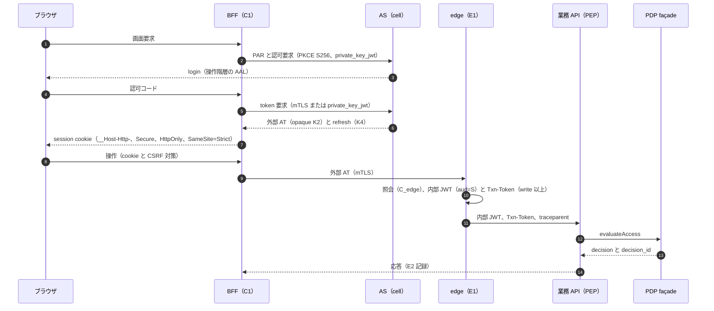

| 項目 | 内容 |
|---|---|
| 適用条件 | 人がブラウザで使う全画面（G-135 の 1・2・20）。第三者が作る SPA は P-07（C4） |
| 主体・認証 | 人（PC-01〜PC-10）。AS で操作階層の AAL（read-sensitive・write は AAL2、privileged/T は AAL2-PR 等。DL-09 §3.1）。step-up は 401 `insufficient_user_authentication`（RFC 9470。OB-10） |
| token・grant・委任 | BFF は C1: authorization_code＋PKCE S256＋PAR、private_key_jwt か mTLS。外部 AT は opaque（ADR-005 D1-7。H-02・H-04 不合格なら K-1 で内部 JWT に切り替わる条件付きの判断）。edge が aud＝呼出し先の内部 JWT に交換（`act` なし）。refresh は client 認証に束縛し AS session に連動 |
| テナント文脈 | 1 token 1 テナント。複数所属（3% [A-015]）はテナント切替で token を取り直す。route テナントは edge が確かめ、PEP が L0 で三者一致 |
| 契約 API | OIDC/OAuth profile（authorize・PAR・token・revocation・back-channel logout。token-profile §11 の版付き profile。CON-00 は OpenAPI を持たない標準 profile として扱う。back-channel logout の契約上の位置は未決（ADR-006 L6-2））／`POST /access/v1/evaluation`（evaluateAccess）・`POST /access/v1/evaluations`（evaluateAccessBatch）／監査スキーマ（CON-08） |
| PEP 配置 | edge（E1）＋業務 API の PP-1（SDK）または PP-2（自前実装） |
| 認可モデル例 | `docs/document#viewer: [core/user, core/group#member] or editor`。操作 `docs.document.read` は read-sensitive、`docs.document.update` は write |
| 整合性 | read-sensitive は `at_least_as_fresh`（内容に保存した consistency token）、write 以上は `fully_consistent` |
| キャッシュ | BFF の session はサーバー側に暗号化して保持。HTTP 応答は read-sensitive 以上で `Cache-Control: private`／`no-store`。allow の cache なし（§3.4） |
| 失効の反映 | 外部経路は毎要求の E1 照会で D_w＋Δ＋C_edge（revocation §6.1）。BFF は RP として back-channel logout（K7）を受けて session を破棄 |
| 失敗時挙動 | §3.3。AS 停止中は既存 session を寿命内で継続（SLI-003）。PDP 不達は 503 |
| 監査 | AS が E3（login）・E5（session）、façade が E1、業務 API が E2。相関 8 欄。write 以上は `txn` 必須 |
| 契約試験・負例 | NP01-1 cookie 属性の欠落を CI で検出／NP01-2 サブドメインからの CSRF の拒否（RFC 10017 は SameSite=Strict だけでは同一 site の他アプリからの CSRF に不十分な場合を述べる [N][^1]（RS-17#3））／NP01-3 ブラウザ storage・URL に token が出ないこと／NP01-4 他 RS 宛て内部 JWT の拒否（RFC 9700 の MUST [N][^7]（RS-17#19））／NP01-5 ID Token を access token として提示した要求の拒否（token-profile §10.2 の NV 系）／NP01-6 他テナント資源への応答が不存在と同一 |
| アンチパターン | localStorage に token を置く SPA（禁止 D-1）／参照実装を使わない BFF の自作（例外審査。ADR-005 D6-2）／同一 site に別アプリを同居させ CSRF 対策を SameSite だけに頼る／token を query string に載せる |
| チェックリスト | ① 参照実装の BFF を使うか例外承認を得た ② cookie 4 属性と CSRF 対策を実装した ③ 業務 API は IC-02 の順で判定する ④ テナント切替で token を取り直す ⑤ logout で refresh を RFC 7009 で失効させる ⑥ 一覧は P-09、ファイルは P-18 を重ねた |
| 関連 | ADR-005、ADR-020、ADR-012／T-011、T-012、T-013、T-014、T-020、T-021／S-01、S-18／K-01、K-11 |

### P-02 ネイティブアプリ・CLI クライアント

**要旨**: OS のブラウザ（外部 user-agent）と PKCE を使い、DPoP で token を端末の鍵に束縛する [D]。ネイティブアプリは embedded user-agent で認可要求を行ってはならず（MUST NOT）、public client は PKCE を実装しなければならない（MUST）[N][^2]（RS-17#6・#7）。

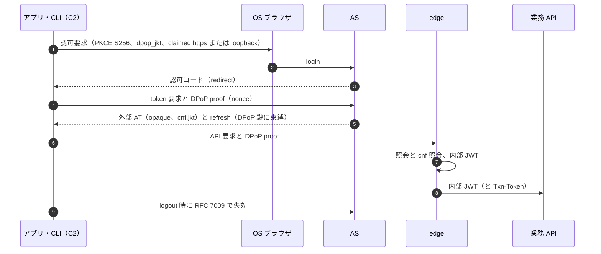

| 項目 | 内容 |
|---|---|
| 適用条件 | モバイル・デスクトップのネイティブアプリ、対話型 CLI（G-135 の 3・4）、利用者端末で動く STDIO の MCP server（ADR-017 D17-28） |
| 主体・認証 | 人。OS ブラウザで AS に認証。WebView 禁止 |
| token・grant・委任 | C2: authorization_code＋PKCE S256。client 認証なし（public）。DPoP＋nonce 必須、`dpop_jkt` でコードを束縛。refresh は DPoP 鍵に束縛（ハードウェア保護鍵を示せない端末は rotation 併用）。F1〜F6 の scope は発行しない。device grant は既定無効（P-23） |
| テナント文脈 | P-01 と同じ。アカウント・テナント切替で token を取り直す |
| 契約 API | OIDC/OAuth profile（authorize・token・revocation）／業務 API 側は P-01 と同じ AuthZEN 呼出し |
| PEP 配置 | edge（E1、DPoP 検証）＋業務 API の PP-1／PP-2 |
| 認可モデル例 | P-01 と同じ。client 種別で権限を変える場合は G 段の条件で表す |
| 整合性 | P-01 と同じ |
| キャッシュ | 端末の token は opaque で毎要求 E1 が照会するため、剥奪の上限に効かない（revocation §6.5） |
| 失効の反映 | E1 が毎要求照会し、E6 が refresh を拒否する。SDK は logout・アカウント切替・アンインストール時に RFC 7009 で refresh を失効させる（RFC 7009 は refresh token の失効の支援を MUST とする [N][^34]（RS-04#69）） |
| 失敗時挙動 | refresh 失敗時は再ログインへ戻し、旧 token を破棄する（RS-17 §5.1）。PDP 不達は §3.3 |
| 監査 | E3・E4・E5 に client 種別と DPoP 鍵の thumbprint 参照。E1・E2 は P-01 と同じ |
| 契約試験・負例 | NP02-1 PKCE なし・plain の拒否（RFC 8252 は PKCE なしの要求を AS が拒否すべき（SHOULD）とする [N][^2]（RS-17#7））／NP02-2 DPoP proof の再送（同一 jti）の拒否／NP02-3 cnf 不一致の拒否／NP02-4 F1〜F6 scope が発行されないこと／NP02-5 静的 client secret を身元の証明として扱わないこと（RFC 8252 の MUST [N][^2]（RS-17#9）） |
| アンチパターン | WebView のログイン画面／アプリへの client secret の同梱／CI・cron で対話用 refresh token を流用する（P-05・P-22 を使う）／token の平文ファイル保存 |
| チェックリスト | ① 外部ブラウザと claimed https（不可なら loopback）② DPoP 鍵を OS の保護領域に生成 ③ logout・切替で revocation ④ 長時間処理は P-14・P-05 の規則に従う |
| 関連 | ADR-005 D4・D6・D7、ADR-020、ADR-006 D6-18／T-006、T-014／S-15、S-18／K-11、K-15 |

### P-03 サービス間の同期呼出し（workload ID＋token exchange）

**要旨**: 呼出し元は mTLS（X.509-SVID）、権限は hop ごとに取り直す aud 1 つの内部 access token、取引は無改変の Txn-Token の 3 点で表す（ADR-009 D09-01・D09-10・D09-32）[D]。RS は自分宛てでない token を拒否しなければならない（MUST）[N][^7]（RS-17#19）。

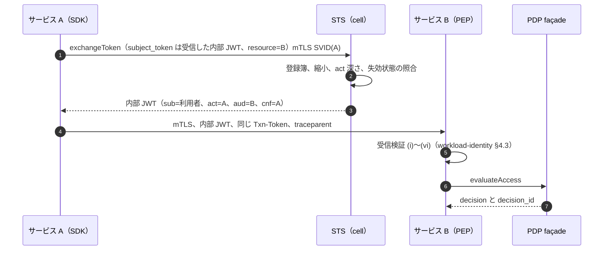

| 項目 | 内容 |
|---|---|
| 適用条件 | 自社サービス間の同期呼出し（REST・gRPC unary・GraphQL・mesh 内。G-135 の 6）。利用者の代理でない内部 M2M も含む |
| 主体・認証 | 呼出し元 workload（SPIFFE ID、X.509-SVID の mTLS）。利用者の代理なら `sub`＝利用者、`act`＝呼出し元 |
| token・grant・委任 | 内部 access token（K3、typ=`at+jwt`、aud＝呼出し先 1 つ、`cnf` x5t#S256）を RFC 8693 で hop ごとに取り直す。RFC 8693 は委任と成りすましを区別する [N][^11]（RS-17#25）。成りすまし（impersonation）は使わない（ADR-017 D17-11）。利用者の代理でない M2M は client credentials＋mTLS（`tls_client_auth`）で refresh なし |
| テナント文脈 | 内部 JWT の `tid` と Txn-Token の `tctx` の tid を一致させ、収容 cell と issuer・署名鍵の cell も照合（W55-12） |
| 契約 API | `POST /token`（exchangeToken、CON-05）／`POST /access/v1/evaluation`（evaluateAccess）・`POST /access/v1/evaluations`（evaluateAccessBatch）／`GET /.well-known/authzen-configuration`（getPdpMetadata） |
| PEP 配置 | 呼出し先の PP-1／PP-2。mesh（層 M）は到達制御であり object 単位の PEP に数えない。GraphQL は resolver だけでなく業務層の認可関数を通す（pep-contract §5） |
| 認可モデル例 | 在庫サービスは自分の資源（`inventory/item`）を判定する。上流の allow や Txn-Token の `scope` を根拠として継承しない（CL-0167） |
| 整合性 | 呼出し元の操作階層を継ぐ（§2.3 規則 3）。write 以上は `fully_consistent` |
| キャッシュ | exchange 済み token は SDK 内で exp まで（§3.4）。証明書の更新前に token を取り直す（RFC 8705 は証明書の更新で束縛 token が無効になるとする [N][^9]（RS-17#22）） |
| 失効の反映 | 内部 JWT はローカル検証のため、失効状態の購読（失効 kid、範囲境界）を無効化しない。STS は派生前に親の jti・sid・grant を照合する（ADR-006 D6-16） |
| 失敗時挙動 | STS 不達なら呼び出さず §3.3 の応答を返す。上流へは 503 を伝播し、独自の迂回をしない |
| 監査 | 呼出し先が E2（相関 8 欄、`act` の連鎖は鍵付き参照）。STS が E4（発行） |
| 契約試験・負例 | workload-identity §10.3 の負例 50 件（規則として 100% 拒否）を必須とする。最低限: NP03-1 他 RS 宛て token／NP03-2 cnf と証明書の不一致（RFC 8705 は 401 `invalid_token` での拒否を MUST とする [N][^9]）／NP03-3 Authorization ヘッダに置いた Txn-Token／NP03-4 Txn-Token の改変・剥ぎ取り／NP03-5 tid と収容 cell の不一致／NP03-6 未登録の呼出し元×呼出し先の exchange／NP03-7 act の深さ超過・循環 |
| アンチパターン | 受け取った内部 JWT の素通し（T-015）／mesh の許可を認可とみなす／Txn-Token の `scope` で業務判定する／共有 API key のサービス間認証 |
| チェックリスト | ① 呼ぶ相手を交換登録簿に申請（O-3）② SDK・sidecar で検証と exchange ③ Txn-Token を読まずに伝播（O-1）④ 業務監査に `txn`（O-5） |
| 関連 | ADR-009、ADR-005 D1-4・D9-3、ADR-022／T-015、T-025、T-037、T-040／S-01、S-07／K-01、K-06 |

### P-04 非同期メッセージの consumer

**要旨**: consumer は処理の直前に、元の主体の権限で PDP に再認可を求める [D]。CloudEvents 1.0.2 は context attributes に機微情報を載せるべきでない（SHOULD NOT）とし [N][^13]（RS-17#32）、主体情報を運ぶ Auth Context 拡張は「純粋に情報提供であり CloudEvents を保護する目的ではない」と自ら述べる [N][^14]（RS-17#33）。

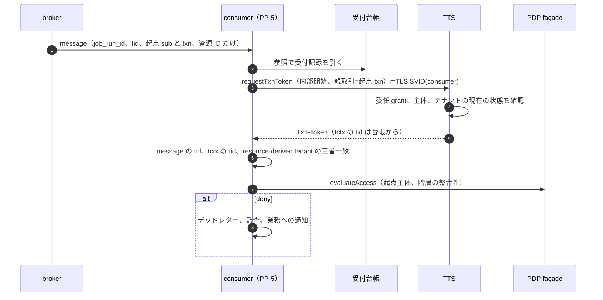

| 項目 | 内容 |
|---|---|
| 適用条件 | キュー・ストリーム・イベントの受信処理（G-135 の 9 の consumer、ADR-026 の A1・A4） |
| 主体・認証 | 実行主体は consumer の workload（SVID）。判定の主体は型ごと（A1 は起点主体＝`sub`・実行主体＝`act`、A4 は D26-10 の型別）。ASVS 5.0.0 の 8.3.3（L3）は中間サービスではなく発端の主体の権限で判定することを求める [N][^15]（RS-17#34） |
| token・grant・委任 | メッセージに token を入れない。実行時に TTS の内部開始フローで Txn-Token を得る（ADR-009 §2.10 P-04） |
| テナント文脈 | DB 文脈は `tctx` の tid から `SET LOCAL`。メッセージの `tid` は受付記録を引く参照で、三者一致しなければ拒否（pep-contract §3.11） |
| 契約 API | `POST /txn-token`（requestTxnToken、CON-05、preview）／evaluateAccess／**ライフサイクル事象の配送（ADR-022 D-2 のイベント配送。契約ファイル未作成）** |
| PEP 配置 | PP-5（consumer の PEP）。型（A1〜A4）の宣言がない consumer は未登録 entry point |
| 認可モデル例 | 請求書発行イベントを受けた通知サービスは、起点主体が `notify/channel#sender` を持つかを実行時に判定する |
| 整合性 | read-sensitive は max(受付時の整合性トークン, 剥奪フェンス)。フェンス有効化までは最新を強制（L06-11）。write 以上は最新 |
| キャッシュ | 判定の cache なし（write 以上）。受付時の判定結果を実行時に使わない |
| 失効の反映 | 実行時の再判定で反映する。剥奪・テナント停止時に該当メッセージを破棄・保留する機能を基盤ライブラリに持つ（ADR-012 D12-34） |
| 失敗時挙動 | PDP・TTS 不達の間、write 以上は実行せず backoff（ADR-026 D26-09）。拒否はデッドレター・監査・通知。黙って捨てず、黙って再試行しない |
| 監査 | E2 に内部開始の `txn` と起点の `txn`（tctx の親取引）を記録。デッドレター送りも E2 |
| 契約試験・負例 | NP04-1 滞留中に剥奪した主体のメッセージの拒否／NP04-2 メッセージ `tid` の改ざんの拒否／NP04-3 メッセージ内の token・role を根拠にしないこと（静的検査）／NP04-4 型宣言のない consumer の配備拒否 |
| アンチパターン | enqueue 時の判定で実行する（T-024）／メッセージに access token を入れる／consumer がサービス権限だけで全テナントのデータを処理する |
| チェックリスト | ① `consume()` で実行直前に再 Check ② 型 A1〜A4 を宣言 ③ デッドレターと通知 ④ (source, id) で冪等に処理（ADR-028 D28-59） |
| 関連 | ADR-026、ADR-012 D12-32〜D12-34、ADR-009／T-024、T-039／S-07／K-17 |

### P-05 長時間・定期ジョブ

**要旨**: ジョブはジョブ用の非人間 ID で実行し、利用者の名で処理する場合は委任 grant を台帳に持ち、実行のたびに利用者の状態を確かめる [D]。Databricks は Run as を service principal に変えるよう推奨し、理由に所有者が去ってもジョブが壊れないことを挙げている [V][^36]（RS-17#27）。

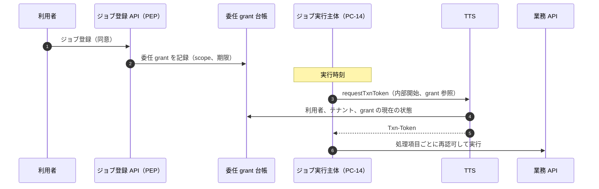

| 項目 | 内容 |
|---|---|
| 適用条件 | バッチ・定期・長時間処理（G-135 の 8、ADR-026 の A2・A3） |
| 主体・認証 | 実行主体はジョブ用 workload（PC-14、SVID）。A2 は代理される利用者（`sub`）、A3 はジョブ主体 |
| token・grant・委任 | 利用者の `offline_access` refresh token をジョブに持たせない（ADR-026）。OIDC Core は offline access に同意を MUST とする [N][^10]（RS-17#24）ので、同意は委任 grant（台帳）で持つ。段ごとに短命 token を新規発行し、寿命を延ばさない。Txn-Token は長時間処理でも短命のままとする（草案 [N][^12]（RS-17#26）） |
| テナント文脈 | TTS が台帳から `tctx` の tid を入れる。ジョブ定義のテナントは不変 |
| 契約 API | requestTxnToken（preview）／exchangeToken（下流が別サービスの場合）／evaluateAccess／ライフサイクル事象の配送（契約未作成） |
| PEP 配置 | PP-5（各実行単位）。ジョブ登録 API は PP-1 |
| 認可モデル例 | `reports/schedule#owner`（人）と `reports/schedule#runner`（PC-14）を分ける。実行時の判定は A2 なら代理される利用者で `reports/dataset#viewer` を見る |
| 整合性 | write 以上は処理項目ごとに `fully_consistent`。read-sensitive は処理単位（件数・時間上限。ADR-012 D12-35 で TBD）ごと |
| キャッシュ | 判定の cache なし。実行時間が R(t) を超えるジョブは I_job(t) ≤ R(t) の間隔で再認可（revocation §6.7） |
| 失効の反映 | 利用者の停止・削除で委任 grant を失効させ、移転しない。所有者（人）の退職の既定は principal-catalog 決裁案 3 (c) を推奨（write 以上は停止、read は期限付き継続）。黙って失敗させない |
| 失敗時挙動 | TTS・PDP 不達は実行を保留して backoff。Tier 3 は Retry-After で再開（ADR-023 D23-11） |
| 監査 | E5（委任 grant の作成・失効）、E2（実行ごと、`txn`・起点 `txn`・grant_ref） |
| 契約試験・負例 | NP05-1 退職者のジョブが停止または移転され、失敗が通知されること（RS-17 §5.3 の 3）／NP05-2 ジョブ定義を改ざんして他テナントを指した実行の拒否／NP05-3 +FIN・+XT 操作が委任ジョブで既定では実行されないこと（K26-4）／NP05-4 Txn-Token の寿命が提示 token を超えないこと |
| アンチパターン | 作成者本人の権限で動くジョブ（主要製品の既定。RS-17#27・#28）／長寿命 refresh token の保存／所有者不在のジョブの放置 |
| チェックリスト | ① 型 A2／A3 を宣言 ② 所有者・実行主体・代理される利用者を分けて記録 ③ 退職時の既定を設定 ④ 出力を URL で配るなら P-18 |
| 関連 | ADR-026、ADR-009、ADR-017 D17-04／T-039、T-053／S-07／K-17 |

### P-06 Webhook の送受信

**要旨**: 受信は edge で送信元を認証してから PEP を通す entry point とし、送信は配信直前に購読者の権限を再 Check して署名する（ADR-012 D12-36、ADR-009 §2.10）[D]。署名方式は research で未調査とされていた（ADR-009 §2.10 P-06）ため、本書で RFC 9421（HTTP Message Signatures、Proposed Standard、2024-02）の原典を取得した [N][^33]。同 RFC は、署名は対象部分の完全性を与えるが機密性は与えず、TLS の必要性を否定しないと述べる [N][^33]（§7.1.2）。

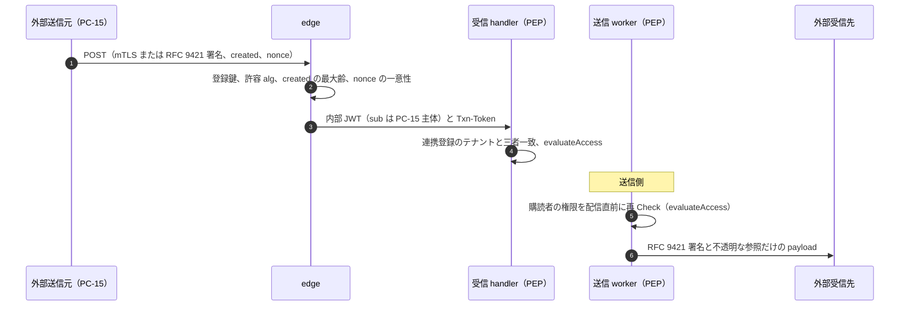

| 項目 | 内容 |
|---|---|
| 適用条件 | 外部からの HTTP 通知の受信、外部への通知の送信（G-135 の 10） |
| 主体・認証 | 受信: 送信元を PC-15（外部連携主体）として登録し、mTLS（RFC 8705）か RFC 9421 の非対称署名で認証する。送信: 自社の送信 worker（PC-14）が署名する |
| token・grant・委任 | 受信は edge が送信元主体の内部 JWT と Txn-Token を発行する（ADR-009 §2.10 P-06）。送信先が OAuth を要求する場合は P-21 |
| テナント文脈 | 受信: 連携登録（1 テナントに束縛）から tid を決める。payload の tid は参照であり、登録と一致しなければ拒否。送信: 購読は 1 テナントに束縛 |
| 契約 API | 受信 handler・送信 worker とも evaluateAccess／監査スキーマ。**Webhook 署名 profile は 11_contracts に未作成**（KD64-1 の決裁後に DL-69 へ追加） |
| PEP 配置 | edge（送信元認証）＋PP-5（受信 handler・送信 worker） |
| 認可モデル例 | `integrations/subscription#owner` を持つ主体が、対象資源（例: `orders/order#viewer`）のイベント受信権を持つかを配信直前に判定する |
| 整合性 | 送信の再 Check は read-sensitive として `at_least_as_fresh`（フェンス有効化までは最新）。受信後の write は `fully_consistent` |
| キャッシュ | 送信元の公開鍵は (送信元, keyid) で cache。判定の cache なし |
| 失効の反映 | 購読者の剥奪後は配信しない（直前の再 Check）。送信元の連携停止で受信を拒否 |
| 失敗時挙動 | 受信で PDP 不達なら 503（送信元の再送に委ねる）。送信は backoff、上限超過はデッドレターと購読者への通知 |
| 監査 | 受信: E2（送信元主体、署名検証の結果、`txn`）。送信: E2（配信の判定、decision_id） |
| 契約試験・負例 | NP06-1 署名なし・未登録鍵・許容外 alg の拒否（RFC 9421 は許容集合にない alg が選ばれた場合に検証を失敗させる [N][^33]（§3.2））／NP06-2 `created` が最大齢を超えた要求と `nonce` の再利用の拒否（RFC 9421 は再送対策として nonce と作成・期限の時刻を挙げる [N][^33]（§7.2.2））／NP06-3 payload の tid が連携登録と異なる要求の拒否／NP06-4 剥奪後の購読者へ配信されないこと／NP06-5 許可リスト外の送信先（SSRF）を持つ購読登録の拒否 |
| アンチパターン | 署名検証の前に payload を処理する／payload に個人データ・token を入れる（CloudEvents の SHOULD NOT [N][^13]）／全テナント共通の webhook secret／検証失敗の詳細を返す |
| チェックリスト | ① 送信元を PC-15 として登録 ② 署名方式を KD64-1 に従う ③ 受信は edge 経由だけ（網で直接到達を遮断）④ 送信は配信直前に再 Check ⑤ payload は不透明な参照 |
| 関連 | ADR-009 §2.10、ADR-012 D12-36、ADR-026／T-016、T-018、T-024／S-01／K-08 |

### P-07 第三者連携アプリ（外部 OAuth client）

**要旨**: 第三者アプリは、登録審査、テナント管理者の承認、細粒度で短命の token、既存 grant の棚卸しと一括失効を、それぞれ独立した統制として持つ [D]。Microsoft Entra は、同意設定の変更は今後の同意にしか影響せず既存の grant は残ると明記している [V][^24]（RS-17#62）。

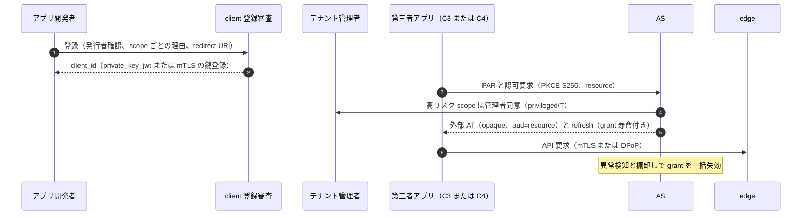

| 項目 | 内容 |
|---|---|
| 適用条件 | 第三者・顧客自作のアプリが利用者の同意で自社 API を呼ぶ（G-135 の 16）。本基盤を OP とする外部 RP（C6）も含む |
| 主体・認証 | アプリ: C3（confidential、private_key_jwt か mTLS、新規 client_secret 不可）か C4（ブラウザ内、受容票付きの低リスク scope）。利用者: AS で認証 |
| token・grant・委任 | 外部 AT は opaque。refresh は client 認証に束縛（C3）か DPoP＋rotation（C4）。利用者本人が同意できるのは検証済み発行者の低リスク scope に限る（token-profile §6）。層 F（F1〜F6）は FAPI 2.0（ADR-020） |
| テナント文脈 | grant は 1 テナント。複数テナントで使うアプリはテナントごとに承認と grant を持つ |
| 契約 API | OIDC/OAuth profile（PAR・authorize・token・revocation）／SSF（高リスク scope のアプリは受信者として `POST /ssf/stream`（createStream）・`POST /ssf/verify`（requestVerification）・`POST /ssf-receiver/{binding_id}/events` 相当の受信。K6-3 の決裁で契約条件化）／監査 |
| PEP 配置 | edge（E1）＋業務 API の PP-1／PP-2 |
| 認可モデル例 | 判定は利用者の権限 ∧ grant の scope ∧ テナントの許可の積。GitHub App も利用者・アプリ・インストール先の 3 条件の積で資源を限る [V][^39]（RS-17#59） |
| 整合性 | 業務 API 側は操作階層どおり |
| キャッシュ | edge の照会 cache（C_edge）だけ |
| 失効の反映 | grant の失効は E1 で毎要求反映。高リスク scope・session 保持のアプリは SSF の session-revoked・account-disabled か Back-Channel Logout を受信する（revocation §6.10） |
| 失敗時挙動 | §3.3。アプリ側の再試行は Retry-After と quota（SLI-037）に従う |
| 監査 | E5（同意・grant の作成・失効）、E6（client 登録・scope 変更）、E1・E2（client_id を含む） |
| 契約試験・負例 | NP07-1 同意設定の変更後も残る既存 grant を棚卸しで検出し一括失効できること／NP07-2 他テナントの grant による要求の拒否／NP07-3 未承認 scope が発行されないこと／NP07-4 redirect URI の完全一致以外の拒否（RFC 9700 の MUST [N][^7]）／NP07-5 外部 AT を内部 RS に直接提示した要求の拒否（K2 は edge 以外で受けない） |
| アンチパターン | 発行者の検証バッジを品質保証とみなす（Microsoft は検証バッジが認証取得・業界標準への準拠などの品質基準を意味しないと明記している [V][^44]（RS-17#64））／長寿命の OAuth app token／将来の機能のための scope |
| チェックリスト | ① 登録審査を通す ② 管理者承認の画面を用意 ③ grant 棚卸しの周期（TBD、ADR-005 D7）を設定 ④ 一括失効の手順を演習 |
| 関連 | ADR-005 D7、ADR-006 D6-26、ADR-020／T-007、T-069、T-070／S-15／K-14、K-15 |

### P-08 AI エージェント・tool 呼出し

**要旨**: エージェントは認証・監査・棚卸しでは独立主体（PC-16）、利用者のための認可は委任（`sub`＝利用者、`act`＝エージェント）で表し、tool 呼出しごとに tool 側の PEP が判定する（ADR-017 D17-06・D17-16）[D]。MCP 2026-07-28 版は、client に RFC 8707 の `resource` を MUST、server に自分宛て token の検証を MUST とし、他の token の受入れ・中継を MUST NOT とする [N][^25]（RS-17#67・#68）。MCP が基礎とする OAuth 2.1 は draft-ietf-oauth-v2-1-13 である [N][^25]（RS-17#70）。最新版 -16（2026-09-03）も WG Document で IESG 未提出の Internet-Draft である [N][^45]（RS-17#70、standards-status SS-B01）。このため P-08 の基盤契約は OAuth 2.1 草案に依存させない（ADR-017 D17-26）[D]。

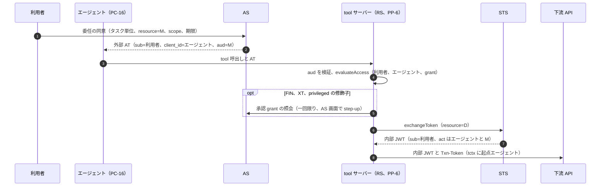

| 項目 | 内容 |
|---|---|
| 適用条件 | 自社・顧客側・第三者のエージェントが API・tool を呼ぶ。自サービスが tool サーバー（MCP server を含む）になる（G-135 の 18） |
| 主体・認証 | エージェントは 1 主体 1 SPIFFE ID 1 テナント（NC-1）。委任動作は C8（委任元の種別）、自律動作は別 client_id・別 scope 集合（write を上限、privileged・break-glass を含めない。D17-10） |
| token・grant・委任 | tool サーバーごとに `resource` を指定した token（D17-15）。RFC 8707 は AS が `resource` の示す資源に audience を絞るべき（SHOULD）とする [N][^40]（RS-17#67）。下流は exchange で取り直し、`act` を入れ子にする（D17-18）。委任 grant はタスク単位で縮小し絶対寿命を付ける（D17-17・D17-43）。impersonation と利用者の秘密の受渡しは禁止（D17-11）。ID-JAG による企業管理の認可は v1 の契約に入れない（D17-30） |
| テナント文脈 | エージェント主体は 1 テナント。+AGT の要求には操作階層によらず Txn-Token を発行（D17-19） |
| 契約 API | OIDC/OAuth profile（authorize・token、RFC 8707・RFC 9728）／exchangeToken／evaluateAccess／監査 |
| PEP 配置 | PP-6（tool サーバー内 PEP）。判定はエージェント・LLM の実行環境の外で行う（D17-35） |
| 認可モデル例 | tool 目録に tool ごとの「操作種別×資源型×作用範囲」、操作階層、修飾子（+FIN・+XT・+SEC）を登録（D17-14）。許可は利用者の権限 ∧ grant ∧ 自律度区分 ∧ tool の要件の論理積 |
| 整合性 | write 以上は呼出しごとに `fully_consistent`。read-sensitive の取得は P-09 の一覧ヘルパ経由 |
| キャッシュ | token をエージェントのコンテキスト（プロンプト）に入れない（data-outside-pep §7）。判定の cache なし（write 以上） |
| 失効の反映 | 停止の単位はエージェント主体・定義・所有者・tool サーバー・委任元の 5 種（D17-37）。委任元の停止で全委任を失効 |
| 失敗時挙動 | 承認 grant の発行・検証に届かなければ、承認を要する tool 呼出しを拒否（D17-25）。grant の scope が足りない呼出しは拒否し、エージェントは委任の同意（AS 画面）からやり直す。tool サーバー側で scope を補ったり、別の token に切り替えたりしない（RS-17 §5.1 の P-08 行、D17-15）。PDP 不達は §3.3 |
| 監査 | 相関 8 欄に加え起点エージェント主体（`tctx`。欄名は **未決（ADR-017 L17-2）**）。Txn-Token・access token・承認 grant の全文は残さない（D17-48） |
| 契約試験・負例 | NP08-1 他 audience の token の拒否（tool サーバーと下流の両方）／NP08-2 上流 token の中継の検出・拒否（MCP Security Best Practices は token passthrough を anti-pattern とする [N][^26]（RS-17#69））／NP08-3 状態ハンドルだけでのアクセスの拒否（同文書の MUST NOT [N][^26]）／NP08-4 エージェント UI の確認だけで +FIN が実行されないこと（T-074）／NP08-5 自律 client による privileged scope の要求の拒否／NP08-6 量の上限超過で停止すること（D17-36） |
| アンチパターン | エージェント内 UI の確認を承認とみなす（D17-23）／外部内容を読む tool と +XT・+FIN の tool を同じ grant に入れる（D17-38）／基盤契約を MCP の版に依存させる（D17-26） |
| チェックリスト | ① tool 目録を登録 ② tool サーバーを RS として登録し RFC 9728 を実装 ③ 下流は exchange ④ 承認 grant を AS 画面で取得 ⑤ リトリーブは P-09 |
| 関連 | ADR-017、ADR-009、ADR-006 D6-22／T-072、T-073、T-074、T-075／S-14／K-16 |

### P-09 一覧・検索

**要旨**: 一覧・検索の認可根拠は返却直前のページの post-check だけとし、列挙・検索・ACL 反映索引は候補の生成器にする（ADR-025 D25-04）[D]。AuthZEN 1.0 の search は結果が evaluation で許可になることを保証せず、ページングも原子的なスナップショットを保証しない [N][^17]（RS-17#45）。

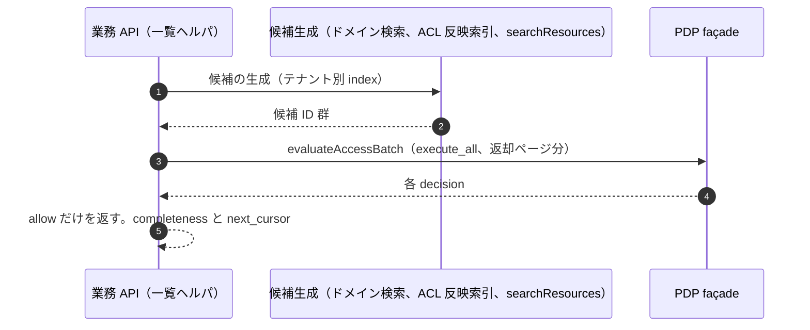

| 項目 | 内容 |
|---|---|
| 適用条件 | 主体に「見られる資源の集合」を返す全操作（一覧、全文検索、ファセット、自動補完、件数、集計、エージェントのリトリーブ。ADR-025 D25-01）。全件取得・eDiscovery・export は P-10 |
| 主体・認証 | 主パターンに従う |
| token・grant・委任 | 主パターンに従う |
| テナント文脈 | 候補生成はテナント別 index・collection（ADR-012 D12-26）。候補の段でもテナントを越えない |
| 契約 API | `POST /access/v1/evaluations`（evaluateAccessBatch、`execute_all`）／`POST /access/v1/search/resource`（searchResources、preview、SDK の一覧ヘルパ内部専用。依存サービスの直接呼出しは CI と façade で拒否。D25-03）／`GET /v1/tenants/{tenant_id}/relationship-changes`（listRelationshipChanges。ローカル索引を作る場合） |
| PEP 配置 | PP-1 の `list()`（一覧ヘルパ） |
| 認可モデル例 | 資源型ごとに方式を宣言する。対象が多く割合が低い型（Google Drive 型）は「changes API のローカル索引＋最後の Check」（OpenFGA の推奨 [V][^18]（RS-17#43））、対象が少ない型は search を候補生成に使う |
| 整合性 | post-check は read-sensitive の `at_least_as_fresh`（フェンス有効化までは最新） |
| キャッシュ | 一覧結果・件数を主体をまたいで cache しない。索引は候補だけ |
| 失効の反映 | 索引の遅延 L_idx は post-check で吸収する（索引に残っても返さない）。剥奪直後に結果へ出続ける時間を実測する（RS-17 §5.3 の 4） |
| 失敗時挙動 | post-check ができなければ空の一覧ではなく「利用不可」（D25-19）。打切りは `completeness=incomplete` と理由（D25-07・D25-21） |
| 監査 | E1 は façade が判定ごと、E2 はページ単位（decision_id を複数記録） |
| 契約試験・負例 | NP09-1 剥奪直後の検索結果に出ないこと／NP09-2 件数・ファセット・自動補完から見えない資源を推測できないこと（総件数は返さない。D25-13）／NP09-3 打切りを「完全」と返さないこと／NP09-4 searchResources の直接呼出しの拒否／NP09-5 ページング中の変更で他テナント資源が混入しないこと |
| アンチパターン | ListObjects の結果をそのまま返す／総件数を返す／cursor で全件を辿る（P-10 として扱う。D25-02） |
| チェックリスト | ① 資源型の方式（L1〜L3）を model registry に宣言 ② 一覧ヘルパ以外で列挙しない ③ 「利用不可」「不完全」を UI に表示 |
| 関連 | ADR-025、ADR-010、ADR-012 D12-26／T-031、T-076、T-078／S-01／K-03 |

### P-10 エクスポート・大量読取り

**要旨**: テナント全体・フォルダ全体の取得と export は一覧ヘルパの対象外とし、privileged/T の別経路（二者承認、発行の記録、検知）で扱う（ADR-025 D25-02、data-outside-pep PX-06）[D]。正規資格情報による大量 export は予防できず、検知に頼る（T-079）[D]。

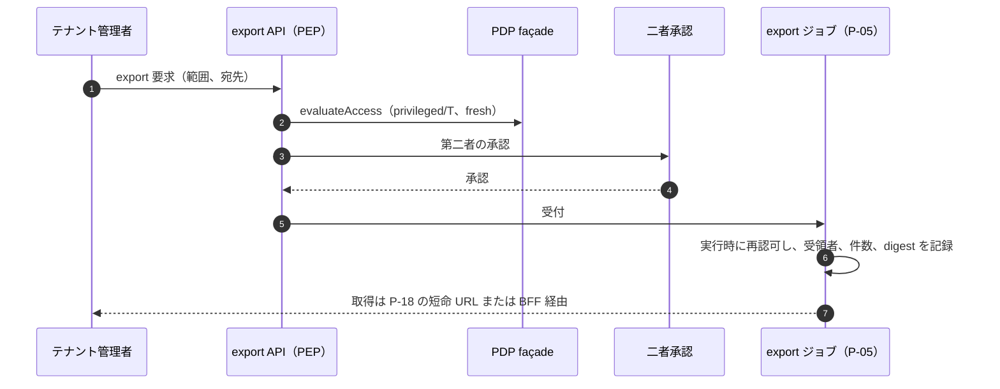

| 項目 | 内容 |
|---|---|
| 適用条件 | テナント全体・大量の読取り、export、eDiscovery（G-135 の 11・13 に重ねる付加パターン） |
| 主体・認証 | テナント管理者（privileged/T、AAL2-PR）。事業者要員は P-11 |
| token・grant・委任 | 要求は主パターンの token。実行は P-05 |
| テナント文脈 | export は自テナントだけ（CUS・PII）。PCI・SEC は export 不可（data-outside-pep PX-06） |
| 契約 API | evaluateAccess（privileged）／`POST /v1/relationship-exports`（createRelationshipExport。認可関係データの出口、ADR-018 の EIF）・`GET /v1/relationship-exports/{job_id}`（getRelationshipExport）／requestTxnToken |
| PEP 配置 | PP-1（export API）＋PP-5（ジョブ） |
| 認可モデル例 | `core/tenant#admin` ∧ 保護操作の再認証 ∧ 二者承認の型付き例外 |
| 整合性 | `fully_consistent` |
| キャッシュ | なし |
| 失効の反映 | 実行時の再認可。出力の配布は P-18 の寿命上限 |
| 失敗時挙動 | 拒否（privileged は fail-closed） |
| 監査 | E6・E7（テナント全体の export、ADR-028 D28-48）、E2。export の要求は即時警報の対象（T-079） |
| 契約試験・負例 | NP10-1 二者承認なしの export の拒否／NP10-2 一覧ヘルパの cursor で全件を辿る挙動の検知（D25-02）／NP10-3 CB-TC-10（約 3 分の一括取得の再現）での検知と遮断 |
| アンチパターン | 通常の一覧 API で大量取得を許す／export の宛先を任意の URL にする |
| チェックリスト | ① export を privileged/T として台帳化 ② 受領者・件数・digest を記録 ③ FA-14 の検知入力に発行記録を供給 |
| 関連 | ADR-012、ADR-014、ADR-018、ADR-028／T-077、T-079／S-09／K-05、K-15 |

### P-11 管理コンソール・support tool

**要旨**: 事業者要員は常設の権限を持たず、チケットに結び付いた昇格 grant と顧客承認でだけアクセスし、特権を通常の認可 graph に混ぜない（ADR-029 D29-02・D29-10）[D]。Microsoft の Customer Lockbox は、顧客が 12 時間以内に承認しなければ要求を失効させ、承認後のアクセスを最大 4 時間で自動的に取り消す [V][^27]（RS-17#75）。

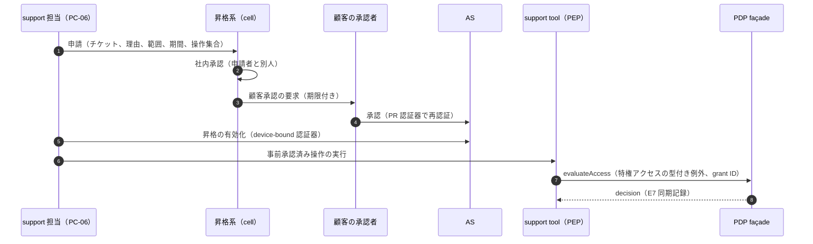

| 項目 | 内容 |
|---|---|
| 適用条件 | 顧客管理者の管理コンソール、事業者の support tool・コールセンター、運用者の調査用読取り（G-135 の 19。G-135 の 20 の管理操作） |
| 主体・認証 | 顧客管理者（PC-04・PC-05、privileged/T、AAL2-PR、保護操作の再認証）。support（PC-06）は昇格時に device-bound 認証器（同期型 passkey を除く、AAL3 相当。D29-24）。管理 tool は管理下の support 端末からだけ到達（D29-46） |
| token・grant・委任 | SL4 の操作は顧客管理者を `sub`、support 担当を `act` とする token（D29-50）。impersonation は提供しない（D29-51）。昇格 grant は基盤所有の特権 grant ストアに置く（D29-10） |
| テナント文脈 | 昇格 grant は 1 テナント・資源範囲・アクセス元法域を持つ（D29-90）。三者一致の例外は ADR-024 D24-09 の規則で表す |
| 契約 API | OIDC/OAuth profile／evaluateAccess（特権アクセスの型付き例外。ADR-011 D3-5）／監査（E7） |
| PEP 配置 | 顧客管理コンソールは PP-1。support tool は PP-1（support 経路として分離。D29-40） |
| 認可モデル例 | テナント store・CAM に事業者要員を subject とする tuple、全テナントの wildcard、super-admin を置かない（D29-12）。判定は昇格 grant ∧ 操作集合（JEA 型）∧ 期限 ∧ 法域 |
| 整合性 | `fully_consistent`（privileged） |
| キャッシュ | なし |
| 失効の反映 | 昇格 grant は時間上限・ケース終了・取消し・承認者の無効化・S8a の発動で失効（D29-25） |
| 失敗時挙動 | 昇格系・特権 grant ストア・PDP・監査の同期記録のどれかに届かなければ拒否（D29-102）。障害中の受付は Tier X（NX-09） |
| 監査 | E7（昇格 grant ID・チケット・承認者・実行した操作）を同期記録、顧客向け監査 API で開示（D29-36）。E6（管理変更） |
| 契約試験・負例 | NP11-1 期限後のアクセスの拒否／NP11-2 承認なしの昇格の拒否／NP11-3 同一人物による申請と承認の拒否／NP11-4 事前承認済み集合外の操作（任意 query）の拒否／NP11-5 許可法域外からの昇格の拒否／NP11-6 E7 の記録率（K-21） |
| アンチパターン | 常設の本番特権／support が利用者として振る舞う impersonation／support 経路と通常経路の資格情報の共有／エージェント（PC-16）による昇格の申請・承認（D29-03） |
| チェックリスト | ① 操作集合を二者レビューで登録 ② 顧客承認の設定 ③ 監査の顧客開示 ④ 添付の無害化（D29-41） |
| 関連 | ADR-029、ADR-008、ADR-011 D3-5／T-046、T-049／S-04、S-09／K-09、K-12 |

### P-12 B2B 顧客 IdP との federation

**要旨**: federation は cell の自社 AS で終端し、RP 起点に限る（ADR-004）[D]。依存サービスは顧客 IdP の assertion を受けず、本基盤が発行した token だけを受ける [D]。linking は（テナント、上流 IdP、外部 subject）の 3 つ組だけで行い、email による結合を禁止する（ADR-004、ADR-021）[D]。Keycloak の公式文書は、同じメールアドレスの既存アカウントへの自動リンクを潜在的なセキュリティホールと述べる [V][^32]（RS-17#78）。

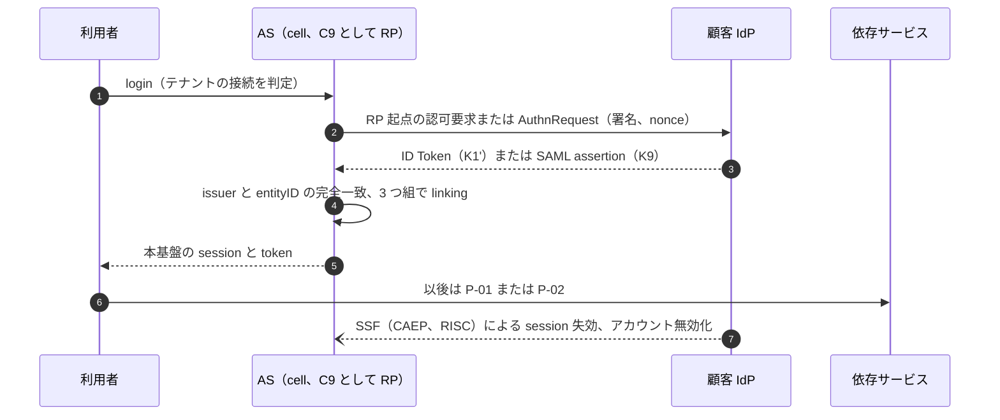

| 項目 | 内容 |
|---|---|
| 適用条件 | 顧客企業の IdP（SAML／OIDC）で利用者を認証する（G-135 の 22）。基盤の機能であり、依存サービスは直接実装しない |
| 主体・認証 | 顧客 IdP の利用者。認証強度は顧客 IdP の acr を接続設定に従って受け入れる（ADR-002、ADR-004） |
| token・grant・委任 | K1'（上流 ID Token）・K9（SAML assertion）は AS の adapter の外へ渡さない。依存サービスへは本基盤の token だけ |
| テナント文脈 | 接続はテナントに束縛。他テナントの IdP の assertion による文脈の取違え（IdP mix-up）を issuer の完全一致で防ぐ |
| 契約 API | OIDC/OAuth profile（C9 の RP 側）／SSF 受信（`/ssf-receiver/{binding_id}/events` の receivePushedSet、`POST /ssf/verify`）／監査 |
| PEP 配置 | AS の federation adapter（依存サービスは対象外） |
| 認可モデル例 | 顧客 IdP のグループ claim を role に直接写さず、P-13 の SCIM か JIT の属性写像を経由して `core/group` に反映 |
| 整合性 | — |
| キャッシュ | 上流 IdP の metadata・JWKS は接続台帳の版で管理 |
| 失効の反映 | 顧客 IdP からの CAEP・RISC の受信で session を失効（ADR-006 D6-23）。顧客 IdP 側の遅延は基盤の R と分けて計る |
| 失敗時挙動 | 顧客 IdP 停止中はその接続の新規 login 不可。既存 session は寿命内で継続。顧客の緊急管理者（PC-08(b)）の扱いは principal-catalog 決裁案 4 |
| 監査 | E3（上流 issuer、接続 ID）、E6（接続設定・証明書の変更） |
| 契約試験・負例 | NP12-1 email 一致による自動 linking の拒否（T-063）／NP12-2 IdP 起点 SAML の unsolicited response の拒否（新規接続）／NP12-3 他テナントの IdP の assertion の拒否（T-061）／NP12-4 未登録の証明書による署名の拒否（T-065） |
| アンチパターン | 依存サービスが顧客 IdP と直接 federation する／email をキーにした結合／IdP 起点 SAML の新規受付 |
| チェックリスト | 依存サービス側: ① 顧客 IdP の token を受けない ② 利用者識別に email を使わない（ADR-021） |
| 関連 | ADR-004、ADR-021、ADR-006 D6-23／T-061〜T-068／S-03／K-13 |

### P-13 SCIM による provisioning・deprovisioning

**要旨**: 顧客 IdP から本基盤への SCIM 2.0 受信で、利用者・グループのライフサイクルを反映する（ADR-004、DL-76）[D]。無効化・削除は cell の Tier 0 の入力経路で処理し、control plane が止まっても剥奪が反映されるようにする（ADR-023 D23-21）[D]。

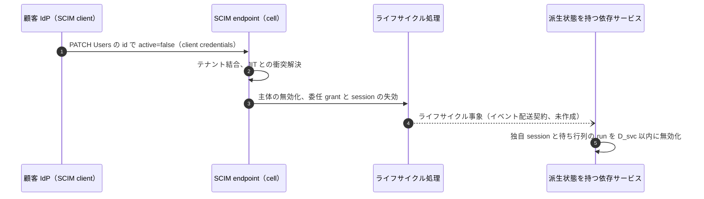

| 項目 | 内容 |
|---|---|
| 適用条件 | 顧客 IdP から利用者・グループを同期する（G-135 の 22） |
| 主体・認証 | SCIM client は顧客ごとの OAuth client（client credentials、`oauthClientCredentials`）。client 認証は非対称（private_key_jwt か mTLS）、scope は SCIM 専用（D04-40）。静的 bearer は受容票のある接続だけの期限付き例外（NA-004-2 の比率で件数を見積もる） |
| token・grant・委任 | SCIM 用の token は SCIM endpoint だけに有効（aud を限る） |
| テナント文脈 | SCIM client は 1 テナントに束縛。他テナントの User・Group を指す要求を拒否 |
| 契約 API | `GET/POST /Users`（listUsers・createUser）、`GET/PUT/PATCH/DELETE /Users/{id}`（getUser・replaceUser・patchUser・deleteUser）、`/Groups` 系（listGroups・createGroup・getGroup・replaceGroup・patchGroup・deleteGroup）、`/Users/.search`（searchUsers）、discovery（getServiceProviderConfig ほか）。`/Bulk`・`/Me` は 501（bulkNotSupported・meNotSupported）／ライフサイクル事象の配送（未作成） |
| PEP 配置 | SCIM endpoint の PEP（基盤側） |
| 認可モデル例 | SCIM の Group は `core/group` に写し、member を tuple にする（writeRelationships は基盤内部） |
| 整合性 | 無効化・削除は剥奪書込として内容変更より先に確定（authorization-model §11） |
| キャッシュ | — |
| 失効の反映 | 無効化から全経路の拒否までは R(t, c)（SLI-050〜SLI-052）。独自 session を持つ依存サービスはライフサイクル事象で D_svc(t) 以内に無効化（revocation §6.10） |
| 失敗時挙動 | 無効化・削除の入力は Tier 0 で受け付け続ける。追加・変更は CP 停止中は受付保留 |
| 監査 | E6（SCIM による変更、前後値は保護欄） |
| 契約試験・負例 | NP13-1 他テナントの資源を指す SCIM 要求の拒否（T-060）／NP13-2 窃取を想定した SCIM 資格情報の失効後の拒否（T-058）／NP13-3 deprovision 後に JIT で再有効化されないこと（T-059）／NP13-4 依存サービスの独自 session が D_svc 以内に無効化されること |
| アンチパターン | 依存サービスが顧客 IdP から直接 SCIM を受ける／無効化を control plane 経由だけで処理する |
| チェックリスト | 依存サービス側: ① 独自 session・派生状態があればライフサイクル事象を受信 ② 主体の状態を自前で複製しない |
| 関連 | ADR-004、ADR-023 D23-21、ADR-006 D6-25／T-058、T-059、T-060／S-07／K-17 |

### P-14 ストリーム接続（WebSocket・gRPC streaming・push）での失効反映

**要旨**: 接続確立時の認可だけでは剥奪が反映されない前提で、最大存続時間、失効状態の購読による切断、メッセージ単位の再認可の 3 つを組み合わせる（ADR-006 D6-14）[D]。ASP.NET Core SignalR は、どの認証方式でも接続中に利用者を自動では再検証しないと明記している [V][^23]（RS-17#53）。

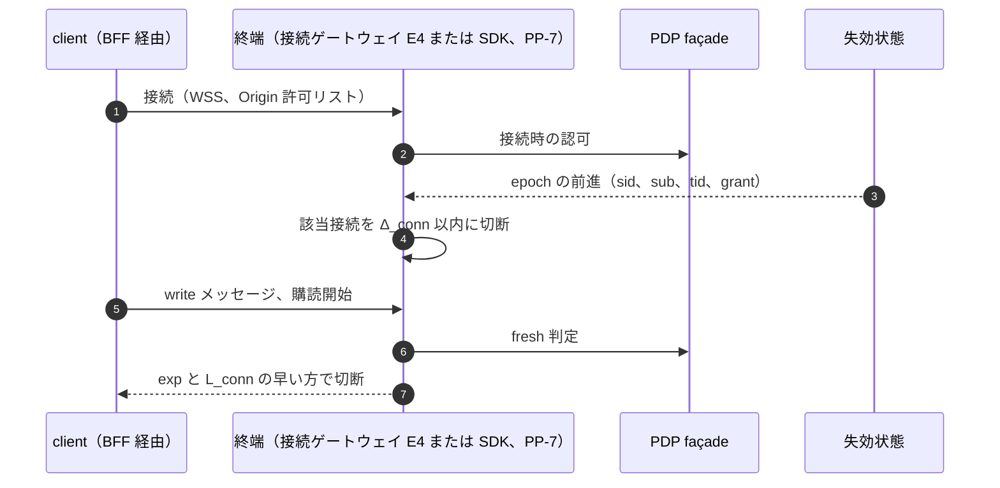

| 項目 | 内容 |
|---|---|
| 適用条件 | WebSocket・SSE・gRPC streaming・長時間 download・push 通知（G-135 の 15） |
| 主体・認証 | 接続確立は主パターン（P-01・P-02・P-03）の token。ブラウザは BFF 経由 |
| token・grant・委任 | token を URL の query に載せない（SignalR はブラウザで query string を使い、多くのサーバーが記録すると注意している [V][^23]（RS-17#54））。push 通知の payload に個人データ・token を入れず、本文は API 経由（PEP）で取得させる |
| テナント文脈 | 接続は 1 テナント。購読ごとに三者一致 |
| 契約 API | 接続確立は主パターンの契約／evaluateAccess（接続・購読・メッセージ）／失効状態の配布（SDK 内部） |
| PEP 配置 | PP-7（接続と購読を別々に数える）。終端を基盤の E4 に寄せるかは **未決（revocation KA9-2）** |
| 認可モデル例 | `chat/channel#member` を接続時と購読開始時に判定し、read-sensitive の配信は I_conn(rs) ごとに再判定 |
| 整合性 | write 以上のメッセージ・購読開始は `fully_consistent`。read-sensitive は I_conn(rs) ごと |
| キャッシュ | 接続中に認可を保持しない（期限と epoch で切る） |
| 失効の反映 | RFC 6455 は handshake での client 認証方法を規定しない [N][^22]（RS-17#51）ので、認可は本パターンの SDK 側で持つ。最大存続 min(exp, L_conn(t))、失効購読で Δ_conn 以内に切断。Amazon API Gateway の接続上限 2 時間 [V][^37]（RS-17#55）は剥奪の上限として当てにしない |
| 失敗時挙動 | PDP 不達時は新しい購読・write を拒否。失効状態が M_rev を超えて古ければ read-sensitive 以上の配信を止める |
| 監査 | E2（接続・購読・切断の理由）。切断は剥奪事象の `txn` と相関 |
| 契約試験・負例 | NP14-1 剥奪から切断までの時間（p50／p99／最大）の実測（TC-ARC09-07）／NP14-2 役割変更後の旧権限での呼出しの拒否／NP14-3 Origin 許可リスト外の handshake の拒否（ASVS 5.0.0 V4.4 の L2 要件 [N][^38]（RS-17#52））／NP14-4 query string の token の拒否 |
| アンチパターン | 接続時の認可だけで運用する（T-019）／製品の接続上限を剥奪上限とみなす／push 本文に機微情報を入れる |
| チェックリスト | ① 期限切断を有効化（SignalR は `CloseOnAuthenticationExpiration`）② 失効購読 ③ メッセージ単位の再認可 ④ BFF 経由・WSS |
| 関連 | ADR-006 D6-14、ADR-012 D12-36／T-019、T-032／S-07／K-17 |

### P-15 データ基盤への持出し（DWH・ML・検索インデックス）

**要旨**: PEP 外の経路は台帳に載ったものだけを存在させ、利用者へ返らない経路はテナント単位の区画と JIT の特権資格情報に閉じ込める（data-outside-pep §0.1）[D]。製品の行・列統制は二層目として使い、PEP の代わりにしない [D]。PostgreSQL では BYPASSRLS ロール・owner・参照整合性検査が RLS を迂回し [V][^16]（RS-17#36）、BigQuery の row-level security は query duration による side-channel に弱い可能性がある [V][^41]（RS-17#37）。

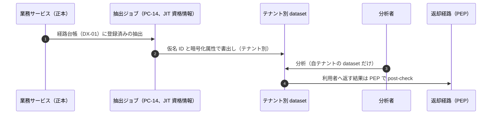

| 項目 | 内容 |
|---|---|
| 適用条件 | DWH・ETL・CDC・ML の学習と推論・検索索引の構築（G-135 の 11） |
| 主体・認証 | 抽出は PC-14 の workload（SVID）と JIT の特権資格情報。分析者は人（privileged/T 相当の扱いはデータ分類による） |
| token・grant・委任 | 抽出ジョブは P-05。分析基盤への login は P-01 |
| テナント文脈 | テナント間の境界は dataset・index・collection の分離で担い、行ポリシーはテナント内の細粒度だけに使う（ADR-012 D12-22・D12-26・D12-28） |
| 契約 API | requestTxnToken（抽出ジョブ）／evaluateAccessBatch（返却時の post-check）／`POST /v1/relationship-exports`（認可関係の写しを作る場合。PX-10）／ライフサイクル事象の配送（削除伝播。未作成） |
| PEP 配置 | 返却経路の PP-1（RM-1・RM-2）。返らない経路は区画と JIT（RM-3） |
| 認可モデル例 | 分析結果を利用者に返す場合は、結果に含まれる資源ごとに `domain/resource#viewer` を post-check |
| 整合性 | 返却時の post-check は read-sensitive の `at_least_as_fresh` |
| キャッシュ | 写しは PX-09・PX-10 の扱い。判定結果を持ち出さない |
| 失効の反映 | ACL 反映遅延 L_idx と削除伝播時間 Del(p) は TBD（TC-057-01〜06 で実測） |
| 失敗時挙動 | 非対応の経路からはデータを返さない。Databricks は row filter・column mask に対応しない runtime から読むとデータを返さない [V][^43]（RS-17#39）。同じ fail securely を要件にする |
| 監査 | E7（JIT 資格情報の発行と利用）、E2（返却経路）、削除の完了報告 |
| 契約試験・負例 | NP15-1 迂回できる主体（BYPASSRLS・owner 等）の棚卸しが自動で取れること／NP15-2 非対応経路からのアクセスの拒否／NP15-3 テナント越えの side-channel（query duration、参照整合性エラー）の抜取り試験／NP15-4 削除事象で経路ごとの完了報告が返ること |
| アンチパターン | 共有 dataset に行ポリシーだけでテナントを分ける／テナント横断の学習（K57-3 の決裁まで不可）／PII を平文で持ち出す |
| チェックリスト | ① 経路を DX-01 に登録（6 軸の宣言）② テナント別 dataset ③ 抽出ロールは JIT ④ 削除事象の購読と完了報告 |
| 関連 | ADR-012、ADR-025、ADR-014／T-076、T-077、T-078、T-082／S-09、S-17／K-05 |

### P-16 テナント越境共有・ゲスト

**要旨**: テナントを越えるアクセスは、資源側テナント文脈の token と期限付きの外部付与だけで表し、三者一致規則に例外を作らない（ADR-024 D24-01・D24-08）[D]。越境共有は既定無効で、認証付きリンクを標準にする（ADR-024）[D]。

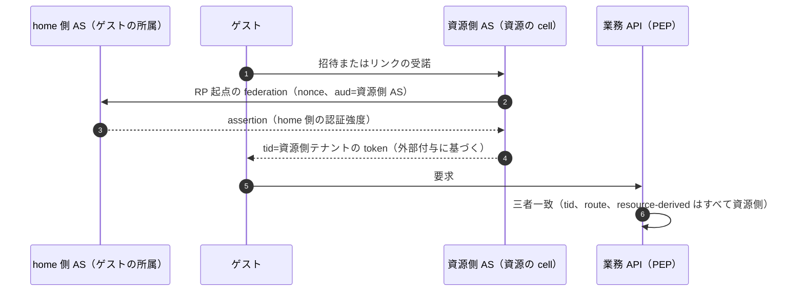

| 項目 | 内容 |
|---|---|
| 適用条件 | 他テナントの利用者・ゲストに自テナントの資源を見せる・触らせる（G-135 の 23） |
| 主体・認証 | 付与先は個人の人間主体（PC-09(a)・(b)）に限る（D24-02）。ゲストの session は資源側 cell の AS が作る（D24-14）。要求強度は資源側テナントのポリシー（D24-15） |
| token・grant・委任 | 常に tid＝資源側テナント。home 側 token をそのまま受ける相互信頼型は禁止（D24-03）。ゲスト session は home 側の再認証から H_g を超えて延長しない（D24-16、H_g は TBD） |
| テナント文脈 | 資源の所有テナントは不変（D24-10）。越境は外部付与の tuple で表す |
| 契約 API | `POST /v1/tenants/{tenant_id}/relationships/write`（writeRelationships、外部付与）・`.../relationships/delete`（deleteRelationships）／evaluateAccess／OIDC/OAuth profile（資源側 AS の federation） |
| PEP 配置 | PP-1 |
| 認可モデル例 | `docs/folder#external_viewer: [core/external_grant]`。外部主体への管理者ロール・privileged 以上の付与、期限のない外部付与は基盤の床で拒否（D24-18） |
| 整合性 | 外部付与の取消しは剥奪書込として先に確定。read-sensitive は剥奪フェンスと整合性トークンの新しい方 |
| キャッシュ | 判定 cache は §3.4 どおり。ゲストの表示名等は資源側に最小限だけ置く（D24-23） |
| 失効の反映 | 取消しの契機（付与者の取消し、期限、home 側の停止、ポリシー変更）ごとの経路は D24-21 |
| 失敗時挙動 | home 側 AS 停止中はゲストの新規 login 不可。既存 session は H_g の範囲 |
| 監査 | 共有の変更は 100% 記録（D24-20、E6）。外部付与ごとに資源側と home 側の法域を記録（D24-23） |
| 契約試験・負例 | NP16-1 home 側 token（tid＝home）を資源側で提示した要求の拒否／NP16-2 期限切れの外部付与での拒否／NP16-3 外部主体への管理者ロール付与の拒否／NP16-4 home 側の停止後のゲスト session の失効（TC-24-05）／NP16-5 匿名リンクで要配慮データにアクセスできないこと |
| アンチパターン | 越境のために三者一致を外す／テナント・グループ単位への付与／中立の共有領域（D24-05） |
| チェックリスト | ① outbound と inbound の両方の許可（D24-17）② 付与に期限 ③ 棚卸し機能（D24-22）④ 法域をまたぐ場合は D24-24 の既定 |
| 関連 | ADR-024、ADR-011、ADR-013／T-080、T-081／S-01、S-17／K-02 |

### P-17 break-glass・緊急経路

**要旨**: break-glass/P は本基盤の AS・PDP に依存しない別経路とし、封緘した資格情報を同時二者で取り出す（ADR-029 D29-70〜D29-81、ADR-023 Tier X）[D]。テナント内の業務上の緊急アクセス（break-glass/B）は本基盤の PDP 上の型付き例外で扱う（D29-80）[D]。

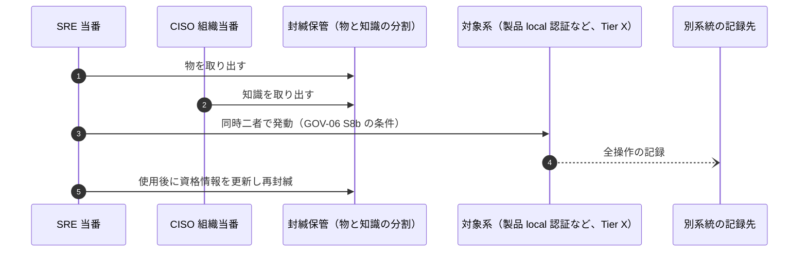

| 項目 | 内容 |
|---|---|
| 適用条件 | 通常経路が使えない、または侵害で信頼できない状況での基盤・業務の復旧（G-135 の 26） |
| 主体・認証 | break-glass/P のアカウントは系統ごとに 2 つ以上を事前作成（D29-70）。エクスポート不能な鍵の認証器（AAL3。DL-09） |
| token・grant・委任 | 本基盤の token を使わない（/P）。/B は本基盤の通常 token＋PDP の型付き例外 |
| テナント文脈 | /P は基盤全体。/B はテナント内 |
| 契約 API | /P: なし（本基盤の契約に依存しないことが要件）。/B: evaluateAccess（型付き例外） |
| PEP 配置 | /P: 対象系の local 統制。/B: PP-1 |
| 認可モデル例 | /B: `med/record#emergency_reader`（型付き例外。理由入力と事後レビュー必須） |
| 整合性 | /B は `fully_consistent`。非同期で実行しない（ADR-012 D12-32） |
| キャッシュ | なし |
| 失効の反映 | 使用後 24 時間以内（初期案、TBD）に資格情報を更新・再封緘（D29-75） |
| 失敗時挙動 | /P は本基盤の停止中も使えること自体が要件（GOV-06 S8a の発動中も S8b は使える。D29-79） |
| 監査 | 別系統の追記専用の記録（D29-62）。全使用を第 2 線がレビュー（D29-76） |
| 契約試験・負例 | NP17-1 本基盤の AS・PDP を止めた状態での発動演習（90 日以内ごと。D29-77）／NP17-2 単独人物による発動の拒否／NP17-3 依存台帳に本基盤の部品が無いこと（D29-78） |
| アンチパターン | 平時の運用に break-glass を使う／break-glass の login を本基盤の IdP で行う（禁止 D-8）／使用後の未更新 |
| チェックリスト | ① 依存台帳への登録 ② 演習の実施 ③ 事後レビュー |
| 関連 | ADR-029、ADR-023、ADR-008、ADR-013 D13-25／T-047／S-11／K-10 |

### P-18 ファイル・オブジェクトストレージ・署名付き URL・CDN

**要旨**: 署名付き URL は「発行後に個別に失効できない bearer」として扱い、発行直前に PEP で認可し、寿命を L_url(t) ≤ R(t) − Δ − C に縛る（ADR-006 D6-15。式は revocation-continuous-evaluation §4・§6.9、G-136 (a)）[D]。GCS の signed URL は、URL を知る者が期限か署名鍵の rotate まで資源にアクセスできる [V][^20]（RS-17#48）。Azure は SAS の生成を監査できず、生成数も追跡しないと明記している [V][^21]（RS-17#49）。

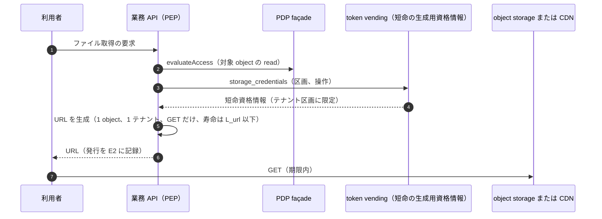

| 項目 | 内容 |
|---|---|
| 適用条件 | ファイル・object の配信と受領、CDN 配信（G-135 の 13） |
| 主体・認証 | 要求は主パターン。URL の利用者は認証されない（所持者なら誰でも使える。S3 は presigned URL を所持者にアクセスを与える bearer token と呼ぶ [V][^19]（RS-17#47）） |
| token・grant・委任 | URL は短命の生成用資格情報で作り、主体・テナントの停止でその資格情報を失効させる（S3 は生成に使った一時資格情報が失効すると URL も失効する [V][^19]） |
| テナント文脈 | URL は 1 object・1 テナント・1 操作に束縛。生成用資格情報は区画に限った IAM 条件付き（ADR-012 D12-24） |
| 契約 API | evaluateAccess／PEP SDK の `storage_credentials`（pep-contract §4.2 #8。基盤内部 API で、11_contracts の外部契約ではない）／監査 |
| PEP 配置 | URL を発行する業務 API の PP-1。object storage 側は区画の短命資格情報（二層目） |
| 認可モデル例 | `files/file#viewer` の判定後にだけ URL を発行 |
| 整合性 | 発行時の判定は read-sensitive の `at_least_as_fresh` |
| キャッシュ | CDN は read-sensitive 以上をキーにテナントと主体を含められる構成だけ。署名付き URL の応答を CDN に置く場合はキャッシュ寿命を URL の残り寿命以下にする（data-outside-pep PX-06） |
| 失効の反映 | 剥奪から実効的な拒否までの上限は URL の残り寿命で決まる。L_url(t) は TBD（KD64-5） |
| 失敗時挙動 | PDP 不達なら URL を発行しない。要配慮個人情報・決済関連情報・+REG のデータは URL を発行せず BFF・proxy で配信 |
| 監査 | E2（発行ごと、件数は KRI へ）。漏えい時は生成用資格情報・署名鍵の失効で一括無効化 |
| 契約試験・負例（G-136 (a)） | NP18-1 期限切れ URL の拒否／NP18-2 他テナント・他 object・他操作（PUT）への流用の拒否／NP18-3 剥奪後に新しい URL が発行されないこと／NP18-4 剥奪前に発行済みの URL が L_url(t) 以内に使えなくなること（TC-ARC09-09）／NP18-5 寿命設定が上限を超える発行の CI 拒否／NP18-6 CDN が URL の残り寿命を超えて応答を保持しないこと |
| アンチパターン | 長寿命 URL（S3 は CLI/SDK で最長 7 日を許す [V][^19]）を共有リンクとして渡す（ADR-024 D24-06）／長期資格情報で URL を作る／URL の発行を記録しない |
| チェックリスト | ① 発行前に判定 ② TTL 上限 ③ 短命の生成用資格情報 ④ 発行を記録 ⑤ 要配慮データは proxy 配信 |
| 関連 | ADR-006 D6-15、ADR-012 D12-24・D12-25・D12-27、ADR-024 D24-06／T-077／S-01、S-07／K-05 |

### P-19 メール・SMS で送る操作リンク（招待・承認・再設定）

**要旨**: 操作リンクは単回・推測不能・有効期限付きの受諾 token を運ぶだけで、受諾者の識別にも認証にも使わない（identity-lifecycle SM-I の I-02、INV-2）[D]。SP 800-63B-4 は電子メールを out-of-band 認証に使うことを SHALL NOT とする [N][^42]（RS-13#7）。金融商品取引業者等向けの監督指針は、メールや SMS にログインリンクを記載しないことを着眼点に挙げる [N][^35]（RS-13#34）。

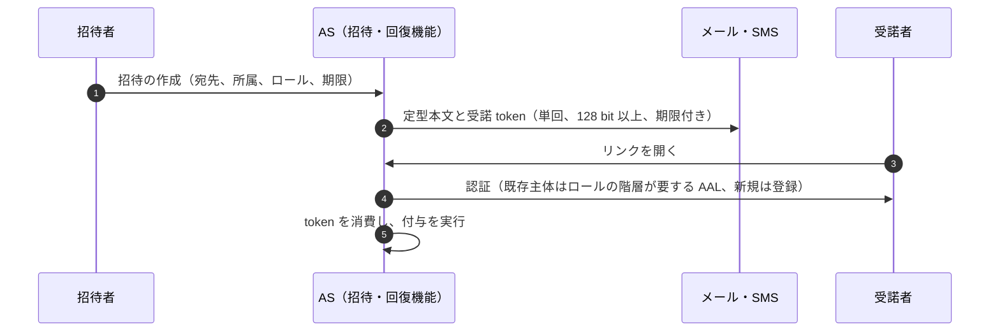

| 項目 | 内容 |
|---|---|
| 適用条件 | 招待、承認依頼の通知、パスワード・認証器の再設定・回復の通知（G-135 の 14） |
| 主体・認証 | 受諾者はリンクを開いた後に AS で認証する。回復は ADR-003 の回復区分（R-A〜R-D）に従う |
| token・grant・委任 | 受諾 token は単回・推測不能・期限付き。値は 128 bit 以上の乱数で、基盤には hash だけを保存（ADR-024 D24-06 のリンク秘密と同じ扱い）。リンクで session を作らない（禁止 D-3） |
| テナント文脈 | 招待は所属先テナントに束縛。SSO を強制するテナントでは検証済みドメインの規則に従う（identity-lifecycle I-03） |
| 契約 API | AS の招待・回復機能（OIDC/OAuth profile の外。**11_contracts に契約なし。基盤の UI 機能であり依存サービスは呼ばない**）。依存サービスが通知の送信だけを行う場合は P-24 のイベント |
| PEP 配置 | AS |
| 認可モデル例 | 招待権限（テナント設定、既定案は IL-D7）を `core/tenant#inviter` で判定。管理者ロールを付与する招待は保護操作と同じ保証 |
| 整合性 | 付与は write（`fully_consistent`） |
| キャッシュ | なし |
| 失効の反映 | 招待の取消しで token を無効化。期限切れは自動失効 |
| 失敗時挙動 | AS 停止中は受諾不可（Tier 3。後で再試行） |
| 監査 | E5（招待の作成・送付・受諾・取消し）、E6（付与） |
| 契約試験・負例 | NP19-1 使用済み・期限切れ・取消し済み token の拒否／NP19-2 別人の認証で受諾した場合も email でなく認証主体に付与されること（INV-2）／NP19-3 リンクだけで session が作られないこと／NP19-4 招待数の上限（FA の値は TBD）超過の拒否 |
| アンチパターン | magic link による login／本文に自由記述や任意 URL を入れる（fraud-abuse-controls の予防策）／招待 token を URL 以外の経路でログに残す |
| チェックリスト | ① 依存サービスが独自の招待リンクを作らない ② 規制プロファイル（金融）では本文にログインリンクを入れない方式を FA の決裁事項 15 に従って選ぶ |
| 関連 | ADR-003、ADR-024 D24-06、identity-lifecycle SM-I、fraud-abuse-controls／T-010、T-002／S-04、S-18／K-12 |

### P-20 レガシー・パッケージ製品（OIDC/OAuth に対応しないもの）

**要旨**: レガシーは前段の gateway・broker で吸収し、バックエンドは gateway が付ける署名付き JWT を検証するか、それができない場合は gateway 以外からの到達を網で遮断し、未署名ヘッダを gateway で必ず上書き・除去する（RS-17#83、OB-01）[D]。AWS ALB は、target が claim に基づく認可の前に署名と `signer` を検証しなければならないとし [V][^29]（RS-17#80）、Entra application proxy は connector 以外からの到達を制限すべきとする [V][^30]（RS-17#81）。

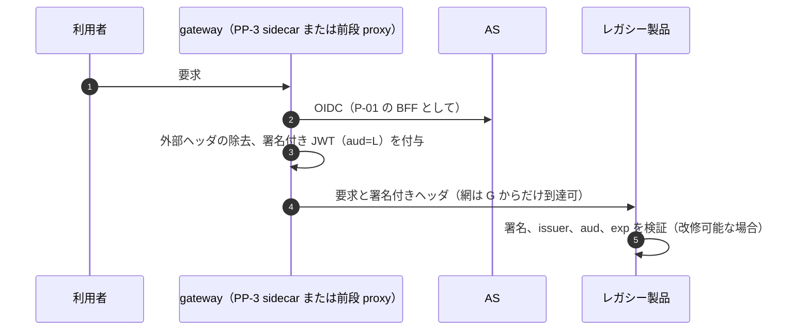

| 項目 | 内容 |
|---|---|
| 適用条件 | OIDC/OAuth に対応しない既存製品（SAML だけ、LDAP 直結、ヘッダ認証、共有シークレットだけ。G-135 の 21。現行 LDAP 直結 30・共有シークレットのみ 45 [A-110]） |
| 主体・認証 | 利用者は gateway で本基盤に認証。SAML だけの製品は AS が SAML IdP として発行（互換層）。LDAP は unauthenticated Bind の拒否と TLS 必須、Bind の成功を認可の根拠にしない（RFC 4513 は unauthenticated Bind を認可に使うものではないとする [N][^31]（RS-17#82）） |
| token・grant・委任 | gateway→製品は署名付き JWT（aud＝製品）か SAML assertion。gateway の認可は最初の要求にしか効かない場合があるため、操作単位の認可は製品内または PP-3 で別に要る |
| テナント文脈 | gateway が tid を署名付きで渡す。製品がテナントを解さない場合はテナントごとに配備を分ける |
| 契約 API | OIDC/OAuth profile（gateway 側）／evaluateAccess（PP-3 の sidecar が呼ぶ）／SAML 互換層は token-profile §11 の federation profile |
| PEP 配置 | PP-3（期限付き例外。object 単位の coverage は数えず、例外台帳に未網羅として登録） |
| 認可モデル例 | 機能単位（`legacy/app#user`）だけを sidecar で判定。object 単位は未網羅として残余リスクに登録 |
| 整合性 | 機能単位の判定は操作階層どおり |
| キャッシュ | gateway の session は P-01 と同じ。製品側の独自 session の寿命は gateway の session 以下 |
| 失効の反映 | 製品の独自 session はライフサイクル事象で無効化できない場合が多いため、gateway で session を切ることで代替し、残存は製品 session の寿命で上限を置く |
| 失敗時挙動 | gateway 停止時は到達不可（迂回経路を作らない） |
| 監査 | gateway が E2（機能単位）。製品内の操作ログは監査経路へ転送できる範囲で連携 |
| 契約試験・負例（G-136 (b)） | NP20-1 バックエンドへの直接到達（gateway 迂回）の網での拒否／NP20-2 外部から送った偽造ヘッダ（`X-User` 等）が gateway で除去されること／NP20-3 署名の `signer`・`aud` の取り違えの拒否／NP20-4 email による自動リンクの拒否／NP20-5 LDAP の空パスワード Bind の拒否 |
| アンチパターン | 未署名ヘッダだけを信頼し網で迂回を塞がない（禁止 D-4）／互換層を恒久化する／レガシーのために三者一致や fail-mode を緩める |
| チェックリスト | ① 互換層の範囲（どの機能を gateway 経由にするか）を例外台帳に記載 ② 廃止期限（TBD。所有者: 各ドメイン責任者＋プラットフォームチーム長、期限の決め方: DL-31 の移行計画と ADR-027 の移行単位）③ 網の到達制御 ④ 署名検証への改修可否の評価 |
| 関連 | ADR-012 D12-02・D12-06、ADR-027、ADR-004／T-016、T-018、T-063／S-01／K-01 |

### P-21 外部 SaaS への outbound 連携

**要旨**: 他社の token・API キーは、基盤所有の outbound 資格情報保管庫に集約し、テナント・連携ごとに束縛し、scope を最小にし、rotation と一括失効の手順を持たせる案を推奨する（KD64-2、決裁前）[D]。RFC 6749 は refresh token を通信中も保存時も秘匿しなければならない（MUST）とする [N][^6]（RS-04#70）。保管場所は PEP 外データ（SEC）として DX-01 の台帳に載せ、X5＋X6 を課す（data-outside-pep §3.11）[D]。

```mermaid
sequenceDiagram
  autonumber
  participant U as テナント管理者
  participant S as 連携サービス（PEP）
  participant V as outbound 資格情報保管庫（cell、KMS で包む）
  participant X as 他社 AS と API
  U->>S: 連携の登録（送るデータの分類、宛先、所在地、scope）
  S->>X: 認可コードフロー（自社が client、最小 scope）
  X-->>S: 他社の AT と refresh
  S->>V: 保存（テナント、連携 ID に束縛）
  Note over S: 実行時
  S->>V: 取得（workload ID、目的の記録）
  S->>X: API 呼出し
  Note over V: 漏えい時は連携先ごとに全件を失効、rotation
```

| 項目 | 内容 |
|---|---|
| 適用条件 | 自サービスが他社の SaaS・API を呼び、他社の token・API キーを保管する（G-135 の 17） |
| 主体・認証 | 他社の AS に対して自社は OAuth client（他社の profile に従う）。保管庫への取得は workload（SVID） |
| token・grant・委任 | 他社 token は他社の宛先だけに使う。自社の token を他社へ渡さない。利用者の名で他社 API を呼ぶジョブは ADR-026 の範囲外で、本パターンと ADR-005 D7 で扱う（ADR-026 案B の勝つ条件） |
| テナント文脈 | 資格情報は 1 テナント・1 連携に束縛。取得時に要求テナントと一致を確かめる |
| 契約 API | evaluateAccess（連携の登録・実行）／保管庫 API（**未定義。KD64-2 の決裁後に基盤内部 API として定義**）／監査 |
| PEP 配置 | 連携サービスの PP-1（登録）・PP-5（実行） |
| 認可モデル例 | `integrations/connection#admin`（登録・変更は privileged/T）、`integrations/connection#runner`（実行主体） |
| 整合性 | 登録・変更は `fully_consistent` |
| キャッシュ | 他社 token をサービスのメモリに保持するのは実行中だけ。ディスク・ログに出さない |
| 失効の反映 | 連携の削除・テナント停止で保管庫の資格情報を削除し、他社側でも失効させる（他社が RFC 7009 に対応していれば revocation、なければ他社管理画面での rotation） |
| 失敗時挙動 | 保管庫不達なら外部呼出しを行わない（Tier 3。後で再試行） |
| 監査 | E6（連携の登録・scope 変更）、E8 相当の資格情報の操作記録（保管・取得・rotation・失効）、E2（実行） |
| 契約試験・負例（G-136 (c)） | NP21-1 漏えいを想定した一括失効の演習（連携先ごとの全件失効の手順と所要時間の実測。所要時間の目標は TBD: 所有者 CISO、期限 G4、決め方 S-15 の被害窓と BIA）／NP21-2 他テナントの連携 ID による資格情報取得の拒否／NP21-3 登録時の scope を超える要求をしないこと（静的検査）／NP21-4 ログ・trace に他社 token が出ないこと（T-057） |
| アンチパターン | サービスごとに他社の秘密を設定ファイルや環境変数に散在させる／全テナント共通の API キー／rotation 記録のない秘密（静的資格情報の 50% は rotation 記録なし [A-113]） |
| チェックリスト | ① 連携を DX-01 の台帳に登録（送るデータの分類、宛先、所在地）② 資格情報を保管庫に置く ③ rotation 周期（TBD）④ 一括失効手順の演習 |
| 関連 | ADR-005 D7、ADR-007、ADR-019、data-outside-pep PX-11／T-053、T-057、T-069／S-15／K-08 |

### P-22 外部の M2M・パートナー API（利用者を伴わない）

**要旨**: 外部 M2M は client credentials と非対称のクライアント認証（private_key_jwt か mTLS）の組に限る（token-profile §6 C5）[D]。client credentials grant は confidential client だけが使わなければならない（MUST）[N][^6]（RS-17#18）。private_key_jwt の `aud` は AS の issuer 識別子を唯一の値にする RFC 7523bis の規則を先行採用する（RFC Ed Queue、RFC 未発行、確認日 2026-10-03）[N][^8]（RS-17#21、SS-B06）[D]。

```mermaid
sequenceDiagram
  autonumber
  participant P as パートナーのシステム（C5）
  participant A as AS
  participant E as edge
  participant S as 業務 API（PEP）
  P->>A: client_credentials（private_key_jwt で aud は issuer だけ、または mTLS）
  A-->>P: 外部 AT（opaque、aud=resource、cnf）
  P->>E: API 要求（mTLS）
  E->>E: 照会、cnf 照合、内部 JWT（sub はパートナー主体）
  E->>S: 内部 JWT と Txn-Token
```

| 項目 | 内容 |
|---|---|
| 適用条件 | 外部の組織のシステムが利用者を伴わずに自社 API を呼ぶ（G-135 の 7） |
| 主体・認証 | パートナー主体（PC-15）。private_key_jwt（`typ` 明示）か mTLS（`tls_client_auth`）。新規の client_secret 不可 |
| token・grant・委任 | 外部 AT は opaque、refresh なし（RFC 6749 は client credentials の応答に refresh token を含めるべきでない（SHOULD NOT）とする [N][^6]（RS-17#18））。sender constraint は mTLS 既定 |
| テナント文脈 | 1 token 1 テナント。複数テナントに提供するパートナーはテナントごとに client を分けるか、テナントごとに token を取り直す |
| 契約 API | OIDC/OAuth profile（token endpoint、client 登録）／業務 API 側の evaluateAccess／監査 |
| PEP 配置 | edge（E1）＋業務 API の PP-1／PP-2 |
| 認可モデル例 | `core/client` を subject とする `logistics/shipment#partner_reader`。範囲はテナント管理者が付与 |
| 整合性 | 操作階層どおり |
| キャッシュ | パートナー側の token cache は exp まで（寿命は延ばさない）。edge の照会 cache |
| 失効の反映 | client の停止・鍵の失効を E1 で毎要求反映。mTLS 証明書の更新で束縛 token は無効になる [N][^9]（RS-17#22） |
| 失敗時挙動 | §3.3。quota（SLI-037）超過は 429＋Retry-After |
| 監査 | E4（発行）、E1・E2（client_id、主体種別） |
| 契約試験・負例 | NP22-1 `aud` に token endpoint URL を入れた client assertion の拒否（RFC 7523bis の MUST NOT [N][^8]）／NP22-2 他 RS 宛て token の拒否／NP22-3 束縛証明書と異なる証明書での要求の拒否／NP22-4 client_secret による認証の拒否（新規登録） |
| アンチパターン | 静的 API key の発行／1 つの client で全テナントを扱う／refresh token の発行 |
| チェックリスト | ① 公開鍵の登録と rotation 手順 ② テナントごとの付与 ③ quota の合意 |
| 関連 | ADR-005 D5、ADR-009 D09-18〜D09-21、ADR-020／T-014、T-015／S-15／K-08 |

### P-23 デバイス・IoT・共有端末・入力制約端末

**要旨**: IoT 機器は自身の資格情報で動く非人間主体（PC-17）とし、共有端末（PC-18）は端末を登録して操作する人を個別に認証する（ADR-017 D17-05、principal-catalog）[D]。業務 API への device authorization grant は既定で禁止する（ADR-005 D7-7）[D]。RFC 10027 は RFC 8628 について、機微・高価値・業務上重要な資源では使用を避けるよう述べる [N][^4]（RS-17#14）。Microsoft は device code phishing の攻撃（Storm-2372）を報告している [I][^5]（RS-17#16）。

```mermaid
sequenceDiagram
  autonumber
  participant D as IoT 機器（PC-17）
  participant A as AS
  participant T as 共有端末（PC-18）
  participant U as 操作する人
  participant E as edge
  D->>A: client_credentials（private_key_jwt または mTLS、デバイス登録の鍵）
  A-->>D: AT（sub はデバイス主体）
  D->>E: API 要求
  Note over T,U: 共有端末
  U->>T: 本人の認証（AS、端末 ID を session 属性に記録）
  T->>E: 本人の token で要求
  U->>T: 離席・交代で logout（session 破棄）
```

| 項目 | 内容 |
|---|---|
| 適用条件 | IoT・自律デバイス、共有端末（店舗・会議室）、入力制約端末（TV 等。G-135 の 5） |
| 主体・認証 | IoT: デバイス登録系が払い出す不透明なデバイス ID と NC-4 の鍵（private_key_jwt か mTLS。attestation 形式は DL-55 で評価、TBD）。共有端末: 端末は主体にせず、人を個別に認証（共有アカウント禁止） |
| token・grant・委任 | IoT は client credentials（`sub`＝デバイス主体、利用者の権利を行使しない）。共有端末は P-01／P-02 の token を人ごとに。device grant は既定禁止（禁止 D-2）。例外を許す場合（KD64-3）: 事前登録した client_id とデバイス種別に限り、記録したリスク評価（RFC 10027 の MUST [N][^4]（RS-17#13））、近接性または組織ネットワークの条件、AS 画面でのデバイス情報の表示（RFC 8628 §5.4 の SHOULD [N][^3]（RS-17#12））、短い user code 寿命、device grant 由来であることを示す監査属性を後続の refresh まで付ける |
| テナント文脈 | IoT 機器は 1 テナントに登録。共有端末はテナントの端末台帳に登録 |
| 契約 API | OIDC/OAuth profile（token endpoint。例外承認時だけ device authorization endpoint）／業務 API 側の evaluateAccess |
| PEP 配置 | edge＋業務 API の PP-1 |
| 認可モデル例 | `iot/device#reporter` はデバイス自身のテレメトリ書込みだけ。利用者データの読取りを持たせない |
| 整合性 | 操作階層どおり |
| キャッシュ | 共有端末に token・業務データを残さない（logout で消去） |
| 失効の反映 | デバイスの紛失届・廃棄で資格情報を失効。不審な device grant を検知したら refresh を失効（Storm-2372 の推奨緩和策にも refresh token の失効が含まれる [I][^5]） |
| 失敗時挙動 | §3.3 |
| 監査 | E3・E4 にデバイス ID・端末 ID、device grant の監査属性 |
| 契約試験・負例（G-136 (d)） | NP23-1 許可リスト外の client_id からの device grant の拒否／NP23-2 承認されていない device code の利用（phishing 演習を含む）の拒否・検知（RS-17 §5.3 の 7）／NP23-3 共有端末での前の利用者 session の残存がないこと／NP23-4 デバイス主体による利用者データの読取りの拒否 |
| アンチパターン | 共有アカウント／業務 API への device grant の既定有効化／デバイスに長寿命の静的秘密 |
| チェックリスト | ① デバイス・端末の台帳登録 ② 共有端末の自動 logout（時間は TBD、DL-09 の session 上限以下）③ device grant の例外は KD64-3 の承認 |
| 関連 | ADR-005 D7-7、ADR-017 D17-05、principal-catalog PC-17・PC-18／T-007、T-014／S-18／K-11 |

### P-24 イベントの producer・broker

**要旨**: producer は不透明な参照（主体・テナント・取引の ID）だけをメッセージに入れ、token や権限を入れない（ADR-026 D26-11）[D]。発行の可否は producer 側の操作として判定し、受信側の認可は P-04 で実行時に行う [D]。

```mermaid
sequenceDiagram
  autonumber
  participant S as producer（PEP）
  participant P as PDP façade
  participant J as 受付台帳
  participant Q as broker（テナント区画）
  S->>P: 元の操作の evaluateAccess
  S->>J: enqueue（受付記録、job_run_id、起点 txn）
  S->>Q: publish（mTLS SVID、CloudEvents 封筒、参照だけ）
  Q->>Q: topic の ACL（workload 単位）とテナント区画
```

| 項目 | 内容 |
|---|---|
| 適用条件 | キュー・イベントの発行と broker の運用（G-135 の 9 の producer・broker） |
| 主体・認証 | producer・consumer は workload（SVID の mTLS）で broker に認証。broker の ACL は workload 単位の境界であり、テナントの境界ではない |
| token・grant・委任 | メッセージに token を入れない。起点の `txn` を参照として入れる |
| テナント文脈 | envelope に tid（参照）。topic・partition はテナント区画キーで分ける構成を推奨（区画キーは基盤のライブラリで生成） |
| 契約 API | PEP SDK の `enqueue`（基盤内部）／evaluateAccess（元の操作）／**イベント配送契約（ADR-022 D-2。CloudEvents 1.0.2・AsyncAPI 3.x の封筒・type 命名・冪等キー。契約ファイル未作成）** |
| PEP 配置 | producer の PP-1（元の操作）。consumer 側は P-04 |
| 認可モデル例 | 発行は元の操作（例: `orders/order.confirm`、write）の一部として判定 |
| 整合性 | 元の操作に従う |
| キャッシュ | — |
| 失効の反映 | 受信側の実行時再認可で反映（P-04） |
| 失敗時挙動 | broker 不達は transactional outbox で再送。PDP 不達は元の操作ごと拒否 |
| 監査 | E2（元の操作）、受付記録（job_run_id、起点 txn） |
| 契約試験・負例 | NP24-1 メッセージに token・role・権限一覧が含まれないこと（静的検査・スキーマ検査）／NP24-2 他テナントの区画への publish の拒否／NP24-3 CloudEvents の context attributes に個人データが無いこと |
| アンチパターン | Auth Context 拡張の `authclaims` を認可の根拠にする（拡張自身が保護目的ではないと述べる [N][^14]）／全テナント共通 topic に業務データを平文で流す |
| チェックリスト | ① AsyncAPI で operation を宣言（IC-01）② enqueue ヘルパを使う ③ outbox |
| 関連 | ADR-026、ADR-012 D12-31・D12-33、ADR-022 D-2／T-024／S-01、S-07／K-01 |

### P-25 匿名・公開アクセスと認証済みへの移行

**要旨**: public 操作は判定に基盤を要さず、SDK 内の静的規則で処理する（ADR-023 D23-16、NX-16）[D]。匿名から認証済みへの移行では、匿名時の識別子（カート ID 等）を権限の根拠にせず、認証後に session を作り直してから利用者に結び付ける [D]。

```mermaid
sequenceDiagram
  autonumber
  participant B as ブラウザ（匿名）
  participant F as BFF または Web
  participant S as 業務 API（PP-4）
  participant A as AS
  B->>F: 公開ページ、匿名カート
  F->>S: public 操作（mark_public、E10 集計）
  B->>F: 購入手続き（認証が必要）
  F->>A: login（P-01）
  A-->>F: token
  F->>F: session ID を再生成し、匿名カートを利用者へ移す（本人の確認操作付き）
```

| 項目 | 内容 |
|---|---|
| 適用条件 | 認証なしの公開アクセス、匿名 session からの認証済みへの移行（G-135 の 24） |
| 主体・認証 | 匿名（主体なし）。移行後は P-01／P-02 |
| token・grant・委任 | 匿名時は token なし。匿名の状態ハンドルを認証として扱わない（MCP も状態ハンドルを認証として扱うことを MUST NOT とする考え方と同じ [N][^26]） |
| テナント文脈 | 公開資源のテナントは資源側で決まる。匿名要求に tid を受け取らない |
| 契約 API | なし（public は判定しない）。移行後は P-01 の契約 |
| PEP 配置 | PP-4（edge＋静的規則。例外台帳の public） |
| 認可モデル例 | データ分類「公開」の資源だけ。匿名リンクは ADR-024 D24-06 の条件（個人情報は保護操作＋CISO 承認、要配慮情報等は不可） |
| 整合性 | 判定しない |
| キャッシュ | 公開資源は共有キャッシュ可。認証後の応答と混ぜない |
| 失効の反映 | — |
| 失敗時挙動 | 基盤停止の影響を受けない（Tier X の NX-16） |
| 監査 | E10（集約） |
| 契約試験・負例 | NP25-1 public と宣言した entry point が非公開データを返さないこと（台帳と data_class の照合）／NP25-2 認証前後で session ID が変わること（session fixation）／NP25-3 匿名ハンドルだけで認証済みの資源に届かないこと／NP25-4 bot による大量登録の速度制限（FA-11） |
| アンチパターン | 空の `security` で public を宣言する（例外台帳なし。pep-contract §4.3 #2）／匿名カート ID で注文履歴を引く |
| チェックリスト | ① public を例外台帳に登録 ② `mark_public` を使う ③ 移行時の session 再生成 |
| 関連 | ADR-023 D23-16、ADR-013 D13-25、ADR-024 D24-06／T-010、T-018／S-01／K-01 |

### P-26 規制スコープを持つサービス（重ね掛け）

**要旨**: 規制スコープは単独のパターンではなく、主パターンに cell・issuer・認証強度・保持・所在地の要件を重ねる付加パターンとする [D]。PCI DSS は基盤が CDE への認証・認可に使われる場合に基盤の構成要素へ及ぶため、CDE 用の認証を専用 cell・専用 issuer・専用鍵に分離する案が推奨されている（applicability §5、決裁前）[D][A-072]。

```mermaid
sequenceDiagram
  autonumber
  participant S as 規制スコープのサービス
  participant C as 規制スコープ cell（または専用 cell）
  participant A as cell の AS（層 F は FAPI 2.0）
  participant J as 監査（規制プロファイルの保持）
  S->>C: 収容（テナントの規制プロファイル）
  S->>A: 主パターンの token（層 F は mTLS、PAR、private_key_jwt）
  S->>J: 監査（保持期間はプロファイルの下限）
```

| 項目 | 内容 |
|---|---|
| 適用条件 | PCI DSS 対象の決済、医療情報、金融規制の対象、FAPI 2.0 の F1〜F6 を含むサービス（G-135 の 25、G-139） |
| 主体・認証 | 主パターンに従い、規制プロファイルの認証強度（AAL3 を契約で求める高保証テナント等。DL-09、ADR-002）を重ねる |
| token・grant・委任 | 層 F は FAPI 2.0 Security Profile（mTLS・private_key_jwt・PAR。ADR-020）。DPoP は privileged と層 F で使わない（token-profile §0 の 4） |
| テナント文脈 | 規制スコープ cell（専用の鍵・監査経路。ADR-013 D13-02）または専用 cell（契約オプション）に収容 |
| 契約 API | 主パターンと同じ。層 F は OIDF conformance を自社で実行（09_assurance/oidf-conformance-plan.md） |
| PEP 配置 | 主パターンと同じ |
| 認可モデル例 | 医療記録は `med/record`（authorization-model §8.5）。tuple の存在そのものが要配慮情報になり得る [A-071] ため、tuple・監査の暗号化と閲覧権限を ADR-014 に従う |
| 整合性 | 主パターンと同じ |
| キャッシュ | 要配慮・決済データは共有キャッシュ・CDN・署名付き URL を使わない（P-18） |
| 失効の反映 | 主パターンと同じ。規制の通知時計（DORA 等）は applicability §0 の 3 |
| 失敗時挙動 | 主パターンと同じ。Tier 1 の候補（ADR-023 D23-48） |
| 監査 | 保持期間は規制プロファイルの下限（SLI-073）。所在地は cell の法域 |
| 契約試験・負例 | NP26-1 層 F で DPoP・client_secret・PAR なしの要求の拒否／NP26-2 規制スコープ外の cell から規制テナントの資源へ届かないこと（K-19）／NP26-3 要配慮データへの署名付き URL の発行拒否 |
| アンチパターン | 規制テナントを一般 cell に収容する／規制ごとに独自の認証基盤を作る（分離は cell・issuer の設定で行う）／「FAPI 2.0 準拠」を OIDF 認定前に表示する |
| チェックリスト | ① 規制プロファイルを申告 ② 影響分析（§7）の確認 ③ 層 F の判定 |
| 関連 | ADR-013、ADR-020、ADR-002、ADR-014、applicability／T-081／S-16、S-17／K-23 |

### P-27 非本番環境（開発・試験・sandbox）

**要旨**: 共有 sandbox は本番と別の issuer・鍵・trust domain で運用し、sandbox の issuer を本番の allowlist に載せない（ADR-022 D-6-4）[D]。非本番から本番資源への経路を作らない（T-071）[D]。

```mermaid
sequenceDiagram
  autonumber
  participant D as 開発者
  participant SB as sandbox AS（別 issuer、別鍵）
  participant SS as sandbox のサービス
  participant PR as 本番サービス
  D->>SB: sandbox の client 登録（動的登録可）
  SB-->>D: sandbox token
  D->>SS: 試験（契約試験キットの負例を含む）
  D->>PR: sandbox token を提示
  PR-->>D: 拒否（issuer が allowlist にない）
```

| 項目 | 内容 |
|---|---|
| 適用条件 | 開発・試験・sandbox・ステージング（G-135 の 27） |
| 主体・認証 | 開発者は sandbox の AS に認証。本番の主体・資格情報を使わない |
| token・grant・委任 | sandbox token は本番で無効。非本番の動的登録は OIDC/OAuth profile の「凍結しない」範囲（ADR-022 D-2） |
| テナント文脈 | 非本番のテナントは本番テナントと別の ID 空間 |
| 契約 API | 本番と同じ契約のモック（DL-80）。本番と同じ版の契約で試験する |
| PEP 配置 | 本番と同じ配置（契約試験のため） |
| 認可モデル例 | 本番と同じモデルを model revision で pin |
| 整合性 | 本番と同じ指定で試験 |
| キャッシュ | — |
| 失効の反映 | 試験で本番と同じ失効経路を検証 |
| 失敗時挙動 | 本番の依存先にしない（Tier 3） |
| 監査 | 非本番の監査は本番の監査と別経路 |
| 契約試験・負例 | NP27-1 sandbox issuer の token を本番が拒否すること（G-141）／NP27-2 非本番から本番の資源・鍵・データへ到達できないこと（T-071）／NP27-3 非本番に本番の個人データが無いこと（data-classification） |
| アンチパターン | 本番データの複製による試験／本番と共有の鍵・client／非本番テナントへの app-only 権限の付与（T-071） |
| チェックリスト | ① 非本番の issuer と鍵 ② 試験データの生成 ③ 本番 allowlist の検査 |
| 関連 | ADR-022 D-6-4、ADR-007／T-071／S-08／K-06 |

---

## 5. パターン×インタフェース×契約の対応行列（G-138）

### 5.1 インタフェースと契約

| ID | 外部インタフェース（G-138 の列挙） | 定義している契約・版付き profile | 状態 |
|---|---|---|---|
| I-01 | client 登録（grant・認証方式・redirect URI） | 登録する内容: OIDC/OAuth profile（token-profile §6・§9）、RFC 9700・FAPI 2.0 SP。登録の手段: 契約なし（非本番の動的登録だけ preview。ADR-022 D-2） | **一部**。CON-00 §3 は「未対応」と判定（登録 API の契約がない）。暫定は G-143。本書は判定の差を §9.1 で申し送った |
| I-02 | discovery・JWKS | RFC 8414・OIDC Discovery（token-profile §11）／`GET /.well-known/authzen-configuration`（getPdpMetadata、CON-03）／`GET /.well-known/ssf-configuration`（getTransmitterConfiguration、CON-09） | 定義あり |
| I-03 | token の取得・更新 | OIDC/OAuth profile（token-profile §6・§8、RFC 9126・RFC 9700・RFC 9449） | 版付き profile あり |
| I-04 | token の検証 | token-profile §4（V1〜V14、NV-01〜NV-58）、CON-06 access-token-claims.schema.json | 定義あり |
| I-05 | logout と session 終了の伝播 | OIDC Back-Channel Logout 1.0（token-profile §4.2 K7）、CON-09・CON-10 の CAEP session-revoked | **一部**。Back-Channel Logout は契約の一覧になく、位置は未決（ADR-006 L6-2）。CAEP の経路は定義あり |
| I-06 | 認可判定 | CON-03: evaluateAccess・evaluateAccessBatch・searchResources・getPdpMetadata | 定義あり（searchResources は preview） |
| I-07 | 関係データの書込み・読取り | CON-04: writeRelationships・deleteRelationships・readRelationships・listRelationshipChanges・createRelationshipExport ほか | 定義あり（tuple 操作は GA、モデル管理は preview。ADR-022 D-2-1） |
| I-08 | token exchange・Txn-Token | CON-05: exchangeToken・requestTxnToken | 定義あり（requestTxnToken は preview、draft-11 依存） |
| I-09 | SCIM | CON-07: listUsers ほか 22 操作 | 定義あり |
| I-10 | 失効・継続評価（SSF/CAEP/RISC） | CON-09: createStream ほか 15 操作、CON-10 ssf-caep-set.schema.json | 定義あり |
| I-11 | ライフサイクル事象（内部の依存サービスへ） | **ADR-022 D-2 の「イベント配送」契約（CloudEvents 1.0.2・AsyncAPI 3.x、G-137）。候補は lifecycle-events.asyncapi.yaml と schemas/lifecycle-event.schema.json（G-goal-criteria §8）。契約ファイル未作成で deliverables.md §8 にも行がない** | **未対応（ADR-022 D-2-3）**。暫定方式は G-143（置き場所も未作成） |
| I-12 | 監査イベント | CON-08 audit-event.schema.json（E1〜E10、`corr` の相関 8 欄） | 定義あり |
| I-13 | エラー形式 | RFC 9457（OIDC/OAuth profile、ADR-022 D-2）、CON-02 common.schema.json、CON-03 の AuthZEN エラー | 定義あり |
| I-14 | レート制限の通知 | 429＋Retry-After（RFC 6585）を CON-03・CON-04・CON-07・CON-09 が定義 | **CON-05（token exchange）に 429 の定義がない**。DL-74 へ申し送り（残課題 6） |
| I-15 | Webhook 署名（本書で追加） | RFC 9421 に基づく社内 profile（KD64-1 の決裁後に作成） | **未対応（契約未作成）** |

### 5.2 パターン × インタフェース

記号: ● 使う、○ 条件付きで使う、― 使わない、主 主パターンの行に従う、模 DL-80 のモックで同じ契約を使う [D]。空欄はない [D]。

| P | I-01 | I-02 | I-03 | I-04 | I-05 | I-06 | I-07 | I-08 | I-09 | I-10 | I-11 | I-12 | I-13 | I-14 |
|---|---|---|---|---|---|---|---|---|---|---|---|---|---|---|
| P-01 | ● | ● | ● | ● | ● | ● | ○ | ○ | ― | ― | ○ | ● | ● | ● |
| P-02 | ● | ● | ● | ● | ― | ● | ○ | ○ | ― | ― | ― | ● | ● | ● |
| P-03 | ● | ● | ● | ● | ― | ● | ○ | ● | ― | ― | ○ | ● | ● | ● |
| P-04 | ― | ● | ― | ● | ― | ● | ○ | ● | ― | ― | ● | ● | ● | ● |
| P-05 | ― | ● | ― | ● | ― | ● | ○ | ● | ― | ― | ● | ● | ● | ● |
| P-06 | ● | ● | ○ | ● | ― | ● | ― | ● | ― | ― | ○ | ● | ● | ● |
| P-07 | ● | ● | ● | ● | ● | ● | ― | ― | ― | ● | ― | ● | ● | ● |
| P-08 | ● | ● | ● | ● | ― | ● | ○ | ● | ― | ― | ○ | ● | ● | ● |
| P-09 | ― | ● | ― | ● | ― | ● | ○ | ― | ― | ― | ― | ● | ● | ● |
| P-10 | ― | ● | ― | ● | ― | ● | ● | ● | ― | ― | ― | ● | ● | ● |
| P-11 | ● | ● | ● | ● | ● | ● | ○ | ● | ― | ― | ― | ● | ● | ● |
| P-12 | ● | ● | ● | ● | ● | ― | ― | ― | ― | ● | ● | ● | ● | ● |
| P-13 | ● | ● | ● | ― | ― | ― | ● | ― | ● | ― | ● | ● | ● | ● |
| P-14 | ― | ● | ― | ● | ― | ● | ― | ○ | ― | ― | ○ | ● | ● | ● |
| P-15 | ― | ● | ― | ● | ― | ● | ○ | ● | ― | ― | ● | ● | ● | ● |
| P-16 | ● | ● | ● | ● | ● | ● | ● | ― | ― | ― | ― | ● | ● | ● |
| P-17 | ― | ― | ― | ― | ― | ○ | ― | ― | ― | ― | ― | ○ | ― | ― |
| P-18 | ― | ● | ― | ● | ― | ● | ― | ― | ― | ― | ― | ● | ● | ● |
| P-19 | ― | ― | ― | ― | ― | ― | ― | ― | ― | ― | ― | ● | ― | ― |
| P-20 | ● | ● | ● | ● | ● | ● | ― | ○ | ― | ― | ○ | ● | ● | ● |
| P-21 | ― | ― | ― | ― | ― | ● | ― | ● | ― | ― | ● | ● | ● | ― |
| P-22 | ● | ● | ● | ● | ― | ● | ― | ― | ― | ― | ― | ● | ● | ● |
| P-23 | ● | ● | ● | ● | ○ | ● | ― | ― | ― | ― | ○ | ● | ● | ● |
| P-24 | ― | ● | ― | ● | ― | ● | ― | ● | ― | ― | ● | ● | ● | ● |
| P-25 | ― | ― | ― | ― | ― | ― | ― | ― | ― | ― | ― | ● | ― | ● |
| P-26 | 主 | 主 | 主 | 主 | 主 | 主 | 主 | 主 | 主 | 主 | 主 | 主 | 主 | 主 |
| P-27 | 模 | 模 | 模 | 模 | 模 | 模 | 模 | 模 | 模 | 模 | 模 | 模 | 模 | 模 |

- P-17 の I-06・I-12 は break-glass/B だけが使い、break-glass/P は本基盤の契約に依存しないこと自体が要件である（ADR-029 D29-81）[D]。P-19 は AS 内部の機能で、依存サービスが呼ぶ外部インタフェースは監査だけである [D]。P-06 は上表に加えて I-15（未作成）を使い、P-21 は保管庫の基盤内部 API（未定義、KD64-2）を使う [D]。
- **判定**: I-11 を使うパターンは 14 個（● 7 個: P-04・P-05・P-12・P-13・P-15・P-21・P-24、○ 7 個: P-01・P-03・P-06・P-08・P-14・P-20・P-23）あり、I-15 に依存する P-06 があるため、G-138 の「契約に定義のないインタフェースに依存するパターン 0 件」は未達である [D]。さらに、I-01（登録の手段の契約なし）を ● で使う 13 パターンと、I-05（一部）を使うパターンも、CON-00 の判定では未定義依存に数えられる [D]。解消には ADR-022 D-2 のイベント配送契約、Webhook 署名 profile、client 登録の手段の契約化、Back-Channel Logout の契約上の位置の決定が要る（残課題 1・2、§9.1）[D]。

---

## 6. 高リスク 4 種別の統制と負例（G-136）

| 種別 | 統制（本書の節） | 必須の負例 | 判定に要る実測 | 状態 |
|---|---|---|---|---|
| (a) ファイル・署名付き URL | P-18: 寿命 L_url(t) ≤ R(t) − Δ − C、1 object・1 テナント・1 操作への束縛、短命の生成用資格情報、発行の記録、CDN のキャッシュ寿命 ≤ URL の残り寿命、要配慮データは proxy 配信 | NP18-1〜NP18-6（期限切れ・他テナント・剥奪後） | URL の実効寿命と剥奪後の残存時間（RS-17 §5.3 の 5、TC-ARC09-09）。L_url(t) の値（KD64-5） | 統制は机上で定義。実測未達 |
| (b) レガシー・パッケージ製品 | P-20: gateway の署名付き JWT、網での迂回遮断、外部ヘッダの除去、互換層の範囲の例外台帳、廃止期限（TBD） | NP20-1〜NP20-5（迂回、偽装ヘッダ、signer・aud の取り違え） | 本番相当環境の迂回試験（pep-contract §8.3、RS-17 §5.3 の 9） | 同上。廃止期限は DL-31 で未決 |
| (c) outbound 連携 | P-21: 保管庫への集約（KD64-2）、テナント・連携への束縛、最小 scope、rotation、一括失効の手順 | NP21-1〜NP21-4（一括失効、他テナント取得） | 一括失効の所要時間（目標は TBD、所有者 CISO、期限 G4） | 決裁前。実測未達 |
| (d) デバイス・入力制約端末 | P-23: device grant の既定禁止、例外の許可リスト・リスク評価・近接性・監査属性、共有端末の個人認証と session 破棄 | NP23-1〜NP23-4（未承認の device code、session 残存） | device code phishing の演習（RS-17 §5.3 の 7） | 同上 |

- G-136 の合格（4 種別すべての負例が拒否されるか事前登録基準内で失効する、CISO と独立立会人の判定）は、DL-22 での事前登録と DL-81 の実測を要し、未達である [D]。

---

## 7. 規制スコープの反映（G-139）

| 業界規制（A-080） | 基盤が対象範囲に入るか（影響分析の要点） | 範囲を限る分離方式 | 連携パターンへの反映 | 確認 |
|---|---|---|---|---|
| 決済（PCI DSS。3% [A-080]） | 基盤が CDE への認証・認可に使われる場合に基盤の構成要素へ及ぶ（applicability §0 の 4）。基盤はカード会員データを保存・処理・伝送しない前提 [A-072] | CDE 用の認証を専用 cell・専用 issuer・専用鍵に分離（推奨案、決裁前） | P-26。CDE のサービスは P-01／P-03 を専用 cell で使う。決済関連情報は P-18 の URL と P-10 の export の対象外 | 未（コンプライアンス責任者の確認待ち） |
| 医療（7% [A-080]） | tuple・監査記録に要配慮個人情報が混入し得る [A-071] | 規制スコープ cell（専用の鍵・監査経路）、テナント別プロファイル | P-26。break-glass/B（P-17）で緊急閲覧、P-18 の URL 不可、P-15 の学習はテナント内 | 未 |
| 金融（10% [A-080]） | 顧客が規制対象のとき契約経由で要求が及ぶ（条件付き）。DORA の通知時計 | 規制スコープ cell、FAPI 2.0 の層 F（F1〜F6） | P-26。P-07・P-22 の層 F、P-19 のリンク方式（監督指針 [N][^35]） | 未 |
| 公共（5% [A-080]） | 条件付き（調達要件） | 規制スコープ cell、所在地の固定 | P-26。所在地は cell の法域、P-16 の法域越えは D24-24 の既定 | 未 |

- 影響分析の正本は applicability（DL-34）であり、本表は連携パターンへの反映だけを示す [D]。G-139 の合格（業界規制ごとの影響分析と分離方式、コンプライアンス責任者・法務・CISO の確認の署名 E2）は未達である [D]。

---

## 8. 決裁案

### KD64-1 Webhook の署名方式

| 選択肢 | 内容 | 帰結 |
|---|---|---|
| (a) RFC 9421 の非対称署名（ecdsa-p256-sha256・ed25519 等）を新規の既定、mTLS を代替、共有秘密の HMAC は期限付き例外 | 送信側は cell の鍵で署名し公開鍵を配布。受信側は送信元ごとに公開鍵を登録 | 共有秘密を増やさない（ADR-009 D09-18 と整合）。受信先側の実装負担が増える。RFC 9421 は §3.3.3 で HMAC Using SHA-256 を定義し、登録表（§6.2.2）にも含む [N][^33]。HMAC を例外扱いにするのは標準の要求ではなく自社判断である |
| (b) HMAC（hmac-sha256）を既定 | 購読ごとの共有秘密 | 受信先の実装は容易。秘密の保管・rotation が増える（A-073 の webhook secret 400 [A-073]） |
| (c) mTLS だけ | 双方向の証明書 | 受信先の到達性と証明書運用の負担が大きい |

- **推奨**: (a) [D]。理由は、共有秘密の廃止方針（ADR-009 D09-18〜D09-20）と一致し、漏えい時の失効を公開鍵の差替えで行えるためである [D]。署名鍵の鍵族（ADR-007 の L2 のどの用途族か）は **未決（ADR-007）** である [D]。
- **決める人**: CTO＋CISO。期限: G3（契約凍結 DEC-8 の前）。決め方: 主要な受信先・送信元の対応状況の調査（As-Is、DL-50）[D]。

### KD64-2 outbound 資格情報の保管庫の集約

| 選択肢 | 内容 | 帰結 |
|---|---|---|
| (a) 基盤所有の保管庫（cell ごと、KMS で包む）に集約し、取得を workload ID と目的で記録 | 一括失効・棚卸し・rotation を中央で実行 | 漏えい時の全件把握ができる（S-15 の被害窓を縮める）。基盤の構築・運用要員が増える（値は TBD） |
| (b) 各サービスが既存の秘密管理を使い、台帳（DX-01）にだけ登録 | 実装は分散 | 一括失効はサービスごとの作業になり、所要時間が読めない |
| (c) 現状維持 | — | G-136 (c) を満たせない |

- **推奨**: (a) [D]。決裁までは (b) を最低線とし、DX-01 への登録と X5＋X6 を必須にする（data-outside-pep §3.11）[D]。
- **決める人**: CISO（リスク）＋プラットフォームチーム長（要員）。期限: G3。決め方: NA-064-1 の件数と、一括失効の机上演習の所要時間 [D]。

### KD64-3 device grant の例外承認

| 選択肢 | 内容 | 帰結 |
|---|---|---|
| (a) 例外を認めない | 入力制約端末は IoT 主体（P-23）か別端末での認証に限る | phishing の経路を断つ。TV 型の端末の利用者体験が落ちる |
| (b) CISO の承認で、許可リスト・記録したリスク評価・近接性または組織ネットワーク・監査属性を条件に許す | P-23 の例外条件 | RFC 10027 の MUST（実装前のリスク評価）を満たす運用が要る [N][^4] |
| (c) 事業部門の判断で許す | — | Storm-2372 型の攻撃に開く [I][^5] |

- **推奨**: (b) で、業務 API・管理機能・個人データへの適用は (a) とする [D]（ADR-005 D7-7 の既定無効を維持）。
- **決める人**: CISO。期限: G2。決め方: 端末種別の棚卸し（DL-50）[D]。

### KD64-4 新パターン追加の審査体制と期限

| 選択肢 | 内容 | 帰結 |
|---|---|---|
| (a) 連携アーキテクチャ審査（プラットフォームチーム長＋CISO 組織の代理）が一次判定、ADR 要否も判定 | §2.4 の手順 | 審査の待ち行列が中央に集まる（SLI-041 の変更速度に影響） |
| (b) アーキテクチャ審査会（ARB）にすべて付議 | — | 判断は重くなり、期限が長くなる |

- **推奨**: (a)。ADR を要する場合だけ ARB に付議する [D]。一次判定の期限（営業日）は TBD とし、オンボーディングの SLI（SLI-086〜SLI-091）と合わせて決める [D]。
- **決める人**: CTO。期限: G2 [D]。

### KD64-5 連携側既定値（G-106）の決裁の進め方

- **論点**: §3.5 の 8 既定値はすべて未決裁であり、L_url(t) には SLI-ID がない [D]。
- **推奨**: DL-20 に L_url(t) の SLI を追加し（所有者はプロダクト責任者＋CISO。revocation-continuous-evaluation §4 の L_url 行に合わせる）、8 値を G4 の数値決裁で一括して決める [D]。決裁前の契約試験キット（DL-80）は「値を設定ファイルで差し替えられること」だけを試験する [D]。
- **決める人**: CTO（決裁）、CISO（L_url と M_rev の協議）。期限: G4 [D]。

---

## 9. 未決の論点（ADR で決まっていない点）

| 論点 | 未決の所在 | 本書の暫定動作 |
|---|---|---|
| issuer の粒度 | 未決（ADR-007 KD7-1／ADR-021 K21-1、U-01） | 依存サービスは issuer を discovery と allowlist の配布物から得て、固定値を書かない |
| `txn` の発行範囲（read-sensitive への拡大） | 未決（ADR-005 §2.15 U2、U-02） | Txn-Token があれば検証して伝播（§3.2） |
| OpenFGA 採用時の read-sensitive の窓 W | 未決（ADR-010・ADR-011、U-03） | 最新強制で実装 |
| read-sensitive の known-good | 未決（ADR-013 KD13-6） | 無効で出荷 |
| 長時間接続の終端を E4 に寄せるか | 未決（revocation KA9-2） | SDK の 3 点実装を義務化（P-14） |
| L0 拒否の reason 値 | 未決（ADR-012 L-05、ADR-011） | pep-contract §3.7 の暫定値 |
| 起点エージェント主体の欄名 | 未決（ADR-017 L17-2） | `tctx` に入れる前提で欄名は空けておく |
| 内部開始の `tctx` の起点 jti・`txn` の意味 | 未決（ADR-026 L26-1・L26-2） | grant 参照を必須にする例外で実装 |
| SPIFFE trust domain の数 | 未決（ADR-009 P09-1／ADR-021 D21-28、DEC-3） | cell ごとの中間 CA と SDK の cell 照合 |
| BFF 経路の opaque／内部 JWT | 条件付き（ADR-005 K-1） | opaque を前提に P-01 を定義 |
| 外部連携アプリの SSF 受信の義務化 | 未決（ADR-006 K6-3） | 高リスク scope のアプリに推奨 |
| +FIN・+XT の委任ジョブ実行 | 未決（ADR-026 K26-4） | 既定では実行しない |
| Webhook 署名鍵の鍵族 | 未決（ADR-007） | KD64-1 の決裁と同時に決める |
| イベント配送契約 | ADR-022 D-2 で区分は決定、契約ファイルは未作成 | §5.1 で「未対応」と明記 |
| ジョブ所有者退職時の既定・顧客緊急管理者 | 未決（principal-catalog 決裁案 3・4） | 推奨案 (c)・(b) を前提に記述 |

### 9.1 申し送り（本書は他の文書を編集していない）

- deliverables.md §6.3 に P-18〜P-27 を追記すること（台帳管理者へ）[D]。
- CON-05（token-exchange.openapi.yaml）に 429＋Retry-After を追加すること（DL-74 の所有者へ）[D]。
- ADR-009 §2.10 P-06 の「署名方式は DL-64 で原典を取得して決める」は、本書で RFC 9421 を取得し、方式の選択を KD64-1 に置いた [D]。
- 種別ごとの既定 Tier は ADR-023 D23-48 から転記した [D]。DL-63（INT-01、10_integration/dependency-tiers.md）は版 0.2 が作成済みであり、INT-01 の改版時は本書 §2.2 と照合すること（INT-01 の所有者へ）[D]。
- CON-00 §3 は client 登録を「未対応」、本書 §5.1 は「一部」と書いている。登録の手段（登録 API か、オンボーディング DL-66 の申請様式か）を決め、両書の判定を揃えること（CON-00 の所有者と DL-66 の所有者へ）[D]。
- CON-00 §3 の I-14 の記載は CON-03・CON-04・CON-07 だけを挙げるが、CON-09（ssf-caep.openapi.yaml）にも 429 の定義がある（2026-10-15 に grep で確認）[M]。CON-00 の所有者へ申し送る [D]。

---

## 10. 連携開発者の着手判定（基盤の完成を待たずに始める）

### 10.1 判定（2026-10-15、版 0.2）

- 本書と 11_contracts だけで、主パターンの選定、entry point 台帳への記載、token 検証・PEP 呼出し・exchange・監査送出の実装と単体試験は始められる [D]。契約側の着手手順の正本は CON-00 §2.5、モック・負例ベクタ・sandbox の正本は CON-11 §16 であり、本節はパターンごとの差分だけを書く [D]。
- 始められないもの: (1) 自チームの CI で合否を出す契約試験（キット本体 DL-82 が未実装。CON-11 残課題 1、期限 G3）、(2) ライフサイクル事象の受信（G-137 の契約が未作成）、(3) Webhook の署名検証・署名送信（I-15 が KD64-1 の決裁待ち）、(4) 保管庫を使う outbound 連携（保管庫 API が KD64-2 の決裁待ち）[D]。
- 基盤の本番提供より前に本番を迎えるサービスの暫定方式（既存方式の継続、契約互換のアダプタ）は、G-143 の置き場所がなく本書でも決められない（残課題 11）[D]。この場合は §2.4 の段 6 と同じく、例外台帳（DL-05）に期限付きで登録してから本番に出す [D]。

### 10.2 全パターン共通で今日から行うこと

| 順 | 行うこと | 完了の確かめ方 | 参照 |
|---|---|---|---|
| 1 | §2.1 の決定表で entry point ごとに主パターンと付加パターンを決め、操作階層（DL-09）と既定 Tier（§2.2、INT-01）を付ける | entry point の一覧に P-ID・操作階層・Tier・配置（PP-x）が全行で埋まっている（IC-01） | §2.1〜§2.3、INT-01 |
| 2 | §2.2 の「禁止する形」（D-1〜D-9）と各パターンのアンチパターンに当たる設計がないか確かめる | 設計レビューの記録に該当なしと書ける | §2.2、§4 |
| 3 | 認可モデルの草案を INT-03 の手順で書き、各パターンの「認可モデル例」を自ドメインの型に置き換える | INT-03 の判定図で各要件の置き場所が決まっている | INT-03 |
| 4 | §5.2 の行列で自パターンが使うインタフェースを拾い、GA の要素だけに依存させる。preview（searchResources、requestTxnToken、モデル管理）を使う場合は理由を記録する | 依存する operation と契約ファイルの git コミットを自リポジトリに記録 | §5、CON-00 §2.5 手順 2〜3 |
| 5 | issuer・JWKS・endpoint・§3.5 の数値を設定から読む実装にする | ソースに URL・数値の直書きがない（静的検査） | §3.5、CON-11 §11.4、§9（issuer 粒度は未決） |
| 6 | IC-02・IC-06・IC-09 と §3.3 の fail-closed の分岐を実装する | 判定不能・PDP 不達・他テナントの各場合の単体試験 | §3.1、§3.3 |
| 7 | 各パターンの負例（NPxx-n）のうち、モックなしで書けるもの（静的検査、自サービス内の拒否）を単体試験にする。モックが要るものはキット配布後に回す | 試験一覧に NPxx-n と CON-11 の CV 番号を対応づけた | §4、CON-11 §6 |

### 10.3 パターンごとの着手可否

| P | 今できる | 待つもの（所在） |
|---|---|---|
| P-01・P-02・P-25 | BFF 参照実装を使う前提での画面・session 処理、cookie 属性の CI 検査（NP01-1）、OS ブラウザ＋PKCE＋DPoP の client 実装（P-02）、public 宣言と session 再生成（P-25） | BFF 参照実装（ADR-005 D6-2）の提供時期（DL-62）、MK-01（開発用 AS）の配布（DL-82）、Back-Channel Logout の位置（ADR-006 L6-2） |
| P-03・P-09・P-10・P-16・P-18 | 内部 JWT の検証（V1〜V14）、evaluateAccess／evaluateAccessBatch の呼出し、exchange の要求、Txn-Token の無改変伝播、一覧ヘルパ前提の post-check、URL 発行前の判定と寿命の設定化 | SDK の提供言語（ADR-022 NA-022-1）、MK-02・MK-03、SPIFFE trust domain の数（§9）、L_url(t) の値（KD64-5） |
| P-04・P-05・P-24 | メッセージを参照だけにする設計と静的検査（NP04-3、NP24-1）、型 A1〜A4 の宣言、デッドレターと通知、outbox | requestTxnToken（preview、draft 依存）、内部開始の `tctx` の意味（ADR-026 L26-1・L26-2）、**ライフサイクル事象の契約（G-137）** |
| P-06 | 送信元の PC-15 登録の設計、受信の edge 経由化、payload の参照化、配信直前の再 Check | **Webhook 署名 profile（I-15、KD64-1）**。決裁までは署名方式を固定した実装をしない |
| P-07・P-22・P-23 | private_key_jwt（`aud`＝issuer 単独）か mTLS の client 実装、scope の最小化、テナントごとの client・grant の設計 | client 登録の手段（I-01、CON-00 では未対応）、共有 sandbox（CON-11 §5、K11-3）、device grant の例外（KD64-3） |
| P-08 | tool 目録の草案、RFC 9728 の metadata、tool ごとの `resource` 指定、下流の exchange | 起点エージェント主体の欄名（ADR-017 L17-2）、承認 grant の画面（AS） |
| P-11・P-17 | 操作集合の定義と二者レビュー、break-glass/P の依存台帳の作成と演習計画 | 昇格系・特権 grant ストアの提供時期（DL-42）。break-glass/P は本基盤を待たずに整備できる（本基盤に依存しないことが要件） |
| P-12・P-13 | 依存サービス側の義務（顧客 IdP の token を受けない、email で識別しない、主体状態を複製しない）の実装 | 独自 session の無効化に使う**ライフサイクル事象の契約（G-137）** |
| P-14 | 期限切断・失効購読・メッセージ単位の再認可の 3 点の SDK 組込み設計、WSS と Origin 許可リスト | 終端を E4 に寄せるか（revocation KA9-2）、Δ_conn・L_conn の値（DL-20） |
| P-15 | 経路の DX-01 登録、テナント別 dataset、JIT の抽出ロール | 削除伝播に使うライフサイクル事象の契約（G-137）、L_idx・Del(p) の値 |
| P-20・P-21 | 互換層の範囲の例外台帳登録、網の到達制御、偽造ヘッダ除去の試験（P-20）、DX-01 登録と資格情報の棚卸し（P-21） | 互換層の廃止期限（DL-31）、保管庫 API（KD64-2）。決裁までは KD64-2 (b) を最低線にする |
| P-26・P-27 | 規制プロファイルの申告、非本番 issuer・鍵の分離と本番 allowlist の検査（NP27-1） | PCI の分離方式の決裁（applicability §5）、共有 sandbox の提供（K11-3） |

- 上表の「待つもの」が解消するまでに作ったものは、DEC-8 後に DL-80 の判定で適合を確かめ直す（CON-00 §2.5）[D]。版 0.x の契約は変更期間を約束しない [D]。

---

## 対応表

| R/G-ID | 要求の要点 | 本書の節 | 閉じ方 | 状態 |
|---|---|---|---|---|
| G-098 | 依存サービスを P-01〜P-17 と Tier で分類、代表例の割当、分類外の新パターン手順 | §2.2、§2.4、KD64-4 | A | 一部: 割当表と手順は定義済み。作成者以外による代表例の割当検証は未実施、ドメイン一覧（DL-50）待ち |
| G-099 | 各 P-xx の必須記述（適用条件〜アンチパターン） | §3.6、§4 | A | 机上で定義済み（27 パターンすべてに 16 項目）。自動検査（必須節）は未実施 |
| G-100 | ユースケースからの決定表と組合せ規則 | §2.1、§2.3 | A | 机上で定義済み。連携開発者の立場の作成者以外による 32 件以上の判定試験は未実施 |
| G-106 | 連携側既定値の SLI・根拠・決裁 | §3.5、KD64-5 | C（B 併用） | 未達: SLI-ID の対応まで。値と決裁は DL-20 で未了 |
| G-135 | 27 種別への P・非対応・禁止の割当 | §2.2 | A | 机上で定義済み（空欄 0、非対応 0、禁止 9 件に理由）。作成者以外の確認は未実施 |
| G-136 | 高リスク 4 種別の統制と負例 | §6、P-18・P-20・P-21・P-23、KD64-2・KD64-3 | C | 未達: 統制と負例は定義、実測（DL-22・DL-81）と CISO・独立立会人の判定は未実施 |
| G-138 | パターン×インタフェース×契約の行列 | §5 | A | 未達: 行列は空欄 0。I-11（イベント配送、G-137）と I-15（Webhook 署名）の契約が未作成、I-01（client 登録の手段）と I-05（Back-Channel Logout の位置、ADR-006 L6-2）が一部 |
| G-139 | 規制スコープの影響分析・分離・パターンへの反映 | §7、P-26 | B | 未達: 反映は記述。コンプライアンス責任者・法務・CISO の署名（E2）が未了 |
| R-058 | 全 entry point inventory（batch・queue・内部 API・データ直アクセス） | IC-01、§2.3 規則 1、P-04・P-05・P-15・P-24 | C | 本書は台帳への登録義務まで。棚卸しと突合の実測は DL-10・ADR-012 |
| R-059 | enforcement coverage の機械的検証 | IC-01・IC-02、各 P の PEP 配置（PP-3 は数えない） | C | 本書はパターンごとの配置と数え方の写像まで。検証は pep-contract §6 の実測 |
| R-100 | workload identity と token exchange | P-03・P-04・P-05・P-08・P-22 | A | ADR-009 の決定をパターンへ写した（ADR 自体は proposed） |
| R-163 | DPoP の限界明記と BFF・CSP・短命化・鍵保護の併用 | P-01（BFF 既定、DPoP を使わない）、P-02（DPoP＋nonce、ハードウェア保護鍵、rotation）、P-26（層 F は mTLS） | C | 併用の配置は定義。DPoP 限界の実測は token-profile §7.2 と PoC |
| R-206 | service 別 aud・token exchange・workload identity の実証 | P-03 の負例 NP03-1〜NP03-7、P-08・P-22 の負例 | C | 未達: PoC（DL-22）の実測待ち |

- 抽出方法: traceability/R-requirements.md と G-goal-criteria.md の対応成果物欄を「DL-64」「integration-patterns」で検索した [D]。G の該当は 8 件（G-098・G-099・G-100・G-106・G-135・G-136・G-138・G-139）である [D]。R-requirements.md の対応成果物欄に本書を挙げる行は 0 件だったため、deliverables.md の DL-64 行が挙げる R-059・R-100・R-163・R-206 と、G-135・G-136 が参照する R-058 を加えた計 13 件に応えた [D]。

---

## 残課題

1. **イベント配送契約（I-11）の作成**: ADR-022 D-2 で区分は決まったが契約ファイルがない [D]。所有者: 契約所有者（DL-69）。期限: DEC-8 の前。これがないと G-138 は合格しない [D]。
2. **Webhook 署名 profile（I-15）の作成**: KD64-1 の決裁後に作成する [D]。所有者: プラットフォームチーム長。期限: G3 [D]。
3. **G-098・G-100・G-135 の作成者以外による検証**: 代表例の割当、32 件以上のユースケースの判定試験は未実施である [D]。前提としてドメイン一覧（DL-50）が要る [D]。
4. **負例の採番と実測**: NPxx-n の仮番を DL-80・DL-22 で採番し、DL-81 で実測する [D]。現時点で実測は 0 件である [D]。
5. **数値の決裁**: §3.5 の 8 既定値、L_url(t)、共有端末の自動 logout 時間、grant 棚卸しの周期、outbound の一括失効の目標時間はすべて TBD である [D]。
6. **CON-05 の 429 定義**: token exchange の契約にレート制限の通知がない（DL-74 へ申し送り）[D]。
7. **レガシー互換層の廃止期限**: P-20 の廃止期限は DL-31 と ADR-027 の移行計画で決める（TBD）[D]。
8. **規制スコープの確認署名**: G-139 の E2 は未取得である [D]。
9. **deliverables.md §6.3 への P-18〜P-27 の反映**: 本書は台帳を編集していない [D]。
10. **本書の人による照合**: 版 0.2 で作成者と別の AI エージェントが独立レビューした（末尾「レビュー記録」）。人による照合と、research ノート外の原典（[^33] RFC 9421）の人による再確認は未実施である（CONVENTIONS §4・§8）[D]。
11. **暫定方式と提供時期の公開（G-143）**: 基盤の本番提供より前に本番を迎える依存サービスの暫定方式・残余リスク・切替条件の置き場所がない（DL-42 か 10_integration/roadmap-interim.md）。所有者・期限は TBD（G-goal-criteria §8 の申し送りで置き場所ごと未定。DL-42 の所有者が決める）[D]。
12. **連携ハンドブック類の未作成**: DL-62（README）、DL-66（onboarding）、DL-67（Definition of Ready）、DL-68（FAQ）が無く、§10 の手順の一部（台帳の登録先、疑義の窓口）は CON-00 §2.5 の暫定経路（E0）に頼っている [D]。

---

## 参考文献

[^1]: IETF (A. Parecki, P. De Ryck, D. Waite)『RFC 10017: OAuth 2.0 for Browser-Based Applications』BCP 212, 2026-08. https://www.rfc-editor.org/rfc/rfc10017 （参照箇所: §6.1.3.1, §6.1.3.2, §6.1.3.3, §6.1.4.3, §6.3.4.3、確認日: 2026-10-03。RS-17#1〜#5）
[^2]: IETF (W. Denniss, J. Bradley)『RFC 8252: OAuth 2.0 for Native Apps』BCP 212, 2017-10. https://www.rfc-editor.org/rfc/rfc8252 （参照箇所: §4, §6, §7, §8.1, §8.5, §8.12、確認日: 2026-10-03。RS-17#6〜#9）
[^3]: IETF (W. Denniss, J. Bradley, M. Jones, H. Tschofenig)『RFC 8628: OAuth 2.0 Device Authorization Grant』2019-08. https://www.rfc-editor.org/rfc/rfc8628 （参照箇所: §5.4、確認日: 2026-10-03。RS-17#12）
[^4]: IETF (P. Kasselman, D. Fett, F. Skokan)『RFC 10027: Best Current Practice for Security of Cross-Device Flows』BCP 247, 2026-08. https://www.rfc-editor.org/rfc/rfc10027 （参照箇所: §2, §6.2.1.5、確認日: 2026-10-03。RS-17#13・#14）
[^5]: Microsoft Threat Intelligence『Storm-2372 conducts device code phishing campaign』Microsoft Security Blog, 2025-02-13（2025-02-14・2026-07-31 追記）. https://www.microsoft.com/en-us/security/blog/2025/02/13/storm-2372-conducts-device-code-phishing-campaign/ （参照箇所: 攻撃の概要, Mitigation and protection guidance、確認日: 2026-10-03。RS-17#16）
[^6]: IETF (D. Hardt, Ed.)『RFC 6749: The OAuth 2.0 Authorization Framework』2012-10. https://www.rfc-editor.org/rfc/rfc6749 （参照箇所: §4.4, §4.4.3, §10.4、確認日: 2026-10-03。RS-17#18、RS-04#70）
[^7]: IETF (T. Lodderstedt, J. Bradley, A. Labunets, D. Fett)『RFC 9700: Best Current Practice for OAuth 2.0 Security』BCP 240, 2025-01. https://www.rfc-editor.org/rfc/rfc9700 （参照箇所: §2.1, §2.3, §2.5、確認日: 2026-10-03。RS-17#19、RS-04#1）
[^8]: IETF (M.B. Jones, B. Campbell, C. Mortimore, F. Skokan)『Updates to OAuth 2.0 JSON Web Token (JWT) Client Authentication and Assertion-Based Authorization Grants』draft-ietf-oauth-rfc7523bis-11, 2026-04-28 投稿（IESG 承認済み、RFC Ed Queue、RFC 未発行）. https://www.ietf.org/archive/id/draft-ietf-oauth-rfc7523bis-11.txt （参照箇所: RFC 7523 §3 項目 3 の置換文、確認日: 2026-10-03。RS-17#21、standards-status SS-B06）
[^9]: IETF (B. Campbell, J. Bradley, N. Sakimura, T. Lodderstedt)『RFC 8705: OAuth 2.0 Mutual-TLS Client Authentication and Certificate-Bound Access Tokens』2020-02. https://www.rfc-editor.org/rfc/rfc8705 （参照箇所: §3, §6.3、確認日: 2026-10-03。RS-17#22）
[^10]: OpenID Foundation『OpenID Connect Core 1.0 incorporating errata set 2』Final, 2023-12-15. https://openid.net/specs/openid-connect-core-1_0.html （参照箇所: §11 Offline Access、確認日: 2026-10-03。RS-17#24）
[^11]: IETF (M. Jones, A. Nadalin, B. Campbell, J. Bradley, C. Mortimore)『RFC 8693: OAuth 2.0 Token Exchange』2020-01. https://www.rfc-editor.org/rfc/rfc8693 （参照箇所: §1.1, §2.1、確認日: 2026-10-03。RS-17#25）
[^12]: IETF (A. Tulshibagwale, G. Fletcher, P. Kasselman)『Transaction Tokens』draft-ietf-oauth-transaction-tokens-11, 2026-07-30（WG Consensus: Waiting for Write-Up、IESG 未提出、2027-01-31 失効予定）. https://www.ietf.org/archive/id/draft-ietf-oauth-transaction-tokens-11.txt （参照箇所: §6, §8.2, §13.1, §13.3, §13.12, §13.13、確認日: 2026-10-03。RS-17#26、RS-06#36、standards-status SS-B04）
[^13]: CNCF CloudEvents『CloudEvents - Version 1.0.2』2022-02-06. https://github.com/cloudevents/spec/blob/v1.0.2/cloudevents/spec.md （参照箇所: Privacy and Security、確認日: 2026-10-03。RS-17#32）
[^14]: CNCF CloudEvents『Auth Context』拡張（main ブランチ、1.0.3-wip）. https://github.com/cloudevents/spec/blob/main/cloudevents/extensions/authcontext.md （参照箇所: 冒頭, authclaims、確認日: 2026-10-03。RS-17#33）
[^15]: OWASP『Application Security Verification Standard 5.0.0』V8 Authorization. https://github.com/OWASP/ASVS/blob/v5.0.0/5.0/en/0x17-V8-Authorization.md （参照箇所: 8.3.2, 8.3.3, 8.4.1、確認日: 2026-10-03。RS-17#34）
[^16]: PostgreSQL Global Development Group『Row Security Policies』PostgreSQL 18 Documentation. https://www.postgresql.org/docs/current/ddl-rowsecurity.html （参照箇所: BYPASSRLS, FORCE, 参照整合性と covert channel の段落、確認日: 2026-10-03。RS-17#36）
[^17]: OpenID AuthZEN WG『Authorization API 1.0』Final, 2026-01-11. https://openid.net/specs/authorization-api-1_0.html （参照箇所: §8 Search APIs、確認日: 2026-10-03。RS-17#45、standards-status SS-C13）
[^18]: OpenFGA『Search With Permissions』web 文書（版表記なし）. https://openfga.dev/docs/interacting/search-with-permissions （参照箇所: Possible options, Choosing the best option、確認日: 2026-10-03。RS-17#43）
[^19]: Amazon Web Services『Download and upload objects with presigned URLs』Amazon S3 User Guide. https://docs.aws.amazon.com/AmazonS3/latest/userguide/using-presigned-url.html （参照箇所: 冒頭, Expiration time for presigned URLs、確認日: 2026-10-03。RS-17#47）
[^20]: Google Cloud『Signed URLs』Cloud Storage 文書, 2026-09-30 更新. https://docs.cloud.google.com/storage/docs/access-control/signed-urls （参照箇所: Overview、確認日: 2026-10-03。RS-17#48）
[^21]: Microsoft『Grant limited access to data with shared access signatures (SAS)』Azure Storage, Microsoft Learn, ms.date 2026-02-27. https://learn.microsoft.com/en-us/azure/storage/common/storage-sas-overview （参照箇所: Best practices when using SAS、確認日: 2026-10-03。RS-17#49）
[^22]: IETF (I. Fette, A. Melnikov)『RFC 6455: The WebSocket Protocol』2011-12. https://www.rfc-editor.org/rfc/rfc6455 （参照箇所: §10.2, §10.5、確認日: 2026-10-03。RS-17#51）
[^23]: Microsoft『SignalR authentication and authorization』ASP.NET Core, Microsoft Learn, ms.date 2026-09-20. https://learn.microsoft.com/en-us/aspnet/core/signalr/authn-and-authz （参照箇所: User and role changes during the connection lifetime, Bearer token authentication、確認日: 2026-10-03。RS-17#53・#54）
[^24]: Microsoft『Configure how users consent to applications』Microsoft Entra ID, Microsoft Learn, ms.date 2025-06-15. https://learn.microsoft.com/en-us/entra/identity/enterprise-apps/configure-user-consent （参照箇所: 既存の同意に関する注記、確認日: 2026-10-03。RS-17#62）
[^25]: Model Context Protocol『Authorization』Specification Version 2026-07-28. https://modelcontextprotocol.io/specification/2026-07-28/basic/authorization （参照箇所: Resource Parameter Implementation, Access Token Usage, Token Handling, Standards Compliance（OAuth 2.1 は draft-ietf-oauth-v2-1-13 を参照）、確認日: 2026-10-03。RS-17#66〜#70。MCP は SDO 外の仕様、standards-status SS-I28）
[^26]: Model Context Protocol『Security Best Practices』2026-07-28 版の文書. https://modelcontextprotocol.io/docs/tutorials/security/security_best_practices （参照箇所: Token Passthrough, State Handle Hijacking、確認日: 2026-10-03。RS-17#69）
[^27]: Microsoft『Customer Lockbox requests』Microsoft Purview, Microsoft Learn, ms.date 2025-02-03. https://learn.microsoft.com/en-us/purview/customer-lockbox-requests （参照箇所: Customer Lockbox workflow, FAQ、確認日: 2026-10-03。RS-17#75）
[^28]: Google Cloud『Securing your app with signed headers』Identity-Aware Proxy 文書, 2026-09-30 更新. https://docs.cloud.google.com/iap/docs/signed-headers-howto （参照箇所: 冒頭, Verifying the JWT、確認日: 2026-10-03。RS-17#79）
[^29]: Amazon Web Services『Authenticate users using an Application Load Balancer』Elastic Load Balancing User Guide. https://docs.aws.amazon.com/elasticloadbalancing/latest/application/listener-authenticate-users.html （参照箇所: User claims encoding and signature verification、確認日: 2026-10-03。RS-17#80）
[^30]: Microsoft『Header-based single sign-on (SSO) for on-premises apps with Microsoft Entra application proxy』Microsoft Learn, ms.date 2026-03-25. https://learn.microsoft.com/en-us/entra/identity/app-proxy/application-proxy-configure-single-sign-on-with-headers （参照箇所: Considerations、確認日: 2026-10-03。RS-17#81）
[^31]: IETF (R. Harrison, Ed.)『RFC 4513: Lightweight Directory Access Protocol (LDAP): Authentication Methods and Security Mechanisms』2006-06. https://www.rfc-editor.org/rfc/rfc4513 （参照箇所: §5.1.2, §6.3.1、確認日: 2026-10-03。RS-17#82）
[^32]: Keycloak『Server Administration Guide』Version 26.8.0. https://www.keycloak.org/docs/latest/server_admin/index.html （参照箇所: First login flow（Automatically link existing first login flow）、確認日: 2026-10-03。RS-17#78）
[^33]: IETF (A. Backman, Ed., J. Richer, Ed., M. Sporny)『RFC 9421: HTTP Message Signatures』Proposed Standard, 2024-02. https://www.rfc-editor.org/rfc/rfc9421 （参照箇所: §2.3（created・nonce）, §3.2（検証手順 step 6.1: 許容集合外の alg で検証失敗）, §3.3.3（HMAC Using SHA-256）, §6.2.2（登録表）, §7.1.2 Use of TLS, §7.2.2 Signature Replay, §8.2、確認日: 2026-10-15。本書の作成時に原典を取得。research ノート外。版 0.2 の独立レビューで別エージェントが原典を再取得し、§3.2 step 6.1・§3.3.3・§7.1.2・§7.2.2 の記述が本文の主張と一致することを確認した。人による照合は未実施）
[^34]: IETF (T. Lodderstedt, Ed., S. Dronia, M. Scurtescu)『RFC 7009: OAuth 2.0 Token Revocation』2013-08. https://www.rfc-editor.org/rfc/rfc7009 （参照箇所: §2、確認日: 2026-10-03。RS-04#69）
[^35]: 金融庁『「金融商品取引業者等向けの総合的な監督指針」の一部改正（新旧対照表）』（別紙 2）2025-10-15. https://www.fsa.go.jp/news/r7/shouken/20251015/02.pdf （参照箇所: Ⅲ－２－８－２－２（２）、確認日: 2026-10-03。RS-13#34）
[^36]: Databricks『Manage identities, permissions, and privileges for Lakeflow Jobs』Databricks on AWS 文書, 2026-09-11 更新. https://docs.databricks.com/aws/en/jobs/privileges （参照箇所: Run as を service principal に変える推奨、確認日: 2026-10-03。RS-17#27）
[^37]: Amazon Web Services『Quotas for configuring and running a WebSocket in API Gateway』API Gateway Developer Guide. https://docs.aws.amazon.com/apigateway/latest/developerguide/apigateway-execution-service-websocket-limits-table.html （参照箇所: Connection duration for WebSocket API、確認日: 2026-10-03。RS-17#55）
[^38]: OWASP『Application Security Verification Standard 5.0.0』V4 API and Web Service. https://github.com/OWASP/ASVS/blob/v5.0.0/5.0/en/0x13-V4-API-and-Web-Service.md （参照箇所: V4.4、確認日: 2026-10-03。RS-17#52）
[^39]: GitHub『Authenticating with a GitHub App on behalf of a user』GitHub Docs. https://docs.github.com/en/apps/creating-github-apps/authenticating-with-a-github-app/authenticating-with-a-github-app-on-behalf-of-a-user （参照箇所: 冒頭のアクセス条件 3 項目、確認日: 2026-10-03。RS-17#59）
[^40]: IETF (B. Campbell, J. Bradley, H. Tschofenig)『RFC 8707: Resource Indicators for OAuth 2.0』2020-02. https://www.rfc-editor.org/rfc/rfc8707 （参照箇所: §2、確認日: 2026-10-03。RS-17#67）
[^41]: Google Cloud『Introduction to BigQuery row-level security』BigQuery 文書, 2026-09-30 更新. https://docs.cloud.google.com/bigquery/docs/row-level-security-intro （参照箇所: Limitations と side channel、確認日: 2026-10-03。RS-17#37）
[^42]: NIST『SP 800-63B-4 Digital Identity Guidelines: Authentication and Authenticator Management』Final, 2025-07. https://pages.nist.gov/800-63-4/sp800-63b.html （参照箇所: §3.1.3.1、確認日: 2026-10-03。RS-13#7）
[^43]: Databricks『Row filters and column masks』Databricks on AWS 文書, 2026-09-24 更新. https://docs.databricks.com/aws/en/data-governance/unity-catalog/filters-and-masks （参照箇所: Limitations、確認日: 2026-10-03。RS-17#39）
[^44]: Microsoft『Publisher verification overview』Microsoft identity platform, Microsoft Learn, ms.date 2024-08-13. https://learn.microsoft.com/en-us/entra/identity-platform/publisher-verification-overview （参照箇所: FAQ「What does publisher verification not tell me」、確認日: 2026-10-03。RS-17#64。版 0.2 のレビューで RS-17 の参考文献 50 番から転記）
[^45]: IETF Datatracker『draft-ietf-oauth-v2-1』文書記録. https://datatracker.ietf.org/doc/draft-ietf-oauth-v2-1/ （参照箇所: WG state（WG Document）, IESG state（I-D Exists）, 最新版 -16、確認日: 2026-10-03。RS-17#70、standards-status SS-B01。-16 の公表日は standards-status の差異 Δ-01 により 2026-09-03 とする。版 0.2 のレビューで RS-17 の参考文献 84 番から転記）

---

## レビュー記録

- 実施: 2026-10-15。作成者と別の AI エージェント（Claude）による独立レビュー。実在の CTO/CISO・人による照合ではない（CONVENTIONS §8）[D]。
- 照合した範囲: ADR-005・ADR-006・ADR-011・ADR-012・ADR-017・ADR-022・ADR-023・ADR-024・ADR-025・ADR-026・ADR-029 の該当決定（D23-10・D23-11・D23-48 の表は全行）、01_governance/assumptions-register.md（§1.2 の A-ID 全件）、07_slo/numeric-contracts.md（§3.5 の SLI 全件）、RS-17#1〜#83（本文が引く全項目）、RS-04#69・#70、RS-06#36、RS-13#7・#34、standards-status（SS-A16・A18・A19・B01・B04・B06・C13・I28）、11_contracts/README.md（CON-00）、mock-contract-test-kit.md（CON-11）、契約ファイルの 429 定義（grep）、pep-contract K06-4、revocation-continuous-evaluation §4・§6 [D]。
- 原典の再取得: RFC 9421（rfc-editor.org のテキスト版）。§3.2 step 6.1、§3.3.3、§7.1.2、§7.2.2、§8.2 の記述を確認した [N][^33]。

### 修正一覧（19 件）

| # | 箇所 | 指摘 | 修正 |
|---|---|---|---|
| 1 | 冒頭メタ情報 | DL-63・DL-69・DL-65・DL-80 が作成済みなのに依存文書になかった | 版 0.2、依存文書と作成方法を更新 |
| 2 | §0-3、P-18 要旨 | L_url(t) ≤ R(t) − Δ − C の式を ADR-006 D6-15 に帰していたが、D6-15 は bearer 扱いと発行時認可までで、式は revocation-continuous-evaluation §4・§6.9 にある | 出典を分けて記載 |
| 3 | §0-4、§5.1、§5.2、対応表 G-138 | client 登録（I-01）を「版付き profile あり」、logout（I-05）を「profile あり」としていたが、契約側の正本 CON-00 §3 は I-01 を未対応、I-05 を一部（ADR-006 L6-2）と判定している | 状態を「一部」に改め、未達理由を 4 件にした。判定の差は §9.1 で申し送り |
| 4 | §0-7、§10（新設） | 観点 (6): 連携開発者が基盤の完成前に何を始められ何を待つかが、パターン単位で書かれていなかった | 着手判定、共通の 7 手順、パターン別の可否表を追加 |
| 5 | §1.1 | DL-63・DL-69・DL-80 を「未作成」と記載（実際は draft が存在） | 正本表を更新し、CON-00・INT-03 の行を追加 |
| 6 | §1.3 | RS-17 §5.1 の暫定 ID（P-10 に署名 URL、P-12 派生にレガシー等）と本書の ID が食い違い、読み違えの恐れ | 対応行を追加 |
| 7 | §2.2 D-1 | RFC 10017 の "strongly recommended" "not recommended" が BCP 14 のキーワードでないことの明記がなく、規範の強度を過大に読める | 小文字表記である旨と、禁止は自社規範（ADR-005 D6-2）である旨を追記 |
| 8 | IC-09 | 「既定 404」と確定値のように記載していたが、pep-contract K06-4 は決裁前 | 設定で切り替えられる実装を求める記述に変更 |
| 9 | §3.2 txn 行、脚注 12 | 「Authorization ヘッダに置く」を草案の MUST NOT としていたが、RS-06#36 の MUST NOT は access token・workload 資格情報としての使用 | 規範と自社規則を分け、脚注の参照節を補った |
| 10 | §3.5 | 所有者・期限・決め方が「DL-20 の記載に従う」「同上」だけで、連携開発者が誰に何を待つか分からない | numeric-contracts と ARC-09 から全 8 行の所有者・期限・決め方を転記 |
| 11 | P-01 契約 API | 「DL-69 収載予定」は古い記述。Back-Channel Logout の位置が未決であることが抜けていた | CON-00 の扱いと ADR-006 L6-2 を記載 |
| 12 | P-07 アンチパターン | 発行者検証バッジの主張にタグ・脚注がなかった | [V] と脚注 44（RS-17#64 の原典）を追加 |
| 13 | P-08 要旨 | OAuth 2.1 -16 の状態を MCP 仕様の脚注 25 で支えていた（脚注と主張の不一致） | Datatracker の脚注 45 を追加し、日付は standards-status Δ-01 の 2026-09-03 に合わせ、D17-26 との関係を記載 |
| 14 | P-08 失敗時挙動 | RS-17 §5.1 が挙げる scope 不足時の挙動が無かった | 拒否し同意からやり直す、tool サーバーで補わない旨を追加 |
| 15 | P-13 主体・認証 | ADR-004 D04-40 の非対称 client 認証・SCIM 専用 scope が抜けていた | 追記 |
| 16 | KD64-1、脚注 33 | HMAC の所在を「§3.3」の登録表としていたが、定義は §3.3.3、登録表は §6.2.2 | 節番号を訂正し、原典の再確認記録を脚注に残した |
| 17 | KD64-5 | L_url の所有者を CTO＋CISO としていたが、ARC-09 §4 はプロダクト責任者＋CISO | ARC-09 に合わせた |
| 18 | §9.1 | DL-63 未作成の申し送りが古い。CON-00 との I-01 判定差、CON-09 の 429 の記載漏れが申し送られていなかった | 申し送りを 3 件に更新 |
| 19 | 残課題 | 独立レビュー未実施の記載が古い。G-143（暫定方式）と DL-62・DL-66〜DL-68 の不在が残課題になかった | 残課題 10 を更新し、11・12 を追加 |

### 確認して修正不要とした主な点

- §2.2 の既定 Tier は ADR-023 D23-48 の表と 27 行すべて一致した [D]。
- §1.2・§7 の A-ID の値（A-013〜A-015、A-050・A-051、A-071〜A-073、A-080〜A-082、A-110・A-112〜A-114）は前提台帳と一致した [D]。
- §4 の各パターン表はすべて 16 行で、§3.6 の様式と一致した（スクリプトで計数）[M]。禁止表現は 0 件だった [M]。
- RS-17 から写した規範の強度（RFC 8252 の MUST NOT・MUST・SHOULD、RFC 6749 §4.4 の MUST と SHOULD NOT、RFC 9700 の MUST、RFC 8705 の MUST、RFC 7523bis の MUST NOT、RFC 10027 の MUST、OIDC Core §11 の MUST、MCP の MUST・MUST NOT、CloudEvents の SHOULD NOT）は調査ノートどおりだった [D]。

### ADR への指摘

- ADR-022 D-2 の OIDC/OAuth profile 行は「client 種別ごとの grant」を GA とするが、本番の client 登録の手段（登録 API か申請様式か）の区分を決めていない。このため G-138 の I-01 の判定が CON-00（未対応）と本書（一部）で分かれる。ADR-022 の改版で、登録の手段を契約に含めるか DL-66 の手順で扱うかを決める必要がある [D]。
- ADR-006 D6-15 は署名付き URL の寿命上限の式を持たず、式は ARC-09 にだけある。G-136 (a) の判定根拠を ADR から辿れるよう、D6-15 から ARC-09 の式への参照を足すことを提案する [D]。

### 判定（観点 6: この文書と契約だけで開発・試験を始められるか）

- 条件付きで可 [D]。主パターンの選定から実装・単体試験までは始められる（§10）。CI での合否判定（DL-82）、ライフサイクル事象の受信（G-137）、Webhook の署名（KD64-1）、outbound の保管庫（KD64-2）は待つ必要がある [D]。

### 未解決事項

1. G-138 は未達のまま（I-11・I-15 の契約作成、I-01 の登録手段の契約化、I-05 の L6-2 の決定）[D]。
2. CON-00 と本書で I-01 の判定が異なる（本書は一部、CON-00 は未対応）。ADR-022 の改版か両書の所有者の合意で揃える必要がある [D]。
3. G-143（暫定方式・提供時期）の置き場所がなく、基盤より先に本番を迎えるサービスの暫定方式を本書で定められない [D]。
4. RFC 9421 は research ノート外の原典のままであり、人による照合は未実施である [D]。
5. NPxx-n と CON-11 の CV 番号の対応表は作っていない（DL-80・DL-22 の採番待ち）[D]。
6. 作成者以外による G-098・G-100・G-135 の判定試験（代表例の割当、32 件以上のユースケース）は本レビューの範囲外で、未実施である [D]。
