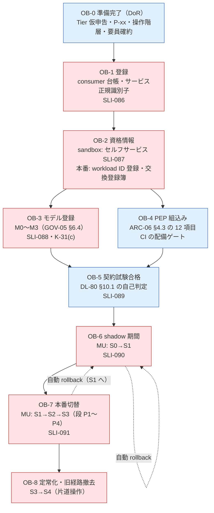
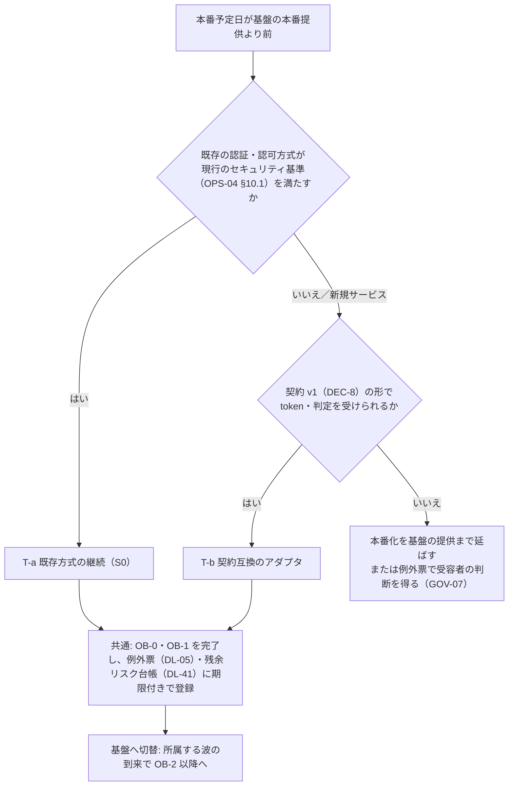
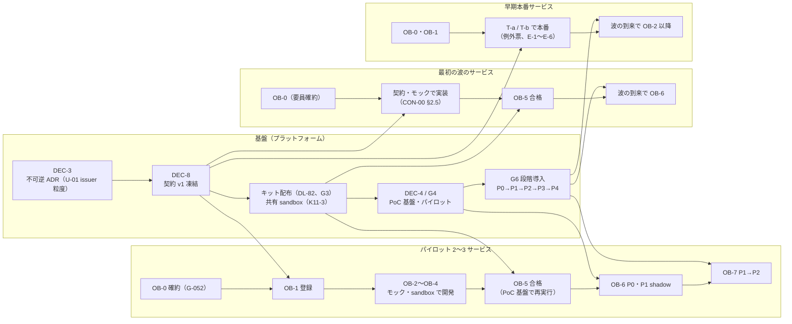

# オンボーディング手順

> 文書ID: INT-04 / 版: 0.2 / 状態: draft / 最終更新: 2026-10-15
> 対応要求: R-140, R-179（R-requirements.md で対応成果物欄に本書のパスまたは DL-66 を含む行と、成果物計画の DL-66 行）／G-052, G-053, G-116, G-124, G-129, G-141, G-144（G-goal-criteria.md で対応成果物欄に本書のパスまたは DL-66 を含む全行）。関連: 主張台帳 CL-0264（移管先が本書）、seed-03 C3・§7-15
> 依存文書: CONVENTIONS.md, traceability/deliverables.md（DL-66）, 05_adr/ADR-009, ADR-012, ADR-016, ADR-022, ADR-023, ADR-027（設計判断の正本）, 05_adr/reconciliation-notes.md, 08_operations/operating-model.md（DL-27）, 08_operations/phased-rollout.md（DL-31）, 08_operations/tco-vendor-lts.md, 10_integration/dependency-tiers.md（INT-01）, 10_integration/integration-patterns.md（INT-02）, 10_integration/authz-modeling-guide.md（INT-03）, 11_contracts/README.md（CON-00）, 11_contracts/compatibility-deprecation-policy.md（DL-70）, 11_contracts/mock-contract-test-kit.md（CON-11、DL-80）, 04_architecture/pep-contract.md（ARC-06）, 04_architecture/workload-identity-delegation.md（ARC-04）, 07_slo/numeric-contracts.md（DL-20）, 01_governance/raci-governance.md（GOV-05）, 01_governance/kri.md（K-29, K-31）, 01_governance/assumptions-register.md, 02_requirements/as-is-inventory.md（REQ-07 §6.2）, research/RS-16（各 verification 記録を含む）
> 作成方法: AI エージェント（Claude）が上記の文書を読んで起草した。判断は自己レビューであり、実在の CTO/CISO・CFO・調達・法務の決裁ではない（CONVENTIONS §8）[D]。research の外から新しく取得した原典はなく、脚注の原典はすべて research/ で独立検証済みの記録（research/verification/RS-16-verification.md）に依る [D]。版 0.2 は模擬パネル（自己レビューであり、実在の CTO/CISO の決裁ではない）のラウンド 7 の指摘を受け、CON-14 §9 の申し送り H-13 を反映し、§4.3 の sandbox の workload、本番の SVID 登録エントリ（OB-2(b)）と交換可能な組（OB-2(c)）の行を client-registration.openapi.yaml（CON-14）§4A の操作・申請種別 `workload`・`exchange_pair`・承認者案 AR-6・AR-7 に結び付けた版である。新たな外部原典は用いていない（末尾「レビュー記録」ラウンド 7）[D]。
> 表記: 本書の段階は OB-0〜OB-8、決裁案は ONB-Kx、新規仮定は NA-ONB-x、残課題は ONB-Rx と書く。表のセルのうちタグのないものは設計推論 [D] であり、本注記で個別のタグに代える。

## 要旨（結論）

1. **参加は 9 段階（OB-0 準備完了〜OB-8 定常化）で進め、中央チームが待たせる段を 4 つ（OB-1 登録、OB-2 本番 workload ID・交換登録、OB-3 のうち M1〜M3 のモデル審査、OB-6/OB-7 の MU 前進承認）に絞る** [D]。契約試験（OB-5）と PEP 組込み（OB-4）は CI の自動ゲートと自己判定で通し、中央の承認を待たない（ADR-022 D-7-1、CON-11 §10.1）[D]。DORA は、チーム外の重い承認がデリバリー性能に負に働き、変更失敗率を下げる証拠も見つからなかったと報告している [M][^8]（RS-16#59）。
2. **各段の承認者は ADR と統治文書が既に決めた者に揃え、本書は新しい承認者を作らない** [D]。MU の S0→S1・S1→S2 はサービスオーナー＋プラットフォームチーム長（ADR-027 D27-02、D27-26）、privileged・越境の意図差分を含む MU は CISO の同意を加え、段（P1→P2 など）の切替は CTO が判定する [D]。モデル変更は GOV-05 §6.4 の M0〜M3、交換可能な組は呼出し先の所有者（ADR-009 D09-13）が承認する [D]。
3. **リードタイムの目標値は、根拠のある公開基準値がないため全段 TBD とし、SLI-086〜SLI-091 で測る** [D]。共有認証基盤のオンボーディングについて公開された基準値は見つからず [D]（RS-16 §2-12）、GビズID の連携規約は審査期間を保証しないと明記し [V][^2]（RS-16#45）、デジタル認証サービスは 5 段階の手続を示すが所要期間を示さない [V][^3]（RS-16#80）。目標値は CTO が G4 でパイロットの実測から決裁し、それまでの波の計画は §5.3 の待ち行列の式で中央の処理能力が足りるかを確かめる [D]。
4. **費用配賦は「必須機能は呼出し量に比例させない」を原則とする決裁案（ONB-K1）を置く** [D]。算出できる定常費の 87〜90% は要員費であり（tco-vendor-lts.md §0）、Check 数や token 数による従量配賦は、サービスに allow の自前 cache や PEP の省略で費用を下げる誘因を与える [D]。これは ARC-06 OB-11（allow を自前で cache しない）と K-01（PEP 未網羅）の統制に逆らうので、推奨しない [D]。
5. **基盤の本番提供より前に本番を迎えるサービスは、OB-0・OB-1 と「契約の形での実装」を先に済ませ、OPS-04 §10.5 の暫定方式 T-a〜T-c を例外票付きで使う** [D]。sandbox の issuer・資格情報を本番で使うことは禁止のままである（ADR-022 D-3-2、D-6-4）[D]。
6. **未達**: リードタイムの目標値、費用配賦の方式、利用インセンティブ、委託契約の条項はいずれも決裁案の段階で、承認記録はない（G-053、G-129 は B 区分）[D]。パイロットでの実測（G-144）もしていない [D]。新規サービス（旧判定を持たないサービス）の shadow の扱いは ADR-027 で決まっていない（未決（ADR-027））[D]。

---

## 1. 位置付けと読み方

### 1.1 本書が決めること・決めないこと

| 本書が決めること | 決めないこと（正本） |
|---|---|
| 参加の段階、各段の成果物・承認者・リードタイムの測り方・費用の負担区分 | 移行の方式・状態機械・差分の扱い（ADR-027、DL-31） |
| 段の入口・出口の条件と、中央待ちの記録様式（SLI-086〜SLI-091、K-31 の入力） | 準備完了条件の詳細項目（DL-67 Definition of Ready） |
| 早期本番サービスの手順（OPS-04 §10.5 をオンボーディングの側から運用する規則） | 暫定方式そのものの定義（OPS-04 §10.5） |
| 並行開発のマイルストーン例 | ゲートの日程（DL-42）、契約の凍結（DEC-8、ADR-022 D-11） |
| 費用配賦・インセンティブ・中央待ちの目標・委託契約条項の決裁案 | 体制と TCO の決裁要約（DL-43）、認可モデル審査 SLA の決め方（GOV-05 DP-6） |

### 1.2 読み手別の入口

| 読み手 | 最初に読む節 |
|---|---|
| CTO・CISO | 要旨、§3（全段の表）、§8（決裁案） |
| CFO・事業責任者 | §6（費用配賦）、§8 の ONB-K1・ONB-K2・ONB-K4 |
| 連携開発者（ベンダーを含む） | §2（流れ図）、§4（段ごとの手順）、§7（早期本番）、§9（マイルストーン例） |
| 調達・法務 | §8 の ONB-K5、付録 A（委託契約の条項案） |

### 1.3 前提（A-ID）

| A-ID | 値（基準） | 本書での使い方 |
|---|---|---|
| A-050 | 依存サービス 300 | 参加の母数、台帳の規模 [A-050] |
| A-052 | 25 組織・60 チーム | 並行するオンボーディングの数、窓口の負荷（operating-model §8.3）[A-052] |
| A-054 | プラットフォームチーム 24 FTE | 中央の審査能力の上限（§5.3）。operating-model §0 は 24 FTE では ADR 群の運用を回せないとしている [A-054] |
| A-055 | entry point 1.2 万 | OB-4 の台帳登録の対象数 [A-055] |
| A-110 | 共通 SSO 120・独自セッション 105・LDAP 30・共有シークレット 45 | 段ごとの改修量の区分（C_改修 の k）、波の順序 [A-110] |
| A-112 | 自前の認可実装 240、アプリ層だけのテナント分離 70% | OB-3 のモデル写像の量、OB-6 の旧判定の性質 [A-112] |
| A-113 | 共有シークレット 3,000 件 | OB-2 の共有秘密の置換 [A-113] |

新規仮定（前提台帳へ追加要）は §10 に置く。

---

## 2. 全体の流れ



- 赤枠は中央チームか他チームの承認を待つ段、青枠はサービス側が自分で進め、CI の自動ゲートか自己判定で通る段である [D]。
- OB-3 と OB-4 は並行に進めてよい [D]。OB-5 の契約試験は OB-3 で登録したモデルと OB-4 の PEP の両方を対象にするので、両方の後に置く [D]。
- 段の順序はレビューの導入順序（read-only → 低リスク tenant → 限定 resource type → cell 単位、R-179）を OB-6・OB-7 の中で守る（§4.7、ADR-027 D27-23）[D]。
- CNCF の Platforms White Paper は、platform の属性に self-service と documentation and onboarding を挙げ、利用者が能力を自律的・自動的に要求し受け取れなければならないとする [V][^1]（RS-16#62, #63）。本書が青枠の段を増やし、赤枠の段を記録付きの待ちとして測るのはこのためである [D]。

---

## 3. 段階ごとの成果物・承認者・リードタイム・費用配賦（G-124）

G-124 の合格条件は「全段階に承認者・所要期間・費用配賦の 3 項目がある」ことである [D]。下表の「リードタイム」は目標値の状態を示し、目標値はすべて TBD である（決め方は §5）[D]。「費用配賦」は ONB-K1 の推奨案（§6）に基づく負担区分であり、決裁前の案である [D]。

| 段 | 主な成果物 | 承認者（正本） | リードタイム（SLI・状態） | 費用配賦（推奨案） |
|---|---|---|---|---|
| OB-0 準備完了 | DoR 申告（DL-67）: Tier 仮申告、P-xx の選定、entry point ごとの操作階層の草案、BIA 票 A6、要員確約、移行見積り（C_改修） | サービスオーナー（申告）、事業責任者（要員と移行費用の確約）。Tier 1 の追加は事業責任者（ADR-023 D23-50、KD23-1） | 中央待ちなし。サービス側の所要日数を記録だけする（§5.4） | ドメイン負担（自サービスの作業）。様式・FAQ・office hours は中央負担 |
| OB-1 登録 | consumer 台帳の行（CC-01）、サービス正規識別子（ADR-021 の名前空間台帳）、連絡先・所有組織・使用版、リリースノートの購読 | プラットフォーム（契約管理）。識別子の払い出しは不可逆なので形式検査を自動で行い、例外だけ人が見る | SLI-086（TBD） | 中央負担 |
| OB-2 資格情報 | (a) sandbox の client・workload・テナント 2 つ以上（CON-11 §5.2）、(b) 本番の SVID 登録エントリ（ARC-04 W55-08）、(c) 交換可能な組の登録簿（ADR-009 D09-13）、(d) 本番 client の登録 | (a) セルフサービス（承認なし）。(b) プラットフォームチーム（作成者≠承認者。selector の妥当性）。(c) 申請は呼出し元の所有者、承認は呼出し先の所有者（D09-13）。(d) 案: 認証・IdP チームの有資格者（作成者≠承認者）。層 F・app-only などは承認者を加える（§4.3、ONB-R2 で確定） | (a) SLI-087（TBD）。(b)(c)(d) は SLI 未採番（DL-20 へ申し送り、ONB-R3） | (a)(b) 中央負担。(c) 承認作業は呼出し先ドメイン負担。共有秘密の置換（A-113）はドメイン負担 |
| OB-3 モデル登録 | CAM モジュール、関係テスト、変更区分の申告（INT-03 §8） | M0: ドメイン内 peer review。M1: ＋プラットフォームのセキュリティレビュアー（非同期）。M2: プラットフォームが多段手順と shadow を確認。M3: プラットフォーム 2 名以上＋CISO 同意（GOV-05 §6.4） | SLI-088（TBD）、M1 の待ちは K-31(c)。SLA の決め方は GOV-05 DP-6 | 自ドメインの型はドメイン負担。審査要員と自動ゲートは中央負担 |
| OB-4 PEP 組込み | entry point 台帳（IDL から生成）、ARC-06 §4.3 の 12 項目、SDK 導入または SDK なしの自前実装の登録、storage guardrail | CI の配備ゲート（自動。ARC-06 §6.5）。例外は例外台帳: privileged 以上とテナントデータを返す read-sensitive は CISO、それ以外はプラットフォームチーム長（ARC-06 §6.6） | 中央待ちなし。例外の承認待ちは K-31 に計上（SLI 未採番、ONB-R3） | ドメイン負担（C_改修）。SDK・静的規則・生成器は中央負担 |
| OB-5 契約試験合格 | DL-80 の判定記録（版・ハッシュ・ベクタごとの結果・CI 署名）の契約レジストリへの登録 | 自己判定（CON-11 §10.1）。ベクタの適用除外は契約変更審査会 | SLI-089（TBD。提出から合否確定まで） | ドメイン負担（CI の実行）。キット・共有 sandbox は中央負担 |
| OB-6 shadow 期間 | 移行台帳の MU 行、旧判定の取得点、意図差分台帳の登録 | S0→S1: サービスオーナー＋プラットフォームチーム長（ADR-027 D27-02）。意図差分: N はサービスオーナー、X はサービスオーナー＋セキュリティ、越境の X は＋CISO 同意（D27-20） | SLI-090（下限型。TBD。下限は §5.2 の式） | shadow の容量と差分調査（移行専任、K27-3）は中央負担。旧判定の取得点の改修はドメイン負担 |
| OB-7 本番切替 | 段判定記録、自動 rollback の演習記録、告知の記録 | MU の S1→S2・S2→S3: サービスオーナー＋プラットフォームチーム長。privileged・越境の意図差分を含む MU は＋CISO 同意。段の切替は CTO（D27-26） | SLI-091（TBD。切替承認から本番トラフィック受付まで） | 中央負担（配布・rollback 機構）。サービス側の待機要員はドメイン負担 |
| OB-8 定常化・旧経路撤去 | 撤去の承認記録、旧経路への到達 0 件の計測 | S3→S4 は片道操作で、CTO＋サービスオーナー、CISO の同意（D27-47）。GOV-06 S6 の F-d 解除が前提 | SLI なし（期間は ADR-027 D27-47 の TBD） | 旧系の並行稼働費（C_並行）は旧系の所有者負担（ONB-K1） |

- 上表の承認者のうち本書が新たに置いたものは、OB-1 の「プラットフォーム（契約管理）」と OB-2(b) の「プラットフォームチーム（作成者≠承認者）」の 2 つだけである [D]。前者は CON-01 §6.1 が consumer 台帳の所有者を CTO（プラットフォームチーム）とし、登録窓口を DL-66 に委ねたこと（compatibility-deprecation-policy.md の残課題表）による [D]。後者は operating-model §7.2 の CP-2（名前空間・テナント単位の構成は作成者≠承認者の peer review）に当てはめた本書の判断である [D]。
- R-140（変更承認）への回答は、上表の承認者列と operating-model §7.2 の変更区分を合わせたものである [D]。人の審査を置くのは、信頼の起点に近い操作（SVID の selector、識別子の払い出し）、権限の拡大（M1〜M3）、本番の正本の切替（OB-6〜OB-8）に限る [D]。

---

## 4. 段階ごとの手順

### 4.1 OB-0 準備完了（DoR）

| # | 行うこと | 正本 | 完了の確かめ方 |
|---|---|---|---|
| 0-1 | Q-01〜Q-09 に答えて Tier を仮申告する。申告のないサービスは本番に接続しない | INT-01 §2.3、ADR-023 D23-04 | DoR 申告に Tier と BIA 票 A6 がある |
| 0-2 | entry point ごとに主パターン（P-xx）と操作階層（REQ-03 の 5 分類）を決める | INT-02 §2.1、§10.2 | entry point の一覧に P-ID・操作階層・Tier が全行で埋まっている |
| 0-3 | 認可要件を INT-03 の判定図で置き場所に振り分け、モデルの草案を書く | INT-03 §3 | 要件ごとの置き場所が決まっている |
| 0-4 | 移行見積り（REQ-07 §6.2 の C_改修 の e_k）と、OB-4 以降に充てる要員を事業責任者が確約する | REQ-07 §6.2、OPS-04 §5.4 | 確約の記録（パイロットは DL-40 の確約欄、G-052） |
| 0-5 | 既存の旧判定の取得点を確かめる（既存サービスのみ） | ADR-027 D27-11、OPS-04 §4.2 | 取得点の位置、または観測不能 MU の申告 |
| 0-6 | preview の要素に依存するなら、要素と理由を申告し adapter 層に閉じ込める | CON-00 §2.5 手順 2、CC-07 | DoR 申告の preview 依存欄 |

- 0-4 を OB-0 に置くのは、自治体標準化で 34,366 システムのうち 10,013（29.1%）が期限内に移行できず、事由の大半が事業者のリソースひっ迫であったためである [M][^5]（RS-16#78。測定条件: 総務省の標準化 PMO ツールによる 2026 年 3 月末時点の集計）。公共の基幹業務システムの結果であり本計画の遅延率の根拠ではないが、要員確約を入口の条件にする理由として使う [D]。

### 4.2 OB-1 登録

- consumer 台帳（CON-01 §6.1）に、サービス、所有チーム、開発組織・ベンダー、事業責任者、連絡先、使う契約と版、BIA 影響度、移行計画を登録する（CC-01）[D]。
- サービスの正規識別子（exchange の `resource`、SPIFFE ID の path、名前空間）は ADR-021 の名前空間台帳から払い出す [D]。払い出した識別子は再割当てしない（ARC-04 W55-04）[D]。SPIFFE ID の path の具体形式は未決（ADR-021 D21-28 の採否は ADR-009 に委任、詳細は DL-71）であり、確定まで識別子は台帳上の予約にとどめ、本番の SVID には使わない [D]。
- issuer の粒度は未決（ADR-007／ADR-021、U-01、DEC-3）である [D]。サービスは issuer を設定から読み、discovery を経由して JWKS を得る実装にしておけば、粒度の決定で登録をやり直す必要はない [D]（ADR-022 D-3-2）。
- 早期本番サービス（§7）も OB-1 を必ず行う [D]。登録していないサービスは K-29（未移行 consumer 数）の母数から漏れ、非推奨の通知も届かないからである [D]（ADR-016 D16-21）。

### 4.3 OB-2 資格情報（sandbox と本番）

| 対象 | 手順 | 承認 | 禁止事項・注意 |
|---|---|---|---|
| sandbox の client・workload・SSF stream・SCIM 資格情報 | consumer 台帳に登録済みのチームが自分で登録する（CON-11 §5.2 (c)）。client は CON-14 §4 の `registerSandboxClient`、workload（SVID 登録エントリ）は CON-14 §4A.2 の `registerSandboxWorkload`（削除は `deleteSandboxWorkload`）、交換可能な組は §4A.3 の `registerExchangePair`（呼出し先が他の consumer なら呼出し先の所有者が `decideSandboxExchangePair` で承認）で行う（いずれも preview、版 0.2.0）。SSF stream・SCIM 資格情報のセルフ登録の契約はまだない（CON-11 §5.2 (c)） | なし（交換可能な組で呼出し先が他の consumer の場合だけ、呼出し先の所有者の承認。中央の承認は待たない。CON-14 §4A.3） | sandbox の issuer は本番の allowlist に載らず、sandbox の token は本番で拒否される（ADR-022 D-6-4、CV-011）。本番データを持ち込まない（ADR-008 D8-55） |
| sandbox テナント | consumer ごとに 2 つ以上払い出す（cross-tenant 試験のため） | なし | 合成データ生成器の書式以外の属性値は拒否される（CON-11 §5.2 (e)） |
| 本番の SVID 登録エントリ（OB-2(b)） | selector を、基盤が管理し workload が書き換えられない属性の組合せで申請する（ARC-04 W55-08）。手段は CON-14 §5 の申請 API（`submitClientRegistrationRequest`）に申請種別 `subject: workload` で WorkloadEntry を送る（CON-14 §4A.4、preview）。selector は `k8s:ns`・`k8s:sa`・`image:digest`（本番は必須）に限り、SPIFFE ID は基盤が払い出す（CR15〜CR17、CR21） | プラットフォームチーム（作成者≠承認者）。CON-14 の承認者案 AR-6 はこれを写したもの（selector の妥当性、namespace の割当て、所有者・副所有者の有無を見る）。確定は ONB-R2 | 主所有者・副所有者のない主体には発行しない（W55-11）。無関係なインスタンス間で鍵を共有しない（W55-06） |
| 交換可能な組（呼出し元 × 呼出し先 × scope 上限。OB-2(c)） | 呼出し元の所有者が申請する（ADR-009 D09-13）。手段は CON-14 §5 の申請 API に申請種別 `subject: exchange_pair` で ExchangePair（`caller_spiffe_id`・`callee_service_id`・`max_scope`・`justification`）を送る（CON-14 §4A.3・§4A.4、preview）。`max_scope` は空・wildcard 不可（CR19） | 呼出し先の所有者。CON-14 の承認者案 AR-7 はこれを写したもの。`max_scope` が privileged の scope（F1・F2）を含む組は AR-3（CISO 組織のセキュリティレビュアー）も要る。廃止は AR-0（所有者だけ）。確定は ONB-R2 | 登録簿にない exchange は STS が拒否する |
| 本番の client（第一者・第三者・外部 RP・M2M） | client-registration.openapi.yaml（CON-14、DL-119）の登録申請 API（`submitClientRegistrationRequest`）に、sandbox で通ったのと同じ ClientMetadata を本番の値で申請する。共有 client secret は登録できず、private_key_jwt か mTLS（public client は none＋DPoP）に限る（ADR-009 D09-18、D09-19、同契約 §3）。承認がそろうと払い出され、`getClientRegistrationRequest` で sandbox と別の `client_id` を受け取る（ADR-021 D21-22） | **案**（同契約の x-approval-rules。既存の変更区分への当てはめで、新しい承認者は置かない）[D]。AR-1 全申請: 認証・IdP チームの有資格者（作成者≠承認者。operating-model §7.2 の CP-2 相当）。AR-2 第三者・外部 RP: 発行者確認を加える（ADR-005 D7-1）。AR-3 層 F・privileged scope: CISO 組織のセキュリティレビュアー（非同期）を加える（ADR-020 D20-03）。AR-4 複数テナントにまたがる app-only の権限: 別報告系統の二者（CP-1 相当、ADR-008 D8-54）。AR-5 第三者サーバー型で DPoP を使う例外: 受容票を必須にする（ADR-005 K-3）。廃止（retire）は所有者だけで成立する。確定は ONB-R2 | 本番の AS では動的登録を無効にする（ARC-02 §9.2 行 34）。申請の時点で種別ごとの規則に反するものは 400 で返る（理由コード CR01〜CR13）。ADR-022 が本番の登録手段を定めていないので、申請 API は preview である（同契約 §6）[D] |

- sandbox の client 登録は、client-registration.openapi.yaml の RFC 7591/7592 profile（preview、ADR-022 D-2）で行う [D]。OB-1 を終えたチームに sandbox 専用の initial access token を発行し、チームはそれを付けて sandbox の AS に自分で登録する（承認なし。CON-11 §5.2 (c)）[D]。RFC 7591 は、AS が登録できる者を限定する場合に initial access token を使うことを定め、software statement には署名または MAC と `iss` を求める（MUST）[N][^4]（RS-16#20）。software statement は署名者の台帳がないため v0.1 では受け付けない（同契約 §4）[D]。
- sandbox への本番 redirect URI・本番の公開鍵の登録は拒否され、sandbox の `client_id` は本番の AS で使えない（同契約の負例 CRN-01・CRN-12・CRN-13）[D]。
- workload と交換可能な組の登録（CON-14 §4A）は、2026-10-15 時点で API とモック（キット本体 DL-120、期限 G3）が未実装である [D]（CON-14 §4A.5）。それまでは CON-14 §4A.5 の暫定手順による。(1) ローカルでは PoC（12_poc/code）を手元に複製し、`lib/topology.js` の `WORKLOADS` と `config/ledger.json` の `services`・`exchange_registry` を改変して起動し直す（コミットしない。selector の検査・承認・負例は再現できない）。(2) 共有 sandbox の提供後で API の提供前は、S1 窓口（INT-00 §8.1）に WorkloadEntry・ExchangePair と同じ項目で依頼し、プラットフォームチームが手で登録する [D]（INT-00 §6.1）。申請から払出しまでの SLI は未採番である（ONB-R3）[D]。
- 共有 sandbox の提供時期と運用水準は K11-3（CTO、DEC-8 前）で決まり、提供時期は DL-42・DL-62 で公開される [D]。sandbox がない間は、ローカルのモック（MK-01〜MK-07）で OB-5 の準備を進める [D]（CON-11 §16.2）。

### 4.4 OB-3 モデル登録

- 手順・命名・変更区分は INT-03 §3・§4・§8 が正本である [D]。本書は待ちの測り方だけを足す [D]。
- 初回のモデル登録は、自ドメインの名前空間に型を追加する変更なので、権限拡大を検出しない限り M0（ドメイン内 peer review）で通る [D]（GOV-05 §6.4）。高リスク操作階層の permission を含む場合は M1 になり、プラットフォームのセキュリティレビュアーの非同期レビューを待つ [D]。
- 中央の待ちは「M1〜M3 の審査待ち」だけを SLI-088 と K-31(c) に計上し、M0 の peer review の待ちはドメインの内部の時間として別に記録する [D]。審査の律速を中央の能力として正しく測るためである [D]。
- 既存の自前実装（A-112 の 240 サービス）は、旧 role モデルを typed ReBAC に写す作業が加わる [D][A-112]。写し違いは OB-6 の判定差分で見つかるので、OB-3 の審査で網羅を求めない [D]（ADR-027 D27-17）。

### 4.5 OB-4 PEP 組込み

- ARC-06 §4.3 の 12 項目を実装し、依存サービスの CI に静的規則（SR-01〜SR-20）、DL-80 の契約試験、cross-tenant property test の生成器を必須ゲートとして組み込む [D]。配備ゲートの拒否条件は ARC-06 §6.5 の 4 つである [D]。
- **SDK を使う場合**: SDK の責務は 5 つに限られ、契約にない意味論（独自 fallback、判定不能時の allow）を持たない（ADR-022 D-4-1、D-4-2）[D]。共通の token 検証・tenant binding の SDK を早期に配布する方針（主張台帳 CL-0264、処置「維持」、移管先は本書）は、SDK の提供言語と時期が NA-022-1・DL-62 で決まるまで、本書では「配布時期 TBD」として扱う [D]。
- **SDK を使わない場合（G-140 の「SDK なしの連携」）**: 次の 4 手順で SDK と同じ合否判定に到達できる [D]（ADR-022 D-4-3、D-11 条件 1）。
  1. ARC-06 §4.2 の外形（`authenticate`→`bind_tenant`→`authorize`→`enforce`）を自前で実装する。
  2. 自前実装であることを entry point 台帳と consumer 台帳に登録する（ARC-06 §4.3 の 3）。
  3. 契約（DL-75 の検証規則、CON-03）と、SDK と同じ負例ベクタ（CV-001〜CV-014）で OB-5 の判定を受ける。
  4. SDK の版差の許容幅とサポート期間（TBD、DL-70）の代わりに、契約の版を自リポジトリに固定し、版が上がったら CON-01 の互換区分に従って追随する（CON-00 §2.5 手順 3）。
- 改修量は認証方式の区分で大きく変わる [D][A-110]。共通 SSO を経由しない 180 サービスはサービス側の改修を伴う（ADR-027 §1.2、OPS-04 §5.4）[D]。

### 4.6 OB-5 契約試験合格

- 判定は自己判定で、中央の審査を待たずに配備ゲートを通せる（CON-11 §10.1）[D]。判定記録を契約レジストリへ登録した時刻から合否が確定するまでを SLI-089 で測る [D]。
- 判定不能（キットの版・ハッシュの照合失敗、モック障害、manifest の不備）は合格として扱わない [D]（CON-11 §10.1）。
- 基盤との結合が深い consumer（edge、BFF、PEP sidecar、監査収集）は、Pact Broker への登録が上層の義務になる（ADR-022 D-6-1）[D]。
- キット本体（DL-82）の配布は G3 の予定で、それまで負例・署名付き試験を自 CI で実行できない（CON-11 §16.3）[D]。配布前に作ったものは、DEC-8 後に DL-80 の判定で確かめ直す [D]。

### 4.7 OB-6 shadow 期間と OB-7 本番切替

- 方式の正本は ADR-027、運用の正本は OPS-04 である [D]。本書はオンボーディングの段としての入口・出口だけを定める [D]。

| 項目 | OB-6（S0→S1） | OB-7（S1→S2→S3） |
|---|---|---|
| 入口 | OB-5 合格、旧判定の取得点の確認（観測不能 MU は OPS04-K4）、所属する波（OPS-04 §5.4）の到来 | OPS-04 §6.2 の C1〜C10 を、その段の bake 時間の間満たし続けた |
| 段の順序（R-179） | P1 では read-sensitive の MU だけを S1 に入れる | P1 read-only → P2 低リスク tenant（write を追加）→ P3 限定 resource type（privileged は type ごとに最後）→ P4 cell 単位（ADR-027 D27-23） |
| 出口 | S1 で差分記録が稼働し、一致判定数が §5.2 の下限に達した | S3 で一定期間自動 rollback がない（期間は TBD、D27-47） |
| 自動化 | 後退（S1→S0）だけ自動 | 後退（S2・S3→S1）だけ自動。前進は人が承認（D27-03） |

- **新規サービス（旧判定を持たないサービス）の扱いは未決（ADR-027）である** [D]。ADR-027 の S1 は旧系の判定と比べることを前提にしており、旧系がないサービスでは S1 の比較が成立しない [D]。本書の暫定は次のとおりとし、ADR-027 の改版で決める（ONB-R1）[D]。
  - 判定差分の比較を省き、cross-tenant property test（D27-16）、既知解 probe（D27-28 R4）、関係テストの全件合格を S2 相当の入口とする。
  - 段の順序（P1〜P4）と cell の wave 順（ADR-013 D13-30）は既存サービスと同じに守る。
  - 前進の承認者は既存サービスと同じ（D27-26）とする。
- 告知と顧客側作業は OPS-04 §9 に従う [D]。オンボーディングの段として独自の告知は出さない [D]。

### 4.8 OB-8 定常化と旧経路撤去

- 旧経路の撤去（S4）は片道操作であり、GOV-06 S6 の F-d が解除されるまで計画に入れない（ADR-027 要旨、D27-47）[D]。
- 定常化の後も、consumer 台帳の連絡先と使用版を最新に保ち（CC-01）、非推奨の告知に従って版を追随する（DL-70）[D]。

---

## 5. リードタイム目標（G-144）

### 5.1 SLI と状態

| 段 | SLI | 種別 | 定義（DL-20 §5.7） | 目標値 | 所有者・期限・決め方 |
|---|---|---|---|---|---|
| OB-1 登録 | SLI-086 | 予算型 | 申請から consumer 台帳への登録完了まで（p50・p95） | TBD | CTO、G4、パイロットの実測と §5.3 の容量確認 |
| OB-2 sandbox | SLI-087 | 予算型 | 登録完了から sandbox の資格情報発行まで | TBD | 同上（共有 sandbox の運用水準は K11-3） |
| OB-3 モデル審査 | SLI-088 | 予算型 | 審査申請から判定まで（M1〜M3。M0 は別記録） | TBD | 同上。SLA の値は GOV-05 DP-6（CTO、CISO 同意、Gate 3） |
| OB-5 契約試験 | SLI-089 | 予算型 | 判定記録の提出から合否確定まで | TBD | 同上 |
| OB-6 shadow | SLI-090 | 設定上限型（下限） | shadow の最短期間と終了条件を満たすまでの期間 | 下限は §5.2 の式。値は TBD | 同上。下限は ADR-027 の段と SLI-081 から導く |
| OB-7 本番切替 | SLI-091 | 予算型 | 切替承認から本番トラフィック受付まで | TBD | 同上 |
| OB-2 本番 SVID・交換登録、OB-4 例外承認 | 未採番 | 予算型（案） | 申請から承認まで | TBD | DL-20 の作成者へ採番を申し送る（ONB-R3） |

- 目標値に外部の数値を転用しない [D]。共有認証基盤のオンボーディングの公開基準値は見つからず [D]（RS-16 §2-12、§6）、CNCF の白書も「新サービスを構築して本番に展開するまでの時間」を platform の効率指標に挙げるだけで値を示していない [V][^1]（RS-16#64）。

### 5.2 shadow 期間の下限の導き方

- shadow の期間は、件数の条件と業務の周期の条件の両方を満たすまで終われない [D]。OPS-04 §6.3 の bake の式をオンボーディングの OB-6 に当てはめる [D]。

```
T_shadow(MU) ≥ max( n_req / r_match , t_cycle , t_min )
  n_req   : 層（MU × 操作階層）ごとの必要一致判定数。n ≥ 3/p（ADR-027 D27-15。p は TBD: CISO＋事業責任者、G4）
  r_match : その層で shadow が評価する一致判定の到着率（件/日）。パイロットの実測値
  t_cycle : 業務の周期（月次締め等）。BIA の業務記述から決める（NA-OPS04-1、前提台帳へ追加要）
  t_min   : 段ごとの最短 bake（OPS-04 §6.3、TBD）
```

- 要求量の少ないサービスほど n_req / r_match が長くなる [D]。要求量が少なく期間が延びすぎる MU は、記録した要求の再生（R-175、D27-15）で件数を補う [D]。

### 5.3 中央の処理能力の確かめ方（目標値の決裁前）

目標値が決まる前でも、波の計画が中央の審査能力を超えていないかは次の式で確かめられる [D]。式は待ち行列の一般的な性質であり、外部の原典に依らない [D]。

```
λ_s = Σ_w ( N_w × c_s ) ÷ D_w        段 s への到着率（件/週）
μ_s = R_s × H × u_s ÷ h_s             段 s の処理能力（件/週）
ρ_s = λ_s ÷ μ_s                       利用率。ρ_s が 1 に近づくと待ち時間は急に伸び、1 以上では待ちが際限なく積み上がる
  N_w : 波 w に入るサービス数（OPS-04 §5.4、A-050）
  c_s : 1 サービスあたりの段 s の申請件数（パイロットの実測）
  D_w : 波 w の期間（OPS04-K1、TBD）
  R_s : 段 s の審査要員数（operating-model §4、DP-OM-2）
  H   : 1 FTE の週あたり稼働時間（人事規程の値）
  u_s : 審査に充てる比率
  h_s : 1 件あたりの審査時間（パイロットの実測）
```

- c_s・h_s は前提台帳にも research にも根拠のある値がない（NA-ONB-2、前提台帳へ追加要）[D]。パイロットで測るまでは、ρ_s の計算を「どの量が分かれば判定できるか」の確認にだけ使う [D]。
- ρ_s が閾値（TBD、所有者 CTO、G4、決め方: パイロットの待ち時間の分布）を超える計画は、OPS04-K1 の並行度の上限を下げるか、GOV-05 §6.6 の順（自動化→M0 の拡大→増員）で処理能力を上げる [D]。

### 5.4 オンボーディング記録の様式（SLI-086〜091、K-31 の入力。SRC-18）

| 欄 | 内容 |
|---|---|
| 識別 | サービス ID、MU ID（OB-6 以降）、段（OB-0〜OB-8）、申請 ID |
| 時刻 | 申請、受付、中央の着手、判定、差戻し、再申請、完了 |
| 待ちの帰属 | 中央（プラットフォーム・セキュリティ・SRE）／他ドメイン（呼出し先の承認）／サービス自身 |
| 手戻り | 差戻しの回数と理由の分類（文書の不備／契約の不備／サービス側の誤り／基盤の不具合） |
| 問い合わせ | 段の間に起票したチケット数（operating-model §8 の S1 と突合） |
| 費用 | サービス側の作業時間（C_改修 の e_k の実績）、中央の作業時間 |

- 「待ちの帰属」を分けるのは、K-31 が中央チームの審査待ちを測る指標であり（kri.md §4.8）、他ドメインやサービス自身の待ちと混ぜると中央の律速を誤って判定するからである [D]。
- 手戻りの分類に「文書の不備」「契約の不備」を置くのは、デジタル庁の多ベンダー検証事業が、仕様の解釈がベンダーごとにずれる可能性と未定義部分の仕様がベンダーごとに異なる可能性を課題に挙げたためである [M][^6]（RS-16#79。測定条件: 推奨構成と技術仕様に準拠した検証環境でのテストデータによる検証）。分類の結果は FAQ・正誤表の改訂（ADR-022 D-7-3）に戻す [D]。

---

## 6. 費用配賦と利用インセンティブ（G-053）

### 6.1 費目と負担区分（推奨案）

| 費目 | 内容 | 規模の手掛かり | 負担（ONB-K1 推奨案） |
|---|---|---|---|
| C_基盤定常 | 基盤の運用要員・KMS・監査保管・ライセンス・インフラ | 算出可能分で年 2.87〜6.80 億円（ライセンス・インフラ等は TBD）[D]（tco-vendor-lts.md §4.10） | 全社共通費。配賦キーは呼出し量に連動させない（ONB-K1 (c)） |
| C_受入 | 審査要員、窓口（operating-model §8）、移行専任チーム（K27-3）、共有 sandbox、キット・SDK | 要員は operating-model §4 の幅に含まれる | 全社共通費（構築期は本社負担） |
| C_shadow | shadow の判定・記録の容量 | Check 最大 42,009/秒、差分の全文記録 [A-045, A-049]（ADR-027 D27-14） | 全社共通費 |
| C_改修 | サービス側の PEP 組込み・モデル写像・共有秘密の置換 | Σ_k S_k × e_k × r_d（REQ-07 §6.2。S_k は A-110、他は TBD） | ドメイン負担。ONB-K2 の補助の対象になり得る |
| C_並行 | 旧系の並行稼働 | Σ_j T_j × m_j（REQ-07 §6.2、TBD） | 旧系の所有者の負担（共有の旧 IdP は全社共通費） |
| C_顧客・C_支援 | 顧客側作業と自社の顧客支援 | REQ-07 §6.2（TBD） | REQ-07 の DQ-B で決める（本書は重ねて決めない） |
| C_暫定 | 早期本番サービスの暫定方式（T-b のアダプタ等） | TBD | ドメイン負担（ONB-K4） |

### 6.2 従量配賦を推奨しない理由

- 算出できる定常費の 87〜90% は要員費であり、Check 1 件・token 1 件の限界費用は総額に比べて小さい [D]（tco-vendor-lts.md §0 の 1）。従量で配っても費用の実態を映さない [D]。
- 従量配賦はサービスに呼出しを減らす誘因を与える [D]。最も安く呼出しを減らす方法は、allow の自前 cache（ARC-06 OB-11 で禁止）、PEP を経由しない経路（T-018、T-022）、粗い一括判定であり、いずれも S-01（テナント間漏えい）・S-07（剥奪後の stale allow）の統制に逆らう [D]。
- CNCF の白書は、トップダウンの強制だけで採用を進める platform チームは利用者の抵抗と反発に遭うとし [V][^1]（RS-16#65）、platform の属性に secure by default を挙げる [V][^1]（RS-16#62）。必須の統制（認証、token 検証、PEP、監査イベント）に参加の費用障壁を置かないことは、この 2 点から導く本書の判断である [D]。

### 6.3 利用インセンティブの設計（ONB-K2 の推奨案の中身）

| 手段 | 内容 | 根拠 |
|---|---|---|
| 必須機能の無償化 | 必須の統制に使う機能は呼出し量で課金しない | §6.2 [D] |
| 支援の提供 | 波の期間に P5（enabling）が対象チームに facilitating の型で入る（operating-model §8.4）。office hours、移行専任チームの差分調査 | Team Topologies は facilitating を障害除去の一時的な支援とする [V][^9]（RS-16#67） |
| 早期参加の優先 | パイロット・最初の波のサービスに、SDK・キットの不具合修正と FAQ 回答の優先順位を与える | [D] |
| 移行費用の補助 | C_改修 の一部を中央予算で補助する。比率と上限は TBD（ONB-K2） | [D] |
| 未参加の可視化 | 未参加・暫定方式のサービスは例外票（DL-05）と残余リスク台帳（DL-41）に事業責任者を受容者として載せ、K-29 で経営に報告する | GOV-07、kri.md K-29 [D] |

- 未参加に罰則的な課金をしない [D]。GOV-06 S6 の F-b（強制移行）が凍結されている間は期限付きの作業依頼も出さない方針であり（ADR-027 要旨）、未参加の費用は「残余リスクを事業責任者が持つ」形で見えるようにする [D]。

---

## 7. 基盤の本番提供より前に本番を迎えるサービスの暫定方式（G-143 の運用）

### 7.1 判定の流れ



- T-c（観測不能 MU の残置）は既存サービスが OB-6 に入れない場合の扱いで、OPS04-K4 で決める [D]。

### 7.2 早期本番サービスに課す条件（ONB-K4 の推奨案）

| # | 条件 | 理由 |
|---|---|---|
| E-1 | OB-0（Tier 申告を含む）と OB-1（consumer 台帳）を本番化の前に完了する | K-29 と非推奨通知の母数から漏らさない（§4.2）[D] |
| E-2 | token の検証、PEP の呼出し、監査イベントを「契約の形」で実装し、issuer・endpoint・数値を設定から読む | 基盤への切替を設定の差し替えだけで済ませる（CON-11 §11.4 の「コード差分 0」の境界）[D] |
| E-3 | sandbox の issuer・鍵・資格情報を本番で使わない。PoC 基盤を本番の依存先にしない | ADR-022 D-3-2、D-6-4。sandbox の信頼を本番に入れると CV-011 の分離が崩れる [D] |
| E-4 | T-b のアダプタが PEP を迂回しないことを K-01 で追い、アダプタの背後を基盤の PDP に置き換えるだけで済むことを DL-80 の契約試験で確かめる | OPS-04 §10.5 の T-b の切替条件 [D] |
| E-5 | 新規の client・workload で共有秘密を使わない | ADR-009 D09-18。早期本番でも後から置換する対象（A-113）を増やさない [D] |
| E-6 | 例外票に「切替の条件」と「計画上の期限」を書き、期限の超過は K-29(b) に計上して受容票を更新する。強制移行の命令にはしない | OPS-04 §10.5（S6 F-b 凍結中の扱い）[D] |

- E-2 を求めても、早期本番サービスは基盤の判定（PDP）を使えないので、テナント分離の正しさは自サービスの実装に依存したままである [D]。この期間の S-01 の残余リスクは、例外票の受容者（影響範囲で決まる段、GOV-07）が持つ [D]。

---

## 8. 決裁案

本書の決裁案はいずれも決定していない [D]。推奨は起草者の設計推論であり、実在の経営・CTO・CISO・CFO の判断ではない [D]。GOV-05 DP-6（モデル審査 SLA の決め方）、ADR-027 K27-3（移行専任要員）、OPS04-K1（波の編成と並行度）、K11-3（共有 sandbox の運用水準）、REQ-07 DQ-B（顧客側作業の費用負担）は重ねて決めない [D]。

### ONB-K1 費用配賦の方式（G-053）

| 選択肢 | 内容 | 帰結 |
|---|---|---|
| (a) 本社一括負担 | 配賦しない | 参加の障壁は最も低い。ドメインごとの費用が見えず、成長（A-050 の 5 年後 600）に伴う費用の説明責任が曖昧になる [D] |
| (b) 呼出し量比例（Check 数・token 数） | 実績の利用量で配る | 費用の実態（要員費 87〜90%）を映さず、allow の自前 cache・PEP の省略の誘因になる（§6.2）[D] |
| **(c) 推奨: 構築期は本社負担で showback、定常期は呼出し量に連動しない配賦キーで配る** | 構築期・パイロットはドメイン別の利用状況を見せるだけにし、定常期に配賦する。キーの候補は事業ドメインの売上比、参加サービス数、entry point 数で、CFO が選ぶ | 必須統制を減らす誘因を作らない。キーの選び方によっては小さなドメインの負担感が残る [D] |
| (d) 定額の参加料 | サービスごとに定額 | 小さなサービスほど負担率が高く、参加を遅らせる誘因になる [D] |

- 決める人: CFO＋CTO（G-053 の判定者）[D]。期限: G3（DL-43 の決裁要約と同時）[D]。決め方: tco-vendor-lts.md の費目と K33-2（「1000 億円規模」の分母）の決定を入力にする [D]。

### ONB-K2 利用インセンティブ（G-053）

| 選択肢 | 内容 | 帰結 |
|---|---|---|
| (a) 期限と命令による強制 | 参加期限を全社命令で課す | GOV-06 S6 の F-b 凍結と衝突する。CNCF の白書が警告する抵抗を招く [V][^1][D] |
| **(b) 推奨: §6.3 の支援・優先・可視化に、パイロットと最初の波に限った移行費用の補助を加える** | 補助の比率・上限は TBD | 中央予算が増える（補助額は C_改修 の見積り待ち）。補助を最初の波に限るので、遅く参加するほど得になる逆の誘因は生じにくい [D] |
| (c) 補助なし | 支援と可視化だけ | 予算は増えないが、改修費用を自ら負うドメインの参加が遅れ得る（RS-16#78 の要員ひっ迫と同じ型の遅延）[D] |

- 決める人: CFO＋CTO、事業責任者の意見 [D]。期限: G3 [D]。決め方: パイロットの C_改修 の実績（REQ-07 §6.2、G4 で補正）から補助の上限を置く [D]。

### ONB-K3 中央待ちの目標（審査 SLA）の構成（G-053、G-116、G-144）

| 選択肢 | 内容 | 帰結 |
|---|---|---|
| **(a) 推奨: 中央が待たせる段ごとに SLI 目標を置き（SLI-086〜091、未採番分は DL-20 で採番）、超過時は自動化→M0 の拡大→増員の順で是正する** | 目標値はパイロットの実測の後に CTO が決裁する。モデル審査の SLA は GOV-05 DP-6 で決める | 中央の律速を K-31 で検知できる。目標値が決まるまで（G4）は §5.3 の容量確認で代える [D] |
| (b) SLA を置かず best effort | 測るだけ | 律速を是正する判断基準がなく、G-053 の「中央チームが律速にならないための審査 SLA」を満たさない [D] |
| (c) 中央の審査を廃止し全自動にする | 人の審査を置かない | 信頼の起点（SVID の selector）と権限拡大（M1〜M3）の確認者がいなくなる（GOV-05 DP-6 の (c) と同じ問題）[D] |

- 決める人: CTO（目標値）、CISO の同意（M1〜M3 の審査の範囲）[D]。期限: 構成は G3、目標値は G4（パイロット実測の後）[D]。

### ONB-K4 早期本番サービスの条件（G-143 の運用）

| 選択肢 | 内容 | 帰結 |
|---|---|---|
| **(a) 推奨: §7.2 の E-1〜E-6 を課し、T-a・T-b を例外票付きで期限を切って認める** | 費用（C_暫定）はドメイン負担 | 本番化の時期を事業が選べる。期限の超過が積み上がると K-29 が悪化し、S-01 の残余が長く残る [D] |
| (b) 基盤の本番提供まで本番化を待たせる | 例外を認めない | 事業の時期を基盤の日程に縛り、F-b 凍結の趣旨（強制しない）とも整合しない [D] |
| (c) 条件を課さない | 各サービスの判断 | 台帳から漏れたサービスと、契約の形でない実装が増え、後の切替で改修が再発する [D] |

- 決める人: 方式は CTO、個々の受容は例外票の受容者（影響範囲で決まる段、GOV-07）で CISO が意見を述べる [D]。期限: G3 [D]。

### ONB-K5 開発委託契約・発注仕様の連携条項（G-129）

| 選択肢 | 内容 | 帰結 |
|---|---|---|
| **(a) 推奨: 付録 A の条項案を、DEC-8 の後に発注する新規・更新の委託契約と発注仕様に組み込む** | 既存契約は更新時に組み込む | 連携要件が契約上の受入条件になる。ベンダーの見積りが上がり得る（金額は TBD）[D] |
| (b) 社内規程だけで求める | 契約に書かない | 受入時に不合格でも契約上の是正義務がなく、多ベンダーの解釈のずれ（RS-16#79）を契約で抑えられない [D] |
| (c) 新規契約だけ | 更新時にも組み込まない | 既存ベンダーの担うサービスが長く条項の外に残る [D] |

- 決める人: 調達部門＋法務（G-129 の判定者）、CTO・CISO が技術要件の妥当性について意見を述べる [D]。期限: DEC-8 より前（G-129 の最終判定は段階1）[D]。

---

## 9. 並行開発のマイルストーン例

基盤の完成を待たずに、パイロット・最初の波・早期本番のサービスが並行して進む順序の例である [D]。期間は置かない [D]。各ゲートの日付は DL-42 が持ち、本書の例は依存関係だけを示す [D]。



| マイルストーン | 前提 | その時点で始められること | まだできないこと |
|---|---|---|---|
| M-a 今（DEC-8 前） | なし | OB-0 の全項目、契約 0.x とモックによる実装と単体試験（CON-00 §2.5、INT-01 §7.4、INT-02 §10.2、CON-11 §16.2） | 自 CI での契約試験の合否、ライフサイクル事象の配送の保証に依存する結合試験（CON-12・CON-13 は draft で受信の実装と単体試験は今できる。モックは未提供）、本番の SVID |
| M-b DEC-8（契約 v1 凍結） | DEC-3 で U-01 が決まっている（ADR-022 D-10b） | OB-1 の登録（台帳の様式が DEC-8 前に整う。CON-01 残課題 7）、GA の契約に限った本格実装 | キットの負例・署名付き試験（DL-82 の配布待ち） |
| M-c キット・sandbox の提供（G3 予定） | DL-82、K11-3 | OB-2(a)、OB-5 の自己判定 | 本番の判定 |
| M-d PoC 基盤・パイロット（DEC-4、G4） | パイロットの確約（G-052） | PoC 基盤での負例の再実行（ADR-022 D-6-3）、SLI-086〜091 の実測、§5.3 の c_s・h_s の実測 | 本番の正本切替 |
| M-e 段階導入（G6） | P0 の完了（OPS-04 §5.2） | OB-6・OB-7（段 P1〜P4 の順） | S4（F-d 解除まで） |

- 版 0.x の契約で作ったものは変更期間が約束されず、DEC-8 後に DL-80 で適合を確かめ直す必要がある（CON-00 §2.5）[D]。デジタル庁の多ベンダー検証事業は、本番切替時に短期間に多数の調整が進むため余裕のある日程で整理・調整する必要があるとした [M][^6]（RS-16#79）。M-e で波の切替日を分散させるのはこのためである（ADR-027 D27-41、OPS-04 §5.4）[D]。
- 疑義は窓口（operating-model §8 の S1）に出し、回答は FAQ（DL-68）と正誤表で公開する [D]。デジタル庁は、標準準拠システムの開発での解釈の確認や疑義に、開発のボトルネックとならないよう改定プロセスを待たずに随時対応し、必要に応じて FAQ で公開するとしている [N][^7]（RS-16#74）。

---

## 10. 新規仮定（前提台帳へ追加要）

| ID | 内容 | 所有者 | 期限 | 決め方 |
|---|---|---|---|---|
| NA-ONB-1 | 300 サービスのうち、旧判定を持たない新規サービスの数と、基盤の本番提供より前に本番を迎えるサービスの数 | CTO＋各事業責任者 | G1 | As-Is 棚卸し（REQ-07、DL-50）と開発計画の申告（OB-0） |
| NA-ONB-2 | 段 s ごとの 1 サービスあたり申請件数 c_s と 1 件あたり審査時間 h_s | プラットフォームチーム長 | G4 | パイロットのオンボーディング記録（§5.4） |
| NA-ONB-3 | 定常期の配賦キー（売上比・サービス数・entry point 数）のどれを使っても、ドメイン間の負担の偏りが許容範囲に収まる | CFO | G3 | ONB-K1 の候補キーごとの試算 |

---

## 対応表

| ID | 要求の要点 | 応える節 | 閉じ方 | 状態 |
|---|---|---|---|---|
| R-140 | 変更承認を定義する | §3（承認者列）、§4.2〜§4.7、§8 ONB-K3 | B | 案。承認者は ADR・GOV-05・operating-model に揃えた。本書が新たに置いた承認者 2 件（OB-1、OB-2(b)）は CTO の承認待ち |
| R-179 | 導入順序（read-only→低リスク tenant→限定 resource type→cell 単位） | §2、§4.7、§9 M-e | B | 案。順序の正本は ADR-027 D27-23・OPS-04 §5。本書は段 OB-6・OB-7 に写像した |
| G-052 | パイロットのオーナーの確約と移行・運用コスト見積りへの同意 | §4.1 の 0-4、§6.1、§9 M-d | B | 未達。見積りの枠（REQ-07 §6.2 の C_改修 等）と確約の位置（DL-40）を示した。確約の記録はない |
| G-053 | 費用配賦、利用インセンティブ、審査 SLA の決裁案と承認 | §6、§8 ONB-K1・ONB-K2・ONB-K3 | B | 案。承認記録なし（CTO・CFO、G3） |
| G-116 | ドメイン名前空間での設計・申請と、中央審査の限定・SLA の承認 | §3 OB-3、§4.4、§5.1、§8 ONB-K3 | B | 案。区分は GOV-05 §6.4、SLA の決め方は DP-6。承認記録なし |
| G-124 | 全段階に承認者・所要期間・費用配賦がある | §3 の表（OB-0〜OB-8 の全段に 3 項目） | A | 本書で記述済み。作成者以外のレビュアーによる判定は未実施 |
| G-129 | 委託契約・発注仕様の連携条項案と採否の決定 | §8 ONB-K5、付録 A | B | 案。条項案を示した。調達部門・法務の採否の決定はない |
| G-141 | 共有 sandbox の 6 項目（設計と提供時期、パイロットでの利用） | §4.3、§7.2 E-3、§9 M-c | C | 未達。6 項目の仕様の正本は CON-11 §5.2。本書は利用手順と提供時期の依存（K11-3、DL-42）を示した。負例試験（CV-011）とパイロットの利用は未実施 |
| G-144 | 各段のリードタイム目標を SLI として根拠付きで定め、パイロットで実測して決裁し、中央の待ちを KRI で報告 | §5（SLI-086〜091、§5.2・§5.3 の式、§5.4 の記録様式）、§8 ONB-K3 | C（B 併用） | 未達。目標値は全段 TBD（CTO、G4）。未採番の SLI 3 種を DL-20 へ申し送る（ONB-R3）。実測なし |

- 件数: R 2 件、G 7 件の計 9 件 [D]。本書だけで閉じたものは G-124 の記述（作成者以外の判定待ち）だけで、残りは組織決定・実測・第三者の判定を要する [D]。
- 主張台帳 CL-0264（共通の token 検証・tenant binding SDK の早期配布）は、§4.5 で「配布時期 TBD（NA-022-1、DL-62）」として扱った [D]。

---

## 残課題

| ID | 内容 | 所有者 | 期限 |
|---|---|---|---|
| ONB-R1 | 新規サービス（旧判定なし）の OB-6 の扱いを ADR-027 で決める（本書 §4.7 は暫定） | CTO＋CISO（ADR-027 の改版） | G3 |
| ONB-R2 | 本番 client の登録手段は client-registration.openapi.yaml（CON-14、DL-119、preview）の申請 API として契約にした（2026-10-15）。残りは、承認者案 AR-1〜AR-5（同契約の x-approval-rules、§4.3）の決裁と、ADR-022 D-2 の改版で申請 API の凍結区分を決めること。版 0.2.0 で同契約に加わった申請種別 `workload`・`exchange_pair` の承認者案 AR-6（プラットフォームチーム、作成者≠承認者）・AR-7（呼出し先の所有者）も同じく決裁を要する（§4.3 の OB-2(b)(c) の行。CON-14 §4A.4） | CTO（契約管理）。CISO が協議先 | DEC-8 前 |
| ONB-R3 | 未採番の SLI（本番 SVID 登録、交換登録簿の承認、OB-4 の例外承認）を DL-20 で採番し、K-31 の対象に加える | DL-20 の作成者、プラットフォームチーム長 | G3 |
| ONB-R4 | SLI-086〜091 の目標値をパイロットで実測し決裁する（G-144） | CTO（決裁）、独立立会人（実測） | G4 |
| ONB-R5 | ONB-K1〜ONB-K5 の決裁 | §8 の各決める人 | G3／DEC-8 前 |
| ONB-R6 | オンボーディング記録（§5.4）を SRC-18 として実装し、KRI 集計へ接続する | プラットフォームチーム長 | パイロット開始前 |
| ONB-R7 | DL-67（Definition of Ready）に OB-0 の項目（§4.1）と早期本番の E-1〜E-6 を反映する（本書は DL-67 を編集していない） | DL-67 の作成者 | DEC-8 前 |
| ONB-R8 | NA-ONB-1〜NA-ONB-3 を前提台帳へ追加する | 前提台帳の所有者 | G1〜G3 |
| ONB-R9 | 独自 session の無効化は CON-12 RO-6 で閉じる。独自 session を持つサービスは、tenant.suspended・membership.suspended・membership.removed・user.suspended・revocation.bulk（preview）を受けて session を無効にする（CON-12・CON-13 は 2026-10-15 に draft で配置済み。INT-02 §5.2）。閉じる条件は、CON-12 の LC-CV-08 を自 CI で合格することである。残りは、モック MK-08（CON-11 版 0.3 で仕様化。キット本体 DL-82 は未実装）、期限 T_user_susp ほかの値（DL-20）、LC-OI-1〜3 | 契約管理（CON-00 §8）。LC-CV-08 の合格は各サービス | DEC-8 前（LC-CV-08 の合格はキット配布後） |
| ONB-R10 | 本書の承認者・段の定義を、作成者以外のレビュアーが G-124 の合格条件で判定する | 作成者以外のレビュアー | 段階1 |

---

## 付録 A 委託契約・発注仕様の連携条項案（G-129。採否は調達部門・法務の決定）

本付録は条項の骨子であり、法的な文言ではない [D]。期限・数値は TBD で、所有者を付けた [D]。

| # | 条項の骨子 | 受入時の確認 | 数値・期限の所在 |
|---|---|---|---|
| A-1 | 受託者は、連携開始前に Definition of Ready（DL-67）を満たし、OB-0 の申告を提出する | DoR 申告の記録 | — |
| A-2 | 受託者は、納品物について DL-80 の契約試験に合格し、判定記録（版・ハッシュ・CI 署名）を提出する。判定不能は不合格として扱う | 判定記録を同じ版のキットで再実行して同じ判定が得られる（CON-11 §10.3） | — |
| A-3 | 受託者は、全 entry point を IDL に宣言し、ARC-06 §4.3 の 12 項目を満たす。PEP の例外は例外台帳の承認を得たものに限る | 配備ゲートの記録（O∖S 0 件、静的規則違反 0 件、cross-tenant property test 合格） | — |
| A-4 | 受託者は、監査イベントを CON-08 の schema で送出し、token の全文と識別子入りの baggage を出力しない | MK-07 の検査結果 | — |
| A-5 | 受託者は、納品物と依存ライブラリの脆弱性を、深刻度別の期限内に修正する | 修正記録 | 期限は TBD（所有者 CISO、DL-20、ADR-022 D-4-5） |
| A-6 | 受託者は、sandbox に本番データを持ち込まず、sandbox の資格情報を本番で使わない | 共有 sandbox の走査結果（CON-11 §5.2 (e)） | — |
| A-7 | 受託者は、契約に定めのない依存（製品固有のヘッダ・claim、token の中身の解析、JWKS URL の直書き、AS・PDP・ストアへの直接接続）を作らない | 静的検査と契約試験 | ADR-022 D-3-2 |
| A-8 | 基盤との結合が深い consumer（edge、BFF、PEP sidecar、監査収集）を受託する場合、Pact Broker に契約を登録する | Broker の登録記録 | ADR-022 D-6-1 |
| A-9 | 受託者は、仕様の疑義を窓口に提出し、FAQ・正誤表の回答に従う。独自の解釈で実装しない | 疑義の記録 | operating-model §8 |
| A-10 | 再委託する場合も、A-1〜A-9 を再委託先に課す | 再委託契約の写し | — |

---

## 参考文献

[^1]: CNCF TAG App Delivery『CNCF Platforms White Paper』（latest 版）. https://tag-app-delivery.cncf.io/whitepapers/platforms/ （参照箇所: Attributes of platforms, How to measure the success of platforms, Challenges with platforms、確認日: 2026-10-03。RS-16#62〜#65）
[^2]: デジタル庁『G ビズ ID サービス連携 利用規約』version1.3, 2026-07-09 制定. https://gbiz-id.go.jp/top/manual/pdf/rules_for_RP.pdf （参照箇所: 第5条 サービス連携手続等、確認日: 2026-10-03。RS-16#45）
[^3]: デジタル庁『民間事業者向けよくある質問｜デジタル認証サービス』. https://services.digital.go.jp/auth-and-sign/business-faq/ （参照箇所: 「デジタル認証サービスAPIへの利用条件、申込手続きはどのようになりますか。」の回答、確認日: 2026-10-03。RS-16#80）
[^4]: J. Richer (Ed.), M. Jones, J. Bradley, M. Machulak, P. Hunt『OAuth 2.0 Dynamic Client Registration Protocol』RFC 7591, Standards Track, 2015-07. https://www.rfc-editor.org/rfc/rfc7591 （参照箇所: §1.2 Terminology の Initial Access Token, §2.3 Software Statement、確認日: 2026-10-03。RS-16#20）
[^5]: デジタル庁『移行支援期間における特定移行支援システムの数について（令和8年（2026年）3月末時点）』2026-06-30 掲載. https://www.digital.go.jp/assets/contents/node/basic_page/field_ref_resources/c58162cb-92e5-4a43-9ad5-095b7c45100c/d70e8d19/20260630_policies_local_governments_doc_1.pdf （参照箇所: p.1 事由別の表と要因の説明、確認日: 2026-10-03。RS-16#78）
[^6]: デジタル庁『令和6年度 共同利用方式の推進及びマルチベンダーにおけるシステム間連携の検証事業 報告書（本紙）』2026-03-27. https://www.digital.go.jp/assets/contents/node/basic_page/field_ref_resources/92d70acb-8407-4f60-8b45-363d9a2d358d/c71cd4d5/20260327_policies_local_governments_government-cloud-vendor-verification_01.pdf （参照箇所: p.7 各検証項目の検証内容・検証結果・総括（2/5）のオ・カ・キ、確認日: 2026-10-03。RS-16#79）
[^7]: デジタル庁 地方業務システム基盤チーム『標準仕様書の改定・運用について（基本的な考え方）』2025-01-29. https://www.digital.go.jp/assets/contents/node/basic_page/field_ref_resources/c58162cb-92e5-4a43-9ad5-095b7c45100c/394352a4/20250129_policies_local_governments_outline_01.pdf （参照箇所: p.1〜p.4、確認日: 2026-10-03。RS-16#74）
[^8]: DORA (Google Cloud)『Capabilities: Streamlining change approval』. https://dora.dev/capabilities/streamlining-change-approval/ （参照箇所: 冒頭, How to implement a change approval process, Common pitfalls、確認日: 2026-10-03。RS-16#59, #60）
[^9]: Team Topologies『Key Concepts』. https://teamtopologies.com/key-concepts （参照箇所: Four fundamental topologies, Three team interaction modes、確認日: 2026-10-03。RS-16#67）

---

## レビュー記録

本節の模擬パネルは AI エージェント（Claude）による自己レビューであり、実在の CTO・CISO の決裁ではない（CONVENTIONS §8）[D]。

### ラウンド 2（模擬パネル、2026-10-15）

| # | 重大度・指摘者 | 指摘（要旨） | 対応 | 修正箇所 |
|---|---|---|---|---|
| R2-1 | High・devlead | CON-12・CON-13 が作成され CON-00 §2.5 は受信を「条件付きで着手可」としたのに、§9 の M-a 行は「ライフサイクル事象の受信（G-137 の契約が未作成）」を「まだできないこと」に挙げ、ONB-R9 は「契約の作成を待つ」のままだった。このままでは ONB-R9 が閉じない | 対応済み。M-a 行の「まだできないこと」を、配送の保証に依存する結合試験（モック未提供）に限った。ONB-R9 を CON-12 RO-6 を閉じ方とする記述に書き換え、閉じる条件（LC-CV-08 の自 CI 合格）と残り（モック、T_* の値、DL、LC-OI-1〜3）を書いた | §9 M-a 行、残課題 ONB-R9 |

- 根拠として確認した箇所: CON-00 §2.5（判定と役割別の表）・§2.6.1・§3 の client 登録行、lifecycle-events.asyncapi.yaml（CON-12）の RO-6・LC-OI-1〜3・LC-CV-08、client-registration.openapi.yaml の `info`（x-status draft）。いずれも 2026-10-15 に本リポジトリで確認した [D]。再発防止の DL-111 の検査規則は INT-00「他文書への申し送り」S-1 で申し送った [D]。
- 対応件数: 1 件（対応済み 1）[D]。

### ラウンド 7（模擬パネル、2026-10-15）

> 模擬パネルは AI エージェントによる自己レビューであり、実在の CTO/CISO の決裁ではない（CONVENTIONS §8）[D]。

| # | 重大度・指摘者 | 指摘（要旨） | 対応 | 修正箇所 |
|---|---|---|---|---|
| R7-1 | High・devlead | CON-14 §9 の申し送り H-13（§4.3 に申請種別 `workload`・`exchange_pair` と AR-6・AR-7 を追記）が反映されていない。§4.3 の OB-2(b)(c) の行は手順に契約を示さず、sandbox の行の「workload」も登録手段に結び付いていない。入口文書だけを読む P-03 のチームは、登録手段の契約にたどり着けない | **対応（本書の担当分 H-13）**。(1) §4.3 の sandbox の行に、client は `registerSandboxClient`、workload は CON-14 §4A.2 の `registerSandboxWorkload`・`deleteSandboxWorkload`、交換可能な組は §4A.3 の `registerExchangePair`・`decideSandboxExchangePair` で行うことと、SSF stream・SCIM 資格情報の契約はまだないことを書いた。(2) 本番の SVID 登録エントリ（OB-2(b)）の行に申請種別 `subject: workload` と selector・SPIFFE ID の規則を、承認に承認者案 AR-6 を書いた。(3) 交換可能な組（OB-2(c)）の行に申請種別 `subject: exchange_pair` と ExchangePair の項目を、承認に AR-7・AR-3・AR-0 を書いた。(4) 表の下に、API とモック（DL-120）の提供前の暫定手順（CON-14 §4A.5）を加えた。(5) ONB-R2 に AR-6・AR-7 の決裁を加えた | 冒頭（版・作成方法）、§4.3（表 3 行と表の下の項）、残課題 ONB-R2 |

- 根拠として確認した箇所（2026-10-15）[D]: 11_contracts/client-registration.openapi.yaml（CON-14、確認時の `info.version` は 0.3.0。§4A は版 0.2.0 で追加）の description §4A.2〜§4A.5、§5（申請の対象 `client`・`workload`・`exchange_pair`）、§9 の H-13、`x-approval-rules` の AR-0・AR-3・AR-6・AR-7、`x-reason-codes` の CR15〜CR21、paths の operationId（`registerSandboxClient`・`registerSandboxWorkload`・`deleteSandboxWorkload`・`registerExchangePair`・`decideSandboxExchangePair`・`submitClientRegistrationRequest`）。CON-11 §5.2 (c)（SSF stream・SCIM 資格情報のセルフ登録の契約はまだない）。12_poc/code/lib/topology.js の `WORKLOADS`、config/ledger.json の `exchange_registry`。
- 新たな外部原典は用いていない。新たに書いた事実はいずれも本リポジトリの文書とソースの照合による [D]。
- 他文書への申し送り: なし（INT-00・INT-02・INT-05 は同じラウンドで各ファイルを是正した）[D]。
- 対応件数: 1 件（対応済み 1）[D]。
