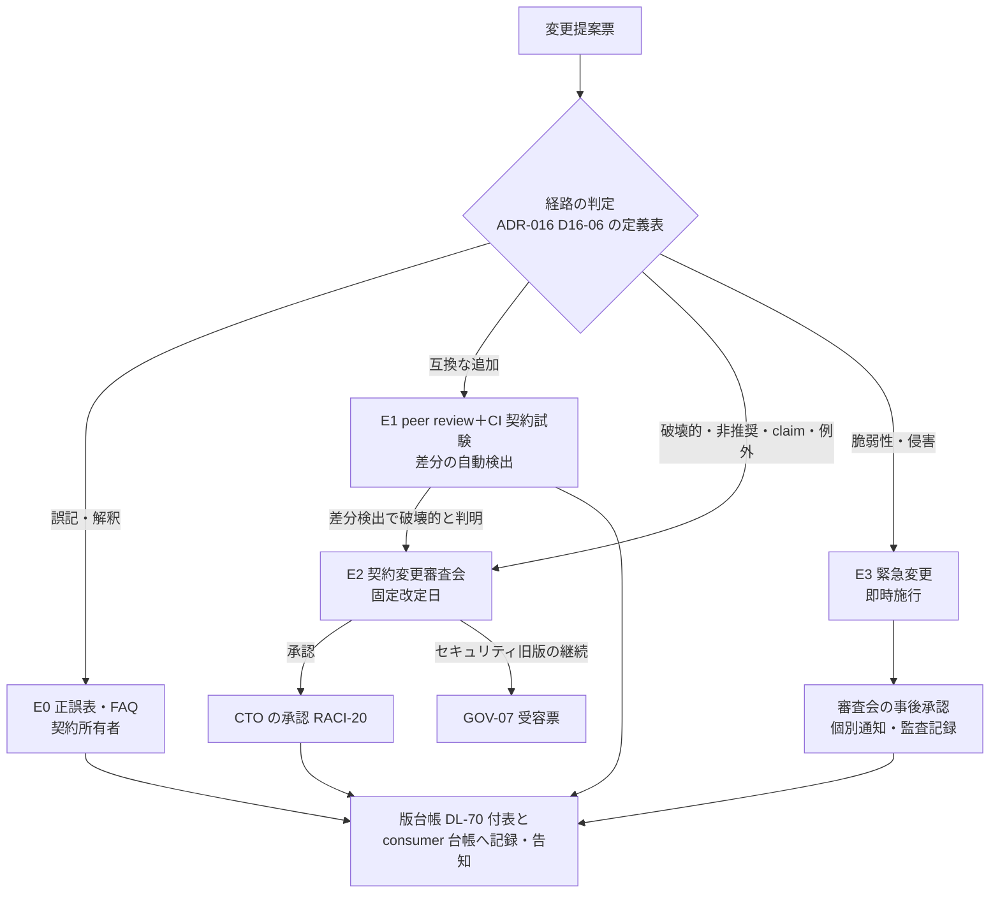

# 連携契約 一覧・規約

> 文書ID: CON-00 / 版: 0.2 / 状態: draft / 最終更新: 2026-10-15
> 対応要求: R-109, R-212／G-118, G-119, G-127, G-134, G-138（R/G 台帳の対応成果物欄に本書のパスか DL-69 を含む行の全件。閉じ方と状態は末尾の対応表）。関連: R-022, R-105, R-108, R-140, R-194, R-208／G-120〜G-123, G-126, G-137, G-140〜G-142／CL-0249, CL-0261
> 依存文書: CONVENTIONS.md, traceability/deliverables.md（DL-69〜DL-80、§8 の 11_contracts 行、DEC-8）, 05_adr/ADR-022-integration-contract-standards.md（正本: 凍結区分・契約ごとの判定・変更管理）, 05_adr/ADR-016-versioning-deprecation.md（正本: 版の表し方・互換区分・期間）, 05_adr/ADR-021-irreversible-identifiers.md, 05_adr/ADR-005-token-profile.md, 05_adr/reconciliation-notes.md（U-01〜U-04）, 04_architecture/token-profile.md（ARC-02）, 01_governance/raci-governance.md（RACI-20、契約変更審査会）, 01_governance/assumptions-register.md（A-050, A-052, A-054）, 12_poc/preregistered-test-plan.md（TC-026, TC-119, TC-129）, research/standards-status.md, research/RS-16-parallel-development-governance.md, 11_contracts/ 配下の全契約と review-notes/CON-02〜CON-10
> 作成方法: AI エージェント（Claude）が 11_contracts の全ファイル、ADR-022、ADR-016 を通読して起草した。§2.3 の機械検証は本書の作成者が 2026-10-15 に再実行した。判断は自己レビューであり、実在する CTO/CISO の決裁ではない（CONVENTIONS §8）[D]。版 0.2 は作成者とは別の AI エージェントが独立レビューして修正した版である（末尾「レビュー記録」）。人による照合はまだ行っていない [D]。

---

## 要旨（結論）

1. **連携契約は 9 ファイルが draft で揃い、機械検証のエラーは 0 件である。ただし DEC-8 で凍結できる状態にはまだない** [M][D]。OpenAPI 5 本はいずれも Redocly lint のエラーが 0 件で、警告は理由を記録済みの 4 件だけである。JSON Schema 4 本はすべてメタスキーマ検査に合格した（§2.3）[M]。凍結の前提のうち、ライフサイクルイベント契約（G-137）と契約試験キット（DL-80）の 2 つがまだ作られていない [D]。互換性・非推奨ポリシー（DL-70、CON-01）は 2026-10-15 に版 0.1 の draft ができたが、期間の数値は決裁案（CON-01 KC-1 ほか）で承認されていない [D]。issuer の粒度（U-01、DEC-3）も決まっていない [D]（§6.3）。
2. **契約は単一の規約で書く** [D]（§4）。本書で決める主な点は次の 5 つである。
   - `openapi` 欄は ADR-022 D-2 のとおり `3.1.2` に揃える。
   - 版は SemVer 2.0.0 とし、DEC-8 で凍結する版を `1.0.0` にする。
   - 凍結区分の注記キーは `x-freeze-class` 1 つにする。
   - JSON Schema の `$id` は `https://contracts.<id-domain>/schemas/<名前>/v<major>/<名前>.schema.json` の形にする。
   - 理由コードの登録簿は共通スキーマ（DL-71）に置く。
   
   現行の契約ファイルとの差分 9 件は、所有者と期限を付けて §4.9 に並べた [D]。
3. **変更提案は 4 つの経路に分ける** [D]（§5）。
   - 誤記の訂正は正誤表で随時出す。
   - 互換な追加は peer review と CI で通す。
   - 破壊的変更・非推奨・claim の追加と廃止・例外は、契約変更審査会が年 2 回の固定改定日に決める（最終責任者は CTO、RACI-20）。
   - セキュリティ上の緊急変更は事後承認とする。
   
   この分け方は ADR-022 D-5-6・D-7-1 と ADR-016 D16-14・D16-46 を手順に写したものである [D]。DEC-8 の凍結で不可逆になるのは識別子だけである。そのほかの要素は「版付き・非推奨期間付き・強制移行なし」で置き換えられる。製品、エンジン、cell 構成、内部 API、SDK の内部実装は凍結しない（§6、ADR-022 D-1・D-1-3）[D]。
4. **連携開発者は、基盤の完成を待たずに、契約の GA 要素に対する実装と単体試験を今日から始められる。ただし範囲は限られる** [D]（§2.5）。
   - 始められる: token 検証、認可判定の呼出し、tuple の書込み、token exchange、監査イベントの送出、失効イベントの受信。契約ファイルの examples からモックを起動し、`x-negative-examples` を試験に入れる [D]。
   - 始められない: テナント・利用者のライフサイクル事象の受信（契約が未作成）[D]。
   - 制約: DEC-8 までは版が 0.x である。SemVer では major 0 の間は何がいつ変わってもよい [N][^2]。CON-01 も凍結前の変更には期間を約束しない [D]。連携側は契約ファイルの git コミットを固定し、差分を追う [D]。基盤側と同じ合否判定は DL-80 ができるまで共有できない [D]。

---

## 1. 本書の位置付け

| 項目 | 内容 |
|---|---|
| 読み手 | CTO・CISO（凍結の決裁、DEC-8）と、連携開発者（約 300 サービス、25 組織・60 チーム [A-050][A-052]） |
| 本書が決めること | 契約の一覧と所在、準拠標準と準拠範囲、命名・版付け規約、変更提案の手順、凍結の範囲（DL-69 の要点）[D] |
| 本書が決めないこと | 凍結区分と契約ごとの GA・preview の判定（ADR-022 D-1・D-2）、互換区分の定義と期間（ADR-016 D16-06・D16-14、数値は DL-70）、契約試験の手順と合否（DL-80）、各契約の中身（各契約ファイル）[D] |
| 正本の優先順位 | ADR（決定）＞ 本書（規約）＞ 各契約ファイル。食い違いが見つかった場合は ADR に合わせ、契約ファイルの所有者が直す [D] |

**ディレクトリ構成** [D]

```
11_contracts/
├── README.md                                 CON-00 本書（DL-69）
├── compatibility-deprecation-policy.md       CON-01（DL-70）
├── mock-contract-test-kit.md                 CON-11（DL-80）未作成
├── authorization-api.openapi.yaml            CON-03（DL-72）
├── relationship-model-registry.openapi.yaml  CON-04（DL-73）
├── token-exchange.openapi.yaml               CON-05（DL-74）
├── scim.openapi.yaml                         CON-07（DL-76）
├── ssf-caep.openapi.yaml                     CON-09（DL-78）
├── schemas/
│   ├── common.schema.json                    CON-02（DL-71）
│   ├── access-token-claims.schema.json       CON-06（DL-75）
│   ├── audit-event.schema.json               CON-08（DL-77）
│   └── ssf-caep-set.schema.json              CON-10（DL-79）
└── review-notes/CON-02.md〜CON-10.md         作成者以外による独立レビューの記録（凍結対象外）
```

---

## 2. 契約一覧

### 2.1 所在・版・状態・所有者

- 版と状態は 2026-10-15 時点の各ファイルの記載である [D]。
- 「独立レビュー」は作成者とは別の AI エージェントによるもので、人による照合はどの契約でもまだ行っていない [D]（各 review-notes §1）。
- 所有者は本書の提案で、確定は K-CON-3（§7）で行う。案は A-054 の内訳（認証・IdP 5、認可・PDP 5、PEP SDK・開発者支援 4、SRE 6 ほか）にもとづく [D][A-054]。

| 文書ID | DL | パス | 記述形式 | 版 | 状態 | 独立レビュー | 所有者（案） |
|---|---|---|---|---|---|---|---|
| CON-00 | DL-69 | 11_contracts/README.md | Markdown | 0.2 | draft | 済（本書末尾のレビュー記録） | プラットフォームチーム長（契約変更審査会の議長） |
| CON-01 | DL-70 | 11_contracts/compatibility-deprecation-policy.md | Markdown | 0.1 | draft（数値は決裁案 KC-1〜KC-5 で未承認） | 未実施 | CTO＋CISO（SLA の承認者）、起草はプラットフォームチーム |
| CON-02 | DL-71 | 11_contracts/schemas/common.schema.json | JSON Schema 2020-12 | 0.1.0 | draft | 済（修正 11 件） | プラットフォームチーム長 |
| CON-03 | DL-72 | 11_contracts/authorization-api.openapi.yaml | OpenAPI 3.1.2 | 0.1.0（profile 1.0） | draft | 済（修正 19 件） | 認可・PDP チーム |
| CON-04 | DL-73 | 11_contracts/relationship-model-registry.openapi.yaml | OpenAPI 3.1.0 | 0.1.1 | draft | 済（修正 12 件） | 認可・PDP チーム |
| CON-05 | DL-74 | 11_contracts/token-exchange.openapi.yaml | OpenAPI 3.1.0 | 0.1.0 | draft | 済 | 認証・IdP チーム |
| CON-06 | DL-75 | 11_contracts/schemas/access-token-claims.schema.json | JSON Schema 2020-12 | 0.1.0 | draft | 済 | 認証・IdP チーム |
| CON-07 | DL-76 | 11_contracts/scim.openapi.yaml | OpenAPI 3.1.0 | 0.1.0 | draft | 済 | 認証・IdP チーム |
| CON-08 | DL-77 | 11_contracts/schemas/audit-event.schema.json | JSON Schema 2020-12 | 0.2（SemVer でない。§4.9 D-4） | draft | 済（RV-01〜RV-14） | プラットフォームチーム（監査収集）。CISO が協議先 |
| CON-09 | DL-78 | 11_contracts/ssf-caep.openapi.yaml | OpenAPI 3.1.0 | 0.1.1 | draft | 済 | 認証・IdP チーム（失効・継続評価） |
| CON-10 | DL-79 | 11_contracts/schemas/ssf-caep-set.schema.json | JSON Schema 2020-12 | 0.1.0 | draft | 済 | 認証・IdP チーム（失効・継続評価） |
| CON-11 | DL-80 | 11_contracts/mock-contract-test-kit.md | Markdown | — | **未作成** | — | PEP SDK・開発者支援チーム |

**ファイルを持たない契約・未作成の契約** [D]

| 契約 | 所在 | 状態 | 扱い |
|---|---|---|---|
| OIDC/OAuth profile（DL-69 に収載） | 04_architecture/token-profile.md（ARC-02）。中身の正本は ADR-005・ADR-020 | review（ARC-02 版 0.2） | 標準の discovery metadata が機械可読な形式なので、OpenAPI にはしない。版付きの標準 profile として凍結の束に含める（ADR-022 D-2 の OIDC/OAuth 行）[D] |
| ライフサイクルイベント契約（G-137） | 未作成。G-goal-criteria の申し送りでは `lifecycle-events.asyncapi.yaml` と `schemas/lifecycle-event.schema.json` が候補 | **未作成**。deliverables.md §8 にファイル行がない | G-118 の検証対象に含まれる。作成しないと G-118 と DEC-8 が未達になる（§8 残課題 1）[D] |
| 内部取引 context（Transaction Token。ADR-022 D-2 の独立した行） | 単独のファイルはない。`txn` 欄の形式は CON-02 `TransactionId`、要求は CON-05 `/txn-token`、claim は CON-06 に分かれている | GA: `txn` の意味と形式、`Txn-Token` ヘッダを無改変で下流へ渡す義務、Authorization ヘッダに入れない義務、全文をログに残さない義務。preview: claim 構成（`txn-v1`）と TTS への要求（ADR-022 D-2） | GA の義務（ヘッダの無改変伝播、Authorization ヘッダに入れない、全文をログに残さない）は CON-05 の `/txn-token` operation の description に書かれている。しかしそこは token を受け取るだけのサービスが読まない場所である。連携開発者は本行と CON-05 の当該箇所を読む。義務を CON-02 `TransactionId` の description から参照できるようにするのは CON-02・CON-05 の所有者の宿題である（§8 残課題 12）[D] |
| trace 伝播（W3C Trace Context Level 1） | CON-02 の `Traceparent`・`TraceId` | GA: traceparent を受け取ったら伝播する義務。外部から来た sampled flag を監査の記録可否に使わない義務。Baggage に subject・tenant を載せない（ADR-022 D-2） | 型と sampled flag の扱いは CON-02 `Traceparent` の `$comment` にある。受け取ったら伝播する義務と Baggage の禁止は、契約ファイルにはまだ書かれていない。CON-02 の所有者が追記する（§8 残課題 12）[D] |
| 非推奨の通知（RFC 9745・RFC 8594） | CON-01 §5.3（header の規則）、本書 §5.3 | GA: header の送出と client_id 単位の利用計測（ADR-022 D-2） | 規則は CON-01 が正本。各 OpenAPI に Deprecation・Sunset の response header を宣言するのは DL-80 の検査項目にする [D] |
| 記述形式（OpenAPI 3.1.2、JSON Schema 2020-12、AsyncAPI 3.x） | 本書 §4.4 | GA（ADR-022 D-2）。OpenAPI 3.2 への移行は preview | 本書 §4.4 の L-1・L-2 で規定する [D] |
| `authorization_details` の type 定義 | 未作成 | v1 では発行しない予約 claim（ADR-022 D-9-2）。ただし ADR-020 D20-09-1 は FAPI 範囲で使うとしており、ADR-017 L17-5 で未決 | type 定義は契約として版付きで公開する（ADR-020 D20-09-2）。所在は CON-06 の付属にする案。未決（ADR-017 L17-5、ADR-020）[D] |

### 2.2 準拠標準・準拠範囲・独自拡張・draft の場合の互換方針（G-119 の 4 項目）

- 標準の状態は research/standards-status.md（確認日 2026-10-03）の SS-ID で示す [D]。
- 凍結区分（GA／preview）は ADR-022 D-2 の判定であり、本書は写しているだけである [D]。

| 文書ID | 準拠標準（状態、SS-ID） | 準拠範囲（GA） | preview・独自拡張 | draft に依存する場合の互換方針 |
|---|---|---|---|---|
| CON-02 | RFC 9457（final、SS-A47）、AuthZEN 1.0 §5 の情報モデル（final、SS-C13）、W3C Trace Context Level 1（Recommendation、SS-D02） | 識別子の型、tenant context、相関 ID、Problem（生成側の検査用。受信側は未知の拡張メンバを無視する MUST [N][^5]）、版情報 | 自社定義の型（OpaqueId、KeyedRef、理由コードの列挙など） | draft には依存しない。`txn` は CON-05・CON-06 の行に従う [D] |
| CON-03 | OpenID AuthZEN Authorization API 1.0（final、SS-C13） | evaluation・evaluations、PDP metadata、X-Request-ID の往復、自社拡張の `decision_id` と不透明な consistency token | preview: resource search、`model_revision` の表現、obligation、`completeness`、`txn`。GA 候補（区分は未決（ADR-022））: `reason`・`consistency.mode`・`model.pin`・`profile_version`。拡張の容器キー名は未決（ADR-021） | AuthZEN の後続改訂は API を拡張してよいが変更してはならない [N][^6]（RS-07#62）。そのため自社拡張は context の名前空間付きキーに閉じ込める [D] |
| CON-04 | 該当する標準なし（ADR-022 D-1-1(b)）。エラーは RFC 9457、状態コードは RFC 9110 | tuple の書込み・削除・読取り、テナント指定の必須化、不透明な consistency token、エラー形式 | preview: モデル DSL、モデル管理（登録・pin・shadow・rollback、export/import）。`x-stability` で operation ごとに記載 | 標準がないため、独立した 2 実装で動くことを PoC で示すことを GA の維持条件にする（ADR-022 D-6-6、TC-026）[D] |
| CON-05 | RFC 8693（final、SS-A09）、RFC 8707（final、SS-A10）、RFC 9068（final、SS-A07）。Transaction Tokens -11（**draft**、IESG 未提出、2027-01-31 失効予定、SS-B04） | subject token の種別、resource の必須化（1 値）、act の深さの上限、エラー | preview: `requested_token_type=txn_token`（`/txn-token`） | Transaction Tokens が RFC にならないか大きく改訂された場合は、edge が発行する自社形式の取引 ID を同じ `txn` 欄に入れて退避する（ADR-022 D-8-5、ADR-009 D09-26）[D] |
| CON-06 | RFC 9068、RFC 7519、RFC 8693、RFC 7800・RFC 8705・RFC 9449、RFC 7662・RFC 9701、OIDC Core（final）。Transaction Tokens -11（**draft**、SS-B04） | ADR-022 D-9-1 の core claim、`typ=at+jwt`（不可逆） | 予約 claim（ADR-022 D-9-2）。独自 claim の名前（ptype・gref・ver など）は案で、未決（ARC-15 KC-1、DEC-8 前） | Txn-Token の claim は版を固定した社内 profile `txn-v1` として扱い、規範の根拠にはしない（ADR-021 D21-36）[D] |
| CON-07 | RFC 7643・RFC 7644（final、SS-A41・SS-A42） | User・Group・Enterprise User 拡張、作成・取得・照会・PUT・PATCH・DELETE、ETag、エラー形式 | 非対応: Bulk・/Me・sort・changePassword（501）、RFC 9865（v1 では不採用）。preview: RFC 9967（final、SS-A44）。準拠しない: IPSIE AL SCIM（**draft**、SS-C19） | IPSIE は数値を参照するだけで依存しない。Implementer's Draft 以上になった時点で再検討する（ADR-004 §8 T-2）[D] |
| CON-08 | 正準スキーマは自社定義（ADR-014 D14-06）。写像先は OCSF 1.9.0（SS-I24）と CADF 1.0.0 | 共通項目（主体、tenant、actor chain、resource、action、decision、reason、policy/model revision、producer 連番、スキーマ版、相関 ID） | OCSF・CADF への写像は export 層に置き、版は契約と別に管理する（凍結しない） | OCSF の版上げは写像の版上げとして扱い、正準スキーマを変えない（ADR-022 D-2）[D] |
| CON-09 | SSF 1.0、CAEP 1.0、RISC 1.0（final、SS-C09〜SS-C11）、RFC 8935・RFC 8936。CAEP Interoperability Profile（**draft**、Implementer's Draft 1、SS-C12） | stream 管理、push/poll、verification、受信 endpoint | `x-contract-tier` で要素ごとに記載。数値はすべて TBD（DL-20） | CAEP Interoperability Profile は監視するだけで依存しない [D] |
| CON-10 | SSF 1.0・CAEP 1.0・RISC 1.0（final）、RFC 8417 | v1 の GA イベント 7 種の SET payload と受信義務の範囲 | 自社イベントの命名規則は preview の案で、未決（ADR-022） | draft には依存しない [D] |

### 2.3 機械検証（lint）の結果

本書の作成者が 2026-10-15 に再実行した結果である [M]。

- 実行環境: Node.js v22.23.2、`@redocly/cli` 2.63.0（recommended 規則、設定ファイルなし）、Python の `jsonschema` 4.26.0（Draft202012Validator、FormatChecker あり）、PyYAML。
- 生データ: 作成者の一時作業領域にだけ置き、リポジトリには残していない。同じ検査は DL-80 の CI（TC-026）で再現し、そこで保存する [D]。

| 文書ID | 検査 | 結果 [M] | 警告の理由（各ファイルの `x-lint-notes`） |
|---|---|---|---|
| CON-03 | Redocly lint | エラー 0・警告 0 | — |
| CON-04 | Redocly lint | エラー 0・警告 0 | — |
| CON-05 | Redocly lint | エラー 0・警告 1（info-license） | 公開ライセンスが決まっていない。§4.7 で値を決めた |
| CON-07 | Redocly lint | エラー 0・警告 3（operation-2xx-response 2、no-unused-components 1） | /Bulk と /Me はわざと 501 だけを返す。未使用の component は例外専用 |
| CON-09 | Redocly lint | エラー 0・警告 0 | — |
| OpenAPI 5 本 | YAML の構文解析 | 5 本とも成功 | — |
| CON-02 | `check_schema` | 合格（ルートの examples なし。`$defs` ごとの正例 67・負例 64 は CON-02 レビュー §5 で検証済み） | — |
| CON-06 | `check_schema`、ルートの examples | 合格。examples 3 件がすべて適合 | — |
| CON-08 | `check_schema`、ルートの examples | 合格。examples 5 件がすべて適合 | — |
| CON-10 | `check_schema`、ルートの examples | 合格。examples 5 件がすべて適合 | — |

- 本書の独立レビュー担当が 2026-10-15 に、YAML の構文解析（5 本）と JSON Schema の `check_schema` およびルートの examples の検証（4 本）を同じ環境（`jsonschema` 4.26.0）で再実行し、上表と同じ結果を得た [M]。Redocly lint は再実行していない [D]。
- 負例、別実装の検証器（Ajv）、コード生成、モックの起動の結果は各 review-notes に記録されている [M]。
- モックサーバーの起動を試したのは CON-07 だけである（Prism 5.12.0）。CON-03 と CON-09 は「未実施」と記録されている [D]。
- 契約試験キット（DL-80）では、全契約でモックを起動する試験を必須にする（§8 残課題 4）[D]。

### 2.4 契約間の依存

```mermaid
flowchart LR
  subgraph 共通
    C02[CON-02 共通スキーマ]
  end
  subgraph token
    ARC02[OIDC/OAuth profile<br/>ARC-02]
    C06[CON-06 access token claims]
    C05[CON-05 Token Exchange]
  end
  subgraph 認可
    C03[CON-03 Authorization API]
    C04[CON-04 Relationship/Model Registry]
  end
  subgraph 失効・連携
    C07[CON-07 SCIM]
    C09[CON-09 SSF/CAEP stream]
    C10[CON-10 SET スキーマ]
    LC[ライフサイクルイベント<br/>未作成 G-137]
  end
  C08[CON-08 監査イベント]
  C02 --> C03 & C04 & C05 & C06 & C07 & C09 & C10 & C08
  ARC02 --> C06
  C05 -->|発行する token| C06
  C03 -->|model_revision| C04
  C09 -->|payload| C10
  C03 & C04 & C05 & C07 & C09 -->|decision_id・txn ほか| C08
  LC -.->|役割分担| C09
```

- 共通の型（識別子、相関 ID、Problem、版情報）は CON-02 を `$ref` で参照する形に寄せる [D]。
- 現時点では CON-03 と CON-08 に、CON-02 と重複する型や形の違う型が残っている（CON-02 レビュー H-1・H-3、CON-03 レビュー L-2・L-3）。これは §4.9 D-7 で扱う [D]。

### 2.5 連携開発者の着手手順（基盤の完成を待たずに始める）

この節は、約 300 サービスの連携開発者が本書と契約ファイルだけで何をすればよいかを示す [D]。手順と禁止事項の正本は ADR-022 D-3・D-6 で、ハンドブック（DL-62）と FAQ（DL-68）ができたら移す [D]。

**判定（2026-10-15）** [D]

- 下表の「今できること」の範囲なら、基盤の完成を待たずに実装と単体試験を始められる。
- 始められないのはライフサイクル事象の受信だけである（契約が未作成。§3）。
- DEC-8 までは版が 0.x で、変更の期間は約束されない（CON-01 §1.2）。基盤側と同じ合否判定（DL-80）もまだない。このため、作ったものが凍結版に適合するかは DEC-8 後に DL-80 で確かめ直す必要がある。

**役割別に使う契約** [D]

| 自サービスがすること | 使う契約（GA の範囲だけに依存する） | 今できること | まだできないこと・待つもの |
|---|---|---|---|
| API を提供し、access token を検証する（resource server） | ARC-02 の検証規則 V1〜V14、CON-06 | 検証ロジックと単体試験。CON-06 の examples と `x-negative-examples` を試験データにする | issuer URL の値（U-01、DEC-3）、`<id-domain>` の値（I-2）、token の寿命などの数値（DL-20）、sandbox の issuer（ADR-022 D-6-4） |
| 認可判定を呼ぶ（PEP） | CON-03 の evaluation・evaluations | 呼出しと応答処理。`reason` の未知の値は拒否として扱う（CON-03 の記載）。モックは CON-03 の examples から起動する | search・obligation・`model_revision` の表現（preview）。timeout・retry・cache の値（DL-20、ADR-022 D-4-2） |
| 関係データを書く | CON-04 の tuple の書込み・削除・読取り | 書込みの実装と試験。テナント指定は必須 | モデル DSL とモデル管理（preview）。モデリングの手引き（DL-65、未作成） |
| 他のサービスを呼ぶ・委譲する | CON-05（RFC 8693 の exchange）、§2.1 の内部取引 context 行 | exchange の要求と、`Txn-Token` ヘッダを無改変で下流へ渡す処理 | `/txn-token` と Txn-Token の claim 構成（preview、draft 依存） |
| 監査イベントを送る | CON-08 の共通項目、CON-02 の相関 ID | 共通項目の生成と schema 検証 | 族ごとの `reason_code` の登録簿（§4.8 R-1、未作成）、`txn` を主キーにする範囲（U-02） |
| 失効・session 終了を受ける | CON-09（stream 管理、push/poll）、CON-10（v1 の GA イベント 7 種） | 受信 endpoint と SET の検証、イベントごとの処理 | 伝播時間などの数値（DL-20）。OIDC Back-Channel Logout の位置（ADR-006 L6-2） |
| 顧客 IdP から利用者を受ける（SCIM） | CON-07 | 顧客 IdP 側の結合試験。CON-07 はモックの起動を確認済み（§2.3） | 拡張 URN の本番の名前空間（I-4） |
| テナント・利用者のライフサイクル事象を受ける | なし（G-137 の契約が未作成） | 着手できない。暫定方式は G-143 で公開する予定だが、その置き場所もまだない | 契約の作成（§8 残課題 1） |

**手順** [D]

1. 連携パターン集（INT-02、DL-64）で自サービスの P-xx を決め、§3 の表で使うインタフェースと契約を確かめる。
2. 依存してよいのは `x-freeze-class`（または §4.9 D-2 の是正前のキー）が GA の要素だけにする。preview の要素を使う場合は、使う要素と理由を Definition of Ready（DL-67、未作成）の申告に書く（ADR-022 §3 案 B のリスク対策）。
3. 契約ファイルの git コミットを 1 つ固定し、その版を自サービスのリポジトリに記録する。版が上がったら差分を読み、互換区分（CON-01 §2）に従って追随する。
4. モック: DL-80 ができるまでは、OpenAPI の examples から汎用のモックサーバーを起動する。ただし起動を確認したのは CON-07 だけである（§2.3）。起動できなかった場合は E0（§5.2）で契約所有者に報告する。
5. 試験: 各契約の `x-negative-examples` と、ADR-022 D-6-2 の必須負例 13 種のうち自サービスに当たるものを単体試験に入れる。JSON Schema の検証器は 2020-12 方言で使い、Ajv なら `strict: false` にする（I-5）。
6. 環境で変わる値（issuer、`<id-domain>`、endpoint のホスト名、`{cell}`、TBD の数値）は設定に出し、コードに直書きしない。endpoint は discovery か metadata から得る（ADR-022 D-3-2、§4.9 D-8）。
7. ADR-022 D-3-2 の禁止事項を守る。主なものは、製品固有のヘッダ・claim への依存、client による access token の中身の解析、JWKS URL の直書き、AS・PDP・ストアへの直接接続、エラー文言の文字列一致である。
8. 契約の不明点・誤りは E0 の経路で、§2.1 の所有者（案）に出す。疑義の窓口と FAQ（DL-68）はまだない。窓口ができるまでは、契約ファイルの `x-open-issues`（CON-10 は `x-open-items`）を先に確かめる。

---

## 3. 外部インタフェースと契約の対応（G-138 の契約側の表）

- G-138 は、連携パターン × インタフェース × 契約の行列で空欄を 0 にすることを求めている [D]。
- 連携パターン（P-xx）の側は DL-64（10_integration/integration-patterns.md、INT-02 版 0.1 draft）が持つ。本書は「インタフェース → 契約」の側を示す [D]。
- INT-02 の要旨 4 は、ライフサイクル事象の契約がないため P-04・P-05・P-13・P-14・P-24 などを「未対応（契約未作成）」としている。本表の「未対応」と一致する [D]。
- 空欄を GA か preview の契約で埋められないインタフェースは「未対応」と明記する（ADR-022 D-2-3）[D]。

| G-138 のインタフェース | 契約・版付き profile | 状態 |
|---|---|---|
| client 登録 | ARC-02 §6（client 種別ごとの grant・認証方式）。非本番の動的登録は preview（ADR-022 D-2） | **未対応**（登録 API の契約がない）。暫定の方式は G-143 で扱う |
| discovery | OIDC Discovery 1.0・RFC 8414 の profile（ARC-02、ADR-022 D-2 の OIDC/OAuth 行） | 対応（版付き標準 profile） |
| token の取得・更新・検証 | ARC-02（取得・更新・検証規則 V1〜V14）、CON-06（claim）、CON-05（内部 exchange） | 対応 |
| logout と session 終了の伝播 | CON-09・CON-10 の CAEP session-revoked（`sid` で突き合わせる） | **一部**。OIDC Back-Channel Logout の契約上の位置は未決（ADR-006 L6-2） |
| 認可判定 | CON-03 | 対応 |
| 関係データの書込み | CON-04 | 対応 |
| token exchange | CON-05 | 対応（Txn-Token の部分は preview） |
| SCIM | CON-07（顧客 IdP からの受信） | 対応 |
| 失効・継続評価 | CON-09・CON-10 | 対応（数値は TBD、DL-20） |
| ライフサイクル事象 | — | **未対応**（G-137 の契約が未作成） |
| 監査イベント | CON-08 | 対応 |
| エラー形式 | CON-02 Problem（RFC 9457）。AuthZEN の endpoint は AuthZEN §10.1.2 の形式 | 対応 |
| レート制限の通知 | CON-03・CON-04・CON-07 がそれぞれ 429 と Retry-After を定めている | **一部**。全契約に共通の定義がない（§8 残課題 6） |

---

## 4. 命名・版付け規約

正本はこの節である。各規則の後ろに、根拠にした ADR か原典を書く。

### 4.1 ファイル名と文書ID

- **N-1** OpenAPI は `<kebab-case の契約名>.openapi.yaml`、AsyncAPI は `<名前>.asyncapi.yaml`、JSON Schema は `schemas/<名前>.schema.json` とする [D]。
  - ファイル名に版を入れない。版はファイルの中に書き、凍結版は git のタグとハッシュで特定する（§6.2）[D]。
- **N-2** 文書ID（CON-xx）と DL は traceability/deliverables.md §8 の割当に従う [D]。新しい契約ファイルは、先に §8 に行を追加してから作る [D]。
- **N-3** 独立レビューの記録は `review-notes/<文書ID>.md` に置く。凍結の対象には含めない [D]。

### 4.2 必須のメタ情報

- OpenAPI では `info` の下に、JSON Schema ではルートに、次のキーを置く [D]。
- 現状では JSON Schema 3 本（CON-02・CON-06・CON-10）がメタ情報を `$comment` の文中にだけ書いている（§4.9 D-4）[D]。

| キー | 内容 |
|---|---|
| `x-document-id` / `x-deliverable` | CON-xx / DL-xx |
| `x-status` | `draft`・`review`・`frozen`（CONVENTIONS §1 の状態値と同じ） |
| `x-last-updated` | 引用符で囲んだ文字列（YAML 1.1 の読込器が date 型に変えるのを防ぐ。CON-03 レビュー指摘 17） |
| `x-depends-on`・`x-requirements` | 依存文書、R/G-ID |
| `x-standards` | 標準ごとに `id`（SS-ID）・`name`・`status`・`checked`（確認日）・`conformance`（準拠範囲） |
| `x-open-issues` | 「未決（ADR-0xx）」の項目と、決める人・期限 |
| `x-lint-notes` | lint の警告が残る場合に、規則名・件数・理由 |

### 4.3 版

- **V-1** 契約文書の版（`info.version`、JSON Schema のメタ情報の版）は SemVer 2.0.0 に従う [D]。
  - SemVer は、後方互換でない変更で major を、後方互換な機能追加と非推奨化で minor を上げなければならない（MUST）と定めている [N][^2]（RS-16#31）。
  - SemVer では major 0 は初期開発用で、何がいつ変わってもよい [N][^2]（RS-16#31）。そのため DEC-8 までは 0.x で改版する [D]。
  - DEC-8 で凍結する版は `1.0.0` とする [D]。
  - 互換か破壊的かの判定は ADR-016 D16-06 の定義表（DL-70 に写す）だけで行う [D]。
- **V-2** 契約 API は major を URL path に置く（`/v1/`）[D]。minor と patch は path に出さない（ADR-016 D16-01）[D]。header や query で版を選ばせる方式は採らない（ADR-016 D16-10）[D]。
- **V-3** token profile の版（profile 版 claim）、PEP–PDP の `profile_version`、監査イベントのスキーマ版欄は、契約文書の版とは別に管理する（ADR-016 D16-01・D16-02）[D]。
  - 契約文書が minor で上がっても、profile の major が変わるとは限らない [D]。
- **V-4** 標準と同じ名前の版（AuthZEN の `/access/v1/`、SCIM の `/scim/v2`）は標準側の版であり、自社の major ではない [D]。
  - CON-07 の `/v1/scim/v2` のように、自社の major を外側に置く [D]。

### 4.4 記述言語の版

- **L-1** OpenAPI の `openapi` 欄は全契約で `3.1.2` とする（ADR-022 D-2）[D]。
  - OAS 3.1.2 §4.1 によると、patch 版は文書の誤りの訂正か明確化であって機能集合を変えない。3.1 に対応するツールは 3.1.* のすべてと互換であるべき（SHOULD）で、patch 版を区別すべきでない（SHOULD NOT）[N][^1]（RS-16#2。SHOULD の文は RS-16#2 に含まれないため、本書の作成者と独立レビュー担当がそれぞれ 2026-10-15 に原典 §4.1 で確認した）。
  - 一方で `openapi` 欄は、その文書が使う OAS の版番号でなければならない（MUST）[N][^1]。
  - 以上から、3.1.0 から 3.1.2 への書き換えはツールの互換性に影響しない [D]。書き換えれば ADR-022 D-2 の表記と一致する [D]。
  - CON-03 はすでに 3.1.2 で、lint のエラー・警告は 0 件である（§2.3）[M]。
  - 3.2 への移行は使用ツールの対応を PoC で確かめてから判断し、それまでは preview に置く（ADR-022 D-2、ADR-016 TR16-6）[D]。
- **L-2** OpenAPI の文書には `jsonSchemaDialect: https://json-schema.org/draft/2020-12/schema` を書く。JSON Schema のファイルには `$schema` に同じ URI を書く [D]。
  - JSON Schema 2020-12 は公式サイトでは現行版だが、IETF 上は失効した Internet-Draft である [N][^3]（RS-16#4）。このため凍結の際には、仕様本文とメタスキーマの写しを保管する（ADR-022 D-10-3）[D]。
- **L-3** 正規表現は RE2 互換にする。先読み・後読みは使わない（CON-02 レビュー指摘 9）[D]。
  - `if`/`then` は Redocly の example 検査で誤判定が出ることがある（CON-02 指摘 10、CON-03 指摘 18）。同じ意味を `anyOf` で書けるなら `anyOf` を使い、書けない規則は `x-constraint` で宣言して DL-80 で検査する [D]。

### 4.5 識別子・URI・名前空間

- **I-1** JSON Schema の `$id` は `https://contracts.<id-domain>/schemas/<名前>/v<major>/<名前>.schema.json` の形にする [D]。
  - major を URI に入れるのは、CloudEvents が互換でないスキーマ変更を別の `dataschema` URI で表すべき（SHOULD）としているためである [N][^4]（RS-16#10）。この規則は ADR-016 D16-01 の共通スキーマ・イベント行と同じである [D]。
  - minor と patch は URI に入れない。入れると、互換な追加のたびに参照元の `$ref` を書き換えることになるためである [D]。
  - 凍結前（0.x）の文書も、目標の major である `v1` を使う [D]。
- **I-2** `<id-domain>` は ADR-021 D21-01 の識別子専用ドメインである。値は未決なので、draft の間は `id-domain.example` を置き場所に使う [D]。本番の値は ADR-021 で決まった時点で一括して置き換える [D]。
- **I-3** 名前空間コード（リソース型、scope、イベント type）は、ADR-021 D21-25〜D21-28 の中央台帳（DL-71 の付表）に従う [D]。名前の削除と再利用の禁止は ADR-021 D21-27 による [D]。
- **I-4** SCIM の拡張 URN は現状 `urn:example:…` を置いている。この名前空間は文書・私的試験・実験以外での使用が推奨されない（NOT RECOMMENDED）[N][^7]。
  - 本番の URN 名前空間は ADR-021 D21-28（外部に出す名前は自社所有ドメインで修飾する）に従って決める [D]。
  - 形式は未決（ADR-021）で、所有者は ADR-021 の所有者、期限は DEC-8 前とする [D]。
- **I-5** 拡張の項目は `x-` で始める [D]。
  - JSON Schema の策定団体は、次期版で利用者独自の property に `x-` で始まる名前を使う規約を定める予定だと述べている [V][^8]（RS-16#5）。この接頭辞にしておけば、将来の keyword と衝突しない [D]。
  - Ajv を strict モードで使うと `x-` の注釈で compile が止まる（CON-08 レビュー §2）。このため DL-80 の手順では `strict: false` を指定する [D]。

### 4.6 凍結区分の注記

- **F-1** 要素ごとの凍結区分は `x-freeze-class` キー 1 つで表す。値は `irreversible`・`GA`・`preview` の 3 つとする [D]。
  - 「凍結しない」区分の要素は契約に書かないので、値として持たない（ADR-022 D-1）[D]。
  - 現状は `x-maturity`（CON-03）、`x-stability`（CON-04）、`x-contract-tier`（CON-09）、`x-freeze-class`（CON-05）の 4 種類が混在している（§4.9 D-2）[D]。
- **F-2** preview の要素には `x-preview-expires`（GA への昇格・改版・廃止のいずれかを判断する日）を付ける（ADR-022 D-1-2）[D]。期限の初期案は、preview に置いた日から 12 か月である（ADR-016 D16-15、NA-016-9。DEC-8 前に CTO が決める）[D]。
- **F-3** GA の要素が preview の要素に必須で依存する場合は、`x-open-issues` に記載する（ADR-022 D-1-1）[D]。現時点の該当は CON-03 L-5（GA の Decision 応答が preview の `model_revision` の表現を必須で含む）で、未決（ADR-022）である [D]。

### 4.7 ライセンス欄と開示範囲

- **P-1** 全 OpenAPI 文書の `info.license` を `name: 社内限定（Proprietary, internal use only）`、`identifier: LicenseRef-Proprietary-Internal` に揃える [D]。
  - 欄を空にすると lint の警告が残る（§2.3 の CON-05）[M]。
  - 現在の 4 種類の値（§4.9 D-5）は意味が同じで、表記だけが違う [D]。
- **P-2** 開示範囲は K-CON-2（§7）で決める。決まるまでの扱いは「社内と、秘密保持契約を結んだ開発ベンダーに限る」とする [D]。
  - CON-07・CON-09・CON-10 は顧客 IdP が使う契約なので、顧客に開示する必要がある [D]。

### 4.8 登録簿の置き場所と列挙の互換区分

- **R-1** 理由コード（監査イベント E1〜E10 の族ごとの `reason_code`、AuthZEN の `reason`）の登録簿は、CON-02（DL-71）の `$defs` に族ごとの閉じた列挙として置く [D]。
  - 名前空間台帳を DL-71 の付表に置くとした ADR-021 D21-25 と場所を揃えるためである [D]。
  - 登録簿を新しいファイルに分けると、deliverables.md §8 への行の追加が要る [D]。
  - CON-08 の `reason_code` の description は「登録簿の所在は DL-69 で決める」としている。本規則がその答えであり、CON-08 の所有者は description を本規則への参照に直す（§4.9 D-10）[D]。
- **R-2** 値を足したときの互換区分は、列挙が判定を担うかどうかで分ける [D]。
  - AuthZEN の `reason`（監査イベント E1・E2 の `reason_code` も同じ値を使う）は、ADR-011 D6-1 が閉じた列挙としている。ADR-016 の現行の定義表では、値の追加は破壊的変更になる。これを開いた列挙に宣言し直すかは未決（ADR-016 P16-2）である [D]。
  - 判定を担わない族（E3 以降の `reason_code`）は、ADR-022 D-5-2 に従って開いた列挙として宣言し、値の追加を互換な追加（minor）とする。受信側には未知の値を受け付けることを義務づける [D]。CON-08 の description が族ごとの列挙を「値の追加は minor 版」としているのは、これと一致する [D]。
  - 「閉じた列挙」はスキーマ上の書き方（`enum` で値を列挙する）であり、互換区分を決めるのは上の宣言である。両者を混同しないよう、各列挙に `x-enum-kind: closed | open` を付ける（DL-80 で検査する）[D]。

### 4.9 現行の契約ファイルと規約の差分（凍結前に直す）

本書は契約ファイルを編集しない（各所有者が直す）[D]。

| # | 差分 | 対象 | 是正 | 所有者 | 期限 |
|---|---|---|---|---|---|
| D-1 | `openapi: 3.1.0` | CON-04, CON-05, CON-07, CON-09 | `3.1.2` に変え、lint を再実行する（L-1） | 各契約の所有者 | DEC-8 前 |
| D-2 | 凍結区分のキーが 4 種類ある | CON-03, CON-04, CON-05, CON-09 | `x-freeze-class` に統一する（F-1） | 各契約の所有者 | DEC-8 前 |
| D-3 | `$id` のホストと path がばらばら（`id-domain.example`／`contracts.id-domain.example`／`contracts.id-domain.invalid`、`/0.1.0/`・`/1/`・`/v1/`） | CON-02, CON-06, CON-08, CON-10 | I-1 の形に揃え、相互の `$ref` を直す | 各契約の所有者（調整はプラットフォームチーム長） | DEC-8 前 |
| D-4 | CON-08 の版が `0.2` で SemVer でない。JSON Schema 3 本でメタ情報が `$comment` の中にしかない | CON-02, CON-06, CON-08, CON-10 | `0.2.0` にし、§4.2 のキーをルートに置く | 各契約の所有者 | DEC-8 前 |
| D-5 | `info.license` がないか、表記が 4 種類ある | CON-03〜CON-05, CON-07, CON-09 | P-1 に揃える | 各契約の所有者 | DEC-8 前 |
| D-6 | URL path に自社の major がない（`/token`、`/txn-token`、`/ssf/...`）。ADR-016 D16-01 は DL-74 を path に major を置く対象に挙げている | CON-05, CON-09 | 未決（ADR-016）。案: AS metadata や SSF configuration で URL を広告する endpoint は、consumer が URL を直書きしない（ADR-022 D-3-2）。そのため path の major は必須にせず、ADR-016 D16-10 の「外部 OIDC/OAuth は標準の交渉に従う」行と同じ扱いにする。ADR-016 の改訂か、例外としての承認が要る | ADR-016 の所有者（CTO） | DEC-8 前 |
| D-7 | 共通の型が重複していて形が違う（OpaqueId の pattern、`profile_version` が必須か任意か、EntityType の pattern、KeyedRef の所在） | CON-02, CON-03, CON-08 | CON-02 へ一本化して `$ref` で参照する（CON-02 レビュー H-1・H-3、CON-03 レビュー L-2・L-3） | CON-02 の所有者と各契約の所有者 | DEC-8 前 |
| D-8 | `servers` のホスト名に `{cell}` が入っている | CON-03, CON-04, CON-05 | 要確認。ADR-021 は識別子に cell を含めないとしている。endpoint のホスト名が ADR-021 の「識別子」に当たるかは未決（ADR-021）である。consumer が cell を意識しなくてよい経路（ADR-013）と合わせて決める | ADR-021・ADR-013 の所有者 | DEC-8 前 |
| D-9 | モックの起動試験をしていない | CON-03〜CON-06, CON-08〜CON-10 | DL-80 で全契約のモックを起動する（TC-026） | PEP SDK・開発者支援チーム | DEC-8 前 |
| D-10 | `reason_code` の登録簿の所在を「DL-69 で決める」と書いたまま。列挙が開いているか閉じているかの宣言がない | CON-08（CON-02・CON-03 も宣言を追加） | R-1 の所在を参照し、R-2 の `x-enum-kind` を付ける | CON-08 の所有者 | DEC-8 前 |

- D-6 は契約ファイルではなく ADR-016 D16-01 の側を直す提案であり、「ADR への指摘」として扱う（末尾のレビュー記録）[D]。

---

## 5. 変更提案の手順（G-127）

### 5.1 提案できる人と提案票

- 提案できるのは、consumer 側のチーム・ベンダー、プラットフォームの各チーム、CISO 組織である [D]。
- 提案票には次の欄を必須にする [D]。
  - 対象の契約と版
  - 経路の区分（§5.2）
  - 互換性区分の自己申告。スキーマの差分では検出できない意味の変更・既定値の変更・制約の強化を申告する欄を含む（ADR-016 D16-08）
  - 影響を受ける consumer（consumer 台帳から引く。G-126）
  - セキュリティとプライバシーへの影響
  - 代替案
  - claim の追加・廃止の場合は ARC-15（DL-115）の様式（ADR-022 D-7-2）
- セキュリティとプライバシーへの影響の欄は、NIST SP 800-53 CM-3 に対応させるために置く [D]。CM-3 は、提案された変更をセキュリティとプライバシーの影響分析を明示的に考慮して承認または却下し、その決定を文書化することを求めている [N][^9]（RS-16#57）。

### 5.2 経路・レビュー期間・決定権者

| 経路 | 対象 | 審査 | レビュー期間 | 決定権者 | 施行 |
|---|---|---|---|---|---|
| E0 正誤・疑義 | 誤記の訂正、意味を変えない解釈の補記（patch） | 契約所有者が回答し、FAQ（DL-68）と正誤表で公開する | 随時。受付から回答までの目標は TBD（所有者: プラットフォームチーム長、期限: DEC-8 前、決め方: TC-130 で記録する疑義対応の工数と件数） | 契約所有者 | 正誤表は随時（ADR-022 D-5-6） |
| E1 互換な追加 | 任意の項目の追加など、ADR-016 D16-06 で「互換」とされる変更（minor） | peer review、自動の契約試験、can-i-deploy、OpenAPI と JSON Schema の差分の自動検出（ADR-016 D16-08） | CI の通過まで | 契約所有者 | GA は固定改定日（年 2 回）にまとめて施行、preview は随時（ADR-016 D16-14） |
| E2 審査会 | 破壊的変更、非推奨、claim の追加・廃止・意味の変更、例外（製品依存、ADR-022 D-3-5）、凍結日、preview の期限の継続 | 契約変更審査会（議長: プラットフォームチーム長。構成: CISO 代表、SRE、consumer 側の開発組織の代表） | 固定改定日の審査会で決める。受付の締切と consumer の意見募集期間は TBD（所有者: プラットフォームチーム長、期限: DEC-8 前、決め方: DL-70 の非推奨期間と固定改定日の日付を決めるときに一緒に決める） | 最終責任者は CTO（RACI-20 の A）。CISO は協議先（C） | 固定改定日。非推奨から廃止までの期間は ADR-016 D16-14 の初期案（GA 24 か月以上、preview 6 か月以上）。CON-01 §4.1 が同じ値を SLA の案として写しており、承認は CON-01 KC-1 による |
| E3 緊急 | 脆弱性の是正、侵害の封じ込め | 契約所有者と CISO が即時に判断する | 即時 | 事前の承認は不要。審査会が事後に承認する（期限は TBD、ADR-016 D16-46） | 即時。影響を受ける consumer への個別通知と、監査記録への理由の記録を必須にする（ADR-016 D16-46） |

- 審査会を E2 に限り、E1 を自動化と peer review で通す理由は次のとおりである [D]（ADR-022 D-7-1）。
  - DORA は、チーム外の CAB による重い承認がデリバリー性能に負に働いたと報告している [M][^10]（RS-16#59）。
  - CM-3 の discussion は、新規システムや大規模な更新では開発組織の代表を委員会に入れることを検討するとしている（discussion は統制の要求文ではなく解説であり、強制力はない）[N][^9]（RS-16#58）。そのため審査会には consumer 側の代表を入れる [D]。要求文として委員会の構成を定めるのは CM-3(4)（組織が定めるセキュリティとプライバシーの代表者を構成員にする）であり、CISO 代表を入れるのはこれに対応する [N][^9]（RS-16#58）。
- 固定改定日を年 2 回にするのは、自治体標準化の標準仕様書が改定基準日（原則として毎年 8 月 31 日または 1 月 31 日）を置いている先例に倣った案である [N][^11]（RS-16#73）。
  - 同じ先例では、解釈の確認と疑義は改定を待たずに随時対応し、誤記は正誤表で直せるとしている [N][^12]（RS-16#74）。E0 はこれに倣った [D]。
- 不可逆区分の識別子は、どの経路でも変更しない。避けられない場合は新しい識別子を並行運用し、旧識別子を E2 の非推奨手続で退役させる（ADR-022 D-1）[D]。
- セキュリティに関わる旧版を使い続ける例外は、審査会では決めない。GOV-07 の受容票で扱う（ADR-016 D16-48）[D]。
- 審査会の決定は ARB に報告する（raci-governance.md §8）[D]。不可逆な ADR に関わる変更は DEC-3 の経路に上げる [D]。



### 5.3 告知

- 非推奨の告知には RFC 9745 の Deprecation header と RFC 8594 の Sunset header を使う [N][^13][^14]。ただし両 header はヒントにすぎない [N][^13][^14]（RS-16#34, #35）。
- そのため告知の主な手段は、consumer 台帳への直接通知、購読型のリリースノート、SDK の非推奨警告、FAQ・正誤表とする（ADR-016 D16-21）[D]。
- 版台帳と consumer 台帳は DL-70 の付表である（ADR-016 D16-50・D16-51）[D]。運用の規則は CON-01 §6.1 にある [D]。
- 凍結前（DEC-8 まで）は consumer 台帳がまだ運用されていない。この間の変更は、契約ファイルの git 履歴と各ファイルの版（`info.version` など）で知らせるだけになる。連携開発者は §2.5 手順 3 のとおりコミットを固定して差分を追う [D]。

---

## 6. 凍結（DEC-8）の範囲

### 6.1 凍結するもの・しないもの

区分は ADR-022 D-1 の 4 区分である。本書は、それが 11_contracts のどの部分に当たるかを示す [D]。

| 区分 | 11_contracts での範囲 | 凍結後の変更 |
|---|---|---|
| 不可逆 | issuer URL、sub・tid の形式、scope・permission・resource type の名前空間、claim 名の予約名前空間、イベント type の命名、kid の命名規則、相関 ID 欄（`jti`・`txn`・`decision_id`・`trace_id`）の意味、`typ=at+jwt`、JSON Schema の `$id` の形（I-1） | 変更しない。並行運用して退役させる |
| GA（v1） | §2.2 の「準拠範囲（GA）」列。OIDC/OAuth profile（ARC-02）の GA 範囲を含む | minor は互換な追加だけ。破壊的変更は新しい major の並行提供だけ（E2） |
| preview | §2.2 の「preview」列。期限付き（F-2） | DEC-8 の凍結対象に含める。GA への昇格は別に承認する（ADR-022 D-1）。変更は随時できるが、非推奨期間を経る |
| 凍結しない | AS・IdP 製品、PDP エンジン、関係ストア、cell 構成、内部 API、SDK の内部実装、OCSF・CADF への写像の版、モックの実装、review-notes、本書の §2.3・§4.9 などの運用記録 | 契約の範囲内で自由に変える。外部挙動が変わらないことは契約試験で確かめる |

- 数値（寿命、失効の伝播時間、上限など）は各契約で TBD のままにしてある。値は DL-20（数値契約）で決める [D]。
  - DEC-8 の時点で TBD の値は、「値を後から決める」という契約上の欄として凍結する [D]。
  - 値を決めることは、制約を強める場合は破壊的変更として E2 で扱う（ADR-016 D16-06）[D]。

### 6.2 凍結版の特定

- DEC-8 の決議文には次の 3 点を載せる（G-134）[D]。
  - (1) 凍結版の git タグ（案 `contracts-v1.0.0`）
  - (2) 対象ファイルごとの SHA-256 の一覧（本書の付表として凍結時に追加する）
  - (3) ADR-022 の版
- 決議文には、ADR-022 D-1-3 と D-11 の条件 5 にもとづき、次の 2 文を必ず含める [D]。
  - 「凍結後の変更は互換性・非推奨ポリシー（DL-70）に従う」
  - 「不可逆なのは識別子だけである」
- 本書の作成時点では、契約ファイルを他のエージェントが並行して編集している。そのためハッシュは記録しない [D]。

### 6.3 凍結の前提の充足状況（2026-10-15）

| 前提 | 根拠 | 状態 |
|---|---|---|
| G-118: 全契約が OpenAPI か JSON Schema で定義され、検証エラーが 0 件 | §2.3 | **未達**。既存の 9 ファイルはエラー 0 件 [M]。ライフサイクルイベント契約が未作成 |
| G-119: 全契約に標準・版・状態・準拠範囲・独自拡張・draft の場合の互換方針が書かれている | §2.2 | 本書で記述済み。作成者以外の AI エージェントが SS-ID と状態を standards-status.md と照合した（レビュー記録）。人による判定は未実施なので未達 |
| G-120〜G-122: 製品非依存、負例ベクタ、consumer の契約試験 | ADR-022 D-3・D-6、DL-80 | **未達**（DL-80 が未作成。TC-026 は計画済み） |
| G-126: 互換性・非推奨の SLA と consumer 台帳 | DL-70（CON-01）、ADR-016 | **未達**（CON-01 は版 0.1 の draft。期間の数値は KC-1 で未承認、consumer 台帳は未運用） |
| ADR-022 D-11 の条件 1〜3（SDK を使わない適合、作成者以外による模擬連携、モックと PoC 基盤の一致） | TC-026、TC-119 | **未達**（実測が必要） |
| U-01（issuer の粒度）の決裁 | DEC-3、ADR-022 D-10b | **未決**。U-01 は不可逆区分なので preview に逃がせない。DEC-8 より前に DEC-3 で決める必要がある |
| U-02・U-04 | ADR-022 D-10b | 未決。凍結の時点で決まっていなければ、該当する要素を preview に置く |
| §4.9 の差分 D-1〜D-10 | 本書 | 未是正 |
---

## 7. 決裁案

本書の決裁案は自己レビューによる案であり、決裁は済んでいない（CONVENTIONS §8）[D]。凍結そのものの決裁案は ADR-022 D-11（決める人: CTO＋CISO）にあるので、本書では繰り返さない [D]。

| ID | 論点 | 選択肢 | 推奨と理由 | 帰結 | 決める人・期限 |
|---|---|---|---|---|---|
| K-CON-1 | `openapi` 欄の値 | (a) `3.1.2` に統一、(b) `3.1.0` に統一し ADR-022 D-2 の記載を直す、(c) 混在を認める | (a)。ツールは patch 版を区別すべきでない（SHOULD NOT）ので、互換性への影響はない [N][^1]。ADR-022 D-2 の表記と一致する [D] | 4 ファイルの書き換えと lint の再実行だけで済む [D] | CTO。DEC-8 前 |
| K-CON-2 | 契約の開示範囲（ライセンス） | (a) 社内と秘密保持契約を結んだ開発ベンダーに限り、顧客が使う CON-07・CON-09・CON-10 は顧客にも開示、(b) 全契約を公開、(c) 社内に限る | (a)。約 20〜30 のベンダーが契約だけで連携できる必要がある [A-052]。一方で、内部の構成（cell、endpoint）を不特定の相手に出す理由はない [D] | (c) では並行開発ができない。(b) は攻撃者に内部の構成を開示することになる [D] | CTO＋法務（CISO が協議先）。DEC-8 前 |
| K-CON-3 | 契約の所有者 | (a) §2.1 の案、(b) 全契約をプラットフォームチーム長 1 人に寄せる | (a)。変更の判断を、ADR の所有と実装の担当に合わせられる [D][A-054] | (b) は 1 人に集中して bus factor が下がる（R-140）[D] | CTO（RACI-20 の A）。DEC-8 前 |
| K-CON-4 | §4.9 D-6（path の major） | (a) 標準の metadata で広告する endpoint は対象外にし、ADR-016 を改訂、(b) `/v1/token` などに改め、metadata に載せる URL もそれに合わせる | (a)。consumer は discovery を経由し、URL を直書きしない（ADR-022 D-3-2）[D] | (b) は AS 製品の endpoint 構成の制約を受ける [D] | CTO（ADR-016 の所有者）。DEC-8 前 |

---

## 8. 残課題

| # | 課題 | 閉じ方 | 所有者 | 期限 |
|---|---|---|---|---|
| 1 | ライフサイクルイベント契約（G-137）が未作成で、deliverables.md §8 にも行がない。§8 への行の追加と、AsyncAPI 3.x＋CloudEvents 1.0.2 での作成が要る | A | プラットフォームチーム長（deliverables.md の所有者と調整） | DEC-8 前 |
| 2 | CON-11（DL-80）が未作成。CON-01（DL-70）は版 0.1 の draft で、独立レビューと KC-1〜KC-5 の決裁が残る | A・B・C | §2.1 の所有者案 | DEC-8 前 |
| 3 | §4.9 の差分 D-1〜D-9 の是正 | A | 各契約の所有者 | DEC-8 前 |
| 4 | モックの起動、SDK を使わない適合、モックと PoC 基盤の一致の実測（TC-026、TC-119） | C | PEP SDK・開発者支援チーム | 段階 1 |
| 5 | 人による照合がどの契約でも未実施。照合ログの traceability/ への追記も未了 | D | CTO が指名するレビュアー | DEC-8 前 |
| 6 | レート制限の通知の共通定義（429・Retry-After・クォータの粒度）を CON-02 に置くか | A | プラットフォームチーム長 | DEC-8 前 |
| 7 | client 登録の契約、OIDC Back-Channel Logout の位置（ADR-006 L6-2）、`authorization_details` の type 定義（ADR-017 L17-5） | A | 認証・IdP チーム | DEC-8 前 |
| 8 | §3 の表と DL-64（INT-02、draft）のパターン軸をつなぎ、G-138 の行列を完成させる | A | DL-64 の所有者 | 段階 1 |
| 9 | K-CON-1〜K-CON-4 の決裁、DEC-8（ADR-022 D-11） | B | CTO・CISO・法務 | DEC-8 |
| 10 | 本書の作成者以外によるレビュー（G-119・G-127 の判定者の条件）。AI エージェントによる独立レビューは版 0.2 で実施した。人による判定が残る | A | 作成者以外のレビュアー（人） | DEC-8 前 |
| 11 | G-143（機能ごとにモック・sandbox・PoC 基盤・本番で使える時期と暫定方式の公開）の置き場所がない。§2.5 の「待つもの」がいつ揃うかを連携開発者に示せない | A | CTO（置き場所は DL-42 か 10_integration/roadmap-interim.md。G-goal-criteria の申し送り） | DEC-8 前 |
| 12 | §2.1 の内部取引 context と trace 伝播の GA の義務を、受け取る側が読む契約ファイルに書く（CON-02 の `TransactionId`・`Traceparent` の description、CON-05 の参照） | A | CON-02・CON-05 の所有者 | DEC-8 前 |
| 13 | 連携開発者の疑義の窓口（E0 の受付先）と FAQ（DL-68）、Definition of Ready（DL-67）、モデリングの手引き（DL-65）が未作成。§2.5 の手順 2・8 は暫定の扱いで動いている | A | PEP SDK・開発者支援チーム | 段階 1 |

新しい仮定は置いていない。前提台帳への追加は不要である [D]。

---

## 対応表

| R/G-ID | 要求の要点 | 本書の節 | 閉じ方 | 状態 |
|---|---|---|---|---|
| R-109 | policy・model・schema・token・audit の版管理、後方互換、rollback の方式 | §4.3〜§4.6（契約の版付け規約）、§5（変更経路）。方式の正本は ADR-016 | C | 本書の担当分（契約の命名・版付け）は記述済み。演習（TC-129）は未実施なので open |
| R-212 | 参照アーキテクチャを実装仕様（契約・profile・スキーマ）に具体化する | §2（一覧）、§2.4（依存）、§2.5（連携開発者の着手手順）、§3（インタフェースと契約の対応） | A | 一覧と規約は記述済み。ライフサイクルイベント契約が未作成なので一部未達 |
| G-118 | 全契約が OpenAPI か JSON Schema で定義され、検証エラーが 0 件 | §2.1、§2.3、§6.3 | A | 未達（既存 9 本はエラー 0 件 [M]。ライフサイクルイベント契約が未作成） |
| G-119 | 契約ごとに標準・版・状態・準拠範囲・独自拡張、draft の場合の互換方針がある | §2.1（ファイルを持たない契約）、§2.2 | A | 記述済み。AI エージェントによる独立レビューで SS-ID と状態を照合済み。人による判定待ち |
| G-127 | 変更提案の手順、レビュー期間、決定権者 | §5.1〜§5.2 | A | 手順と決定権者は記述済み。E0 の回答目標と E2 の受付締切・意見募集期間は TBD（所有者・期限・決め方を記載） |
| G-134 | 版とハッシュを固定した DEC-8 の凍結承認と、凍結後の変更規律 | §6、§7（ADR-022 D-11 を参照） | B | 未達（前提が未充足。決裁は未実施） |
| G-138 | パターン × インタフェース × 契約の行列で空欄が 0 件 | §3 | A | 未達（未対応 2 件・一部対応 2 件。パターン軸は DL-64（INT-02、draft）で、INT-02 もライフサイクル事象に依存するパターンを未対応としている） |

計 7 件（R 2 件、G 5 件）。台帳の対応成果物欄に本書を含む主張は CL-0249 と CL-0261 で、どちらも §4・§5（共通の契約・命名の具体化）で受けている [D]。

---

## 参考文献

[^1]: OpenAPI Initiative『OpenAPI Specification v3.1.2』2025-09-19. https://spec.openapis.org/oas/v3.1.2.html （参照箇所: §4.1 Versions、§4.8.1.1 OpenAPI Object の openapi 欄、確認日: 2026-10-15。版・状態は standards-status SS-I16）（RS-16#2, #3）
[^2]: T. Preston-Werner『Semantic Versioning 2.0.0』. https://semver.org/ （参照箇所: Specification 項目 4, 7, 8、確認日: 2026-10-03）（RS-16#31）
[^3]: JSON Schema『Specification』. https://json-schema.org/specification （参照箇所: 現行版 2020-12 の段落、確認日: 2026-10-03）（RS-16#4）
[^4]: CloudEvents『CloudEvents - Version 1.0.2』（タグ ce@v1.0.2, 2022-02-06）. https://github.com/cloudevents/spec/blob/v1.0.2/cloudevents/spec.md （参照箇所: Context Attributes の dataschema・type、確認日: 2026-10-03）（RS-16#9, #10）
[^5]: M. Nottingham, E. Wilde, S. Dalal『Problem Details for HTTP APIs』RFC 9457, 2023-07. https://www.rfc-editor.org/rfc/rfc9457 （参照箇所: §3.2、確認日: 2026-10-03）（RS-16#12）
[^6]: O. Gazitt, D. Brossard, A. Tulshibagwale (Eds.), OpenID AuthZEN WG『Authorization API 1.0』Final, 2026-01-11. https://openid.net/specs/authorization-api-1_0.html （参照箇所: §4、確認日: 2026-10-03）（RS-07#62）
[^7]: P. Saint-Andre『A Uniform Resource Name (URN) Namespace for Examples』RFC 6963（BCP 183）, 2013-05. https://www.rfc-editor.org/rfc/rfc6963 （参照箇所: §3.6、確認日: 2026-10-15。research ノートにない原典で、CON-07 の作成者と独立レビューが照合した記録（scim.openapi.yaml の脚注 [^9]）を引いた）
[^8]: G. Dennis (JSON Schema)『Moving Toward a Stable Spec』2025-01-13. https://json-schema.org/blog/posts/stable-json-schema （参照箇所: Compatibility、確認日: 2026-10-03）（RS-16#5）
[^9]: NIST『Electronic (OSCAL) Version of NIST SP 800-53 Rev 5.2.0 Controls』5.2.0. https://github.com/usnistgov/oscal-content/blob/main/nist.gov/SP800-53/rev5/json/NIST_SP-800-53_rev5_catalog.json （参照箇所: CM-3 の statement と discussion、CM-3(4)、確認日: 2026-10-03）（RS-16#57, #58）
[^10]: DORA (Google Cloud)『Capabilities: Streamlining change approval』. https://dora.dev/capabilities/streamlining-change-approval/ （参照箇所: 冒頭, Common pitfalls、確認日: 2026-10-03）（RS-16#59）
[^11]: 内閣（閣議決定）『地方公共団体情報システム標準化基本方針』2024-12-24 改定. https://www.digital.go.jp/assets/contents/node/basic_page/field_ref_resources/c58162cb-92e5-4a43-9ad5-095b7c45100c/6a6cf2e1/20241224_policies_local_governments_doc_04.pdf （参照箇所: 5.1.2 機能標準化基準の変更方針、確認日: 2026-10-03）（RS-16#73）
[^12]: デジタル庁 地方業務システム基盤チーム『標準仕様書の改定・運用について（基本的な考え方）』2025-01-29. https://www.digital.go.jp/assets/contents/node/basic_page/field_ref_resources/c58162cb-92e5-4a43-9ad5-095b7c45100c/394352a4/20250129_policies_local_governments_outline_01.pdf （参照箇所: p.1〜p.4、確認日: 2026-10-03）（RS-16#73, #74）
[^13]: S. Dalal, E. Wilde『The Deprecation HTTP Response Header Field』RFC 9745, 2025-03. https://www.rfc-editor.org/rfc/rfc9745 （参照箇所: §2.1, §4, §5, §7、確認日: 2026-10-03）（RS-16#34）
[^14]: E. Wilde『The Sunset HTTP Header Field』RFC 8594, Informational, 2019-05. https://www.rfc-editor.org/rfc/rfc8594 （参照箇所: §3、確認日: 2026-10-03）（RS-16#35）

---

## レビュー記録

> レビュー担当: 作成者とは別の AI エージェント（Claude）／実施日: 2026-10-15／対象: 版 0.1 → 版 0.2。人による照合ではなく、CONVENTIONS §8 の自己レビューに当たる [D]。

### 確認した範囲

- ADR-022（D-1〜D-11、D-10b）と ADR-016（D16-01・D16-06・D16-10・D16-14・D16-15・D16-21・D16-46・P16-2）を、本書の引用箇所ごとに照合した。引用した ID はすべて実在し、要旨も一致した [D]。
- standards-status.md で SS-ID 17 件（SS-A07・A09・A10・A41・A42・A44・A47・B04・C09〜C13・C19・D02・I16・I24）の版と状態を照合した。不一致はなかった。SS-B04 の失効予定日を追記した [D]。
- RS-16#2・#4・#5・#10・#12・#31・#34・#35・#57〜#59・#73・#74 と RS-07#62 を照合した。OAS 3.1.2 §4.1 の SHOULD・SHOULD NOT と §4.8.1.1 の MUST は RS-16#2 に含まれないため、原典（https://spec.openapis.org/oas/v3.1.2.html）を取得して文言を確認した [N][^1]。
- 契約ファイル 9 本の版・`openapi` 欄・`$id`・凍結区分キーを実ファイルで確認し、§2.1・§4.9 の記載と一致することを確かめた。YAML の構文解析と JSON Schema の検査を再実行した（§2.3）[M]。
- 禁止表現は 0 件だった（「検討する」は CM-3 の原文の写しとして 1 件あり、規範の強さを注記した）[D]。

### 修正（19 件）

| # | 観点 | 箇所 | 内容 |
|---|---|---|---|
| 1 | (1) | 冒頭、§2.1 | 版を 0.2 にし、独立レビュー済みと記した |
| 2 | (1) | 要旨 1 | CON-01 を「未作成」としていた誤りを直した。2026-10-15 に版 0.1 の draft ができている |
| 3 | (6) | 要旨 4（新設） | 連携開発者が基盤を待たずに始められる範囲・始められない範囲・制約の判定を加えた |
| 4 | (1) | §1 のディレクトリ構成 | CON-01 の「未作成」を外した |
| 5 | (1) | §2.1 の CON-01 行 | 版 0.1・draft・数値は未承認に直した |
| 6 | (3) | §2.1「ファイルを持たない契約」 | ADR-022 D-2 の契約のうち、表から漏れていた 4 つ（内部取引 context、trace 伝播、非推奨の通知、記述形式）を加え、所在と、契約ファイルにまだ書かれていない義務を示した |
| 7 | (2) | §2.2 の CON-05 行 | Transaction Tokens の状態に「IESG 未提出、2027-01-31 失効予定」（SS-B04）を足した |
| 8 | (5) | §2.3 | レビュー担当による再実行の結果と、Redocly lint を再実行していないことを記した |
| 9 | (4)(6) | §2.5（新設） | 役割別に使う契約、今できること、待つもの、着手手順 8 項目（パターンの選択、GA だけへの依存、コミットの固定、モック、負例、設定の外出し、禁止事項、疑義の出し方）を加えた |
| 10 | (1) | §3 | DL-64 を「未作成」としていた誤りを直した（INT-02 版 0.1 draft）。INT-02 の未対応の判定と一致することを記した |
| 11 | (1) | §4.8 | 「閉じた列挙への値の追加は破壊的」を監査イベントの全族に広げていた。これは ADR-022 D-5-2（判定を担わない列挙は開く）と CON-08 の「値の追加は minor」に反するので、R-2 として判定を担う列挙とそれ以外に分けた。節名も変えた |
| 12 | (1)(3) | §4.9 | CON-08 の「登録簿の所在は DL-69 で決める」への回答を D-10 として加えた。D-6 を「ADR への指摘」と明示した |
| 13 | (2) | §4.4 L-1、脚注 [^1] | SHOULD の文は RS-16#2 にないことを明記し、参照箇所に §4.8.1.1 を加えた |
| 14 | (2) | §5.2 の CM-3 | discussion の「検討する」は要求文ではないことを注記した。委員会の構成を定める要求文 CM-3(4) を根拠に加えた |
| 15 | (1) | §5.2 の E2 | 非推奨期間を「DL-70 で確定」から「CON-01 §4.1 の案、KC-1 で承認」に直した |
| 16 | (6) | §5.3 | 凍結前は consumer 台帳による通知がないため、変更をどう知るかを加えた |
| 17 | (1) | §6.3 | G-119・G-126 の状態を現状に合わせた。差分の範囲を D-1〜D-10 にした |
| 18 | (4)(6) | §8 | 残課題 2・8・10 を現状に合わせた。11（G-143 の置き場所）、12（内部取引 context と trace の義務の記載）、13（窓口・DL-65/67/68）を加えた |
| 19 | (3) | 対応表 | G-119・G-138・R-212 の節と状態を直した |

### ADR への指摘

- **ADR-016 D16-01（契約 API の path に major）**: D16-01 は DL-74 を path に major を置く対象に挙げている。一方で token endpoint などは AS metadata や SSF configuration で URL を広告しており、ADR-022 D-3-2 は consumer に URL の直書きを禁じている。D16-10 の「外部 OIDC/OAuth は標準の交渉に従う」行と同じ扱いにするかを ADR-016 で決める必要がある（本書 §4.9 D-6、K-CON-4）[D]。
- **ADR-022 D-2 の契約の数**: 見出しは「10 種の契約」だが、表には 13 行ある（内部取引 context、trace 伝播、記述形式、非推奨の通知を含む）。本書は 13 行すべてを §2.1・§2.2 で受けた。ADR 側で見出しを直すか、どれを契約と数えるかを明記するとよい [D]。

### 未解決（本レビューで閉じられなかったもの）

- Redocly lint は再実行していない。各契約は 09:10〜09:21 にも更新されており、§2.3 の結果が最新のファイルに当てはまるかは、DL-80 の CI（TC-026）で確かめる必要がある [D]。
- §2.5 の判定は、契約ファイルと本書の記載から導いた机上の判定である。実際に作成者以外がモックだけで連携を作れるかは、ADR-022 D-11 の条件 2（TC-119）の実測まで分からない [D]。
- CON-01（DL-70）の内容と本書 §5 の整合は、要旨と §1.1〜§1.3 の範囲だけ確かめた（期間の値は要旨 3 で照合）。CON-01 全体の独立レビューは別に要る [D]。
- R-2 の `x-enum-kind` は本書が提案した新しい注記キーであり、各契約にはまだない [D]。
