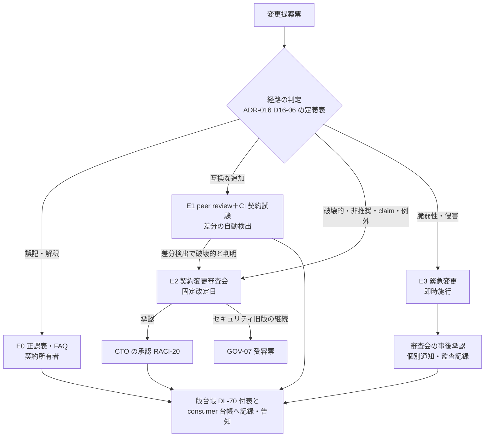

# 連携契約 一覧・規約

> 文書ID: CON-00 / 版: 0.11（提出版 v1.1 と同期） / 状態: draft / 最終更新: 2026-10-15（0.11（v1.1 の同期）: 他文書の v1.1 改訂が本書に宛てた申し送りを反映した。§2.1 の版と SHA-256 の取り直し、CON-15・CON-16・kit/ の行、§2.3 の v1.1 の検査結果、未作成の契約 2 件、残課題 15・16、§9 申し送り 14 の閉鎖。記録は「v1.1 の同期の記録」。v1.1（I-13・I-7・I-10）: 冒頭に「実装者向けの契約早見表」、§4.6 に凍結区分キーの読替え表 F-4 を置き、新規ファイル（integration-essentials.md、state-query.openapi.yaml、kit/）を案内し、改版履歴を末尾「改版履歴」へ移した）
> 対応要求: R-109, R-212／G-118, G-119, G-127, G-134, G-138（R/G 台帳の対応成果物欄に本書のパスか DL-69 を含む行の全件。閉じ方と状態は末尾の対応表）。関連: R-022, R-044, R-105, R-108, R-140, R-194, R-208／G-120〜G-123, G-126, G-137（§2.6 で契約側を起草）, G-140〜G-142／CL-0249, CL-0261
> 依存文書: CONVENTIONS.md, traceability/deliverables.md（DL-69〜DL-80、DL-117〜DL-119、§8 の 11_contracts 行、DEC-8）, 05_adr/ADR-022-integration-contract-standards.md（正本: 凍結区分・契約ごとの判定・変更管理）, 05_adr/ADR-016-versioning-deprecation.md（正本: 版の表し方・互換区分・期間）, 05_adr/ADR-021-irreversible-identifiers.md, 05_adr/ADR-005-token-profile.md, 05_adr/reconciliation-notes.md（U-01〜U-04）, 04_architecture/token-profile.md（ARC-02）, 01_governance/raci-governance.md（RACI-20、契約変更審査会）, 01_governance/assumptions-register.md（A-050, A-052, A-054）, 12_poc/preregistered-test-plan.md（TC-026, TC-119, TC-129）, research/standards-status.md, research/RS-16-parallel-development-governance.md, 11_contracts/ 配下の全契約と review-notes/CON-02〜CON-10
> 作成方法: AI エージェント（Claude）が 11_contracts の全ファイル、ADR-022、ADR-016 を通読して起草した。§2.3 の機械検証は本書の作成者が 2026-10-15 に再実行した。判断は自己レビューであり、実在する CTO/CISO の決裁ではない（CONVENTIONS §8）[D]。版ごとの起草・是正の経緯は末尾「改版履歴」にある（v1.1（I-13）で冒頭から移した）[D]。

---

## 実装者向けの契約早見表（v1.1（I-13））

> 実装者の入口は 1 か所で、INT-00（10_integration/README.md）冒頭の「実装者向けの入口（1 枚）」である。本節はその手順 2 で使う契約側の早見表である。要旨以降は契約の規約・凍結・変更手順の説明で、実装の着手のために通読しなくてよい [D]。模擬連携検証（13_integration-trial/report.md。AI による模擬であり、実在の連携チームの検証ではない）で、11_contracts の分量（約 1.8 MB）と入口の分散が詰まった点に挙がったため置いた（P-18）[D]。

| やりたいこと | 読むファイル | モックの起こし方 | 凍結区分の注記キー（読替えは §4.6 F-4） |
|---|---|---|---|
| SDK なしで token 検証・PEP を実装する | `integration-essentials.md`（CON-16、DL-122。v1.1（I-2）で新設。V1〜V14、PEP の 11 関数、core 型、スタブの最小構成） | —（規則の抜粋。正本は ADR・設計文書） | — |
| access token を検証する | `schemas/access-token-claims.schema.json`（CON-06） | JSON Schema のみ。examples と `x-negative-examples` を試験データにする | なし（§2.2 の列で読む） |
| 認可判定を呼ぶ | `authorization-api.openapi.yaml`（CON-03） | Prism ＋ `kit/echo-proxy.js`（v1.1（I-1）） | `x-maturity` |
| 関係データ・モデルを書く | `relationship-model-registry.openapi.yaml`（CON-04） | Prism | `x-stability` |
| 他サービスを呼ぶ（exchange・Txn-Token） | `token-exchange.openapi.yaml`（CON-05） | Prism | `x-freeze-class` |
| 監査イベントを送る | `schemas/audit-event.schema.json`（CON-08） | JSON Schema のみ | なし（§2.2 の列で読む） |
| 失効・session 終了を受ける | `ssf-caep.openapi.yaml`（CON-09）、`schemas/ssf-caep-set.schema.json`（CON-10） | Prism（CON-09） | `x-contract-tier`（CON-09）、なし（CON-10） |
| ライフサイクル事象を受ける | `lifecycle-events.asyncapi.yaml`（CON-12）、`schemas/lifecycle-event.schema.json`（CON-13） | キットの MK-08（未実装、G3） | `x-freeze-class` |
| 削除などの直前に正本を照会する | `state-query.openapi.yaml`（CON-15。v1.1（I-10）で単独ファイルへ切出し） | Prism にそのまま渡す。不適合応答の注入は CON-11 §4.11 | 各ファイルの記載（版 0.2.0 も全 operation が preview） |
| client を登録する | `client-registration.openapi.yaml`（CON-14） | Prism | `info.x-freeze-classes` と `x-freeze-class` |
| 共通の型（`tid`・tier の表記ほか） | `schemas/common.schema.json`（CON-02。v1.1（I-7）で表記を一本化） | — | `ContractStatus`（値は小文字） |
| 負例を流す | `kit/negative-vectors/*.json`（v1.1（I-11）。CV-001〜CV-014。v1.1 の同期で CV-045 と CV-003c・CV-007c・CV-007d を追加）、各契約の `x-negative-examples` | — | — |
| モックの制約と差し替え点を知る | `kit/README.md`（v1.1（I-1））、`mock-contract-test-kit.md`（CON-11）§4.10・§11.4 | — | — |

- 新設・切出しの 3 件（integration-essentials.md、state-query.openapi.yaml、kit/）は v1.1 の並行改訂で作られた。中身の正本は各ファイルで、本表は所在の案内である [D]。

---

## 要旨（結論）

1. **機械可読な連携契約は 12 ファイル（OpenAPI 6 本、AsyncAPI 1 本、JSON Schema 5 本）が draft で揃い、機械検証のエラーは 0 件である。ただし DEC-8 で凍結できる状態にはまだない** [M][D]。
   - 2026-10-15 11:30〜11:36 の再実行（§2.3）で、OpenAPI 6 本と AsyncAPI 1 本は Redocly lint のエラーが 0 件だった。警告は 14 件で、うち 5 件（CON-05 1、CON-07 3、CON-12 1）は各ファイルの `x-lint-notes` に理由がある。CON-04（版 0.3.0）の 9 件は理由が記録されていない（§9 申し送り 11）[M]。JSON Schema 5 本はすべてメタスキーマ検査に合格し、ルートの examples はすべて適合した [M]。
   - ライフサイクルイベント契約（G-137）は CON-12（`lifecycle-events.asyncapi.yaml`、AsyncAPI 3.1.0）と CON-13（`schemas/lifecycle-event.schema.json`）、client 登録は CON-14（`client-registration.openapi.yaml`）である。CON-12 の RO-9・RO-12 が呼ぶ照会 API は CON-15（案、DL-121 案。OpenAPI 3.1.2、preview）として版 0.6 で登録した。並行作業の約束で新しいファイルを作れなかったため、本体は CON-12 の拡張 `x-state-query-api` にあり、単独ファイルへの切出しと DL の確定は申し送った（§2.6.4、§9 申し送り 14）[D]。v1.1（I-10）で単独ファイル `state-query.openapi.yaml` に切り出され、v1.1 の同期で「案」を外し DL-121 の所在を改めた（§2.1、§2.6.4、§9 申し送り 14 は済）[D]。版 0.4 で 3 ファイルとも deliverables.md §4.5・§8 に DL-117〜DL-119 として行を加え、文書ID の衝突（client 登録とライフサイクル事象のスキーマがともに「CON-13」を名乗っていた）を解いた [D]。
   - 3 ファイルとも作成者以外の独立レビューがまだない。G-118 は §8 の登録で確認対象に入ったが、判定者である自動検査（DL-111）の再実行がまだなので、G-118 と DEC-8 の凍結条件 ④ は未達として扱う [D]。
   - 契約試験キットは仕様（CON-11、版 0.4 draft。ライフサイクル事象の publisher モック MK-08 と sandbox の client 登録 endpoint を版 0.3 で追加し、キット本体を DL-82 から分ける判断を版 0.4 で加えた）ができた。PoC 基盤（DL-82、12_poc/code/README.md）は納品済みだがキットを含まず、キット本体（DL-120、12_poc/code/contract-kit/、所有者案は PEP SDK・開発者支援チーム）は未実装（期限 G3）である [D][^16]。
   - 互換性・非推奨ポリシー（DL-70、CON-01）は版 0.2（review）だが、期間の数値は決裁案（CON-01 KC-1 ほか）で承認されていない [D]。issuer の粒度（U-01、DEC-3）も決まっていない [D]（§6.3）。
2. **契約は単一の規約で書く** [D]（§4）。本書で決める主な点は次の 5 つである。
   - `openapi` 欄は ADR-022 D-2 のとおり `3.1.2` に揃える。
   - 版は SemVer 2.0.0 とし、DEC-8 で凍結する版を `1.0.0` にする。
   - 凍結区分の注記キーは `x-freeze-class` 1 つにする。
   - JSON Schema の `$id` は `https://contracts.<id-domain>/schemas/<名前>/v<major>/<名前>.schema.json` の形にする。
   - 理由コードの登録簿は共通スキーマ（DL-71）に置く。
   
   現行の契約ファイルとの差分 9 件は、所有者と期限を付けて §4.9 に並べた [D]。
3. **変更提案は 4 つの経路に分ける** [D]（§5）。
   - 誤記の訂正は正誤表で随時出す。
   - 互換な追加は peer review と CI で通す。
   - 破壊的変更・非推奨・claim の追加と廃止・例外は、契約変更審査会が年 2 回の固定改定日に決める（最終責任者は CTO、RACI-20）。
   - セキュリティ上の緊急変更は事後承認とする。
   
   この分け方は ADR-022 D-5-6・D-7-1 と ADR-016 D16-14・D16-46 を手順に写したものである [D]。DEC-8 の凍結で不可逆になるのは識別子だけである。そのほかの要素は「版付き・非推奨期間付き・強制移行なし」で置き換えられる。製品、エンジン、cell 構成、内部 API、SDK の内部実装は凍結しない（§6、ADR-022 D-1・D-1-3）[D]。
4. **連携開発者は、基盤の完成を待たずに、契約の GA 要素に対する実装と単体試験を今日から始められる。ただし範囲は限られる** [D]（§2.5）。
   - 始められる: token 検証、認可判定の呼出し、tuple の書込み、token exchange、監査イベントの送出、失効イベントの受信。契約ファイルの examples からモックを起動し、`x-negative-examples` を試験に入れる [D]。
   - 条件付きで始められる: client の登録。sandbox では CON-14 の `registerSandboxClient`、本番では `submitClientRegistrationRequest` を使う（いずれも preview。種別ごとの必須項目は GA）[D]。
   - 条件付きで始められる: テナント・利用者のライフサイクル事象の受信。CON-12 の事象一覧・配送の保証・受信側の義務と、CON-13 の封筒・data の形・examples・負例に対して、受信処理（重複除去、順序番号による欠番検知、未知の type の受理と無視、完了報告）の実装と単体試験を書ける [D]。封筒・type 名・冪等と順序の規約は GA、個別の data スキーマは preview である（ADR-022 D-2）[D]。削除・保全解除・付け替え・所属除去の削除経路は、CON-15 の verifyLifecycleAction の要求・応答・理由コード（LQ00〜LQ11、LQ20〜LQ24）と負例 LQN-01〜LQN-19 に対して、実装と単体試験を書ける（preview）[D]。DEC-8 までは両ファイルのコミットを固定して追う [D]。試験データは CON-13 版 0.2.0 以降の examples・負例を使い、版 0.1.1 では受信処理を始めない（版 0.1.1 には `lcsig` と撤回事象がない。CON-13 x-handoffs R8-H1）[D]。CON-13 の正例の `lcsig` はダミーで署名検証（CON-12 RO-11）を通らないので、署名検証の正例の試験はキットの試験鍵の配布（DL-120、G3）以降になる（INT-00 §6.1、CON-11 §16.3）[D]。
   - モック: OpenAPI 6 本は汎用モック（Prism 5.12.0）で起動し、全 77 operation が応答を返すことを確かめた（§2.3、版 0.5）[M]。汎用モックは署名付き token・負例・mTLS の拒否を出せないので、それらの結合確認は INT-00 §6.3 の暫定ローカル結合環境（12_poc/code）か、キット本体（DL-120、期限 G3）で行う [D]。
   - 制約: DEC-8 までは版が 0.x である。SemVer では major 0 の間は何がいつ変わってもよい [N][^2]。CON-01 も凍結前の変更には期間を約束しない [D]。連携側は契約ファイルの git コミットを固定し、差分を追う [D]。基盤側と同じ合否判定は DL-80 ができるまで共有できない [D]。

---

## 1. 本書の位置付け

| 項目 | 内容 |
|---|---|
| 読み手 | CTO・CISO（凍結の決裁、DEC-8）と、連携開発者（約 300 サービス、25 組織・60 チーム [A-050][A-052]） |
| 本書が決めること | 契約の一覧と所在、準拠標準と準拠範囲、命名・版付け規約、変更提案の手順、凍結の範囲（DL-69 の要点）[D] |
| 本書が決めないこと | 凍結区分と契約ごとの GA・preview の判定（ADR-022 D-1・D-2）、互換区分の定義と期間（ADR-016 D16-06・D16-14、数値は DL-70）、契約試験の手順と合否（DL-80）、各契約の中身（各契約ファイル。ライフサイクルイベント契約は CON-12・CON-13）[D] |
| 正本の優先順位 | ADR（決定）＞ 本書（規約）＞ 各契約ファイル。食い違いが見つかった場合は ADR に合わせ、契約ファイルの所有者が直す [D] |

**ディレクトリ構成** [D]

```
11_contracts/
├── README.md                                 CON-00 本書（DL-69）
├── compatibility-deprecation-policy.md       CON-01（DL-70）
├── mock-contract-test-kit.md                 CON-11（DL-80）
├── integration-essentials.md                 CON-16（DL-122）SDK なし実装の自己完結の抜粋（v1.1（I-2）で新設）
├── lifecycle-events.asyncapi.yaml            CON-12（DL-117）。CON-15 は v1.1（I-10）で下の単独ファイルへ切出し
├── state-query.openapi.yaml                  CON-15（DL-121）照会 API（v1.1（I-10）で単独ファイル化）
├── client-registration.openapi.yaml          CON-14（DL-119）
├── authorization-api.openapi.yaml            CON-03（DL-72）
├── relationship-model-registry.openapi.yaml  CON-04（DL-73）
├── token-exchange.openapi.yaml               CON-05（DL-74）
├── scim.openapi.yaml                         CON-07（DL-76）
├── ssf-caep.openapi.yaml                     CON-09（DL-78）
├── schemas/
│   ├── common.schema.json                    CON-02（DL-71）
│   ├── access-token-claims.schema.json       CON-06（DL-75）
│   ├── audit-event.schema.json               CON-08（DL-77）
│   ├── ssf-caep-set.schema.json              CON-10（DL-79）
│   └── lifecycle-event.schema.json           CON-13（DL-118）
├── kit/                                      v1.1（I-1・I-11）で新設。キット本体（DL-120）の先行配布物
│   ├── README.md                             汎用モックの制約と使い方
│   ├── echo-proxy.js                         X-Request-ID の往復などを補う echo proxy
│   └── negative-vectors/*.json               機械可読な負例ベクタ（CV-001〜CV-014、CV-045）
└── review-notes/CON-02.md〜CON-10.md         作成者以外による独立レビューの記録（凍結対象外）
```

---

## 2. 契約一覧

### 2.1 所在・版・状態・所有者

- 版と状態は 2026-10-15 時点の各ファイルの記載である [D]。
- 「独立レビュー」は作成者とは別の AI エージェントによるもので、人による照合はどの契約でもまだ行っていない [D]（各 review-notes §1）。
- 所有者は本書の提案で、確定は K-CON-3（§7）で行う。案は A-054 の内訳（認証・IdP 5、認可・PDP 5、PEP SDK・開発者支援 4、SRE 6 ほか）にもとづく [D][A-054]。

| 文書ID | DL | パス | 記述形式 | 版 | 状態 | 独立レビュー | 所有者（案） | SHA-256（v1.1 の同期で 2026-10-15 に再取得。旧値は版 0.10 までの本表） |
|---|---|---|---|---|---|---|---|---|
| CON-00 | DL-69 | 11_contracts/README.md | Markdown | 0.11 | draft | 版 0.2 に対して済（本書末尾のレビュー記録） | プラットフォームチーム長（契約変更審査会の議長） | —（本書自身。自分のハッシュは本文に書けないため、git のコミットで特定する） |
| CON-01 | DL-70 | 11_contracts/compatibility-deprecation-policy.md | Markdown | 0.2 | review（数値は決裁案 KC-1〜KC-5 で未承認） | 未実施 | CTO＋CISO（SLA の承認者）、起草はプラットフォームチーム | `e28822db9a6440900a2a43308177ebc6e24d902a7e2760a8359ec24488ed7d4a` |
| CON-02 | DL-71 | 11_contracts/schemas/common.schema.json | JSON Schema 2020-12 | 0.3.0 | draft | 済（修正 11 件） | プラットフォームチーム長 | `7f7ef899eeff8279c671ab8153a2c81e5cb4d88ff720109768551502f043bdde` |
| CON-03 | DL-72 | 11_contracts/authorization-api.openapi.yaml | OpenAPI 3.1.2 | 0.3.1（profile 1.0） | draft | 版 0.1.x に対して済（修正 19 件）。模擬パネル ラウンド 1 による 0.2.0 の改版分は未実施 | 認可・PDP チーム | `82155c6ceb2c398671e5cd13ae7cb88b465ec9520a2095d4a8aa0d571d53a054` |
| CON-04 | DL-73 | 11_contracts/relationship-model-registry.openapi.yaml | OpenAPI 3.1.0 | 0.4.1 | draft | 版 0.1.x に対して済（修正 12 件）。0.2.0・0.3.0・0.3.1 の改版分は未実施 | 認可・PDP チーム | `ae766e118804ab466c797598c1dcb39752633af8d04ca60469d4a5af26211625` |
| CON-05 | DL-74 | 11_contracts/token-exchange.openapi.yaml | OpenAPI 3.1.0 | 0.2.0 | draft | 済 | 認証・IdP チーム | `31739dac670496b1961d8839a660d280e32f39a19e3e85a464d87f9788300ff9` |
| CON-06 | DL-75 | 11_contracts/schemas/access-token-claims.schema.json | JSON Schema 2020-12 | 0.2.0 | draft | 済 | 認証・IdP チーム | `766a3ff8b6ddf7a3accc78f4a1e7644886ee8efed621a0ad1987eef2b71b4b70` |
| CON-07 | DL-76 | 11_contracts/scim.openapi.yaml | OpenAPI 3.1.0 | 0.1.0 | draft | 済 | 認証・IdP チーム | `6ef3b845c4826fcde850ffe00b5d25b2d816021761941a41377bb8534066c124` |
| CON-08 | DL-77 | 11_contracts/schemas/audit-event.schema.json | JSON Schema 2020-12 | 0.3.1（SemVer の形に揃えた。§4.9 D-4） | draft | 済（RV-01〜RV-14） | プラットフォームチーム（監査収集）。CISO が協議先 | `3820bb4b143c05b58695a8f1ad8f14fd570f8f6b2fe898ad6bc438a11ebde458` |
| CON-09 | DL-78 | 11_contracts/ssf-caep.openapi.yaml | OpenAPI 3.1.0 | 0.1.1 | draft | 済 | 認証・IdP チーム（失効・継続評価） | `c01c8c2fb6c51fd3a54648893b86a4cf79d7b4a0bc151748e26f2040cabe4482` |
| CON-10 | DL-79 | 11_contracts/schemas/ssf-caep-set.schema.json | JSON Schema 2020-12 | 0.1.0 | draft | 済 | 認証・IdP チーム（失効・継続評価） | `c137a200b93e8f383278b2733eabdd6ad4f14d78a5b1bf16908583e295377662` |
| CON-11 | DL-80 | 11_contracts/mock-contract-test-kit.md | Markdown | 0.13 | draft（DL-82（PoC 基盤）は納品済み。キット本体 DL-120 は未実装、期限 G3） | 版 0.2 まで済（同書のレビュー記録） | PEP SDK・開発者支援チーム | `d471b4fbf4e59221ad7ffab9011fa226677418db5423a47360e09f5129302243` |
| CON-12 | DL-117 | 11_contracts/lifecycle-events.asyncapi.yaml | AsyncAPI 3.1.0 | 0.6.1 | draft（版 0.4.0 でファイル内の「案」を外した。版 0.5.0 で CON-13 版 0.2.0 の改版に揃えた） | 未実施（本書の作成者は §2.3・§2.6.2 の機械検査だけを行った） | 未決（K-CON-3。案: プラットフォームチームと DL-49・DL-08 の所有者の共同） | `273fb9c058035c476bdbb68fa08035d6761732814e38b45a4b573b1e3543ec1b` |
| CON-15 | DL-121 | 11_contracts/state-query.openapi.yaml（v1.1（I-10）で CON-12 の拡張 `x-state-query-api` から単独ファイルへ切出し。旧計画名 lifecycle-state.openapi.yaml は使わない。DL-121 の所在は traceability/deliverables.md 版 0.7 で改めた） | OpenAPI 3.1.2 | 0.2.0 | draft、preview（GA への昇格は CON-12 §4.1 Q-5 の案）。版 0.2.0 で QC-8・QC-9・`x-response-classes`・LQN-20〜LQN-29 を追加 | 未実施 | DL-49 の所有者＋プラットフォームチーム長（CON-12 LC-OI-3） | `df4bd18bd9f74a60863ce2cef3d623c03661edcfc056bb5cdc4a2f3fb7ae0931` |
| CON-13 | DL-118 | 11_contracts/schemas/lifecycle-event.schema.json | JSON Schema 2020-12 | 0.2.3 | draft（版 0.2.0 は受信側・publisher 側の双方に非互換な改版。版 0.1.1 の examples で受信処理を始めない） | 未実施（同上。TRC-11 OI-G10） | 同上 | `cb5f359c53c810987f91995311a21ecea99b3693f0f62ad80e334fd2bd7833d1` |
| CON-14 | DL-119 | 11_contracts/client-registration.openapi.yaml | OpenAPI 3.1.2 | 0.5.1 | draft | 未実施 | 認証・IdP チーム（承認者は CTO、契約管理） | `30c5c0e5e7f15876807d4a80c8d422101be22174f15660890eaaab65e264f3cf` |
| CON-16 | DL-122 | 11_contracts/integration-essentials.md | Markdown | 0.2 | draft（v1.1（I-2）で新設。文書ID・DL は v1.1 の同期で確定） | 未実施（抜粋と正本の照合は同書 残課題 1） | 契約チーム（同書 残課題 1・2） | `32fc6521595e67ae6675090378502395ae5c9b0d9010e92fec11ba85bdec9700` |
| CON-11-KIT（CON-11 の付属） | DL-120（先行配布物） | 11_contracts/kit/README.md、kit/echo-proxy.js（0.2.0）、kit/negative-vectors/（CV-001〜CV-014、CV-045、vector.schema.json） | Markdown、JavaScript（Node.js 22）、JSON | 0.2 | draft（v1.1（I-1・I-11）で新設。正本は CON-11） | 未実施 | PEP SDK・開発者支援チーム | README `93ed091859531d5a76d8192f6905b63e23dd44545c84919d739303d0bed06e97`、echo-proxy.js `32be0ea2b380f0721e78857f08e458c9c47cab07b96322fbf15a559d5013d61c`（ベクタの JSON は個別に取る） |

- 版とハッシュは、CON-01 CP-60 (4)（凍結前でも DL-69 の一覧に版とハッシュを残す）に従って記録した [D]。版は各ファイルの記載（OpenAPI・AsyncAPI は `info.version`、JSON Schema は `x-version` か `$comment`、Markdown は冒頭の版）を、ハッシュは `sha256sum` の出力を、本書の作成者が 2026-10-15 11:35〜11:36 に読み取ったものである [M]。
- PoC/R7反映（版 0.7）: CON-04・CON-06・CON-11・CON-14 の行の版とハッシュを、本書の作成者が 2026-10-15 の是正の後に `sha256sum` で取り直した値に改めた（MP-7-21 の是正。CON-14 は版 0.1.1 の表示のまま 0.2.0・0.3.0・0.3.1 と改版されていた）[D]。他の行は同じ時点に再計算し、表の値と一致することを確かめた [D]。CON-14 版 0.3.1 の Redocly lint は本作業の環境では再実行していない（§2.3 の CON-14 の行は版 0.1.1 の結果。版 0.2.0・0.3.0 の結果と版 0.3.1 の検査は同契約の `x-lint-notes`）[D]。
- ラウンド 9（版 0.8）: 本書のこの改訂の担当が 2026-10-15 09:16Z（UTC）に、表の全 16 行（CON-00 を除くハッシュは 14 行）の版と SHA-256 を各ファイルと `sha256sum` で照合した [M]。CON-01〜CON-10 の 10 行は表の値と一致した。一致しなかった CON-11（0.8 → 0.10）、CON-12（0.4.0 → 0.5.0）、CON-13（0.1.1 → 0.2.1）、CON-14（0.3.1 → 0.4.0）と、CON-00 自身の版（0.6 → 0.8）を改めた。CON-14 版 0.4.0 は並行作業の改版で、本改訂では §2.3 の検査を再実行していない。照合は改訂の担当によるもので、作成者以外の照合は TRC-11 OI-G10 で追跡する [D]。
- v1.1（I-10・I-13）: 本表の版・SHA-256 は v1.0（提出版）の時点の値である。v1.1 の並行改訂で各契約の版が上がり、新設の `integration-essentials.md` と `kit/` は本表に行がない。版・ハッシュの取り直しと新設ファイルの行の追加は §9「他文書への申し送り（v1.1）」V-1 とする [D]。
- v1.1 の同期（V-1・V11-Q2・IE-1）: 上の段落は改訂中の状態の記録である。同期の担当が 2026-10-15 に、v1.1 の改訂と同期の後のファイルから版を読み、`sha256` を取り直して本表の版と SHA-256 の列を改めた [M]。CON-15 の「案」を外し、CON-16（integration-essentials.md）と kit/ の行を加えた。各行の「状態」「独立レビュー」の列の改版の経緯は版 0.10 までの記述のままで、v1.1 の改訂の内容は各ファイルの冒頭にある。v1.1 の改訂・同期の分の独立レビューはどの契約でも未実施である [D]。
- 契約ファイルは並行作業で更新が続いている（版 0.3 の作成時から本版までに CON-04・CON-11・CON-12 の版が上がった）。連携開発者が §2.5 手順 3 でコミットを固定するときは、本表の値ではなく、固定したコミットのファイルから版とハッシュを取る [D]。本表と実ファイルの差分は DL-111 の検査項目にする（§9 申し送り 1）[D]。

**ファイルを持たない契約・未作成の契約** [D]

| 契約 | 所在 | 状態 | 扱い |
|---|---|---|---|
| 参照値 API（subj_ref の払出し照会、res_ref・jti_ref・ip_ref の計算、DEK wrap）と監査送信 API（耐久ジャーナルへの送信、producer_seq 順、spool・再送・冪等キー event_id）。v1.1 の同期で登録（CON-08 x-handoff-v1.1 の 3、v1.1（I-3）、P-03） | 未作成。求め方と鍵の取得経路は CON-08 の `x-ref-derivation`、送信の順序と連鎖は `x-integrity-chain` に記述がある | 未作成（所有者 DL-77・ADR-014。期限は DEC-8 第 1 段の前） | 契約ができるまで、依存サービスは CON-08 の schema に合う監査イベントを作るところまでを実装し、送信と参照値の取得は差し替えられる形にする。CON-11 MK-07 にこの 2 API のスタブは置けない（CON-11 §4.8）。cell 内、workload 認証、要求の tid に限定、逆引きなしを要件とする [D] |
| OIDC/OAuth profile（DL-69 に収載） | 04_architecture/token-profile.md（ARC-02）。中身の正本は ADR-005・ADR-020 | review（ARC-02 版 0.2） | 標準の discovery metadata が機械可読な形式なので、OpenAPI にはしない。版付きの標準 profile として凍結の束に含める（ADR-022 D-2 の OIDC/OAuth 行）[D] |
| ライフサイクルイベント契約（G-137） | CON-12・CON-13（§2.6）。ファイル名は G-goal-criteria の申し送りの候補どおり | **配置済み・DL 割当済み**（DL-117・DL-118。版 0.4 で deliverables.md §4.5・§8 に行を追加） | G-118 の検証対象に含まれる。独立レビューと DL-111 の再検査まで G-118 と DEC-8 は未達（§8 残課題 1）[D] |
| 内部取引 context（Transaction Token。ADR-022 D-2 の独立した行） | 単独のファイルはない。`txn` 欄の形式は CON-02 `TransactionId`、要求は CON-05 `/txn-token`、claim は CON-06 に分かれている | GA: `txn` の意味と形式、`Txn-Token` ヘッダを無改変で下流へ渡す義務、Authorization ヘッダに入れない義務、全文をログに残さない義務。preview: claim 構成（`txn-v1`）と TTS への要求（ADR-022 D-2） | GA の義務（ヘッダの無改変伝播、Authorization ヘッダに入れない、全文をログに残さない）は CON-05 の `/txn-token` operation の description に書かれている。しかしそこは token を受け取るだけのサービスが読まない場所である。連携開発者は本行と CON-05 の当該箇所を読む。義務を CON-02 `TransactionId` の description から参照できるようにするのは CON-02・CON-05 の所有者の宿題である（§8 残課題 12）[D] |
| trace 伝播（W3C Trace Context Level 1） | CON-02 の `Traceparent`・`TraceId` | GA: traceparent を受け取ったら伝播する義務。外部から来た sampled flag を監査の記録可否に使わない義務。Baggage に subject・tenant を載せない（ADR-022 D-2） | 型と sampled flag の扱いは CON-02 `Traceparent` の `$comment` にある。受け取ったら伝播する義務と Baggage の禁止は、契約ファイルにはまだ書かれていない。CON-02 の所有者が追記する（§8 残課題 12）[D] |
| 非推奨の通知（RFC 9745・RFC 8594） | CON-01 §5.3（header の規則）、本書 §5.3 | GA: header の送出と client_id 単位の利用計測（ADR-022 D-2） | 規則は CON-01 が正本。各 OpenAPI に Deprecation・Sunset の response header を宣言するのは DL-80 の検査項目にする [D] |
| 記述形式（OpenAPI 3.1.2、JSON Schema 2020-12、AsyncAPI 3.x） | 本書 §4.4 | GA（ADR-022 D-2）。OpenAPI 3.2 への移行は preview | 本書 §4.4 の L-1・L-2 で規定する [D] |
| `authorization_details` の type 定義 | 未作成 | v1 では発行しない予約 claim（ADR-022 D-9-2）。ただし ADR-020 D20-09-1 は FAPI 範囲で使うとしており、ADR-017 L17-5 で未決 | type 定義は契約として版付きで公開する（ADR-020 D20-09-2）。所在は CON-06 の付属にする案。未決（ADR-017 L17-5、ADR-020）[D] |

### 2.2 準拠標準・準拠範囲・独自拡張・draft の場合の互換方針（G-119 の 4 項目）

- 標準の状態は research/standards-status.md（確認日 2026-10-03）の SS-ID で示す [D]。
- 凍結区分（GA／preview）は ADR-022 D-2 の判定であり、本書は写しているだけである [D]。

| 文書ID | 準拠標準（状態、SS-ID） | 準拠範囲（GA） | preview・独自拡張 | draft に依存する場合の互換方針 |
|---|---|---|---|---|
| CON-02 | RFC 9457（final、SS-A47）、AuthZEN 1.0 §5 の情報モデル（final、SS-C13）、W3C Trace Context Level 1（Recommendation、SS-D02） | 識別子の型、tenant context、相関 ID、Problem（生成側の検査用。受信側は未知の拡張メンバを無視する MUST [N][^5]）、版情報 | 自社定義の型（OpaqueId、KeyedRef、理由コードの列挙など） | draft には依存しない。`txn` は CON-05・CON-06 の行に従う [D] |
| CON-03 | OpenID AuthZEN Authorization API 1.0（final、SS-C13） | evaluation・evaluations、PDP metadata、X-Request-ID の往復、自社拡張の `decision_id` と不透明な consistency token | preview: resource search、`model_revision` の表現、obligation、`completeness`、`txn`。GA 候補（区分は未決（ADR-022））: `reason`・`consistency.mode`・`model.pin`・`profile_version`。拡張の容器キー名は未決（ADR-021） | AuthZEN の後続改訂は API を拡張してよいが変更してはならない [N][^6]（RS-07#62）。そのため自社拡張は context の名前空間付きキーに閉じ込める [D] |
| CON-04 | 該当する標準なし（ADR-022 D-1-1(b)）。エラーは RFC 9457、状態コードは RFC 9110 | tuple の書込み・削除・読取り、テナント指定の必須化、不透明な consistency token、エラー形式 | preview: モデル DSL、モデル管理（登録・pin・shadow・rollback、export/import）。`x-stability` で operation ごとに記載 | 標準がないため、独立した 2 実装で動くことを PoC で示すことを GA の維持条件にする（ADR-022 D-6-6、TC-026）[D] |
| CON-05 | RFC 8693（final、SS-A09）、RFC 8707（final、SS-A10）、RFC 9068（final、SS-A07）。Transaction Tokens -11（**draft**、IESG 未提出、2027-01-31 失効予定、SS-B04） | subject token の種別、resource の必須化（1 値）、act の深さの上限、エラー | preview: `requested_token_type=txn_token`（`/txn-token`） | Transaction Tokens が RFC にならないか大きく改訂された場合は、edge が発行する自社形式の取引 ID を同じ `txn` 欄に入れて退避する（ADR-022 D-8-5、ADR-009 D09-26）[D] |
| CON-06 | RFC 9068、RFC 7519、RFC 8693、RFC 7800・RFC 8705・RFC 9449、RFC 7662・RFC 9701、OIDC Core（final）。Transaction Tokens -11（**draft**、SS-B04） | ADR-022 D-9-1 の core claim、`typ=at+jwt`（不可逆） | 予約 claim（ADR-022 D-9-2）。独自 claim の名前（ptype・gref・ver など）は案で、未決（ARC-15 KC-1、DEC-8 前） | Txn-Token の claim は版を固定した社内 profile `txn-v1` として扱い、規範の根拠にはしない（ADR-021 D21-36）[D] |
| CON-07 | RFC 7643・RFC 7644（final、SS-A41・SS-A42） | User・Group・Enterprise User 拡張、作成・取得・照会・PUT・PATCH・DELETE、ETag、エラー形式 | 非対応: Bulk・/Me・sort・changePassword（501）、RFC 9865（v1 では不採用）。preview: RFC 9967（final、SS-A44）。準拠しない: IPSIE AL SCIM（**draft**、SS-C19） | IPSIE は数値を参照するだけで依存しない。Implementer's Draft 以上になった時点で再検討する（ADR-004 §8 T-2）[D] |
| CON-08 | 正準スキーマは自社定義（ADR-014 D14-06）。写像先は OCSF 1.9.0（SS-I24）と CADF 1.0.0 | 共通項目（主体、tenant、actor chain、resource、action、decision、reason、policy/model revision、producer 連番、スキーマ版、相関 ID） | OCSF・CADF への写像は export 層に置き、版は契約と別に管理する（凍結しない） | OCSF の版上げは写像の版上げとして扱い、正準スキーマを変えない（ADR-022 D-2）[D] |
| CON-09 | SSF 1.0、CAEP 1.0、RISC 1.0（final、SS-C09〜SS-C11）、RFC 8935・RFC 8936。CAEP Interoperability Profile（**draft**、Implementer's Draft 1、SS-C12） | stream 管理、push/poll、verification、受信 endpoint | `x-contract-tier` で要素ごとに記載。数値はすべて TBD（DL-20） | CAEP Interoperability Profile は監視するだけで依存しない [D] |
| CON-10 | SSF 1.0・CAEP 1.0・RISC 1.0（final）、RFC 8417 | v1 の GA イベント 7 種の SET payload と受信義務の範囲 | 自社イベントの命名規則は preview の案で、未決（ADR-022） | draft には依存しない [D] |
| CON-15（案） | 照会 API 自体は自社定義（該当する標準なし）。エラーは RFC 9457、キャッシュ禁止は RFC 9111 §5.2.2.5、503・429 と Retry-After は RFC 9110・RFC 6585（根拠の脚注は CON-15 の x-references） | なし（版 0.1.0 は全 operation が preview）。GA の候補は verifyLifecycleAction の要求・応答の形、受信側の規則 QC-1〜QC-7、理由コードの意味（CON-12 §4.1 Q-5） | 理由コード LQxx（開いた列挙）、状態の列挙値（DL-49 §2.1・DL-08 §4・§7.1 の写し）、`x-negative-examples` | draft には依存しない [D] |

### 2.3 機械検証（lint）の結果

本書の作成者が 2026-10-15 に再実行した結果である。版 0.4 では、client 登録（CON-14）、ラウンド 1 以降に改版された CON-03（0.2.0）・CON-04（0.3.0）、CON-12・CON-13 を含めて、全 12 ファイルを 11:30〜11:36 に再実行した [M]。対象の版とハッシュは §2.1 の表のとおりである。

- 実行環境: Node.js v22.23.2、`@redocly/cli` 2.63.0（recommended 規則、設定ファイルなし）、Python の `jsonschema` 4.26.0（Draft202012Validator、FormatChecker あり）、PyYAML。
- 生データ: 作成者の一時作業領域にだけ置き、リポジトリには残していない。同じ検査は DL-80 の CI（TC-026）で再現し、そこで保存する [D]。

| 文書ID | 検査 | 結果 [M] | 警告の理由（各ファイルの `x-lint-notes`） |
|---|---|---|---|
| CON-03（0.2.0） | Redocly lint | エラー 0・警告 0 | — |
| CON-04（0.3.0） | Redocly lint | エラー 0・警告 9（no-unused-components 7、no-required-schema-properties-undefined 2） | CON-04 に `x-lint-notes` がなく、理由は記録されていない。7 件は `components/schemas/ConditionCatalog` とその `$defs` 6 件をどの operation も参照していないこと、2 件は `SemanticChangeDeclaration` の `then.required`（description・affected）が `then` の中に properties を持たないことによる（警告の位置で確認）[M]。版 0.1.x の時点では警告 0 件だった。理由の記録か是正は CON-04 の所有者へ申し送った（§9 申し送り 11） |
| CON-05 | Redocly lint | エラー 0・警告 1（info-license） | 公開ライセンスが決まっていない。§4.7 で値を決めた |
| CON-07 | Redocly lint | エラー 0・警告 3（operation-2xx-response 2、no-unused-components 1） | /Bulk と /Me はわざと 501 だけを返す。未使用の component は例外専用 |
| CON-09 | Redocly lint | エラー 0・警告 0 | — |
| CON-14（0.1.1） | Redocly lint | エラー 0・警告 0 | — |
| CON-12（0.2.0） | Redocly lint | エラー 0・警告 1（info-license-strict） | License Object に url がない（CON-12 の `x-lint-notes`。§2.6.3） |
| CON-12（0.4.0。版 0.6 で追加） | Redocly lint | エラー 0・警告 1（info-license-strict） | 同上。拡張 `x-state-query-api` は AsyncAPI の検査の対象外なので、下の CON-15 の行で別に検査した |
| CON-12（0.5.0。版 0.8 で追加、ラウンド 9） | Redocly lint、PyYAML、CON-13 版 0.2.1 との要約の一致（CON-11 §9.1 P-7） | Redocly lint はエラー 0・警告 1（info-license-strict）。構文解析は成功。`CloudEventEnvelope` と CON-13 `$defs/Envelope` の required（`lcsig` を含む）と const 3 件が一致し、CON-13 の examples 5 件がすべて要約に適合した。`ReportEnvelope` の required の不一致（`datacontenttype`・`dataschema`・`partitionkey`）は残る | 同上。`ReportEnvelope` の件は CON-11 §14.2 の CON-12 行 (1) で申し送り済み・未対応 |
| CON-15（0.1.0。版 0.6 で追加） | `x-state-query-api` の値を単独のファイルに取り出し、Redocly lint、`check_schema`、examples と要求の負例の検証 | Redocly lint はエラー 0・警告 0。`components.schemas` 19 件すべて合格。operation の examples 10 件すべて適合。要求の形の負例 5 件すべて不適合 | — |
| OpenAPI 6 本・AsyncAPI 1 本 | YAML の構文解析（PyYAML） | 7 本とも成功 | — |
| CON-02 | `check_schema` | 合格（ルートの examples なし。`$defs` ごとの正例 67・負例 64 は CON-02 レビュー §5 で検証済み） | — |
| CON-06 | `check_schema`、ルートの examples | 合格。examples 3 件がすべて適合 | — |
| CON-08 | `check_schema`、ルートの examples | 合格。examples 5 件がすべて適合 | — |
| CON-10 | `check_schema`、ルートの examples | 合格。examples 5 件がすべて適合 | — |
| CON-13（0.1.1） | `check_schema`、ルートの examples、ルートの `x-negative-examples`（CON-02 を registry に登録） | 合格。examples 4 件がすべて適合、負例 7 件がすべて不適合 | — |
| CON-13（0.2.1。版 0.8 で追加、ラウンド 9） | 同上に加え、`$defs/DeletionReport` の examples と `x-negative-examples` | 合格。ルートの examples 5 件がすべて適合、ルートの負例 11 件（LC-NE-01〜LC-NE-11）がすべて不適合。DeletionReport の examples 2 件が適合、負例 2 件（LC-DR-NE-01・02）が不適合 | — |
| CON-14（0.1.1） | `components.schemas` の各スキーマの `check_schema` | 25 件すべて合格（examples と負例 10 件の検査は同契約の `x-lint-notes` に起草者の結果がある） | — |
| CON-14（0.4.0。版 0.9 で追加、ラウンド 10） | Redocly lint | エラー 0・警告 0（09:34Z 頃、SHA-256 `4137faa3…`） | — |
| CON-14（0.4.1。版 0.9 で追加、ラウンド 10） | Redocly lint、`components.schemas` の各スキーマの `check_schema`、requestBody の examples、`x-approval-rules`・`x-reason-codes`・`x-negative-examples` の件数 | Redocly lint はエラー 0・警告 0。`check_schema` は 34 件すべて合格（DataProcessingDeclaration を含む）。requestBody の examples 8 件（`data_processing` を付けた createTenantAppOnlyClient を含む）がすべて適合。承認規則は AR-0〜AR-9 の 10 件、理由コードは CR24 まで 24 件、負例は CRN-01〜CRN-46 の 46 件（09:40Z、SHA-256 `aa3dfe67…`） | — |
| v1.1 の同期（2026-10-15）: CON-03（0.3.1）・CON-04（0.4.1）・CON-05（0.2.0）・CON-07・CON-09・CON-14（0.5.1）・CON-15（0.2.0） | Redocly lint（`@redocly/cli@latest`、recommended、設定ファイルなし。外部参照 `./schemas/common.schema.json` は Redocly が解決） | 7 本ともエラー 0。警告は CON-04 が 9（従来と同じ no-unused-components 7、no-required-schema-properties-undefined 2）、CON-05 が 1（info-license）、CON-07 が 3（従来と同じ）、他は 0 | 従来と同じ（上の各行） |
| v1.1 の同期: CON-12（0.6.1） | Redocly lint、`@asyncapi/cli validate` | Redocly lint はエラー 0・警告 1（info-license-strict）。AsyncAPI CLI は valid、governance の問題なし（CON-15 の切出しで、拡張の中の `$ref` による invalid-ref が解消した） | 同上 |
| v1.1 の同期: CON-02（0.3.0）・CON-06（0.2.0）・CON-08（0.3.1）・CON-13（0.2.3） | `python -m json.tool`、`check_schema`、examples と負例（CON-02 を `referencing` の registry に登録して外部参照を解決） | 4 本とも構文・`check_schema` に合格。CON-02 の `$defs` の正例 76 件すべて適合。CON-06 のルートと `$defs` の examples すべて適合、負例 NE-01〜NE-25 すべて不適合。CON-08 の examples 8 件すべて適合、負例 AEN-01〜AEN-32 すべて不適合。CON-13 の examples 5 件すべて適合、負例 11 件すべて不適合 | — |
| v1.1 の同期: kit/negative-vectors（CV-001〜CV-014、CV-045） | `vector.schema.json` による検証（`jsonschema`） | 15 件すべて適合 | — |

- （版 0.2 の記録）本書の独立レビュー担当が 2026-10-15 に、YAML の構文解析（5 本）と JSON Schema の `check_schema` およびルートの examples の検証（4 本）を同じ環境（`jsonschema` 4.26.0）で再実行し、上表と同じ結果を得た [M]。Redocly lint は再実行していない [D]。
- 版 0.8（ラウンド 9）の CON-12・CON-13 の行は、本書のこの改訂の担当が 2026-10-15 に、上と同じ環境（Redocly は `@redocly/cli` 2.63.0、`jsonschema` 4.26.0）で実行した [M]。
- 版 0.9（ラウンド 10）の CON-14（0.4.0・0.4.1）の行は、本書のこの改訂の担当が 2026-10-15 09:34Z〜09:40Z（UTC）に、上と同じ環境（Node.js v22.23.2、`@redocly/cli` 2.63.0 の recommended 規則、`jsonschema` 4.26.0 の Draft202012Validator と FormatChecker、PyYAML）で実行した [M]。版 0.4.0 を検査した直後に並行作業で 0.4.1 に改版されたため、0.4.1 でも再実行した。CON-14 の `x-lint-notes` が「Redocly CLI は環境に導入されておらず、版 0.4.0 では lint を実行していない。再実行は CON-00 の所有者による」とした分はこれで実行した [D]。CR22 の (i)〜(v) の照合と CR24 は状態に依存し、スキーマでは検査できない（同契約の `x-lint-notes`）ので、本検査の対象外である [D]。Prism の起動確認は再実行していない（下の表は版 0.1.1 の結果）[D]。生データは担当の一時作業領域にだけ置いた [D]。`@asyncapi/parser` と Ajv は再実行していない [D]。
- 版 0.4 の再実行では、`@asyncapi/parser` による CON-12 の検査と、Ajv による CON-13 の検査は行っていない。これらの結果は §2.6.2（版 0.1.0 の CON-12・CON-13 に対するもの）にある [D]。
- 負例、別実装の検証器（Ajv）、コード生成、モックの起動の結果は各 review-notes に記録されている [M]。
- （版 0.4 までの記録）モックサーバーの起動を試したのは CON-07 だけで、CON-03 と CON-09 は review-notes に「未実施」と記録されていた [D]。版 0.5 で下記のとおり OpenAPI 6 本すべてを起動した。
- 契約試験キット（DL-80）では、全契約でモックを起動する試験を必須にする（§8 残課題 4）[D]。

**汎用モックの起動結果（版 0.5。模擬パネル ラウンド 4 の指摘 MP-1-31・MP-3-19 への対応）**

本書の作成者が 2026-10-15 12:29〜12:31 に、OpenAPI 6 本を汎用モック Prism で 1 本ずつ起動し、各 operation に 1 回ずつ要求を送った [M]。

- 実行環境: Node.js v22.23.2、`@stoplight/prism-cli` 5.12.0（`prism mock -h 127.0.0.1 -p <port> <契約ファイル>`、既定の静的応答。CON-07 の review-notes と同じ版）、本書の作成者の一時作業領域に置いた起動・要求スクリプト。
- 要求の作り方: path 引数はすべて仮値 `x1`、`Authorization: Bearer x` を付け、request body は契約に request example があればそれを、なければ送らない。これは「起動して応答を返すか」の確認であり、契約の正例・負例の試験ではない [D]。
- 対象ファイルのハッシュは §2.1 の SHA-256 と一致した（6 本とも先頭 12 桁で照合）[M]。
- 生データ（スクリプト、要求ごとの状態コード、Prism のログ）は作成者の一時作業領域にだけ置き、リポジトリには残していない。同じ確認はキット DL（DL-120）の CI で再現し、そこで保存する [D]。

| 文書ID（版） | 起動 [M] | operation 数 | 応答の状態コードの内訳 [M] | Prism のログに出た事項 [M] |
|---|---|---|---|---|
| CON-03（0.2.0） | 成功 | 4 | 200 が 4 | `mutualTLS` の security scheme は扱えないという警告。生成した `Deprecation` 応答ヘッダが契約の pattern に合わないという応答検証の誤り 1 種 |
| CON-14（0.1.1） | 成功 | 7 | 201 が 1、202 が 1、400 が 2、422 が 3 | — |
| CON-04（0.3.0） | 成功 | 29 | 200 が 10、201 が 2、202 が 3、400 が 4、422 が 10 | `mutualTLS` の警告 |
| CON-07（0.1.0） | 成功 | 21 | 200 が 7、204 が 2、400 が 8、401 が 2（/Bulk・/Me。契約どおり）、422 が 2 | 応答の `status` が pattern に合わないという応答検証の誤り 1 種 |
| CON-09（0.1.1） | 成功 | 14 | 200 が 7、204 が 1、400 が 4、422 が 2 | `mutualTLS` の警告。issuer・各 endpoint の URL・`delivery` が pattern・const・oneOf に合わないという応答検証の誤り 11 種 |
| CON-05（0.1.0） | 成功 | 2 | 400 が 2 | `mutualTLS` の警告。form の必須欄（`grant_type` 等）の欠落による要求検証の拒否 |

- 6 本とも起動し、全 77 operation が応答を返した。5xx と接続失敗は 0 件だった [M]。
- 4xx（39 件）は Prism の要求検証によるもので、仮値 `x1` が path 引数の pattern・enum に合わないこと、必須の body を送らなかったことが原因である（ログの理由で確認）[M]。契約の誤りを示すものではない [D]。
- `mutualTLS` を使う CON-03・CON-04・CON-05・CON-09 では、Prism は client 認証を検査しない（警告の文言 "We currently do not support this type of security scheme: mutualTLS"）[M]。汎用モックで mTLS の拒否は試験できない [D]。
- 応答検証の誤り（CON-03・CON-07・CON-09）は、抜き取りで確かめた応答（CON-09 の `GET /.well-known/ssf-configuration` と `GET /ssf/stream` の本文、CON-07 の 400 の `status: "400"`）がいずれも契約の pattern を満たしていた [M]。原因（Prism の生成値・検証器の問題か、契約の他の example の問題か）は切り分けていない [D]。連携側はこの誤りに合わせてコードを直さない（CON-11 §4.10）。切り分けはキット DL（DL-120）の実装時に行う [D]。
- （版 0.6 で追加）CON-15（0.1.0）を同じ Prism 5.12.0 で 2026-10-15 12:58 に起動し、6 operation すべてが 200 を返した。ログは `mutualTLS` の警告だけだった [M]。要求には examples の値を使った [D]。
- AsyncAPI 1 本（CON-12）は汎用モックでの起動を試していない。ライフサイクル事象の模擬は CON-11 §4.11 の MK-08（キット本体、未実装）で行う [D]。
- 汎用モックは examples か生成値の正例しか返さず、署名付きの token も負例も出さない（CON-11 §4.10）[D]。token 検証と PDP の失敗時の振舞いの結合確認は、INT-00 §6.3 の暫定ローカル結合環境（12_poc/code、POC-03）か、キット配布後の MK-01〜MK-08 で行う [D]。

### 2.4 契約間の依存

```mermaid
flowchart LR
  subgraph 共通
    C02[CON-02 共通スキーマ]
  end
  subgraph token
    ARC02[OIDC/OAuth profile<br/>ARC-02]
    C06[CON-06 access token claims]
    C05[CON-05 Token Exchange]
    C14[CON-14 client 登録]
  end
  subgraph 認可
    C03[CON-03 Authorization API]
    C04[CON-04 Relationship/Model Registry]
  end
  subgraph 失効・連携
    C07[CON-07 SCIM]
    C09[CON-09 SSF/CAEP stream]
    C10[CON-10 SET スキーマ]
    LC[CON-12/13 ライフサイクルイベント<br/>§2.6]
  end
  C08[CON-08 監査イベント]
  C02 --> C03 & C04 & C05 & C06 & C07 & C09 & C10 & C08
  ARC02 --> C06
  ARC02 -->|種別ごとの必須項目| C14
  C05 -->|発行する token| C06
  C03 -->|model_revision| C04
  C09 -->|payload| C10
  C03 & C04 & C05 & C07 & C09 -->|decision_id・txn ほか| C08
  LC -.->|役割分担| C09
  C15[CON-15 照会 API（案）<br/>CON-12 に内包]
  LC -->|RO-9・RO-12 の照会| C15
  C02 -->|識別子の型（CON-13 が $ref）| LC
```

- 共通の型（識別子、相関 ID、Problem、版情報）は CON-02 を `$ref` で参照する形に寄せる [D]。
- 現時点では CON-03 と CON-08 に、CON-02 と重複する型や形の違う型が残っている（CON-02 レビュー H-1・H-3、CON-03 レビュー L-2・L-3）。これは §4.9 D-7 で扱う [D]。

### 2.5 連携開発者の着手手順（基盤の完成を待たずに始める）

この節は、約 300 サービスの連携開発者が本書と契約ファイルだけで何をすればよいかを示す [D]。手順と禁止事項の正本は ADR-022 D-3・D-6 である [D]。連携ハンドブック（INT-00、DL-62）§6「並行開発の始め方」と開発者 FAQ（INT-06、DL-68）が 2026-10-15 時点で draft として存在するので、本節は契約側の要約にとどめ、手順の詳細は INT-00 §6 を正とする（INT-00 残課題 7 の申し送り）[D]。

**判定（2026-10-15）** [D]

- 下表の「今できること」の範囲なら、基盤の完成を待たずに実装と単体試験を始められる。
- ライフサイクル事象の受信は、CON-12・CON-13 に対して実装と単体試験を始められる。ただしモック（CON-11）がまだないため、配送の保証（重複・順序の逆転・欠番・replay）に依存する結合試験はモックの提供後になる（§2.6、§3）。
- DEC-8 までは版が 0.x で、変更の期間は約束されない（CON-01 §1.2）。基盤側と同じ合否判定（DL-80）もまだない。このため、作ったものが凍結版に適合するかは DEC-8 後に DL-80 で確かめ直す必要がある。

**役割別に使う契約** [D]

| 自サービスがすること | 使う契約（GA の範囲だけに依存する） | 今できること | まだできないこと・待つもの |
|---|---|---|---|
| API を提供し、access token を検証する（resource server） | ARC-02 の検証規則 V1〜V14、CON-06 | 検証ロジックと単体試験。CON-06 の examples と `x-negative-examples` を試験データにする | issuer URL の値（U-01、DEC-3）、`<id-domain>` の値（I-2）、token の寿命などの数値（DL-20）、sandbox の issuer（ADR-022 D-6-4） |
| 認可判定を呼ぶ（PEP） | CON-03 の evaluation・evaluations | 呼出しと応答処理。`reason` の未知の値は拒否として扱う（CON-03 の記載）。モックは CON-03 の examples から起動する | search・obligation・`model_revision` の表現（preview）。timeout・retry・cache の値（DL-20、ADR-022 D-4-2） |
| 関係データを書く | CON-04 の tuple の書込み・削除・読取り | 書込みの実装と試験。テナント指定は必須。resource type・relation・permission の設計は認可モデリングの手引き（INT-03、DL-65、版 0.4 draft）に従う | モデル DSL とモデル管理（preview） |
| 他のサービスを呼ぶ・委譲する | CON-05（RFC 8693 の exchange）、§2.1 の内部取引 context 行 | exchange の要求と、`Txn-Token` ヘッダを無改変で下流へ渡す処理 | `/txn-token` と Txn-Token の claim 構成（preview、draft 依存） |
| 監査イベントを送る | CON-08 の共通項目、CON-02 の相関 ID | 共通項目の生成と schema 検証 | 族ごとの `reason_code` の登録簿（§4.8 R-1、未作成）、`txn` を主キーにする範囲（U-02） |
| 失効・session 終了を受ける | CON-09（stream 管理、push/poll）、CON-10（v1 の GA イベント 7 種） | 受信 endpoint と SET の検証、イベントごとの処理 | 伝播時間などの数値（DL-20）。OIDC Back-Channel Logout の位置（ADR-006 L6-2） |
| client を登録する（BFF・RP・M2M） | CON-14 の ClientMetadata の規則（種別ごとの必須項目・禁止項目は GA。ARC-02 §6 の写し） | sandbox では `registerSandboxClient`（RFC 7591/7592 profile）でセルフ登録し、払い出された `client_id` で結合試験をする。本番では `submitClientRegistrationRequest` に、sandbox で通ったのと同じ ClientMetadata を本番の値で申請する。どちらの操作も preview（CON-14 の `x-freeze-classes`）。負例 CRN-01〜CRN-20 を試験データにする。顧客テナントを所有テナントとする app-only・低リスクでない scope の申請では、所有テナントの管理者の同意記録（AR-8）と `data_processing`（(i) 受領者・(ii) 利用目的・(iii) データ区分・(iv) 処理地域・(v) 保持期間。同意の本体と不一致なら CR22）を付け、処理地域が所有テナントの所在地群の外か受領法人が別法人（判定不能を含む）なら法務責任者の DL-34 の判定記録の参照（`transfer_assessment_ref`）を申請前に得る。ないか本申請を覆わなければ CR24 で払い出されない（AR-9。CON-14 版 0.4.0、CRN-42〜CRN-46。手順と待ちは INT-04 §4.3・INT-05 RD-08・INT-00 §6.1） | 本番の承認者 AR-1〜AR-9 の決裁（ONB-R2、ADR-022 の改版。AR-9 は承認者ではなく DL-34 の判定記録の検査規則）、AR-9 の判定記録の待ちの SLI（未採番、INT-04 ONB-R3）、法的十分性の判断（CTL-02 L-04・L-13）、workload の sandbox セルフ登録の契約（G-141(c) の残り）、モックの実装（CON-11 MK-01 の登録 endpoint は仕様のみ、DL-82（PoC 基盤）は納品済み。キット本体 DL-120 は未実装、期限 G3） |
| 顧客 IdP から利用者を受ける（SCIM） | CON-07 | 顧客 IdP 側の結合試験。CON-07 はモックの起動を確認済み（§2.3。版 0.5 で全 OpenAPI 6 本の起動を確認） | 拡張 URN の本番の名前空間（I-4） |
| テナント・利用者のライフサイクル事象を受ける | CON-12（事象一覧・配送の保証・受信側の義務・完了報告）、CON-13（封筒・type 名・順序番号・冪等キーは GA、個別 data は preview）、CON-15（案。RO-9・RO-12 の照会 API、preview） | 受信 consumer の実装、(source, id) による重複除去、順序番号による欠番検知、未知の type の受理と無視、削除などの完了報告。CON-13（版 0.2.0 以降）の examples と `x-negative-examples` を試験データにする。撤回事象（deletion.withdrawn）を未知の type として無視せず、outcome=failed の報告には failure_reason を付ける。正例の `lcsig` はダミーなので、署名検証の正例の試験はキットの試験鍵の配布（G3）以降になる（ラウンド 9）。削除・保全解除・付け替え・所属除去の経路は、CON-15 の verifyLifecycleAction を直前に呼び、proceed のときだけ実行する処理（QC-1〜QC-7）と、長期停止後の全件突合（listReconciliationSnapshot）を実装する。CON-15 の examples と LQN-01〜LQN-19 を試験データにする。照会先の URL は `LIFECYCLE_STATE_QUERY_URL`（CON-11 §11.4）から読む | 期限 T_* と Q_fresh の値（DL-20、CON-12 §7）、CON-15 の GA への昇格と単独ファイル化（§9 申し送り 14）、MK-08 の照会モックを CON-15 から作る改訂（§9 申し送り 15）、モックの実装（CON-11 版 0.3 の MK-08 は仕様のみ、DL-82（PoC 基盤）は納品済み。キット本体 DL-120 は未実装、期限 G3）、`<id-domain>` の値（I-2、CON-13 の LC-OI-1） |

**手順** [D]

1. 連携パターン集（INT-02、DL-64）で自サービスの P-xx を決め、§3 の表で使うインタフェースと契約を確かめる。
2. 依存してよいのは `x-freeze-class`（または §4.9 D-2 の是正前のキー。読替えは §4.6 F-4、v1.1（I-7））が GA の要素だけにする。preview の要素を使う場合は、使う要素と理由を Definition of Ready（INT-05、DL-67、版 0.2 draft）の RD-04 の申告に書く（ADR-022 §3 案 B のリスク対策）。
3. 契約ファイルの git コミットを 1 つ固定し、その版を自サービスのリポジトリに記録する。版が上がったら差分を読み、互換区分（CON-01 §2）に従って追随する。
4. モック: キット本体（DL-120、期限 G3）ができるまでは、OpenAPI の examples から汎用のモックサーバーを起動する。OpenAPI 6 本すべてで Prism 5.12.0 の起動を確認した（§2.3、版 0.5）[M]。汎用モックで確かめられるのは正例の形だけで、署名付き token・負例・mTLS の拒否は確かめられない（§2.3）。token 検証と PDP の失敗時の振舞いの結合確認には、INT-00 §6.3 の暫定ローカル結合環境（12_poc/code、POC-03）を、同節の条件（契約の範囲だけで使う、本番と別の issuer・鍵）で使ってよい [D]。起動できなかった場合は E0（§5.2）で契約所有者に報告する。v1.1（I-1・I-10）: 汎用モックは `kit/README.md` の手順で `kit/echo-proxy.js` を前に挟んで使う。模擬連携検証では、迂回なしの汎用モックの正例が契約に忠実な PEP を全件 fail-closed にした（13_integration-trial/report.md P-01）。CON-15 は `state-query.openapi.yaml` を Prism に直接渡す（同 P-12）[D]。
5. 試験: 各契約の `x-negative-examples` と、ADR-022 D-6-2 の必須負例 13 種のうち自サービスに当たるものを単体試験に入れる。JSON Schema の検証器は 2020-12 方言で使い、Ajv なら `strict: false` にする（I-5）。
6. 環境で変わる値（issuer、`<id-domain>`、endpoint のホスト名、`{cell}`、TBD の数値）は設定に出し、コードに直書きしない。endpoint は discovery か metadata から得る（ADR-022 D-3-2、§4.9 D-8）。
7. ADR-022 D-3-2 の禁止事項を守る。主なものは、製品固有のヘッダ・claim への依存、client による access token の中身の解析、JWKS URL の直書き、AS・PDP・ストアへの直接接続、エラー文言の文字列一致である。
8. 契約の不明点・誤りは、まず開発者 FAQ（INT-06、DL-68、版 0.1 draft）と契約ファイルの `x-open-issues`（CON-10 は `x-open-items`）を確かめる。解決しなければ E0 の経路で出す。受付先は INT-00 §8.1 の S1 疑義窓口（運用の正本は operating-model §8.1）だが、開設時期は INT-00 の決裁案 KD-INT00-1 で未決である。開設までは §2.1 の所有者（案）に直接出す。

### 2.6 ライフサイクルイベント契約（G-137。CON-12・CON-13）

この節は、ライフサイクルイベント契約を本書の一覧・規約にどう組み込むかを示す。契約の中身の正本は契約ファイル（CON-12・CON-13）であり、本書は繰り返さない（§1 の正本の優先順位）[D]。

#### 2.6.1 所在と状態（2026-10-15 時点）

| 文書ID | パス | 状態 | 備考 |
|---|---|---|---|
| CON-12 | 11_contracts/lifecycle-events.asyncapi.yaml | 版 0.5.0 draft（2026-10-15 11:15 に版 0.1.0 の配置を確認、11:36 に 0.2.0 を確認。0.3.0 は redteam、0.4.0 は devlead のラウンド 5 の指摘による改版。0.5.0 はラウンド 9 の devlead 指摘で、CON-13 版 0.2.0 で適用済みの §10 H2-3 を本文に揃え、RO-8・RO-12・RO-14 に failure_reason を書き込んだ改版） | 事象の一覧・配送の保証・受信側の義務・完了報告の正本。DL-117（版 0.4 で deliverables.md §4.5・§8 に行を追加）。ファイル内の「案」の表記は版 0.4.0 で外した [D] |
| CON-15 | 11_contracts/state-query.openapi.yaml（v1.1（I-10）で単独ファイル化。CON-12 の拡張 `x-state-query-api` は移転先だけを持つ墓石） | 版 0.2.0 draft、preview | RO-9・RO-12 の照会 API。DL-121。§2.6.4 [D] |
| CON-13 | 11_contracts/schemas/lifecycle-event.schema.json | 版 0.2.1 draft（2026-10-15 11:10 に版 0.1.0 の配置を確認。0.1.1 は文書ID・DL の確定だけの改版。0.2.0 はラウンド 8 の改版で、封筒の required に `lcsig` を加え、withdrawn 系の type と DeletionReport の failure_reason を加えた非互換な変更。0.2.1 はラウンド 9 で冒頭の版の表示を揃えたメタ情報だけの改版） | 封筒（CloudEvents 1.0.2）と data の形。DL-118（同上）[D] |

- 規範の正本の分担は、事象の意味と受信側の義務が tenant-lifecycle.md（DL-49）§7 と identity-lifecycle.md（DL-08）§16.3、契約の形が CON-12・CON-13 である [D]。
- 凍結区分は ADR-022 D-2 の「イベント配送」行による。封筒（id・source・type・specversion・dataschema）、type の命名（不可逆）、冪等キー・順序・再送の規約が GA、初版の個別 data スキーマが preview、broker 製品と配信経路は凍結しない [D]。CON-01 §5.2 の GA-EVENT／PV の区分も同じである [D]。
- SSF/CAEP との分担は DL-49 §7.3 による。セキュリティ事象は CON-09・CON-10 で組織外を含む受信者へ送り、業務とデータの所有・存続の事象は本契約で組織内の依存サービスへ送る。内部サービスは SSF 受信者にしない（CON-09 の G-137 行の注記）[D]。
- 停止の効力は事象の受信に依存させず、中央強制で決まる（DL-49 §7.1、DL-08 §16.3）[D]。

#### 2.6.2 CON-12・CON-13 の検査結果（本書の作成者が 2026-10-15 に実行。版 0.1.0 に対するもの。現行版の Redocly lint と `check_schema` の結果は §2.3）

| 対象 | 検査 | 結果 [M] |
|---|---|---|
| CON-12 | Redocly lint 2.63.0（recommended、設定ファイルなし） | エラー 0・警告 1（info-license-strict。CON-12 の `x-lint-notes` に理由あり） |
| CON-12 | `@asyncapi/parser` 3.6.4 | 解析に成功、診断 0 件 |
| CON-13 | Ajv 8.20.0（`ajv/dist/2020`、`strict: false`、ajv-formats 3.0.1。CON-02 を `addSchema` で登録）のメタスキーマ検査 | 合格 |
| CON-13 | 同、ルートの examples | 4 件すべて適合 |
| CON-13 | 同、`x-negative-examples`（ルート直下の 7 件。`value` をインスタンスとして検証） | 7 件すべて不適合 |
| CON-13 | Python `jsonschema` 4.26.0 の `check_schema` | 合格 |

- 実行環境は §2.3 と同じ Node.js v22.23.2 である。生データは作成者の一時作業領域にだけ置いた。両ファイルは並行作業で更新され得るため、結果は次の時点のファイルに対するものである [M]。CON-12: 11:15 時点、SHA-256 `f60d15394c28958238c0e5a1a2815a34559a35fa9d13b95f394cd054cee7b6c3`。CON-13: 11:10 時点、SHA-256 `2fb0b04f26459c08cad44f184d386ab2bba7ea9c898e3f73f2fd2a7b1bca3ff4`。同じ検査は DL-80 の CI（TC-026）で再現する [D]。

#### 2.6.3 AsyncAPI と JSON Schema 2020-12 の組合せ（§4.4 L-2 への注記）

- AsyncAPI 3.0.0 の Schema Object は JSON Schema Draft 07 の上位集合であり、すべての実装が対応しなければならない（MUST）schema 形式は AsyncAPI Schema と JSON Schema Draft 07 の 2 つである [N][^15]。JSON Schema 2020-12 は必須の対応形式に入っていない [N][^15]。
- 本書の作成者が、CON-13 を payload として直接参照する最小の AsyncAPI 3.0.0 文書を試作し、Redocly lint 2.63.0 にかけた。`$defs` に struct エラー 1 件と、CON-02 の絶対 `$id`（`id-domain.example` 系）への `$ref` が取得できないエラー（no-unresolved-refs）9 件が出た [M]。
- CON-12 はこれを避けるため、payload には封筒の要約スキーマを置き、正本の CON-13 は `x-dataschema` で参照している（CON-12 の `x-lint-notes`）[D]。本書はこの形を、AsyncAPI の契約で 2020-12 のスキーマを正本にするときの規約として採る [D]。
  - 規則 L-4（案）: AsyncAPI 文書の payload に 2020-12 のスキーマを直接 `$ref` しない。payload は AsyncAPI Schema（Draft 07 の上位集合）で書き、正本の 2020-12 スキーマは `x-dataschema` で指す [D]。
  - この形では、AsyncAPI の検査が CON-13 の中身を検証しない。CON-12 の payload と CON-13 の封筒が食い違わないことは、DL-80 の検査項目にする（§9 申し送り 4）[D]。
- AsyncAPI 3.0.0 の License Object の欄は `name` と `url` だけで、`identifier` はない [N][^15]。§4.7 P-1 の `identifier` は AsyncAPI の文書には書けない [D]。

#### 2.6.4 照会 API の契約 CON-15（案）（版 0.6 で追加。模擬パネル ラウンド 5 の devlead 指摘）

- CON-12 は、受信側が破壊的・不可逆な処理（テナント・利用者の削除、保全解除後の削除、統合・分割の付け替え、所属除去に伴う削除）の直前に正本を照会すること（RO-12）と、W_replay を超えて停止した後に全件を突き合わせること（RO-9）を義務としている。その照会 API の契約がなかったため、削除の義務を負うほぼ全サービスが削除経路の入出力を書けなかった [D]。
- CON-15（案）は、CON-12 §4.1 の最小要件 Q-1〜Q-5 を満たす読取り専用の API として OpenAPI 3.1.2 で起草した。operation は 6 つである [D]。
  - verifyLifecycleAction（RO-12。事象の id・source・type・sequence と request_id・hold_ref・mapping_ref を渡し、proceed か do_not_proceed と理由コードを返す）。
  - getTenantState・getPrincipalState・getMembershipState（状態、収容 cell、保全と hold_ref、要求の状態）。
  - getMappingState（mapping_ref の有効性と対応表の digest）。
  - listReconciliationSnapshot（RO-9 の全件突合。cursor で分ける）。
- 受信側の規則は CON-15 の QC-1〜QC-7 である。要点は、200 かつ verdict=proceed のときだけ実行する（fail closed）、不一致は outcome=failed（正本不一致）、撤回は outcome=withdrawn、503・429・timeout・古い読取り（LQ11）は照会不能として保留する、の 4 点である [D]。
- 認証は `mutualTLS` の security scheme（workload ID の相互 TLS）で、照会 API は publisher と別の workload・別の配備にする（CON-12 RO-12、§4.1 Q-2）[D]。
- 凍結区分は版 0.1.0 では全 operation が preview で、CON-12 の GA の凍結（DEC-8 第 1 段）の付議の前に GA へ上げる候補である。条件は作成者以外の独立レビュー、モックでの LQN の実行（TC-026）、DL-49・DL-08 の所有者による状態区分の確認である（CON-15 §5）[D]。
- 所在（v1.1（I-10））: `11_contracts/state-query.openapi.yaml` に単独ファイルとして切り出した。汎用モック（Prism）に直接渡せなかったこと（13_integration-trial/report.md P-12）への対応である。以下は v1.0 までの経緯である [D]。
- 所在（版 0.10 までの記録。v1.1（I-10）で上の項のとおり単独ファイル化した）: 並行作業の約束で新しいファイルを作れなかったため、CON-12 の拡張 `x-state-query-api` に置いた。AsyncAPI 3.1.0 の AsyncAPI Object は `x-` で始まる拡張を持ってよい（MAY）とされている（CON-15 の脚注 [^aa31]、2026-10-15 に原文で確認）[D]。単独ファイルへの切出しは、値を変えずに行える（§9 申し送り 14）[D]。
- 機械検査の結果は §2.3 にある [M]。

---

## 3. 外部インタフェースと契約の対応（G-138 の契約側の表）

- G-138 は、連携パターン × インタフェース × 契約の行列で空欄を 0 にすることを求めている [D]。
- 連携パターン（P-xx）の側は DL-64（10_integration/integration-patterns.md、INT-02 版 0.1 draft）が持つ。本書は「インタフェース → 契約」の側を示す [D]。
- INT-02 の要旨 4 は、ライフサイクル事象の契約がないため P-04・P-05・P-12・P-13・P-15・P-21・P-24 を「未対応（契約未作成）」としている（INT-02 の I-11 行）[D]。版 0.3 の時点で CON-12・CON-13 が配置されたので、本表の判定は「一部」に変えた（版 0.4 で DL を割り当てた。残りは作成者以外の判定）。INT-02 側の判定の更新は §9 申し送り 5 とした [D]。
- 空欄を GA か preview の契約で埋められないインタフェースは「未対応」と明記する（ADR-022 D-2-3）[D]。
- client 登録の行の補足（版 0.7、PoC/R7反映）: CON-14 版 0.3.0 で、顧客テナントを所有テナントとする app-only・低リスクでない scope の申請に所有テナントの管理者の同意（AR-8、CR22）を求め、版 0.3.1 で `platform_owning_tenant` の値そのものの検証（受付時の主状態の確認 CR23、変更時の再同意、token の `tid` の固定、同意の撤回での無効化）を加えた [D]。版 0.3.1 は POC-02 の X-C・X-D（テナント境界の検査が 1 つの層・1 つの欄に依存した兆候）からの設計推論で、PoC は client 登録を試験していない。POC-02 の値は立会人なしの自己実行で Gate 4 の証拠ではない [D]。
- client 登録の行の補足（版 0.9、ラウンド 10）: CON-14 版 0.4.0（ラウンド 9 legal）で、AR-8 に当たる申請に `data_processing`（受領者・利用目的・データ区分・処理地域・保持期間）が要り、同意の本体がこの (i)〜(v) を束縛し不一致は CR22 になった。処理地域が所有テナントの所在地群の外にあるか、受領法人が基盤運営法人と別法人（不明を含む）の申請は、承認規則 AR-9 により DL-34 の判定記録の参照（`transfer_assessment_ref`）がなければ理由コード CR24（`transfer_assessment_required`、400）で拒否され、払い出されない（負例 CRN-42〜CRN-46）。いずれも preview で、未実装・未実行である。モックの仕様は CON-11 版 0.11 の §4.2 MK-01 と CV-039〜CV-043 にある [D]。

| G-138 のインタフェース | 契約・版付き profile | 状態 |
|---|---|---|
| client 登録 | 登録する内容: ARC-02 §6（client 種別ごとの grant・認証方式）を、11_contracts/client-registration.openapi.yaml（CON-14、DL-119）の ClientMetadata の規則として機械可読にした（GA）。登録の手段: sandbox は RFC 7591/7592 の profile によるセルフ登録（preview、ADR-022 D-2）、本番は承認付きの登録申請 API（preview。ADR-022 が本番の登録手段を定めていないため） | **対応**（登録の手段は preview。ADR-022 D-2-3 は空欄を GA か preview の契約で埋めるとしている）[D]。本番の承認者は案（同契約の x-approval-rules）で、確定は ONB-R2 と ADR-022 の改版による。INT-02 §5.1 I-01 の判定の更新は INT-02 の所有者へ申し送った（同契約 §9 H-2） |
| discovery | OIDC Discovery 1.0・RFC 8414 の profile（ARC-02、ADR-022 D-2 の OIDC/OAuth 行） | 対応（版付き標準 profile） |
| token の取得・更新・検証 | ARC-02（取得・更新・検証規則 V1〜V14）、CON-06（claim）、CON-05（内部 exchange） | 対応 |
| logout と session 終了の伝播 | CON-09・CON-10 の CAEP session-revoked（`sid` で突き合わせる） | **一部**。OIDC Back-Channel Logout の契約上の位置は未決（ADR-006 L6-2） |
| 認可判定 | CON-03 | 対応 |
| 関係データの書込み | CON-04 | 対応 |
| token exchange | CON-05 | 対応（Txn-Token の部分は preview） |
| SCIM | CON-07（顧客 IdP からの受信） | 対応 |
| 失効・継続評価 | CON-09・CON-10 | 対応（数値は TBD、DL-20） |
| ライフサイクル事象 | CON-12・CON-13、照会 API は CON-15（案、preview）。§2.6 | **一部**。契約ファイルは揃い、DL も割り当てた（DL-117・DL-118）。本書の作成者の機械検査でエラー 0 件 [M]。作成者以外の判定（G-137 の判定者の条件）が残る |
| 監査イベント | CON-08 | 対応 |
| エラー形式 | CON-02 Problem（RFC 9457）。AuthZEN の endpoint は AuthZEN §10.1.2 の形式 | 対応 |
| レート制限の通知 | CON-03・CON-04・CON-07 がそれぞれ 429 と Retry-After を定めている | **一部**。全契約に共通の定義がない（§8 残課題 6） |
| workload ID の登録（INT-02 I-16。版 0.7 で追加、PoC/R7反映） | CON-14 §4A.2（`registerSandboxWorkload`・`deleteSandboxWorkload`）と本番の申請種別 `workload`（承認者案 AR-6） | **定義あり（preview）**。API とモック（DL-120）は未実装で、それまでは CON-14 §4A.5 の暫定手順による。ADR-022 D-2 での区分は未決（CON-14 §9 H-11） |
| 交換可能な組の登録（INT-02 I-17。版 0.7 で追加、PoC/R7反映） | CON-14 §4A.3（`registerExchangePair`・`decideSandboxExchangePair`・`deleteExchangePair`）と本番の申請種別 `exchange_pair`（承認者案 AR-7） | **定義あり（preview）**。状態は I-16 と同じ。edge を呼出し元とする組の登録者は CON-14 に未記載（INT-02 §9.1） |

---

## 4. 命名・版付け規約

正本はこの節である。各規則の後ろに、根拠にした ADR か原典を書く。

### 4.1 ファイル名と文書ID

- **N-1** OpenAPI は `<kebab-case の契約名>.openapi.yaml`、AsyncAPI は `<名前>.asyncapi.yaml`、JSON Schema は `schemas/<名前>.schema.json` とする [D]。
  - ファイル名に版を入れない。版はファイルの中に書き、凍結版は git のタグとハッシュで特定する（§6.2）[D]。
- **N-2** 文書ID（CON-xx）と DL は traceability/deliverables.md §8 の割当に従う [D]。新しい契約ファイルは、先に §8 に行を追加してから作る [D]。
- **N-3** 独立レビューの記録は `review-notes/<文書ID>.md` に置く。凍結の対象には含めない [D]。

### 4.2 必須のメタ情報

- OpenAPI では `info` の下に、JSON Schema ではルートに、次のキーを置く [D]。
- 現状では JSON Schema 3 本（CON-02・CON-06・CON-10）がメタ情報を `$comment` の文中にだけ書いている（§4.9 D-4）[D]。

| キー | 内容 |
|---|---|
| `x-document-id` / `x-deliverable` | CON-xx / DL-xx |
| `x-status` | `draft`・`review`・`frozen`（CONVENTIONS §1 の状態値と同じ） |
| `x-last-updated` | 引用符で囲んだ文字列（YAML 1.1 の読込器が date 型に変えるのを防ぐ。CON-03 レビュー指摘 17） |
| `x-depends-on`・`x-requirements` | 依存文書、R/G-ID |
| `x-standards` | 標準ごとに `id`（SS-ID）・`name`・`status`・`checked`（確認日）・`conformance`（準拠範囲） |
| `x-open-issues` | 「未決（ADR-0xx）」の項目と、決める人・期限 |
| `x-lint-notes` | lint の警告が残る場合に、規則名・件数・理由 |

### 4.3 版

- **V-1** 契約文書の版（`info.version`、JSON Schema のメタ情報の版）は SemVer 2.0.0 に従う [D]。
  - SemVer は、後方互換でない変更で major を、後方互換な機能追加と非推奨化で minor を上げなければならない（MUST）と定めている [N][^2]（RS-16#31）。
  - SemVer では major 0 は初期開発用で、何がいつ変わってもよい [N][^2]（RS-16#31）。そのため DEC-8 までは 0.x で改版する [D]。
  - DEC-8 で凍結する版は `1.0.0` とする [D]。
  - 互換か破壊的かの判定は ADR-016 D16-06 の定義表（DL-70 に写す）だけで行う [D]。
- **V-2** 契約 API は major を URL path に置く（`/v1/`）[D]。minor と patch は path に出さない（ADR-016 D16-01）[D]。header や query で版を選ばせる方式は採らない（ADR-016 D16-10）[D]。
- **V-3** token profile の版（profile 版 claim）、PEP–PDP の `profile_version`、監査イベントのスキーマ版欄は、契約文書の版とは別に管理する（ADR-016 D16-01・D16-02）[D]。
  - 契約文書が minor で上がっても、profile の major が変わるとは限らない [D]。
- **V-4** 標準と同じ名前の版（AuthZEN の `/access/v1/`、SCIM の `/scim/v2`）は標準側の版であり、自社の major ではない [D]。
  - CON-07 の `/v1/scim/v2` のように、自社の major を外側に置く [D]。

### 4.4 記述言語の版

- **L-1** OpenAPI の `openapi` 欄は全契約で `3.1.2` とする（ADR-022 D-2）[D]。
  - OAS 3.1.2 §4.1 によると、patch 版は文書の誤りの訂正か明確化であって機能集合を変えない。3.1 に対応するツールは 3.1.* のすべてと互換であるべき（SHOULD）で、patch 版を区別すべきでない（SHOULD NOT）[N][^1]（RS-16#2。SHOULD の文は RS-16#2 に含まれないため、本書の作成者と独立レビュー担当がそれぞれ 2026-10-15 に原典 §4.1 で確認した）。
  - 一方で `openapi` 欄は、その文書が使う OAS の版番号でなければならない（MUST）[N][^1]。
  - 以上から、3.1.0 から 3.1.2 への書き換えはツールの互換性に影響しない [D]。書き換えれば ADR-022 D-2 の表記と一致する [D]。
  - CON-03 はすでに 3.1.2 で、lint のエラー・警告は 0 件である（§2.3）[M]。
  - 3.2 への移行は使用ツールの対応を PoC で確かめてから判断し、それまでは preview に置く（ADR-022 D-2、ADR-016 TR16-6）[D]。
- **L-2** OpenAPI の文書には `jsonSchemaDialect: https://json-schema.org/draft/2020-12/schema` を書く。JSON Schema のファイルには `$schema` に同じ URI を書く [D]。
  - JSON Schema 2020-12 は公式サイトでは現行版だが、IETF 上は失効した Internet-Draft である [N][^3]（RS-16#4）。このため凍結の際には、仕様本文とメタスキーマの写しを保管する（ADR-022 D-10-3）[D]。
- **L-4（案）** AsyncAPI の payload に JSON Schema 2020-12 のスキーマを直接 `$ref` しない。正本は `x-dataschema` で指す（理由と根拠は §2.6.3）[D]。
- **L-3** 正規表現は RE2 互換にする。先読み・後読みは使わない（CON-02 レビュー指摘 9）[D]。
  - `if`/`then` は Redocly の example 検査で誤判定が出ることがある（CON-02 指摘 10、CON-03 指摘 18）。同じ意味を `anyOf` で書けるなら `anyOf` を使い、書けない規則は `x-constraint` で宣言して DL-80 で検査する [D]。

### 4.5 識別子・URI・名前空間

- **I-1** JSON Schema の `$id` は `https://contracts.<id-domain>/schemas/<名前>/v<major>/<名前>.schema.json` の形にする [D]。
  - major を URI に入れるのは、CloudEvents が互換でないスキーマ変更を別の `dataschema` URI で表すべき（SHOULD）としているためである [N][^4]（RS-16#10）。この規則は ADR-016 D16-01 の共通スキーマ・イベント行と同じである [D]。
  - minor と patch は URI に入れない。入れると、互換な追加のたびに参照元の `$ref` を書き換えることになるためである [D]。
  - 凍結前（0.x）の文書も、目標の major である `v1` を使う [D]。
- **I-2** `<id-domain>` は ADR-021 D21-01 の識別子専用ドメインである。値は未決なので、draft の間は `id-domain.example` を置き場所に使う [D]。本番の値は ADR-021 で決まった時点で一括して置き換える [D]。
- **I-3** 名前空間コード（リソース型、scope、イベント type）は、ADR-021 D21-25〜D21-28 の中央台帳（DL-71 の付表）に従う [D]。名前の削除と再利用の禁止は ADR-021 D21-27 による [D]。
- **I-4** SCIM の拡張 URN は現状 `urn:example:…` を置いている。この名前空間は文書・私的試験・実験以外での使用が推奨されない（NOT RECOMMENDED）[N][^7]。
  - 本番の URN 名前空間は ADR-021 D21-28（外部に出す名前は自社所有ドメインで修飾する）に従って決める [D]。
  - 形式は未決（ADR-021）で、所有者は ADR-021 の所有者、期限は DEC-8 前とする [D]。
- **I-5** 拡張の項目は `x-` で始める [D]。
  - JSON Schema の策定団体は、次期版で利用者独自の property に `x-` で始まる名前を使う規約を定める予定だと述べている [V][^8]（RS-16#5）。この接頭辞にしておけば、将来の keyword と衝突しない [D]。
  - Ajv を strict モードで使うと `x-` の注釈で compile が止まる（CON-08 レビュー §2）。このため DL-80 の手順では `strict: false` を指定する [D]。

### 4.6 凍結区分の注記

- **F-1** 要素ごとの凍結区分は `x-freeze-class` キー 1 つで表す。値は `irreversible`・`GA`・`preview` の 3 つとする [D]。
  - 「凍結しない」区分の要素は契約に書かないので、値として持たない（ADR-022 D-1）[D]。
  - 現状は `x-maturity`（CON-03）、`x-stability`（CON-04）、`x-contract-tier`（CON-09）、`x-freeze-class`（CON-05）の 4 種類が混在している（§4.9 D-2）[D]。
- **F-2** preview の要素には `x-preview-expires`（GA への昇格・改版・廃止のいずれかを判断する日）を付ける（ADR-022 D-1-2）[D]。期限の初期案は、preview に置いた日から 12 か月である（ADR-016 D16-15、NA-016-9。DEC-8 前に CTO が決める）[D]。
- **F-3** GA の要素が preview の要素に必須で依存する場合は、`x-open-issues` に記載する（ADR-022 D-1-1）[D]。現時点の該当は CON-03 L-5（GA の Decision 応答が preview の `model_revision` の表現を必須で含む）で、未決（ADR-022）である [D]。
- **F-4** 凍結区分キーの読替え表（v1.1（I-7））。§4.9 D-2 の統一までは、連携開発者は下表で各契約の注記を `x-freeze-class` の値に読み替える [D]。模擬連携検証で、凍結区分のキーと値が契約ごとに違い、どれが GA かを契約ごとに解釈し直す必要があったため置いた（13_integration-trial/report.md P-08）[D]。表のキーと値は 2026-10-15 に v1.0（提出版）の各ファイルを文字列検索で数えたものである [M]。

  | 契約 | 注記キー（位置） | 現れる値 | `x-freeze-class` への読替え |
  |---|---|---|---|
  | CON-03 | `x-maturity`（operation・schema） | `GA`、`preview` | `GA`→GA、`preview`→preview。§2.2 の「GA 候補（区分は未決）」（`reason`・`consistency.mode`・`model.pin`・`profile_version`）は確定まで preview として扱う |
  | CON-04 | `x-stability`（operation・schema） | `ga`、`ga-candidate`、`preview` | `ga`→GA、`ga-candidate`→preview（DEC-8 第 1 段で GA に固定する予約で、固定までは変わり得る）、`preview`→preview |
  | CON-05、CON-12、CON-13、CON-15 | `x-freeze-class`（＋preview には `x-preview-expires`） | `irreversible`、`GA`、`preview` | そのまま |
  | CON-09 | `x-contract-tier`（要素） | `GA` | `GA`→GA。キーのない要素は GA とみなさず preview として扱う |
  | CON-14 | `info.x-freeze-classes`（区分ごとの文章の一覧）と要素の `x-freeze-class` | `irreversible`、`GA`、`preview`、`not-frozen` | 前 3 つはそのまま。`not-frozen` は凍結しない値（ホスト名・寿命・上限値など）で、依存せず設定から読む |
  | CON-02 | `ContractStatus`（`VersionInfo.status` の列挙） | `irreversible`、`ga`、`preview`、`deprecated`、`sunset` | `ga`→GA（小文字）。`deprecated`・`sunset` は凍結区分ではなく非推奨の段階（CON-01） |
  | CON-06、CON-07、CON-08、CON-10 | 要素ごとのキーはない | — | §2.2 の「準拠範囲（GA）」列を GA、「preview・独自拡張」列を preview として読む。CON-07 は `info` の `conformance` の記述も見る |

  - 読替えの規則は 2 つである [D]。(1) 読み替えた結果が GA でない要素と、区分を判定できない要素は preview として扱い、使うなら INT-05 RD-04 に申告する。(2) 全ファイルにある `x-status`（`draft` など）は文書の状態で、凍結区分ではない。
  - v1.1 の並行改訂で各契約の注記が変わった場合は、各ファイルの記載を正とし、本表を直す（§9「他文書への申し送り（v1.1）」V-3）[D]。

### 4.7 ライセンス欄と開示範囲

- **P-1** 全 OpenAPI 文書の `info.license` を `name: 社内限定（Proprietary, internal use only）`、`identifier: LicenseRef-Proprietary-Internal` に揃える [D]。
  - 欄を空にすると lint の警告が残る（§2.3 の CON-05）[M]。
  - 現在の 4 種類の値（§4.9 D-5）は意味が同じで、表記だけが違う [D]。
- **P-2** 開示範囲は K-CON-2（§7）で決める。決まるまでの扱いは「社内と、秘密保持契約を結んだ開発ベンダーに限る」とする [D]。
  - CON-07・CON-09・CON-10 は顧客 IdP が使う契約なので、顧客に開示する必要がある [D]。

### 4.8 登録簿の置き場所と列挙の互換区分

- **R-1** 理由コード（監査イベント E1〜E10 の族ごとの `reason_code`、AuthZEN の `reason`）の登録簿は、CON-02（DL-71）の `$defs` に族ごとの閉じた列挙として置く [D]。
  - 名前空間台帳を DL-71 の付表に置くとした ADR-021 D21-25 と場所を揃えるためである [D]。
  - 登録簿を新しいファイルに分けると、deliverables.md §8 への行の追加が要る [D]。
  - CON-08 の `reason_code` の description は「登録簿の所在は DL-69 で決める」としている。本規則がその答えであり、CON-08 の所有者は description を本規則への参照に直す（§4.9 D-10）[D]。
- **R-2** 値を足したときの互換区分は、列挙が判定を担うかどうかで分ける [D]。
  - AuthZEN の `reason`（監査イベント E1・E2 の `reason_code` も同じ値を使う）は、ADR-011 D6-1 が閉じた列挙としている。ADR-016 の現行の定義表では、値の追加は破壊的変更になる。これを開いた列挙に宣言し直すかは未決（ADR-016 P16-2）である [D]。
  - 判定を担わない族（E3 以降の `reason_code`）は、ADR-022 D-5-2 に従って開いた列挙として宣言し、値の追加を互換な追加（minor）とする。受信側には未知の値を受け付けることを義務づける [D]。CON-08 の description が族ごとの列挙を「値の追加は minor 版」としているのは、これと一致する [D]。
  - 「閉じた列挙」はスキーマ上の書き方（`enum` で値を列挙する）であり、互換区分を決めるのは上の宣言である。両者を混同しないよう、各列挙に `x-enum-kind: closed | open` を付ける（DL-80 で検査する）[D]。

### 4.9 現行の契約ファイルと規約の差分（凍結前に直す）

本書は契約ファイルを編集しない（各所有者が直す）[D]。

| # | 差分 | 対象 | 是正 | 所有者 | 期限 |
|---|---|---|---|---|---|
| D-1 | `openapi: 3.1.0` | CON-04, CON-05, CON-07, CON-09 | `3.1.2` に変え、lint を再実行する（L-1） | 各契約の所有者 | DEC-8 前 |
| D-2 | 凍結区分のキーが 4 種類ある | CON-03, CON-04, CON-05, CON-09 | `x-freeze-class` に統一する（F-1） | 各契約の所有者 | DEC-8 前 |
| D-3 | `$id` のホストと path がばらばら（`id-domain.example`／`contracts.id-domain.example`／`contracts.id-domain.invalid`、`/0.1.0/`・`/1/`・`/v1/`） | CON-02, CON-06, CON-08, CON-10 | I-1 の形に揃え、相互の `$ref` を直す | 各契約の所有者（調整はプラットフォームチーム長） | DEC-8 前 |
| D-4 | CON-08 の版が `0.2` で SemVer でない。JSON Schema 3 本でメタ情報が `$comment` の中にしかない | CON-02, CON-06, CON-08, CON-10 | `0.2.0` にし、§4.2 のキーをルートに置く | 各契約の所有者 | DEC-8 前 |
| D-5 | `info.license` がないか、表記が 4 種類ある | CON-03〜CON-05, CON-07, CON-09 | P-1 に揃える | 各契約の所有者 | DEC-8 前 |
| D-6 | URL path に自社の major がない（`/token`、`/txn-token`、`/ssf/...`）。ADR-016 D16-01 は DL-74 を path に major を置く対象に挙げている | CON-05, CON-09 | 未決（ADR-016）。案: AS metadata や SSF configuration で URL を広告する endpoint は、consumer が URL を直書きしない（ADR-022 D-3-2）。そのため path の major は必須にせず、ADR-016 D16-10 の「外部 OIDC/OAuth は標準の交渉に従う」行と同じ扱いにする。ADR-016 の改訂か、例外としての承認が要る | ADR-016 の所有者（CTO） | DEC-8 前 |
| D-7 | 共通の型が重複していて形が違う（OpaqueId の pattern、`profile_version` が必須か任意か、EntityType の pattern、KeyedRef の所在） | CON-02, CON-03, CON-08 | CON-02 へ一本化して `$ref` で参照する（CON-02 レビュー H-1・H-3、CON-03 レビュー L-2・L-3） | CON-02 の所有者と各契約の所有者 | DEC-8 前 |
| D-8 | `servers` のホスト名に `{cell}` が入っている | CON-03, CON-04, CON-05 | 要確認。ADR-021 は識別子に cell を含めないとしている。endpoint のホスト名が ADR-021 の「識別子」に当たるかは未決（ADR-021）である。consumer が cell を意識しなくてよい経路（ADR-013）と合わせて決める | ADR-021・ADR-013 の所有者 | DEC-8 前 |
| D-9 | モックの起動試験をしていない（版 0.5 で OpenAPI 6 本は汎用モックでの起動を確認した（§2.3）。JSON Schema のみの契約と AsyncAPI（CON-12）は汎用モックの対象外で、キットのモックで確かめる） | CON-02, CON-06, CON-08, CON-10, CON-12, CON-13 | DL-80 で全契約のモックを起動する（TC-026） | PEP SDK・開発者支援チーム | DEC-8 前 |
| D-10 | `reason_code` の登録簿の所在を「DL-69 で決める」と書いたまま。列挙が開いているか閉じているかの宣言がない | CON-08（CON-02・CON-03 も宣言を追加） | R-1 の所在を参照し、R-2 の `x-enum-kind` を付ける | CON-08 の所有者 | DEC-8 前 |

- D-6 は契約ファイルではなく ADR-016 D16-01 の側を直す提案であり、「ADR への指摘」として扱う（末尾のレビュー記録）[D]。

---

## 5. 変更提案の手順（G-127）

### 5.1 提案できる人と提案票

- 提案できるのは、consumer 側のチーム・ベンダー、プラットフォームの各チーム、CISO 組織である [D]。
- 提案票には次の欄を必須にする [D]。
  - 対象の契約と版
  - 経路の区分（§5.2）
  - 互換性区分の自己申告。スキーマの差分では検出できない意味の変更・既定値の変更・制約の強化を申告する欄を含む（ADR-016 D16-08）
  - 影響を受ける consumer（consumer 台帳から引く。G-126）
  - セキュリティとプライバシーへの影響
  - 代替案
  - claim の追加・廃止の場合は ARC-15（DL-115）の様式（ADR-022 D-7-2）
- セキュリティとプライバシーへの影響の欄は、NIST SP 800-53 CM-3 に対応させるために置く [D]。CM-3 は、提案された変更をセキュリティとプライバシーの影響分析を明示的に考慮して承認または却下し、その決定を文書化することを求めている [N][^9]（RS-16#57）。

### 5.2 経路・レビュー期間・決定権者

| 経路 | 対象 | 審査 | レビュー期間 | 決定権者 | 施行 |
|---|---|---|---|---|---|
| E0 正誤・疑義 | 誤記の訂正、意味を変えない解釈の補記（patch） | 契約所有者が回答し、FAQ（DL-68）と正誤表で公開する | 随時。受付から回答までの目標は TBD（所有者: プラットフォームチーム長、期限: DEC-8 前、決め方: TC-130 で記録する疑義対応の工数と件数） | 契約所有者 | 正誤表は随時（ADR-022 D-5-6） |
| E1 互換な追加 | 任意の項目の追加など、ADR-016 D16-06 で「互換」とされる変更（minor） | peer review、自動の契約試験、can-i-deploy、OpenAPI と JSON Schema の差分の自動検出（ADR-016 D16-08） | CI の通過まで | 契約所有者 | GA は固定改定日（年 2 回）にまとめて施行、preview は随時（ADR-016 D16-14） |
| E2 審査会 | 破壊的変更、非推奨、claim の追加・廃止・意味の変更、例外（製品依存、ADR-022 D-3-5）、凍結日、preview の期限の継続 | 契約変更審査会（議長: プラットフォームチーム長。構成: CISO 代表、SRE、consumer 側の開発組織の代表） | 固定改定日の審査会で決める。受付の締切と consumer の意見募集期間は TBD（所有者: プラットフォームチーム長、期限: DEC-8 前、決め方: DL-70 の非推奨期間と固定改定日の日付を決めるときに一緒に決める） | 最終責任者は CTO（RACI-20 の A）。CISO は協議先（C） | 固定改定日。非推奨から廃止までの期間は ADR-016 D16-14 の初期案（GA 24 か月以上、preview 6 か月以上）。CON-01 §4.1 が同じ値を SLA の案として写しており、承認は CON-01 KC-1 による |
| E3 緊急 | 脆弱性の是正、侵害の封じ込め | 契約所有者と CISO が即時に判断する | 即時 | 事前の承認は不要。審査会が事後に承認する（期限は TBD、ADR-016 D16-46） | 即時。影響を受ける consumer への個別通知と、監査記録への理由の記録を必須にする（ADR-016 D16-46） |

- 審査会を E2 に限り、E1 を自動化と peer review で通す理由は次のとおりである [D]（ADR-022 D-7-1）。
  - DORA は、チーム外の CAB による重い承認がデリバリー性能に負に働いたと報告している [M][^10]（RS-16#59）。
  - CM-3 の discussion は、新規システムや大規模な更新では開発組織の代表を委員会に入れることを検討するとしている（discussion は統制の要求文ではなく解説であり、強制力はない）[N][^9]（RS-16#58）。そのため審査会には consumer 側の代表を入れる [D]。要求文として委員会の構成を定めるのは CM-3(4)（組織が定めるセキュリティとプライバシーの代表者を構成員にする）であり、CISO 代表を入れるのはこれに対応する [N][^9]（RS-16#58）。
- 固定改定日を年 2 回にするのは、自治体標準化の標準仕様書が改定基準日（原則として毎年 8 月 31 日または 1 月 31 日）を置いている先例に倣った案である [N][^11]（RS-16#73）。
  - 同じ先例では、解釈の確認と疑義は改定を待たずに随時対応し、誤記は正誤表で直せるとしている [N][^12]（RS-16#74）。E0 はこれに倣った [D]。
- 不可逆区分の識別子は、どの経路でも変更しない。避けられない場合は新しい識別子を並行運用し、旧識別子を E2 の非推奨手続で退役させる（ADR-022 D-1）[D]。
- セキュリティに関わる旧版を使い続ける例外は、審査会では決めない。GOV-07 の受容票で扱う（ADR-016 D16-48）[D]。
- 審査会の決定は ARB に報告する（raci-governance.md §8）[D]。不可逆な ADR に関わる変更は DEC-3 の経路に上げる [D]。



### 5.3 告知

- 非推奨の告知には RFC 9745 の Deprecation header と RFC 8594 の Sunset header を使う [N][^13][^14]。ただし両 header はヒントにすぎない [N][^13][^14]（RS-16#34, #35）。
- そのため告知の主な手段は、consumer 台帳への直接通知、購読型のリリースノート、SDK の非推奨警告、FAQ・正誤表とする（ADR-016 D16-21）[D]。
- 版台帳と consumer 台帳は DL-70 の付表である（ADR-016 D16-50・D16-51）[D]。運用の規則は CON-01 §6.1 にある [D]。
- 凍結前（DEC-8 まで）は consumer 台帳がまだ運用されていない。この間の変更は、契約ファイルの git 履歴と各ファイルの版（`info.version` など）で知らせるだけになる。連携開発者は §2.5 手順 3 のとおりコミットを固定して差分を追う [D]。

---

## 6. 凍結（DEC-8）の範囲

### 6.1 凍結するもの・しないもの

区分は ADR-022 D-1 の 4 区分である。本書は、それが 11_contracts のどの部分に当たるかを示す [D]。

| 区分 | 11_contracts での範囲 | 凍結後の変更 |
|---|---|---|
| 不可逆 | issuer URL、sub・tid の形式、scope・permission・resource type の名前空間、claim 名の予約名前空間、イベント type の命名、kid の命名規則、相関 ID 欄（`jti`・`txn`・`decision_id`・`trace_id`）の意味、`typ=at+jwt`、JSON Schema の `$id` の形（I-1） | 変更しない。並行運用して退役させる |
| GA（v1） | §2.2 の「準拠範囲（GA）」列。OIDC/OAuth profile（ARC-02）の GA 範囲を含む | minor は互換な追加だけ。破壊的変更は新しい major の並行提供だけ（E2） |
| preview | §2.2 の「preview」列。期限付き（F-2） | DEC-8 の凍結対象に含める。GA への昇格は別に承認する（ADR-022 D-1）。変更は随時できるが、非推奨期間を経る |
| 凍結しない | AS・IdP 製品、PDP エンジン、関係ストア、cell 構成、内部 API、SDK の内部実装、OCSF・CADF への写像の版、モックの実装、review-notes、本書の §2.3・§4.9 などの運用記録 | 契約の範囲内で自由に変える。外部挙動が変わらないことは契約試験で確かめる |

- 数値（寿命、失効の伝播時間、上限など）は各契約で TBD のままにしてある。値は DL-20（数値契約）で決める [D]。
  - DEC-8 の時点で TBD の値は、「値を後から決める」という契約上の欄として凍結する [D]。
  - 値を決めることは、制約を強める場合は破壊的変更として E2 で扱う（ADR-016 D16-06）[D]。

### 6.2 凍結版の特定

- DEC-8 の決議文には次の 3 点を載せる（G-134）[D]。
  - (1) 凍結版の git タグ（案 `contracts-v1.0.0`）
  - (2) 対象ファイルごとの SHA-256 の一覧（本書の付表として凍結時に追加する）
  - (3) ADR-022 の版
- 決議文には、ADR-022 D-1-3 と D-11 の条件 5 にもとづき、次の 2 文を必ず含める [D]。
  - 「凍結後の変更は互換性・非推奨ポリシー（DL-70）に従う」
  - 「不可逆なのは識別子だけである」
- 本書の作成時点では、契約ファイルを他のエージェントが並行して編集している。そのためハッシュは記録しない [D]。

### 6.3 凍結の前提の充足状況（2026-10-15）

| 前提 | 根拠 | 状態 |
|---|---|---|
| G-118: 全契約が OpenAPI か JSON Schema で定義され、検証エラーが 0 件 | §2.1、§2.3 | **未達**。機械可読な 12 ファイルは本書の作成者の検査でエラー 0 件 [M]。版 0.4 で CON-12〜CON-14 を deliverables.md §8 に登録し、確認対象（11_contracts 一式）に入った。判定者である自動検査（DL-111）の再実行がまだである（G-131 の §8 差分検査も同じ） |
| G-137: ライフサイクル事象の契約と受信側の義務 | §2.6、CON-12・CON-13、DL-49 §7、DL-08 §16.3（義務の正本） | **未達**。CON-12・CON-13 には DL-49 §7.1・DL-08 §16.3 の事象と大規模な権限剥奪（`revocation.bulk`）がある [D]。期限の値（DL-20）、プライバシー担当を含む作成者以外のレビューが残る |
| G-119: 全契約に標準・版・状態・準拠範囲・独自拡張・draft の場合の互換方針が書かれている | §2.2 | 本書で記述済み。作成者以外の AI エージェントが SS-ID と状態を standards-status.md と照合した（レビュー記録）。人による判定は未実施なので未達 |
| G-120〜G-122: 製品非依存、負例ベクタ、consumer の契約試験 | ADR-022 D-3・D-6、DL-80 | **未達**（DL-80 は版 0.4 の仕様だけで、DL-82（PoC 基盤）は納品済み。キット本体 DL-120 は未実装、期限 G3。TC-026 は計画済み） |
| G-126: 互換性・非推奨の SLA と consumer 台帳 | DL-70（CON-01）、ADR-016 | **未達**（CON-01 は版 0.1 の draft。期間の数値は KC-1 で未承認、consumer 台帳は未運用） |
| ADR-022 D-11 の条件 1〜3（SDK を使わない適合、作成者以外による模擬連携、モックと PoC 基盤の一致） | TC-026、TC-119 | **未達**（実測が必要） |
| U-01（issuer の粒度）の決裁 | DEC-3、ADR-022 D-10b | **未決**。U-01 は不可逆区分なので preview に逃がせない。DEC-8 より前に DEC-3 で決める必要がある |
| U-02・U-04 | ADR-022 D-10b | 未決。凍結の時点で決まっていなければ、該当する要素を preview に置く |
| §4.9 の差分 D-1〜D-10 | 本書 | 未是正 |
---

## 7. 決裁案

本書の決裁案は自己レビューによる案であり、決裁は済んでいない（CONVENTIONS §8）[D]。凍結そのものの決裁案は ADR-022 D-11（決める人: CTO＋CISO）にあるので、本書では繰り返さない [D]。

| ID | 論点 | 選択肢 | 推奨と理由 | 帰結 | 決める人・期限 |
|---|---|---|---|---|---|
| K-CON-1 | `openapi` 欄の値 | (a) `3.1.2` に統一、(b) `3.1.0` に統一し ADR-022 D-2 の記載を直す、(c) 混在を認める | (a)。ツールは patch 版を区別すべきでない（SHOULD NOT）ので、互換性への影響はない [N][^1]。ADR-022 D-2 の表記と一致する [D] | 4 ファイルの書き換えと lint の再実行だけで済む [D] | CTO。DEC-8 前 |
| K-CON-2 | 契約の開示範囲（ライセンス） | (a) 社内と秘密保持契約を結んだ開発ベンダーに限り、顧客が使う CON-07・CON-09・CON-10 は顧客にも開示、(b) 全契約を公開、(c) 社内に限る | (a)。約 20〜30 のベンダーが契約だけで連携できる必要がある [A-052]。一方で、内部の構成（cell、endpoint）を不特定の相手に出す理由はない [D] | (c) では並行開発ができない。(b) は攻撃者に内部の構成を開示することになる [D] | CTO＋法務（CISO が協議先）。DEC-8 前 |
| K-CON-3 | 契約の所有者 | (a) §2.1 の案、(b) 全契約をプラットフォームチーム長 1 人に寄せる | (a)。変更の判断を、ADR の所有と実装の担当に合わせられる [D][A-054] | (b) は 1 人に集中して bus factor が下がる（R-140）[D] | CTO（RACI-20 の A）。DEC-8 前 |
| K-CON-4 | §4.9 D-6（path の major） | (a) 標準の metadata で広告する endpoint は対象外にし、ADR-016 を改訂、(b) `/v1/token` などに改め、metadata に載せる URL もそれに合わせる | (a)。consumer は discovery を経由し、URL を直書きしない（ADR-022 D-3-2）[D] | (b) は AS 製品の endpoint 構成の制約を受ける [D] | CTO（ADR-016 の所有者）。DEC-8 前 |

---

## 8. 残課題

| # | 課題 | 閉じ方 | 所有者 | 期限 |
|---|---|---|---|---|
| 1 | ライフサイクルイベント契約（G-137）は CON-12・CON-13 が配置され、本書に組み込んだ（版 0.3）。DL-117・DL-118 は版 0.4 で確定した。残るのは、CON-15（照会 API、版 0.6 で登録）の単独ファイル化・DL の確定・GA への昇格（§9 申し送り 14〜16）、両ファイルの `x-open-issues`（LC-OI-1 ほか）、作成者以外の独立レビュー（プライバシー担当を含む）、DL-111 による G-118・G-131 の再検査 | A | プラットフォームチーム長 | DEC-8 前 |
| 2 | CON-11（DL-80）は版 0.4 の draft（ライフサイクル事象の MK-08 と、client 登録のための MK-01 の拡張を含む）だが、キット本体（DL-120）は未実装（期限 G3）である。PoC 基盤（DL-82）は納品済みだがキットを含まない（CON-11 版 0.4 要旨 7）[^16]。CON-01（DL-70）は版 0.2（review）で、独立レビューと KC-1〜KC-5 の決裁が残る | A・B・C | §2.1 の所有者案 | DEC-8 前 |
| 3 | §4.9 の差分 D-1〜D-9 の是正 | A | 各契約の所有者 | DEC-8 前 |
| 4 | モックの起動（汎用モックによる OpenAPI 6 本の起動は版 0.5 で確認済み。キットのモックの起動が残る）、SDK を使わない適合、モックと PoC 基盤の一致の実測（TC-026、TC-119） | C | PEP SDK・開発者支援チーム | 段階 1 |
| 5 | 人による照合がどの契約でも未実施。照合ログの traceability/ への追記も未了 | D | CTO が指名するレビュアー | DEC-8 前 |
| 6 | レート制限の通知の共通定義（429・Retry-After・クォータの粒度）を CON-02 に置くか | A | プラットフォームチーム長 | DEC-8 前 |
| 7 | (a) client 登録の契約は 2026-10-15 に client-registration.openapi.yaml（CON-14／DL-119、版 0.1.1、draft、Redocly lint のエラー・警告 0 件 [M]）として作成した。文書ID と DL は版 0.4 で確定した。残りは、本番の登録手段の凍結区分と承認者 AR-1〜AR-5 の確定（ADR-022 の改版、INT-04 ONB-R2）、workload の sandbox セルフ登録の契約（G-141(c) の残り）、作成者以外による独立レビュー、モックの起動と負例 CRN-01〜CRN-20 の実行（CON-11 への取込み、TC-026）である。(b) OIDC Back-Channel Logout の位置（ADR-006 L6-2）。(c) `authorization_details` の type 定義（ADR-017 L17-5） | A（承認者の確定は B、負例の実行は C） | 認証・IdP チーム（承認者は CTO、契約管理） | DEC-8 前 |
| 8 | §3 の表と DL-64（INT-02、draft）のパターン軸をつなぎ、G-138 の行列を完成させる | A | DL-64 の所有者 | 段階 1 |
| 9 | K-CON-1〜K-CON-4 の決裁、DEC-8（ADR-022 D-11） | B | CTO・CISO・法務 | DEC-8 |
| 10 | 本書の作成者以外によるレビュー（G-119・G-127 の判定者の条件）。AI エージェントによる独立レビューは版 0.2 で実施した。人による判定が残る | A | 作成者以外のレビュアー（人） | DEC-8 前 |
| 11 | G-143（機能ごとにモック・sandbox・PoC 基盤・本番で使える時期と暫定方式の公開）の置き場所がない。§2.5 の「待つもの」がいつ揃うかを連携開発者に示せない | A | CTO（置き場所は DL-42 か 10_integration/roadmap-interim.md。G-goal-criteria の申し送り） | DEC-8 前 |
| 12 | §2.1 の内部取引 context と trace 伝播の GA の義務を、受け取る側が読む契約ファイルに書く（CON-02 の `TransactionId`・`Traceparent` の description、CON-05 の参照） | A | CON-02・CON-05 の所有者 | DEC-8 前 |
| 13 | Definition of Ready（INT-05、DL-67）、開発者 FAQ（INT-06、DL-68）、認可モデリングの手引き（INT-03、DL-65）は draft として存在し、§2.5 の手順 2・8 と役割別の表はこれらを参照する形に改めた（版 0.4）。残るのは、疑義の窓口（INT-00 §8.1 の S1、E0 の受付先）の開設時期の決裁（KD-INT00-1）と、3 文書の draft からの確定である | A・B | PEP SDK・開発者支援チーム（開設時期は INT-00 KD-INT00-1 の決裁者） | 段階 1 |
| 14 | CON-14 の §4A（I-16・I-17）、AR-8・CR22、版 0.3.1 の CR23・CRN-38〜CRN-41、版 0.4.0 の `data_processing`・AR-9・CR24・CRN-42〜CRN-46 を DL-120 で実装し、CON-11 の CV-015〜CV-035・CV-039〜CV-043 を立会い下に実行する（版 0.4.0 の分は版 0.9 で追加、ラウンド 10）。PoC 基盤には登録の部品がないので、系統 1 の再実行では実行できない（版 0.7 で追加、PoC/R7反映） | A・C | PEP SDK・開発者支援チーム（キット DL。案）、PoC リード | G3（実行は DL-120 の受入れか系統 2） |
| 15 | 業務通知の宛先の連絡先を `sub` から引く経路（基盤が属性を提供するか、社内の通知基盤に解決を任せるか、提供しないか）を決め、契約にするか「提供しない」と明記する（v1.1 の同期で登録。INT-02 §9.2 HO11-4、v1.1（I-12）、P-16）。決まるまで INT-02 BN-7 の暫定（アプリ内通知を既定）による | B | 02_requirements/identity-lifecycle.md（DL-08）の所有者、プラットフォームチーム長 | DEC-8 前 |
| 16 | 参照値 API と監査送信 API の契約の作成（「未作成の契約」の行。CON-08 x-handoff-v1.1 の 3） | A | DL-77 の所有者（ADR-014） | DEC-8 第 1 段の前 |

新しい仮定は置いていない。前提台帳への追加は不要である [D]。

---

## 9. 他文書への申し送り

本書は並行作業の約束で本ファイルだけを編集している。次の修正は各文書の所有者に申し送る [D]。

| # | 対象文書 | 申し送る内容 | 理由 |
|---|---|---|---|
| 1 | traceability/deliverables.md §8（11_contracts 行）、traceability/consistency-checks.md（DL-111） | (a)(c) は版 0.4 で対応済み（deliverables.md §4.5・§8 に DL-117〜DL-119 を追加し、N-2 の順序が逆になったことを同書のレビュー記録に残した。本書の「案」を外した）。残り: (b) §2.3・§2.6.2 の検査結果を DL-80 の CI 記録に移す。(d) DL-111 で G-118・G-131 を再検査し、§2.1 の版・ハッシュと実ファイルの差分を検査項目に加える | N-2、G-118 の確認対象（11_contracts 一式）、G-131、CON-01 CP-60 (4) |
| 2 | 07_slo/numeric-contracts.md（DL-20） | ライフサイクル事象の配信の指標（例: 発生から最初の配送試行までの遅延 p99、dead letter に移った比率、期限付き事象の期限内完了報告率）と、受信側の期限 T_susp・T_del・T_user_* を値 TBD で追加する | DL-20 の現行本文にライフサイクル事象の配信の SLI がない（2026-10-15 に本書の作成者が検索で確認）[D]。DL-49 §7.1・DL-08 §16.3 は期限を TBD とし、値を DL-20 で決めるとしている [D] |
| 3 | 02_requirements/identity-lifecycle.md（DL-08）§16.3 | 状態遷移表の `user.dormant`（P-07）と `user.registration.*`（P-01・P-03）が §16.3 の表と CON-13 の type 一覧にない。依存サービスへ送るかどうかを §16.3 に明記する | 事象名の一覧が文書間で揃っていない [D] |
| 4 | 11_contracts/mock-contract-test-kit.md（CON-11、DL-80） | ライフサイクル事象の producer モック（重複・順序の逆転・欠番・dead letter を注入する制御 API を含む）と、CON-13 の負例を負例ベクタに加える。CON-12 の payload の要約スキーマと CON-13 の封筒が一致することを検査項目に加える（§2.6.3 L-4） | G-121（全契約にモック）。CON-11 の本文にライフサイクル事象の記載がない（2026-10-15 に検索で確認）。試験観点は DL-08 の IL-TC20 と DL-49 TL-8 |
| 5 | 10_integration/integration-patterns.md（INT-02） | I-11 行と要旨 4 の判定を「未対応（契約未作成）」から「一部（CON-12・CON-13 配置済み、DL-117・DL-118 割当済み）」に更新し、G-138 の行列の I-11 列を CON-12・CON-13 に結び付ける。P-04・P-05・P-12・P-13・P-15・P-21・P-24 の「待つもの」を本書 §2.5 の表に合わせる | G-138。本書 §3 の判定と揃える |
| 6 | 00_decision/03-decision-items.md（DEC-8。§4.8 の現状、条件 ④ を説明する本文、末尾の残課題 7） | 「下流向けライフサイクルイベント契約が未作成」を「CON-12・CON-13 が配置済み（DL 未割当、独立レビュー未実施）」に更新する。条件 ④（G-118）が未達である点は変わらない | DEC-8 の判断材料を本書と揃える |
| 7 | 02_requirements/tenant-lifecycle.md（DL-49）§7.4 | 申し送り先を CON-12・CON-13 に更新し、replay の保持期間（§13）を決める。CON-13 の `tenant.deleted`・`tenant.cell_move.scheduled` は §7.1 の表にないので、受信側の義務を §7.1 に足す | 正本の分担（義務は DL-49）を保つため [D] |
| 8 | 04_architecture/revocation-continuous-evaluation.md（DL-56） | CON-13 の `revocation.bulk` の受信側の義務と期限を定める | DL-08 §16.3 は大規模な権限剥奪の事象を DL-56 に委ねている [D] |
| 9 | traceability/G-goal-criteria.md | G-118・G-137 の申し送り行（「契約ファイルは §8 で申し送り」）の参照先を CON-12・CON-13（と本書 §2.6）に更新する | 台帳と本書の対応を辿れるようにする |
| 10 | 10_integration/onboarding.md（INT-04）§4.3 の表と ONB-R2、11_contracts/mock-contract-test-kit.md（CON-11）§4.0 の client 登録行 | client 登録の契約を「CON-13 は仮番」「文書 ID は仮番。CON-13 と衝突」と書いている箇所を「CON-14（DL-119）」に直す | 版 0.4 で文書ID を確定した。CON-13 はライフサイクル事象のスキーマ（DL-118）である |
| 11 | 11_contracts/relationship-model-registry.openapi.yaml（CON-04） | 版 0.3.0 の Redocly lint の警告 9 件（§2.3）について、`x-lint-notes` に理由を書くか、`ConditionCatalog` の参照と `SemanticChangeDeclaration` の `then` を直して警告をなくす | §4.2 の `x-lint-notes` の規約を守るため |
| 12 | 11_contracts/lifecycle-events.asyncapi.yaml（CON-12） | **対応済み（版 0.6）**。CON-12 版 0.4.0 で「案」を外した。本書の作成者が担当ファイルとして直した | 版 0.4 で deliverables.md §4.5・§8 により確定した |
| 14 | traceability/deliverables.md §4.5・§7・§8 | CON-15（案）を DL-121（案）として §4.5 に行を加え（照会 API、11_contracts/lifecycle-state.openapi.yaml、R-044・R-109／G-137・G-118・G-138、Phase 5、区分 A・C、証拠 E4）、§7 の件数と §8 の 11_contracts 行を更新する。ファイルは CON-12 の `x-state-query-api` の値を変えずに切り出し、CON-12 には参照だけを残す（CON-12 §10 H5-1）。DL-121 は 2026-10-15 時点の deliverables.md と全文書で未使用であることを本書の作成者が検索で確かめた案で、採番は deliverables.md の所有者が行う | ラウンド 5 の devlead 指摘。G-118（全契約が OpenAPI か JSON Schema で定義）の確認対象にする **状態（v1.1 の同期、2026-10-15）: 済**。DL-121 の所在は `11_contracts/state-query.openapi.yaml`（lifecycle-state.openapi.yaml は使わない）として traceability/deliverables.md 版 0.7 で改めた（CON-15 §8 V11-Q1・V11-Q2） |
| 15 | 11_contracts/mock-contract-test-kit.md（CON-11）§4.11・§6.3・§11.4 | §4.11 の「照会 API のモック」行を、CON-15 の operation・examples・x-negative-examples から作る形に改め、暫定の path と形（L11-11）を廃止する。§11.4 の `LIFECYCLE_STATE_QUERY_URL` の注記「照会 API の契約は未作成。CON-12 LC-OI-3」を「CON-15（案）の servers に当たる URL」に改める。§6.3 のライフサイクル族に LQN-01〜LQN-19 と CON-12 の LC-CV-16 を加える。MK-08 の注入に 503・Retry-After、古い読取り（LQ11）、応答の不適合を加える（CON-12 §10 H5-2） | ラウンド 5 の devlead 指摘の修正案「CON-11 §4.11 の MK-08 の照会モックの仕様を、この契約から作る形に改める」 |
| 16 | traceability/open-items.md（POA&M）、07_slo/numeric-contracts.md（DL-20） | POA&M の CON-12 H3-1 (2)「CON-15 の契約本体の作成」を「CON-15 の独立レビューと GA への昇格、単独ファイル化」に改める（CON-12 §10 H5-3）。Q_fresh（照会から実行までの許容時間、CON-12 §7）を DL-20 の TBD に加える | 契約本体は起草済み。値は未決 |
| 13 | 10_integration/README.md（INT-00）残課題 7 | 本書に関する部分（CON-11・DL-65・DL-67・DL-68 を「未作成」とした記述、§2.5 を INT-00 §6 の参照にすること）は版 0.4 で反映した。残課題 7 の本書分を閉じる | 申し送りの往復を閉じるため |


### 他文書への申し送り（v1.1）

v1.1 の改訂も並行作業の約束により本ファイルだけを編集した [D]。

| # | 対象文書・箇所 | 申し送る内容 | 理由 |
|---|---|---|---|
| V-1 | 本書 §2.1・§2.3、traceability/deliverables.md §4.5・§4.6・§8 | v1.1 の各改訂の後に §2.1 の版と SHA-256 を取り直し、`integration-essentials.md` と `kit/` の行を加える（文書ID・DL は deliverables.md の採番に従う）。`state-query.openapi.yaml`（CON-15）を DL-121 の所在として登録し、Redocly lint の結果を §2.3 に記録する | 本書の v1.1 改訂は並行作業中で、他ファイルの v1.1 の版・ハッシュを確かめられない。申し送り 14 の残り（DL の確定）もここで閉じる |
| V-2 | 11_contracts/lifecycle-events.asyncapi.yaml（CON-12） | 拡張 `x-state-query-api` を、`state-query.openapi.yaml` への参照だけに置き換える（CON-12 §10 H5-1。値を二重に持たない） | 正本を 1 つにするため。二重に持つと版が分かれる |
| V-3 | 11_contracts の各 OpenAPI・AsyncAPI・JSON Schema | §4.9 D-2 の `x-freeze-class` への統一を行うまでは、注記を変えたら §4.6 F-4 の読替え表を同じ改訂で直す | F-4 は v1.0 の各ファイルの写しで、注記の変更に追随しないと読み違いが再発する（P-08） |
| V-4 | 11_contracts/mock-contract-test-kit.md（CON-11）§4.10・§11.4・§16 | 汎用モックの手順を `kit/README.md` と `kit/echo-proxy.js` への参照にし、本書冒頭の早見表と INT-00 冒頭の入口から辿れる形にする | 入口を 1 か所に寄せるため（I-13） |

### v1.1 の同期の記録

v1.1 の各改訂が本書に宛てた申し送りと、本書の申し送り（v1.1）の宛先での反映状況を、v1.1 の同期作業（AI エージェント。人による照合は未実施）で次のとおり記録する [D]。

| 出所 | 内容 | 反映 |
|---|---|---|
| 本書 V-1、CON-16 IE-1、CON-15 §8 V11-Q2 | §2.1 の版と SHA-256、新設ファイルの行、CON-15 の所在と「案」、§2.3 の検査結果、ファイル一覧、申し送り 14 | §2.1（版・SHA-256 を取り直し、CON-16・kit/ の行を追加）、§2.3（v1.1 の同期の 4 行）、§2.6.1、ファイル一覧、早見表、§9 の 14 を済 |
| 本書 V-2、CON-12 §10.1 V11-L1 | CON-12 の `x-state-query-api` を参照だけに | CON-12 版 0.6.0 で墓石（移転先だけ）になっていることを確かめた。本書の `x-state-query-api` を指す記述は、v1.0 時点の記録として残した行を除き、所在を `state-query.openapi.yaml` に改めた |
| 本書 V-3 | F-4 の読替え表の追随 | v1.1 の改訂・同期で注記キーを変えた契約はないことを確かめた。CON-15 は `x-freeze-class`（F-4 の行のとおり） |
| 本書 V-4 | CON-11 の汎用モックの手順を kit への参照に | CON-11 §16.2 の 8 と §4.10 で反映された |
| CON-08 x-handoff-v1.1 の 3 | 参照値 API と監査送信 API の契約 | 「未作成の契約」に登録し、残課題 16 とした |
| INT-02 §9.2 HO11-4 | 業務通知の連絡先の経路を契約にするか「提供しない」と明記するか | 残課題 15 に登録した（決裁事項） |


---

## 対応表

| R/G-ID | 要求の要点 | 本書の節 | 閉じ方 | 状態 |
|---|---|---|---|---|
| R-109 | policy・model・schema・token・audit の版管理、後方互換、rollback の方式 | §4.3〜§4.6（契約の版付け規約）、§5（変更経路）。方式の正本は ADR-016 | C | 本書の担当分（契約の命名・版付け）は記述済み。演習（TC-129）は未実施なので open |
| R-212 | 参照アーキテクチャを実装仕様（契約・profile・スキーマ）に具体化する | §2（一覧）、§2.4（依存）、§2.5（連携開発者の着手手順）、§2.6（ライフサイクルイベント契約）、§3（インタフェースと契約の対応） | A | 一覧と規約は記述済み。CON-12〜CON-14 は DL を割り当てたが独立レビュー未実施なので一部未達 |
| G-118 | 全契約が OpenAPI か JSON Schema で定義され、検証エラーが 0 件 | §2.1、§2.3、§2.6.2、§6.3 | A | 未達（機械可読な 12 ファイルはエラー 0 件 [M]。§8 への登録は版 0.4 で済み。判定者の DL-111 の再検査待ち） |
| G-119 | 契約ごとに標準・版・状態・準拠範囲・独自拡張、draft の場合の互換方針がある | §2.1（ファイルを持たない契約）、§2.2 | A | 記述済み。AI エージェントによる独立レビューで SS-ID と状態を照合済み。人による判定待ち |
| G-127 | 変更提案の手順、レビュー期間、決定権者 | §5.1〜§5.2 | A | 手順と決定権者は記述済み。E0 の回答目標と E2 の受付締切・意見募集期間は TBD（所有者・期限・決め方を記載） |
| G-134 | 版とハッシュを固定した DEC-8 の凍結承認と、凍結後の変更規律 | §6、§7（ADR-022 D-11 を参照） | B | 未達（前提が未充足。決裁は未実施） |
| G-138 | パターン × インタフェース × 契約の行列で空欄が 0 件 | §3 | A | 未達（一部対応 3 件（logout、ライフサイクル事象、レート制限の通知）。client 登録は CON-14 で対応（登録手段は preview）。パターン軸は DL-64（INT-02、draft）で、INT-02 の I-11 の判定の更新は §9 申し送り 5） |
| （関連）G-137 | ライフサイクル事象の契約と受信側の義務 | §2.6 | A | 未達（CON-12・CON-13 は配置済み。照会 API の CON-15 は版 0.6 で preview として登録。期限の値、作成者以外のレビューが残る。義務の正本は DL-49 §7・DL-08 §16.3） |

計 7 件（R 2 件、G 5 件）。G-137 は台帳の対応成果物欄に本書を含まないため件数に入れず、関連として載せた。台帳の対応成果物欄に本書を含む主張は CL-0249 と CL-0261 で、どちらも §4・§5（共通の契約・命名の具体化）で受けている [D]。

---

## 参考文献

[^1]: OpenAPI Initiative『OpenAPI Specification v3.1.2』2025-09-19. https://spec.openapis.org/oas/v3.1.2.html （参照箇所: §4.1 Versions、§4.8.1.1 OpenAPI Object の openapi 欄、確認日: 2026-10-15。版・状態は standards-status SS-I16）（RS-16#2, #3）
[^2]: T. Preston-Werner『Semantic Versioning 2.0.0』. https://semver.org/ （参照箇所: Specification 項目 4, 7, 8、確認日: 2026-10-03）（RS-16#31）
[^3]: JSON Schema『Specification』. https://json-schema.org/specification （参照箇所: 現行版 2020-12 の段落、確認日: 2026-10-03）（RS-16#4）
[^4]: CloudEvents『CloudEvents - Version 1.0.2』（タグ ce@v1.0.2, 2022-02-06）. https://github.com/cloudevents/spec/blob/v1.0.2/cloudevents/spec.md （参照箇所: Context Attributes の dataschema・type、確認日: 2026-10-03）（RS-16#9, #10）
[^5]: M. Nottingham, E. Wilde, S. Dalal『Problem Details for HTTP APIs』RFC 9457, 2023-07. https://www.rfc-editor.org/rfc/rfc9457 （参照箇所: §3.2、確認日: 2026-10-03）（RS-16#12）
[^6]: O. Gazitt, D. Brossard, A. Tulshibagwale (Eds.), OpenID AuthZEN WG『Authorization API 1.0』Final, 2026-01-11. https://openid.net/specs/authorization-api-1_0.html （参照箇所: §4、確認日: 2026-10-03）（RS-07#62）
[^7]: P. Saint-Andre『A Uniform Resource Name (URN) Namespace for Examples』RFC 6963（BCP 183）, 2013-05. https://www.rfc-editor.org/rfc/rfc6963 （参照箇所: §3.6、確認日: 2026-10-15。research ノートにない原典で、CON-07 の作成者と独立レビューが照合した記録（scim.openapi.yaml の脚注 [^9]）を引いた）
[^8]: G. Dennis (JSON Schema)『Moving Toward a Stable Spec』2025-01-13. https://json-schema.org/blog/posts/stable-json-schema （参照箇所: Compatibility、確認日: 2026-10-03）（RS-16#5）
[^9]: NIST『Electronic (OSCAL) Version of NIST SP 800-53 Rev 5.2.0 Controls』5.2.0. https://github.com/usnistgov/oscal-content/blob/main/nist.gov/SP800-53/rev5/json/NIST_SP-800-53_rev5_catalog.json （参照箇所: CM-3 の statement と discussion、CM-3(4)、確認日: 2026-10-03）（RS-16#57, #58）
[^10]: DORA (Google Cloud)『Capabilities: Streamlining change approval』. https://dora.dev/capabilities/streamlining-change-approval/ （参照箇所: 冒頭, Common pitfalls、確認日: 2026-10-03）（RS-16#59）
[^11]: 内閣（閣議決定）『地方公共団体情報システム標準化基本方針』2024-12-24 改定. https://www.digital.go.jp/assets/contents/node/basic_page/field_ref_resources/c58162cb-92e5-4a43-9ad5-095b7c45100c/6a6cf2e1/20241224_policies_local_governments_doc_04.pdf （参照箇所: 5.1.2 機能標準化基準の変更方針、確認日: 2026-10-03）（RS-16#73）
[^12]: デジタル庁 地方業務システム基盤チーム『標準仕様書の改定・運用について（基本的な考え方）』2025-01-29. https://www.digital.go.jp/assets/contents/node/basic_page/field_ref_resources/c58162cb-92e5-4a43-9ad5-095b7c45100c/394352a4/20250129_policies_local_governments_outline_01.pdf （参照箇所: p.1〜p.4、確認日: 2026-10-03）（RS-16#73, #74）
[^13]: S. Dalal, E. Wilde『The Deprecation HTTP Response Header Field』RFC 9745, 2025-03. https://www.rfc-editor.org/rfc/rfc9745 （参照箇所: §2.1, §4, §5, §7、確認日: 2026-10-03）（RS-16#34）
[^14]: E. Wilde『The Sunset HTTP Header Field』RFC 8594, Informational, 2019-05. https://www.rfc-editor.org/rfc/rfc8594 （参照箇所: §3、確認日: 2026-10-03）（RS-16#35）
[^15]: AsyncAPI Initiative『AsyncAPI Specification 3.0.0』. https://www.asyncapi.com/docs/reference/specification/v3.0.0 （参照箇所: Schema Object、Multi Format Schema Object の schemaFormat の表、License Object、確認日: 2026-10-15。research ノート（RS-16#6〜#8）にない箇所で、版 0.3 の作成者が原典を取得して文言を確認した）
[^16]: 本リポジトリ『モック・契約試験キット仕様』（CON-11、版 0.4 draft）2026-10-15. 11_contracts/mock-contract-test-kit.md （参照箇所: 要旨 7, §11 冒頭, §14.2、確認日: 2026-10-15）。DL-120 の登録は traceability/deliverables.md（TRC-03 版 0.3）§4.6・§8（確認日: 2026-10-15）

---

## レビュー記録

> レビュー担当: 作成者とは別の AI エージェント（Claude）／実施日: 2026-10-15／対象: 版 0.1 → 版 0.2。人による照合ではなく、CONVENTIONS §8 の自己レビューに当たる [D]。

### 確認した範囲

- ADR-022（D-1〜D-11、D-10b）と ADR-016（D16-01・D16-06・D16-10・D16-14・D16-15・D16-21・D16-46・P16-2）を、本書の引用箇所ごとに照合した。引用した ID はすべて実在し、要旨も一致した [D]。
- standards-status.md で SS-ID 17 件（SS-A07・A09・A10・A41・A42・A44・A47・B04・C09〜C13・C19・D02・I16・I24）の版と状態を照合した。不一致はなかった。SS-B04 の失効予定日を追記した [D]。
- RS-16#2・#4・#5・#10・#12・#31・#34・#35・#57〜#59・#73・#74 と RS-07#62 を照合した。OAS 3.1.2 §4.1 の SHOULD・SHOULD NOT と §4.8.1.1 の MUST は RS-16#2 に含まれないため、原典（https://spec.openapis.org/oas/v3.1.2.html）を取得して文言を確認した [N][^1]。
- 契約ファイル 9 本の版・`openapi` 欄・`$id`・凍結区分キーを実ファイルで確認し、§2.1・§4.9 の記載と一致することを確かめた。YAML の構文解析と JSON Schema の検査を再実行した（§2.3）[M]。
- 禁止表現は 0 件だった（「検討する」は CM-3 の原文の写しとして 1 件あり、規範の強さを注記した）[D]。

### 修正（19 件）

| # | 観点 | 箇所 | 内容 |
|---|---|---|---|
| 1 | (1) | 冒頭、§2.1 | 版を 0.2 にし、独立レビュー済みと記した |
| 2 | (1) | 要旨 1 | CON-01 を「未作成」としていた誤りを直した。2026-10-15 に版 0.1 の draft ができている |
| 3 | (6) | 要旨 4（新設） | 連携開発者が基盤を待たずに始められる範囲・始められない範囲・制約の判定を加えた |
| 4 | (1) | §1 のディレクトリ構成 | CON-01 の「未作成」を外した |
| 5 | (1) | §2.1 の CON-01 行 | 版 0.1・draft・数値は未承認に直した |
| 6 | (3) | §2.1「ファイルを持たない契約」 | ADR-022 D-2 の契約のうち、表から漏れていた 4 つ（内部取引 context、trace 伝播、非推奨の通知、記述形式）を加え、所在と、契約ファイルにまだ書かれていない義務を示した |
| 7 | (2) | §2.2 の CON-05 行 | Transaction Tokens の状態に「IESG 未提出、2027-01-31 失効予定」（SS-B04）を足した |
| 8 | (5) | §2.3 | レビュー担当による再実行の結果と、Redocly lint を再実行していないことを記した |
| 9 | (4)(6) | §2.5（新設） | 役割別に使う契約、今できること、待つもの、着手手順 8 項目（パターンの選択、GA だけへの依存、コミットの固定、モック、負例、設定の外出し、禁止事項、疑義の出し方）を加えた |
| 10 | (1) | §3 | DL-64 を「未作成」としていた誤りを直した（INT-02 版 0.1 draft）。INT-02 の未対応の判定と一致することを記した |
| 11 | (1) | §4.8 | 「閉じた列挙への値の追加は破壊的」を監査イベントの全族に広げていた。これは ADR-022 D-5-2（判定を担わない列挙は開く）と CON-08 の「値の追加は minor」に反するので、R-2 として判定を担う列挙とそれ以外に分けた。節名も変えた |
| 12 | (1)(3) | §4.9 | CON-08 の「登録簿の所在は DL-69 で決める」への回答を D-10 として加えた。D-6 を「ADR への指摘」と明示した |
| 13 | (2) | §4.4 L-1、脚注 [^1] | SHOULD の文は RS-16#2 にないことを明記し、参照箇所に §4.8.1.1 を加えた |
| 14 | (2) | §5.2 の CM-3 | discussion の「検討する」は要求文ではないことを注記した。委員会の構成を定める要求文 CM-3(4) を根拠に加えた |
| 15 | (1) | §5.2 の E2 | 非推奨期間を「DL-70 で確定」から「CON-01 §4.1 の案、KC-1 で承認」に直した |
| 16 | (6) | §5.3 | 凍結前は consumer 台帳による通知がないため、変更をどう知るかを加えた |
| 17 | (1) | §6.3 | G-119・G-126 の状態を現状に合わせた。差分の範囲を D-1〜D-10 にした |
| 18 | (4)(6) | §8 | 残課題 2・8・10 を現状に合わせた。11（G-143 の置き場所）、12（内部取引 context と trace の義務の記載）、13（窓口・DL-65/67/68）を加えた |
| 19 | (3) | 対応表 | G-119・G-138・R-212 の節と状態を直した |

### ADR への指摘

- **ADR-016 D16-01（契約 API の path に major）**: D16-01 は DL-74 を path に major を置く対象に挙げている。一方で token endpoint などは AS metadata や SSF configuration で URL を広告しており、ADR-022 D-3-2 は consumer に URL の直書きを禁じている。D16-10 の「外部 OIDC/OAuth は標準の交渉に従う」行と同じ扱いにするかを ADR-016 で決める必要がある（本書 §4.9 D-6、K-CON-4）[D]。
- **ADR-022 D-2 の契約の数**: 見出しは「10 種の契約」だが、表には 13 行ある（内部取引 context、trace 伝播、記述形式、非推奨の通知を含む）。本書は 13 行すべてを §2.1・§2.2 で受けた。ADR 側で見出しを直すか、どれを契約と数えるかを明記するとよい [D]。

### 未解決（本レビューで閉じられなかったもの）

- Redocly lint は再実行していない。各契約は 09:10〜09:21 にも更新されており、§2.3 の結果が最新のファイルに当てはまるかは、DL-80 の CI（TC-026）で確かめる必要がある [D]。
- §2.5 の判定は、契約ファイルと本書の記載から導いた机上の判定である。実際に作成者以外がモックだけで連携を作れるかは、ADR-022 D-11 の条件 2（TC-119）の実測まで分からない [D]。
- CON-01（DL-70）の内容と本書 §5 の整合は、要旨と §1.1〜§1.3 の範囲だけ確かめた（期間の値は要旨 3 で照合）。CON-01 全体の独立レビューは別に要る [D]。
- R-2 の `x-enum-kind` は本書が提案した新しい注記キーであり、各契約にはまだない [D]。

### ラウンド 1（模擬パネル、2026-10-15、版 0.2 → 版 0.3）

> 模擬パネルは AI エージェントによる自己レビューであり、実在の CTO/CISO の決裁ではない（CONVENTIONS §8）[D]。是正は本書だけを編集して行い、他文書の修正は §9 に申し送った [D]。

| # | 重大度・指摘者 | 指摘（要旨） | 対応 | 箇所 |
|---|---|---|---|---|
| R1-1 | High・CTO 役 | ライフサイクルイベント契約（G-137）が未作成で deliverables.md §8 にも行がない。DEC-8 の凍結条件 ④（G-118）と G-138 が満たせず、P-04・P-05・P-13・P-14・P-24 などが「未対応」のままで、依存サービスがテナント・利用者の事象の受信を並行開発できない。AsyncAPI＋JSON Schema の起草は机上で閉じられる | **一部対応・残りは申し送り**。(1) 本書の作業中に、別の担当が CON-13（`schemas/lifecycle-event.schema.json`）と CON-12（`lifecycle-events.asyncapi.yaml`、AsyncAPI 3.1.0。いずれも版 0.1.0）を配置した。本書は両ファイルを一覧（§1・§2.1）、依存図（§2.4）、着手手順（§2.5）、インタフェース表（§3）、凍結の前提（§6.3）に組み込み、§2.6 を新設した。(2) CON-12 を Redocly lint と AsyncAPI parser で、CON-13 をメタスキーマ・examples・負例で検査し、エラー 0 件を確かめた（§2.6.2）[M]。(3) 2020-12 のスキーマを AsyncAPI の payload から直接参照すると Redocly lint でエラーが出ることを試作で確かめ、原因（AsyncAPI の必須 schema 形式が Draft 07 であること）を原典で確認した。CON-12 が採った回避の形（`x-dataschema` で正本を指す）を規則 L-4（案）にした（§2.6.3、§4.4）[M][N][D]。(4) deliverables.md §8 への行の追加、INT-02 の未対応パターンと G-138 の行列の更新、DL-20 への配信の指標の追加、CON-11 へのモックの追加は、本書以外の編集なので §9 の申し送り 1〜9 にした。G-118 と DEC-8 の条件 ④ は、§8 への行の追加と作成者以外の判定まで未達のままである [D] | 冒頭、要旨 1・4、§1、§2.1、§2.4、§2.5、§2.6（新設）、§3、§4.4 L-4、§6.3、§8 残課題 1・2、§9（新設）、対応表、参考文献 [^15] |

**作業の経過** [D]

- 当初は、本書の §2.6 に契約の規定を書き、AsyncAPI と JSON Schema の草案を付録に載せて検証した。その途中で CON-13、続いて CON-12 が並行作業で配置されたことに気づいた。同じ契約の草案が 2 つあると正本が割れる（§1 の正本の優先順位）ため、本書の草案は撤回し、配置された CON-12・CON-13 を正本として扱う形に書き直した。
- 撤回した草案の検証で得た知見のうち、規約に効くもの（AsyncAPI から参照する schema の形式、License Object に `identifier` がないこと）は §2.6.3 と L-4（案）に残した。

**指摘の範囲外で直したもの** [D]

- 要旨 1、§1、§2.1、§6.3、§8 残課題 2 で CON-11（DL-80）を「未作成」としていたが、11_contracts/mock-contract-test-kit.md は版 0.2 の draft として存在する（2026-10-15 にファイル冒頭で確認）。キット本体（DL-82）が未実装であることと分けて書き直した。§2.3・§2.5 の手順 4 など、「DL-80 ができるまで」と書いた残りの箇所は、キット本体の意味として読めるため変えていない。
- 指摘は INT-02 の未対応パターンを P-04・P-05・P-13・P-14・P-24 としているが、INT-02 の I-11 行と要旨 4 は ● で使うパターンを P-04・P-05・P-12・P-13・P-15・P-21・P-24 としている（P-14 は ○）。§3 では INT-02 の記載に合わせた。
- G-138 の本書側の判定を、未対応 1 件（client 登録）・一部 3 件（logout、ライフサイクル事象、レート制限の通知）に更新した。

**新たに確認した原典** [D]

- AsyncAPI 3.0.0: Schema Object が Draft 07 の上位集合であること、全実装が対応しなければならない schema 形式、License Object の欄（[^15]）。

**このラウンドで閉じられなかったもの** [D]

- CON-12 の payload の要約スキーマと CON-13 の封筒の一致は、本書では検査していない（§9 申し送り 4 で DL-80 の検査項目にする）。
- CON-12・CON-13 の独立レビュー（作成者以外、プライバシー担当を含む。G-137 の判定者の条件）は未実施である。type 名の接頭辞（CON-13 の LC-OI-1）は不可逆区分なので、DEC-8 より前に決める必要がある。

### ラウンド 1（模擬パネル、2026-10-15）: 契約ファイル担当の対応記録

> 模擬パネルは AI エージェントによる自己レビューであり、実在の CTO/CISO の決裁ではない（CONVENTIONS §8）[D]。本節は CON-12・CON-13 を作成した担当（本書の版 0.3 の作成者とは別の AI エージェント）の記録である。本書の §2.1・§3・§6.3 は版 0.3 の作成者が並行して CON-12・CON-13 を組み込んだため、本担当は本書の本文を書き換えず、本節の追記だけを行った [D]。

| # | 重大度・指摘者 | 指摘（要旨） | 対応 | 箇所 |
|---|---|---|---|---|
| R1-LC | Critical・devlead 役 | テナントの作成・停止・再開・削除・統合・分割・cell 移動、利用者の停止・削除・所属変更を下流へ伝える契約がない。INT-02 §5.2 で I-11 を使う 14 パターンが、停止の反映・削除の伝播・独自 session の無効化（ONB-R9）を実装できず、DEC-8 条件 ④・G-118・G-138 も未達 | **対応（一部は申し送り）**。(1) CON-12（案）`lifecycle-events.asyncapi.yaml`（AsyncAPI 3.1.0、版 0.1.0）を作成した。G-137 の列挙事象 25 種ごとに順序キー・凍結区分・受信側の義務・期限（SLI は TBD）・完了報告・受信できない場合の扱いを表にし（§2）、配送の保証 PO-1〜PO-12（at-least-once、冪等キー (source, id)、順序キー tid／sub と sequence、再送、dead letter、replay、認証、秘匿、完了報告の追跡）（§3）、受信側の義務 RO-1〜RO-10（確認応答前の永続化、重複除去、欠番の replay、未知 type の受理、独自 session の無効化、完了報告、dead letter、受信不能時の扱い、再認可）（§4）、SSF/CAEP との役割分担（§5）、凍結区分（§6）、TBD の数値と決める人（§7）を定めた。完了報告は deletionReports channel、replay は replayRequests channel（preview）にした。(2) CON-13（案）`schemas/lifecycle-event.schema.json` に封筒と type ごとの data、DeletionReport、ReplayRequest、正例・負例を定めた。(3) MK-08 と試験ベクタ LC-CV-01〜LC-CV-09（重複、順序の逆転、欠番、未知 type、未知の欄・値、削除報告、処理失敗、停止と独自 session、送信者の偽装）を CON-12 の `x-conformance-vectors` に置いた。(4) INT-02 §5.1 I-11 と §5.2 を更新した | CON-12、CON-13、INT-02 §5.1・§5.2 |

**§2.6.3 の注意への回答** [D]

- CON-12 の payload には Draft 07 の範囲で書ける封筒の要約スキーマ（`components/schemas/CloudEventEnvelope`）を置き、正本の CON-13（2020-12）は `x-dataschema` で参照した。§2.6.3 の候補 (c) に当たる。AsyncAPI の parser が CON-02 の絶対 `$id` を取得しにいかないようにするためである（CON-12 の `x-lint-notes`）[D]。
- License Object には `name` だけを置いた。`url` がないため Redocly の info-license-strict の警告が 1 件残る（理由は `x-lint-notes`）[M]。
- 記述言語の版は AsyncAPI 3.1.0 とした。ADR-022 の脚注が 3.1.0 を引いており、3.1.0 は破壊的変更を含まない minor 版である [V]（RS-16#7）。§2.1 の表の記載（3.1.0）と一致する [D]。

**検査結果（本担当が 2026-10-15 に実行）** [M]

| 対象 | 検査 | 結果 |
|---|---|---|
| CON-12 | `@asyncapi/parser` 3.6.4 | 診断 0 件（action を不正値に変えた試料ではエラーを検出することも確かめた） |
| CON-12 | Redocly lint 2.63.0（recommended） | エラー 0・警告 1（info-license-strict） |
| CON-13 | Python `jsonschema` 4.26.0（Draft202012Validator、FormatChecker あり、CON-02 を registry に登録） | check_schema 合格。ルートの examples 4 件が適合、`x-negative-examples` 7 件がすべて不適合、DeletionReport の example が適合。`$defs/PublisherProfile` は未知 type を拒否し、既知 type の examples 3 件を受理 |

- ファイルの SHA-256: CON-12 `0548ed224461571b7a06fb2b74be9dcf3056204e14f309df65b97f25328fe62c`、CON-13 `2fb0b04f26459c08cad44f184d386ab2bba7ea9c898e3f73f2fd2a7b1bca3ff4`（§2.6.2 の値と同じ）[M]。生データは担当の一時作業領域にだけ置いた [D]。

**新たに確認した原典**（CON-12 の `x-references`）[D]

- CloudEvents 1.0.2 の JSON 形式（`application/cloudevents+json` の MUST）、Sequence 拡張、Partitioning 拡張を ce@v1.0.2 タグの原文で確認した。AsyncAPI 3.1.0 の Operation Object の action を asyncapi/spec の v3.1.0 タグで確認した。いずれも research 未収録で、人による照合は未実施である。

**他文書への申し送り**（本担当から）[D]

| # | 対象 | 内容 |
|---|---|---|
| 1 | traceability/deliverables.md §8・§4.5 | CON-12（DL-117 案）・CON-13（DL-118 案）の行を追加する。N-2 の順序（行の追加が先）を守れなかったことを記録する |
| 2 | 11_contracts/client-registration.openapi.yaml と本書 §3・§8 残課題 7 | client 登録の契約が仮番「CON-13」を使っており、ライフサイクル事象の CON-13（案）と文書 ID が衝突している。deliverables.md §8 で採番するときに一方を別番号にする |
| 3 | 11_contracts/mock-contract-test-kit.md（CON-11） | MK-08 と LC-CV-01〜LC-CV-09 を取り込む（CON-12 §8） |
| 4 | 07_slo/numeric-contracts.md（DL-20） | CON-12 §7 の数値の SLI を値 TBD で採番する |
| 5 | 10_integration/README.md（INT-00）§7.1、10_integration/onboarding.md ONB-R9、00_decision/06-gate-plan-and-plan-b.md（DCS-06）§8 | 契約の作成を反映する。ONB-R9 は CON-12 RO-6 で閉じる方向、DCS-06 §8 は「G3 までに作成（案）」を「draft 作成済み、凍結は DEC-8、作成者はプラットフォームチーム長」に改める |
| 6 | 本書 §2.3 | CON-12・CON-13 の検査結果を lint の表に加える（版 0.3 の作成者は §2.6.2 に記録済み） |

**閉じられなかったもの** [D]

- CON-12・CON-13 の作成者以外による独立レビュー（プライバシー担当を含む。G-137 の判定者の条件）は未実施である。
- 期限の数値、W_replay、現在状態照会 API（LC-OI-3）、非人間主体の扱い（LC-OI-2）、type 名の接頭辞（LC-OI-1、不可逆）は未決である。

### ラウンド 2（模擬パネル、2026-10-15、版 0.3 → 版 0.4）

> 模擬パネルは AI エージェントによる自己レビューであり、実在の CTO/CISO の決裁ではない（CONVENTIONS §8）[D]。是正では本書、traceability/deliverables.md、client-registration.openapi.yaml、schemas/lifecycle-event.schema.json の 4 ファイルだけを編集し、他文書の修正は §9 申し送り 10〜13 にした [D]。

| # | 重大度・指摘者 | 指摘（要旨） | 対応 | 箇所 |
|---|---|---|---|---|
| R2-1 | High・devlead | (1) §2.1 の契約一覧と §2.5 の役割別の表に client 登録がなく、一覧から辿る開発者がこの契約に行き着けない。(2) 文書ID「CON-13」を client 登録（仮番）とライフサイクル事象のスキーマ（案）が同時に名乗っている。(3) §2.1 の版が実ファイルと合わない（CON-03 は表 0.1.0・実 0.2.0、CON-04 は表 0.1.1・実 0.2.0）。CON-01 CP-60 (4) と矛盾し、§2.5 手順 3 の前提が崩れる。(4) §2.3 と要旨 1 の数に client 登録と、改版した CON-03・CON-04 の再検査が含まれていない。(5) §2.5 手順 2・8、残課題 13、表の「DL-65 未作成」は、存在する INT-03・INT-05・INT-06 を未作成としている（INT-00 残課題 7 の申し送りが未反映）。(6) deliverables.md §8 に CON-12・CON-13・client 登録の行がなく、G-118・G-131 の確認対象から漏れている | **対応（6 点すべて）**。(1) §1 の構成、§2.1 に CON-14 の行、§2.5 の役割別の表に「client を登録する（BFF・RP・M2M）」の行（sandbox は `registerSandboxClient`、本番は `submitClientRegistrationRequest`、いずれも preview）を加え、要旨 4 にも書いた。operationId は CON-14 の paths で確認した [M]。(2)(6) deliverables.md §4.5・§8 で CON-12／DL-117、CON-13／DL-118、client 登録を CON-14／DL-119 と確定し、CON-14 の `x-document-id`・`x-deliverable` と CON-13 の `x-document-id`・`x-deliverable`・`$comment` を合わせた（両ファイルは CP-60 (1) に従い版を 0.1.1 に上げた）。(3) §2.1 の全行の版を実ファイルから読み直し、SHA-256 の列を加えた。指摘時点から CON-04 は 0.3.0、CON-11 は 0.3、CON-12 は 0.2.0、CON-01 は 0.2（review）に上がっていたので、実ファイルの値で記録した [M]。(4) 12 ファイルすべてで Redocly lint、YAML の構文解析、`check_schema` を再実行し、§2.3 と要旨 1 を直した（OpenAPI 6・AsyncAPI 1・JSON Schema 5）。エラーは 0 件だった。CON-04 0.3.0 に理由の記録のない警告 9 件が出たので、§2.3 に位置と原因を書き、§9 申し送り 11 にした [M]。(5) §2.5 の前文・手順 2・手順 8・役割別の表と残課題 13 を、INT-00 §6・§8.1、INT-05 RD-04、INT-06、INT-03 を参照する形に改めた。各文書の版と節は 2026-10-15 に各ファイルの冒頭と見出しで確認した [D] | 冒頭、要旨 1・4、§1、§2.1、§2.3、§2.4（依存図に CON-14）、§2.5、§2.6.1・§2.6.2、§3、§6.3、§8 残課題 1・2・7・13、§9 申し送り 1・10〜13、対応表 |

**指摘の範囲外で直したもの** [D]

- 対応表の G-138 が「未対応 1 件（client 登録）」のままで、§3 の判定（対応、登録手段は preview）と食い違っていたので、§3 に合わせた。
- 要旨 1 と残課題 2 で CON-11 を「ライフサイクル事象のモックが仕様にない」としていたが、CON-11 版 0.3 は MK-08 を加えている（2026-10-15 に同書の要旨 1 で確認）。仕様はあり、キット本体（DL-82）が未実装である、という書き方に直した。
- §2.1 の独立レビュー列で、CON-03・CON-04 の「済」は版 0.1.x に対するものであり、模擬パネルによる改版分は作成者以外のレビューを経ていないことを明記した（各 review-notes の対象版と、各契約ファイルの「ラウンド1 是正」の記載で確認）。

**新たに確認した原典**

- なし。本ラウンドの是正は、リポジトリ内のファイルの版・ハッシュ・operationId・見出しの読み取りと、機械検証の再実行だけで行った [D]。

**このラウンドで閉じられなかったもの** [D]

- G-118・G-131 の判定は自動検査（DL-111）の再実行による。本書の作成者の検査はその代わりにならない（§9 申し送り 1）。
- CON-12 のファイル内の「案」の表記、INT-04・CON-11 の「CON-13 は仮番」の表記は担当外のため直していない（§9 申し送り 10・12）。
- §2.1 の版とハッシュは並行作業で古くなり得る。凍結版のハッシュは DEC-8 の決議文の付表（§6.2）で改めて固定する。
- `@asyncapi/parser` による CON-12 の検査と、Ajv による CON-13 の検査は版 0.4 では再実行していない（§2.3）。

### ラウンド 4（模擬パネル、2026-10-15）

> 模擬パネルは AI エージェントによる自己レビューであり、実在の CTO/CISO の決裁ではない（CONVENTIONS §8）。

| # | 重大度・指摘者 | 指摘（要旨） | 対応 | 箇所 |
|---|---|---|---|---|
| R4-1 | High・devlead | CON-11 版 0.4 はキット本体を DL-82（PoC 基盤、納品済み）から分けたが、本書は「キット本体 DL-82 は未実装」と書き、納品済みの DL-82 と矛盾している。キット本体の DL（所有者・期限）を追跡できない | **対応**。「キット本体 DL-82 は未実装」の類を「DL-82（PoC 基盤）は納品済み。キット本体 DL-120 は未実装（期限 G3）」に改めた。DL-120 は traceability/deliverables.md 版 0.3 で登録された（所有者案 PEP SDK・開発者支援チーム、期限 G3）。CON-11 の版の記載を 0.4 に合わせた。根拠は CON-11 要旨 7・§11 冒頭・§14.2 を 2026-10-15 に確認した[^16] [D] | 要旨 1、§2.1 の CON-11 行（状態欄）、§7 の G-120〜G-122 行、§8 残課題 2、[^16] |

- §2.1 の版欄（0.3）とハッシュは 2026-10-15 11:35〜11:36 の取得値であり、取り直していない。次回の §2.3 の機械検証で版 0.4 のハッシュに更新する [D]。

### ラウンド 4 の続き（模擬パネル、2026-10-15、版 0.4 → 版 0.5。指摘 MP-1-31・MP-3-19）

> 模擬パネルは AI エージェントによる自己レビューであり、実在の CTO/CISO の決裁ではない（CONVENTIONS §8）[D]。是正は本書、10_integration/README.md（INT-00）、mock-contract-test-kit.md（CON-11）の 3 ファイルだけで行い、他文書の修正は INT-00・CON-11 の申し送りにした [D]。

| # | 重大度・指摘者 | 指摘（要旨） | 対応 | 根拠 | 箇所 |
|---|---|---|---|---|---|
| R4-2 | High・devlead（MP-1-31、MP-3-19。ラウンド 3 で devlead が付けた条件） | G0 からキットを配る G3 まで（NA-DCS06-7 では 12〜24 か月）、連携チームが使えるのは契約の examples から起動する汎用モックだけで、その起動確認も CON-07 しか済んでいない。汎用モックは署名付き token も負例も出せず、token 検証や PDP の失敗時の振舞いを結合試験できない。12_poc/code に AS 2 issuer・STS/TTS・PDP façade・PEP SDK が動く形であるのに、暫定のローカル結合環境としての使い方がどの入口文書にもない。PoC SDK は `PEP_PDP_URL`・`PEP_JWKS_TTL_MS` を読み、CON-11 §11.4 の名前を読まないので、INT-00 §6.3 の「PoC 基盤へコード差分 0 で切り替える」（G-123）は現状の PoC では成り立たない | **対応（本書の担当分は (1)）**。(1) OpenAPI 6 本すべてを Prism 5.12.0 で起動し、operation ごとの応答と Prism のログを §2.3 に記録した。6 本とも起動し、全 77 operation が応答した（5xx 0 件）。mTLS の検査ができないこと、応答検証の誤り（原因未切り分け）があることも書いた [M]。§2.3 の「CON-07 だけ」の記述は版 0.4 までの記録として残した。§2.5 の役割別の表（SCIM 行）と手順 4、要旨 4、§4.9 D-9、§8 残課題 4 を直した。(2) 暫定ローカル結合環境の行は INT-00 §6.3 に、(3) PoC SDK の環境変数と CON-11 §11.4 の対応表は CON-11 §11.5 に置き、POA&M への起票は CON-11 §14.2・INT-00 の申し送りにした | Prism の実行（2026-10-15 12:29〜12:31、`@stoplight/prism-cli` 5.12.0、Node.js v22.23.2）[M]。対象ファイルの SHA-256 と §2.1 の照合 [M]。指摘が挙げる「OpenAPI 7 本」は、11_contracts の OpenAPI が 6 本（ほかに AsyncAPI 1 本）なので 6 本として扱い、AsyncAPI は未試行と明記した [D]。G3 までの期間は 00_decision/06-gate-plan-and-plan-b.md の NA-DCS06-7 行（G3 判定 12〜24 か月）で確認した [D] | 冒頭、要旨 4、§2.3、§2.5（役割別の表、手順 4）、§4.9 D-9、§8 残課題 4 |

- 新たに確認した外部原典: なし。本ラウンドの根拠は、リポジトリ内のファイルと、本書の作成者による汎用モックの実行結果である [D]。
- 閉じられなかったもの: AsyncAPI（CON-12）の汎用モックでの起動、Prism の応答検証の誤りの原因の切り分け、生データのリポジトリへの保存（キット DL（DL-120）の CI で行う）[D]。
- 対応件数（R4-2）: 1 件（対応済み 1）[D]。

### ラウンド 5（模擬パネル、2026-10-15、版 0.5 → 版 0.6。devlead 指摘）

> 模擬パネルは AI エージェントによる自己レビューであり、実在の CTO/CISO の決裁ではない（CONVENTIONS §8）[D]。是正は本書と 11_contracts/lifecycle-events.asyncapi.yaml（CON-12）の 2 ファイルだけで行い、他文書の修正は §9 申し送り 14〜16 と CON-12 §10 H5-1〜H5-3 にした [D]。

| # | 重大度・指摘者 | 指摘（要旨） | 対応 | 根拠 | 箇所 |
|---|---|---|---|---|---|
| R5-1 | High・devlead（ラウンド 2 の MP-2-28 の継続） | CON-12 は RO-12（破壊的・不可逆な処理の直前の正本照会）と RO-9（W_replay を超えた停止の後の全件突合）で照会 API（LC-OI-3）を呼ぶことを義務とするが、照会 API の契約ファイルがない。CON-11 §11.4 の `LIFECYCLE_STATE_QUERY_URL` は存在しない契約を指し、CON-12 §6 も照会 API が揃うまで GA の凍結を付議しないとしている。削除の義務を負うほぼ全サービスが、削除経路の実装と単体試験の入出力を書けない | **対応（本書と CON-12 の担当分）**。(1) 照会 API の OpenAPI 3.1.2 を preview・版 0.1.0 で起草し、CON-15（案）・DL-121（案）とした。並行作業の約束で新しいファイルを作れないため、CON-12 の拡張 `x-state-query-api` に置いた。内容は、tenant・principal・membership の現在状態、request_id・hold_ref・mapping_ref と事象の照合（verifyLifecycleAction）、撤回の有無（request_status と LQ02）、mapping_ref の有効性と digest、全件突合の一覧、相互 TLS（`mutualTLS`）、不一致・到達不能・古い読取りの応答と理由コード（LQ00〜LQ11、LQ20〜LQ24）、正例 10 件、`x-negative-examples` LQN-01〜LQN-19 である。CON-12 §4.1 の最小要件 Q-1〜Q-5（redteam 指摘への同日の是正で置かれたもの）との対応を CON-15 §0 に置いた。(2) 本書の §2.1・§2.2・§2.3・§2.4・§2.5・§2.6.1・§2.6.4（新設）・§3・§8・§9・対応表に登録した。(3) CON-12 の RO-9・RO-12・§4.1・§6・§7（Q_fresh）・§8・LC-OI-3 を CON-15 に結び付け、LC-CV-16 を加え、版を 0.4.0 に上げた。§9 申し送り 12（「案」の除去）も同じ改版で閉じた。(4) DL の確定と単独ファイル化（申し送り 14）、CON-11 §4.11 の MK-08 の照会モックを CON-15 から作る形への改訂と §11.4 の注記の修正（申し送り 15）、POA&M と DL-20 の更新（申し送り 16）は担当外のため申し送った | 機械検査 [M]: Redocly lint 2.63.0（CON-15 単独でエラー 0・警告 0、CON-12 版 0.4.0 でエラー 0・警告 1）、Python jsonschema 4.26.0（schema 19 件合格、examples 10 件適合、要求の負例 5 件不適合）、Prism 5.12.0（6 operation すべて 200）。いずれも 2026-10-15 12:50〜13:01 に本書の作成者が実行し、生データは一時作業領域にだけ置いた。外部原典（OpenAPI 3.1.2 の Security Scheme Object の type、RFC 9111 §5.2.2.5、RFC 9110 §10.2.3・§15.6.4、RFC 6585 §4、AsyncAPI 3.1.0 の AsyncAPI Object と Specification Extensions）は 2026-10-15 に原文を取得して確かめ、CON-15 の x-references に脚注として置いた。DL-121 が未使用であることはリポジトリ全体の検索で確かめた [D] | 冒頭、要旨 1・4、§1 の構成図、§2.1、§2.2、§2.3、§2.4、§2.5、§2.6.1、§2.6.4、§3、§8 残課題 1、§9 申し送り 12・14〜16、対応表 G-137 |

- 指摘の修正案のうち、「CON-00 §3 に登録する」は §3 の表のライフサイクル事象の行に CON-15 を加えることで行った。「deliverables.md §8 に登録する」と「CON-11 §4.11 の改訂」は担当外のため申し送った（§9 申し送り 14・15）[D]。
- 閉じられなかったもの [D]: CON-15 の単独ファイル化と DL の確定、作成者以外による独立レビュー、GA への昇格（CON-12 §4.1 Q-5）、MK-08 の照会モックの改訂と LQN のモックでの実行（TC-026）、Q_fresh の値、`@asyncapi/parser` による CON-12 版 0.4.0 の検査（本環境に parser がなく未実行）。
- 対応件数（R5-1）: 1 件（本書・CON-12 の担当分は対応済み 1、他文書の分は申し送り 3 件）[D]。

### PoC/R7反映（2026-10-15、版 0.6 → 版 0.7）

> 12_poc/measurement-report.md（POC-02 版 0.1）、12_poc/reproduction-log.md と、ラウンド 7 の模擬パネルの指摘（traceability/mock-panel-report.md §4.2 の MP-7-21 ほか）を読んで反映した。模擬パネルは自己レビューであり、実在の CTO/CISO の決裁ではない（CONVENTIONS §8）。POC-02 の値は立会人なしの自己実行で、Gate 4 の証拠ではない [D]。

| # | 出典 | 反映 | 箇所 |
|---|---|---|---|
| P-1 | MP-7-21（CON-11・CON-14 の版とハッシュが古く、§3 に §4A の行がない） | §2.1 の 4 行の版とハッシュを取り直し、§3 に I-16・I-17 の行を加えた（CON-14 §9 H-11 の CON-00 分）| §2.1、§3 |
| P-2 | POC-02 §6.2 X-C・X-D、CON-14 版 0.3.1 | client 登録の行に、所有テナントの同意と値そのものの検証の補足を加えた | §3 |
| P-3 | POC-02 §6.3・§6.4 の TC-015・TC-016（MR-10） | CON-06 は版を変えず、`issuedAlg`・`opaqueId` に PoC の観察と決める人を注記した（同ファイル）。ハッシュを §2.1 に写した | §2.1 |
| P-4 | CON-14 §9 H-20、CON-11 版 0.8 | 実装と実行の残りを §8 残課題 14 に加えた | §8 |

- 設計上の含意 [D]: 見直しトリガー・残余リスク・追加統制・追加 TC は各契約の「PoC/R7反映」の節に置いた（CON-14 §5 と §9 H-20〜H-23、CON-04 §3 と §11 HO-P-1〜HO-P-3、CON-11 §9.3 と残課題 15・16）。
- 閉じられなかったもの [D]: MP-7-25（CON-05 の 429・Retry-After）と MP-7-16（CON-13 の `lcsig`）は本反映の範囲（client 登録と §4A の申し送り）の外で、本版では扱っていない（MP-7-16 は CON-13 版 0.2.0 で適用され、本書には版 0.8（ラウンド 9）で反映した）。MP-7-26（CON-14 の Prism の再実行）は、本作業の環境に Prism・Redocly がなく実行していない。
- 対応件数: 4 件（対応済み 4）[D]。

### ラウンド 9（模擬パネル、2026-10-15、版 0.7 → 版 0.8。devlead 指摘）

> 模擬パネルは AI エージェントによる自己レビューであり、実在の CTO/CISO の決裁ではない（CONVENTIONS §8）[D]。是正は同じ指摘の担当ファイル（本書、CON-12、CON-13、CON-11、INT-00、TRC-11）だけで行った [D]。

| # | 重大度・指摘者 | 指摘（要旨） | 対応 | 修正箇所 |
|---|---|---|---|---|
| R9-1 | High・devlead | ラウンド 8 で CON-13 が版 0.2.0 に改版された（封筒の required に `lcsig`、withdrawn 系の type、failure_reason。受信側・publisher 側の双方に非互換）。しかし本書 §2.1 の CON-13 行は版 0.1.1・`2f05ec03…` のまま（実ファイルは `f70aaca3…`）、§2.3 は「examples 4 件、負例 7 件」のまま（実際は 5 件と 11 件）。CON-12 §2・§10 H2-3・RO-8、CON-11 の CON-13 行と LC-CV-11、INT-00 §6.1・§0 の 3、CON-13 自身の `$comment` の版、POA&M の R8-H5 の行と OI-G09 も追随していない。ラウンド 7 で差し戻した入口文書の状態表示の陳腐化の再発 | **対応**。CON-13 の x-handoffs R8-H1〜R8-H5 を宛先に適用した。(1) 本書: 要旨 4 と §2.5 の役割別の表に、版 0.2.0 以降の試験データを使うこと・版 0.1.1 で受信処理を始めないこと・撤回事象を無視しないこと・署名検証の正例の試験がキットの試験鍵の配布（G3）以降であることを書いた。§2.1 の全 16 行を `sha256sum` で照合し、不一致の CON-11・CON-12・CON-13・CON-14 と本書自身の版を改めた。§2.3 に CON-13 版 0.2.1（examples 5 件適合、負例 11 件不適合、DeletionReport の正例 2・負例 2）と CON-12 版 0.5.0（Redocly lint エラー 0・警告 1、P-7 の一致）の再検査を加えた [M]。§2.6.1 の版を改めた。PoC/R7反映の記録の「範囲外で扱っていない」（MP-7-16）を改めた（R8-H1）。(2) CON-12 は版 0.5.0 で §2・§10 H2-3・RO-8・RO-12・RO-14・x-dataschema-note・LC-CV-07 を改め、failure_reason を書き込んだ（R8-H2）。(3) CON-11 は版 0.10 で LC-CV-11 に LC-NE-08・09 と RO-11 による検出の合格条件を加えた（R8-H3）。(4) INT-00 は版 0.6 で §6.1 と §0 の 3 を改め、INT-02 §10.1 は S-8 で申し送った（R8-H4）。(5) TRC-11 は版 0.13 で OI-G10 を起票し、OI-G09 を「一部（CON-13 は適用済み、伝播は未了）」に改めた（R8-H5）。(6) CON-13 は `$comment` の版を揃え、メタ情報だけの改版として 0.2.1 にした（版 0.2.0 の `f70aaca3…` と別のファイルになるため。1 版 1 ハッシュを保つ） | 冒頭、要旨 4、§2.1（表と注記）、§2.3、§2.5、§2.6.1、レビュー記録 PoC/R7反映 |

- 根拠として確認した箇所（2026-10-15）[D]: CON-13 の `$defs/Envelope`・`$defs/DeletionReport`・`x-negative-examples`・`x-schema-limits`・`x-handoffs`・`x-review-log` のラウンド 8、CON-12 の RO-8・RO-11〜RO-14・§10、CON-11 §4.11・§9.1 P-7・§14.2。指摘の `f70aaca3…` は版 0.2.0 の値で、本改訂の前に `sha256sum` で同じ値を得た [M]。
- 新たな外部原典は用いていない。lcsig の形と alg none の根拠（RFC 7515・RFC 7518）は CON-13 版 0.2.0 の確認に依る [D]。
- 閉じられなかったもの [D]: (1) §2.1 の照合は本書のこの改訂の担当によるもので、作成者以外の照合（指摘の最後の段）は未実施であり、TRC-11 OI-G10 で追跡する。(2) INT-02 §10.1 の注記（INT-00 S-8）と DL-49・DL-08 への failure_reason の反映（CON-12 §10 H9-2）は宛先の作業として未了である。(3) CON-12 の `ReportEnvelope` の required の不一致（CON-11 §14.2）は残っている。(4) CON-14 版 0.4.0 の §2.3 の検査は再実行していない。
- 対応件数: 1 件（対応済み 1。他文書への申し送りは INT-00 S-8、CON-12 §10 H9-1・H9-2、TRC-11 申し送り 59 に記録）[D]。

### ラウンド 10（模擬パネル、2026-10-15、版 0.8 → 版 0.9。devlead 指摘）

> 模擬パネルは AI エージェントによる自己レビューであり、実在の CTO/CISO の決裁ではない（CONVENTIONS §8）[D]。是正は同じ指摘の担当ファイル（INT-04、INT-05、INT-00、CON-11、本書、TRC-11）だけで行った [D]。

| # | 重大度・指摘者 | 指摘（要旨） | 対応 | 修正箇所 |
|---|---|---|---|---|
| R10-1 | High・devlead | ラウンド 9 legal の是正で CON-14 が版 0.4.0 になり、`data_processing`、同意の本体の (i)〜(v)、AR-9、CR24、CRN-42〜CRN-46 が加わった。しかし本書は §2.1 で版 0.4.0 を「中身を確かめていない」とし、§2.5・§3 に CR24 がなく、§2.3 の検査も版 0.1.1 のまま。10_integration・CON-11・TRC-11 にも「AR-9」「CR24」「data_processing」「CRN-42」が 0 件で、顧客テナント向けの app-only client を作るチームが本番申請で初めて CR24 に当たる。ラウンド 7 の「CON-14 の入口への未伝播」の再発 | **対応（本書の担当分）**。(1) §2.3 に CON-14 版 0.4.0 の Redocly lint（エラー 0・警告 0）と、検査の直後に並行作業で改版された版 0.4.1 の Redocly lint（エラー 0・警告 0）・`check_schema`（34 件合格）・requestBody の examples（8 件適合）・承認規則／理由コード／負例の件数を [M] として加えた。(2) §2.1 の CON-14 の行を版 0.4.1・`aa3dfe67…` に改め、「中身を確かめていない」を外した。CON-11 の行を版 0.11 に改めた。(3) §2.5 の役割別の表の client 登録の行に `data_processing`・AR-9・CR24 と申請前の DL-34 の判定記録を、「まだできないこと」に AR-1〜AR-9 の決裁・判定の待ちの SLI・法的十分性を書いた。(4) §3 の client 登録の行の補足に CR24 を書いた。(5) §8 残課題 14 に版 0.4.0 の分と CV-039〜CV-043 を加えた | 冒頭、§2.1、§2.3、§2.5、§3、§8 残課題 14 |

- 根拠として確認した箇所（2026-10-15T09:34Z〜09:40Z（UTC）、git HEAD d6af03e、未コミットの変更あり）[D]: 11_contracts/client-registration.openapi.yaml（CON-14 版 0.4.0 と 0.4.1）の description §5・§9 H-24〜H-31・§10、`x-approval-rules`、`x-reason-codes`（CR24 の error は `transfer_assessment_required`、http 400）、`x-negative-examples`、`x-lint-notes`、`components.schemas.DataProcessingDeclaration`。
- 新たな外部原典は用いていない。AR-9 の根拠の条文は CON-14 の脚注 14〜16 にあり、本書では引用していない [D]。
- 閉じられなかったもの [D]: (1) Prism による版 0.4.x の起動確認（MP-7-26）は再実行していない。(2) §2.3 の検査は本書のこの改訂の担当によるもので、作成者以外の再現は TRC-11 OI-G25（ラウンド 10 devlead で起票）で追跡する。(3) §2.1 の CON-11・CON-14 以外の行は本ラウンドで照合し直していない。
- 対応件数: 1 件（対応済み 1、他文書への申し送り 0 項目）[D]。

---

## 改版履歴

v1.1（I-13）で、冒頭のメタ情報と「作成方法」に積み重なっていた版ごとの経緯をこの節に移した。文言は移しただけで変えていない [D]。各版の指摘と対応の詳細は「レビュー記録」にある [D]。

| 版 | 日付 | 変更 |
|---|---|---|
| 0.11（v1.1 の同期） | 2026-10-15 | 他文書の v1.1 改訂の申し送りを反映した（「v1.1 の同期の記録」）。§2.1 の版と SHA-256 の取り直しと CON-15・CON-16・kit/ の行、§2.3 の v1.1 の検査結果、未作成の契約 2 件、残課題 15・16、§9 の 14 の閉鎖 [D] |
| 0.10（提出版 v1.1） | 2026-10-15 | 模擬連携検証（13_integration-trial/report.md。AI による模擬であり、実在の連携チームの検証ではない）の改善提案を反映した。(1) 冒頭に「実装者向けの契約早見表」を新設し、入口を INT-00 冒頭に寄せた（I-13。P-18）。(2) §4.6 に凍結区分キーの読替え表 F-4 を加え、§2.5 手順 2 から参照した（I-7。P-08）。(3) §1 の構成図、§2.1 の CON-15 の行、§2.5 手順 4、§2.6.4 の所在、要旨 1 に、新規ファイル integration-essentials.md・state-query.openapi.yaml・kit/ を反映した（I-1・I-2・I-10・I-11。P-01・P-02・P-12）。(4) 改版履歴を冒頭から本節へ移した（I-13）。(5) §9 に「他文書への申し送り（v1.1）」V-1〜V-4 を加えた。規約 F-1〜F-3 と変更手順は変えていない |
| 0.9 以前 | 2026-10-15 | 下記の移設記録のとおり |

**移設記録 1（v1.0 までのメタ情報「最終更新」の括弧内）**

0.9: 模擬パネル ラウンド 10 の devlead 指摘により、CON-14 版 0.4.0（ラウンド 9 legal。`data_processing`、同意の本体の (i)〜(v)、AR-9、CR24、CRN-42〜CRN-46）を確かめ、§2.3 に版 0.4.0・0.4.1 の Redocly lint と `check_schema`・examples の再検査を加え、§2.1 の CON-11・CON-14 の行、§2.5 の役割別の表、§3 の client 登録の行の補足、§8 残課題 14 に反映した。末尾「レビュー記録」の「ラウンド 10」。0.8: 模擬パネル ラウンド 9 の devlead 指摘により、CON-13 版 0.2.0 の改版（封筒の required に `lcsig`、withdrawn 系の type、DeletionReport の failure_reason。受信側・publisher 側の双方に非互換）を反映した。要旨 4、§2.1 の全行の版と SHA-256 の照合と CON-00・CON-11・CON-12・CON-13 の行の更新、§2.3 の CON-12・CON-13 の再検査、§2.5 の役割別の表、§2.6.1。末尾「レビュー記録」の「ラウンド 9」。0.7: PoC/R7反映。§2.1 の CON-04・CON-06・CON-11・CON-14 の版とハッシュ、§3 の I-16・I-17 と所有テナントの検証、§8 残課題 14。末尾「レビュー記録」の「PoC/R7反映」

**移設記録 2（v1.0 までの「作成方法」の版ごとの記述）**

版 0.2 は作成者とは別の AI エージェントが独立レビューして修正した版である（末尾「レビュー記録」）。版 0.3 は模擬パネル（自己レビューであり、実在の CTO/CISO の決裁ではない）のラウンド 1 の指摘を受け、並行作業で配置されたライフサイクルイベント契約（CON-12・CON-13）を一覧・依存・着手手順・インタフェース表に組み込み、残りを申し送った版である（§2.6、§9）。版 0.4 は同パネルのラウンド 2 の指摘を受け、文書ID と DL を deliverables.md §4.5・§8 で確定し（CON-12／DL-117、CON-13／DL-118、client 登録 CON-14／DL-119）、§2.1 の版を実ファイルに揃えて SHA-256 を併記し、§2.3 の機械検証を全 12 ファイルで再実行した版である（末尾「レビュー記録」ラウンド 2）。版 0.5 は同パネル（自己レビューであり、実在の CTO/CISO の決裁ではない）のラウンド 4 の指摘を受け、OpenAPI 6 本すべてを汎用モック（Prism 5.12.0）で起動した結果を §2.3 に記録し、§2.5 のモックの手順を直した版である（末尾「レビュー記録」ラウンド 4）。版 0.6 は同パネル（自己レビューであり、実在の CTO/CISO の決裁ではない）のラウンド 5 の devlead 指摘を受け、CON-12 が RO-9・RO-12 で呼ぶことを義務とする照会 API の契約 CON-15（案、DL-121 案、preview）を CON-12 の拡張 `x-state-query-api` に起草し、一覧・検査・依存・着手手順・インタフェース表に登録した版である（§2.6.4、末尾「レビュー記録」ラウンド 5）。人による照合はまだ行っていない [D]。
