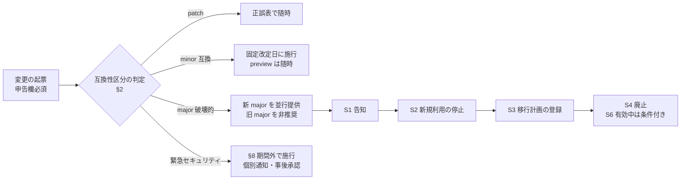
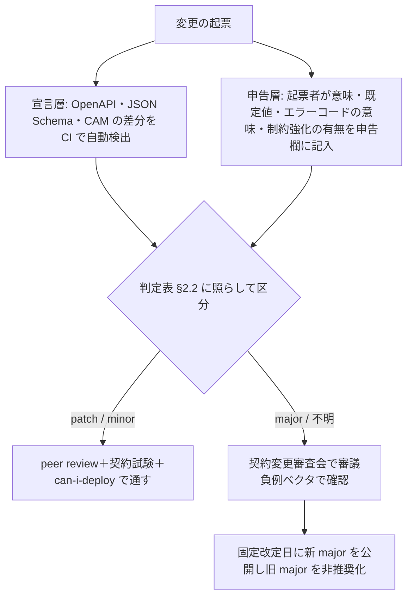
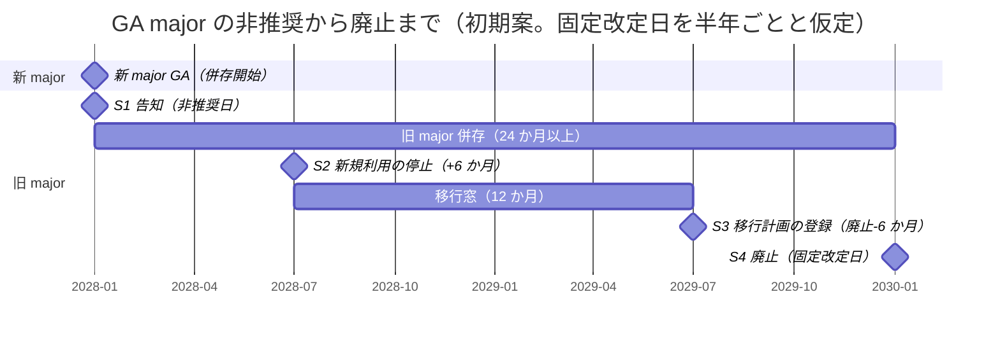
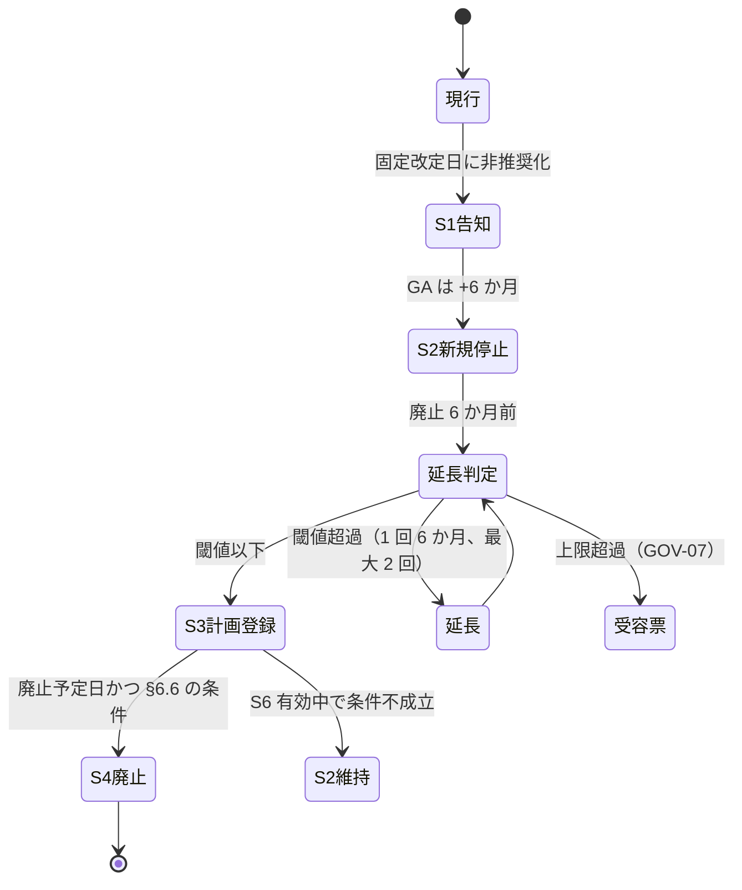

# 互換性・非推奨ポリシー（SLA）

> 文書ID: CON-01 / 版: 0.2 / 状態: review / 最終更新: 2026-10-15
> 対応要求: R-105, R-108, R-194.4, R-194.5, R-256（R-requirements.md の対応成果物欄に本書のパスを含む全行）、R-109, R-194（deliverables.md の DL-70 行）／G-069, G-126, G-140（G-goal-criteria.md の対応成果物欄に本書のパスまたは DL-70 を含む全行）。関連: R-022, G-134, G-144
> 依存文書: CONVENTIONS.md, traceability/deliverables.md（DL-70 行、DL-69〜DL-80, DL-115, DEC-8）, 05_adr/ADR-016-versioning-deprecation.md, 05_adr/ADR-022-integration-contract-standards.md, 05_adr/README.md, 05_adr/reconciliation-notes.md, research/RS-16-parallel-development-governance.md, research/standards-status.md, 01_governance/assumptions-register.md, 01_governance/exception-risk-acceptance.md（GOV-07）, 01_governance/stop-authority.md（§4.6 S6）, 01_governance/kri.md（K-29, SRC-16）, 01_governance/raci-governance.md（RACI-20）, 01_governance/business-impact-analysis.md, 07_slo/numeric-contracts.md（SLI-083, SLI-084）, 08_operations/operating-model.md, 12_poc/preregistered-test-plan.md
> 作成方法: AI エージェント（Claude）が ADR-016・ADR-022 の決定を SLA の形に写し、RS-16 で検証済みの原典に照合した。RFC 9745 の §2.2・§3・§4 は本書の作成者が 2026-10-15 に原典で再確認した。v0.2 で作成者以外のレビュアー（AI エージェント）が RFC 9745（§2.2、§3.1、§4、§7）・RFC 8594（§3、§8）・RFC 9110（§5.1）を原典で再照合し、末尾の「レビュー記録」の修正を加えた。本書の判断と決裁案は自己レビューであり、実在する CTO/CISO の決裁ではない（CONVENTIONS §8）[D]。
> 表の注記: 表のセルのうちタグのないものは、同じ行の「根拠」列または直前の本文が示す文書から導いた設計推論 [D] であり、本注記で個別のタグに代える。
> 表記: 本書の条項は CP-xx（提供側の約束）、CC-xx（consumer の義務）、決裁案は KC-x、本書の新規仮定は NA-CON01-x（前提台帳へ追加要）とする。締め出しの段 S1〜S4 は ADR-016 D16-25 の表記で、損失シナリオの S-ID・停止権限の S6 とは別物である。

## 要旨（結論）

1. **本書は、DEC-8（連携契約 v1 の凍結）と同時に CTO＋CISO が承認する社内 SLA の案である** [D]。凍結後の契約変更はすべて本書に従い、「不可逆なのは識別子だけで、他は版付き・非推奨期間付き・強制移行なし」とする ADR-022 D-1-3 の原則を、告知・期間・締め出し・廃止の全段で守る [D]（G-134、R-022）。
2. **互換性区分は patch／minor（互換）／major（破壊的）の 3 つで、判定は ADR-016 D16-06 の定義表に従う** [D]。認証・認可の契約では未知の claim・field を受信者が無視するため、「制約を強める追加」は minor ではなく major とする [D]（ADR-016 §2.2、RS-16#14, #15）。判定はスキーマ差分の自動検出と、意味の変更の申告・審査の二層で行う [D]（RS-16#82）。
3. **最短期間（初期案）は、GA の major が「新 major の GA から 24 か月以上併存、非推奨告知から廃止まで 24 か月以上」、preview が「告知から廃止まで 6 か月以上」である** [D][A-050, A-052]。値は ADR-016 の新規仮定 NA-016-1・NA-016-2 で、公開先例（Microsoft Graph の 24 か月 [V][^8]、Google Cloud Terms の 12 か月 [V][^11]、AIP-185 の 180 日 [V][^7]。RS-16#26, #28, #41）と、年 2 回の固定改定日 4 回分で 300 サービスの移行を計画できることから置いた [D]。移行に実際に要する時間の実測（TC-119）は未了であり、承認は決裁案 KC-1 による [D]。
4. **告知は Deprecation（RFC 9745）・Sunset（RFC 8594）header を補助とし、主手段は consumer 台帳への直接通知と実行時計測である** [D]。両 header は client への保証にならないヒントだからである [N][^1][^2]（RS-16#34, #35）。未移行 consumer は AS・PDP facade・gateway・SDK・監査収集の 5 点で client_id／workload ID 単位に数え、K-29 と SLI-084 に載せる [D]（ADR-016 D16-24）。
5. **未移行 consumer は S1 告知 → S2 新規利用の停止 → S3 移行計画の登録 → S4 廃止の 4 段で扱う** [D]（ADR-016 D16-25）。S4 の実行は S6（不可逆標準化の凍結）が有効な間、経営会議の解除か全 consumer の事業責任者の同意を要する [D]（ADR-016 D16-28、stop-authority.md §4.6）。
6. **セキュリティ上の緊急変更は期間の約束から外すが、個別通知・事後承認・監査記録を義務づけ、件数を報告する** [D]（ADR-022 D-5-5、ADR-016 D16-46）。先例の AIP-181・Microsoft Graph・Google Cloud Terms もセキュリティ等を理由とする例外を設けている [V][^6][^8][^11]（RS-16#25, #28, #41）。事後承認の期限は TBD（所有者 CTO、期限 DEC-8 前）である [D]。
7. **連携開発者は DEC-8 の凍結を待たずに開発・試験を始めてよいが、凍結前の契約（版 0.x）には期間の約束がない** [D]（§1.2、§13）。着手時は契約の版とハッシュを固定し、GA 範囲の要素だけに必須依存し、§13.3 の consumer 義務 CC-01〜CC-08 を最初から実装し、凍結前の変更通知（CP-60）を購読する [D]。



---

## 1. 位置付けと SLA の当事者

### 1.1 本書が決めること・決めないこと

本書の上位の正本は ADR-016[^19] と ADR-022[^20]、根拠調査は RS-16[^21] である [D]。

| 項目 | 本書 | 正本 |
|---|---|---|
| 互換性区分の判定規則（SLA としての運用） | 決める | 定義表の正本は ADR-016 D16-06。本書 §2 は写しで、差異があれば ADR-016 を優先する |
| 版の併存期間、告知から廃止までの最短期間、延長・締め出しの数値 | 決める（初期案。KC-1〜KC-4 で承認） | ADR-016 §2.4・§2.6 の新規仮定を本書で SLA 化する（ADR-016 冒頭の DEC-3 注記） |
| 告知の内容・経路、Deprecation/Sunset header の使い方 | 決める | ADR-016 §2.5、ADR-022 D-5-3 |
| 未移行 consumer の計測・扱い、例外承認、緊急変更 | 決める | ADR-016 §2.6・§2.10 |
| 版の表し方と version negotiation の方式 | 要約のみ（§3） | ADR-016 §2.3 |
| 凍結区分（不可逆・GA・preview・凍結しない）と各契約の区分 | 要約のみ（§1.3） | ADR-022 D-1・D-2 |
| model・policy の shadow・canary・rollback の手順 | 要約のみ（§9） | ADR-016 §2.7、ADR-011、ADR-013 |
| 各数値の SLI 定義 | 参照 | 07_slo/numeric-contracts.md（SLI-083, SLI-084） |

### 1.2 当事者と承認

| 役割 | 担い手 | 本書での責任 | 根拠 |
|---|---|---|---|
| 提供者 | 認証・認可プラットフォームチーム（A-054 の 24 FTE、うち PEP SDK・開発者支援 4） | CP-xx の約束を守る。版台帳・consumer 台帳・計測を運用する | [A-054]、operating-model.md P4 |
| consumer | 依存サービス約 300（成長 600）、25 組織・60 チーム | CC-xx の義務を守る | [A-050, A-052] |
| 契約変更審査会 | 議長: プラットフォームチーム長。CISO 代表、SRE、consumer 側開発組織の代表 | 破壊的変更・非推奨・延長・例外・固定改定日を審議（RACI-20 の R） | raci-governance.md。CISO 代表を含めるのは CM-3(4) がセキュリティ・プライバシーの代表を構成員にすることを求めるため [N][^15]。consumer 側の代表を含めるのは、開発組織の代表を入れることを「検討する」とする CM-3 の discussion（要求ではない）を踏まえた自社の判断 [D]（RS-16#58、ADR-016 D16-41） |
| 承認者 | CTO＋CISO | 本 SLA の承認（DEC-8 と同時）、KC-1〜KC-5 | ADR-016 冒頭、G-126 |
| 経営会議 | — | S6 の解除（S4 廃止に関わる部分）、KC-3 | stop-authority.md §4.6 |
| リスク受容者 | 事業責任者（段1）、CEO（段2）、取締役会（段3）。CTO・CISO は受容者にならない | セキュリティに関わる旧版の継続利用の受容票 | GOV-07 §3.1、RV-1・RV-2 |

- 本書は社内 SLA であり、外部顧客との契約上の SLA ではない [D]。外部 RP 向けの標準プロトコル（OIDC discovery 等）の変更は標準の規定に従い、本書の期間はそれを下回らない範囲の社内約束とする [D]（ADR-016 D16-10 の外部 OIDC 行）。
- 本書が効力を持つのは DEC-8 の決議に「凍結後の変更は互換性・非推奨ポリシーに従う」が含まれた時点である [D]（ADR-022 D-11 条件 5、G-134）。それまでの契約は preview 相当の扱いとし、凍結前の変更は本書の期間を約束しない [D]。ただし凍結前でも変更の通知だけは CP-60（§13.1）で約束し、連携開発者が凍結前に着手できるようにする [D]。

### 1.3 契約ごとの区分と適用期間（G-126 の「全契約に区分と期間」）

区分は ADR-022 D-2 の判定を写したものである [D]。期間の欄は §4 の期間クラスを指す [D]。

| 契約（DL／文書ID） | GA に置く範囲 | preview に置く範囲 | 期間クラス | 非推奨告知の手段 |
|---|---|---|---|---|
| OIDC/OAuth profile（DL-69 収載、ADR-005・ADR-020） | issuer 照合、discovery、JWKS 取得規則、grant と sender constraint、RFC 9457 エラー形式 | 非本番の動的登録 | GA-API／PV | 標準 metadata＋§5.2 の主手段 |
| access token claims（DL-75／CON-06） | core claim、`typ`（不可逆）、検証規則 V1〜V14、profile 版 claim | 予約 claim の発行開始 | GA-TOKEN／PV | §5.2 の主手段（header は使えない） |
| Authorization API（DL-72／CON-03） | evaluation・evaluations、PDP metadata、X-Request-ID の往復、`decision_id`、consistency token（不透明） | search 3 種、model/policy revision の表現、obligation | GA-API／PV | header＋§5.2 |
| Relationship / Model Registry API（DL-73／CON-04） | tuple の書込み・削除・読取り、テナント指定、consistency token、エラー形式 | モデル DSL、モデル管理 | GA-API／PV | header＋§5.2 |
| Token Exchange API（DL-74／CON-05） | token 種別、audience/resource 必須、act の深さ、エラー | `requested_token_type` の txn_token 行 | GA-API／PV | header＋§5.2 |
| 内部取引 context（Transaction Token） | `txn` 欄の意味と形式、ヘッダの無改変伝播等の義務 | claim 構成（`txn-v1`）、TTS 要求 | GA-TOKEN／PV | §5.2 |
| SCIM（DL-76／CON-07） | User・Group core 属性、テナント表現、deprovision の意味 | SET profile、エージェント拡張 | GA-API／PV | header＋§5.2 |
| SSF/CAEP stream と SET（DL-78／CON-09、DL-79／CON-10） | stream 管理、push/poll、SET 形式、v1 のイベント種別 | CAEP Interoperability Profile 準拠表明 | GA-EVENT／PV | header（stream API）＋§5.2 |
| 監査イベント（DL-77／CON-08） | 共通項目、スキーマ版欄 | — | GA-AUDIT | §5.2（収集側で旧版を受け続ける） |
| 共通スキーマ（DL-71／CON-02）・ライフサイクルイベント（G-137） | 封筒、type 命名（不可逆）、冪等・順序・再送の規約 | 初版の個別 data スキーマ | GA-EVENT／PV | §5.2 |
| 記述形式（OpenAPI 3.1.2、JSON Schema 2020-12、AsyncAPI 3.x） | 凍結版の記述言語 | OpenAPI 3.2 への移行 | GA-API（記述言語の版上げは §2.4） | §5.2 |
| trace 伝播（W3C Trace Context Level 1） | traceparent を受け取ったら伝播する義務、外部から来た sampled flag を監査の記録可否に使わない | Level 2・Baggage（Baggage に subject・tenant を載せることは禁止） | GA-API／PV | §5.2 |
| 非推奨の通知（RFC 9745・8594） | header の送出と client_id 単位の計測 | — | 本書そのもの | — |
| SDK・PEP ライブラリ（ADR-022 D-4） | 公開インタフェース | — | SDK（§4.4） | SDK の非推奨警告＋§5.2 |
| 不可逆の識別子（issuer URL、sub/tid 形式、名前空間、type/source 命名、kid 命名、相関 ID 欄の意味） | 変えない | — | IRR | 個別決裁 |
| 凍結しない（製品、エンジン、ストア、cell 構成、内部 API、SDK 内部実装、モック実装） | — | — | なし（契約試験で外部挙動の不変を確認） | — |

- 期間クラスの記号: GA-API・GA-TOKEN・GA-EVENT・GA-AUDIT は §4.1 の GA 行の期間に、対象別の追加条件（§4.2）を加えたもの、PV は preview、IRR は不可逆である [D]。
- 契約ごとの現行版・状態・ハッシュの一覧は DL-69（CON-00）が持ち、本書は区分と期間の規則だけを持つ [D]。
- 上表の区分は ADR-022 D-2 の表の 13 行（見出しは「10 種の契約」だが表は 13 行。OIDC/OAuth profile、access token claims、Authorization API、Relationship/Model Registry API、Token Exchange API、内部取引 context、SCIM、SSF/CAEP/RISC、監査イベント、イベント配送、記述形式、trace 伝播、非推奨の通知）をすべて写し、SDK・不可逆・凍結しないの 3 行を加えたものである [D]。v0.1 では trace 伝播の行が欠けていた（レビュー記録 RV-03）。
- 契約文書の中でどの要素が GA・preview かは、各契約の要素ごとの安定度の注記で示す [D]。2026-10-15 時点の草案では表記が揃っておらず、CON-03 は `x-maturity`（`GA`/`preview`）、CON-04 は `x-stability`（`ga`/`preview`）を operation に付け、他の契約は要素ごとの注記を持たない [D]。表記を揃えるまでは、連携開発者は両者を同じ意味に読み、注記のない要素は本表の区分に従う [D]。表記の統一は DL-69（CON-00）の命名・版付け規約で決める（残課題 11）[D]。共通スキーマの `ContractStatus`（`irreversible`／`ga`／`preview`／`deprecated`／`sunset`）は本書の区分と S1〜S4 に対応し、`deprecated` は S1〜S3、`sunset` は S4 の後を表す [D]。

---

## 2. 互換性区分の判定規則

### 2.1 3 区分と判定の原則

- **CP-01** 変更は patch（意味に関わらない修正）、minor（互換）、major（破壊的）のいずれかに分類し、契約文書は SemVer で版付けする [D]。SemVer 2.0.0 は後方互換でない変更で major を、後方互換な追加と非推奨化で minor を上げなければならない（MUST）と定める [N][^4]（RS-16#31）。SemVer は SDO の発行物ではなくコミュニティ仕様である [D]（standards-status.md[^28] SS-I22）。
- **CP-02** 互換は source・wire・semantic の 3 類型すべてで判定し、wire 上は互換でも意味が変わる変更は破壊的とする [D]。3 類型は AIP-180 の区分である [V][^5]（RS-16#23）。
- **CP-03** 迷う場合は破壊的に倒す [D]。破壊的を互換と誤判定すると旧 consumer が黙って誤動作し、逆の誤りは移行の手間で済むためである [D]。

### 2.2 判定表（ADR-016 D16-06 の写し）

| 変更の種類 | 区分 | 判定の理由 |
|---|---|---|
| 任意の field・claim・応答メンバの追加（無視されても安全側） | minor | 受信者は未知の要素を無視する（ADR-016 §1.2 の N-1・N-3、RS-16#14, #15）。JWT では、アプリケーションが別の要求を定めない限り、理解できない claim は無視しなければならない（MUST、RFC 7519 §4）[N][^30]。consumer 側の義務は CC-06（§13.3）。新しい HTTP header も、無視して安全な意味なら版を変えずに足せる [N][^3]（RS-16#21） |
| 制約を強める claim・field の追加（無視されると判定が緩くなる） | **major** | 旧受信者が黙って無視する。`typ`・profile major・`crit` で表す（ADR-005 V13、ADR-022 D-5-1） |
| 必須の要求 field・header の追加、入力検証の厳格化 | **major** | 旧 client の要求が失敗する。Microsoft Graph も必須 request header の追加を非互換に挙げる [V][^8]（RS-16#27） |
| field・claim・型・relation・endpoint の削除・改名 | **major** | AIP-180 は禁止（must not）[V][^5]。名前は再利用しない（ADR-021 D21-27・D21-38） |
| 既定値の変更 | **major** | AIP-180 は禁止（must not）[V][^5]（RS-16#24） |
| claim・field・エラーコードの意味の変更 | **major** | Microsoft Graph はエラーコードの変更を互換に分類する [V][^8] が、監視・runbook が壊れるため本基盤では逆に扱う（ADR-022 D-5-1） |
| 判定を担う閉じた enum（decision、consistency mode 等）への値の追加 | **major** | 受信者が未知値を判定に誤って写す |
| 判定を担わない開いた enum への値の追加 | minor（consumer に deny 側の fallback を義務づける。CC-02） | Stripe は open enum への値追加を版を上げない互換変更とする [V][^14]（RS-16#32）。ADR-022 D-5-2 |
| 応答側で optional↔required を入れ替える | **major** | producer か consumer の前提を壊す |
| 公開した deny semantics を緩める | **major** | ADR-011 §6.4 |
| 宣言した上限を超える token・応答の最大長の引上げ | **major** | gateway・proxy の header 上限を超え得る（ADR-005 D10-2） |
| 上限内での長さの変化、不透明な識別子の形式の変化 | minor | 不透明値は解釈させない契約（ADR-021）。Microsoft Graph も互換に挙げる [V][^8] |
| 署名 alg の追加 | minor（検証側の設定更新を Prepare とする） | ADR-015、ADR-022 D-10-1 |
| 署名 alg の削除・停止 | **major**（停止日は規制期限から逆算。§4.3） | ADR-016 D16-19 |
| 誤記の訂正、意味を変えない解釈の補記 | patch（正誤表） | 自治体標準化は解釈の補記・誤記訂正を改定を待たず正誤表で出す [N][^16]（RS-16#74）。ADR-022 D-5-6 |
| policy・model の内容の変更（付与・剥奪の規則） | 契約区分の対象外（「判定の変更」。§9 の手順で統制） | ADR-016 D16-07。ただし型・relation・permission の削除・改名は major |

- Authorization API の応答 `reason`（ADR-011 D6-1 で閉じた列挙）への値の追加を major とするか minor とするかは未決（ADR-016 P16-2）である [D]。決まるまでは、提供側は値の追加を major として扱い（CP-03）、consumer は未知の `reason` 値を「判定が得られない」側（deny）に倒す（CC-02）[D]。判定そのものは `decision` が担うため、どちらに決まっても consumer の実装は変わらない [D]。
### 2.3 判定の手順（二層）



- **CP-04** 宣言層: スキーマ差分で検出できる破壊的変更は CI で merge 前に止める [D]（ADR-016 D16-08、TC-026）。
- **CP-05** 申告層: スキーマ差分で検出できない変更（意味、既定値、エラーコードの意味、制約を強める claim）は起票時の申告欄を必須にし、審査会が審議し、契約試験の負例ベクタ（未知 `crit`・未知 claim の注入を含む）で確かめる [D]（RS-16#82、ADR-022 D-6-2）。
- **CP-06** 審査会に上げるのは major・非推奨・延長・例外・固定改定日だけとし、個々の実装変更は peer review と自動試験で通す [D]。CM-3 は変更をセキュリティ・プライバシーの影響分析を考慮して承認・却下し記録することを求める [N][^15]（RS-16#57）。DORA の 2019 年報告は、外部承認を要する重い変更承認が配信性能に負の影響を与え、変更失敗率の低さとの関連を示す証拠はなかったと報告した [M][^17]（RS-16#59。回答者約 1,000 人の質問票調査）。
- 判定の記録（区分、根拠行、審査会の決定）は版台帳（§6.1）に残す [D]（ADR-016 D16-50）。

### 2.4 記述言語の版上げ

- **CP-07** OpenAPI・JSON Schema の方言・AsyncAPI・CloudEvents の版上げは「仕様の版を上げただけ」で互換とみなさず、生成物（モック、SDK、検証器）の差分試験を通して区分を決める [D]（ADR-016 D16-01a、RS-16#2, #5）。

---

## 3. 版の表し方と version negotiation（R-105 の要約）

方式の正本は ADR-016 §2.1・§2.3 であり、本書は consumer が守る点だけを写す [D]。

| 対象 | 版の表し方 | 交渉 | 失敗時 |
|---|---|---|---|
| 契約 API | path の major（`/v1/`）。minor・patch は path に出さない | 要求ごとに path で選ぶ。header・query による版上書きは採らない | 404＋RFC 9457 problem details |
| token claims profile | `typ`＋profile 版 claim（必須。名前は DL-75 で確定。CON-06 v0.1.0 草案は `ver`）＋必要なら `crit` | 発行時に aud の登録が宣言した受理集合の中で最新の major を AS が選び署名する | 共通 major がなければ発行拒否・監査記録 |
| PEP–PDP | 要求の `profile_version` | facade が対応 major と最低受理版を metadata の自社拡張欄で公開 | decision=false、reason=`unsupported_profile` |
| イベント | `type` の major、`dataschema` の URI | 購読登録時に major を選ぶ。併存中は新旧二重配信 | 購読のない版は配信しない |
| 監査イベント | スキーマ版欄（必須） | 収集側が全版を受ける | 未知 major は隔離し K-21 で監視 |
| SDK | SemVer。リリースごとに契約版を 1 つに固定 | 版差の許容幅は §4.4 | 計測で検出し §6 の手順へ |

- **CP-08** 交渉の結果は署名・完全性保護の内側に置き、受信者は版付き設定の最低受理版より古い版を拒否し、共通の版がなければ黙って最古版に落とさず失敗させる [D]（ADR-016 D16-09、D16-11。downgrade は T-027）。
- R-105 の閉じ方は C（実測）であり、downgrade 防止の実測は TC-006（ADR-016 の仮番 TC-016-02 を吸収）で行う [D]（preregistered-test-plan.md）。

---

## 4. 版の併存期間と最短期間（SLA）

### 4.1 安定度別の期間（初期案）

| 区分 | minor の施行 | 破壊的変更 | 新旧 major の最短併存期間 | 非推奨告知から廃止までの最短期間 | 根拠 |
|---|---|---|---|---|---|
| 不可逆（識別子） | 名前の追加のみ | 行わない。避けられない場合は新識別子を並行運用し旧識別子を非推奨手続で退役 | 個別決裁（GA 以上） | **GA 以上** | ADR-022 D-1、ADR-016 D16-14 |
| GA | 固定改定日（年 2 回） | 新 major の並行提供のみ。major 内で削除しない | **24 か月以上** | **24 か月以上** | NA-016-1 [D][A-050, A-052]。先例は §4.5 |
| preview | 随時 | 非推奨期間を経て可 | **3 か月以上** | **6 か月以上** | NA-016-2。AIP-185 の 180 日 [V][^7] |
| 凍結しない | 自由 | 契約の範囲内で自由 | — | — | ADR-022 D-1 |

- **CP-10** GA の契約は、上表の最短期間より前に廃止しない [D]。違反は §8 の緊急変更を除き SLA 違反として扱い、旧版の提供を再開して審査会と CTO＋CISO に報告する [D]。
- **CP-11** 破壊的変更の施行、非推奨の告知、廃止は固定改定日（年 2 回）に限る [D]（ADR-016 D16-16、ADR-022 D-5-6）。固定改定日の具体日は TBD（所有者 CTO、期限 DEC-8 前、決め方: 事業部門の予算・リリース周期と照合）である [D]。自治体標準化は改定基準日を原則として毎年 8 月 31 日または 1 月 31 日に固定している [N][^16]（RS-16#73）。
- **CP-12** 同時に提供する GA major は契約ごとに 2 つまでとし、3 つ目を出す前に最古の major の廃止日を確定する [D][A-054]（NA-016-3、ADR-016 D16-17）。20 年で版が累積して保守できなくなることを防ぐためである [D][A-100]。
- **CP-13** preview の期限（GA 昇格・改版・廃止を判断する日）は preview に置いた日から 12 か月とする [D]（NA-016-9、ADR-016 D16-15）。AIP-181 の beta の目安 90 日 [V][^6]（RS-16#25）より長いのは、本基盤の preview が自社で制御できない draft 標準の RFC 化を待つ要素を含むためである [D]。継続する場合は審査会が理由と次の期限を記録し、期限超過件数を KRI に載せる [D]（ADR-022 D-1-2）。

### 4.2 対象別の追加条件

| 期間クラス | 追加条件 | 根拠 |
|---|---|---|
| GA-TOKEN | 旧 major の受理を外せるのは、旧 major で発行した token がすべて失効した後（最長寿命は ADR-005 D3） | ADR-016 D16-37 |
| GA-EVENT | 併存期間中は producer が新旧両版を配信し、旧版の購読が 0 件になるまで旧版を止めない | ADR-016 D16-10, D16-37 |
| GA-AUDIT | 監査スキーマは廃止しない。収集・読取り側は保持期間中の全版を読む。producer に新版への移行を求める期間は GA に従う | ADR-016 D16-04 |
| model revision | テナントが旧 revision に留まれる上限は 90 日、または後続 revision が 2 つ出るまでの短い方 | NA-016-5（G3 で確定） |
| 判定記録が参照する policy・model の版 | 判定記録の保持期間が終わるまで registry から消さない | ADR-016 D16-04 |

### 4.3 期間の短縮（規制・標準起因）

- **CP-14** 暗号 alg の停止など、規制期限や準拠先の標準・自社規則（ADR-015、ADR-020 D20-07）に起因する期限が GA の最短期間より近い場合は、§8 の緊急変更とせず「規制起因の期間短縮」として審査会が承認し、経営への報告に載せる [D]（ADR-016 D16-19）。告知には停止日と、その起因となる規制・標準の版と状態を書く [D]。

### 4.4 SDK の版付けと支援期間（G-140 の一部）

| 項目 | 初期案 | 根拠 | 所有者・期限 |
|---|---|---|---|
| 版付け | SemVer 2.0.0。リリースごとに契約の版を 1 つ固定 | ADR-022 D-4-5 [N][^4] | 決定済み（ADR-022） |
| 基盤との版差の許容幅 | minor で N−2 | Kubernetes は直近 3 minor のリリースブランチを保守し [V][^32]、kubelet は kube-apiserver より最大 3 minor 古くてよい [V][^31]（RS-16#39） | CTO、DEC-8 前（NA-016-4） |
| SDK major の支援期間 | GA から 24 か月。旧 major は新 major の GA 後 12 か月セキュリティ修正のみ | AWS SDK は GA 版を 24 か月以上支援 [V][^12]（RS-16#43）。Microsoft Graph SDK は直前 major を 12 か月セキュリティ修正のみ [V][^8]（RS-16#44） | CTO、DEC-8 前（NA-016-4） |
| SDK 廃止の上限 | SDK major の廃止は、その SDK が固定する契約版の廃止日を越えない | ADR-016 D16-18 | 決定済み（ADR-016） |
| 脆弱性修正の期限 | 深刻度別の期限 | 未決（ADR-022 D-4-5。所有者 CISO、DL-20） | CISO |
| 利用状況の把握 | SDK が固定版と非推奨機能の呼出しを workload ID 単位で計測（§6.2） | ADR-022 D-4-4 | 決定済み |

- G-140 の残りの項目（対象言語、責務の上限、SDK なしの連携手順）は ADR-022 D-4 と DL-62・DL-66 が持つ [D]。

### 4.5 最短期間の根拠

**先例**（各提供者の自社方針であり、本基盤の値ではない）

| 提供者・文書 | 対象 | 最短の告知・併存期間 | 例外 | 原典 |
|---|---|---|---|---|
| Kubernetes | GA の API 版 | メジャー版の中で削除しない | — | [V][^9]（RS-16#36） |
| Kubernetes | Beta の API 版 | 非推奨から 9 か月または 3 リリースの長い方 | — | [V][^9]（RS-16#36） |
| Microsoft Graph | 版、GA の API | 24 か月以上前に非推奨を宣言 | セキュリティ・健全性 | [V][^8]（RS-16#28） |
| Google Cloud Terms §1.4(e) | 後方互換でない大きな API 変更、代替のない停止 | 12 か月以上前に通知 | 法令・セキュリティ・負担。Cloud Identity Services と GA 前は対象外 | [V][^11]（RS-16#41） |
| Microsoft Modern Lifecycle | 後継のない製品・サービス | 12 か月以上前に通知 | 無償・プレビュー | [V][^13]（RS-16#42） |
| Google AIP-185 | Beta channel の機能 | 180 日（推奨） | — | [V][^7]（RS-16#26） |
| AWS SDK | SDK メジャー版 | GA 24 か月以上、maintenance の告知 6 か月以上 | — | [V][^12]（RS-16#43） |
| GビズID 連携利用規約 | 休廃止・重大な変更 | 90 日前までに公表 | 性質に重大な変更が生じないもの | [V][^18]（RS-16#45） |
| Azure AD Graph（実績） | 退役 | 告知（2019）から完全退役の予定日（2025-08-31）まで約 6 年。当初の退役日 2023-06-30 から 2 年あまり延びた（停止の事実は未確認） | — | [V][^10]（RS-16#40） |

**導出（設計推論）**

1. 下限側: 上表のうち API・SDK の GA 相当の約束（Kubernetes、Microsoft Graph、Google Cloud Terms、Microsoft Modern Lifecycle、AWS SDK）に、告知から廃止まで 12 か月を下回るものはない [D]（RS-16#28, #36, #41, #42, #43 からの推論）。GビズID の 90 日は行政サービスの利用規約上の休廃止告知であり、API の版の約束ではないため比較から外した [D]。12 か月では固定改定日 2 回分しかなく、告知を受けた日に次の改定日の計画が固まっている組織は 1 回の機会で移行しなければならない [D][A-052]。
2. 推奨値 24 か月: 固定改定日 4 回分になり、S2（告知後 6 か月）から S3（廃止 6 か月前）までに 12 か月の移行窓が残る（§6.3）[D]。Microsoft Graph の 24 か月と同じ値、AWS SDK の GA 支援 24 か月と同じ桁である [V][^8][^12][D]。
3. 上限側: 36 か月以上は、同時 GA major の上限 2（CP-12）と組み合わせると、3 年ごとより速く major を出せなくなる [D]。暗号移行（A-103）や準拠標準の世代交代に追随できない恐れがある [D][A-103]。GA を永続させる案は旧版の脆弱性を固定化するため棄却済みである（RH-144[^29]）[D]。
4. 規模（前提台帳[^26]）: 300 サービス・25 組織・60 チームの移行は、全 consumer の同時改修を前提にできない [D][A-050, A-052]。Azure AD Graph の実績は、退役が当初の予定より延びることを示す [V][^10]。そのため最短期間に加えて延長の基準（§6.4）を置く [D]。
5. 未検証の点: 本基盤の consumer が 1 回の major 移行に要する実時間は未計測である [D]。パイロット（TC-119 の模擬非推奨）で「告知から移行完了までの時間」の分布を測り、24 か月の妥当性を最初の見直し（§11 の G4）で再判定する [D]。



図の日付は期間の関係を示すための例であり、計画日ではない [D]。

---

## 5. 非推奨の告知

### 5.1 告知の必須内容

- **CP-20** 告知には、対象の版、代替の版、非推奨日、廃止予定日、締め出し各段（S2・S3）の日付、延長の判断基準（§6.4）、移行ガイドの所在、問い合わせ先を必ず含める [D]（ADR-016 D16-23）。RFC 9745 §3.1 は、`deprecation` link relation が指す文書に移行の手引きと日程を含めてよい（MAY）とする [N][^1]。本書はこれを必須に強める [D]。
- **CP-21** 告知は固定改定日に出し、廃止予定日も固定改定日に置く [D]（CP-11）。

### 5.2 告知の経路（主手段と補助）

| # | 経路 | 位置付け | 到達の確認 | 根拠 |
|---|---|---|---|---|
| 1 | consumer 台帳の連絡先への直接通知 | 主 | 受領確認を記録。未確認は 2 週以内に所有組織の責任者へ再送（期間は TBD、所有者 プラットフォームチーム長、DEC-8 前） | ADR-016 D16-21 |
| 2 | 購読型リリースノート（契約・版ごとに購読） | 主 | 購読者数を台帳と照合 | G-126 |
| 3 | SDK の非推奨警告 | 主 | §6.2 の SDK 計測 | ADR-022 D-4-1 (5) |
| 4 | 開発者 FAQ・正誤表（DL-68） | 主 | — | RS-16#74 |
| 5 | HTTP の Deprecation・Sunset header と `deprecation` link | 補助 | gateway での送出件数 | RFC 9745、RFC 8594 |

- AWS も告知手段にメール、文書、ブログ、SDK の非推奨警告を併用している [V][^12]（RS-16#43）。

### 5.3 Deprecation・Sunset header の規則

- **CP-22** 非推奨にした resource の HTTP 応答に Deprecation header を付け、廃止予定日が決まっていれば Sunset header を併用する [D]（ADR-016 D16-20）。Deprecation の値は RFC 9651 の Date（例 `@1688169599`）でなければならない（MUST）[N][^1]（RS-16#34）。Sunset の値は HTTP-date である [N][^2]（RS-16#35）。
- **CP-23** Sunset の日時を Deprecation の日時より前にしない。RFC 9745 §4 は "MUST NOT be earlier than" と定める [N][^1]。
- **CP-24** Deprecation header は応答で識別される resource に適用される（RFC 9745 §2.2）[N][^1]。同節は、より広い範囲の非推奨を示す情報を、依存できない任意の情報と位置付ける [N][^1]。このため API の major 全体を非推奨にする場合も、各 resource の応答に付け、範囲は移行ガイドで示す [D]。
- **CP-25** 非推奨にしても resource の挙動は変えない（RFC 9745 §5）[N][^1]。S2 以降で挙動を変える場合は、その段の告知（CP-20）で事前に示す [D]。
- **CP-26** 両 header は client への保証ではない [D]。RFC 9745 §7 は header をヒントとして扱い、client の開発者は参照先の文書で真正性と正確性を確かめるべき（SHOULD）とする [N][^1]。RFC 8594 §3 は client が Sunset の日時をヒントとして扱うべき（SHOULD）とし、§8 は告知された Sunset の日時を確定的な予測として扱うべきでない（小文字の should）とする [N][^2]（RS-16#34, #35）。このため header の送出だけで告知義務を果たしたとはみなさない [D]。
- **CP-27** header の追加そのものは版を上げない。RFC 9110 §5.1 は認識できない header field を受信者が無視すべき（SHOULD）と定め、旧 client に影響しないためである [N][^3]（RS-16#21）。

```http
HTTP/1.1 200 OK
Deprecation: @1798761599
Sunset: Sun, 31 Dec 2028 23:59:59 GMT
Link: <https://<contracts-portal>/migration/authz-v1-to-v2>; rel="deprecation"; type="text/html"
```

上の値は書式を示す例であり、計画日ではない [D]。

### 5.4 HTTP でない契約

- **CP-28** token、イベント、監査スキーマ、SDK は header で告知できないため、§5.2 の経路 1〜4 と、§6.2 の計測で特定した consumer への個別通知で告知する [D]（ADR-016 D16-22）。

---

## 6. 未移行 consumer の計測と扱い

### 6.1 版台帳と consumer 台帳（G-126）

| 台帳 | 記録する項目 | 更新 | 根拠 |
|---|---|---|---|
| 版台帳（本書の付表。初版は DEC-8 の凍結版で作る） | 契約・profile・スキーマ・model・policy の版ごとの区分、公開日、非推奨日、廃止予定日、延長の履歴、Prepare/Activate の状態、変更の互換性区分と承認記録、緊急変更の記録 | 変更のたび | ADR-016 D16-50 |
| consumer 台帳 | consumer（サービス、所有チーム、開発組織・ベンダー、事業責任者、連絡先）、契約・使用版、client_id・workload ID、BIA 影響度、移行計画（所有者・完了予定日）、通知の受領確認、購読 | オンボーディング時（DL-66）と週次突合 | ADR-016 D16-51、G-126 |

- consumer 台帳は KRI の情報源 SRC-16（連携契約レジストリ）と同じものとし、所有者は CTO である [D]（kri.md[^24]）。
- **CC-01** consumer はオンボーディングで台帳に登録し、連絡先・所有組織・使用版の変更を届け出て、該当契約のリリースノートを購読する [D]。

### 6.2 計測点

| 計測点 | 数えるもの | 識別の単位 |
|---|---|---|
| AS・STS | 版ごとの token 発行数（aud と発行先 client 別） | client_id、aud |
| PDP facade | `profile_version`、`model.pin`、PEP SDK の版 | PEP の workload ID、テナント |
| gateway・edge | path の major、非推奨 resource への要求 | client_id、workload ID |
| SDK | 固定している契約版、非推奨機能の呼出し | workload ID、サービス |
| 監査収集 | producer ごとのスキーマ版 | producer |

- この方式は、Kubernetes が非推奨 API への要求ごとに Warning header、監査注記、削除予定リリースのラベル付きメトリクスを出す方式 [V][^9]（RS-16#38）を基盤の計測点に写したものである [D]（ADR-016 D16-24）。
- **CP-30** 計測と台帳を週次で突き合わせる [D]。台帳にあって計測にない consumer（休眠、四半期バッチ等）は所有者に利用の有無を確認させ、計測にあって台帳にない consumer は未登録として K-29(c) に数える [D]（kri.md K-29）。
- **CP-31** 集計は SLI-084（未移行 consumer 数）と K-29(a)(b) に載せ、契約変更審査会と CTO へ月次で報告する [D]（numeric-contracts.md §5.7、kri.md）。

### 6.3 締め出しの 4 段

| 段 | 時点（GA） | 時点（preview。本書の新規案） | 内容 |
|---|---|---|---|
| S1 告知 | 非推奨日（固定改定日） | 非推奨日 | §5 の告知。挙動は変えない |
| S2 新規利用の停止 | 非推奨日の 6 か月後 | 非推奨日と同時 | 新しい client・購読・テナントでの旧版の選択を登録時に拒否 |
| S3 移行計画の登録 | 廃止予定日の 6 か月前 | 廃止予定日の 3 か月前 | 既存 consumer に移行計画（所有者・完了予定日）の登録を求める。未登録は §6.5 の個別対応 |
| S4 廃止 | 廃止予定日（固定改定日） | 廃止予定日 | 旧版の提供を止める。§6.6 の条件を要する |

- GA の時点は ADR-016 の新規仮定 NA-016-10 である [D]。Azure AD Graph が新規アプリ → 既存アプリの順に明示の opt-in を要求した経過 [V][^10]（RS-16#40）を先例とし、ADR-022 D-5-4 の「新規 consumer から締め出す」を具体化した [D]。
- preview の時点は ADR-016 に定めがないため本書の新規仮定とする（NA-CON01-1、前提台帳へ追加要。所有者 CTO、期限 DEC-8 前、決め方 KC-4）[D]。preview の告知期間 6 か月では S2 を遅らせる余地がないことから、S2 を告知と同時にした [D]。



### 6.4 延長

- **CP-32** 延長は廃止予定日の 6 か月前に判定する [D]。閾値は、未移行 consumer が当該版の利用 consumer の 10% 超、または BIA 影響度 3（深刻）の業務を持つ consumer で移行計画のないものが 1 件以上である [D]（NA-016-7。影響度の段階は business-impact-analysis.md §2.1）。
- **CP-33** 延長は 1 回 6 か月、最大 2 回とし、契約変更審査会が決める [D]（NA-016-6）。延長中も S2 は解除しない [D]（ADR-016 D16-26）。3 回目以降は §7 の受容票へ移す [D]。
- 延長の上限は、Azure AD Graph の予定日が約 2 年延びた実績 [V][^10] の範囲内に収めるよう置いた推定であり、根拠は自社の推定である [D]（ADR-016 NA-016-6）。

### 6.5 未移行 consumer の扱い

| 類型 | 扱い | 根拠 |
|---|---|---|
| 移行計画あり | 月次で進捗を確認し、遅延はプラットフォームチームが enabling で支援 | ADR-016 D16-27 |
| 移行計画なし | 所有サービスの事業責任者に通知し、S3 の期限までに計画を登録させる | 同上 |
| セキュリティに関わる旧版（旧 alg、SDK を使わない独自検証、版 claim のない token の受理、レガシー API）を継続 | GOV-07 の受容票なしでは延長しない。CB-REQ-07（レガシー API 等の期限付き廃止と現行基準の遡及適用）を適用 | ADR-016 D16-27・D16-48 |
| 台帳外（計測でのみ検出） | 未登録 consumer として所有者を特定し台帳に登録させる。特定できない client は S2 の対象に含める | CP-30、K-29(c) |

- K-29(c) が台帳にない token 種別とレガシー API を数えるのは、CVE-2025-55241 がレガシーの Azure AD Graph API と未文書化の token の組合せで他テナントの利用者になりすませた事例による [D]（kri.md §4.8、RS-12#53）。

### 6.6 廃止（S4）の実行条件

- **CP-34** S4 は stop-authority.md §4.6 の S6 で凍結されている F-b（既存システムの強制移行）・F-d（旧経路の撤去）に当たり得る [D]。このため S6 が有効な間は、(a) 経営会議による S6 の該当部分の解除、または (b) 当該版を使う全 consumer の事業責任者の同意（RACI-35 の「事業責任者が自ら決める移行」）を要する [D]（ADR-016 D16-28、stop-authority.md[^23]）。どちらもなければ S4 を延期し、S2 にとどめる [D]。扱いの選択肢は KC-3 で決裁する [D]。
- **CC-03** consumer は S3 の期限までに移行計画を登録し、計画日を変える場合は届け出る [D]。

---

## 7. 例外承認

| 例外の種類 | 決める者 | 記録 | 上限・移行先 | 根拠 |
|---|---|---|---|---|
| 廃止の延長（セキュリティ影響なし） | 契約変更審査会 | 版台帳の延長履歴 | 1 回 6 か月・最大 2 回。超過は受容票 | ADR-016 D16-47、NA-016-6 |
| preview 期限の継続 | 契約変更審査会 | 理由と次の期限 | 期限超過件数を KRI に報告 | ADR-022 D-1-2、ADR-016 D16-15 |
| 規制・標準起因の期間短縮 | 契約変更審査会（経営へ報告） | 起因する規制・標準の版と状態 | — | CP-14 |
| セキュリティに関わる旧版の継続利用 | GOV-07 の受容票（類型 AT-1）。単一ドメインは事業責任者、基盤横断は CEO | 受容票、是正追跡 ID（E11） | 有効期限は固定改定日に揃える。CTO・CISO は受容者にならない | ADR-016 D16-48、GOV-07 §3.1・§3.2・RV-1・RV-2 |
| SDK を使わない独自検証（レガシーを含む） | 例外台帳に期限付き登録（審査会） | 例外台帳 | 期限までに SDK か契約適合（負例ベクタ全件合格）へ。超過は受容票 | ADR-016 D16-49、ADR-022 D-3-5 |
| GA の major 内での例外的な破壊的変更（セキュリティ以外） | 認めない。必要なら新 major を作る | — | — | ADR-016 D16-14。AIP-181 も stable 内の破壊的変更を新 major と同等以上の重みで扱う [V][^6]（RS-16#25） |
| 緊急セキュリティ変更 | §8 | §8 | §8 | ADR-022 D-5-5 |

- 受容票の段・類型・検証規則は GOV-07[^22] に従う [D]。
- **CP-40** 例外の件数と滞留期間を四半期ごとに CTO＋CISO へ報告する [D]。延長が続いて旧版の保守が長期化するリスクは ADR-022 RR-10 で CTO が持つ [D]。

---

## 8. 緊急セキュリティ変更

### 8.1 適用条件

- **CP-50** 次のいずれかに当たり、かつ最短期間を守ると被害が拡大する変更に限り、§4 の期間と固定改定日の約束から外す [D]（ADR-022 D-5-5、ADR-016 D16-46）。
  1. 契約の挙動・旧版・旧 alg に悪用可能な脆弱性がある（脆弱性 ID を記録する）。
  2. 侵害の封じ込め（ADR-019 の侵害対応、GOV-06 の停止権限の発動）。
  3. 法令・監督当局の命令による即時の変更。
- 費用・期限・機能の都合は適用条件に含めない [D]。これらは GOV-07 で劣後判断（AT-3）として扱う [D]（GOV-07 RQ-9）。
- 先例の AIP-181 はセキュリティ・規制上の例外的な場合に安定度に関係なく破壊的変更を許し、非推奨期間を約束しない [V][^6]（RS-16#25）。Microsoft Graph はセキュリティ・健全性の問題を方針の例外とする [V][^8]（RS-16#28）。Google Cloud Terms は法令順守・重大なセキュリティリスク等のための変更を制限しない [V][^11]（RS-16#41）。

### 8.2 義務

| # | 義務 | 時点 | 根拠 |
|---|---|---|---|
| 1 | 変更を最小範囲に限る（影響する resource・版・テナントに絞る）。互換を保てる代替経路があれば併設する | 実施時 | 本書 |
| 2 | 影響を受ける consumer への個別通知（§6.2 の計測で特定した全 consumer） | 実施前、遅くとも実施と同時 | ADR-022 D-5-5 |
| 3 | 監査記録への理由・脆弱性またはインシデント ID・範囲の記録 | 実施時 | ADR-016 D16-46 |
| 4 | 契約変更審査会の事後承認 | 期限 TBD（所有者 CTO、期限 DEC-8 前、決め方: GOV-07 §4.5 の時間値と合わせる） | ADR-016 D16-46 |
| 5 | 恒久化するか戻すかの判断。恒久化する場合は次の固定改定日に major・正誤表として正規の版にする | 事後承認時 | 本書 |

- 権限を縮める封じ込め（脆弱な旧版の即時停止など）は GOV-07 §4.5 の「受容を要しない」扱いと GOV-06 の停止権限に従い、本書の期間・段階に優先する [D]（ADR-016 D16-29）。
- 既に非推奨日を過ぎた版を緊急に止める場合、RFC 9745 §7 は Deprecation の日付が過去なら client の開発者はもはや resource の挙動が同じままだと仮定してはならない（原文 "MUST no longer assume"）とする [N][^1]（RS-16#34）。ただし header だけに頼らず義務 2 の個別通知を行う [D]。
- **CP-51** 緊急変更の件数、うち事後承認で「緊急に当たらない」とされた件数を四半期ごとに報告する [D]。後者が 1 件でもあれば審査会が原因を記録する [D]。緊急変更が通常の非推奨の迂回路になることを防ぐためである [D]。報告件数の閾値は TBD（所有者 CISO、期限 G3、決め方 最初の 4 四半期の実績）である [D]。

---

## 9. 変更統制（R-256）

R-256 がレビューで「良い」と評価した変更統制（schema-first、policy-as-code、revision pinning、shadow 判定、canary、rollback）を維持する [D]。本書は SLA に関わる部分だけを写し、手順の正本は ADR-016 §2.7・§2.8 とする [D]。

| 統制 | 本書での扱い | 正本 |
|---|---|---|
| schema-first | 契約は 11_contracts の OpenAPI・JSON Schema を先に変え、差分を §2.3 で判定する | ADR-022 D-3、本書 §2 |
| policy-as-code | policy・model は PR で起票し CI 検査（肯定・否定・テナント越え・権限拡大差分）を通す | ADR-011 D2-5 |
| revision pinning | model revision は不変で registry が採番し、本番は pin。pin がなければテナントの現行固定 revision | ADR-016 D16-30、ADR-011 D6-1 |
| shadow 判定 | 新旧 revision の判定差分を記録。allow が広がる差分は承認済み以外 0 件 | ADR-016 D16-32、SLI-081 |
| canary | canary cell → 標準 cell → 所在地群 → 残り。bake 期間は SLI-080（TBD） | ADR-016 D16-31・D16-33 |
| rollback | 旧内容を新しい版番号で再発行。剥奪済みの権限は復活させない | ADR-016 D16-03・D16-34・D16-35、SLI-082 |
| 形式変更 | Prepare（受信側）→ bake → Activate（送信側）の 2 段階、無停止 [A-094] | ADR-016 D16-37・D16-38 |

---

## 10. SLA の指標と報告

| 指標 | 内容 | 目標（初期案） | 測定源 | 状態 |
|---|---|---|---|---|
| SLI-083 schema 互換期間（R-194.4） | GA major の併存期間、告知から廃止までの最短期間 | GA 24 か月以上、preview 6 か月以上 | 版台帳 | 仮置き（KC-1） |
| SLI-084 未移行 consumer 数（R-194.5） | 非推奨版を使う consumer の数と比率、期限超過の件数 | 延長判定の閾値は CP-32。期限超過 0 件 | §6.2 の計測、K-29 | 仮置き・要実測 |
| 告知の遵守（新規。数値契約台帳へ追加要） | 非推奨・廃止のうち CP-20 の必須内容と最短期間を満たした割合、受領確認率 | 最短期間の遵守 100%。受領確認率は TBD（所有者 プラットフォームチーム長、期限 G3、決め方 パイロットの実績） | 版台帳、通知記録 | 未定義 |
| 緊急変更と例外（新規。同上） | 緊急変更の件数、事後承認で否とされた件数、延長・受容票の件数 | CP-51 の閾値は TBD | 版台帳、例外台帳、受容票 | 未定義 |

- 既存の 2 指標の定義は SLO-01[^25] §5.7 による [D]。新規の 2 指標は SLO-01（07_slo/numeric-contracts.md）に SLI-ID を採番して追加する必要がある（本書からは編集していない）[D]。

**提供者の約束と consumer の義務（要約）**

| 提供者（CP） | consumer（CC） |
|---|---|
| 判定表に従って区分し、迷えば破壊的に倒す（CP-01〜CP-07） | オンボーディングで台帳に登録し、連絡先・使用版を最新に保ち、リリースノートを購読する（CC-01） |
| GA は最短期間より前に廃止しない。固定改定日に限る（CP-10〜CP-13） | 開いた enum・`reason` の未知値は deny 側に倒す（CC-02。ADR-022 D-5-2） |
| 告知の必須内容と経路を守る（CP-20〜CP-28） | S3 の期限までに移行計画を登録する（CC-03） |
| 計測と台帳を週次で突き合わせ、月次で報告する（CP-30・CP-31） | 版 claim・`profile_version` の最低受理版を版付き設定で持ち、未対応 major を拒否する（CC-04。ADR-016 D16-09・D16-11） |
| 緊急変更の義務を果たし件数を報告する（CP-50・CP-51） | Deprecation・Sunset header を監視に取り込み、header だけを根拠に計画しない（CC-05） |
| 凍結前の変更も差分と版を通知する（CP-60） | 受信データの未知の field・claim・メンバを拒否しない（CC-06）。preview 依存を分離し台帳に申告する（CC-07）。必須負例ベクタを CI で回す（CC-08） |

- CC-01〜CC-08 の定義、実装方法、確かめ方は §13.3 にまとめる [D]。

---

## 11. 決裁案

| ID | 論点 | 選択肢 | 推奨 | 帰結 | 決める人・期限 |
|---|---|---|---|---|---|
| KC-1 | GA の最短期間（併存・告知から廃止）。ADR-016 K16-1 と同じ論点 | (a) 12 か月 (b) 24 か月 (c) 36 か月 | (b) | (a) は固定改定日 2 回分で、計画が固まった組織は 1 回の機会しか持てない。(b) は 4 回分で移行窓 12 か月が残る。(c) は CP-12 と組み合わせると major を 3 年に 1 回しか出せず暗号移行（A-103）への追随が遅れる。(b) でも実測で不足なら G4 で見直す | CTO＋CISO（本 SLA の承認）、DEC-8 前 |
| KC-2 | preview の告知から廃止までの期間と期限 | (a) 3 か月・期限 6 か月 (b) 6 か月・期限 12 か月 (c) 9 か月・期限 18 か月 | (b) | (a) は固定改定日の間隔（半年）より短く、CP-11 と両立しない。(c) は preview の既成事実化（ADR-022 RR-3）を招きやすい | CTO、DEC-8 前 |
| KC-3 | S6 有効中の S4 廃止の扱い。ADR-016 K16-3 と同じ論点 | (a) 経営会議の解除または全 consumer の事業責任者の同意を要する (b) 本 SLA に従う廃止は S6 の対象外と経営会議が明示する | (a) | (a) は R-022 と ADR-022 D-1-3 に忠実だが、旧版の保守が延びる。(b) は廃止を予定どおり進められるが、S6 の趣旨（強制移行の凍結）を SLA で迂回したと読まれ得る | 経営会議（S6 の権限者）、DEC-8 と同時 |
| KC-4 | 延長の上限・閾値と締め出しの時点（NA-016-6・NA-016-7・NA-016-10・NA-CON01-1） | (a) 初期案のとおり (b) 延長上限を 1 回にする (c) 上限を置かず審査会の都度判断 | (a) | (b) は Azure AD Graph の実績のような遅延に耐えにくい。(c) は旧版の保守が際限なく延びる（ADR-022 RR-10） | CTO（契約変更審査会）、DEC-8 前 |
| KC-5 | 緊急変更の事後承認の期限 | (a) 実施後 5 営業日以内 (b) 次回の審査会 (c) GOV-07 §4.5 の受容票の起票期限に揃える | (c) | (c) は時間値が GOV-07 で未定（TBD）のため、決まるまで本書も TBD が残る。(a) は値に根拠がない。(b) は年 2 回の定例だと事後承認まで半年空き得る | CTO、DEC-8 前（GOV-07 の時間値の決定と同時） |

---

## 12. 検証

| 確かめること | 試験（12_poc の TC） | 合否 | 関連 |
|---|---|---|---|
| 模擬の非推奨で全 consumer を計測から特定できる（台帳外を含む） | TC-119（合成 consumer 50・300 の非推奨模擬。ADR-016 TC-016-04、ADR-022 H-6 を吸収） | 特定漏れ 0 件 | R-194.5、G-126 |
| 最低受理版で downgrade を防げる | TC-006（TC-016-02 を吸収） | 受理 0 件 | R-105 |
| 破壊的変更を差分ツールと負例ベクタで merge 前に止められる | TC-026（TC-016-03 を吸収） | 宣言で検出できる変更の検出率 100% | §2.3 |
| SDK の版差 N−2 で基盤の版上げに追随できる | TC-014（TC-016-08 を吸収） | 失敗率 0 | G-140 |
| 5 対象で版上げ演習ができ、Prepare/Activate を無停止で戻せる | TC-129（TC-016-05・09 を吸収） | 判定系の停止 0 [A-094]、5 対象の演習合格 | G-069、R-109 |
| 移行に要する実時間 | TC-119 の記録（告知から移行完了までの時間） | 合否なし（KC-1 の見直し入力） | KC-1 |

- TC-119・TC-129 の状態は preregistered-test-plan.md[^27] による（TC-129 は DL-20 待ち）[D]。

---

## 13. 連携開発者の着手規則（基盤の完成を待たない開発・試験）

本節は v0.2 のレビューで加えた [D]。連携開発者（約 20〜30 チーム・ベンダー）が、本書と 11_contracts の契約だけで自サービスの開発・試験を始められるように、凍結前の扱い、依存してよい範囲、consumer の義務、基盤なしで試験する手段、まだ足りない情報を示す [D]。

### 13.1 凍結前（DEC-8 前）の扱い

- 2026-10-15 時点で 11_contracts の契約はすべて版 0.x・状態 draft である（各契約のメタ情報）[D]。SemVer 2.0.0 は major 版 0 を初期開発用とし、いつ何が変わってもよい（MAY）とする [N][^4]（RS-16#31）。このため凍結前の契約には §4 の期間が適用されない（§1.2）[D]。
- **CP-60** 凍結前でも、提供者は契約を変えるたびに、(1) 版番号を上げ、(2) §2.3 の宣言層の差分と §2.2 による区分（凍結後なら major に当たるかどうか）を示し、(3) 購読型リリースノート（§5.2 の経路 2）に載せ、(4) DL-69（CON-00）の一覧に版とハッシュを残す [D]。本書の新規案であり、期間は約束しない [D]。連携開発者が凍結前の変更を差分として取り込めるようにするためである [D]。
- 凍結版の版番号の付け方（例: 凍結版を 1.0.0 とする）は DL-69（CON-00）の版付け規約で決める（残課題 11）[D]。凍結後の変更から §4 の期間が適用される [D]。

### 13.2 依存してよい範囲

| 区分 | 連携開発者の扱い | 根拠 |
|---|---|---|
| GA の範囲（§1.3、契約の要素ごとの注記） | 必須依存してよい。凍結後は §4.1 の期間で保護される | ADR-022 D-1 |
| preview の範囲 | 使ってよいが、adapter 層に閉じ込めて差し替えられるようにし、台帳に preview 依存として申告する（CC-07）。GA の機能を preview の要素に必須依存させない | ADR-022 D-1-1・D-1-2 |
| 凍結しない範囲（AS・IdP 製品、PDP エンジン固有の API・ヘッダ、関係ストア、cell 構成、内部 API、SDK の内部実装、モックの実装） | 依存してはならない。直接呼ばない | ADR-022 D-1・D-1-4 |
| 不可逆の識別子 | 形式を解釈しない（不透明値として扱う）。変わらない前提で保存してよい | ADR-021、ADR-022 D-1 |

### 13.3 consumer の義務（CC-01〜CC-08）

| ID | 義務 | 実装の要点 | 確かめ方 | 根拠 |
|---|---|---|---|---|
| CC-01 | 台帳への登録と購読 | オンボーディングで consumer 台帳に登録し、連絡先・所有組織・使用版の変更を届け出て、使う契約のリリースノートを購読する | 週次の台帳と計測の突合（CP-30） | §6.1、ADR-016 D16-51 |
| CC-02 | 開いた enum の未知値を deny 側に倒す | 判定を担わない enum と `reason` の分岐に既定の分岐を置き、未知値は「判定が得られない」（deny）として扱う | モックで未知の enum 値・`reason` 値を返して拒否側に倒れることを確かめる（必須負例 13 種の外。CON-11 に追加を申し送る） | ADR-022 D-5-2、§2.2 |
| CC-03 | 移行計画の登録 | S3 の期限までに移行計画（所有者、完了予定日）を登録し、計画日を変える場合は届け出る | 版台帳・consumer 台帳 | §6.6 |
| CC-04 | 最低受理版と版の拒否 | token の版 claim・`profile_version` の最低受理版と受理集合を、token・metadata から読まず、版付き設定に置く。未対応の major は拒否し、黙って古い版に落とさない | TC-006、必須負例 6（未知 `crit`） | ADR-016 D16-09・D16-11、§3 |
| CC-05 | 非推奨 header の取込み | Deprecation・Sunset header を受けたら resource・client 単位で記録し警報を出す。日付は §5.2 の主手段（直接通知・移行ガイド）で確かめ、header だけで計画しない | 模擬の非推奨（TC-119）で警報が出ること | RFC 9745 §7（SHOULD）[N][^1]、RFC 8594 §3（SHOULD）[N][^2]、CP-26 |
| CC-06 | 受信データの未知要素を拒否しない | 受け取った token・応答・イベントの未知の field・claim・メンバを無視して処理を続ける。11_contracts のスキーマで受信データを検証する場合は、未知メンバで検証が失敗しない使い方にする（下の注） | 必須負例 13（未知 claim の注入） | RFC 7519 §4（MUST）[N][^30]、ADR-022 D-6-2、§2.2 |
| CC-07 | preview 依存の分離と申告 | preview の要素は adapter 層に閉じ込め、consumer 台帳に preview 依存として申告する。preview の期限（CP-13）を自分の計画に入れる | 台帳の preview 依存数（ADR-022 D-1-2 の KRI） | ADR-022 D-1-1・D-1-2 |
| CC-08 | 必須負例ベクタの CI 実行 | SDK の有無にかかわらず、ADR-022 D-6-2 の必須負例 13 種を自サービスの CI で毎回実行する | CI の記録、TC-026 | ADR-022 D-6-1・D-6-3 |

- 注（CC-06）: 2026-10-15 時点の草案のうち、CON-02・CON-04・CON-05・CON-06・CON-08・CON-09・CON-10 は `additionalProperties: false` で閉じたスキーマを含む（本レビューが各ファイルの記述を数えて確認）[D]。閉じたスキーマをそのまま受信側の検証に使うと、§2.2 で minor とした「任意の要素の追加」で受信が失敗し、互換の定義が崩れる [D]。連携開発者は、受信データの検証では未知メンバを許す（未知メンバを除いてから検証するなど）[D]。閉じたスキーマを producer の適合検証用と受信側の検証用のどちらに置くかは各契約の所有者が決める（残課題 12）[D]。

### 13.4 基盤なしで試験を始める手段

- **CP-61** 提供者は、凍結前から各契約に正例と負例（`examples`、`x-negative-examples`、JSON Schema の負例）を載せ、契約の版ごとにモックを生成できる状態を保つ [D]（ADR-022 D-6-1 の下層）。
- モック・契約試験キット（DL-80、CON-11）は 2026-10-15 時点で未作成である [D]。それまでは、連携開発者は版とハッシュを固定した OpenAPI・JSON Schema から OpenAPI 対応のモック生成ツール（ADR-022 D-6-1 の Microcks 型）でモックを作り、契約の正例・負例と必須負例 13 種で自サービスを試験する [D]。CON-11 の公開後は CON-11 のモックに切り替え、結果の差を作成者に報告する [D]（G-142 のモックと PoC 基盤の不一致 0 件の前提）。
- 共有 sandbox は本番と別の issuer・鍵・trust domain で運用するため、sandbox の token を本番相当環境で受理しない実装にする（必須負例 11）[D]（ADR-022 D-6-4）。

### 13.5 本書と契約だけでは足りない情報

判定: 本書と 11_contracts の草案だけで、連携開発者は版を固定してモックに対する開発・試験を始められる [D]。ただし次の情報が揃うまでは、凍結版での完成と、移行計画の日付の確定はできない [D]。

| 足りない情報 | 状態 | 所有者・期限 | それまでの扱い |
|---|---|---|---|
| 固定改定日の具体日 | TBD（CP-11） | CTO、DEC-8 前 | 半年間隔を前提に計画する |
| consumer 台帳の登録・購読の窓口（DL-66、SRC-16） | 未作成 | CTO（プラットフォームチーム）、DEC-8 前 | 契約変更審査会の議長（プラットフォームチーム長）に使用契約・版・連絡先を申告する |
| モック・契約試験キット（DL-80、CON-11） | 未作成 | CON-11 の作成者、Phase 3 | §13.4 の暫定手段 |
| 契約要素の安定度の表記の統一 | 未決（CON-00） | DL-69 の作成者、DEC-8 前 | §1.3 の注記の読み方 |
| token の profile 版 claim の名前 | 草案は `ver`。確定は DL-75 | DL-75 の所有者、DEC-8 前 | 名前を設定値にし、コードに埋め込まない |
| `reason` 値の追加の互換区分 | 未決（ADR-016 P16-2） | ADR-011 の所有者、契約変更審査会、DEC-8 前 | CC-02 で deny 側に倒す |
| SDK の版差・支援期間 | 初期案（NA-016-4、未承認） | CTO、DEC-8 前 | §4.4 の初期案で計画する |
| SDK の脆弱性修正の期限 | 未決（ADR-022 D-4-5） | CISO、DL-20 | — |

---

## 対応表

R-requirements.md と G-goal-criteria.md から、対応成果物欄に本書のパスまたは DL-70 を含む行をすべて抽出した（R 5 件、G 3 件）[D]。deliverables.md の DL-70 行が挙げる R-109・R-194 を加え、計 10 件である [D]。

| ID | 要求の要点 | 本書の節 | 閉じ方 | 状態 |
|---|---|---|---|---|
| R-105 | version negotiation | §3（方式は ADR-016 §2.3） | C | 方式は定めた。downgrade 防止の実測（TC-006）が残る |
| R-108 | deprecation policy の設計 | §4〜§8 | B | 決裁案まで（KC-1〜KC-5） |
| R-194.4 | schema 互換期間 | §4.1、§10（SLI-083） | B | 決裁案まで（KC-1・KC-2） |
| R-194.5 | 未移行 consumer 数 | §6.2、§10（SLI-084） | C | 測定設計は定めた。実測（TC-119）が残る |
| R-256 | 変更統制（schema-first、policy-as-code、pinning、shadow、canary、rollback）の維持 | §2.3、§9 | A | 本書で閉じた（手順の正本は ADR-016 §2.7） |
| R-109 | policy/model/schema/token/audit の versioning・後方互換・rollback | §1.3、§2、§3、§4.2、§9（方式の正本は ADR-016 §2.1） | C | 方式は定めた。演習（TC-129）が残る |
| R-194 | 数値契約: 変更（R-194.1〜.5） | §4、§10（.4・.5 を担当。.1〜.3 は SLO-01・ADR-016 §2.7） | B・C | 決裁案まで／要実測 |
| G-069 | 5 対象の versioning・後方互換・rollback と、schema migration・version negotiation の PoC または演習 | §2、§3、§4.2、§9、§12 | C | 方式は定めた。演習（E8、TC-129）が残る |
| G-126 | 全契約の区分と期間、併存期間、最短期間、未移行 consumer の扱い、例外承認が SLA として承認され、consumer 台帳と通知経路がある | §1.3（全契約の区分と期間）、§4、§5.2（通知経路）、§6（台帳・扱い）、§7、§11 | B | 決裁案まで。承認記録（CTO、アーキテクチャ審査会）と台帳の実体の作成が残る |
| G-140 | SDK の 7 項目 | §4.4（版付け、支援期間・版差、利用状況の把握）。他の項目は ADR-022 D-4 | A | 方針は定めた。版差・支援期間の値は KC 外の CTO 承認（NA-016-4）、脆弱性修正の期限は未決（ADR-022、CISO） |

関連（対応成果物欄に本書を含まないが本書が条件になるもの）: R-022（§6.6、KC-3）、G-134（§1.2 の効力発生条件）、G-144（オンボーディングの台帳登録 CC-01）、G-123・G-142（§13 の凍結前着手とモックの一致）[D]。

---

## 残課題

| # | 課題 | 所有者 | 期限 | 決め方 |
|---|---|---|---|---|
| 1 | 本 SLA の承認（KC-1〜KC-5）と、DEC-8 の決議への「凍結後の変更は本ポリシーに従う」の明記 | CTO＋CISO、経営会議（KC-3） | DEC-8 前／同時 | 本書の決裁案。承認は未達 |
| 2 | 固定改定日の具体日（年 2 回） | CTO | DEC-8 前 | 事業部門の予算・リリース周期との照合 |
| 3 | 新規仮定 NA-016-1〜NA-016-10 と NA-CON01-1 の前提台帳への追加 | 前提台帳の所有者 | DEC-8 前 | 本書からは編集していない（前提台帳へ追加要） |
| 4 | 緊急変更の事後承認の期限、受領確認の再送期間、受領確認率・緊急変更件数の閾値（TBD） | CTO、CISO、プラットフォームチーム長 | DEC-8 前〜G3 | KC-5、GOV-07 §4.5、パイロット実績 |
| 5 | 移行に要する実時間の実測と、24 か月の妥当性の再判定 | CTO | G4 | TC-119 |
| 6 | 新規指標 2 件の SLO-01 への採番・追加 | SLO-01 の所有者 | G3 | 本書 §10 |
| 7 | 版台帳・consumer 台帳の実体（SRC-16）の作成と、300 サービスの初期登録 | CTO（プラットフォームチーム） | DEC-8 前（台帳の様式）、パイロット開始前（初期登録） | DL-66 のオンボーディングと As-Is（DL-50） |
| 8 | SDK の脆弱性修正期限（G-140） | CISO | DEC-8 前 | 未決（ADR-022 D-4-5、DL-20） |
| 9 | RFC 9745・RFC 8594・各先例の原典照合の作成者以外による確認と、照合ログの traceability/ への記録。v0.2 のレビューで RFC 9745・RFC 8594・RFC 9110 は再照合した（レビュー記録）。ベンダー先例（[^5]〜[^14]）の再照合と照合ログの記録が残る | 作成者以外のレビュアー | Phase 4 | CONVENTIONS §4・§8 |
| 10 | 決定済みの記述はすべて ADR-016・ADR-022（ADR 状態 proposed）に依存する。ADR の決裁で値・規則が変わった場合の本書の改版 | CTO | ADR 決裁時 | ADR-016 §8 の再検討トリガー |
| 11 | 契約要素の安定度の表記（`x-maturity`／`x-stability` の不一致）と凍結版の版番号の付け方の統一 | DL-69（CON-00）の作成者 | DEC-8 前 | CON-00 の命名・版付け規約。本書 §1.3 の注記・§13.1 |
| 12 | 閉じたスキーマ（`additionalProperties: false`）と minor の「任意の要素の追加」の両立（受信側検証用の扱い） | CON-02・CON-04・CON-05・CON-06・CON-08・CON-09・CON-10 の所有者 | DEC-8 前 | 本書 §13.3 の注。本書からは各契約を編集していない |
| 13 | 同時 GA major の上限（NA-016-3、K16-2）と旧 model revision の滞留上限（NA-016-5）の承認。本書の KC-1〜KC-5 に含まれない | CTO（NA-016-3）、認可・PDP チーム（NA-016-5） | G3 | ADR-016 K16-2、NA-016-5 |
| 14 | 凍結前の変更通知（CP-60）とモック用の正例・負例の維持（CP-61）の承認。本書の新規案 | CTO | DEC-8 前 | 本書 §13 |
| 15 | CC-02（未知の enum 値・`reason` 値）の負例を CON-11 のベクタに加えるか | CON-11 の作成者 | Phase 3 | ADR-022 D-6-2 の 13 種の外 |

---

## 参考文献

[^1]: S. Dalal, E. Wilde『The Deprecation HTTP Response Header Field』RFC 9745, Standards Track（Proposed Standard）, 2025-03. https://www.rfc-editor.org/rfc/rfc9745 （参照箇所: §2.1 Syntax, §2.2 Scope, §3.1 Documentation, §4 Sunset, §5 Resource Behavior, §7 Security Considerations、確認日: 2026-10-03（RS-16#34）、§2.2・§3・§4 は本書の作成者が 2026-10-15 に再確認、§2.2・§3.1・§4・§7 は v0.2 のレビュアーが 2026-10-15 に再確認）
[^2]: E. Wilde『The Sunset HTTP Header Field』RFC 8594, Informational, 2019-05. https://www.rfc-editor.org/rfc/rfc8594 （参照箇所: §3 The Sunset HTTP Response Header Field, §8 Security Considerations、確認日: 2026-10-03（RS-16#35）、§3・§8 は v0.2 のレビュアーが 2026-10-15 に再確認）
[^3]: R. Fielding, M. Nottingham, J. Reschke (Eds.)『HTTP Semantics』RFC 9110, STD 97, 2022-06. https://www.rfc-editor.org/rfc/rfc9110 （参照箇所: §5.1 Field Names（"Other recipients SHOULD ignore unrecognized header and trailer fields."）、確認日: 2026-10-03（RS-16#21）、v0.2 のレビュアーが 2026-10-15 に再確認）
[^4]: T. Preston-Werner『Semantic Versioning 2.0.0』2.0.0（公表日は未確認。standards-status.md SS-I22）. https://semver.org/ （参照箇所: Specification 項目 4, 7, 8、確認日: 2026-10-03（RS-16#31））
[^5]: Google『AIP-180: Backwards compatibility』Approved, 2019-07-23. https://google.aip.dev/180 （参照箇所: 互換性の 3 類型, Default values must not change, Semantic changes、確認日: 2026-10-03（RS-16#23, #24））
[^6]: Google『AIP-181: Stability levels』Approved, 2019-02-18. https://google.aip.dev/181 （参照箇所: Beta, Stable, Isolated changes, Emergency changes、確認日: 2026-10-03（RS-16#25））
[^7]: Google『AIP-185: API Versioning』Approved, 2024-10-22. https://google.aip.dev/185 （参照箇所: Channel-based versioning の deprecation と 180 日の推奨、確認日: 2026-10-03（RS-16#26））
[^8]: Microsoft『Versioning, support, and breaking change policies for Microsoft Graph』Microsoft Learn, ms.date 2024-11-07（更新 2025-08-06）. https://learn.microsoft.com/en-us/graph/versioning-and-support （参照箇所: Support policy and deprecation information, API contract and nonbackward compatible changes, Versions、確認日: 2026-10-03（RS-16#27, #28, #44））
[^9]: The Kubernetes Authors『Kubernetes Deprecation Policy』kubernetes.io, 最終更新 2026-08-21. https://kubernetes.io/docs/reference/deprecation-policy/ （参照箇所: Deprecating parts of the API（Rule #1〜#4b、REST resources の Warning header と metric）、確認日: 2026-10-03（RS-16#36, #38））
[^10]: Microsoft『Migrate from Azure Active Directory (Azure AD) Graph to Microsoft Graph』Microsoft Learn, ms.date 2025-09-29. https://learn.microsoft.com/en-us/graph/migrate-azure-ad-graph-overview （参照箇所: Key timelines in the retirement of Azure AD Graph、確認日: 2026-10-03（RS-16#40））
[^11]: Google『Google Cloud Terms of Service』最終更新 2026-09-02. https://cloud.google.com/terms （参照箇所: §1.4(e) Discontinuation of Services、確認日: 2026-10-03（RS-16#41））
[^12]: Amazon Web Services『AWS SDKs and Tools maintenance policy』AWS SDKs and Tools Reference Guide. https://docs.aws.amazon.com/sdkref/latest/guide/maint-policy.html （参照箇所: SDK major version lifecycle, Communication methods、確認日: 2026-10-03（RS-16#43））
[^13]: Microsoft『Modern Lifecycle Policy』Microsoft Learn, ms.date 2020-01-10. https://learn.microsoft.com/en-us/lifecycle/policies/modern （参照箇所: Continuity and migration、確認日: 2026-10-03（RS-16#42））
[^14]: Stripe『Versioning』Stripe API Reference（現行版 2026-09-30.endive の表示）. https://docs.stripe.com/api/versioning （参照箇所: Enums 節、確認日: 2026-10-03（RS-16#32））
[^15]: NIST『Electronic (OSCAL) Version of NIST SP 800-53 Rev 5.2.0 Controls』5.2.0. https://github.com/usnistgov/oscal-content/blob/main/nist.gov/SP800-53/rev5/json/NIST_SP-800-53_rev5_catalog.json （参照箇所: CM-3 の statement と guidance, CM-3(4)、確認日: 2026-10-03（RS-16#57, #58））
[^16]: デジタル庁 地方業務システム基盤チーム『標準仕様書の改定・運用について（基本的な考え方）』2025-01-29. https://www.digital.go.jp/assets/contents/node/basic_page/field_ref_resources/c58162cb-92e5-4a43-9ad5-095b7c45100c/394352a4/20250129_policies_local_governments_outline_01.pdf （参照箇所: p.1〜p.4（改定基準日、正誤表）、確認日: 2026-10-03（RS-16#73, #74））
[^17]: N. Forsgren, D. Smith, J. Humble, J. Frazelle (DORA / Google Cloud)『Accelerate: State of DevOps 2019』2019. https://services.google.com/fh/files/misc/state-of-devops-2019.pdf （参照箇所: p.7 注 2, p.50〜51 Heavyweight change process、確認日: 2026-10-03（RS-16#59））
[^18]: デジタル庁『G ビズ ID サービス連携 利用規約』version1.3, 2026-07-09 制定. https://gbiz-id.go.jp/top/manual/pdf/rules_for_RP.pdf （参照箇所: 第14条 本サービスの休廃止等、確認日: 2026-10-03（RS-16#45））
[^19]: 本リポジトリ『ADR-016 版管理・後方互換・非推奨』05_adr/ADR-016-versioning-deprecation.md （参照箇所: §1.3 新規仮定, §2.1〜§2.12, §7.1、確認日: 2026-10-15）
[^20]: 本リポジトリ『ADR-022 連携契約の標準と並行開発の契約凍結範囲』05_adr/ADR-022-integration-contract-standards.md （参照箇所: D-1, D-2, D-4, D-5, D-11, §6.3、確認日: 2026-10-15）
[^21]: 本リポジトリ『RS-16 超大規模並行開発の統治』research/RS-16-parallel-development-governance.md （参照箇所: §3.3, §3.4, §3.9 表 1, §5.1、確認日: 2026-10-15）
[^22]: 本リポジトリ『例外・リスク受容手順と受容票（GOV-07）』01_governance/exception-risk-acceptance.md （参照箇所: §3.1, §3.2, §4.5, RQ-9, RV-1・RV-2、確認日: 2026-10-15）
[^23]: 本リポジトリ『停止権限』01_governance/stop-authority.md （参照箇所: §4.6 S6、確認日: 2026-10-15）
[^24]: 本リポジトリ『KRI』01_governance/kri.md （参照箇所: K-29, SRC-16, §4.8、確認日: 2026-10-15）
[^25]: 本リポジトリ『数値契約台帳（SLO-01）』07_slo/numeric-contracts.md （参照箇所: §5.7 SLI-080〜SLI-085、確認日: 2026-10-15）
[^26]: 本リポジトリ『前提台帳』01_governance/assumptions-register.md （参照箇所: A-050, A-052, A-054, A-094, A-100, A-103、確認日: 2026-10-15）
[^27]: 本リポジトリ『事前登録試験計画』12_poc/preregistered-test-plan.md （参照箇所: TC-006, TC-012, TC-014, TC-026, TC-119, TC-129 と吸収した仮番、確認日: 2026-10-15）
[^28]: 本リポジトリ『標準・文書ステータス』research/standards-status.md （参照箇所: SS-A48, SS-A49, SS-A50, SS-I22、確認日: 2026-10-15）
[^29]: 本リポジトリ『棄却仮説ログ』traceability/rejected-hypotheses.md （参照箇所: §3.16 RH-143, RH-144、確認日: 2026-10-15）
[^30]: M. Jones, J. Bradley, N. Sakimura『JSON Web Token (JWT)』RFC 7519, Standards Track（Proposed Standard）, 2015-05. https://www.rfc-editor.org/rfc/rfc7519 （参照箇所: §4 JWT Claims、確認日: 2026-10-03（RS-16#14））
[^31]: The Kubernetes Authors『Version Skew Policy』kubernetes.io, 最終更新 2026-04-14. https://kubernetes.io/releases/version-skew-policy/ （参照箇所: Supported version skew の kube-apiserver と kubelet、確認日: 2026-10-03（RS-16#39））
[^32]: The Kubernetes Authors『Releases』kubernetes.io. https://kubernetes.io/releases/ （参照箇所: Release History の冒頭段落、確認日: 2026-10-03（RS-16#39））

---

## レビュー記録

> レビュー: v0.1 → v0.2、2026-10-15。作成者以外のレビュアー（AI エージェント Claude）による独立レビューであり、実在の CTO/CISO の承認ではない（CONVENTIONS §8）[D]。
> 観点: (1) ADR・上流文書との整合、(2) 原典による支持と規範の強度・版・状態、(3) 対応表の網羅、(4) 連携開発者にとっての具体性、(5) 根拠のない数値・禁止表現・主張タグ、(6) 基盤の完成を待たずに着手できるか。

### 照合した範囲

- ADR-016（D16-01〜D16-51、NA-016-1〜NA-016-10、K16-1〜K16-4、P16-1・P16-2）、ADR-022（D-1、D-2、D-4、D-5、D-6、D-11、RR-3、RR-10）、GOV-06 §4.6、GOV-07（§3.1、§3.2、§4.5、RQ-9、RV-1・RV-2）、kri.md K-29、numeric-contracts.md SLI-080〜SLI-085、raci-governance.md RACI-20・RACI-35、business-impact-analysis.md §2.1、preregistered-test-plan.md（TC-006・TC-014・TC-026・TC-119・TC-129 と吸収した仮番）、rejected-hypotheses.md RH-143・RH-144、standards-status.md SS-A48〜SS-A50・SS-I22、RS-16#2〜#82 の引用項目、R-requirements.md・G-goal-criteria.md の対応成果物欄、11_contracts の各契約草案のメタ情報と安定度の注記 [D]。
- 原典の再照合: RFC 9745（§2.2、§3.1、§4、§7）、RFC 8594（§3、§8）、RFC 9110（§5.1）を 2026-10-15 に rfc-editor.org で確認した [N][^1][^2][^3]。

### 修正一覧

| # | 観点 | 箇所 | 指摘 | 修正 |
|---|---|---|---|---|
| RV-01 | (2) | §5.1 CP-20 | RFC 9745 の移行文書の MAY は §3.1 Documentation にある（v0.1 は §3） | §3.1 に直し、脚注 [^1] の参照箇所に §3.1 を加えた |
| RV-02 | (2) | §5.3 CP-26、§8.2 | header をヒントとする SHOULD と過去の非推奨日の規定はどちらも RFC 9745 §7 にある。過去日の原文は "MUST no longer assume"。RFC 8594 は §3 が SHOULD（ヒント）、§8 が小文字の should（確定的な予測にしない）で、強度を区別していなかった | 節番号と強度を原典どおりに書き分けた |
| RV-03 | (1)(3) | §1.3 | ADR-022 D-2 の trace 伝播（W3C Trace Context）の行が欠け、Authorization API の GA 範囲から X-Request-ID の往復が漏れていた | 行と項目を加え、D-2 の全 13 行を写したことを明記した |
| RV-04 | (2) | §1.2 契約変更審査会の行 | CM-3(4) が求めるのはセキュリティ・プライバシーの代表であり、consumer 側代表は CM-3 の discussion の「検討する」（要求ではない）。v0.1 は構成全体を CM-3(4) の [N] で支えていた | ADR-016 D16-41 と同じ書き分けにした |
| RV-05 | (2)(5) | §4.4 版差の行 | Kubernetes の 2 つの [V] に脚注がなかった | Version Skew Policy と Releases の脚注 [^31][^32] を加えた |
| RV-06 | (2) | §4.5 導出 1 | 「12 か月を下回る GA 方針は見当たらない」を RS-16#81 に帰していたが、RS-16#81 はその主張をしていない。表中の GビズID（90 日）との関係も説明がなかった | 根拠を表の各項目（RS-16#28, #36, #41〜#43）からの [D] に直し、GビズID を比較から外す理由を書いた |
| RV-07 | (2) | §2.2 判定表の 1 行目 | 未知 claim の無視が RS-16 の番号だけで、原典の強度がなかった | RFC 7519 §4 の MUST と脚注 [^30] を加えた |
| RV-08 | (1) | §2.2 | AuthZEN `reason` への値の追加の区分は ADR-016 P16-2 で未決だが、本書は触れていなかった | 「未決（ADR-016 P16-2）」と、決まるまでの提供側・consumer 側の扱いを加えた |
| RV-09 | (4) | §10 | CC-02・CC-04・CC-05 が要約表にしか現れず、実装方法と確かめ方がなかった | §13.3 に CC-01〜CC-08 の定義表を置き、要約表から参照した |
| RV-10 | (6) | 新設 §13 | 凍結前（版 0.x）の契約で何を約束し、連携開発者が何に依存してよいか、モック・試験キット（DL-80）がない間にどう試験するかが書かれていなかった | §13.1〜§13.5（CP-60・CP-61、依存してよい範囲、CC-06〜CC-08、暫定の試験手段、足りない情報の表）を加え、要旨 7 を加えた |
| RV-11 | (1)(6) | §13.3 の注 | 7 つの契約草案が `additionalProperties: false` の閉じたスキーマを含み、受信側の検証に使うと §2.2 の minor（任意の要素の追加）で受信が失敗する | CC-06 で受信側の扱いを定め、契約の所有者への申し送りを残課題 12 にした |
| RV-12 | (1)(4) | §1.3 の注記 | 契約草案の安定度の表記が `x-maturity`（CON-03）と `x-stability`（CON-04）で揃っていない | 当面の読み方を定め、統一を残課題 11（CON-00）にした |
| RV-13 | (1) | §3 | profile 版 claim の名前が「DL-75」だけで、草案の現状がわからなかった | CON-06 v0.1.0 草案の `ver` を併記し、確定は DL-75 とした |
| RV-14 | (2)(5) | 脚注 [^4] | SemVer の版と公表日の状態がなかった | 2.0.0、公表日未確認（SS-I22）を加えた |
| RV-15 | (1) | 残課題 | NA-016-3（K16-2）・NA-016-5 は本書の KC に含まれず、承認経路が残課題に載っていなかった | 残課題 13 に加えた |

修正件数は 15 件である [D]。

### 確認して修正しなかった点

- 期間の値（GA 24 か月、preview 6 か月・併存 3 か月、preview 期限 12 か月、延長 1 回 6 か月・最大 2 回、閾値 10%、S2・S3 の時点）は ADR-016 の NA-016-1・2・6・7・9・10 と一致し、新規仮定として明示されている [D]。根拠のない数値は見つからなかった（KC-5 (a) の 5 営業日は選択肢として「根拠がない」と明記されている）[D]。
- 禁止表現（CONVENTIONS §5）は本文に見つからなかった [D]。
- 対応表の R 5 件・G 3 件は R-requirements.md・G-goal-criteria.md の対応成果物欄の抽出結果と一致し、DL-70 行の R-109・R-194 も載っている [D]。
- TC-014 は鍵の rotation の試験だが、TC-016-08（SDK 版差）を吸収し、SDK 3 版を検証点に含むため、§12 の対応は維持した [D]。
- standards-status.md は RFC 9745 を Proposed Standard、RFC 8594 を Informational、RFC 9110 を Internet Standard（STD 97）としており、本書の記載と一致する [D]。

### ADR への指摘

- ADR-022 D-2 の見出しは「10 種の契約の個別判定」だが、表は 13 行ある（イベント配送、記述形式、trace 伝播、非推奨の通知を含む）[D]。見出しと G-126 の「全契約」の範囲が一致するよう、ADR-022 の所有者が見出しか表を直すことを提案する [D]。
- ADR-016 D16-23 は RFC 9745 の移行文書の規定を「§3.1」と正しく引いているが、D16-21 の「header はヒント」の根拠節（RFC 9745 §7、RFC 8594 §3）は節番号がない [D]。ADR 側の誤りではないが、改版時に節番号を加えると照合しやすい [D]。

### 未解決事項（本書の残課題に反映済み）

- KC-1〜KC-5 の承認と DEC-8 の決議文（残課題 1）。固定改定日（2）。新規仮定の前提台帳への追加（3）。TBD の時間値（4）。移行時間の実測（5）。新規指標の SLO-01 への採番（6）。台帳の実体（7）。SDK の脆弱性修正期限（8）。安定度の表記の統一（11）。閉じたスキーマの扱い（12）。NA-016-3・NA-016-5 の承認（13）。CP-60・CP-61 の承認（14）。CC-02 の負例の追加（15）[D]。
