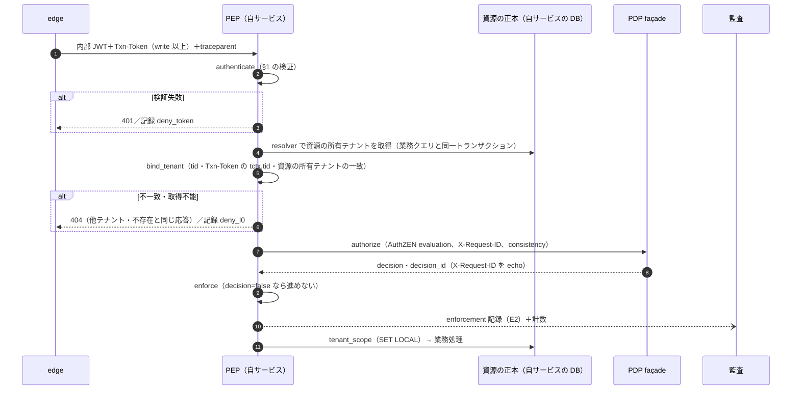

# 連携の要点: SDK なし実装のための token 検証・PEP・core 型の抜粋とスタブの最小構成

> 文書ID: CON-16（v1.1 の同期で確定。成果物 DL-122。traceability/deliverables.md 版 0.7・CON-00 で登録） / 版: 0.2（v1.1 の同期） / 状態: draft / 最終更新: 2026-10-15（0.2: v1.1 の同期で、文書ID と DL を確定し、`subject.type` の写像の正本を CON-02 `x-subject-type-map` に改め（`service_account` は `core/workload`（暫定）から `core/client`（暫定）へ）、申し送り IE-1〜IE-8 の反映状況を記した。0.1: v1.1（I-2）で新設。模擬連携検証 13_integration-trial/report.md の P-02・P-17 を主に、P-04（core/unit の公開 permission の部分）・P-05/P-06（PEP 側の組み立て規則）・P-11（Txn-Token の検証に要る値）・P-22（自サービスの SPIFFE ID）の一部を解消するために起草した）
> 対応要求: G-138, G-140, G-121, G-123（連携インタフェースの profile、SDK なし適合、モック、独立開発者による切替）。関連: R-059〜R-062, R-161, R-162, R-250, R-283
> 依存文書（抜粋元。正本）: 05_adr/ADR-005-token-profile.md（V1〜V14）, 04_architecture/token-profile.md（ARC-02 版 0.4。§3.1・§4.1〜§4.5）, 04_architecture/pep-contract.md（ARC-06 版 0.3。§3・§4）, 04_architecture/authorization-model.md（ARC-05 版 0.4。§3.1〜§3.6・§8・§9.1）, 11_contracts/schemas/access-token-claims.schema.json（CON-06）, 11_contracts/authorization-api.openapi.yaml（CON-03）, 11_contracts/mock-contract-test-kit.md（CON-11）, 13_integration-trial/report.md（模擬連携検証）
> 作成方法: AI エージェント（Claude）が上記の正本を読み、連携チームが 04_architecture と 05_adr を読まずに SDK なしの自前実装と単体・結合試験を始められるよう、必要な規則だけを写して起草した。抜粋は正本の文言を実装者向けに言い換えたもので、意味を変えないことを意図したが、作成者以外による照合は未了である（残課題 1）。判断は自己レビューであり、実在の CTO/CISO の決裁ではない（CONVENTIONS §8）[D]。
> 表記: 規則 ID（V1〜V14、TP-xx、OB-xx、X-xx、NV-xx、CV-xxx、NE-xx）は正本の ID をそのまま使う。本書が新たに置く ID は、スタブを ST-x、本書の注意点を EN-x、申し送りを IE-x と書く。表のセルのうちタグのないものは、正本の規則の転記（正本の規範性を引き継ぐ）か、それに基づく設計推論 [D] であり、本注記で個別のタグに代える。規範（RFC 等）の強度を写すセルには個別にタグと脚注を付けた。

---

## 要旨（結論）

1. **本書は、SDK を使わずに PEP を自前実装する連携チームが「04_architecture・05_adr を開かずに」実装を始めるための抜粋である。正本は ADR-005・ARC-02・ARC-06・ARC-05 であり、本書と正本が食い違えば正本が優先する** [D]。v1.0 では、SDK なし実装に要る検証規則 V1〜V14、PEP の 11 関数、core 型の定義が 04_architecture にしかなく、連携向けの引渡し資料（10_integration・11_contracts）が自己完結しなかった（P-02）[M][^14]。
2. **token 検証（§1）**: 受理してよいのは内部 access token（typ=`at+jwt`、Authorization ヘッダ）と Transaction Token（typ=`txntoken+jwt`、`Txn-Token` ヘッダ）の 2 種だけである [D]。期待値（issuer・aud・alg・profile の最低版・許容時刻差）は自サービスの版付き設定から読み、token や issuer metadata から読まない（V1・V4）[D]。模擬検証の自前実装には、`exp` に時刻差の許容を足す、issuer の期待値を discovery 応答から取る、Txn-Token を署名検証せずに読む、という正本と異なる読み方があった（EN-1〜EN-3）[M][^14]。
3. **PEP（§2）**: 1 要求の処理は `authenticate`→`bind_tenant`→`authorize`→`enforce` の順に固定し、データアクセスより前に終える [D]。判定が得られない場合はすべて拒否し、write 以上は 503（Retry-After 付き）を返す [D]。PDP 要求の `action.name` は資源型の permission 名（動詞。例 `approve`）をそのまま入れる（v1.1（I-5）の統一に合わせた）[D]。
4. **core 型（§3）**: 連携チームが参照してよい core の relation・permission を一覧にし、`fga model test` にそのまま使える core 型の代替定義（OpenFGA DSL）を付けた [D]。代替定義は本書の作成者が `fga model test` に通し、4 試験・29 check がすべて合格した [M]。ただし ARC-05 の `core/tenant` には `manage` がなく、`ancestor->manage` でテナント管理者が配下へ継承されない（代替定義は `manage = admin` を足した。IE-5）[M][D]。
5. **スタブの最小構成（§4）**: 基盤の部品が 1 つも動いていない段階で結合確認をするのに要るスタブは 8 種（ST-1〜ST-8）で、うち内部 issuer・PDP・TTS の 3 種は必須である [D]。汎用モック（Prism）だけでは契約に忠実な PEP の正例が通らない（P-01）ので、PDP はプログラム可能なスタブか、キットの echo proxy（v1.1（I-1）、11_contracts/kit/）を使う [D]。スタブで合格しても、キット（DL-120）による判定・DoR・DoD の証拠にはならない [D]。

---

## 0. 本書の使い方

### 0.1 位置付け

| 項目 | 内容 |
|---|---|
| 読者 | SDK のない言語で PEP を自前実装する連携チーム（10_integration INT-00 §5.2 の「SDK を提供しない言語」、DoR の RD-09 で自前実装を選んだチーム）。SDK を使うチームも、SDK の挙動を確かめる試験の期待値に使ってよい |
| 本書が決めること | なし。正本の規則を写し、連携向けの読み方と実装上の注意（EN-x）とスタブの最小構成（ST-x）を足す |
| 本書が決めないこと | 規則の値（時刻差・寿命・timeout 等。DL-19・DL-20）、claim 名の確定（DL-75）、core 型の確定（ARC-05 K05-6〜K05-8、DEC-8 前）、キットの合否（CON-11） |
| 正本との食い違い | 正本が優先する。食い違いを見つけたら疑義窓口（10_integration INT-06）に出す |
| 凍結区分 | 本書は凍結対象ではない（抜粋の写しのため）。抜粋元の版が上がったら本書を追随させる（残課題 2） |

### 0.2 抜粋元の版

| 章 | 抜粋元 | 版（2026-10-15 時点） |
|---|---|---|
| §1 token 検証 | ADR-005 D2（V1〜V14）、ARC-02 §3.1・§4.1〜§4.5、CON-06（access-token-claims.schema.json 0.1.0） | ARC-02 0.4 |
| §2 PEP | ARC-06 §3.1〜§3.11・§4.2・§4.3、CON-03（authorization-api.openapi.yaml 0.3.0） | ARC-06 0.3 |
| §3 core 型 | ARC-05 §3.1・§3.3・§3.6・§8.3・§8.6・§9.1 | ARC-05 0.4 |
| §4 スタブ | CON-11 §4.2〜§4.4・§4.8・§4.11・§6.2・§11.4、模擬連携検証の expense-service/test/harness.js | CON-11 0.11 |

---

## 1. token 検証（SDK なし実装の正本抜粋）

### 1.1 受理する token と受理位置

依存サービスの PEP（層 S）が受理するのは次の 2 種だけである。他の種別（ID Token、logout token、SET、DPoP proof、introspection 応答、外部 opaque access token）が届いたら、すべて拒否する [D]（ARC-02 §3.1・TP-01）。

| 種別 | 受理位置（ここ以外では拒否） | 形式・typ | iss | aud | 鍵 |
|---|---|---|---|---|---|
| K3 内部 access token | `Authorization: Bearer` ヘッダ | JWT、typ=`at+jwt`（`application/at+jwt` も受理） | 内部 issuer（外部 AS と別、cell ごと） | 呼出し先 1 サービス（自サービス） | 内部 issuer の JWKS（ES256） |
| K5 Transaction Token | `Txn-Token` ヘッダ（Authorization ヘッダでは拒否） | JWT、typ=`txntoken+jwt` | 同じ cell の TTS | trust domain の値（cell ごとの内部値） | TTS の JWKS（K3 と別の鍵族。ES256） |

- `at+jwt` は RFC 9068 で宣言が MUST であり、RS は `at+jwt` と `application/at+jwt` 以外を拒否しなければならない（MUST）[N][^1]。
- `txntoken+jwt` は Transaction Tokens draft-11 の MUST だが、draft であり規範根拠ではない（Internet-Draft、IESG 未提出、確認日 2026-10-03）[N][^9]。本基盤は社内 profile `txn-v1` として固定している [D]。
- token の中身から種別を推測しない。受け取ったヘッダから期待種別をちょうど 1 つ決め、その種別の規則だけで検証する（TP-01）[D]。RFC 8725 §3.12 は、同じ issuer が複数種類の JWT を発行する場合、種類ごとの検証規則を互いに排他にすることを求める（MUST）[N][^2]。
- access token を URL の query で受け取らない（V11）[D]。RFC 9700 は access token を URI の query で送ってはならない（MUST NOT）とする [N][^8]。

### 1.2 検証の順序

次の順で検証し、1 つでも満たさなければ拒否する。順序は ARC-02 §4.5 の流れと同じである [D]。

```
verify_access_token(header_value, cfg):            # cfg は自サービスの版付き設定（§1.8）
  1  受理位置: Authorization ヘッダの Bearer 値だけ。query・body の token は拒否（V11, TP-01）
  2  大きさ: 文字列長が cfg.max_jwt_bytes を超えたら署名検証の前に拒否（TP-06）
  3  JWS compact（3 部）として解析。失敗は拒否
  4  header: typ ∈ {at+jwt, application/at+jwt}（V5）
            alg ∈ cfg.alg_allowlist（初期値 ES256 のみ。none・大文字小文字の変種・HS*・RS*（既定無効）は拒否）（V1, V12, V14）
            jku・x5u・x5c・jwk・crit・cty があれば拒否（TP-02、CON-06 forbiddenHeaderParams。crit は v1 で定義しない）（V3, V13）
            kid は 1〜64 文字の [A-Za-z0-9_-]。不透明値として完全一致でだけ使う（TP-04）
  5  鍵: cfg.issuer の jwks_uri（設定で固定）から kid の鍵を引く（V3, TP-02）
            見つからなければ JWKS を 1 回だけ取り直す。取り直し後も無ければ拒否（TP-02、CV-005）
            失効 kid リストに載った kid は直ちに拒否（TP-03）
            鍵の alg（JWK の alg）・kty/crv と header の alg が一致しなければ拒否（V2）
  6  署名検証。暗号処理のうち 1 つでも失敗したら拒否（V12）
  7  iss == cfg.issuer（完全一致。正規化しない）（V4）
  8  exp > now（時刻差を足さない）。iat・nbf は未来方向の差が cfg.skew_sec（S_int）以内なら受理、超えたら拒否。
     iat が古いこと自体は拒否理由にしない（V7、§1.7）
  9  aud == cfg.audience（文字列 1 値。配列・共通 aud は拒否）（V6）
 10  種別固有（§1.5）: 必須 claim、tid は 1 つ、ver の最低版、cnf、act、K3 にない判別 claim
 11  検証結果を「種別・issuer・profile 版」付きの型で返す（TP-09）
```

- 署名検証（6）より前に claim の値で分岐しない [D]。拒否の原因の細目は応答に出さず（§1.9）、内部の記録にだけ残す [D]。
- token をログ・トレース・エラー出力に記録しない（V11）[D]。RFC 9700 §4.9.3 は access token を機微な秘密として扱うことを求める（MUST）[N][^8]。

### 1.3 検証規則 V1〜V14（ADR-005 D2 の連携向け抜粋）

ADR-005 は V1〜V14 を「共通 SDK・sidecar・edge の既定とし、利用側では無効化できない」と定める [D]。自前実装でも、これらを設定や引数で外せる形にしない（OB-15）[D]。

| ID | 規則（実装者向けの言い換え） | 規範の根拠（原典の強度） | 主な試験 |
|---|---|---|---|
| V1 | alg の許可集合を、issuer×種別ごとに**自サービスの版付き設定**から読む。token の header や issuer metadata（discovery の `id_token_signing_alg_values_supported` 等）から読まない。内部 access token の初期値は ES256 のみ | 許可集合の指定は RFC 8725 §3.1 の MUST [N][^2]。metadata を出所にしないのは自社判断 [D] | CV-004、NE-02 |
| V2 | 1 鍵 1 alg 1 種別。JWK の `alg` と header の `alg` が一致しない、または鍵の種類（ES256 なら EC P-256）が合わない場合は拒否 | 1 鍵 1 alg は RFC 8725 §3.1 の MUST [N][^2]。種別との結合は自社判断 [D] | CV-004（第 3 の場合） |
| V3 | 鍵は、設定で固定した issuer の `jwks_uri` だけから取る。header の `jku`・`x5u`（と `x5c`・埋込み `jwk`）は辿らない・使わない | 鍵と issuer の結合は RFC 8725 §3.8 の MUST [N][^2] | NE-03 |
| V4 | `iss` を設定の期待値と完全一致で照合する。内部 issuer は外部 AS と別で、cell ごとに分かれる | RFC 9068 §4 の MUST [N][^1] | CV-003、CV-011 |
| V5 | `typ` を期待値と照合する。typ のない JWT は拒否する | `at+jwt` は RFC 9068 の MUST [N][^1]。全種別必須は自社判断 [D] | CV-002、NE-01、NE-04 |
| V6 | `aud` に自サービスが含まれることを確かめる。本基盤の内部 access token の aud は 1 値の文字列で、共通 aud は発行されない | RFC 9068 §4・§5 の MUST [N][^1] | CV-001、NE-05 |
| V7 | `exp` が現在時刻より後であることを検証する。`iat`・`nbf` は、未来方向の時刻差を許容値 S 以内なら受理し、それを超える未来の値は拒否する。S の初期値は 10 秒、上限 60 秒（値は DL-20 で確定）。`iat` が古いこと自体は拒否理由にしない | exp は RFC 9068 の MUST [N][^1]。未来方向の許容は FAPI 2.0 の AS 側規定の準用で自社判断 [D] | CV-007、NE-14 |
| V8 | `cnf` がある token は提示者との一致を検証する（内部は mTLS 証明書の `x5t#S256`）。DPoP 束縛 token を Bearer として提示されたら拒否する | RFC 8705 の MUST [N][^7]、RFC 9449 §7.2 の MUST [N][^6] | CV-037（mTLS が要る。§4.4） |
| V9 | テナント claim `tid` は 1 token に 1 つ。PEP は資源から導いたテナントと突き合わせる（§2.4） | 自社判断 [D] | CV-008、NE-06 |
| V10 | token を権限 DB にしない（role・group・属性を token から読んで判定しない）。アクセス制御に使う `act` は現在の actor（最外の `act`）だけ | act の扱いは RFC 8693 の MUST [N][^5]。他は自社判断 [D] | NE-07、NE-11 |
| V11 | query の token を受け付けない。token をログ・トレース・エラー出力に記録しない | RFC 9700 §4.3.2・§4.9.3 [N][^8] | NV-33 |
| V12 | 暗号処理のうち 1 つでも失敗したら全体を拒否する。`alg=none` は拒否する | RFC 8725・RFC 9068 の MUST [N][^2][^1] | CV-004、NE-02 |
| V13 | 制約を強める変更は、未知 claim の追加では表されず、typ・profile 版（`ver`）の変更か `crit` で表される。受信側は理解できない claim を無視し、`crit` に未理解の拡張があれば拒否する | 理解できない claim の無視は RFC 7519 §4 の MUST [N][^4]。`crit` の未理解で JWS 無効は RFC 7515 §4.1.11 [N][^3] | CV-006、CV-013、CV-014 |
| V14 | draft-ietf-oauth-rfc8725bis の防御的検査のうち厳しくなる側を先行採用する（alg の大文字小文字の変種を拒否する、JWT 形式の取違えを拒否する等） | draft であり規範根拠ではない（rev 10、RFC Ed Queue、確認日 2026-10-03）[N][^11]。先行採用は自社判断 [D] | NV-02 |

### 1.4 V1〜V14 を補う規則（ARC-02 TP の抜粋）

| ID | 規則 |
|---|---|
| TP-01 | 受理位置（ヘッダ）で期待種別を 1 つ決め、その規則だけで検証する。中身から推測しない |
| TP-02 | (iss, typ, kid) の組で許可鍵を引く。未知の kid は JWKS を 1 回だけ取り直し、無ければ拒否。取り直しの頻度に上限を置く（値は TBD、DL-20）。`jku`・`x5u`・`x5c`・埋込み `jwk` は辿らない |
| TP-03 | JWKS から kid が**欠落**した場合は前回取得した鍵（last known good）を上限時間（R-189.6、TBD）まで使う。署名付き失効 kid リストに**載った** kid は直ちに拒否する。2 つを区別する |
| TP-04 | kid は不透明値。DB 検索・ファイルパス・URL の組立てに使わない |
| TP-06 | token の最大長を種別ごとに置き、超えたら署名検証の前に拒否する。初期案は内部 JWT 1 個 6,144 byte、認証系ヘッダ合計 16,384 byte（確定は DL-75・DL-20）|
| TP-08 | `crit` に未理解の拡張がある JWS は無効。理解できない claim は無視する |
| TP-09 | 検証結果を「種別・issuer・profile 版」を持つ型で返し、別種別として誤用できないようにする |
| TP-10 | 共通 SDK・sidecar・edge 以外の独自 JWT 検証実装は CI で検出される。自前実装は SDK なし実装として台帳に登録し（INT-04 OB-4）、例外は受容票で扱う |

- Storm-0558 では、開発者がライブラリが完全な検証を行うと誤認し、issuer・scope の検証を追加していなかったと当事者が報告している [I][^12]。汎用 JWT ライブラリを使う場合も、上の V1〜V14 を自分のコードで明示的に検査する [D]。

### 1.5 内部 access token（K3）の claim と固有規則

必須 claim（CON-06 `internalAccessTokenClaims` の required）: `iss`, `sub`, `aud`, `exp`, `iat`, `jti`, `client_id`, `tid`, `ptype`, `ver` [D]。`ptype=human` の場合はさらに `acr`, `amr`, `auth_time`, `sid`, `gref` が必須で、非人間主体（`service_account`・`workload`・`ai_agent`）は `acr`・`amr`・`auth_time`・`sid` を持たない [D]。RFC 9068 §2.2 は `iss`・`exp`・`aud`・`sub`・`client_id`・`iat`・`jti` を REQUIRED とする [N][^1]。

| 規則（ARC-02 §4.2 の K3 行） | PEP での扱い |
|---|---|
| (1) iss は内部 issuer（cell ごと）と完全一致 | §1.2 の 7 |
| (2) typ が `at+jwt`／`application/at+jwt` | §1.2 の 4 |
| (3) aud に自サービスを含み、共通 aud は拒否 | §1.2 の 9 |
| (4) cnf の `x5t#S256` が呼出し元の mTLS 証明書と一致（I1） | mTLS 終端（自サービスまたは sidecar）から呼出し元証明書の SHA-256 thumbprint を受け取り比較する。mTLS のない試験環境では未試験として記録する（§4.4） |
| (5) tid は 1 つだけで、資源から導いたテナントと一致 | 型が文字列でなければ拒否。資源との照合は §2.4 の `bind_tenant` |
| (6) `act` で判定に使うのは現在の actor だけ | 最外の `act.sub`・`act.ptype` だけを PDP 要求に使う。入れ子の過去の actor は監査にだけ使う |
| (7) privileged・break-glass/B・層 F では jti を発行台帳と毎要求照合（stateful） | 該当する entry point だけ。照合 API は基盤側で未提供のため、該当するチームは疑義窓口へ（§5 の U-4） |

追加の扱い（本書の読み方）:

| 項目 | 扱い | 根拠 |
|---|---|---|
| `ver`（profile 版） | `major.minor` の文字列。major が設定の最低受理版より古ければ拒否（CV-014）。最低受理版は設定から読み、token からは読まない | CON-06 profileVersion、ADR-016 D16-11 [D] |
| `txn`・`tctx`（K5 の判別 claim）が K3 にある | 拒否する（種別の取違え） | CON-06 NE-12、ARC-02 §4.3 の判別軸からの導出 [D] |
| `scope` | 粗い API 能力。認可判定には使わず、PDP の判定を使う（V10） | CON-06 scopeString。scope の必須・任意は ARC-15 と ARC-02 で揺れがある（CON-06 x-open-issues、§5 の U-3）[D] |
| 識別子（`sub`・`tid`・`client_id`・`jti`・`sid`・`gref`）の形 | 受信側は 64 文字以下の印字可能 ASCII の不透明値として扱い、発行側の pattern（base32 26 文字か UUIDv4）で拒否しない | CON-06 opaqueId の $comment、TP-08 [D] |
| 未知の claim | 無視して続行する（CV-013） | RFC 7519 §4 [N][^4] |
| `roles`・`groups`・`email` 等の発行禁止 claim | 発行側の誤り。受信側は無視し、判定に使わない（V10） | CON-06 NE-07 [D] |

### 1.6 Transaction Token（K5）の検証

write 以上の操作（と FAPI 範囲）では、内部 access token と一緒に `Txn-Token` ヘッダの Transaction Token を検証する [D]（ARC-06 §3.4）。必須 claim（CON-06 `txnTokenClaims` の required）: `iss`, `aud`, `iat`, `exp`, `txn`, `sub`, `scope`, `req_wl`, `tctx`。`tctx` の必須項目は `tid`, `root_jti`, `tier`, `ver` [D]。

| 規則（ARC-02 §4.2 の K5 行と CON-06） | PEP での扱い |
|---|---|
| (1) `Txn-Token` ヘッダでだけ受理 | Authorization ヘッダに txntoken+jwt が来たら拒否（CV-010） |
| (2) iss は同じ cell の TTS、aud は trust domain の値、typ は `txntoken+jwt` | 期待値は設定から読む（§1.8）。署名は TTS の JWKS で検証する。K3 と鍵族が別なので、K3 の JWKS で検証できても受理しない |
| (3) 同じ要求の内部 access token と、`sub`・`tctx.tid`・`tctx.root_jti` が整合 | `txn.sub == at.sub`、`txn.tctx.tid == at.tid`。不一致は拒否（L0 では `l0_mismatch`、§2.4） |
| (4) 呼出し元の認証は mTLS で別に行う | Transaction Token だけを信頼の根拠にしない。draft-11 は Transaction Token を認証資格情報として使うことを禁じる（MUST NOT、draft）[N][^9] |
| (5) token 全体をログに残さない | `txn` の値と hash だけを記録する。draft-11 は全体のログ記録を禁じる（MUST NOT、draft）[N][^9] |
| 時刻 | K3 と同じ（§1.7） |
| `rctx`・`purp`・`jti`・`client_id`・`act`・`cnf` | 発行されない（CON-06）。受信側は未知 claim として無視する |

- Transaction Token の発行範囲は write 以上である。全要求に発行するかは未決（ADR-005 U2、reconciliation-notes U-02）で、PEP は「Txn-Token があれば検証して伝播する」と実装すればどちらの結論でも変えずに済む [D]（ARC-06 §3.8）。Txn-Token のない write の監査欄の扱いは CON-08 の v1.1（I-3）による [D]。業務としては、write 以上で Txn-Token が無い・検証できない要求を処理せず拒否する（INT-02 §3.2。v1.1 の同期）[D]。
- TTS の JWKS の公開場所は v1.0 の契約になかった（P-11）[M][^14]。v1.1（I-9）で CON-05 に追加される前提で、本書のスタブ（ST-2）では TTS 専用の discovery と JWKS を別の URL で持つ [D]。

### 1.7 時刻

| 種別 | exp | iat・nbf（未来方向） | iat（過去方向） | 許容時刻差 |
|---|---|---|---|---|
| K3 | 必須。現在時刻より後（許容差を足さない） | 未来方向の差が S_int 以内なら受理、超えたら拒否 | 拒否理由にしない（有効期間は exp で律する） | S_int: 初期値 10 秒、上限 60 秒（V7。確定は DL-20） |
| K5 | 必須 | K3 と同じ | 拒否理由にしない | S_int |

- 許容時刻差は検証点の時計が正しいことを前提にする [D]。本番では認証付きの時刻同期と複数の時刻源を使い、時刻のずれが閾値を超えた検証点は新規の token 受理を止める（ARC-02 §4.4.1 TS-1〜TS-4）[D]。依存サービスが自前で持つ実行環境では、少なくともずれの監視（TS-3）を入れる [D]。

### 1.8 設定から読む値（token・metadata から読まない値）

| 値 | 例（スタブ） | 読んではならない出所 | 規則 |
|---|---|---|---|
| issuer の期待値 | `https://as-a.trial.invalid` | token の `iss`、discovery 応答の `issuer` を期待値として採ること（discovery の `issuer` が期待値と一致しなければ設定誤りとして起動を止める） | V4 |
| `jwks_uri` | discovery から得る | token header の `jku`・`x5u` | V3、CON-11 §11.4（JWKS URL の直書き禁止、discovery 経由） |
| alg 許可集合 | `["ES256"]` | token header、issuer metadata | V1 |
| 自サービスの aud | 自サービスの識別子（DL-71 で払出し） | 要求 path・Host ヘッダ | V6 |
| profile の最低受理版 | `1.0` | token の `ver` | V13、CV-014 |
| 許容時刻差 S_int | 10 秒 | — | V7 |
| TTS の issuer・aud（trust domain 値）・JWKS | ST-2 の値 | Txn-Token 自身 | §1.6 |
| token の最大長 | 6,144 byte | — | TP-06 |

- 環境変数の名前は CON-11 §11.4 の差替え点に従う。v1.0 の §11.4 には aud・alg・profile 版・自 SPIFFE ID の差替え点がなかった（P-10）ため、v1.1（I-8）で CON-11 §11.4 に追加される名前を使う [D]。追加前に実装する場合は、上の値を 1 つの設定オブジェクトにまとめ、名前だけ後で合わせられるようにする [D]。

### 1.9 失敗時の応答と記録

| 状況 | 応答 | 記録 |
|---|---|---|
| token が無い・無効・失効・種別違い | 401。原因の細目（どの検査で落ちたか）は返さない。応答の形は CON-11 の v1.1（P-25）に従う | enforcement 記録の拒否理由 `deny_token`。内部ログに検査名（例 `bad_typ`）を残してよいが token 本体は残さない |
| 認証強度（acr・auth_time）の不足 | 401 と step-up の指示（`insufficient_user_authentication`） | 同上 |
| 鍵の取得に失敗（JWKS 不達） | 前回の値を使い続けて警報を出す（ARC-06 §3.9 の JWKS 行）。前回の値もなければ 401 ではなく 503 | 判定に進めない |

RFC 9470 は、RS が `insufficient_user_authentication` のエラーコードで追加認証を求められると定める [N][^13]。

### 1.10 模擬連携検証で見つかった読み違い（EN-1〜EN-3）

模擬連携検証の自前実装（13_integration-trial/expense-service/src/token.js・src/app.js）は 04_architecture を読まずに書かれ、次の点で正本と異なっていた [M][^14]。同検証の試験はすべて合格していたので、v1.0 のキットの負例だけでは検出されない [D]。

| ID | 読み違い | 正本の規則 | 検出に要る試験 |
|---|---|---|---|
| EN-1 | `exp` に許容時刻差を足して判定した（`exp + skew <= now` で拒否するので、許容差の間は期限切れを受理する） | V7: exp は現在時刻より後であること。許容差は iat・nbf の未来方向だけ | exp=now−1 の token が拒否されること（CV-007 の境界値として追加。IE-3） |
| EN-2 | issuer の期待値を discovery 応答の `issuer` から取った | V4: 設定の期待値と完全一致。discovery の改ざん・誤設定に issuer 判定を依存させない（V1 と同じ理由） | discovery が設定と別の issuer を返す構成で起動が止まること（IE-3） |
| EN-3 | Txn-Token を署名検証せずに payload を復号して `txn` を読み、`tctx.tid` と access token の `tid` を照合しなかった | §1.6: write 以上では Txn-Token を検証し、`sub`・`tctx.tid` を access token と照合する。照合は `bind_tenant` の最初（§2.4）で、不一致は `l0_mismatch` | `tctx.tid` が `tid` と違う正規署名の Txn-Token、署名を改変した Txn-Token の拒否（IE-3） |

---

## 2. PEP の 11 関数の外形（ARC-06 §3・§4 の抜粋）

### 2.1 処理順序

全 entry point の PEP は次の順で処理する。順序を入れ替えない [D]（ARC-06 §3.1）。



### 2.2 義務 OB-01〜OB-15（要約）

| ID | 義務 | 関数 |
|---|---|---|
| OB-01 | 未署名のテナント・利用者ヘッダを判定・業務ロジックの入力にしない。主体・テナントは署名付き token からだけ取る | authenticate |
| OB-02 | token を検証する（§1） | authenticate |
| OB-03 | 処理を始める前に、自分の entry point ID と台帳上の操作階層を確定する。台帳にない entry point では処理しない | init |
| OB-04 | テナント三者一致（L0）を PDP 呼出しの前に照合する（§2.4） | bind_tenant |
| OB-05 | 既定は拒否。判定が得られない・解釈できない・照合できない場合はすべて拒否（§2.6） | authorize |
| OB-06 | PDP façade を AuthZEN 1.0 evaluation／evaluations で呼ぶ。engine（OpenFGA・SpiceDB）を直接呼ばない | authorize・list |
| OB-07 | decision が false なら要求を進めない | enforce |
| OB-08 | decision_id を受け取り enforcement 記録に残す。PEP は decision_id を自ら作らない | authorize・enforce |
| OB-09 | `Txn-Token` と `traceparent` を無改変で下流へ渡し、監査に `txn` と decision_id を残す | propagate |
| OB-10 | エラー応答は §2.7 の写像に従い、存在・件数・拒否理由を区別させない | enforce |
| OB-11 | 認可の allow を SDK・契約適合実装の外で cache しない（§2.9） | authorize |
| OB-12 | 監査を独立経路で送出し、sampling から独立した計数を出す | enforce |
| OB-13 | データアクセスの前に、L0 を通ったテナントだけからストレージ側のテナント文脈を設定する | tenant_scope |
| OB-14 | 非同期の受付・実行・配信をそれぞれ独立した entry point として扱い、実行直前に再 Check する | enqueue／consume |
| OB-15 | 迂回の引数・設定（テナント照合の省略、判定の省略、fail-open）を持たない | 全関数 |

AuthZEN 1.0 は、decision が false なら要求を進めてはならない（MUST NOT）とする [N][^10]。

### 2.3 11 関数の外形（言語非依存の擬似シグネチャ）

名前は暫定で、ADR-021・DL-72 で確定する [D]。自前実装は同じ外形の記録・応答・計数を出し、DL-80 の負例ベクタと実行時検査に合格することを適合条件とする [D]（ARC-06 §4.2）。

| # | 関数 | 入力 | 出力 | 主な義務 | 持たないもの |
|---|---|---|---|---|---|
| 1 | `init(config)` | entry point 台帳の該当行（IDL から生成）、操作階層ごとの fail-mode 設定（DL-19・DL-20 由来の配布物）、§1.8 の設定 | PEP インスタンス | OB-03 | fail-mode の値の上書き |
| 2 | `authenticate(request)` | 要求（内部 JWT、Txn-Token、署名付き route 文脈） | `Principal` | OB-01・OB-02 | 検証規則の無効化 |
| 3 | `bind_tenant(principal, op, resource_ref, resolver)` | `resolver` は自サービスが実装する「正本から所有テナントを返す関数」（業務クエリと同一トランザクション） | `TenantBinding` または拒否 | OB-04 | 照合を省く引数、テナントを直接渡す引数 |
| 4 | `authorize(binding, action, resource, opts)` | `opts` は consistency token、evaluations のモード | `Decision`。拒否は例外ではなく値で返し、`enforce()` を経ずに業務処理へ進めない型にする | OB-05〜OB-08 | 判定不能時の allow、独自 cache |
| 5 | `enforce(decision)` | — | 拒否なら §2.7 の応答を生成。enforcement 記録を送出し計数 | OB-08・OB-10・OB-12 | — |
| 6 | `list(binding, query)` | 一覧ヘルパ（ADR-025） | `items`・`next_cursor`・`completeness` | 一覧の後段 Check | engine の列挙 API の公開 |
| 7 | `tenant_scope(binding, tx)` | DB トランザクション | `SET LOCAL`／`set_config(..., true)` を発行した Tx | OB-13 | session 単位の `SET` |
| 8 | `storage_credentials(binding, scope)` | 区画・操作 | token vending の短命資格情報 | object storage の分離 | 任意テナントのタグ指定 |
| 9 | `propagate(outgoing)` | 下流への要求 | Txn-Token・traceparent を無改変で付与 | OB-09 | baggage への識別子の付与 |
| 10 | `enqueue(binding, job_def, params)`／`consume(message)` | ジョブ基盤（ADR-026） | 受付記録・`job_run_id`／再 Check 済みの実行文脈 | OB-14 | token・権限一覧のメッセージ格納 |
| 11 | `mark_public(reason)` | public 階層の静的規則 | 集計と `public_static` の記録 | public 行 | public 以外での使用（台帳と照合して拒否） |

関数間で受け渡す型（ARC-06 §4.2 の出力欄を型にしたもの。欄名は DL-72 で確定）[D]:

| 型 | 欄 |
|---|---|
| `Principal` | `sub`、主体種別（`ptype`）、現在の actor（最外 `act` の `sub`・`ptype`）、`tid`、`acr`、`jti_ref`（jti の鍵付きハッシュ）、`sid`、grant 参照（`gref`）、`txn`（Txn-Token があれば）、検証済み Txn-Token の `tctx` |
| `TenantBinding` | 束縛したテナント（以後の PDP 要求と DB 文脈はこの値だけを使う）、L0 の結果（一致）、資源の参照 |
| `Decision` | `allow`（真偽）、`decision_id`、鮮度区分（fresh／known-good と齢）、PDP の reason（記録用。エンドユーザーには返さない）、`consistency` の実効モードと token |

- 1〜11 のうち自サービスが使わない関数（例: object storage を使わないなら 8、非同期がなければ 10）は実装しなくてよいが、使わないことを台帳（entry point の宣言）と矛盾させない [D]。連携チームが必ず実装するのは 1〜5 と 9 である [D]（ARC-06 §4.3 の項目 3・8）。

### 2.4 `bind_tenant`（L0 テナント三者一致）の手順

```
function bind_tenant(principal, signed_route_ctx, resource_ref, op):
  t_tok := principal.tid                                   # (i) §1 で検証済み
  if t_tok == null: return DENY(l0_missing)
  if principal.txn_token present and principal.tctx.tid != t_tok: return DENY(l0_mismatch)
  t_route := signed_route_ctx.tenant if present else null  # (ii) 署名を検証できた場合だけ
  if t_route != null and t_tok != t_route: return DENY(l0_mismatch)
  switch op.resource_kind:
    case EXISTING:                                         # 既存資源の参照・更新・削除
      t_res := resolver.owner_tenant(resource_ref)         # 正本ストアから。業務クエリと同一 Tx
      if t_res == NOT_FOUND: return DENY(l0_not_found)     # 応答は他テナントと同じ
      if t_res == UNRESOLVABLE: return DENY(l0_indeterminate)
    case CREATE_CHILD:                                     # 親（container）配下への作成
      t_res := resolver.owner_tenant(parent_ref)
    case CREATE_ROOT:                                      # テナント直下への作成
      t_res := t_tok                                       # 作成後の所有テナントは t_tok で固定し不変
    case COLLECTION:                                       # 一覧・検索
      return list ヘルパへ（候補生成はテナントで先に絞る）
  if t_res != t_tok: return DENY(l0_mismatch)
  return BOUND(t_tok)
```

- テナントの出所は (i) 検証済み token の `tid`、(ii) 署名付き route 文脈、(iii) 資源の正本ストアに記録された所有テナント、(iv) Txn-Token の `tctx.tid` に限る。資源 ID の文字列・要求パラメータ・ヘッダ・path から取らない [D]（ARC-06 §3.3）。
- 1 要求が複数資源に触れる場合は資源ごとに (iii) を求め、1 つでも不一致なら要求全体を拒否する [D]。
- PDP の G 段（façade 側）にも同じテナント一致の規則があるが、片方を省く理由にしない [D]。

### 2.5 `authorize`: PDP 要求の組み立て（CON-03）

| 欄 | 値 | 注意 |
|---|---|---|
| `X-Request-ID` ヘッダ | PEP が要求ごとに採番する不透明値 | 応答で同じ値が返らなければ「判定が得られない」。AuthZEN 1.0 は PEP が付けた要求 ID を PDP が応答に含めることを求める [N][^10] |
| `subject.type` | 主体種別の写像（下表） | 写像の正本は CON-02（common.schema.json）の `x-subject-type-map`（v1.1 の同期で設置）。下表はその写しで、食い違えば CON-02 を正とする。監査（CON-08）の `subject.type` は `ptype` の値をそのまま書く別の欄 |
| `subject.id` | token の `sub` | 委任時も `sub`（起点主体）。現在の actor は `context` 側（CON-03 の定義に従う） |
| `subject.properties.tid` | `TenantBinding` のテナント | — |
| `action.name` | **資源型の permission 名をそのまま**（例 `read`、`approve`）。Registry（CON-04）に登録した permission 名と完全一致 | v1.0 では `can_read`／`docs.document.read`／`read` の 3 通りの書き方が契約内にあった（P-05）。caller_scope 規則（呼出し元が宣言した資源型・permission 以外の照会を deny）により、取り違えは本番で全件 deny になるがモックでは検出できない [M][^14]。v1.1（I-5）で動詞の permission 名に統一する |
| `resource.type`・`resource.id` | `<名前空間>/<型名>` と不透明 ID | — |
| `resource.properties.tid` | `TenantBinding` のテナント（L0 で照合済みの値。要求の生値ではない） | — |
| `context.x-authz-profile.profile_version` | DL-72 の版（例 `"1.0"`） | 未対応 major は `unsupported_profile` |
| `context.x-authz-profile.consistency` | `mode`: write 以上は `fully_consistent`。read-sensitive は保存した consistency token があれば `at_least_as_fresh`＋`token`。`token` は façade が発行した値をそのまま渡す | 応答の実効モードが要求より弱ければ「判定が得られない」 |
| 締切 D(t) | 操作階層ごとの設定値（DL-19・DL-20。SDK に埋め込まない） | 名前解決・接続確立・TLS・送信・待機・受信と再試行のすべてを含む要求全体の締切。締切後に届いた応答は allow でも破棄する（ARC-06 §3.6） |

主体種別の写像（CON-02 `x-subject-type-map` の写し。v1.1 の同期）:

| token の `ptype`（または最外 `act.ptype`） | `subject.type` | 状態 |
|---|---|---|
| `human` | `core/user` | CON-03 の examples と同じ |
| `workload` | `core/workload` | ARC-05 §3.1 |
| `service_account` | `core/client`（暫定） | ARC-05 §3.1 の主体型 `core/client`。確定は DL-75 と CAM 生成器の対応表（未作成）。§5 の U-1。版 0.1 の暫定値 `core/workload` は、CON-08 の暫定値（`core/client`）と食い違っていたため、v1.1 の同期で CON-02 の正本に合わせて改めた |
| `ai_agent` | 未決（ADR-017。独立の型にするか属性にするか） | 利用者の代理で動くエージェントは `sub` が利用者（`human`）で、エージェントは `act` と `client_id` に入る（CON-06 の $comment）。`sub` 自体が `ai_agent` の token を受ける entry point は、対応表が決まるまで判定に進めず拒否する（deny-by-default、OB-05）|

- 複数資源の判定は evaluations を使い、「全て必要」は `deny_on_first_deny`、「いずれか」は `permit_on_first_permit` に固定する。後者は privileged 以上で使わない [D]（ARC-06 §3.6）。応答の `evaluations` の件数が要求の件数と一致しなければ「判定が得られない」として扱う [D]。
- 一覧・検索は一覧ヘルパ（ADR-025）だけを使い、返す各資源を evaluations で後段 Check する。engine の ListObjects や AuthZEN search を直接呼ばない [D]。PP-2（自前 PEP）で候補生成に何を使ってよいかは INT-02 の v1.1（I-6）による [D]。

### 2.6 「判定が得られない」の条件

次のいずれかに当たれば「判定が得られない」とし、拒否側に倒す（OB-05）[D]（ARC-06 §3.5）:

1. façade 不達・接続失敗・締切 D(t) 超過（締切後の応答を含む）
2. 503・429・その他 2xx 以外の応答
3. `deny_unavailable`、`deny_indeterminate`、`unsupported_profile`
4. 応答に `decision_id` がない
5. `X-Request-ID` の echo が無い・一致しない
6. 応答の実効 consistency モードが要求したモードより弱い
7. evaluations の応答件数が要求件数と一致しない
8. 応答を解釈できない（未知の reason の値、必須欄の欠落、JSON として壊れている）

- 評価不能（`deny_indeterminate`）を known-good（前回の判定）で許可に変えない [D]。read-sensitive の known-good 継続は KD13-6 の決裁後に限り、決裁までは read-sensitive も 503 とする [D]（ARC-06 §3.5・§3.10、L06-9）。

### 2.7 エラー応答の写像（OB-10）

| 状況 | 応答 |
|---|---|
| token が無い・無効・失効 | 401。原因の細目は返さない |
| 認証強度の不足 | 401 と step-up の指示（`insufficient_user_authentication`） |
| 機能単位の拒否（資源 ID を含まない操作） | 403（資源の存在を示さない場合に限る） |
| 資源単位の拒否、L0 不一致、他テナントの資源、存在しない資源 | **同じ応答**（既定 404。本文・ヘッダを同一にし、時間の差を設計上つくらない） |
| write 以上で判定が得られない | 503（Retry-After 付き） |
| read-sensitive で判定が得られない | 503（KD13-6 の決裁までは known-good を使わない） |
| 一覧で後段 Check ができない | 空の一覧ではなく「利用不可」 |
| 一覧の打切り | `completeness=incomplete` と理由 |

- façade の reason はエンドユーザーに返さない。エラー文言・理由句の文字列一致で分岐しない [D]（ARC-06 §3.10）。

### 2.8 enforcement 記録と拒否の内部理由

enforcement 記録（監査の E2）は、識別（entry point ID、PEP 識別子＝サービス ID・実装種別 SDK／自前／sidecar・版、producer_seq）、相関 8 欄（iss、jti_ref、sid、grant 参照、txn、decision_id、request_id、trace_id）、判定の適用（適用結果、L0 の結果、拒否の内部理由、fail-mode、鮮度区分、操作階層）、文脈（tid、cell_id、資源型、res_ref、subj_ref）を持つ [D]（ARC-06 §3.7）。欄名と、PDP 不達・L0 拒否時の decision_id、Txn-Token のない write の txn、prev_fp の初期値の扱いは CON-08 の v1.1（I-3）に従う [D]。

| 拒否の内部理由 | 意味 |
|---|---|
| `deny_token` | token 検証の失敗 |
| `deny_l0:<missing\|mismatch\|not_found\|indeterminate>` | L0 の照合失敗 |
| `deny_pdp:<reason>` | façade の reason をそのまま写す |
| `deny_failmode` | 判定が得られず fail-mode により拒否 |
| `public_static` | public 階層で静的規則により処理 |

L0 の拒否値は PDP の reason 列挙にないため、enforcement 記録側の値として DL-72 で別に定める（未決、ARC-06 の暫定案）[D]。

### 2.9 キャッシュ規則（OB-11）

| キャッシュ | 置いてよいか |
|---|---|
| 認可判定（allow） | 自前実装の中で cache しない。read-sensitive の known-good は KD13-6 の決裁まで無効。write・privileged・break-glass は常に使わない |
| JWKS・discovery | 可。キーは (issuer, kid)。取得に失敗したら前回の値を使い続けて警報 |
| 業務データのアプリケーションキャッシュ | 可。キーにテナント（区画キー）を必須にし、応答が主体・権限に依存する場合は主体も含める。allow の代用にしない |
| HTTP・CDN | read-sensitive 以上は、キャッシュキーにテナントと主体を含められる構成だけ |

### 2.10 非同期（OB-14）

- queue consumer・batch の実行単位・webhook 配信は、それぞれ台帳上の独立した entry point として PEP を持つ [D]（ARC-06 §3.11）。
- 受付時の判定を実行の根拠にせず、実行直前に再 Check する。write は最新を強制（`fully_consistent`）する [D]。
- 実行時の DB 文脈は、メッセージの `tid` ではなく、TTS が受付記録から入れた Txn-Token の `tctx.tid` から設定し、資源側テナントと照合する。メッセージの `tid` と `tctx.tid` が一致しなければ拒否する [D]。
- メッセージに入れてよい認可関連の値は不透明な参照（`job_run_id`、tid、起点主体の `sub`、起点の `txn`、資源 ID）に限り、token・権限一覧・role を入れない [D]。
- 再 Check で拒否されたメッセージはデッドレターへ送り、監査に記録して業務側へ通知する。黙って捨てず、黙って再試行もしない [D]。
- 受付記録の登録 API は v1.0 の契約になかった（P-11）[M][^14]。v1.1（I-9）で CON-05 に追加される前提である [D]。

### 2.11 自前実装の適合条件と記録

| 条件 | 判定 |
|---|---|
| 1〜5・9（と使う関数）を §2.3 の外形で実装し、SDK なし実装として台帳に登録する | INT-04 OB-4、DoR RD-09 |
| §1 の検証で CV-001〜CV-014 に合格する | CON-11 §6.2（v1.1（I-11）で JSON 配布） |
| PDP の注入 16 種で fail-open 0 件 | CON-11 §4.4 |
| 処理した要求数と判定を伴った要求数を entry point ごとに sampling なしで計数して出す | ARC-06 §3.8、§6.4 の実行時検査 |
| 迂回の引数・設定を持たない | OB-15。静的規則 SR-01・SR-02 |

---

## 3. core 型の連携向け抜粋（ARC-05 §3 の抜粋）

### 3.1 core 型と relation

core 型は基盤チームだけが変更でき、連携チームは定義できない [D]（ARC-05 §3.1）。`core/unit`・`core/admin_scope` は新設案で、決裁（ARC-05 K05-6〜K05-8、INT-03 INT03-K1）の前である [D]。

| 型 | relation（直接型） | permission | 用途・制約 |
|---|---|---|---|
| `core/user` | なし（主体） | — | 人間の主体。id は `sub` の値（人もシステムも同じ値域）。主体の型を id の文字列から推論しない |
| `core/workload`, `core/client` | なし（主体） | — | 非人間主体。AI エージェントの型は未決（ADR-017） |
| `core/tenant` | `member`、`external_member`（外部付与で入る主体。façade が書く。ドメインは書けない）、`admin`、`security_admin`、`role_manager`（`core/user`, `core/role#assignee`） | `manage_roles = role_manager \| admin`、`manage_idp = security_admin`、`view_audit = security_admin \| admin`、`revoke_session = security_admin \| admin` | テナントの根。管理機能の permission は基盤予約 |
| `core/group` | `member`（`core/user`, `core/group#member`）、`owner_unit`（案。`core/unit`, `core/tenant`。継承に使わない帰属） | — | 所属（n:n）。入れ子は DAG を許す唯一の構造。`parent` を持たない |
| `core/unit`（案） | `parent`（`core/unit`, `core/tenant`。単一値）、`admin`（`core/user`, `core/group#member`）、`member`（同左）、`admin_scope`（`core/admin_scope`） | `manage = admin \| parent->manage`、`view_directory = member \| manage`、`manage_membership = manage \| admin_scope->delegate` | 部署・子会社・支社などの単一親の再帰コンテナ。呼び名の違いは表示属性 `kind`（判定に使わない）。深さ上限は 5（初期案） |
| `core/admin_scope`（案） | `delegate`（`core/user`, `core/group#member`）、`owner_unit` | — | 管理委任の範囲。ネストしない。管理操作の permission にだけ効き、閲覧系には効かない |
| `core/role` | `assignee`（`core/user`, `core/group#member`） | — | custom role。テナントの `role_manager` が作る |
| `core/external_grant` | `grantee`（`core/user`。期限条件付き） | — | 越境共有の外部付与 |
| `core/share_link` | `holder` | — | 認証付きリンク |
| `core/exception` | `holder`（`core/user`。期限条件付き） | — | 型付き例外（break-glass/B、JIT の特権付与） |
| （予約 relation）`restricted_external` | `core/tenant#external_member` | — | 各資源型に core の生成器が付ける。子で外部主体の継承を止める唯一の手段。ドメインは独自に定義できない |
| （予約 relation）`ancestor`（案） | `core/unit`, `core/tenant` | — | 階層サービスだけが書く祖先閉包。ドメインは定義・書込みできず、式で参照だけできる |

### 3.2 連携チームが参照してよい core の relation・permission

ドメインのモデルが参照してよいのは次に限る [D]（ARC-05 §3.3 X-4・X-8・X-13 と §8 のサンプルから導出）。core 型の「公開」宣言は Registry（CON-04）にまだ載っていない（IE-4）[D]。

| 参照 | 書き方 | 使う場面 | 書込み |
|---|---|---|---|
| `core/user` | 直接型 `[core/user]` | 個人への付与 | 自サービスが書く（自分の資源型の relation として） |
| `core/group#member` | 直接型 `[core/group#member]` | グループへの付与 | 同上（group の所属自体は基盤・テナント管理者が書く） |
| `core/role#assignee` | 直接型 `[core/role#assignee]` | custom role への付与 | 同上 |
| `core/external_grant#grantee` | 直接型（期限条件付き） | 「外部付与可」の印を付けた permission の relation だけ | façade が外部付与と同時に書く |
| `core/tenant#external_member` | 予約 relation `restricted_external` の直接型 | 外部主体の継承を止める | core の生成器 |
| `core/unit` の `manage` | `parent->manage`、`ancestor->manage` | 部署の管理者（と上位部署の管理者）に資源の管理を継承させる | `parent` は自サービスが資源の containment として書く。`ancestor` は階層サービスだけ |
| `core/unit` の `view_directory` | `parent->view_directory` 等 | 部署の所属者（と管理者）に閲覧を許す | 同上 |
| `core/tenant` の `member` | `[core/tenant#member]` | テナント全員を条件付きで含める（ワイルドカードの代わり） | 自サービス（資源作成時） |
| `core/exception#holder` | 直接型（期限条件付き） | break-glass/B の例外 | 基盤の例外 API |

参照してはならないもの [D]:

- `core/unit#admin`・`core/unit#member` の relation を直接参照して継承の向きを独自に決めること（`manage`・`view_directory` の permission を経由する）。
- `core/tenant` の管理機能 permission（`manage_idp` 等）をドメインの permission の式に入れること（基盤予約）。
- `core/admin_scope#delegate` を閲覧系 permission に入れること（委任範囲は管理操作にだけ効く）。

### 3.3 ドメイン拡張規則（X-1〜X-13 の要約）

| # | 規則 |
|---|---|
| X-1 | 資源型は `<名前空間コード>/<型名>`。名前空間コードは中央台帳が払い出す |
| X-2 | 識別子は ASCII 小文字・数字・下線、先頭英字、3〜64 文字（案）。relation は名詞（`owner`、`parent`）、permission は動詞（`read`、`approve`）。PDP 要求の `action.name` はこの permission 名をそのまま使う（§2.5） |
| X-3 | core 型の type extension は可。既存 relation と重なる relation、`core/tenant` に権限を与える relation は追加できない |
| X-4 | 他ドメインの型の relation を参照してよいのは、所有ドメインが Registry で「公開」と宣言した relation だけ |
| X-5 | exclusion（but not）を自前の relation で書けない。縮小は `restricted_external` と基盤の制限型だけ |
| X-6 | 型ワイルドカード（全主体）を直接型に許さない |
| X-7 | 再帰は `parent` 型 relation に限り、最大深度を宣言する |
| X-8 | サービスが書ける relation を Registry で宣言する。宣言外の書込は façade が拒否する |
| X-9 | tuple の ID は不透明 ID。業務上の名前・テナント ID を入れない |
| X-10 | データがある relation の削除・改名は多段手順に限る。削除した名前は再利用しない |
| X-11 | containment（どこに属すか）の辺は、どの型でも `parent` という名前の単一値 relation にする |
| X-12 | containment でない参照（担当部署など）は役割の名詞（`owning_unit` 等）にし、`parent` の名前を使わない |
| X-13 | `ancestor` は予約名。階層サービスだけが書き、ドメインは参照だけ |

### 3.4 `core/unit` を使うときの注意（P-04 の一部）

| 論点 | 読み方 |
|---|---|
| `core/unit#admin` は「部署長」か | 違う。`admin` は組織・所属を管理する権限（`manage`）の relation で、上位部署へ推移しない代わりに配下へ継承される [D]（ARC-05 §8.3）。業務上の承認権限（例: 経費の承認者）は業務規程に依存するので、ドメインの relation（例: 承認 workflow が書く `approver`）か、承認経路の解決を workflow で行う形で表す。承認経路の通し例は INT-03 §9 の v1.1（I-4）による [D] |
| `parent->parent->manage` のような矢印の連鎖 | 書けない。OpenFGA の tuple-to-userset は 1 段であり、上位への継承は `core/unit` の `manage = admin \| parent->manage` の再帰で表す。資源側からは `parent->manage`（親の unit の manage。再帰で上位まで届く）か `ancestor->manage`（祖先閉包。1 hop）を使う [D] |
| 継承の向き | 管理（`manage`）は上位から配下へ継承する。所属（`member`）は親へ推移しない。上位部署の所属者にも見せるかは業務規程で選び、式で明示する [D] |
| 所属部署の取得 | 主体の所属部署・選択中の unit は token に載らない（ADR-021 D21-38 規則 2）。PDP が正本から評価する。業務処理で所属部署が要る場合の取得手段（API）は v1.0 になく、INT-03 の v1.1（I-4）で扱う [D] |
| 決裁前の扱い | K05-6 が不採用なら `core/unit` は `org/unit` に読み替わる。自サービスのモデルでは、unit を参照する relation を 1 か所（`parent` か `owning_unit`）に集め、読替えの影響を局所化する [D] |

### 3.5 `fga model test` 用の core 型の代替定義（P-17）

ドメインのモデルを `fga model test` で試験するには core 型の定義が要る。v1.0 では連携向けの資料に core 型の DSL がなく、模擬検証では relation を持たない最小の代替を手書きした（P-17）[M][^14]。次の定義は §3.1 の表を OpenFGA DSL（schema 1.1）に写したもので、**開発・試験専用であり、本番のモデルではない**（本番の core 型は基盤が生成する）[D]。OpenFGA の公式文書は、モデルの試験を `.fga.yaml` に書いて `fga model test` で実行する方法を示している [V][^15]。

```yaml
# core 型の代替定義（CON-16 §3.5、v1.1（I-2））。開発・試験専用。本番に配備しない。
# 正本: ARC-05 §3.1・§8.3・§8.6（K05-6〜K05-8 の決裁前の案を含む）。
# 注: core/tenant の manage は ARC-05 にない。ancestor->manage / parent->manage で
#     テナント管理者を配下へ継承させるために本代替定義で足した（IE-5）。
model: |
  model
    schema 1.1
  type core/user
  type core/workload
  type core/client
  type core/tenant
    relations
      define member: [core/user]
      define external_member: [core/user]
      define admin: [core/user]
      define security_admin: [core/user]
      define role_manager: [core/user, core/role#assignee]
      define manage_roles: role_manager or admin
      define manage_idp: security_admin
      define view_audit: security_admin or admin
      define revoke_session: security_admin or admin
      define manage: admin
  type core/group
    relations
      define member: [core/user, core/group#member]
      define owner_unit: [core/unit, core/tenant]
  type core/unit
    relations
      define parent: [core/unit, core/tenant]
      define admin: [core/user, core/group#member]
      define member: [core/user, core/group#member]
      define admin_scope: [core/admin_scope]
      define manage: admin or manage from parent
      define view_directory: member or manage
      define manage_membership: manage or delegate from admin_scope
  type core/admin_scope
    relations
      define delegate: [core/user, core/group#member]
      define owner_unit: [core/unit, core/tenant]
  type core/role
    relations
      define assignee: [core/user, core/group#member]
  type core/external_grant
    relations
      define grantee: [core/user with not_expired]
  type core/share_link
    relations
      define holder: [core/user with not_expired]
  type core/exception
    relations
      define holder: [core/user with not_expired]
  # ---- ここから下に自ドメインの型を書く（例）----
  type demo/doc
    relations
      define parent: [core/unit, core/tenant]
      define ancestor: [core/unit, core/tenant]          # 階層サービスだけが書く（X-13）
      define owner: [core/user]
      define viewer: [core/user, core/group#member, core/role#assignee, core/external_grant#grantee] or owner
      define restricted_external: [core/tenant#external_member]   # core の生成器が付ける予約 relation
      define read: (viewer or manage from ancestor) but not restricted_external
      define edit: owner or manage from ancestor
  condition not_expired(current_time: timestamp, expires_at: timestamp) {
    current_time < expires_at
  }
```

- 例の `demo/doc` の `but not restricted_external` は、core の生成器が付ける縮小（X-5 の例外）を手書きで模したものである。自ドメインの permission に `but not` を書いてはならない（X-5）[D]。
- 本書の作成者は、上の定義に 4 試験（部署の管理の配下への継承と上位への非推移、委任範囲が管理操作にだけ効くこと、祖先閉包と期限付き外部付与と `restricted_external`、テナントの管理機能 permission）を付けて `fga model test` を実行し、4/4 試験・29/29 check が合格した（2026-10-15、OpenFGA CLI のソースビルド版。版表記は `dev`）[M]。TC-ID はなく、本書の自己実行であり、エンジンの検証器による E4 ではない [D]。CLI の版と入手方法は CON-11 の v1.1（P-24）に従う [D]。
- `core/tenant` の `manage` を除いた定義では、テナント管理者 `admin` が `core/unit` の `manage` を得られず、上の試験の 1 check が失敗した [M]。ARC-05 §8.4 は「`ancestor` に `core/tenant` を含めるのはテナント管理者の継承を同じ式で書くため」とするが、`core/tenant` に `manage` がないので式どおりには継承されない [D]（IE-5）。
- SpiceDB（`zed validate`）用の代替定義は置いていない（残課題 3）[D]。

---

## 4. スタブの最小構成

### 4.1 何をスタブにするか

基盤の部品（AS・PDP・STS・TTS・Registry・キット）が 1 つも動いていない段階で、自サービスの結合確認（正例と負例）をするのに要るスタブは次の 8 種である [D]。キット（DL-120）が納品されたら MK-01〜MK-08 に置き換え、スタブは捨てる [D]。

| ID | スタブ | 代替する部品（キットのモック） | 必須 | 使う契約 | 最小機能 |
|---|---|---|---|---|---|
| ST-1 | 内部 issuer（本番役）と別 issuer（sandbox 役） | MK-01 | 必須 | CON-06 | discovery、JWKS、K3 の鋳造（正例・負例）、鍵の追加 |
| ST-2 | TTS | MK-02 の `/txn-token` | write 以上があれば必須 | CON-06（txnTokenClaims）、CON-05 | K5 の鋳造、TTS 専用の JWKS |
| ST-3 | PDP façade | MK-03 | 必須 | CON-03 | evaluation／evaluations、X-Request-ID の echo、decision_id、consistency、G 段、注入 16 種 |
| ST-4 | STS | MK-02 の `/token` | 下流サービスを呼ぶなら必須 | CON-05 | RFC 8693 の exchange で下流 aud の K3 を返す |
| ST-5 | 監査 sink | MK-07 | 推奨 | CON-08 | 受信した監査イベントを schema で検査し保存 |
| ST-6 | ライフサイクル事象 publisher・状態照会 | MK-08、CON-15 の照会モック | CR-9 を申告するなら必須 | CON-12・CON-13・CON-15 | 署名付き事象の送出、照会応答 |
| ST-7 | workload 身元（試験用 CA と証明書） | MK-02 の SVID 発行 | mTLS の試験をするなら | CON-14 §4A | 自己署名 CA、試験用 trust domain の証明書 |
| ST-8 | 資源の fixture adapter | （自サービス側） | 必須 | CON-11 §6.4 | 所有テナント・主体を指定して資源を直接作る |

- 汎用モック（Prism 等）を CON-03 に向けて起動すると、契約に忠実な PEP は正例でも fail-closed（503）になる。応答の X-Request-ID が要求と一致しない、allow 例の consistency が write の要求より弱い、evaluations の件数が固定、などのためである（P-01）[M][^14]。ST-3 は汎用モックではなく、要求に応じて応答を作るスタブにするか、キットの echo proxy（v1.1（I-1）、11_contracts/kit/）を汎用モックの前に置く [D]。
- 12_poc/code（PoC 基盤）を使えるチームは、ST-1〜ST-4 の代わりに PoC 基盤を使ってよい（CON-11 §11.5）。本節は 12_poc/code を使わない（使えない）チームのための構成である [D]。

### 4.2 各スタブの最小仕様

**ST-1 内部 issuer**

| 項目 | 最小仕様 |
|---|---|
| discovery | `GET /.well-known/openid-configuration` → `{"issuer": <issuer>, "jwks_uri": <URL>}` |
| JWKS | `GET <jwks_uri>` → EC P-256 の公開鍵。各鍵に `kid`・`alg: "ES256"`・`use: "sig"` を付ける |
| 正例の鋳造 | header `{"typ":"at+jwt","alg":"ES256","kid":<kid>}`、payload は CON-06 の examples と同じ欄（§1.5 の必須 claim。`exp = iat + 300` など）。鋳造した token を CON-06 の `decodedInternalAccessToken` で自己検証する |
| 負例の鋳造 | 1 つの関数で header・payload の任意の欄を上書き・削除できるようにし、CV-001〜CV-014 と CON-06 NE-01〜NE-14 を作る（alg=`none`／`None`／`HS256`、未知の kid、`crit`・`jku` 付き、typ の取違え、exp 過去、iat 未来、他 aud、他 iss、tid 配列、`txn` 入り、未知 claim、古い `ver`） |
| 鍵の制御 | 鍵を後から追加できる（CV-005 の「取り直し後に見つかる」場合）。追加前に新しい鍵で署名した token を作れる |
| 2 つの issuer | 本番役（issuer A）と sandbox 役（issuer B）。B の正規署名 token を A の設定の検証点に出して拒否を確かめる（CV-011） |

**ST-2 TTS**

| 項目 | 最小仕様 |
|---|---|
| 鍵 | ST-1 と別の EC P-256 鍵と別の JWKS（K3 と K5 は鍵族が別。ARC-02 §4.3） |
| 正例の鋳造 | header `{"typ":"txntoken+jwt","alg":"ES256","kid":<kid>}`、payload は `iss`（TTS）、`aud`（trust domain の値）、`iat`、`exp`、`txn`、`sub`（同じ要求の K3 の sub）、`scope`（entry point 台帳の操作 ID）、`req_wl`（edge の SPIFFE ID の形の値）、`tctx: {tid, root_jti, tier, ver}`。CON-06 の `decodedTxnToken` で自己検証する |
| 負例 | `tctx.tid` が K3 の `tid` と違う、`sub` が違う、typ が `at+jwt`（NE-15）、Authorization ヘッダで提示（CV-010） |
| 注意 | 汎用モックで生成した Txn-Token には `tctx` がない（P-11）[M][^14]。ST-2 で鋳造する |

**ST-3 PDP façade**

| 項目 | 最小仕様 |
|---|---|
| endpoint | `POST /access/v1/evaluation`、`POST /access/v1/evaluations`（CON-03） |
| 正例の応答 | `decision`、`context.x-authz-profile` に `decision_id`（毎回新しい不透明値）、`consistency.mode`（要求したモード。要求がなければ階層の既定）、`model_revision`。要求ヘッダの `X-Request-ID` を同じ値で返す |
| 判定の源 | 許可表（`(subject.id, action.name, resource.type, resource.id) → allow/deny`）を試験から設定できる。モデルの意味論が要る試験は §3.5 の `fga model test` で別に行う |
| G 段（常時） | `subject.properties.tid` と `resource.properties.tid` が違えば `decision=false`、reason=`deny_guardrail:<規則ID>`。設定で無効にできない |
| evaluations | 要求の件数と同じ件数を同じ順で返す |
| 注入（CON-11 §4.4 の 16 種） | timeout（応答しない）、接続確立の遅延、TLS の停止（mTLS がある場合）、応答本文の遅延、締切後の allow、503＋Retry-After、429＋Retry-After、`deny_unavailable`、`deny_indeterminate`、`unsupported_profile`、deny、剥奪後の deny、decision_id の欠落、X-Request-ID の不一致、G 段の拒否、consistency の格下げ。試験から 1 要求単位で切り替えられる |

**ST-4 STS**: `POST /token`（RFC 8693。`grant_type=urn:ietf:params:oauth:grant-type:token-exchange`）で、`subject_token`（K3）と `resource` を受け、ST-1 の鍵で下流 aud の K3 を返す。呼出し元×呼出し先×scope の組を試験から登録し、登録にない組は拒否する [D]。RFC 8693 は token exchange の要求・応答の形を定める [N][^5]。`subject_token_type` の値は CON-05 の v1.1（I-9）に従う [D]。

**ST-5 監査 sink**: 受信した監査イベントを CON-08 の schema で検査し、不適合を試験の失敗として返す。producer_seq・prev_fp の連鎖を検査する [D]。送信 API の形は CON-08 の v1.1（I-3）に従う [D]。ただし監査送信 API・参照値 API の契約は未作成である（CON-08 x-handoff-v1.1 の 3。CON-00 の「未作成の契約」に v1.1 の同期で登録）。それまで ST-5 は CON-08 の schema による検査だけを行う [D]。

**ST-6 ライフサイクル**: CON-13 の封筒で事象を送出する。`lcsig` の再署名手順は v1.1（I-11）で配布される手順に従い、v1.0 の examples のダミー署名を正例に使わない（P-15）[D]。照会は CON-15 の単独ファイル（v1.1（I-10）、11_contracts/state-query.openapi.yaml）から起動する [D]。

**ST-7 workload 身元**: 試験用の自己署名 CA と、試験専用の trust domain（例 `spiffe://stub.test.invalid/...`）の SPIFFE ID を SAN URI に持つ証明書を作る。本番・共有 sandbox の trust domain の値を使わない [D]。実際の SPIFFE ID は MK-02（CON-14 §4A の `registerSandboxWorkload`）が払い出し、登録者は指定できない（CR17）ので、スタブの値は設定（自 SPIFFE ID の差替え点。CON-11 の v1.1（I-8））に置き、コードに直書きしない（P-22）[D]。

**ST-8 fixture adapter**: 資源を「所有テナント・作成主体・状態」を指定して自サービスの正本ストアに直接作る試験用関数。CV-008（他テナントの実在 ID と存在しない ID で応答が同一）の試験に要る [D]。

### 4.3 スタブの置き場所と差替え

- スタブは試験コード（例 `test/` 配下）に置き、本番ビルドに含めない [D]。
- 自サービスのコードは、スタブ・キット・PoC 基盤・共有 sandbox・本番を、CON-11 §11.4 の差替え点（discovery URL、trust anchor、PDP・STS・TTS・Registry・監査の endpoint、fail-mode 設定、§1.8 の値）だけで切り替える。コードの差分 0 で切り替えられることを、スタブからキットへの切替時に確かめる（G-123）[D]。
- スタブの URL・鍵・SPIFFE ID は `.invalid`・`.test` の名前と試験専用の鍵だけを使う [D]。

### 4.4 スタブでは確かめられないこと

| 項目 | 理由 | 確かめる場所 |
|---|---|---|
| キットによる CI 判定（DoR・DoD の証拠） | スタブは自作であり、判定の基準にならない | キット（DL-120）、共有 sandbox |
| 本番の鍵マニフェスト・失効 kid リスト（TP-02・TP-03） | 署名付き配布物の形式が連携向けに未公開 | キット、PoC 基盤 |
| mTLS と `cnf` の束縛（V8、CV-037） | 試験用 CA だけでは基盤の trust bundle を再現できない。mTLS 終端の構成に依存 | 共有 sandbox |
| CV-011 と CV-003 の区別 | どちらも「設定と違う issuer」として同じ検査で落ちる。MK-01 の 2 issuer 構成で初めて区別して記録できる（P-23） | キット（CON-11 の v1.1（P-23）） |
| 正規モデルでの判定 | ST-3 の許可表はモデルの意味論を持たない | `fga model test`（§3.5）、MK-03 の参照評価器 |
| 時刻源の要件（TS-1〜TS-4） | 実行環境の構成 | 本番相当環境 |

---

## 5. 未決事項（実装を止めないための暫定）

| ID | 未決 | 正本・決める場所 | 本書の暫定 |
|---|---|---|---|
| U-1 | `ptype` と `subject.type` の対応表（特に `service_account`、`ai_agent`） | DL-75、ADR-017、CAM 生成器 | §2.5 の表。`ai_agent` が `sub` の token は拒否 |
| U-2 | claim 名 `ptype`・`gref`・`ver` の確定（KC-1） | ARC-15 KC-1、DL-75（DEC-8 前） | CON-06 の名前で実装し、名前を 1 か所の定数にまとめる |
| U-3 | K3 の `scope` の必須・任意 | CON-06 x-open-issues | 任意として扱い、判定に使わない |
| U-4 | stateful jti 照合（privileged・break-glass/B・層 F）の API | ADR-005 D1-6、ADR-006 | 該当 entry point を持つチームは疑義窓口へ。暫定実装はしない |
| U-5 | `core/unit`・`core/admin_scope`・`ancestor` の採否（K05-6〜K05-8） | ARC-05、INT-03 INT03-K1、DEC-8 前 | §3.4 の局所化 |
| U-6 | 時刻差 S_int・D(t)・token の最大長の確定値 | DL-19・DL-20 | 初期値（10 秒、TBD、6,144 byte）を設定に置く |
| U-7 | L0 の拒否値（`deny_l0:*`）の正式な列挙 | DL-72、ADR-012 L-05 | §2.8 の値 |
| U-8 | SDK なし実装と ADR-011 D5-4（SDK を通してだけ PDP を呼ぶ）の文言の関係 | ADR-011／ADR-012 L-01 | 「SDK または契約適合の自前実装を通してだけ」と読む（ARC-06 §4.1） |

---

## 他文書への申し送り（v1.1）

本書は他文書を編集していない。v1.1 の同期で次を反映する [D]。

| ID | 宛先 | 内容 | 由来 |
|---|---|---|---|
| IE-1 | 11_contracts/README.md（CON-00）§1・§2.1、traceability/deliverables.md | 本書（11_contracts/integration-essentials.md）を一覧に登録し、文書 ID（本書は仮番 CON-16。他の新規ファイルと衝突する場合は CON-00 で採番し直す）と DL を割り当てる。CON-00 の「実装者向けの入口」（v1.1（I-13））から §1〜§4 へ案内する | I-2、I-13 |
| IE-2 | 10_integration/README.md（INT-00）§5.2・§6、developer-faq.md（FQ-xx）、definition-of-ready.md（RD-09） | 「ARC-06 §4.2 の 11 関数」「ADR-005 V1〜V14」「ARC-05 §3.1」への参照を、本書 §2.3・§1.3・§3.1 への参照に置き換える（正本の参照は残してよいが、連携チームが開くのは本書とする） | P-02、I-2 |
| IE-3 | 11_contracts/mock-contract-test-kit.md（CON-11）§6.2・kit/negative-vectors | CV-007 に境界値（exp=now−1 で拒否、exp=now+1 で受理。exp に許容差を足す実装を検出する）を、CV-003 に「discovery が設定と別の issuer を返す構成で起動を止める」を追加する（EN-1・EN-2）。Txn-Token の負例として「`tctx.tid` が access token の `tid` と違う正規署名の Txn-Token」「署名を改変した Txn-Token」を write の entry point に対して追加する（EN-3） | 本書 §1.10 |
| IE-4 | 11_contracts/relationship-model-registry.openapi.yaml（CON-04） | core 型の relation・permission のうち、ドメインが参照してよいもの（本書 §3.2）を「公開」として Registry に宣言する形を定める（X-4 は「所有ドメインの公開宣言」を前提にするが、core 型の公開宣言がない） | P-04、P-17 |
| IE-5 | 04_architecture/authorization-model.md（ARC-05）§3.1・§8.4・§8.6 | `core/tenant` に `manage` がなく、`ancestor->manage`／`parent->manage` でテナント管理者が配下へ継承されない（本書 §3.5 の `fga model test` で確認）。`core/tenant` に `manage`（例 `admin`）を足すか、§8.4 の説明を改める | 本書 §3.5 |
| IE-6 | 04_architecture/authorization-model.md（ARC-05）§3.1、claims-catalog.md（ARC-15）§3.9 | `ptype=service_account` に対応する core 型がない。対応表（DL-75）の作成時に決める | 本書 §2.5、U-1 |
| IE-7 | 11_contracts/mock-contract-test-kit.md（CON-11）§11.4 | 本書 §1.8 の値のうち、issuer の期待値、aud、alg 許可集合、profile の最低受理版、TTS の issuer・aud・JWKS を差替え点として名前を定める（v1.1（I-8）の作業と同じ範囲。TTS の JWKS は I-9 と合わせる） | P-10、P-11 |
| IE-8 | 04_architecture の正本（ARC-02・ARC-06・ARC-05）の改版手順 | 正本を改版したら本書の該当章を同じ変更で更新する（抜粋の追随）。改版の PR に本書の差分がない場合はレビューで差し戻す | 残課題 2 |

---

**v1.1 の同期での反映状況**（2026-10-15、AI エージェントによる同期。人による照合は未実施）[D]

| ID | 反映 |
|---|---|
| IE-1 | 文書ID CON-16・DL-122 を確定し、CON-00 §2.1・traceability/deliverables.md §4.5・§8 に登録した。CON-00 冒頭の早見表から本書へ案内した |
| IE-2 | INT-00 §5.2、INT-06 FQ-04、INT-05 RD-09 の参照を本書の節に置き換えた（正本の参照は残した） |
| IE-3 | CON-11 §6.8 と kit/negative-vectors に CV-003c・CV-007c・CV-007d・CV-045 を加えた |
| IE-4 | CON-04 §8 に未決として登録した（core 型の公開宣言の形は決裁事項） |
| IE-5・IE-6・IE-8 | 04_architecture の範囲で、本同期では未反映 |
| IE-7 | CON-11 §11.4 に TTS の issuer・aud・JWKS の差し替え点を加えた。issuer・aud・alg・最低受理版は v1.1（I-8）の `AUTH_VERIFIER_CONFIG_URL` の文書で受けている |
| CON-08 の申し送り（写像の正本） | 本書 §2.5 を CON-02 `x-subject-type-map` の写しに改めた |

## 対応表（模擬連携検証の詰まった点との対応）

| P-xx | 内容（report.md §7） | 本書の対応 | 残り |
|---|---|---|---|
| P-02 | 引渡し資料が自己完結しない（V1〜V14・11 関数・core 型が 04_architecture にのみ、結合確認が 12_poc/code 前提） | §1（V1〜V14 と K3・K5 の規則）、§2（11 関数と義務）、§3（core 型）、§4（12_poc/code なしのスタブ構成） | INT-00 の参照の置換は IE-2 |
| P-17 | 手写し DSL に要る core 型定義がない | §3.5（`fga model test` 済みの代替定義） | SpiceDB 版（残課題 3） |
| P-04 | core/unit の公開 permission 一覧なし、部署長と unit#admin の違い、矢印連鎖不可 | §3.2・§3.4 | 承認経路の通し例と所属部署の取得手段は INT-03（I-4）。Registry の公開宣言は IE-4 |
| P-05 | `action.name` の書き方が 3 通り | §2.5（permission 名をそのまま） | CON-03 の examples の統一は I-5 |
| P-06 | subject.type の値の不一致 | §2.5 の写像表（CON-02 の写し） | 写像の正本は CON-02 `x-subject-type-map`（v1.1 の同期で設置。I-5）。`service_account` の確定と `ai_agent` は U-1・IE-6 |
| P-11 | 受付記録登録 API と TTS の JWKS がない、Txn-Token に tctx がない | §1.6・§2.10・ST-2 | 契約への追加は CON-05（I-9） |
| P-22 | 自サービスの SPIFFE ID 未払出し | ST-7（試験専用 trust domain、設定に置く） | 差替え点の名前は CON-11（I-8） |
| P-01 | 汎用モックの正例が PEP を通らない | §4.1（ST-3 か echo proxy を使う） | CON-03・CON-11 の修正は I-1 |

---

## 残課題

| # | 課題 | 所有者 | 期限 |
|---|---|---|---|
| 1 | 本書の抜粋が正本と一致することの、作成者以外による照合（特に §1.3 の V1〜V14 の言い換え、§2.3 の型の欄） | 契約チーム | v1.1 の凍結前 |
| 2 | 正本（ARC-02・ARC-06・ARC-05・CON-06・CON-03）の改版に本書を追随させる手順の制度化（IE-8） | 契約チーム | DEC-8 前 |
| 3 | SpiceDB（`zed validate`）用の core 型の代替定義 | 認可・PDP チーム | DL-65 と同時 |
| 4 | §3.5 の代替定義を、DL-65（検証済みモデルの版）が出たら生成物に置き換える | 認可・PDP チーム | DL-65 の納品時 |
| 5 | ST-1〜ST-8 を、キット DL-120 の納品までの暫定として共通のスタブ集にまとめるか（各チームが同じものを作る重複の解消） | 契約チーム | G3（DL-120 と同じ） |
| 6 | 本書だけで SDK なし実装を始められるかの再検証（模擬ではなく実在の連携チームによる） | 連携推進 | 未定 |

---

## 参考文献

[^1]: IETF (V. Bertocci)『RFC 9068: JSON Web Token (JWT) Profile for OAuth 2.0 Access Tokens』2021-10. https://www.rfc-editor.org/rfc/rfc9068 （参照箇所: §2.1, §2.2, §4, §5、確認日: 2026-10-03）RS-04#60, #61
[^2]: IETF (Y. Sheffer, D. Hardt, M. Jones)『RFC 8725: JSON Web Token Best Current Practices』BCP 225, 2020-02. https://www.rfc-editor.org/rfc/rfc8725 （参照箇所: §3.1, §3.8, §3.12、確認日: 2026-10-03）RS-04#62、RS-11#51
[^3]: IETF (M. Jones, J. Bradley, N. Sakimura)『RFC 7515: JSON Web Signature (JWS)』Standards Track, 2015-05. https://www.rfc-editor.org/rfc/rfc7515 （参照箇所: §4.1.11 "crit"、確認日: 2026-10-03）RS-16#16
[^4]: IETF (M. Jones, J. Bradley, N. Sakimura)『RFC 7519: JSON Web Token (JWT)』Standards Track, 2015-05. https://www.rfc-editor.org/rfc/rfc7519 （参照箇所: §4、確認日: 2026-10-03）RS-16#14
[^5]: IETF (M. Jones ほか)『RFC 8693: OAuth 2.0 Token Exchange』2020-01. https://www.rfc-editor.org/rfc/rfc8693 （参照箇所: §2.1, §4.1、確認日: 2026-10-03）RS-04#66
[^6]: IETF (D. Fett ほか)『RFC 9449: OAuth 2.0 Demonstrating Proof of Possession (DPoP)』2023-09. https://www.rfc-editor.org/rfc/rfc9449 （参照箇所: §7.2、確認日: 2026-10-03）RS-04#58
[^7]: IETF (B. Campbell ほか)『RFC 8705: OAuth 2.0 Mutual-TLS Client Authentication and Certificate-Bound Access Tokens』2020-02. https://www.rfc-editor.org/rfc/rfc8705 （参照箇所: §3、確認日: 2026-10-03）RS-04#59
[^8]: IETF (T. Lodderstedt, J. Bradley, A. Labunets, D. Fett)『RFC 9700: Best Current Practice for OAuth 2.0 Security』BCP 240, 2025-01. https://www.rfc-editor.org/rfc/rfc9700 （参照箇所: §4.3.2, §4.9.3、確認日: 2026-10-03）RS-04#17, #33
[^9]: A. Tulshibagwale, G. Fletcher, P. Kasselman / IETF『Transaction Tokens』draft-ietf-oauth-transaction-tokens-11, 2026-07-30（Internet-Draft、IESG 未提出、状態: draft）. https://datatracker.ietf.org/doc/html/draft-ietf-oauth-transaction-tokens-11 （参照箇所: §9.1, §13.12, §15.2、確認日: 2026-10-03）RS-06#31, #36, #41
[^10]: OpenID Foundation AuthZEN WG『Authorization API 1.0』Final Specification, 2026-01-11. https://openid.net/specs/authorization-api-1_0.html （参照箇所: Decision の意味論（false なら MUST NOT be permitted to go forward）, 要求 ID（X-Request-ID）の応答への包含、確認日: 2026-10-03）RS-07#63, #66
[^11]: IETF Datatracker『draft-ietf-oauth-rfc8725bis』. https://datatracker.ietf.org/doc/draft-ietf-oauth-rfc8725bis/ （参照箇所: rev 10、RFC Ed Queue、状態: draft、確認日: 2026-10-03）RS-04#63
[^12]: Microsoft Security Response Center『Results of Major Technical Investigations for Storm-0558 Key Acquisition』2023-09-06（2024-03-12 追記）. https://www.microsoft.com/en-us/msrc/blog/2023/09/results-of-major-technical-investigations-for-storm-0558-key-acquisition （参照箇所: 「Why a consumer key was able to access enterprise mail」、確認日: 2026-10-03）RS-12#5
[^13]: IETF (V. Bertocci, B. Campbell)『RFC 9470: OAuth 2.0 Step Up Authentication Challenge Protocol』2023-09. https://www.rfc-editor.org/rfc/rfc9470 （参照箇所: §3、確認日: 2026-10-03）RS-04#72
[^14]: 本リポジトリ『並行開発可能性の実地検証（連携チーム模擬）: 経費精算サービス』13_integration-trial/report.md（git `33e06ea`）と成果物 13_integration-trial/expense-service/（src/token.js、test/harness.js、model/expense.fga.yaml）（参照箇所: §0, §7 P-01・P-02・P-04・P-05・P-11・P-17・P-22・P-23、確認日: 2026-10-15。AI エージェントによる模擬検証であり、実在の連携チームの検証ではない）
[^15]: OpenFGA『Testing Models』web 文書（版表記なし）. https://openfga.dev/docs/modeling/testing （参照箇所: 冒頭, Write tests、確認日: 2026-10-03）RS-17#86

---

## 改版履歴

| 版 | 日付 | 内容 |
|---|---|---|
| 0.1 | 2026-10-15 | v1.1（I-2）で新設。V1〜V14 と K3・K5 の検証規則、PEP の 11 関数と義務、core 型の連携向け抜粋と `fga model test` 用の代替定義（作成者の自己実行で 4/4 試験・29/29 check 合格）、スタブの最小構成 ST-1〜ST-8、申し送り IE-1〜IE-8 |
| 0.2 | 2026-10-15 | v1.1 の同期。文書ID CON-16・DL-122 の確定、`subject.type` の写像の正本を CON-02 に改め `service_account` の暫定値を `core/client` に揃えた、IE-1〜IE-8 の反映状況の追記 [D] |
