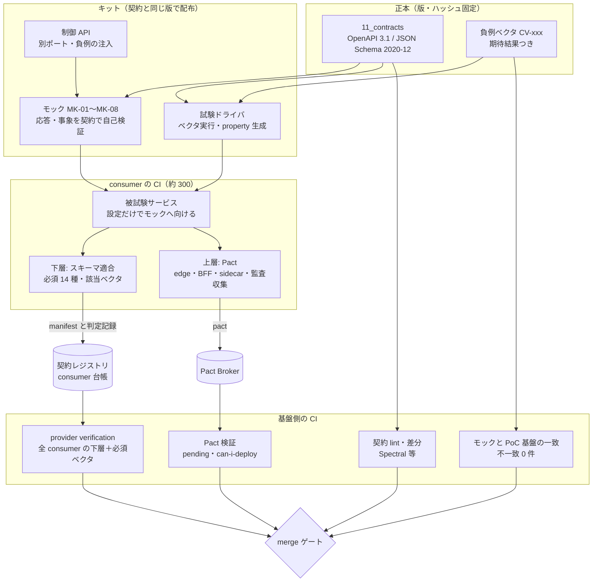
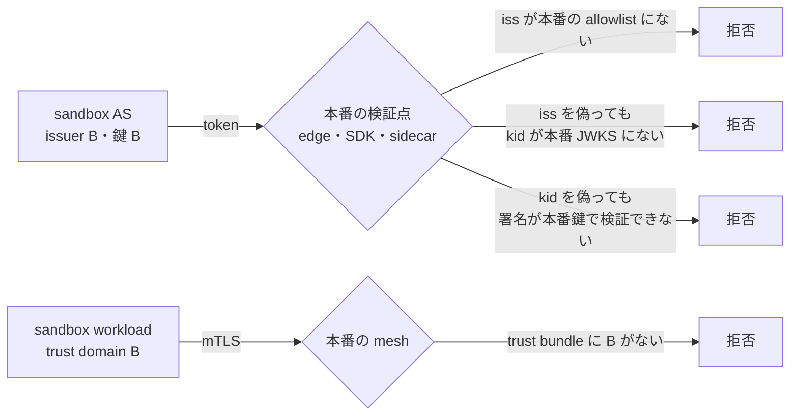
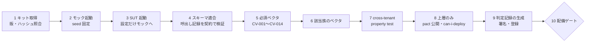
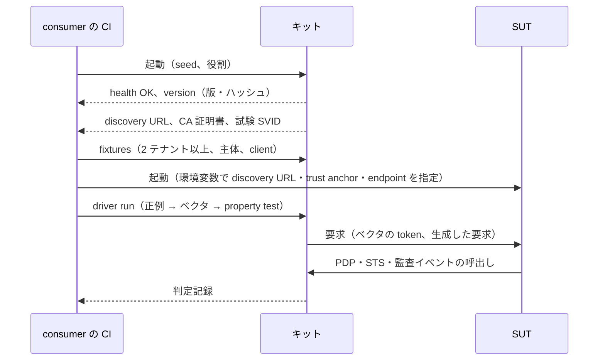

# モック・契約試験キット仕様

> 文書ID: CON-11 / 版: 0.4 / 状態: draft / 最終更新: 2026-10-15
> 対応要求: R-062, R-172, R-242／G-072, G-088, G-103, G-121, G-122, G-123, G-134, G-141, G-142（R-requirements.md・G-goal-criteria.md で対応成果物欄に本書のパスまたは DL-80 を含む全行）。補足: R-071（deliverables.md の DL-80 行が挙げる。閉じ方 D）
> 依存文書: CONVENTIONS.md, traceability/deliverables.md（DL-80, DL-22, DL-82, DEC-8）, 12_poc/code/README.md（POC-03。DL-82 の納品物）, 05_adr/ADR-022（D-1〜D-11, H-1〜H-11）, ADR-005, ADR-006, ADR-008（D8-50〜D8-55）, ADR-011, ADR-012（D12-41）, ADR-016（D16-08）, ADR-021, ADR-024, ADR-025（D25-22）, 05_adr/reconciliation-notes.md（U-01〜U-04）, 04_architecture/pep-contract.md（ARC-06）, token-profile.md（ARC-02 §10）, claims-catalog.md（ARC-15 §3.8）, architecture-reconciliation-notes.md（XR-17）, 11_contracts/*.openapi.yaml・schemas/*.json・review-notes/CON-02〜CON-10（版 0.3 で lifecycle-events.asyncapi.yaml（CON-12 案）、schemas/lifecycle-event.schema.json（CON-13 案）、client-registration.openapi.yaml（client 登録契約。文書 ID は仮番で未確定）を追加）, 10_integration/integration-patterns.md（INT-02 §申し送り 3）, 12_poc/preregistered-test-plan.md（TC-002, TC-003, TC-025, TC-026, TC-028, TC-119）, 01_governance/kri.md（K-03, K-06, K-31）, 01_governance/assumptions-register.md（A-050〜A-054）, 07_slo/numeric-contracts.md（SLI-086〜SLI-091）, research/RS-16, RS-08, RS-12, standards-status.md（SS-K34〜SS-K36）
> 作成方法: AI エージェント（Claude）が上記を通読し、ADR-022 D-6 の決定を、モック・試験キットの実装と判定ができる仕様に落として起草した。その後、起草者と別の AI エージェント（Claude）が独立レビューを行い修正した（末尾「レビュー記録」）。実在の CTO/CISO の判定ではない（CONVENTIONS §8）[D]。research ノートにない原典として OWASP API2:2023 を起草者が 2026-10-15 に取得して確認した。版 0.3 は模擬パネル（自己レビューであり、実在の CTO/CISO の決裁ではない）のラウンド 2 の指摘を受け、ライフサイクル事象と client 登録のモック・役割・ベクタ族・一致検査を加えた版である（末尾「レビュー記録」ラウンド 2）。この版で新たに確認した原典は RFC 7592（2026-10-15 に RFC Editor から取得）である。版 0.4 はラウンド 3 の指摘を受け、キット本体を DL-82（PoC 基盤）から分け、独立した DL（DL-120 案）として登録を申し送った版である（末尾「レビュー記録」ラウンド 3）。ラウンド 3 で新たな外部原典は用いず、根拠は deliverables.md の DL-82 行と 12_poc/code/README.md（POC-03）の照合である。人による照合は未実施である [D]。
> 表記: モックは MK-xx、consumer の役割は CR-x、試験ベクタは CV-xxx、決裁案は K11-x、新規仮定は NA-11-x（前提台帳へ追加要）、未決・申し送りは L11-x と書く。表のセルのうちタグのないものは設計推論 [D] であり、本注記で個別のタグに代える。「必須」「禁止」は本書が定める自社規範であり、外部規範の強度は脚注の原典どおりに写した。

---

## 要旨（結論）

1. **キットは ADR-022 D-6-1 の二層で作る** [D]。下層は全 consumer（約 300 サービス [A-050]）に必須とし、契約から作ったモック 8 種（版 0.3 でライフサイクル事象の publisher MK-08 を追加し、MK-01 に sandbox の client 登録 endpoint を加えた）、スキーマ適合試験、必須ベクタ 14 種（ADR-022 D-6-2 の 13 種 CV-001〜CV-013 と、ADR-016 が求めた版 downgrade の CV-014）を含む。上層は Pact による consumer-driven 契約で、edge・BFF・PEP sidecar・監査収集に限る [D]（ADR-022 D-6-1）。Pact の公式文書は、Pact が向く条件に「provider チームが consumer チームごとに個別の関係を管理できる程度に consumer が少ないこと」を挙げ、向かない例に「API が完全に安定した OAuth provider」を挙げている [V][^2]（RS-16#47）。約 300 の consumer はこの条件を満たしにくいため、全 consumer への Pact の必須化は採らない [D][A-050]。
2. **モックは「契約から作り、契約で自己検証する、本番と信頼を共有しない振る舞いモック」とする** [D]。応答はすべて送出前に契約の schema で検証し、合わない応答はモック自身の障害として止める（ADR-022 D-3-1）[D]。issuer・鍵・trust domain は本番と別に持ち、本番の allowlist に載せない（ADR-022 D-6-4、ADR-008 D8-51）[D]。負例の注入は consumer のコードに入らない別ポートの制御 API で行い、モックから PoC 基盤へは設定（discovery URL と trust anchor）の差し替えだけで移れるようにする（G-123 の「コード差分 0」）[D]。
3. **負例ベクタは「期待結果つきの機械可読データ」として版付きで配る** [D]。ADR-022 D-6-2 の 13 種は ARC-02 の NV-xx と対応づける（token-profile.md §10）。(11) sandbox token は本書の CV-011 とし、(12) PDP の timeout・deny・失効はモック MK-03 で再現する。(13) 未知 claim は「受理して続行」を期待する互換試験として分ける（XR-17）[D]。このほか、契約別の負例（各契約の `x-negative-examples`）、API Top 10 の 4 項目（BOLA・認証不備・BOPLA・BFLA。R-242）、cross-tenant property test の生成器（R-172、ADR-012 D12-41）を収める [D]。
4. **基盤側の CI は全 consumer の下層試験と必須ベクタを毎回流し、違反する変更は merge できない**（G-142、ADR-022 D-6-3）[D]。同じベクタをモックと PoC 基盤の両方に流して結果を比べ、不一致 0 件をモック配布と DEC-8 の凍結維持の条件にする（H-8、TC-026）[D]。上層は can-i-deploy と pending pacts で基盤側の開発を止めずに運用する [V][^4][^5]（RS-16#49, #50）。
5. **合格判定は「判定者が再現できる記録」で行う** [D]。キットの版とハッシュ、モックの版、ベクタごとの期待値と実測値、生成型試験の seed と試行回数 n を記録に残す。この記録は E4（CI ログ）として保存する（kri.md SRC-03）[D]。cross-tenant property test の n は TC-002 の n = ⌈3/p_max⌉ に従い、p_max は TBD（KP-4）である [D]。
6. **共有 sandbox の仕様は本書に置く**（G-goal-criteria §8 の申し送りの「DL-80 の範囲に加える」案を採る）[D]。G-141 の 6 項目 (a)〜(f) を §5 で定める。可用性目標・リセット周期・運用要員は TBD であり、決裁案 K11-3 とした [D]。
7. **実測・決裁はいずれも未達である** [D]。PoC 基盤（DL-82、12_poc/code/README.md＝POC-03、版 0.1 draft）は納品済みだが、その中身は AS 2 issuer・STS/TTS・PDP façade・PEP SDK・CAM 生成器などで、本書 §11.1 の `contract-kit/`（MK-01〜MK-08、ドライバ、ベクタ）を含まない。DL-82 の定義も「PoC コードと再現手順」で、キットを含まない。このためキット本体は独立した DL（DL-120 案。deliverables.md への追加を申し送り、§14.2）として未実装である。モックと PoC 基盤の一致（H-8）、独立開発者の切替（H-1、TC-119）、意図的違反の検出（H-5、K-06(c)）は未測定である。経営判断が要る点は 4 件ある（§13）。ADR・契約で未決の点は 12 件あり、本書では安全側の暫定動作を置いた（§14）[D]。

---

## 1. 位置付けと範囲

### 1.1 正本の関係

| 本書が定めるもの | 他の正本に委ねるもの |
|---|---|
| モック 8 種（MK-01〜MK-08）の振る舞い・負例の注入点・起動仕様 | 各 API・事象の要求・応答・エラーの形（11_contracts の各契約。ライフサイクル事象は CON-12・CON-13、client 登録は client-registration.openapi.yaml） |
| 負例ベクタの形式・カタログ・期待結果の規則・適用条件 | 検証規則 V1〜V14 と NV-01〜NV-58 の中身（ADR-005、ARC-02 §10） |
| consumer 側の CI 組込み手順、基盤側の provider verification、合格判定 | PEP の義務と静的規則 SR-01〜SR-20（ARC-06） |
| 共有 sandbox の仕様（G-141） | 非本番と本番の信頼分離の原則（ADR-008 D8-50〜D8-55） |
| キットの版付け・配布・DEC-8 の凍結物への組入れ | 互換性区分と非推奨期間（ADR-016、DL-70） |
| — | TC の事前登録と合否の閾値（DL-22）、PoC コード（DL-82。キット本体は含まない。キット本体は DL-120 案） |

- 本書と ADR-022 が食い違う場合は ADR-022 が優先する。食い違いは本書の改訂で解消する [D]。
- 本書は 11_contracts の契約を編集しない。契約側の不足は L11-x として申し送る（§14.2）[D]。

### 1.2 前提

| 項目 | 値 | 出所 |
|---|---|---|
| consumer の数 | 依存サービス 300、開発組織 25・開発チーム 60、開発者 1,500 | [A-050][A-052][A-053] |
| 契約管理の要員 | 2 FTE を新設（スキーマ、モック、負例ベクタ、正誤表、FAQ、審査会事務局） | ADR-022 NA-022-4（仮定） |
| SDK の言語 | サーバー側は主要 3 言語。それ以外は契約と負例ベクタだけで連携する | ADR-022 NA-022-1（仮定） |
| PoC の実装系 | 系統 1 は Node 22・Python 3.14・OpenFGA v1.21.0・Cedar wasm | preregistered-test-plan.md §3.1 |
| 契約ツールの OSS 基盤 | Pact の仕様と OSS Broker、Microcks（以上 ADR-022 D-10-4）。lint は Spectral（本書の選定。ADR-022 D-10-4 の列挙外） | ADR-022 D-10-4、standards-status SS-K34〜SS-K36（版の正本） |

### 1.3 なぜモックと負例ベクタが要るか

- デジタル庁の多ベンダー検証事業の報告は、20 社による検証で他社の認証認可サーバーとの疎通・連携を確認した。一方で、仕様書の解釈がベンダーごとにずれ得ること、未定義部分の仕様がベンダーごとに異なり得ることを課題に挙げている [M][^24]（RS-16#79）。25 組織 [A-052] が並行して開発する本基盤でも同じ種類のずれが起こり得るため、解釈を機械で判定できる負例ベクタとモックを契約と同じ版で配る [D]。
- OWASP API1:2023 は、予防策として「認可機構の脆弱性を評価する試験を書き、試験を失敗させる変更をデプロイしない」ことを命令形で挙げる [N][^15]（RS-08#9）。API Security Top 10 は自らを awareness document と位置付け、規範語は RFC 2119 の強度表現ではない [N][^19]（RS-08#7）。本書はこの勧告を、consumer 側と基盤側の両方の CI の必須ゲートとして実装する [D]（C-051）。
- スキーマの差分だけでは、claim の意味の変更、既定値の変更、エラーコードの意味の変更を検出できない [D]（RS-16#82）。このため、宣言の層（契約 lint・差分）と実行の層（負例ベクタ・契約試験）を組み合わせる（ADR-016 D16-08）[D]。

---

## 2. 全体像



- 契約レジストリ（consumer 台帳）は kri.md SRC-16 の「連携契約レジストリ」と同じものを指す [D]。consumer は自分が使う契約・版・操作・依存する欄を manifest（§7.2）で登録し、基盤側の CI はこれを入力にする [D]。

---

## 3. consumer の役割と適用範囲

consumer は 1 つ以上の役割を持つ。適用するモックとベクタは役割で決まる [D]。

| 役割 | 内容 | 使うモック | 必須ベクタ（§6.2） | 上層（Pact） |
|---|---|---|---|---|
| CR-1 資源サーバ（依存サービス） | 内部 access token を受けて業務 API を提供し、PEP を持つ | MK-01, MK-03, MK-07 | CV-001〜CV-008, CV-010〜CV-014。CV-009 は sender-constrained token を受ける場合 | 対象外（sidecar 利用時は sidecar 側） |
| CR-2 PEP 呼出し元 | PDP façade を AuthZEN 契約で呼ぶ（SDK か自前実装） | MK-03, MK-07 | CV-012, CV-014、§6.3 の PDP 族 | edge・PEP sidecar |
| CR-3 下流呼出し元 | STS で宛先別 token を取り直し、Txn-Token を伝播する | MK-01, MK-02 | CV-001, CV-002, CV-010、§6.3 の STS 族 | edge |
| CR-4 BFF・RP（OIDC client） | authorization code＋PKCE で token を得る | MK-01（上流 IdP 役を含む） | CV-003, CV-004, CV-005, CV-007、§6.3 の RP 族 | BFF |
| CR-5 関係データの書込元 | Registry API で tuple を書く | MK-04 | CV-008、§6.3 の Registry 族 | 対象外 |
| CR-6 SSF 受信者（外部連携アプリ・顧客の受信者） | SET を push または poll で受ける | MK-05 | CV-002, CV-003, CV-004、§6.3 の SSF 族 | 対象外 |
| CR-7 SCIM client（顧客 IdP 側コネクタ） | SCIM で User・Group を送る | MK-06 | §6.3 の SCIM 族 | 対象外 |
| CR-8 監査 producer | 監査イベント（DL-77）を送る | MK-07 | §6.3 の監査族 | 監査収集 |
| CR-9 ライフサイクル事象の受信者（依存サービス。版 0.3 で追加） | テナント・所属・主体の事象（CON-12 の tenantLifecycle・principalLifecycle・platformLifecycle）を購読し、完了報告（deletion.report）と replay 要求を送る | MK-08（MK-07 は監査を送る場合） | なし（CV-001〜CV-014 は token・PDP の負例で、事象の受信に当たらない）。§6.3 のライフサイクル族（LC-CV-01〜LC-CV-14（LC-CV-10〜14 は CON-12 版 0.2.0 作業中の追加）、CON-13 の LC-NE-01〜LC-NE-07、DeletionReport の自己検証） | 対象外 |
| CR-10 client 登録者（版 0.3 で追加） | sandbox の AS（issuer B）に RFC 7591/7592 profile で client を登録・読取り・更新・削除し、本番の登録申請 API に申請する（client-registration.openapi.yaml） | MK-01（issuer B の登録 endpoint と、本番申請 API の example 駆動のモック） | CV-011（sandbox の資格情報の本番提示。登録族の CRN-12 と対で流す）、§6.3 の登録族（CRN-01〜CRN-20 のうち consumer 側で観測できるもの） | 対象外 |

- 役割の申告は manifest（§7.2）で行う。申告と実際の呼出しの不一致（申告にない契約の呼出し）は、モックの呼出し記録から検出して不合格にする [D]。ADR-022 D-3-2 が禁じる契約外依存（AS・PDP・ストアへの直接接続、製品固有ヘッダなど）も同じ記録から検出する [D]。
- CR-9 は、ライフサイクル事象を受けるすべての依存サービスに適用する。CON-12 の受信側の義務 RO-xx（2026-10-15 時点で RO-1〜RO-13）が試験の正本であり、本書はその試験の仕方だけを定める [D]。内部サービスは SSF 受信者（CR-6）にせず、業務とデータの所有・存続の事象は CR-9 で受ける（CON-09 §1、ADR-006 D6-25、DL-49 §7.3 の分担。CON-00 §2.6.1）[D]。
- CR-10 は、OIDC client・OAuth client を持つ consumer（CR-4 の BFF・RP、client credentials を使う CR-3 など）が client を sandbox に登録するときに持つ。登録族の負例のうち、登録 endpoint の判定（CR01〜CR14）は基盤側（AS）が出す拒否であり、consumer 側の合否は「拒否の応答を受けて登録を誤って続行しないこと」と「回転後の registration access token だけを使うこと」で判定する（§6.3）[D]。
- CR-6 の受信義務を外部連携アプリの契約条件にするかは決裁案 K6-3（ADR-006 D6-26）で未決である。決まるまでは、高リスク scope を持つか利用者 session を保持する外部連携アプリには必須、それ以外には推奨とする（revocation-continuous-evaluation.md §6 の開発者義務 10 の暫定と同じ扱い）[D]。

---

## 4. モックサーバの振る舞い仕様

### 4.0 契約とモックの対応（G-121 の「全契約にモック」）

| 契約 | 形式 | 提供するモック | 備考 |
|---|---|---|---|
| CON-02 common.schema.json（DL-71） | JSON Schema | 全モック（共通型・Problem・版情報の自己検証に使う） | 単独のサーバを持たない |
| CON-03 authorization-api.openapi.yaml（DL-72） | OpenAPI 3.1 | MK-03 | resource search は preview |
| CON-04 relationship-model-registry.openapi.yaml（DL-73） | OpenAPI 3.1 | MK-04 | モデル管理は preview（example 駆動のみ） |
| CON-05 token-exchange.openapi.yaml（DL-74） | OpenAPI 3.1 | MK-02 | `/txn-token` は preview |
| CON-06 access-token-claims.schema.json（DL-75） | JSON Schema | MK-01（発行 token の自己検証）、MK-02 | — |
| CON-07 scim.openapi.yaml（DL-76） | OpenAPI 3.1 | MK-06 | — |
| CON-08 audit-event.schema.json（DL-77） | JSON Schema | MK-07 | — |
| CON-09 ssf-caep.openapi.yaml（DL-78） | OpenAPI 3.1 | MK-05 | — |
| CON-10 ssf-caep-set.schema.json（DL-79） | JSON Schema | MK-05（SET の生成と自己検証） | — |
| OIDC discovery・JWKS・認可 code＋PKCE・PAR・logout token | 標準（OIDC Core 等。11_contracts に OpenAPI はない） | MK-01 | 振る舞いは ARC-02 §10 の NV と ADR-005 V1〜V14 に従う |
| CON-12（案）lifecycle-events.asyncapi.yaml（DL-117 案。版 0.3 で追加） | AsyncAPI 3.1.0 | MK-08 | 事象の一覧・配送の保証（PO-xx）・受信側の義務（RO-xx）の正本。2026-10-15 時点で CON-12 は並行作業で版 0.2.0 に改訂中で、メッセージ単位の署名 PO-13（拡張属性 `lcsig`）、署名の検証 RO-11、正本照会 RO-12、削除の猶予 RO-13 が加わっている。broker 製品・protocol binding は凍結せず `servers` を置かない（CON-12 の description）。replayRequests channel と `revocation.bulk` は preview |
| CON-13（案）schemas/lifecycle-event.schema.json（DL-118 案。版 0.3 で追加） | JSON Schema 2020-12 | MK-08（事象の生成と自己検証、受けた deletion.report・replay 要求の検証） | 封筒・type 名・順序番号・冪等キーは GA、個別の data は preview（CON-00 §2.6）。CON-12 の payload は要約スキーマで、正本は CON-13（規則 L-4。§9.1 P-7） |
| client 登録契約 client-registration.openapi.yaml（文書 ID は仮番。CON-13 と衝突。L11-12。版 0.3 で追加） | OpenAPI 3.1 | MK-01（issuer B の登録 endpoint。本番申請 API は example 駆動） | sandbox 登録（RFC 7591/7592 profile）と本番申請は preview。ClientMetadata の規則は GA（CON-00 §3 の client 登録行）。モックの振る舞いは同契約の `x-mock`（§4.2） |

- CON-00（README）と CON-01（互換性・非推奨ポリシー）は API を持たないため、モックの対象外である [D]。
- 上表の 13 行のいずれかでモックが起動しない版は配布しない（§12）[D]。版 0.2 までの表は 10 行で、ライフサイクル事象の 2 契約と client 登録契約の行がなかった（ラウンド 2 の指摘）[D]。

### 4.1 共通原則

| ID | 原則 | 理由・根拠 |
|---|---|---|
| MK-P1 | 契約から作る。OpenAPI の examples と schema から応答を作る層（Microcks 型）と、署名・状態・判定を持つ振る舞いの層を分け、後者の応答も送出前に契約の schema で検証する | Microcks は OpenAPI・AsyncAPI 等を取り込み、仕様中の制約と例からモックを生成し、実装の適合も検証できる [V][^8]（RS-16#55）。ADR-022 D-3-1 |
| MK-P2 | 自己検証に失敗した応答は送らない。`500` と制御 API 上の「モック障害」記録に置き換え、その回の判定を「判定不能」にする | モックの誤りを consumer の合格・不合格と混ぜないため [D] |
| MK-P3 | 本番と信頼を共有しない。issuer URL・鍵・CA・SPIFFE trust domain はキット専用とし、鍵は起動ごとに生成する（固定鍵を使う回帰ベクタは §6.1 の「試験鍵」に限る） | ADR-008 D8-51、ADR-022 D-6-4 |
| MK-P4 | 負例の注入は制御 API（§4.9）か fixture の識別子で行う。業務 API に試験用のヘッダ・パラメータを加えない | 試験用ヘッダを consumer のコードが送ると、PoC 基盤への切替でコード差分が出る（G-123）。製品・環境固有ヘッダへの依存は禁止である（ADR-022 D-3-2） |
| MK-P5 | 決定的に動く。乱数・時刻・鍵は seed と起動時の設定から決め、同じ seed・同じベクタで同じ結果を返す | 判定の再現（G-122）と、モックと PoC 基盤の比較（H-8）のため |
| MK-P6 | 合成データだけを扱う。fixture は合成データ生成器が作り、外部から取り込んだデータは §5.5 の検査を通す | ADR-008 D8-55、DEC-4 の合成データ限定 |
| MK-P7 | モックの版は契約の版と同じ番号で出し、起動時に自分の版・契約のハッシュ・ベクタのハッシュを `/__kit/version` で返す | G-142「モックは契約と同じ版で配布」 |
| MK-P8 | 本番にしかない性質（容量・遅延・可用性）を模さない。遅延の注入は負例のためだけに行い、性能試験に使わない | preregistered-test-plan.md §3.3（系統 1 の遅延は記録のみ） |

### 4.2 MK-01 開発用 AS・IdP

| 項目 | 振る舞い |
|---|---|
| 提供する契約 | OIDC discovery・JWKS、authorization code＋PKCE、PAR、refresh、logout token の送信、内部 access token（typ=at+jwt、claim は DL-75）の発行。版 0.3 から、issuer B の client 登録（client-registration.openapi.yaml の `x-mock` を本節に取り込んだもの。下の 4 行） |
| issuer | 2 つ持つ。issuer A は「本番役」、issuer B は「sandbox 役」。PoC 系統 1 の 2 issuer 構成（node-oidc-provider 2 インスタンス）と同じ形にする（preregistered-test-plan.md §3.1）。上流の顧客 IdP 役（OIDC）を別に 2 つ持つ |
| 正例 | 制御 API で登録した合成の主体・テナント・client に、DL-75 の schema に適合する token を発行する。発行した token は自己検証（MK-P1）で access-token-claims.schema.json に通す |
| 負例の注入 | 制御 API の「token 鋳造」で、ARC-02 NV-01〜NV-58 のうち token の形で表せる負例を作る（alg=none、allowlist 外の alg、未知の kid、未知の `crit`、期限切れ、`nbf` が未来、typ の取違え、他 aud、他 issuer、他テナントの tid、issuer B の正規署名、Txn-Token、ID Token、logout token・SET を ID Token として提示する形） |
| JWKS の制御 | 鍵の追加・削除・rotation を制御 API で起こせる。未知 kid の取り直し（CV-005）の試験では、token を新しい鍵で署名してから JWKS へ鍵を載せる時刻をずらす |
| AS としての負例 | redirect URI の不一致、PKCE の欠落・不一致、使用済み refresh token の再提示（grant の全 token の失効）、DPoP proof の再送の拒否を、PoC の AS と同じ判定で返す。どの負例を AS の機能で再現できるかは node-oidc-provider の公式文書で確認してから凍結する（preregistered-test-plan.md §3.1 の「未確認」を引き継ぐ） |
| client 登録（版 0.3 で追加） | issuer B（sandbox 役）に、client 登録契約の `registerSandboxClient`（RFC 7591 の登録 endpoint）と `readSandboxClient`・`updateSandboxClient`・`deleteSandboxClient`（RFC 7592 の client configuration endpoint）を実装し、ClientMetadata の規則と理由コード CR01〜CR14 の判定を返す。issuer B の discovery に `registration_endpoint` を載せ、consumer は URL を直書きせず discovery から得る（§11.4）。登録には制御 API の `fixtures` で consumer ごとに払い出した initial access token を要する（CRN-10・CRN-11）。RFC 7591 は、登録 endpoint を initial access token で事前に認可した者に限ってよい（MAY）とする [N][^26]（RS-16#20） |
| client 登録の管理 | RFC 7592 は、client が client configuration endpoint へのすべての呼出しで registration access token を Bearer token として使わなければならない（MUST）とし、読取り・更新の応答で新しい registration access token を受けた client は以前の token を直ちに破棄しなければならない（MUST）とする [N][^27]（§2.1・§2.2）。RFC 7592 は Experimental である [N][^27]。MK-01 は読取り・更新のたびに token を回転させ、回転前の token を 401 で拒否する（同契約が RFC 7592 の MAY を必須化した規則。CRN-14）。削除後は registration access token とその client に発行した access token を拒否する（CRN-15） |
| issuer A との分離 | issuer A（本番役）には登録 endpoint を置かない。issuer B で払い出した `client_id` は issuer A の token endpoint で `invalid_client` になる（CRN-12。CV-011 の資格情報版）。本番役の redirect URI のホストと公開鍵の一覧を制御 API の `fixtures` で登録し、CR04（本番 redirect URI の sandbox 登録。CRN-01）と CR13（本番の公開鍵の sandbox 登録。CRN-13）の判定に使う |
| 本番の登録申請 | `submitClientRegistrationRequest`・`getClientRegistrationRequest`・`decideClientRegistrationRequest` は examples から起動する example 駆動のモックにする。承認は制御 API の `inject` で模し、required_approvals がそろうまで provisioned にしない（CRN-17〜CRN-19）。承認者の判断そのものは模さない |
| 返さないもの | 本番相当の MFA・回復・リスク判定。認証は制御 API で決めた主体としてそのまま成立させる（acr・amr・auth_time の値は制御 API で指定する） |

### 4.3 MK-02 STS・TTS（token exchange）

| 項目 | 振る舞い |
|---|---|
| 提供する契約 | `/token`（RFC 8693 の社内 profile）と `/txn-token`（preview）。CON-05 |
| 呼出し元の認証 | キット専用の CA が発行した試験用 X.509-SVID による mTLS。登録簿（呼出し元×呼出し先）は制御 API で登録する |
| 判定 | CON-05 の判定順（mTLS → actor_token の有無 → subject_token → resource → 登録簿 → scope → act の深さ・循環 → 失効状態）で、最初に該当した理由コード（R01〜R10、T01〜T08）で拒否する。理由コードは `error_description` に入れず、制御 API の記録にだけ残す（CON-05 §2 の 5） |
| 負例 | CON-05 `x-negative-examples` の全件（N-08〜N-21、N-26、N-34、N-39、N-42、X74-N1〜N6）。複数 `resource`（N-11）は JSON で表せないため、生の form 本文のベクタとして持つ（review-notes/CON-05.md） |
| 注意 | `not: {}` で表した拒否パラメータ（`actor_token`・`audience`）は、要求検証つきのモックではツール固有の 400 になる。MK-02 は要求検証をツールに任せず、RFC 6749 §5.2 形式の `invalid_request` 等を自ら返す（CON-05 §4、review-notes/CON-05.md #11） |

### 4.4 MK-03 PDP façade（AuthZEN）

| 項目 | 振る舞い |
|---|---|
| 提供する契約 | `/.well-known/authzen-configuration`、evaluation、evaluations、resource search（preview。SDK の一覧ヘルパの内部専用）。CON-03 |
| 判定の源 | MK-04 に書いた tuple と、制御 API で登録した許可表。正規モデルの意味論が要る試験は、PoC の参照評価器（Python。TC-002）を判定の源に差し替えて行う |
| G 段（常時有効） | `subject.properties.tid` と `resource.properties.tid` が一致しない要求は、許可表の内容にかかわらず decision=false、reason=`deny_guardrail:<規則ID>` を返す。この規則は制御 API で無効にできない（ADR-011・ADR-010 D-28 の「G 段は R 段のどの permit でも打ち消せない」を模す） |
| 正例の応答 | AuthZEN の情報モデルに、自社 profile の `decision_id`・consistency・`model_revision`・`profile_version` を付けて返す。要求に X-Request-ID があれば同じ値を返す。AuthZEN は、要求に要求 ID が付いていれば PDP が応答に PEP の指定と同じ値を含めなければならない（MUST）とする [N][^22]（RS-07#66） |
| 負例の注入 | 下表の 12 種。ADR-011 が DL-80 に求める AuthZEN profile の負例（`deny_guardrail`、`deny_indeterminate`、`deny_unavailable`、`unsupported_profile`、timeout、consistency の格下げ拒否、cross-tenant、要求 ID の不一致）をすべて含む（ADR-011 §6.4） |

| 注入 | MK-03 の応答 | consumer に期待する振る舞い（CON-03 §7、ARC-06 §3.10） |
|---|---|---|
| timeout | 応答しない（接続を保持し、consumer の timeout を超えるまで返さない） | 「判定が得られない」として階層別 fail-mode（ARC-06 §3.10）。write 以上は 503（Retry-After 付き）。read-sensitive も KD13-6 の決裁までは known-good を使わず 503（L11-5）。どの階層でも fail-open しない |
| façade の過負荷 | 503＋Retry-After | 同上 |
| クォータ超過 | 429＋Retry-After | 同上。再試行は Retry-After に従う |
| engine 不達 | 200、decision=false、`deny_unavailable` | 同上 |
| 評価不能 | 200、decision=false、`deny_indeterminate` | 同上 |
| 未対応 profile | `unsupported_profile` | 同上 |
| deny | 200、decision=false | 資源単位の拒否は他テナント・不存在と同じ応答 |
| 失効 | 制御 API の「剥奪」以後、同じ要求に decision=false | 次の要求から拒否。allow を PEP の外で cache しない（DEV-9） |
| decision_id の欠落 | 200、`decision_id` なし | 「判定が得られない」 |
| X-Request-ID の不一致 | 別の値を返す | 「判定が得られない」 |
| G 段の拒否（cross-tenant） | 200、decision=false、`deny_guardrail:<規則ID>`（制御 API で無効にできない常時規則） | 拒否。他テナント・不存在と同じ応答（ARC-06 §3.10） |
| consistency の格下げ要求 | write 操作に `minimize_latency` を指定した要求に対し、階層の既定へ格上げして評価し、応答の `consistency.mode` に実効モードを返す（CON-03 `downgradeAttempt`、ADR-011 D6-3）。注入時は「格上げできない」として decision=false、`deny_indeterminate` を返す | 前者は応答の実効モードで処理を続ける。後者は「判定が得られない」。要求したモードより弱い実効モードを返された場合も「判定が得られない」 |

- 一覧（search）では `completeness=incomplete` と理由、主体に束縛した `page.token`、`page.limit` 超過の 400 を返せるようにする（CON-03 §3、ADR-025）[D]。

### 4.5 MK-04 Relationship/Model Registry

- tuple の書込み・削除・読取りと変更購読を、テナント指定の path（`/v1/tenants/{tenant_id}/...`）で受ける。path のテナントと呼出し元の資格情報のテナントが一致しない要求を拒否する [D]（CON-04）。
- consistency token は形式を規定しない不透明な文字列として返す。consumer がその中身を解析していないことは、キットが版ごとに token の符号化を変えて検出する [D]（ADR-022 D-2 の「不透明な consistency token」）。
- モデル管理（登録・pin・shadow・rollback）は preview のため、MK-04 は example 駆動の層だけで返し、振る舞いを模さない [D]。shadow の結果が DL-72 の判定応答に現れないこと（CON-04 の該当 example）は契約試験で確かめる [D]。
- 負例は CON-04 の `x-negative-examples` 全件（ワイルドカード ID、名前空間の非所有、dry-run なしの apply など。review-notes/CON-04.md §3）である [D]。

### 4.6 MK-05 SSF transmitter（と受信者役）

| 項目 | 振る舞い |
|---|---|
| 提供する契約 | `/.well-known/ssf-configuration`、stream 管理、subject の追加・削除、verify、poll、push 配送（webhook）。SET の payload は DL-79。CON-09・CON-10 |
| 正例 | 制御 API の事象（session 失効、資格情報変更、claims 変更、保証レベル変更、アカウント停止、資格情報の侵害、識別子の再利用）から、DL-79 に適合する SET（typ=secevent+jwt）を作り、登録された stream へ送る |
| 負例（送信側として注入） | 署名不正、未知の kid、iss の不一致（mix-up）、aud の不一致、未知のイベント種別、重複 jti、禁止 claim（sub・exp）の混入。期待は「処理しない」と RFC 8935 の誤り応答（CON-09 の受信側 `x-negative-examples`）。受信後の確認として、session-revoked を受けた consumer の session が終了していることを制御 API の probe で調べる |
| 負例（受信者の振る舞いを試す） | 受信者が誤り応答を返したときに再送せず dead letter に移すこと、5xx のときに同じ jti で再送すること、検証イベントの往復（CON-09 の該当 example）を確かめる |
| 受信者役 | 基盤の受信側（C16）を試すため、顧客 IdP 役として SET を基盤へ送る機能も持つ。これは基盤側の CI でだけ使う（TC-ARC09-11、ADR-006 H6-09） |
| 範囲外 | 内部の約 300 サービスを SSF の受信者にしない（CON-09 §1、ADR-006 D6-25）。依存サービスの失効の試験は MK-01 の失効状態と MK-03 の「失効」注入で行う |

### 4.7 MK-06 SCIM service provider

- CON-07 の User・Group・ServiceProviderConfig・ResourceTypes・Schemas と、照会（GET と POST /.search）、PUT・PATCH・DELETE、ETag を提供する [D]。
- テナントは SCIM 資格情報から導く。テナントを示す header を受けて資格情報のテナントと異なる場合は 403 を返す。他テナントの id は path では 404、body では 400 `invalidValue` を返し、存在の有無を漏らさない（CON-07 §2）[D]。
- C1〜C10 の衝突解決（CON-07 §3）を状態として持ち、409 `uniqueness`、412、`pendingBinding` を返せるようにする [D]。
- readOnly 属性は POST・PUT で無視する。要求検証の前に readOnly 属性を除去する（RFC 7644 §3.3・§3.5.1 の SHALL。CON-07 §3.1）[D]。汎用のモックサーバは readOnly 属性を「あれば拒否」と扱うことがあり、CON-07 の独立レビューでも誤った 400 を返す挙動が観測された [M]（review-notes/CON-07.md #1、#8）。
- 流量超過の 429 は制御 API で起こす [D]。

### 4.8 MK-07 監査イベント sink

- consumer が送る監査イベントを受け、audit-event.schema.json（DL-77）で検証する [D]。
- 検証に加えて次の 4 点を検査する [D]。(1) write・privileged・break-glass/B の操作で `txn` があること（U-02 が決まるまでは CON-08 の必須条件どおり）。(2) enforcement 記録に `decision_id` があり、MK-03 が返した値と一致すること。(3) JWT の compact 形式（3 つの base64url 部分）に一致する文字列がどの欄にもないこと（DEV-6。token 全文の記録の検出）。(4) baggage・traceparent・tracestate に主体・テナント・資源の識別子がないこと（DEV-7）。
- (3) は文字列の形での検出であり、符号化や分割で隠した token は検出できない [D]。この限界は残余リスク RR11-03 に置く。

### 4.9 制御 API とシナリオ

- 制御 API は業務 API と別のポートで待ち受け、既定では loopback だけに bind する [D]。共有 sandbox（§5）では、consumer は自分の sandbox テナントに属する fixture にだけ注入できる [D]。
- 主な操作は次のとおりである [D]。

| 操作 | 暫定 path（制御ポート） | 内容 |
|---|---|---|
| `fixtures` | `POST /__kit/fixtures`、`DELETE /__kit/fixtures` | 合成のテナント・主体・client・workload・資源・関係の登録と全消去 |
| `mint` | `POST /__kit/mint` | MK-01・MK-02 による正例・負例 token の鋳造（ベクタ ID を指定） |
| `inject` | `POST /__kit/inject`、`DELETE /__kit/inject/{id}` | MK-03〜MK-06・MK-08 への注入（対象の fixture・回数・期間を指定）と解除。MK-08 の注入の種類は §4.11 の表、MK-01 の本番申請の承認は §4.2 |
| `emit` | `POST /__kit/lifecycle/emit` | MK-08 から指定の type の正例の事象を発行する（パーティション・sequence は MK-08 が採番。版 0.3 で追加） |
| `revoke` | `POST /__kit/revoke` | 主体・grant・テナント・鍵の剥奪事象を起こし、MK-01 の失効状態・MK-03・MK-05 に反映 |
| `keys` | `POST /__kit/keys` | JWKS の追加・削除・rotation |
| `record` | `GET /__kit/record` | 呼出し記録（契約・操作・要求・応答・自己検証結果）の取得。§3 の申告との突合と合格判定の入力 |
| `probe` | `POST /__kit/probe` | consumer の外から見える振る舞い（session の有無など）の確認 |
| 健全性・版 | `GET /__kit/health`、`GET /__kit/version` | 起動完了と版・ハッシュ（MK-P7、§11.2） |

- path は本書 0.x の暫定であり、要求・応答の schema とともにキット DL（DL-120 案）の実装時に OpenAPI として `contract-kit/control-api.openapi.yaml` に定め、キットの版で凍結する [D]。consumer の業務コードは制御 API を呼ばない（試験コードだけが呼ぶ）。このため path の変更は consumer のソースに影響しない [D]（MK-P4）。

- 業務 API の fixture 識別子に意味を持たせる方式（例: 特定の資源 ID で timeout を起こす）は使わない [D]。識別子を解析しない義務（DEV-3、ADR-021）と衝突し、PoC 基盤では同じ ID が意味を持たないためである [D]。

### 4.10 モック実装上の注意（契約の独立レビューで判明した事項）

| 事項 | 出所 | 本キットでの扱い |
|---|---|---|
| 汎用モックは `x-negative-examples` を実行しない（filter の意味を検査せず `userName pr` にも 200 を返した）[M] | review-notes/CON-07.md R-13 | 負例はドライバが実行する。モックの自動応答で負例を判定しない |
| 共有 400 応答の先頭 example が返り、文脈と違うエラー本文になる [M] | review-notes/CON-07.md #8、scim.openapi.yaml | 振る舞い層がエラー本文を選ぶ |
| servers の base path を付けずに path を提供するツールがある [M] | review-notes/CON-07.md §4 | 起動仕様で base path を明示し、自己検証で path を照合する |
| `not: {}` の拒否パラメータがツール固有の 400 になる | review-notes/CON-05.md #11 | §4.3 |
| `status=incomplete` なら `reason` 必須の規則は schema でなく `x-constraint` で宣言されている | authorization-api.openapi.yaml `Completeness` | ドライバが `x-constraint` を検査する |
| 例の JWT の payload が抜粋で、署名検証つきの試験に使えない | review-notes/CON-05.md §4 | 署名つきの試験ベクタをキット側で別に作る（§6.1） |
| AuthZEN 契約のモック起動は未試行 | review-notes/CON-03.md L-6 | キット DL（DL-120 案）の実装時に起動記録を E4 として残す |
| CON-12 の payload は要約スキーマで、正本の CON-13 を `x-dataschema` で指すだけである。AsyncAPI から汎用モックを作ると、CON-13 の pattern・data の形を満たさない事象が出得る [M]（本書の作成者が 2026-10-15 に CON-13 の負例 7 件を CON-12 の要約スキーマ `CloudEventEnvelope` で検証し、4 件（LC-NE-03・05・06・07）が受理された） | CON-00 §2.6.3（規則 L-4）、本書 §9.1 P-7 | MK-08 は送出前の自己検証（MK-P1）を CON-13 で行い、要約スキーマでは行わない |

### 4.11 MK-08 ライフサイクル事象 publisher（CON-12・CON-13。版 0.3 で追加）

節番号は、既存の §4.9・§4.10 を参照する他文書の記述を変えないため末尾に置いた [D]。

| 項目 | 振る舞い |
|---|---|
| 提供する契約 | CON-12 の publish 側 3 channel（tenantLifecycle・principalLifecycle・platformLifecycle）への送信と、receive 側 2 channel（deletionReports・replayRequests）の受信。封筒と data は CON-13 |
| 配送の経路 | CON-12 は broker 製品・protocol binding を凍結せず `servers` を置かない [D]。このため MK-08 は「事象の列を作る層」と「binding の adapter」を分け、adapter は設定で選ぶ（§11.2）。consumer は受信処理を binding から分けて書き、adapter の差替えを §11.4 の差し替え点で行う。どの binding を参照 adapter にするかはキット DL（DL-120 案）の実装時に PoC 基盤（DL-82）の構成に合わせて決める [D] |
| 正例 | 制御 API の `emit` で、CON-13 の type ごとの `$defs/Event_*` に適合する事象を発行する。source・partitionkey はパーティション（tenants/<tid>、principals/<sub>、platform）ごとに作り、sequence は 20 桁 0 埋めで 1 から連続させる（CON-12 PO-4・PO-5）。発行前に CON-13 で自己検証する（MK-P1）。CloudEvents は producer が source と id の組を事象ごとに一意にしなければならない（MUST）とする [N][^28]（RS-16#9） |
| 受信側の確認 | 受けた deletion.report・replay 要求を CON-13 の `$defs/DeletionReport`・`$defs/ReplayRequest` で検証し、送信元の workload ID と source の一致を確かめる（CON-12 deletionReports の description、RO-1）。期限（T_*）の判定は設定値で行う |
| 呼出し記録 | 事象ごとに配送・ack の有無・再送回数、受けた deletion.report と replay 要求を記録する（§4.9 `record`）。LC-CV-01 の「副作用は 1 回」は SUT の副作用を `probe` で数えて判定する |
| 署名（CON-12 版 0.2.0 の PO-13 に追従） | 起動ごとに、環境別・cell 別の試験用署名鍵（用途族「ライフサイクル事象の署名」。他の用途族と共有しない）を生成し、すべての事象に `lcsig`（JWS Compact、typ=`lifecycle-event+jws`）を付ける。鍵の配布は、キット専用の署名付き鍵マニフェストを試験の trust anchor として SUT に渡す形で模す（§11.2 の CA 証明書と同じ扱い）。鍵マニフェストの形式は ADR-007 の決定に従い、未決の間はキットの暫定形式とする（L11-11） |
| 照会 API のモック（CON-12 RO-12 に追従） | CON-12 が RO-9・RO-12 で使う「現在状態の照会 API」は契約が未作成である（CON-12 LC-OI-3）。MK-08 は暫定の照会 endpoint を持ち、テナント・主体の状態、request_id・hold_ref・mapping_ref の有無、撤回の有無を、制御 API で設定した値で返す。path と形は暫定で、LC-OI-3 の契約ができたら置き換える（L11-11） |
| 範囲外 | 本番の publisher の容量・遅延・outbox の取引境界（PO-2）は模さない（MK-P8）。PO-2 は基盤側の試験（P-4）で PoC の publisher に対して確かめる |

| 注入（`inject`） | MK-08 の振る舞い | 受信者に期待する振る舞い（CON-12） | ベクタ |
|---|---|---|---|
| 重複 | 同じ (source, id)・同じ sequence の事象を 2 回配送する | 2 回目は ack だけ返し、副作用は 1 回（RO-3） | LC-CV-01 |
| 順序の逆転 | 同じパーティションの sequence n+1 を n より先に配送する | n+1 を保留し、n の処理後に処理する（RO-4） | LC-CV-02 |
| 欠番 | sequence n を落として n+1 以降を配送する | G_gap の後に replay 要求（from_sequence=n）を送る（RO-4） | LC-CV-03 |
| replay | 受けた replay 要求に対し、元の channel に同じ id・sequence で再配送する（PO-9）。注入時は W_replay を超えた要求に「再配送できない」応答を返す | 再配送を重複除去と順序の規則で処理する。W_replay を超えたら RO-9 の手順（例外台帳と現在状態の照会）へ移る | LC-CV-03 の後段、RO-9 |
| 未知の type | 既知の前置で未定義の type（例 tenant.future_event）を配送する | 受理して ack し、dead letter に送らない（RO-5） | LC-CV-04 |
| 未知の data 欄・未知の列挙値 | 既知の type に未知の欄と reason_class の未知の値を加える | 受理し、未知の値を other と同じに扱う（RO-5） | LC-CV-05 |
| 削除要求 | tenant.deletion.requested・user.deletion.requested を配送する | 期限内に CON-13 DeletionReport に適合する報告を送る。データがなければ outcome=not_applicable（RO-7） | LC-CV-06 |
| 処理失敗 | 制御 API で SUT の処理失敗を起こす試験用の事象を配送する（SUT 側の失敗の起こし方は fixture adapter で用意する） | 自サービスの dead letter に移し、黙って ack しない。削除要求なら期限内に outcome=failed を報告する（RO-8） | LC-CV-07 |
| 停止と独自 session | membership.suspended を配送した後、`probe` で独自 session による要求を送る | 独自 session が無効になっている（RO-6、ONB-R9。期限 T_user_susp は TBD） | LC-CV-08 |
| 送信者の偽装 | キット専用 CA が発行した、publisher 以外の workload ID で事象を送る | 処理しない（RO-1） | LC-CV-09 |
| 他の鍵による署名 | 非本番の鍵、別 cell の鍵、別の用途族の鍵（例 内部 token 用）で署名した tenant.deletion.requested を配送する | 処理せず隔離し警報する。sequence の処理済みに数えず、replay で真正な事象を取り直す（RO-11） | LC-CV-10 |
| 署名なし・封筒の改変 | (a) `lcsig` なし、(b) alg none の JWS、(c) 署名は正しいが封筒の source・type を書き換えた事象を配送する | いずれも処理せず隔離し警報する（RO-11） | LC-CV-11 |
| 正本と食い違う削除要求 | 正しく署名されているが、照会 API のモックでは request_id がない、または対象が削除要求の状態にない tenant.deletion.requested を配送する | 削除を実行せず、outcome=failed（正本不一致）で報告し警報する（RO-12） | LC-CV-12 |
| 猶予中の撤回 | tenant.deletion.requested の後、猶予 G_del の満了前に tenant.deletion.withdrawn を配送する。別の試行では撤回事象を落とし、照会 API のモックだけが撤回を返す | どちらも不可逆な削除を実行せず、outcome=withdrawn で報告する（RO-13、RO-12） | LC-CV-13 |
| 保全中の解除事象 | 照会 API のモックでは保全が続いている hold_ref について、署名済みの tenant.legal_hold.released を配送する | 削除を再開せず、正本不一致として報告し警報する（RO-12） | LC-CV-14 |
| publisher 側の dead letter | ack を返さない受信者への再送が N_retry を超えたとき、事象を MK-08 の dead letter に移し、そのパーティションの後続の配送を止める（PO-8） | 復旧後に replay で欠番を埋める（RO-9）。基盤側では dead letter の件数と最古の齢が記録されること | 基盤側（P-4） |
| 封筒の負例 | CON-13 の `x-negative-examples`（LC-NE-01〜LC-NE-07）をそのまま配送する | 処理しない。ただし CON-13 のスキーマに合わない事象の扱い（隔離か dead letter か）は CON-12 の RO に明記がないため、期待結果は「副作用 0 件」とし、行き先は問わない（L11-11） | ライフサイクル族 |

- LC-CV-10〜LC-CV-14 と上表の署名・照会 API の行は、本書の改訂中に CON-12 が版 0.2.0（作業中）で加えたもので、CON-12 §8 と同契約の申し送り H2-7 が CON-11 に取込みを求めている。本書は 2026-10-15 時点の CON-12 の記述に追従したが、CON-12 と CON-13（`lcsig` の追加は CON-13 への申し送り H2-3 で未反映）がまだ確定していないため、両契約の確定後に本節を照合し直す [D]。
- N_retry・G_gap・G_del・W_replay・T_* は CON-12 §7 で TBD である。MK-08 は値を設定（`kit.config.yaml`）から読み、ベクタの期待結果は値ではなく「設定値以内」で書く [D]（L11-11）。

---

## 5. sandbox テナントと共有 sandbox（G-141）

### 5.1 2 つの非本番環境

| 環境 | 運用者 | 用途 | 信頼 |
|---|---|---|---|
| ローカル・CI のモック（MK-01〜MK-08） | consumer 自身（キットを起動） | 開発・CI の契約試験 | 起動ごとの鍵。外部に到達しない |
| 共有 sandbox | 基盤チーム | 連携の結合確認、オンボーディング（SLI-087）、顧客 IdP 接続の事前確認 | 本番と別の issuer・鍵・trust domain・クラウドアカウント・CI runner |

- 両者で同じ契約・同じベクタを使い、consumer はどちらへも設定の差し替えだけで向けられるようにする [D]。

### 5.2 G-141 の 6 項目

| 項目 | 仕様 | 根拠 | 状態 |
|---|---|---|---|
| (a) 信頼の分離 | sandbox の issuer・JWKS・CA・SPIFFE trust bundle を本番の検証点に置かず、sandbox の issuer を本番の allowlist に載せない。sandbox の主体・client・workload は本番資源への権限を持たず、環境をまたぐ付与を台帳から機械検査して 0 件に保つ | ADR-022 D-6-4、ADR-008 D8-50〜D8-52。Midnight Blizzard では、MFA のない非本番テストテナントのアカウントを足がかりに、corporate 環境で高い権限を持つ旧テスト OAuth アプリへ到達された [I][^21]（RS-12#16） | 設計。実測は TC-025・TC-122 |
| (b) テスト用テナント・合成 ID・顧客 IdP | consumer ごとに 2 つ以上の sandbox テナントを払い出す（cross-tenant 試験に 2 テナント以上が要るため。WSTG-ATHZ-04 は異なるオブジェクトを所有する 2 人以上の利用者を用いるのが最善とする [N][^20]（RS-08#39））。主体は合成データ生成器が作る。顧客 IdP 役は MK-01 の上流 IdP 役（OIDC）を使い、SAML 役は系統 2 で用意する | ARC-06 §8.2、TC-002 | 設計 |
| (c) セルフサービス登録 | client・workload・redirect URI・SSF stream・SCIM 資格情報を、consumer 台帳に登録済みのチームが自分で登録する。登録から資格情報発行までの時間は SLI-087 で測る。**client と redirect URI の登録は 11_contracts/client-registration.openapi.yaml（CON-13 は仮番、preview）の RFC 7591/7592 profile で行う** [D]。OB-1 を終えたチームに sandbox 専用の initial access token を発行し、チームはそれを付けて sandbox の AS（issuer B）の `registerSandboxClient` に ClientMetadata を送る。応答は `client_id`・`registration_client_uri`・`registration_access_token` で、承認は要らない。登録内容は ARC-02 §6 の種別ごとの規則（grant、`token_endpoint_auth_method`、DPoP・mTLS の束縛、PAR、FAPI の層）で検査され、本番 redirect URI・本番の公開鍵の登録と、sandbox の `client_id` の本番での使用は拒否される（同契約の負例 CRN-01・CRN-12・CRN-13）。MK-01 には issuer B に同じ登録 endpoint を持たせる（同契約の x-mock。版 0.3 で §4.2 と §6.3 の登録族に取り込んだ。同契約の申し送り H-3）。workload・SSF stream・SCIM 資格情報のセルフ登録の契約はまだない | ADR-022 D-7、D-2（非本番の動的登録は preview）、D-6-4、SLI-087（値は TBD）。RFC 7591 の登録 endpoint は initial access token で登録を事前に認可した者に限ってよい（MAY）[N][^26]（RS-16#20）。本番と非本番に同じ認証の最低基準を適用する（ADR-008 D8-53） | client は契約あり（preview）。workload・SSF stream・SCIM 資格情報は設計（契約は未作成。所有者 PEP SDK・開発者支援チーム、期限 DEC-8 前） |
| (d) 状態のリセット | テナント単位のリセット（fixture・tuple・stream・SCIM 資源・失効状態の消去と再生成）を制御 API で行う。全体リセットの周期は TBD | — | TBD（所有者 プラットフォームチーム長、期限 DEC-8 前、決め方 パイロットの利用記録） |
| (e) 本番データの持込み禁止と検出 | 本番データを持ち込まない（ADR-008 D8-55）。検出は 3 段で行う。(1) 登録できる属性値を合成データ生成器の書式（予約した試験用ドメインの email、生成器の接頭辞を持つ ID）に限り、他を拒否する。(2) 取込み経路（SCIM・fixture）で、本番の識別子の書式（本番 issuer の `sub`・`tid`）を拒否する。(3) 保存データの定期走査。検出した場合は該当テナントを止め、インシデントとして扱う | ADR-008 D8-55、DEC-4 | 設計。(3) の走査方式と周期は TBD（所有者 CISO、期限 G3、決め方 DL-26 のデータ分類） |
| (f) 可用性目標と保守の告知 | 可用性目標と保守窓は TBD。保守の告知は consumer 台帳の連絡先へ直接通知する | operating-model.md §8 の S0 セルフサービス | TBD（決裁案 K11-3） |

- 段階 1（G-141 の要件）では、上の設計と提供時期を示す [D]。提供時期は DL-42（ゲート計画）と DL-62 で公開する（phased-rollout.md の申し送り）。本書では日付を置かない [D]。
- sandbox で発行した token・資格情報を本番相当環境に提示する負例（CV-011）は、全件拒否を合格条件とする（G-141 の合格条件）[D]。

### 5.3 sandbox の発行物が本番で拒否される仕組み



- 3 段のいずれか 1 つが設定誤りで外れても、残りの段で拒否される構造にする [D]。ただし、本番の allowlist に sandbox の issuer を誤って載せ、同時に JWKS にも sandbox の鍵を載せた場合は受理される。この設定は ADR-008 D8-51 の機械検査（環境をまたぐ trust anchor の検出）で防ぐ [D]。

---

## 6. 負例ベクタ

### 6.1 ベクタの形式

各ベクタは次の項目を持つ機械可読データ（JSON。schema は JSON Schema 2020-12）として配る [D]。

| 項目 | 内容 |
|---|---|
| `id` | CV-xxx（キット内で一意。廃止した ID は再利用しない） |
| `source` | 出所（NV-xx、契約の `x-negative-examples` の名前、ADR の決定 ID） |
| `roles` | 適用する consumer の役割（CR-x）と適用条件（例: sender-constrained token を受ける場合） |
| `stimulus` | 刺激。token の鋳造指示（`mint`）、要求の雛形、モックへの注入（`inject`）のいずれか |
| `expect` | 期待結果。「拒否」「受理して続行」「判定が得られない扱い」のいずれかと、外から観測できる条件（状態コード、応答の同一性、監査イベントの有無と欄） |
| `observe` | 観測点（SUT の応答、MK-07 の監査イベント、制御 API の記録、probe） |
| `strength` | 期待結果の根拠の強度（外部規範の MUST 等、または自社規範） |
| `since` / `deprecated` | 追加・廃止したキットの版 |

- 期待結果は「状態コードが 401 であること」のような完全一致を避け、契約が定める範囲で書く [D]。例えば資源単位の拒否は「他テナントの資源・存在しない資源への応答と状態コード・本文・ヘッダが一致すること」と書く。既定の状態コード（404 か 403 か）は ARC-06 の決裁案 K06-4 で未決だからである [D]。
- 署名つきのベクタは起動ごとの鍵で鋳造する。暗号の回帰（固定の入力に固定の結果）が要るベクタだけ、キットに同梱する「試験鍵」で署名する。試験鍵はキット専用の issuer にだけ結び付け、公開鍵を本番の検証点に置かない [D]（MK-P3）。
- ベクタ 1 件の例を示す（形式の説明用。値はキット DL（DL-120 案）の実装で確定する）[D]。

```json
{
  "id": "CV-001",
  "source": ["ADR-022 D-6-2 (1)", "NV-12", "NV-13"],
  "roles": [{"role": "CR-1"}],
  "stimulus": {
    "mint": {"issuer": "A", "typ": "at+jwt", "aud": "{{other_api_audience}}", "tid": "{{tenant_1}}", "sub": "{{user_1_t1}}"},
    "request": {"operation": "{{manifest.operations[0]}}", "resource": "{{resource_1_t1}}"}
  },
  "expect": {"outcome": "reject", "observable": {"status_class": "4xx", "same_as": "invalid_token_response"}},
  "observe": ["sut_response", "mk07_audit"],
  "strength": "N: RFC 9068 MUST（資源ごとに異なる aud）",
  "since": "1.0.0",
  "deprecated": null
}
```

- `{{...}}` は fixture（§4.9 `fixtures`）と manifest（§7.2）から実行時に埋める置換子である。consumer はベクタを編集せず、fixture adapter（§6.4）と manifest だけを用意する [D]。

### 6.2 必須ベクタ 14 種（ADR-022 D-6-2 の 13 種と CV-014）

| CV | ADR-022 D-6-2 | 刺激 | 期待 | NV 対応（ARC-02 §10） | 外部規範 |
|---|---|---|---|---|---|
| CV-001 | (1) aud の誤り | API A 用の token を API B へ提示 | 拒否（401 相当） | NV-12, NV-13 | RFC 9068 は、同じ issuer が異なる資源向けに発行する token に資源ごとに異なる aud を使わなければならない（MUST）とする [N][^23]（RS-04#61） |
| CV-002 | (2) typ の取違え | at+jwt の代わりに txntoken+jwt・secevent+jwt・ID Token を提示 | 拒否 | NV-16〜NV-19, NV-57 | ADR-005 V1〜V14 |
| CV-003 | (3) issuer mix-up | 他 issuer の token、RP では認可応答の `iss` 不一致 | 拒否 | NV-14, NV-39, NV-42 | ADR-005、ARC-02 |
| CV-004 | (4) alg=none と allowlist 外 | alg=none、allowlist 外の alg、alg と鍵種別の不一致 | 拒否 | NV-01, NV-02, NV-04 | OWASP API2:2023 は、未署名・弱い署名の JWT（`{"alg":"none"}`）を受け入れる API を脆弱とする [N][^18] |
| CV-005 | (5) 未知の kid | JWKS にない kid。取り直し後に見つかる場合と見つからない場合 | 前者は受理、後者は拒否 | NV-06（後者に対応。前者は D-6-2 の正例側で NV にない） | OIDC Core §10.1.1（ADR-022 D-10-1） |
| CV-006 | (6) 未知の crit | protected header の `crit` に未知の拡張 | 拒否 | NV-24 | JWS の `crit` に受信者が理解しない拡張があれば、その JWS は無効である [N][^13]（RS-16#16） |
| CV-007 | (7) 期限切れ | `exp` が過去 | 拒否 | NV-21, NV-22 | OWASP API2:2023 は JWT の有効期限を検証しない API を脆弱とする [N][^18] |
| CV-008 | (8) cross-tenant | tid と資源側テナントの不一致（他テナントの実在 ID と存在しない ID の両方） | 拒否。2 つの応答が同一 | NV-27 | OWASP API1:2023 [N][^15]（RS-08#8）、ADR-024 D24-07 |
| CV-009 | (9) DPoP replay | 同じ jti の proof の再送（受理窓内） | 拒否 | NV-54 | ARC-02 §10（RFC 9449 §11.1） |
| CV-010 | (10) Txn-Token を Authorization で提示 | Txn-Token を `Authorization` ヘッダに入れる | 拒否 | NV-19 | DEV-5（Transaction Tokens draft-11 の MUST NOT。draft、SS-B04） |
| CV-011 | (11) sandbox token の本番提示 | issuer B（sandbox 役）の正規署名 token を、本番役の検証点に提示 | 拒否 | なし（本書で新設。XR-17） | ADR-022 D-6-4、ADR-008 D8-51 |
| CV-012 | (12) PDP の timeout・deny・失効 | MK-03 の注入（§4.4 の 12 種） | 判定が得られない扱い・拒否。fail-open 0 件 | なし（ARC-06 の負例。XR-17） | CON-03 §7、ADR-013 D13-23 |
| CV-013 | (13) 未知 claim の注入 | 目録にない claim を加えた正規署名 token | **受理して続行**（互換試験） | なし（XR-17 により正例の互換試験） | JWT は、別の要求がなければ理解できない claim を無視しなければならない（MUST）[N][^12]（RS-16#14） |
| CV-014 | 追加（ADR-016 §9.2） | 凍結版より古い major の profile 版を名乗る token・要求 | `unsupported_profile` または拒否 | なし | ADR-016 D16-08 |

- CV-013 は ADR-022 D-6-2 の番号を保つが、期待結果が他の 12 種と逆である [D]。ADR-022 側で「必須の互換試験」として分けて書く改版は申し送り済みである（XR-17）。本書では判定上「必須互換試験」と表示する [D]。
- 版の downgrade（旧い profile 版を名乗る token・要求）と未知 `crit` は ADR-016 が DL-80 に追加を求めた負例である（ADR-016 §9.2）。前者を CV-014 として必須に加える [D]。期待は、凍結版より古い major を名乗る要求を `unsupported_profile` または拒否とすることである [D]。

### 6.3 契約別のベクタ族

| 族 | 入力（正本） | 主な内容 | 適用 |
|---|---|---|---|
| RS 族（JWT 検証） | ARC-02 NV-01〜NV-58 のうち R・S 区分、access-token-claims.schema.json の `x-negative-examples`（NE-xx）と `x-negative-examples-outside-schema` | 署名・時刻・照合・サイズ上限（内部 JWT の初期案 6,144 byte。ADR-015 D15-40、確定値は TBD） | CR-1 |
| RP 族 | NV-40（redirect URI）、NV-42（issuer mix-up）、NV-56（logout token） | 外部 RP 向け。OIDC RP は OpenID Foundation の RP 適合試験の自己実行を推奨し、FAPI 範囲では必須とする（ADR-022 D-6-5）。RP 向け適合試験は利用者が自分で実行できる [V][^10]（RS-16#56） | CR-4 |
| AS 族 | NV-49（盗まれた refresh token）、NV-52、NV-54・NV-55（DPoP） | MK-01 と PoC の AS が同じ判定をすることの確認。基盤側の CI だけで使う | 基盤 |
| PDP 族 | CON-03 の examples・`x-negative-examples`、ADR-011 §6.4 の列挙 | §4.4 の 12 種、PDP mix-up（metadata の `policy_decision_point` 不一致）、page token の流用、`completeness` | CR-2 |
| STS 族 | CON-05 `x-negative-examples` | R01〜R10、T01〜T08 の全件 | CR-3 |
| Registry 族 | CON-04 `x-negative-examples` | テナント path の不一致、ワイルドカード ID、名前空間の非所有 | CR-5 |
| SSF 族 | CON-09・CON-10 の `x-negative-examples` | §4.6 | CR-6 |
| SCIM 族 | CON-07 の `x-negative-examples`、TC-004-12〜17 | テナント header の不一致、他テナント id、readOnly の無視、uniqueness、filter の制限、429 | CR-7 |
| 監査族 | audit-event.schema.json の `x-negative-examples`（基底の例に RFC 7396 の patch を当てる形）、common.schema.json | §4.8 の 4 点 | CR-8 |
| 失効族 | ADR-006 §6.4、ARC-09 の開発者義務 | 失効後の token、失効後の接続の継続、失効後のジョブ実行（ADR-006 が DL-80 に求める 3 種） | CR-1（長時間接続・ジョブを持つ場合） |
| 一覧族 | ADR-025 D25-22（TC-025-08〜12 の縮約版） | cursor の改ざん・流用、打切りの「不完全」表示、件数・エラーからの推測 | 一覧を提供する CR-1。L3 を宣言した資源型は本番切替の条件（D25-22） |
| 順序族 | authorization-model.md W-4（例 A・例 B） | K-1 の順序を守らない実装の検出 | CR-1、CR-5 |
| パターン族 | TC-028（G-103） | P-01, P-03, P-04, P-05, P-07, P-08, P-09, P-14 の参照実装に、他テナント・他 aud・失効後の 3 種を流す | 参照実装（DL-82） |
| ライフサイクル族（版 0.3 で追加） | CON-12 の `x-conformance-vectors`（LC-CV-01〜LC-CV-14）、CON-13 の `x-negative-examples`（LC-NE-01〜LC-NE-07）と `$defs/DeletionReport`・`$defs/ReplayRequest` | 重複、順序の逆転、欠番と replay、未知 type、未知の欄・列挙値、削除要求と報告、処理失敗、停止と独自 session、送信者の偽装、署名の検証、正本照会、削除の猶予（§4.11 の注入表）。SUT が送る deletion.report・replay 要求の CON-13 への適合 | CR-9。LC-CV-08 は独自 session を持つ場合（manifest の `options.own_session`）。publisher 側の dead letter・PO-2 は基盤（P-4） |
| 登録族（版 0.3 で追加） | client 登録契約の `x-negative-examples`（CRN-01〜CRN-20）と理由コード CR01〜CR14 | 本番 redirect URI・本番の公開鍵の sandbox 登録（CRN-01・CRN-13）、認証方式・grant・redirect URI・鍵の規則違反（CRN-02〜CRN-09・CRN-16・CRN-20）、initial access token の欠落・流用（CRN-10・CRN-11）、sandbox の client_id の本番使用（CRN-12）、回転前・削除後の registration access token（CRN-14・CRN-15）、本番申請の自己承認・承認不足・層の誤り（CRN-17〜CRN-19） | 基盤（MK-01 と PoC の AS が同じ理由コードを返すこと。P-4・P-5）。CR-10 には consumer 側で観測できる CRN-10・CRN-12・CRN-14・CRN-15（拒否を受けて誤って続行しないこと、回転後の token だけを使うこと）を流す |

- 族の中身は正本の各契約・文書が持ち、本書は取込みの規則だけを定める [D]。取込みは、契約の版を上げるたびにドライバが `x-negative-examples` を読み直して CV-ID を払い出す方式とする [D]。CON-12 は負例を `x-conformance-vectors` に置くため、ドライバは同じ規則でこの欄も読む。元の ID（LC-CV-xx、LC-NE-xx、CRN-xx）はベクタの `source`（§6.1）に残し、CV-ID はキット DL（DL-120 案）の実装時に払い出す。CON-12 §8 が「CV 番号への採番は CON-11 の所有者が行う」とした点は、この規則で引き受ける [D]。
- ライフサイクル族と登録族は、両契約とも draft で個別の data・登録手段が preview のため、L11-10 と同じく必須に数えず「preview」と表示して不合格を記録する。ただし CON-13 の封筒・type 名・順序番号・冪等キーは GA なので、LC-CV-01〜LC-CV-04 と LC-NE-01・02・04・06・07（封筒の負例）は DEC-8 の凍結後に必須へ移す。署名の LC-CV-10・LC-CV-11 は PO-13 の確定後に同じ扱いを判断する [D]。

### 6.4 cross-tenant property test の生成器（R-172）

- 生成器は consumer の IDL（OpenAPI 等）と entry point 台帳から、全 entry point について「2 テナント以上 × 複数ロール × {他テナントの実在 ID、存在しない ID、自テナントの ID}」の要求を作り、他テナントへの許可 0 件と、他テナントの実在 ID・存在しない ID への応答の同一性を性質として検査する [D]（ARC-06 §8.2、ADR-012 D12-41）。
- 加える変数は ARC-06 §8.2 のとおり（tid の書換え、別 issuer・別 cell の token、ゲスト・越境共有、統合元 tid、Txn-Token の `tctx` 不一致、他テナントの `job_run_id`）[D]。
- consumer は「fixture adapter」を 1 つ実装する。adapter は、指定されたテナント・主体で資源を作り、その ID を返す関数である [D]。生成器はこの adapter だけを通じて SUT にデータを作る。
- 試行回数 n は TC-002 と同じ n = ⌈3/p_max⌉ とする。0 件の観測から言える残余率の 95% 上側限界は約 3/n である（preregistered-test-plan.md §2）[D]。p_max は KP-4 で決める（TBD）。consumer の変更ごとの CI で n 回すべてを流すか、変更ごとは縮約し定期実行で n 回を満たすかは、CI の実行時間の予算に依存するため決裁案 K11-2 とする [D][NA-11-1（前提台帳へ追加要）]。
- 生成器は seed を記録し、反例を最小化して報告する [D]。失敗件数（K-03(a)）と変異体に対する検出力（K-03(b)）を基盤へ送る [D]。

### 6.5 API Top 10 の 4 項目（R-242）

OWASP API Security Top 10 2023 は自らを awareness document と位置付ける [N][^19]（RS-08#7）。本書は 4 項目を負例の観点として使い、期待結果は自社規範として定める [D]。

| 項目 | 原典の要点 | ベクタ |
|---|---|---|
| API1:2023 BOLA | オブジェクト ID を受けて操作する全 endpoint はオブジェクトレベルの認可チェックを実装すべき（should）。JWT の利用者 ID と ID パラメータの比較だけでは不十分とする [N][^15]（RS-08#8） | 同一テナント内の他利用者の object ID（TC-003）、CV-008、§6.4 |
| API2:2023 認証不備 | token の真正性を検証しない、未署名・弱い署名の JWT を受け入れる、有効期限を検証しない API を脆弱とする [N][^18] | CV-004〜CV-007、RS 族 |
| API3:2023 BOPLA | 汎用シリアライザの回避を予防策とし、schema に基づく応答検証を追加の防御層として挙げる [N][^16]（RS-08#10） | 返却・更新が許されないプロパティの要求。応答に契約外の欄がないことの schema 検査（MK-07・ドライバ） |
| API5:2023 BFLA | 強制機構は既定で全拒否とし、機能ごとに特定ロールへの明示的な付与を求めるべき（should）とする。URL パスだけで一般用か管理用かを判断しないよう求める [N][^17]（RS-08#11） | 権限のない機能（管理系 endpoint）への要求。edge の route 既定拒否（ADR-012 D12-07） |

- 4 項目の負例は同一テナント内（TC-003）とテナント間（§6.4）の両方で流す [D]。R-071（API Top 10 を独立評価者の検証に含める）は閉じ方 D であり、本キットは評価者に渡す入力にとどまる（09_assurance/self-assessments.md）[D]。

### 6.6 連携開発者の義務の検査

ARC-15 §3.8 の DEV-1〜DEV-9、ADR-021 の依存サービスの 4 義務、ARC-06 §4.3 の 12 項目のうち、キットで検査するものを次に写す（claims-catalog.md 残課題 11 の処置）[D]。

| 義務 | キットでの検査 | 静的規則・他の検査 |
|---|---|---|
| DEV-1 token の検証を自前で書かない／SDK の拒否を救済しない | RS 族を SUT に流し、全件拒否 | SR-18・SR-19（ARC-06） |
| DEV-2 読んでよい claim を限る | CV-013 の互換試験に加え、目録外 claim の値を変えても判定が変わらないこと | — |
| DEV-3 識別子を解析しない・内部 issuer を保存しない | MK-04 の consistency token と MK-01 の `sub` の符号化を版ごとに変えても SUT が動くこと。MK-01 の内部 issuer の値を変えても保存データの照合が壊れないこと（ADR-021 D21-08） | SDK の lint |
| DEV-4 テナントは資源の正本から導く | CV-008、§6.4 | ARC-06 §3.3 |
| DEV-5 下流で取り直す・Txn-Token を Authorization に入れない | MK-02 の呼出し記録で素通しの token（aud が自分の token）の下流提示を検出、CV-010 | — |
| DEV-6 token 全文をログに出さない | MK-07 の検査 (3) | ログ設定の lint |
| DEV-7 trace に識別子を載せない | MK-07 の検査 (4) | — |
| DEV-8 未知・予約 claim | CV-013 | — |
| DEV-9 allow を cache しない | CV-012 の「失効」注入で次の要求から拒否 | SR-15・SR-17 |
| ARC-06 §4.3 #8（Txn-Token・traceparent の無改変伝播） | MK-07 の監査イベントと MK-02 の記録で、`txn` が hop 間で一致すること（ADR-022 H-4 の consumer 側部分） | — |

---

## 7. consumer-driven contract test

### 7.1 二層の分担

| 層 | 対象 | 何を確かめるか | 道具 |
|---|---|---|---|
| 下層（必須） | 全 consumer | consumer が送る要求と、モックの応答を consumer が解釈した結果が契約に合うこと。必須ベクタと該当族の期待結果 | キットのモック・ドライバ、契約 schema |
| 上層（限定） | edge、BFF、PEP sidecar、監査収集（ADR-022 D-6-1） | consumer が実際に使う要求・応答の組を pact として記録し、基盤がそれを満たすこと | Pact、OSS Pact Broker（ADR-022 D-10-4。standards-status SS-K34 は v2.122.0 を記録） |

- Pact の契約は consumer の自動試験の実行中に生成されるため、consumer が実際に使う部分だけが試験される [V][^1]（RS-16#46）。この性質から、上層は「基盤が consumer の使い方を壊さないこと」の検出に向き、攻撃の負例は consumer の期待から生まれない [D]（ADR-022 §3 案 E）。負例は下層のベクタで扱う [D]。
- 上層の対象とした consumer には、調達契約で Broker への登録を義務づける（ADR-022 D-6-1）[D]。様式は 09_assurance/rfp-sow.md に申し送る（L11-6）。

### 7.2 consumer manifest

下層の試験と基盤側の provider verification の入力として、consumer は次の manifest をリポジトリに置き、契約レジストリに登録する [D]。

| 項目 | 内容 |
|---|---|
| consumer ID | client_id・workload ID（consumer 台帳の値） |
| 役割 | CR-1〜CR-10 |
| 契約と版 | 使う契約と major・minor（例: CON-03 profile 1.x） |
| 使う操作と依存する欄 | operationId と、応答のうち処理に使う欄の JSON Pointer |
| 未知値の扱いの宣言 | 開いた enum の未知値を deny 側に倒すことの宣言（ADR-022 D-5-2） |
| 試験の実行方法 | SUT の起動コマンド、設定の差し替え点（§11.4）、fixture adapter |
| キットの版 | 合格判定に使ったキットの版とハッシュ |

- manifest はリポジトリ直下の `contract-kit.manifest.yaml` に置く（暫定名。キット DL（DL-120 案）で schema とともに凍結）[D]。例を示す [D]。

```yaml
consumer_id: { client_id: "svc-orders-api", workload_id: "spiffe://<trust-domain>/ns/orders/sa/api" }
roles: [CR-1, CR-2, CR-3, CR-8]
contracts:
  - { id: CON-03, version: "profile 1.x", operations: [evaluation, evaluations], depends_on: ["/decision", "/context/x-authz-profile/decision_id"] }
  - { id: CON-05, version: "0.1.x", operations: [token], depends_on: ["/access_token", "/expires_in"] }
  - { id: CON-06, version: "0.1.x", depends_on_claims: [sub, tid, client_id, scope, act] }
  - { id: CON-08, version: "0.2" }
open_enum_unknown: deny        # ADR-022 D-5-2
options: { sender_constrained: false, long_lived_connections: false, list_endpoints: [], own_session: false }
# CR-9 を申告する場合の例（版 0.3）: roles に CR-9 を加え、contracts に
#   - { id: CON-12, version: "0.x", channels: [tenantLifecycle], sends: [deletionReports, replayRequests] }
#   - { id: CON-13, version: "1.x(dataschema)", types: ["example.id-domain.lifecycle.tenant.suspended"] }
# を書く。CR-10 は { id: client-registration, version: "0.1.x", operations: [registerSandboxClient, readSandboxClient] }
test:
  sut_start: "make run-test"
  config_points: env           # §11.4 の環境変数で差し替える
  fixture_adapter: "test/kit/fixture_adapter.py"
kit: { version: "1.0.0", sha256: "<配布物のハッシュ>" }
```

- `options` は適用条件つきのベクタ（CV-009、失効族、一覧族）を選ぶために使う。申告と異なる振る舞い（例: `sender_constrained: false` なのに DPoP proof を検証している）は §3 と同じく呼出し記録で検出する [D]。
- 基盤側の CI は「依存する欄」を使い、契約差分がどの consumer に影響するかを特定する [D]。Bi-Directional Contract Testing のように、consumer の期待と provider の OpenAPI を静的に比べる方式もあるが、これは商用製品（PactFlow）の機能である [V][^25]（RS-16#53）。本書は manifest と契約差分の突合を OSS の範囲で自作する前提とし、商用の上乗せは任意にとどめる（ADR-022 D-10-4）[D]。

---

## 8. CI 組込み手順（consumer 側）



| 段 | 内容 | 失敗時 |
|---|---|---|
| 1 | manifest に書いたキットの版を取得し、配布物の署名とハッシュを照合する（§12） | 判定不能（照合失敗） |
| 2 | §11 の起動仕様でモックを起動する。`/__kit/version` で版を確かめる | 判定不能 |
| 3 | SUT を、discovery URL・trust anchor・各 endpoint を環境変数で差し替えて起動する。コードは変えない | — |
| 4 | SUT の業務フローを流し、モックの呼出し記録を契約で検証する。申告にない契約・endpoint の呼出しを検出する（§3） | 不合格 |
| 5〜7 | §6 のベクタを流す | 不合格 |
| 8 | 上層の consumer だけ。pact を Broker へ公開し、`record-deployment` で環境ごとの版を記録し、can-i-deploy で配備可否を問う。can-i-deploy は、配備する版と、その環境に既にある連携先の全版との間に成功した検証結果がある場合にだけ配備を許す [V][^4]（RS-16#49） | 不合格（配備しない） |
| 9 | 判定記録（§10.3）を作り、契約レジストリへ登録する | — |
| 10 | 配備ゲート。ARC-06 §6.5 の流れ（IDL lint → 静的規則 → 契約試験 → property test → storage 負例 → 本番相当環境）の「契約試験」と「property test」の段に当たる | 配備拒否。K-06(a)・K-03(a) に計上 |

- CI の設定変更は二者レビューにし、CI ログを E4 として保存する（kri.md SRC-03）[D]。
- ゲートの対象は配備ごとである（C-051「変更ごと（CI）」）[D]。

---

## 9. 基盤側の contract test（provider verification）

### 9.1 基盤の変更ごとに実行するもの

| # | 検査 | 内容 | 合格 |
|---|---|---|---|
| P-1 | 契約 lint | Spectral 等で 11_contracts の全契約を検査する。Spectral v6.17.0 の README は、既定の ruleset が OpenAPI v3.1・v3.2 と AsyncAPI を検証できると記す（AsyncAPI の対応版は README に記載なし）[V][^11]（RS-16#13） | 違反 0 件 |
| P-2 | 契約差分 | 凍結版との差分を取り、ADR-016 D16-08・ADR-022 D-5-1 の破壊的変更の定義に当てる。manifest の「依存する欄」と突き合わせ、影響する consumer を列挙する。スキーマ差分で出ない変更（意味、既定値、エラーコードの意味、制約を強める claim）は起票時の申告欄で扱う | 宣言で検出できる破壊的変更の merge 0 件（major 改版の手続を経たものを除く） |
| P-3 | 下層の再実行 | 登録済みの全 consumer の manifest について、使う操作・依存する欄で PoC 基盤（系統 1）の応答を検証する | 不合格 0 件 |
| P-4 | 必須ベクタと契約別族（基盤側） | 全ベクタを PoC 基盤に流す。AS 族・受信者役の SSF もここで流す | 期待結果どおり 100% |
| P-5 | モックとの一致 | P-4 と同じベクタをモックにも流し、ベクタごとの判定（拒否・受理・判定が得られない扱い）と、観測できる応答の形（状態コード、エラーコード、応答欄の有無）を比べる | 不一致 0 件（H-8、TC-026） |
| P-7 | AsyncAPI の要約スキーマと正本の一致（規則 L-4。版 0.3 で追加） | CON-12 の `components.schemas` の要約（`CloudEventEnvelope`・`ReportEnvelope`）と、正本の CON-13（`$defs/Envelope`・`$defs/DeletionReport`・`$defs/ReplayRequest`）を比べる。(1) required の集合が一致すること、(2) `const` の値（specversion、datacontenttype、dataschema）が一致すること、(3) CON-13 の examples がすべて要約スキーマに適合すること（要約が正本より厳しくないこと）、(4) 要約が正本より緩い点（pattern・data の形）は一覧にして記録し、モックの自己検証と consumer の受信試験には正本だけを使うこと | (1)〜(3) の不一致 0 件。(4) の一覧が前回から増えたら起票 |
| P-6 | Pact 検証 | 上層の pact を検証する。consumer の版は `mainBranch` と `deployedOrReleased` の組で選ぶ [V][^6]（RS-16#51）。pending pacts を有効にし、まだ一度も検証に成功していない新しい契約の不一致で基盤の検証全体を失敗させない [V][^5]（RS-16#50）。契約が公開されたら webhook（`contract_requiring_verification_published`）で検証を起動する [V][^7]（RS-16#52）。provider state は fixture の注入で用意する [V][^3]（RS-16#48） | pending でない pact の不一致 0 件 |

- P-7 は CON-00 §2.6.3 の規則 L-4（AsyncAPI の payload に 2020-12 のスキーマを直接 `$ref` せず、要約を置いて正本を `x-dataschema` で指す）の帰結である。この形では AsyncAPI の検査が CON-13 の中身を検証しないため、一致を別に検査する（CON-00 §9 申し送り 4）[D]。
- P-7 の試行結果（本書の作成者が 2026-10-15 に Python `jsonschema` 4.26.0 の Draft7Validator で実行。FormatChecker なし）[M]: 2 回実行した。両ファイルは並行作業で更新中だった。
  - 1 回目（CON-12 版 0.1.0 系、CON-13 SHA-256 `2fb0b04f…`）: `CloudEventEnvelope` と CON-13 `$defs/Envelope` の required は一致した。CON-13 の examples 4 件はすべて要約に適合した。CON-13 の負例 7 件のうち要約が拒否したのは 3 件（LC-NE-01・02・04）で、4 件（LC-NE-03・05・06・07）は要約が受理した（(4) の「緩い点」。data の形と source・partitionkey の pattern が要約にない）。`ReportEnvelope` の required には、CON-13 `$defs/DeletionReport` が必須とする `datacontenttype`・`dataschema`・`partitionkey` がなかった（(1) の不一致）。
  - 2 回目（CON-12 版 0.2.0 作業中 SHA-256 `4cdb0bc0…`、CON-13 版 0.1.1 作業中 SHA-256 `2f05ec03…`）: CON-12 の要約の required に `lcsig` が加わり、CON-13 の Envelope にはまだない。このため required が一致せず、CON-13 の examples 4 件がすべて要約に不適合になった（(1)・(3) の不一致）。CON-12 はこの差を CON-13 への申し送り H2-3 として自ら記録している。`ReportEnvelope` の不一致は残っていた。
  - 2 回目の結果は、改訂途中の 2 ファイルが食い違い得ることを P-7 が検出できる例である。どちらも作業中のファイルに対する結果で、凍結版に対する合否ではない。再現は DL-80 の CI（P-7）で行う [M][D]。`ReportEnvelope` の件は CON-12 への申し送りとした（§14.2）。
- P-1〜P-7 のいずれかが不合格なら merge できない（G-142、ADR-022 D-6-3）[D]。
- 例外はセキュリティ上の緊急変更だけとし、ADR-022 D-5-5 に従って事後承認と consumer への個別通知を義務づける。merge を許す承認者は決裁案 K11-1 で決める [D]。

### 9.2 モックの変更

- モックの変更も同じ P-5 を通す。モックだけを直してベクタの結果を PoC 基盤に合わせることは、PoC 基盤側の挙動が契約どおりであることを P-4 で確かめた後に限る [D]。
- 不一致の原因が契約の曖昧さにある場合は、正誤表または契約の改版で解消し、モックと PoC 基盤の一方に合わせて黙って直さない（ADR-022 D-7-3）[D]。

### 9.3 意図的違反の混入試験（G-072、K-06(c)）

- 基盤側の CI に、意図的に違反を混ぜた変更（mutation）を定期的に投入し、検出率を測る [D]。投入する違反は次の 5 性質ごとに作る [D]（G-072）。

| 性質 | 混入させる違反の例 | 検出する段 | 正本 |
|---|---|---|---|
| PEP 網羅 | PEP 呼出しを外した handler | §6.4 の生成器、SR-01〜SR-04 | ARC-06 |
| 共通 audience の禁止 | 複数サービス共通の aud を発行する AS 設定 | CV-001、AS 設定の検査 | ARC-02 |
| token 寿命の上限 | 上限を超える exp を発行する AS 設定 | AS 族、発行 token の自己検証 | ADR-005・DL-20 |
| DB 直アクセスの検出 | アプリロールに BYPASSRLS を付与 | storage 負例（ARC-06 §7.6） | ARC-06 |
| スキーマ互換 | 既定値の変更、閉じた enum への値の追加、claim の意味の変更、制約を強める claim の追加、欄の削除 | P-2、P-3、CV-006・CV-013・CV-014 | ADR-016、ADR-022 H-5 |

- 合格は「宣言で検出できる違反の停止 100%」で、意味の変更で見逃した件数と種類は記録する（TC-026。許容値は TBD、所有者 CTO、期限 G4、決め方 初回実測）[D]。K-06 の (c) の閾値 100% は kri.md の定義に従う [D]。

---

## 10. 合格判定

### 10.1 consumer の判定

| 判定 | 条件 |
|---|---|
| 合格 | §8 の段 4〜8 がすべて期待どおり。必須ベクタ CV-001〜CV-014 のうち適用されるものが 100% 期待どおり。該当族が 100% 期待どおり。§6.4 の越境許可 0 件（n 回の範囲）。モック障害（MK-P2）0 件 |
| 不合格 | 上のいずれかを満たさない |
| 判定不能 | キットの版・ハッシュの照合失敗、モック障害の発生、manifest の不備。判定不能は合格として扱わない |

- 期待結果は規則であり、率の推定ではない（拒否率 100%。ADR-005 H-01 と同じ扱い）[D]。生成型の試験だけは、n 回の範囲での 0 件として報告し、残余率の上限 3/n を併記する [D]。
- 一部のベクタを適用除外にする場合は、例外台帳（ARC-06 §6.6）に理由と期限を登録し、契約変更審査会の承認を得る [D]。
- consumer の合格は自己判定であり、中央の審査を待たずに配備ゲートを通せる [D]（ADR-022 D-7-1 の二層の変更管理）。オンボーディングで判定記録を提出してから合否が確定するまでの時間は SLI-089 で測り、中央の審査待ちは K-31 で監視する（値は TBD。07_slo/numeric-contracts.md）[D]。

### 10.2 基盤の判定

- §9.1 の P-1〜P-7 がすべて合格であること [D]。
- DEC-8 の承認条件のうち、本キットに関わるものは次の 3 つである（ADR-022 D-11）[D]。(1) 少なくとも 1 つの主要言語で SDK を使わず契約と負例ベクタだけで合格した記録（G-140）、(2) 基盤チームと報告系統が異なる者による模擬連携の切替でコード差分 0（G-123）、(3) モックと PoC 基盤の不一致 0 件（G-142）。

### 10.3 判定記録

| 欄 | 内容 |
|---|---|
| 識別 | consumer ID、SUT のコミットハッシュ、実行日時、CI の実行 ID |
| 版 | キットの版とハッシュ、契約の版とハッシュ、モックの版 |
| 結果 | ベクタごとの期待・実測・判定、生成器の seed と n と反例 |
| 記録 | モックの呼出し記録、MK-07 の監査イベント検査の結果 |
| 署名 | CI の署名（配布物の provenance と同じ方式。ADR-008） |

- 判定記録は契約レジストリと CI ログ（E4）の両方に残す [D]。判定者（G-122 の「作成者以外のレビュアー」）は、判定記録と同じ版のキットで再実行して同じ判定を得られることを確かめる [D]。

### 10.4 独立開発者による切替（G-123）

- TC-119 の手順に、次の 3 つを本書の条件として加える [D]。
  1. 開発者が使ってよい資料は、公開した連携ハンドブック・契約・モック・キットだけとする。
  2. 開発中に作成者へ行った質問を全件記録し、「文書の不備による」「それ以外」に分類し、前者はすべて正誤表・契約・本書の改版で是正する。デジタル庁の検証事業が挙げた、解釈のずれと未定義部分の課題を再現確認する意図である [M][^24]（RS-16#79。RS-16 §5.2 の 1）。
  3. 「コード差分 0」は、§11.4 の設定差し替え点を除くソースの差分で測る。差し替え点の一覧は開始前に凍結する。

---

## 11. 12_poc/code での起動仕様（キット DL（DL-120 案）への前提）

### 11.1 配置

本書は 12_poc/code のファイルを作らない。キット本体の実装者（キット DL（DL-120 案）。所有者案は PEP SDK・開発者支援チーム、期限 G3）は次の配置を前提にする [D]。キット本体は DL-82（PoC コードと再現手順。12_poc/code/README.md＝POC-03）と別の DL とする。理由は、DL-82 の定義がキットを含まず（deliverables.md §4 の DL-82 行）、納品された POC-03 の構成（AS 2 issuer、STS/TTS、PDP façade、PEP SDK、参照サービス、監査、合成データ生成器、障害注入、試験ハーネス。同書 要旨 1・§1）にも `contract-kit/` がないためである。DL-82 のままでは、G3 に連携開発者へ配るキットの受入れ基準と期限を持つ DL がなく、契約試験の開始時期の責任者を追えない [D]。キットは PoC 基盤の部品（`pep/sdk.js` 等）を参照してよいが、配布物の版はキット DL で付ける [D]。

| パス（12_poc/code/ 配下） | 内容 |
|---|---|
| `contract-kit/mocks/` | MK-01〜MK-08（Node 22。系統 1 の実装系に揃える） |
| `contract-kit/driver/` | ベクタ実行器、property test 生成器（参照評価器との連携は Python） |
| `contract-kit/vectors/` | CV-xxx のデータとその schema |
| `contract-kit/contracts/` | 11_contracts の凍結版の写し（ハッシュ付き。ADR-022 D-10-3） |
| `contract-kit/kit.config.yaml` | 既定設定 |
| `contract-kit/README.md` | 起動・CI 組込みの手順（キット DL（DL-120 案）の本体文書。DL-82 の一部ではない） |

### 11.2 起動

| 項目 | 仕様 |
|---|---|
| 起動単位 | 1 コマンドで MK-01〜MK-08 と制御 API を起動する。役割（CR-x）を指定した場合は、必要なモックだけを起動する |
| 形態 | 単一プロセス（ローカル）と、モックごとのコンテナ（CI・共有 sandbox）の 2 形態。どちらも同じ設定ファイルで動く |
| 設定 | `kit.config.yaml` と環境変数。主な項目は seed、役割、待受けアドレス・ポート、base path、issuer URL、trust domain、PDP の判定の源（許可表か参照評価器か）、鍵の生成方式（起動ごと／試験鍵） |
| 事象の binding（MK-08。版 0.3 で追加） | `kit.config.yaml` の項目で MK-08 の binding adapter を選ぶ。CON-12 が binding を凍結しないため、キットは参照 adapter を 1 つ以上同梱し、どれを同梱するかはキット DL（DL-120 案）で決める。署名付き鍵マニフェスト（§4.11）を CA 証明書と同じく SUT に渡すファイルとして出力する |
| ポート | 業務 API と制御 API を別ポートにする。値は実装時に決め、設定で上書きできる |
| TLS・mTLS | 起動時にキット専用 CA を生成し、MK-02・MK-03 の mTLS 用の試験 SVID を払い出す。CA の証明書を SUT の trust anchor として渡すファイルを出力する |
| 健全性 | `/__kit/health`（起動完了）と `/__kit/version`（版・ハッシュ） |
| 停止・消去 | 停止時に鍵・fixture・記録を消す。記録の保存は判定記録の生成（§10.3）で行う |
| 時刻 | モックの時刻は実時刻を使う。期限切れは過去の `exp` を持つ token の鋳造で作り、SUT の時計を操作しない |

### 11.3 起動シーケンス



### 11.4 設定の差し替え点（コード差分 0 の境界）

SUT がモックから PoC 基盤・共有 sandbox・本番へ移るときに変えてよいのは次だけである [D]。

| 差し替え点 | 理由 |
|---|---|
| OIDC discovery URL（issuer） | JWKS URL の直書きは禁止（ADR-022 D-3-2）。discovery を経由する |
| trust anchor（CA・trust bundle） | 環境ごとに信頼を分ける（ADR-008 D8-51） |
| PDP façade・STS・TTS・Registry・SSF・監査送出の endpoint | 配置は凍結しない区分（ADR-022 D-1） |
| ライフサイクル事象の binding・購読先・鍵マニフェスト・照会 API（版 0.3） | broker 製品・binding は凍結しない（CON-12 の description、ADR-022 D-2） |
| workload の資格情報の取得元 | 環境ごとに分ける（ADR-008 D8-52） |
| fail-mode の設定値（timeout、retry、cache 最大齢） | SDK に埋め込まず契約側の設定から読む（ADR-022 D-4-2） |

- 差し替え点は環境変数で渡す。名前は次の暫定案とし、キット DL（DL-120 案）と SDK（DL-62 の連携ハンドブック）で凍結する [D]。値の既定（timeout 等）は DL-19 で決まるまで TBD である [D]。

| 差し替え点 | 環境変数（暫定） |
|---|---|
| OIDC discovery URL | `AUTH_OIDC_DISCOVERY_URL`（issuer ごとに複数ある場合は `_<名前>` を付ける。L11-1） |
| trust anchor | `AUTH_TRUST_ANCHOR_FILE`（CA・trust bundle の PEM） |
| PDP façade | `AUTHZ_PDP_BASE_URL`（`/.well-known/authzen-configuration` を取得し `policy_decision_point` を照合する） |
| STS・TTS | `AUTH_STS_TOKEN_URL`、`AUTH_TTS_URL` |
| Registry | `AUTHZ_REGISTRY_BASE_URL` |
| SSF | `AUTH_SSF_CONFIGURATION_URL` |
| 監査送出 | `AUDIT_SINK_URL` |
| workload 資格情報 | `WORKLOAD_CREDENTIAL_SOURCE`（SPIFFE Workload API の socket 等） |
| fail-mode の設定 | `AUTHZ_FAILMODE_CONFIG_URL`（契約側の版付き設定の取得先） |
| ライフサイクル事象の購読先・完了報告と replay の送信先（版 0.3） | `LIFECYCLE_BINDING_CONFIG`（binding の種別と接続先。CON-12 の channel の論理名 `lifecycle.v1.*` と配備上の名前の対応を含む） |
| ライフサイクル事象の署名鍵マニフェスト・照会 API（版 0.3） | `LIFECYCLE_KEY_MANIFEST_URL`、`LIFECYCLE_STATE_QUERY_URL`（照会 API の契約は未作成。CON-12 LC-OI-3） |

- client 登録の endpoint は環境変数に置かない。consumer は issuer B の discovery（AS metadata）の `registration_endpoint` から得る（client-registration.openapi.yaml の servers の注記）[D]。

---

## 12. 版・配布・凍結

- キットの版は契約一式の版に合わせる。契約の minor 改版ではベクタの追加だけを行い、既存ベクタの期待結果を変える変更は major で行う [D]（ADR-022 D-5）。
- 配布物（モックのコンテナ、ドライバ、ベクタ、契約の写し）は署名し、ハッシュを公開する。CI は取得時に照合する [D]（ADR-008 の provenance の方針）。
- DEC-8 の凍結対象に、キットの版とハッシュを含める（G-134）[D]。凍結後のキットの変更は、契約と同じ互換性・非推奨ポリシー（DL-70）に従う [D]。
- 凍結版の契約の写しと、依拠する仕様（OpenAPI、JSON Schema のメタスキーマ）の写しをキットに同梱する（ADR-022 D-10-3）[D]。
- ベクタの廃止は非推奨の手続で行い、廃止した CV-ID は再利用しない [D]。

---

## 13. 決裁案（経営判断が要る点）

本節は決裁案であり、決定済みではない [D]。

### K11-1 基盤側 CI の merge 停止の例外を誰が承認するか

| 選択肢 | 内容 | 帰結 |
|---|---|---|
| (a) 推奨: CTO＋CISO の二者承認、セキュリティ緊急変更に限る | ADR-022 D-5-5 の緊急変更だけ、consumer 契約の破壊を承認つきで merge できる。事後に consumer へ個別通知 | 修正を止めない。破壊の件数は K-06(a) と別に記録する |
| (b) 例外なし | 契約試験を破る変更は常に merge できない | 脆弱性の修正が consumer の移行待ちになり得る |
| (c) 基盤チーム長の判断 | 緊急性の判断を現場に置く | 速いが、契約を破る判断に統制がかからない |

決める人: CTO＋CISO（DEC-8 の一部として）。

### K11-2 cross-tenant property test の試行回数を変更ごとに満たすか

| 選択肢 | 内容 | 帰結 |
|---|---|---|
| (a) 変更ごとに n 回 | TC-002 の n = ⌈3/p_max⌉ を毎回流す | 残余率の上限を変更ごとに言える。CI 時間が p_max に反比例して延びる |
| (b) 推奨: 変更ごとは縮約、定期実行で n 回 | 変更ごとは固定 seed の縮約集合と前回の反例、日次などの定期実行で n 回 | CI 時間を抑える。変更から定期実行までの間は上限を言えない |
| (c) 定期実行だけ | 変更ごとに流さない | API1:2023 の「試験を失敗させる変更をデプロイしない」[N][^15] を変更単位で満たせない |

決める人: CISO（K-03 の所有者）。p_max（KP-4）と CI 時間の予算（NA-11-1）を測ってから決める。期限 G4。

### K11-3 共有 sandbox の運用水準と費用

| 選択肢 | 内容 | 帰結 |
|---|---|---|
| (a) 推奨: 共有 sandbox を常設し、可用性目標と保守窓を SLI として公開 | G-141 (f) を満たす。運用は NA-022-4 の契約管理 2 FTE とは別に SRE の内数で持つ | 並行開発の待ちを減らせる。費用・要員は TBD（H-7・TC-130 で測る） |
| (b) ローカルのモックだけ、sandbox は予約制 | 常設しない | 費用は小さい。G-141 (f) と SLI-087 を満たせない |

決める人: CTO。期限 DEC-8 前。決め方: パイロット（TC-119）の利用記録と H-7。

### K11-4 キット不合格の既存サービスの扱い

| 選択肢 | 内容 | 帰結 |
|---|---|---|
| (a) 推奨: 新規・改修は即時に必須、既存は移行計画（ADR-027、DL-31）の段階で必須化 | 段階ごとに期限を例外台帳に登録 | 300 サービス [A-050] の一斉停止を避ける。期限までの残余リスクを受容票に載せる |
| (b) 全サービス即時必須 | — | 配備が大量に止まる。DL-31 の順序と衝突する |

決める人: CTO（受容は CISO）。期限 DL-31 の確定時。

---

## 14. 未決の論点

### 14.1 ADR で決まっていない点と本書の暫定

| ID | 論点 | 未決の所在 | 本書の暫定 |
|---|---|---|---|
| L11-1 | issuer の粒度（区画別かテナント別か）。CV-003 の対象数と sandbox issuer の命名に効く | 未決（ADR-007／ADR-021、U-01、DEC-3） | MK-01 は issuer を複数持てるようにし、本番役・sandbox 役の 2 つで試す |
| L11-2 | `txn` を証跡の主キーにする範囲 | 未決（ADR-005 H-20、U-02） | MK-07 は CON-08 の必須条件（write・privileged・break-glass/B）で検査する |
| L11-3 | 他テナント・不存在への応答の既定コード | 未決（ARC-06 K06-4） | 期待結果を「応答の同一性」で書き、コードを固定しない |
| L11-4 | テナント照合の 3 値の定義（ADR-012 D12-04 と ADR-024 D24-07） | 未決（ADR-012／ADR-024、XR-07） | §6.4 の生成器は両定義の不一致を両方生成する |
| L11-5 | read-sensitive の fail-static と判定記録の署名 | 未決（ADR-013 KD13-6、U-04） | MK-03 の注入に対し、read-sensitive でも known-good を使わず拒否することを期待する |
| L11-6 | L0 拒否の理由値 | 未決（ADR-011／ADR-012 L-05） | MK-07 は理由値を検査せず、拒否の記録の有無だけを検査する |
| L11-7 | CV-013 を ADR-022 D-6-2 上で互換試験として分けて書くか | 未決（ADR-022 の改版。XR-17） | 本書では「必須互換試験」として表示する |
| L11-8 | SDK の責務に L0 三者一致・enforcement 記録を含めるか | 未決（ADR-022 D-4-1／ADR-012 L-07） | SDK・自前実装の別なく、外から観測できる結果で判定する |
| L11-9 | 外部連携アプリの SSF 受信義務 | 未決（ADR-006 K6-3） | §3 の暫定 |
| L11-10 | preview 要素（resource search、`txn`、モデル管理、`/txn-token`）の期限 | 未決（ADR-022 D-1-2） | preview のベクタは必須に数えず「preview」と表示し、不合格を記録だけする |
| L11-11 | ライフサイクル事象の数値（N_retry・G_gap・G_del・W_replay・T_*）、署名鍵マニフェストの形式、照会 API の契約、スキーマ不適合の事象の行き先 | 未決（CON-12 §7・LC-OI-3・LC-OI-8、ADR-007、DL-20） | MK-08 は値を設定から読み、期待結果を「設定値以内」で書く。鍵マニフェストと照会 API はキットの暫定形式。スキーマ不適合の事象は「副作用 0 件」だけを判定する（§4.11） |
| L11-12 | client 登録契約の文書 ID（仮番「CON-13」がライフサイクル事象の CON-13 と衝突）と DL の採番 | 未決（deliverables.md §8。CON-00 の申し送り 2） | 本書では文書 ID を使わず「client 登録契約（client-registration.openapi.yaml）」と書き、manifest の `id` も仮に `client-registration` とする |

### 14.2 他文書への申し送り（本書は編集していない）

| 宛先 | 内容 |
|---|---|
| ADR-022 | D-6-2 に CV-014（版の downgrade）の追加、(13) の互換試験への区分変更（L11-7） |
| ADR-022（ADR への指摘） | D-6-1 は「Pact の公式文書が、個別に関係を管理できない多数の consumer と安定した OAuth provider を向かない例に挙げる」と書くが、原典（RS-16#47）で「consumer が少ないこと」は向く条件の側にあり、向かない例に挙がるのは「consumer を個別に識別できない API」と「API が完全に安定した OAuth provider」である。結論（全 consumer への Pact 必須化を採らない）は変わらないが、根拠の書き方を RS-16 §6 の記述に合わせる改版を求める |
| ADR-022（ADR への指摘） | D-10-4 は lint ツールを列挙しない。本書は Spectral を P-1 に使う。採否を D-10-4 に追記するか、DL-80 の選定とするかを決める |
| 11_contracts/authorization-api.openapi.yaml（CON-03） | §4.4 の consistency 格下げ要求で、要求より弱い実効モードが返った場合の PEP 側の扱い（本書は「判定が得られない」とした）を契約に明記する |
| 11_contracts/README.md（DL-69） | キットの版付けを契約一式の版と揃える規則、`openapi` 欄の統一 |
| DL-22 | TC-026 の手順に P-5 の比較方法、TC-119 に §10.4 の 3 条件を加える |
| traceability/deliverables.md（TRC-03）§4・§8（版 0.4 で追加） | キット本体の DL を新設する。案: DL-120「契約試験キット本体」、パス 12_poc/code/contract-kit/README.md、内容は §11.1 の配置（MK-01〜MK-08、ドライバ、ベクタ、契約の凍結写し、制御 API の OpenAPI、kit.config.yaml）と §11.2〜§11.4 の起動仕様、受入れ基準は「全モックの起動記録と G-121 の 4 種の負例の再現（残課題 1）、§10.1 の判定を模擬 consumer で 1 回再現」、所有者は PEP SDK・開発者支援チーム、期限 G3。番号は本書の改訂時点の最終番号 DL-119 の次を案とし、採番は TRC-03 の所有者が行う。§2 の「12_poc のコード本体は DL-81・DL-82 から参照する（個別ファイルは DL 対象外）」の例外として扱うことも明記する |
| DL-82（12_poc/code/README.md、POC-03） | §11 の配置はキット DL に移した。POC-03 の依存文書に本書があるため、キットを含まないこと（キット本体は DL-120 案）を同書に一言記載する |
| 10_integration/README.md（INT-00）要旨 3・図・§キット配布後の行、10_integration/integration-patterns.md（INT-02）§10.1・§「始められないもの」(1)、10_integration/developer-faq.md（INT-06）FQ-02・FQ-42・§6 の表、10_integration/onboarding.md（INT-04）、10_integration/definition-of-ready.md（INT-05）RD-04、11_contracts/README.md（CON-00）要旨 1・§3 の CON-11 行（版 0.4 で追加） | 「キット本体（DL-82）は未実装」の類を「DL-82（PoC 基盤）は納品済み。キット本体（DL-120 案）は未実装（期限 G3）」に改める |
| 09_assurance/rfp-sow.md | 上層 consumer の Broker 登録義務と、キット合格を受入条件にする様式 |
| 01_governance/assumptions-register.md | NA-11-1（consumer CI の実行時間予算）、NA-11-2（sandbox 運用の要員） |
| G-goal-criteria.md §8 | G-141 の置き場所を DL-80 と記録する |
| 11_contracts/lifecycle-events.asyncapi.yaml（CON-12）（版 0.3 で追加） | (1) `ReportEnvelope` の required に、CON-13 `$defs/DeletionReport` が必須とする `datacontenttype`・`dataschema`・`partitionkey` を加えるか、DeletionReport と ReplayRequest で要約を分ける（§9.1 P-7 の試行結果）。(2) CON-13 のスキーマに合わない事象の受信側の扱い（隔離か dead letter か）を RO に明記する（L11-11）。(3) §8 の「CON-11 への写し」と申し送り H2-7 は本書 §4.11・§6.3 に取り込んだので、閉じた扱いにする |
| 11_contracts/schemas/lifecycle-event.schema.json（CON-13）（版 0.3 で追加） | CON-12 の申し送り H2-3（Envelope への `lcsig` の追加）の反映。未反映の間は P-7 が不一致を出す（§9.1） |
| 11_contracts/client-registration.openapi.yaml（版 0.3 で追加） | 申し送り H-3 と `x-mock` の「CON-11 の作成者が取り込むまでは本節を仕様とする」は、本書 §4.2・§6.3 に取り込んだので、正本を本書に移したことを記載する。文書 ID の衝突（L11-12） |
| 11_contracts/README.md（CON-00）§9 申し送り 4、作成担当の申し送り 3（版 0.3 で追加） | MK-08・LC-CV・L-4 の一致検査は本書 §4.11・§6.3・§9.1 P-7 に取り込んだ。CON-00 §2.5 の着手手順と §3 の「待つもの」欄の「モック（CON-11、§9 申し送り 4）」を「モックの仕様は CON-11 §4.11、実装はキット DL（DL-120 案）」に更新する |
| 10_integration/integration-patterns.md（INT-02）申し送り 3（版 0.3 で追加） | 本書 §3 に CR-9 を、§4.11 に MK-08 を、§6.3 に LC-CV を取り込んだ。INT-02 §申し送り 3 を閉じ、§「始められないもの」(2) を「モックの仕様は CON-11 §4.11、キット本体はキット DL（DL-120 案）」に改める |
| 12_poc/preregistered-test-plan.md（DL-22）（版 0.3 で追加） | ライフサイクル族と登録族の TC-ID を採番する（client 登録契約は「TC-ID は DL-22 で採番」としている）。PO-2（outbox）と publisher 側の dead letter の基盤側試験を TC に加える |
| 07_slo/numeric-contracts.md（DL-20）（版 0.3 で追加） | MK-08 の期待結果に使う N_retry・G_gap・G_del・W_replay・T_* の値（CON-00 §9 申し送り 2 と同じ） |

---

## 15. 残余リスク

| ID | リスク | 抑え | 受容者 |
|---|---|---|---|
| RR11-01 | ベクタにない検証漏れ。キットの合格は列挙した負例への耐性だけを示す | 新しい事故・脆弱性からベクタを追加する手続（§12）、独立 pentest（DL-59） | CISO |
| RR11-02 | モックと実基盤の差。P-5 は流したベクタの範囲での一致しか示さない | P-5 の継続、系統 2 での再実行（preregistered-test-plan.md §3.3） | CTO |
| RR11-03 | MK-07 の token 全文検出は文字列の形に依存し、符号化・分割を見逃す | ログ設定の lint、本番ログの定期走査 | CISO |
| RR11-04 | 生成型試験の 0 件は残余率の上限 3/n しか言えない | K11-2、p_max の決裁（KP-4） | CISO |
| RR11-05 | sandbox の設定誤り（本番 allowlist への sandbox issuer の登録）で信頼分離が崩れる | ADR-008 D8-51 の機械検査、CV-011 の本番相当環境での定期実行 | CISO |
| RR11-06 | キット自体の改ざん（配布物の差し替え） | 署名・ハッシュ照合（§12）、CI の二者レビュー | CTO |

---

## 16. 連携開発者の開始手順（基盤の完成を待たずに始める）

### 16.1 判定（本書 0.1 の時点）

- 連携開発者がこの文書と 11_contracts だけで「設計と実装の大半」を始めることはできる。一方で、自チームの CI で合否を出す試験は、キット本体（キット DL（DL-120 案））の配布（残課題 1、期限 G3）まで実行できない [D]。PoC 基盤（DL-82）は納品済みだがキットを含まず、キットは未実装であり、本書はその仕様である [D]（版 0.4 で修正）。
- 足りない情報のうち、本書で補えるもの（manifest の形式 §7.2、ベクタの形式 §6.1、制御 API の path §4.9、差し替え点の環境変数 §11.4、契約とモックの対応 §4.0）は本レビューで暫定値を追記した。補えないものは §16.3 に列挙する [D]。

### 16.2 今日から行うこと

| 順 | 行うこと | 完了の確かめ方 | 参照 |
|---|---|---|---|
| 1 | 自サービスの役割（CR-1〜CR-10）を決め、適用されるモック・必須ベクタ・族を書き出す | §3 の表と突き合わせた一覧 | §3 |
| 2 | `contract-kit.manifest.yaml` を作り、使う契約・版・operation・依存する欄（JSON Pointer）を書く | 11_contracts の schema 上に各 Pointer が存在する | §7.2 |
| 3 | §11.4 の差し替え点をすべて環境変数から読むように実装する。JWKS URL・issuer・endpoint をコードに直書きしない | ソース内に URL の直書きがない（静的検査） | §11.4、ADR-022 D-3-2 |
| 4 | fixture adapter（指定テナント・主体で資源を作り ID を返す関数）を実装する | 2 テナントで資源を作れる単体試験 | §6.4 |
| 5 | 拒否・他テナント・不存在の応答を同一にする（コードは K06-4 の決裁まで固定しない） | 3 種の応答の状態コード・本文・ヘッダが一致する単体試験 | §6.2 CV-008、ARC-06 §3.10 |
| 6 | PDP が「判定が得られない」場合（§4.4 の表）の分岐を実装し、fail-open の経路がないことを確かめる | §4.4 の各行に対応する単体試験 | §4.4、CON-03 |
| 7 | 監査イベントを CON-08 の schema に合わせて生成し、token 全文と識別子入りの baggage を出さない | 生成したイベントの schema 検証、§4.8 の 4 点 | §4.8、DEV-6・DEV-7 |
| 7a | CR-9 の場合（版 0.3）: 受信処理を binding から分け、(source, id) の重複除去、パーティションごとの sequence の順の処理と欠番の保留、未知 type の受理、完了報告、`lcsig` の検証（CON-12 の改訂の確定後）を実装する。CON-13 の examples と負例、§4.11 の注入表の各行を、binding を介さない単体試験の入力にする | §4.11 の注入表の各行に対応する単体試験。送る deletion.report が CON-13 に適合する | §4.11、§6.3 ライフサイクル族、CON-12 |
| 7b | CR-10 の場合（版 0.3）: issuer B の discovery から `registration_endpoint` を得て登録し、読取り・更新のたびに回転した registration access token に置き換える | CRN-14（回転前の token の拒否）を前提にした単体試験 | §4.2、client 登録契約 |
| 8 | キット配布前の結合は、契約の examples から汎用モック（Microcks 等）で正例だけを確かめる。負例・署名つき試験はキット配布後に回す | — | §4.10（汎用モックの既知の誤り） |
| 9 | キット配布後、§8 の段 1〜10 を CI に組み込み、判定記録を契約レジストリへ登録する | §10.1 の合格 | §8、§10 |

- 手順 8 で汎用モックが返す誤り（§4.10）に合わせてコードを直さない。疑義は FAQ（DL-68）の窓口へ出し、正誤表で回答を受ける（ADR-022 D-7-3）[D]。

### 16.3 本書だけでは決まらず、開発を止め得る事項

| 事項 | 影響 | 所在・期限 |
|---|---|---|
| キット本体（モック・ドライバ・ベクタ）の配布 | 負例・契約試験を自 CI で実行できない | キット DL（DL-120 案）、G3（残課題 1） |
| SDK の提供言語と提供時期 | SDK のない言語は token 検証・L0・enforcement 記録を契約どおり自前実装する必要がある（L11-8） | ADR-022 NA-022-1、DL-62 |
| issuer の粒度 | discovery URL の数と issuer 照合の実装 | 未決（ADR-007／ADR-021、U-01、DEC-3） |
| 他テナント・不存在の応答コード | 応答の同一性は今から実装できるが、コードは未定 | 未決（ARC-06 K06-4） |
| fail-mode の値（timeout 等） | 設定の読み込みは実装できるが、値は未定 | DL-19（TBD） |
| 共有 sandbox の提供時期と可用性 | 結合確認・顧客 IdP 接続の事前確認の開始時期 | DL-42・DL-62、K11-3 |
| ライフサイクル事象の契約の確定（CON-12 版 0.2.0・CON-13 の `lcsig`）、数値 T_* 等、照会 API の契約（LC-OI-3）、参照 binding | 受信処理と単体試験は書けるが、署名検証・正本照会の結合試験と期限の判定値は未定 | CON-12・CON-13 の改訂、DL-20、キット DL（DL-120 案）（L11-11） |
| client 登録契約の文書 ID と DL | 実装には影響しない。manifest の `id` が変わり得る | deliverables.md §8（L11-12） |
| 環境変数名・manifest・制御 API の凍結 | 本書の暫定名が変わると CI 設定の修正が要る（業務コードは変わらない） | キット DL（DL-120 案）、DEC-8 |

---

## 対応表

| R/G | 要求の要点 | 本書の節 | 閉じ方 | 状態 |
|---|---|---|---|---|
| R-062 | PEP 網羅等の CI 継続自動検証 | §8、§9.1、§9.3 | C | open（仕様まで。CI の稼働と混入試験は未実測） |
| R-172 | PoC: cross-tenant property test | §6.4、§10.1、K11-2 | C | open（生成器の仕様まで。TC-002 は p_max 待ち） |
| R-242 | API Top 10 の BOLA・認証不備・BOPLA・BFLA を負例試験へ | §6.5、§6.2 | C | open（ベクタの設計まで。実行は未実施） |
| G-072 | アーキテクチャ性質の CI 常時検査と KRI 報告 | §9.3、§8 段 10（K-06・K-03） | C | 未達（PoC 環境での稼働と混入試験の実測が必要） |
| G-088 | JWT 厳格検証と G-088 の負例がキットで拒否される | §6.2（CV-001〜CV-009）、§6.3（RP 族・AS 族） | C | 未達（全負例の拒否の確認は CISO と独立立会人が行う） |
| G-103 | 参照パターンの正例・負例 | §6.3 パターン族、TC-028 | C | 未達（TC-028 は未実施。PoC 基盤 DL-82 は納品済みで BFF（P-01）等の部品を含むが、パターン族の参照実装の網羅は未確認） |
| G-121 | 全契約にモックがあり 4 種の負例を再現できる | §4.0（契約とモックの対応。版 0.3 で CON-12・CON-13・client 登録契約の 3 行を追加し 13 行）、§4（MK-01〜MK-08。MK-01 の client 登録、§4.11 MK-08）、§4.4（deny・timeout・失効・G 段の cross-tenant）、CV-008（cross-tenant） | C | 未達（モック未実装。起動と再現の記録が必要。CON-12・CON-13 は改訂中で、MK-08 は確定後に照合し直す） |
| G-122 | consumer-driven contract test、負例ベクタ、CI 手順、合格判定 | §3（CR-1〜CR-10）、§6（§6.3 にライフサイクル族・登録族）、§7、§8、§9.1 P-7、§10、§16 | C | open（仕様は本書。模擬 CI での再現が必要） |
| G-123 | 独立開発者がモック等だけで開発し、コード差分 0 で切替 | §4.1 MK-P4、§10.4、§11.4、§16 | C | 未達（TC-119 の実施が必要） |
| G-134 | 連携契約 v1 の版・ハッシュを固定して DEC-8 で凍結承認 | §10.2、§12 | B | 未達（決裁案・凍結物の定義まで。決議と前提 G の判定が必要） |
| G-141 | 共有 sandbox の 6 項目 | §5（(a)〜(f)）、CV-011、K11-3 | C | 未達（段階 1 の設計は本書。提供時期は DL-42、(d)(f) の値は TBD、実測は TC-025・TC-122） |
| G-142 | 基盤側 CI で全 consumer の契約試験、モックと PoC 基盤の一致 | §9.1（P-1〜P-7）、§9.2、K11-1 | C | 未達（TC-026 の実施が必要） |
| R-071（補足） | API Top 10 を独立評価者の検証に含める | §6.5 | D | open（本キットは評価者への入力。独立評価は DL-30） |

件数: R 3 件・G 9 件の計 12 件（補足 R-071 を除く）。

---

## 残課題

| # | 内容 | 所有者 | 期限 |
|---|---|---|---|
| 1 | キット本体（モック・ドライバ・ベクタ）を 12_poc/code/contract-kit/ に実装し、全モックの起動と G-121 の 4 種の負例の再現を記録する。前提としてキット DL（DL-120 案）を deliverables.md に登録する（§14.2。版 0.4 で修正） | PEP SDK・開発者支援チーム（キット DL。案）、登録は TRC-03 の所有者 | G3（DL の登録は次回改訂） |
| 2 | P-5（モックと PoC 基盤の一致）を TC-026 として実施する | PoC チーム（DL-22） | G3〜G4 |
| 3 | 独立開発者の切替（TC-119）を実施する | CTO（立会人を含む） | G4 |
| 4 | 決裁案 K11-1〜K11-4 を決裁する | CTO、CISO | DEC-8 前（K11-2 は G4） |
| 5 | NA-11-1・NA-11-2 を前提台帳へ追加する | 01_governance の担当 | 次回改訂 |
| 6 | node-oidc-provider で再現できる AS 族の負例を公式文書で確認し、再現できないものを系統 2 へ移す | PoC チーム | 凍結前 |
| 7 | 人による独立レビュー（AI による独立レビューは実施済み。末尾「レビュー記録」）と、§16.3 の暫定値（環境変数名・manifest・制御 API）の凍結 | 契約チーム | DEC-8 前 |
| 8 | §14.2 の申し送りを各文書へ反映する | 各文書の所有者 | 次回改訂 |
| 9 | 経営承認・第三者評価・本番運用実績はすべて未達である（CONVENTIONS §8） | — | — |
| 10 | CON-12（版 0.2.0）・CON-13（`lcsig`）の確定後に、§4.11 と §6.3 のライフサイクル族を照合し直し、P-7 を凍結版で実行する（版 0.3 で追加） | 契約チーム（CON-12 の所有者と共同） | DEC-8 前 |
| 11 | MK-08 の参照 binding と、照会 API・鍵マニフェストの暫定形式をキット DL（DL-120 案）で決める（L11-11。版 0.3 で追加、版 0.4 で DL を修正） | PEP SDK・開発者支援チーム（キット DL。案）。PoC 基盤側の構成は PoC チーム（DL-82） | G3 |

---

## 参考文献

[^1]: Pact Foundation『Introduction』Pact Docs. https://docs.pact.io/ （参照箇所: What is contract testing?, Consumer driven contracts、確認日: 2026-10-03）（RS-16#46）
[^2]: Pact Foundation『When to use Pact』Pact Docs, 最終更新 2022-04-13. https://docs.pact.io/getting_started/what_is_pact_good_for （参照箇所: What is Pact good for? / What is it not good for?、確認日: 2026-10-03）（RS-16#47）
[^3]: Pact Foundation『Provider states』Pact Docs. https://docs.pact.io/getting_started/provider_states （参照箇所: 冒頭の定義と使い方、確認日: 2026-10-03）（RS-16#48）
[^4]: Pact Foundation『Can I Deploy』Pact Docs. https://docs.pact.io/pact_broker/can_i_deploy （参照箇所: The Matrix, Recording deployments、確認日: 2026-10-03）（RS-16#49）
[^5]: Pact Foundation『Pending pacts』Pact Docs. https://docs.pact.io/pact_broker/advanced_topics/pending_pacts （参照箇所: 定義, 解決する問題, pending の判定、確認日: 2026-10-03）（RS-16#50）
[^6]: Pact Foundation『Consumer Version Selectors』Pact Docs. https://docs.pact.io/pact_broker/advanced_topics/consumer_version_selectors （参照箇所: 各言語の設定例（mainBranch, deployedOrReleased）、確認日: 2026-10-03）（RS-16#51）
[^7]: Pact Foundation『Webhooks』Pact Docs. https://docs.pact.io/pact_broker/webhooks （参照箇所: Using webhooks with the 'contract_requiring_verification_published' event、確認日: 2026-10-03）（RS-16#52）
[^8]: Microcks『Main Concepts』Microcks Documentation. https://microcks.io/documentation/overview/main-concepts/ （参照箇所: Artifacts, Mocks, Tests の説明、確認日: 2026-10-03）（RS-16#55）
[^10]: OpenID Foundation『OpenID Connect RP Testing』. https://openid.net/certification/connect_rp_testing/ （参照箇所: テスト計画と profile の説明, 実行手順、確認日: 2026-10-03）（RS-16#56）
[^11]: Stoplight『stoplightio/spectral』README（タグ v6.17.0, 2026-10-01）. https://github.com/stoplightio/spectral （参照箇所: Ready-to-use Rulesets の記述、確認日: 2026-10-03）（RS-16#13）
[^12]: M. Jones, J. Bradley, N. Sakimura『JSON Web Token (JWT)』RFC 7519, 2015-05. https://www.rfc-editor.org/rfc/rfc7519 （参照箇所: §4 JWT Claims、確認日: 2026-10-03）（RS-16#14）
[^13]: M. Jones, J. Bradley, N. Sakimura『JSON Web Signature (JWS)』RFC 7515, 2015-05. https://www.rfc-editor.org/rfc/rfc7515 （参照箇所: §4.1.11 "crit" Header Parameter、確認日: 2026-10-03）（RS-16#16）
[^15]: OWASP『API1:2023 Broken Object Level Authorization』API Security Top 10 2023. https://github.com/OWASP/API-Security/blob/master/editions/2023/en/0xa1-broken-object-level-authorization.md （参照箇所: Is the API Vulnerable?, How To Prevent、確認日: 2026-10-03）（RS-08#8, #9）
[^16]: OWASP『API3:2023 Broken Object Property Level Authorization』API Security Top 10 2023. https://github.com/OWASP/API-Security/blob/master/editions/2023/en/0xa3-broken-object-property-level-authorization.md （参照箇所: Is the API Vulnerable?, How To Prevent、確認日: 2026-10-03）（RS-08#10）
[^17]: OWASP『API5:2023 Broken Function Level Authorization』API Security Top 10 2023. https://github.com/OWASP/API-Security/blob/master/editions/2023/en/0xa5-broken-function-level-authorization.md （参照箇所: Is the API Vulnerable?, How To Prevent、確認日: 2026-10-03）（RS-08#11）
[^18]: OWASP『API2:2023 Broken Authentication』API Security Top 10 2023. https://github.com/OWASP/API-Security/blob/master/editions/2023/en/0xa2-broken-authentication.md （参照箇所: Is the API Vulnerable?（"Doesn't validate the authenticity of tokens."、"Accepts unsigned/weakly signed JWT tokens ({"alg":"none"})"、"Doesn't validate the JWT expiration date."）, How To Prevent、確認日: 2026-10-15。research に未収録のため本書起草時に原典を取得。引用 3 文はレビュー時に原典（raw.githubusercontent.com の同ファイル）で再照合した）
[^19]: OWASP『API Security Top 10 2023 — Release Notes』2023. https://github.com/OWASP/API-Security/blob/master/editions/2023/en/0x04-release-notes.md （参照箇所: "awareness document" の段落、確認日: 2026-10-03）（RS-08#7）
[^20]: OWASP『Web Security Testing Guide v4.2 — WSTG-ATHZ-04 Testing for Insecure Direct Object References』v4.2, 2020-12-03. https://owasp.org/www-project-web-security-testing-guide/v42/4-Web_Application_Security_Testing/05-Authorization_Testing/04-Testing_for_Insecure_Direct_Object_References （参照箇所: Test Objectives, How to Test、確認日: 2026-10-03）（RS-08#39）
[^21]: Microsoft Threat Intelligence『Midnight Blizzard: Guidance for responders on nation-state attack』2024-01-25（2024-02-13 微修正）. https://www.microsoft.com/en-us/security/blog/2024/01/25/midnight-blizzard-guidance-for-responders-on-nation-state-attack/ （参照箇所: 「Initial access through password spray」「Malicious use of OAuth applications」、確認日: 2026-10-03）（RS-12#16）
[^22]: O. Gazitt, D. Brossard, A. Tulshibagwale (Eds.), OpenID AuthZEN WG『Authorization API 1.0』Final, 2026-01-11. https://openid.net/specs/authorization-api-1_0.html （参照箇所: §9.2.3, §10.1（10.1.1〜10.1.3）、確認日: 2026-10-03）（RS-07#66）
[^23]: IETF (V. Bertocci)『RFC 9068: JSON Web Token (JWT) Profile for OAuth 2.0 Access Tokens』2021-10. https://www.rfc-editor.org/rfc/rfc9068 （参照箇所: §5, §6、確認日: 2026-10-03）（RS-04#61）
[^24]: デジタル庁『令和6年度 共同利用方式の推進及びマルチベンダーにおけるシステム間連携の検証事業 報告書（本紙）』2026-03-27. https://www.digital.go.jp/assets/contents/node/basic_page/field_ref_resources/92d70acb-8407-4f60-8b45-363d9a2d358d/c71cd4d5/20260327_policies_local_governments_government-cloud-vendor-verification_01.pdf （参照箇所: 検証結果と課題の節、確認日: 2026-10-03）（RS-16#79）
[^25]: SmartBear『Bi-Directional Contract Testing』PactFlow On-Premises Documentation. https://support.smartbear.com/pactflow-on-premises/docs/en/user-guide/user-interface/user-interface-2-x-x/bi-directional-contract-testing.html （参照箇所: 冒頭の定義, Statuses, Provider Contract Tab、確認日: 2026-10-03）（RS-16#53）
[^26]: J. Richer (Ed.), M. Jones, J. Bradley, M. Machulak, P. Hunt / IETF『OAuth 2.0 Dynamic Client Registration Protocol』RFC 7591, Standards Track, 2015-07. https://www.rfc-editor.org/rfc/rfc7591 （参照箇所: §3、確認日: 2026-10-15。initial access token の定義は RS-16#20（確認日 2026-10-03）。§3 の MAY・SHOULD の文言は client-registration.openapi.yaml の起草者が原典で照合）
[^27]: J. Richer (Ed.), M. Jones, J. Bradley, M. Machulak / IETF『OAuth 2.0 Dynamic Client Registration Management Protocol』RFC 7592, Experimental, 2015-07. https://www.rfc-editor.org/rfc/rfc7592 （参照箇所: 冒頭の Category、§2（client configuration endpoint で registration access token を Bearer token として使う MUST）、§2.1・§2.2（読取り・更新の応答で新しい registration access token を受けたら以前の token を直ちに破棄する MUST）、確認日: 2026-10-15。research に未収録のため本書の版 0.3 の改訂者が RFC Editor の原文を取得して確認した。人による照合は未実施）
[^28]: CloudEvents『CloudEvents - Version 1.0.2』（タグ ce@v1.0.2, 2022-02-06）. https://github.com/cloudevents/spec/blob/v1.0.2/cloudevents/spec.md （参照箇所: Context Attributes の id・source、確認日: 2026-10-03）（RS-16#9）

---

## レビュー記録

- 実施: 2026-10-15。起草者と別の AI エージェント（Claude）による独立レビューである。実在の CTO/CISO・人の契約チームによるレビューではない（CONVENTIONS §8）[D]。
- 照合した正本: ADR-022（D-6・D-7・D-10・D-11・H 表）、ADR-005・006・008・011・012・013・016・021・024・025 の該当決定、reconciliation-notes（U-01〜U-04）、ARC-02 §10（NV 表）、ARC-06（§3.10・§4.3・K06-4・L06-9）、ARC-15 §3.8（DEV-1〜DEV-9）、architecture-reconciliation-notes（XR-07・XR-17）、11_contracts/README.md（CON-00〜CON-10）と authorization-api.openapi.yaml、R/G 台帳（本書のパスまたは DL-80 を含む全行）、kri.md（K-03・K-06・K-31・SRC-03・SRC-16）、numeric-contracts.md（SLI-086〜SLI-091）、assumptions-register.md（A-050〜A-054）、research の RS-16#13〜#16・#46〜#56・#79・#82、RS-08#7〜#11・#39、RS-07#66・#68、RS-04#61、RS-12#16、standards-status（SS-B04・SS-C13・SS-K34〜SS-K36）。脚注 [^18]（OWASP API2:2023）は原典を再取得して引用 3 文を照合した。

### 修正一覧（13 件）

| # | 観点 | 箇所 | 指摘 | 修正 |
|---|---|---|---|---|
| 1 | 原典の正確さ | 要旨 1 | Pact 公式文書の要約が不正確（「consumer が少ないこと」は向く条件。向かない例は「個別に識別できない API」「完全に安定した OAuth provider」） | RS-16#47 どおりに書き直し、結論は [D][A-050] とした。ADR-022 D-6-1 の同じ誤りは §14.2 に「ADR への指摘」として記載 |
| 2 | 規範の強度 | §1.3 | OWASP API1:2023 の試験ゲートを「should 相当」と書いていた。原典は命令形で、文書全体が awareness document（RFC 2119 の強度表現ではない） | 強度の書き方を RS-08#7・#9 に合わせた |
| 3 | 規範の強度 | §4.4 | AuthZEN の要求 ID の往復に強度がなかった | MUST（PEP 指定と同じ値）を明記（RS-07#66） |
| 4 | ADR 整合・網羅 | §4.4、§6.2、§6.3 | ADR-011 §6.4 が DL-80 に求める負例のうち consistency 格下げ拒否と `deny_guardrail` が注入表になかった | 注入表に 2 行を追加し、10 種→12 種に改めた |
| 5 | ADR 整合 | §4.4 timeout 行 | read-sensitive の期待が書かれていなかった | ARC-06 §3.10・L06-9 に合わせ、KD13-6 決裁まで 503 と明記 |
| 6 | 網羅（G-121） | §4.0 新設 | 「全契約にモック」の対応が示されていなかった | CON-02〜CON-10 と OIDC 標準 endpoint の 10 行の対応表を追加。対応表 G-121 行を更新 |
| 7 | 内部整合 | 要旨 1、§3、§6.2 | §6.2 と §10.1 は CV-014 を必須とするが、要旨・役割表・ベクタ表に CV-014 がなかった | 要旨を「必須ベクタ 14 種」に、役割表の CR-1・CR-2 に CV-014 を追加し、§6.2 表に CV-014 行を追加 |
| 8 | 出所の正確さ | §1.2 | Spectral を ADR-022 D-10-4 の列挙として示していた（D-10-4 は Pact・Broker・Microcks のみ） | 本書の選定と明記し、§14.2 に「ADR への指摘」を追加 |
| 9 | 具体性 | §6.5 API5 行 | BFLA の原典要点が「参照箇所は RS-08#11」だけだった | RS-08#11 の要点（既定全拒否・明示付与、URL パスで判断しない。should）を記載 |
| 10 | 連携開発者の実行可能性 | §4.9 | 制御 API が操作名だけで path がなかった | 暫定 path と、DL-82 で OpenAPI として凍結する規則を追加 |
| 11 | 連携開発者の実行可能性 | §6.1、§7.2 | ベクタと manifest の具体形がなかった | JSON・YAML の例、置き場所（暫定名）、`options` による適用条件の選択を追加 |
| 12 | 連携開発者の実行可能性 | §11.4 | 差し替え点の受け渡し方法（環境変数名）が未定義 | 暫定の環境変数名を追加 |
| 13 | 連携開発者の実行可能性 | §16 新設、§10.1 | 「基盤の完成を待たずに何をすべきか」がなかった。SLI-089・K-31 が依存文書にあるが本文で使われていなかった | 開始手順 9 段、開発を止め得る未決事項の表を追加。自己判定と SLI-089・K-31 の関係を §10.1 に追加 |

- その他: 脚注 [^18] の注記を「独立検証は未実施」から照合済みに改め、版を 0.2 に上げ、残課題 7 を更新した。

### 判定（観点 6: この文書と契約だけで開発・試験を始められるか）

- 開発（設計・実装・単体試験）は始められる。§16.2 の手順 1〜8 は本書と 11_contracts だけで実施できる [D]。
- 自 CI での契約試験・負例ベクタの実行は始められない。キット本体（DL-82）が未実装であり、配布は G3 の予定である [D]。それまでの汎用モックでの結合は正例に限られる（§4.10）[D]。

### 未解決事項

| # | 事項 | 扱い |
|---|---|---|
| 1 | 本レビューで追加した暫定値（環境変数名、manifest のファイル名と形式、制御 API の path）は起草者・PEP SDK チームの合意を経ていない | DL-82・DL-62 で確定し凍結する（§16.3） |
| 2 | §4.4 の「要求より弱い実効モードは判定が得られない扱い」は本書の推論で、CON-03 に規定がない | §14.2 で CON-03 に申し送り |
| 3 | ADR-022 D-6-1 の Pact 根拠の記述、D-10-4 の lint ツールの扱い | §14.2 の「ADR への指摘」 |
| 4 | 脚注番号 [^9]・[^14] が欠番である（内容への影響はない） | 次回改訂で詰める |
| 5 | RFC 9449 §11.1（CV-009）と OIDC Core §10.1.1（CV-005）は ARC-02・ADR-022 経由の引用で、本レビューでは原典を再照合していない | 人の独立レビュー（残課題 7）で照合する |
| 6 | キット本体の実装、TC-026・TC-119 の実測、決裁案 K11-1〜K11-4 は未達 | 残課題 1〜4 のとおり |

### ラウンド 2（模擬パネル。版 0.3）

- 実施: 2026-10-15。模擬パネルは自己レビューであり、実在の CTO/CISO の決裁ではない（CONVENTIONS §8）[D]。修正は本書だけに行い、他文書の修正は §14.2 に申し送った [D]。

| # | 重大度・指摘者 | 指摘 | 対応 | 修正箇所 |
|---|---|---|---|---|
| R2-1 | High・devlead 役 | CON-11 には、ライフサイクル事象の契約（CON-12・CON-13）と client 登録の契約へのモックがない。CR 表には「ライフサイクル事象の受信者」も「client 登録者」もない。§4.0 の対応表にも両契約の行がない。CON-12 の LC-CV-01〜LC-CV-09、client 登録の負例 CRN-01〜CRN-20、CON-12 の要約スキーマと CON-13 の封筒の一致検査（CON-00 §2.6.3 L-4）のどれも取り込まれていない。ラウンド 1 の申し送り（INT-02 の申し送り 3、CON-00 §9 の申し送り 4、契約担当の申し送り 3）が未反映である。G-121・G-122 の対象に穴があり、ライフサイクル事象を受けるサービスが、重複・逆順・欠番・replay を注入した試験の設計を始められない | **対応**。(1) §4.11 に MK-08（ライフサイクル事象 publisher）を新設した。重複・順序の逆転・欠番・replay・未知 type・未知の欄・削除要求・処理失敗・停止と独自 session・送信者の偽装・publisher 側の dead letter・封筒の負例を制御 API の `inject` で起こす注入表を置き、deletion.report・replay 要求を CON-13 で検証する。改訂中の CON-12 版 0.2.0 が加えた署名（PO-13・RO-11）、正本照会（RO-12）、削除の猶予（RO-13）と LC-CV-10〜LC-CV-14 にも追従し、試験用署名鍵と照会 API の暫定モックを置いた。(2) §4.2 の MK-01 に、issuer B の RFC 7591/7592 sandbox 登録 endpoint（client 登録契約の `x-mock` の取込み）、registration access token の回転、issuer A との分離、本番申請の example 駆動のモックを加えた。RFC 7592 は原典を取得して確認した [N][^27]。(3) §3 に CR-9（ライフサイクル事象の受信者）と CR-10（client 登録者）を加えた。(4) §4.0 に CON-12・CON-13・client 登録契約の 3 行を加え、13 行とした。(5) §6.3 にライフサイクル族（LC-CV-01〜LC-CV-14、LC-NE-01〜LC-NE-07、DeletionReport・ReplayRequest）と登録族（CRN-01〜CRN-20）を置き、`x-conformance-vectors` も取込み対象にした。(6) §9.1 に P-7（規則 L-4 の一致検査）を加えた。作業中の 2 ファイルで 2 回試行し、`ReportEnvelope` の required の不足と、`lcsig` の追加による一時的な不一致を検出した [M]。(7) 制御 API（§4.9 `emit`）、manifest（§7.2）、起動（§11.2）、差し替え点（§11.4）、開始手順（§16.2 の 7a・7b）、止め得る事項（§16.3）、未決 L11-11・L11-12、申し送り（§14.2）、対応表 G-121・G-122、残課題 10・11 を更新した | 冒頭、要旨 1・7、§1.1、§2、§3、§4.0、§4.2、§4.9、§4.10、§4.11（新設）、§5.1、§5.2 (c)、§6.3、§7.2、§9.1、§10.2、§11.1、§11.2、§11.4、§14.1、§14.2、§16.2、§16.3、対応表、残課題、参考文献 [^27]・[^28] |

- ラウンド 1 の申し送りの扱い: INT-02 の申し送り 3（MK-08・LC-CV・CR 表）、CON-00 §9 の申し送り 4（producer モック・CON-13 の負例・L-4 の一致検査）、CON-00 作成担当の申し送り 3（MK-08 と LC-CV）、client 登録契約の申し送り H-3（§4.0・§4.2・§6.3）、CON-12 の申し送り H2-7（署名・注入・照会 API のモック、LC-CV-10〜LC-CV-14）は、本書に取り込んだ。各文書の側で申し送りを閉じる修正は §14.2 に記載した [D]。
- 未解決として残すもの: (1) CON-12・CON-13 は本書の改訂中に並行作業で更新されており、§4.11 と §6.3 は 2026-10-15 時点の記述への追従である。確定後に照合し直す（残課題 10）。(2) LC-CV・CRN の CV-ID は DL-82 の実装時に払い出す（§6.3 の規則）。(3) MK-08 の参照 binding、照会 API、鍵マニフェストの形式は未決（L11-11、残課題 11）。(4) client 登録契約の文書 ID の衝突（L11-12）。(5) P-7 は作業中のファイルへの試行で、凍結版での合否は未測定 [D]。

### ラウンド 3（模擬パネル。版 0.4）

- 実施: 2026-10-15。模擬パネルは自己レビューであり、実在の CTO/CISO の決裁ではない（CONVENTIONS §8）[D]。修正は本書だけに行い、他文書の修正は §14.2 に申し送った [D]。

| # | 重大度・指摘者 | 指摘 | 対応 | 根拠 | 修正箇所 |
|---|---|---|---|---|---|
| R3-1 | High・devlead 役 | 本書・CON-00・INT-00・INT-02・INT-06 は「キット本体（12_poc/code、DL-82）は未実装」と書くが、DL-82 は POC-03（12_poc/code/README.md）として納品され、中身は AS 2 issuer・STS/TTS・PDP façade・PEP SDK・CAM 生成器などで、§11.1 の `contract-kit/` を含まない。DL-82 の定義も「PoC コードと再現手順」でキットを含まない。G3 に配るキットを受入れ基準付きで持つ DL がなく、契約試験の開始時期を誰が保証するか追えない | **対応**。(1) キット本体を DL-82 から分け、独立した DL（DL-120 案「契約試験キット本体」、12_poc/code/contract-kit/README.md、所有者案 PEP SDK・開発者支援チーム、期限 G3、受入れ基準付き）の新設を deliverables.md §4・§8 に申し送った。(2) 本書内の「DL-82 の実装時」「DL-82 で凍結」等、キットを指す箇所を「キット DL（DL-120 案）」に改め、PoC 基盤を指す箇所は DL-82 のまま残した。(3) 要旨 7・§16.1 を「DL-82（PoC 基盤）は納品済み。キット本体は未実装」に改めた。(4) 残課題 1・11 の所有者を PoC チームからキット DL の所有者案に改めた。(5) 対応表 G-103 の「参照実装 DL-82 は未作成」を実態に合わせて改めた。(6) CON-00・INT-00・INT-02・INT-04・INT-05・INT-06・POC-03 の同種の記述の修正を §14.2 に申し送った | deliverables.md §4 の DL-82 行（「PoC コードと再現手順」、12_poc/code/README.md、内容欄にキットの記載なし）と §8 の POC-03 行、12_poc/code/README.md の冒頭メタ情報（文書ID POC-03・対応成果物 DL-82）・要旨 1・§1 の構成図、`12_poc/code/` 配下に `contract-kit/` が存在しないこと（2026-10-15 にファイル一覧で確認）[M]。DL 番号案は deliverables.md の最終番号 DL-119 の次とした [D] | 冒頭（版・依存文書・作成方法）、要旨 7、§1.1、§4.9、§4.10、§4.11、§6.1、§6.3、§7.2、§11 見出し、§11.1、§11.2、§11.4、§14.2、§16.1、§16.3、対応表 G-103、残課題 1・11 |

- 未解決として残すもの: (1) DL 番号（DL-120）は案であり、deliverables.md の所有者が採番するまで本書は「DL-120 案」と書く。(2) キット DL の所有者（PEP SDK・開発者支援チーム）と期限 G3 は指摘の案を採ったもので、DL-62・DL-42 の側の合意は未確認である [D]。(3) ラウンド 1 の判定（「キット本体（DL-82）が未実装」）と未解決事項の記述は当時の記録としてそのまま残した。(4) L11-12（client 登録契約の文書 ID）は deliverables.md の側で CON-14／DL-119 に確定済みだが、本ラウンドの指摘の範囲外のため本書の表記の追従は次回改訂で行う [D]。
