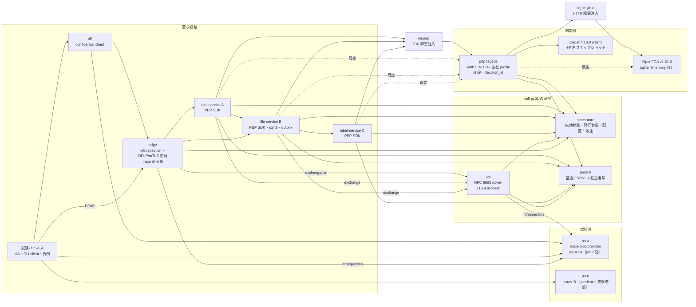

# 高保証 PoC 系統 1 — コード構成と再現手順

> 文書ID: POC-03 / 版: 0.2 / 状態: draft / 最終更新: 2026-10-15
> 改版: v0.2（模擬パネル ラウンド6 の対応）で、§2「モデル（CAM）」行に入力形式の注記を、§10.2 に暫定 P-15（cam.json の入力形式は CON-04 の `CamModule` と異なる）を加え、「他文書への申し送り」節と「レビュー記録」節を設けた。コードは変えていない。模擬パネルは AI による自己レビューで、実在の CTO/CISO の決裁ではない（CONVENTIONS §8）[D]。
> 対応成果物: DL-82（12_poc/code/README.md）。試験計画は POC-01（12_poc/preregistered-test-plan.md、凍結コミット 151940ac00dc64a89ac5a5cd148e42326e7c5e73）の §2・§3.1・§4 に従う。
> 依存文書: 05_adr/ADR-005, ADR-009, ADR-010, ADR-011, ADR-012, ADR-013, ADR-014, ADR-021, ADR-024, ADR-025, ADR-026／04_architecture/token-profile.md, claims-catalog.md, authorization-model.md, pep-contract.md, revocation-continuous-evaluation.md, fail-mode-matrix.md, root-of-trust.md／11_contracts/authorization-api.openapi.yaml, token-exchange.openapi.yaml, relationship-model-registry.openapi.yaml, schemas/access-token-claims.schema.json, schemas/audit-event.schema.json, mock-contract-test-kit.md
> 作成方法: AI エージェント（Claude）が上記を読み、系統 1 の全 TC（TC-001〜TC-028）が使う部品を洗い出して実装した。本書と本コードは自己レビューであり、実在の CTO/CISO・独立立会人の確認を経ていない（CONVENTIONS §8）[D]。

## 要旨

1. 系統 1 の基盤（AS 2 issuer、STS／TTS、PDP façade と 2 エンジン、PEP SDK、参照サービス 3 つ、edge・BFF、監査ジャーナルと再構成器、合成データ生成器、障害注入プロキシ、試験ハーネス）を Node 22 で実装した。Docker は使わない。外部ネットワークへの依存は `npm install` だけである。
2. smoke test（ログイン→token exchange→PDP→file 読取り、および A→B→C の 3 サービス連鎖と監査からの再構成）は OpenFGA 構成・Cedar 構成の両方で成功した（§9）。これは §2.5 の「ハーネスの動作確認」であり、合否の算出ではない。生データは `12_poc/data/_prefreeze/smoke/` にある。
3. 3 つの評価器（OpenFGA v1.21.0、Cedar 4.13.0、Python の参照評価器）は、合成データ上の無作為な 1,507 件の R 段判定で全件一致した（自己試験、§8）。これも凍結前の開発用の確認で、TC-013・TC-021 の合否には使わない。
4. 合否基準・中止基準は一切変更していない。実装上、設計が未決の箇所に置いた暫定の決めと、設計・依頼との差は §10 に列挙した（事前登録からの逸脱は 0 件。依頼文との差が 1 件ある）。
5. PoC のモデル入力 `model/cam.json` と生成器 `model/generate.js` の入力形式は、契約 CON-04 v0.3.0 の `CamModule` と異なる（§10.2 P-15）。暫定ローカル結合環境（INT-00 §6.3）として本コードを使う場合も、モデルは INT-03 付録 A と CON-04 の `CamModule` に従って書き、JSON Schema で検証する [M][D]。

---

## 1. 構成



- 1 回の起動が 1 cell（`cell_id`=`pc01`、trust domain `poc.test`、TTS の trust-domain 値 `td-c1`）に当たる [D]。部品はすべて別プロセスで、各 TC が自分で起動・停止する。
- 部品間の通信は、AS・edge・BFF への外部経路を除き、実行時に生成した X.509-SVID 相当の証明書（URI SAN `spiffe://poc.test/w/<name>`）による mTLS である（ADR-009 N-a、token-exchange.openapi.yaml の `svidMtls`、authorization-api.openapi.yaml の `workloadMtls`）。sandbox 役の別 trust domain `sandbox.test` の CA と証明書も生成する（TC-025 用）。
- 識別子（issuer、aud）は論理名で、実体は `127.0.0.1:<port>` に置く。検証側は issuer ごとに JWKS の URL を設定で固定する（ADR-005 V3）。

## 2. 部品と設計文書の対応

| 部品 | ファイル | 実装した内容 | 正本（設計） |
|---|---|---|---|
| AS（2 issuer） | `as/server.js` | node-oidc-provider 9.12.2。PKCE（S256、全 client 必須）、PAR（BFF は必須）、private_key_jwt（共有 secret なし）、DPoP（nonce 必須、public client）、RFC 8705 証明書束縛（BFF）、resource indicators（API 1 つ）、opaque access token＋introspection（edge・STS だけに許可）、RFC 9207 の `iss`、refresh（confidential は rotation なし、public は rotation）、device flow 有効、合成ログイン（`POST /interaction/:uid/login {sub, tid, amr}`）、管理 API（利用者停止、grant 失効） | ADR-005 D1〜D5、token-profile.md、NA-POC-2 |
| STS | `sts/server.js` `POST /token` | RFC 8693。mTLS の SVID だけで client 認証、判定順 R01〜R10（ARC-04 §5.2）、resource ちょうど 1 つ、audience・actor_token 拒否、交換登録簿、scope ⊆ subject∩上限、`act` の入れ子・深さ N_act=3・循環拒否、失効状態、出力 `typ: at+jwt`・`aud`=resource・`cnf.x5t#S256`=要求元 SVID・`exp`≤入力と SVID の残存。理由コードは発行台帳だけに記録 | token-exchange.openapi.yaml、ADR-009 D09-10〜D09-17・D09-40、ADR-005 D1-4 |
| TTS | `sts/server.js` `POST /txn-token` | Transaction Token（txn-v1）。`typ: txntoken+jwt`、`aud`=trust-domain 値、`txn`・`sub`・`scope`（台帳の操作 ID）・`req_wl`・`tctx{tid, root_jti, gref, sid, tier, ver}`。同期は edge だけ・subject_token の `cnf`=要求元（T04）。内部開始（`internal-start-ref`）の受付記録 API も置いた。T01〜T08 | token-exchange.openapi.yaml、ADR-009 D09-22〜D09-32、claims-catalog §3.5・§4.2 |
| 鍵 | `lib/keys.js` | 発行者ごとの ES256 鍵（1 鍵 1 alg 1 種別）、事前公開→切替→保持→撤去、retain 指定の削除阻止、緊急失効（kid を失効状態に配布）、alg 切替（ES256/ES384/PS256/EdDSA）。管理 API `POST /admin/keys/{at|txn}/{prepublish|activate|remove|emergency-revoke|retain}` | ADR-007、ADR-015 D15-71、root-of-trust.md |
| 内部 token 検証 | `lib/jwt.js` | V1〜V14 を既定動作として実装（呼出し側で外せない）: alg allowlist（検証側設定）、`none`・未署名拒否、`typ` 必須、`jku/x5u/x5c/jwk/cty` 拒否、未知 `crit` 拒否、iss 完全一致と issuer 固定の JWKS、未知 kid の取り直し（間隔制限）、失効 kid、鍵の cell と tid の収容 cell の一致、`aud` 単一、`exp`・未来方向の `iat/nbf` 許容 S=10 秒、契約スキーマ（`access-token-claims.schema.json`）の検証（未知 claim は無視、禁止 claim は拒否）、profile 版、`cnf` と提示者の一致 | ADR-005 D2 V1〜V14、ADR-021 D21-07、ADR-022 H-2 |
| PDP façade | `pdp/facade.js`、`pdp/guardrails.js` | AuthZEN 1.0 の `/.well-known/authzen-configuration`、`/access/v1/evaluation`、`/access/v1/evaluations`（3 つの semantic、privileged の `permit_on_first_permit` は 400）、`/access/v1/search/resource`（preview、`limit`≤100、主体・テナントに束縛した MAC 付き page token、`total` なし、打切りは `incomplete`）。自社 profile（`decision_id`、`model_revision`＋G 段カタログ版、`consistency`、閉じた `reason`、X-Request-ID の echo、`unsupported_profile`）。G 段（規則 1・2・3・4・6）を engine の前に評価。engine 不達は `deny_unavailable`、評価不能は `deny_indeterminate`。関係書込 API（X-8 の書込宣言、テナント越えの書込拒否、`idempotency_key`、consistency token 発行）、モデル登録・テナント pin・現行版切替、判定記録（E1）と生データ `pdp/decisions.jsonl`。誤応答の模擬（`POC_FAULT_ADMIN=1` のときだけ `/admin/fault`） | authorization-api.openapi.yaml、relationship-model-registry.openapi.yaml、ADR-010 D-28、ADR-011 D1〜D6、ADR-025 |
| エンジン切替 | `pdp/adapters/openfga.js`、`pdp/adapters/cedar.js` | 環境変数 `PDP_ENGINE=openfga|cedar`（既定 openfga）。OpenFGA は HTTP API（Check の consistency は `minimize_latency`→MINIMIZE_LATENCY、それ以外→HIGHER_CONSISTENCY）。Cedar は CAM から生成した policy と schema を事前 parse し、PIP スナップショット（tuple の op ログ）から要求ごとに最小の entity slice を作って評価。`errors` が空でなければ評価不能 | ADR-011 D2-8・D3-3、NA-POC-4、test plan §3.1 |
| モデル（CAM） | `model/cam.json`、`model/cam.js`、`model/generate.js`、`model/out/` | `core/tenant`・`core/unit`（`parent` 単一、深さ 5）・`core/admin_scope`・`core/group`（入れ子 3）・`core/role`・`core/external_grant`（`c.not_expired`）・`files/folder`・`files/file`・`proj/project`（`parent`＋`ancestor` 閉包）・`proj/tool_instance`。CAM から OpenFGA モデル（JSON と DSL）と Cedar の policy・schema を生成し、Cedar は strict 検証に通す。**入力の `cam.json` は PoC 限りの形で、CON-04 の `CamModule` に適合しない（§10.2 P-15）。各型（`types[]`）の形は `CamType` に適合する。連携チームはこのファイルをモデルの雛形にしない** | authorization-model.md §3.1・§3.6（RS-18 反映）・§8.2〜§8.4・§8.6、ADR-011 D2 |
| OpenFGA 起動 | `harness/stack.js`（`openfga` 起動部） | `12_poc/tools/openfga/openfga.exe run`。datastore は sqlite（`openfga migrate` を先に実行）が既定、`openfgaDatastore:'memory'` で memory。Check cache 等の追加フラグは `openfgaFlags` で渡す | test plan §3.1 |
| PEP SDK | `pep/sdk.js` | OB-01〜OB-15: 台帳にない entry point は 404、V1〜V14（`lib/jwt.js`）、失効状態と M_rev、privileged の jti 発行台帳照合、write 以上の Txn-Token 必須と `tctx.tid`・`sub` の照合、L0 三者一致（token tid・署名付き route（`tctx`）・資源の正本から引いた tid。path の tid は判定の入力にせず、不一致なら拒否）、AuthZEN 呼出し（X-Request-ID 採番と echo 照合、metadata の `policy_decision_point` 照合、`decision_id` 欠落・`deny_unavailable` 等は「判定が得られない」）、OB-10 の応答写像（資源単位の拒否と不存在は同じ 404、判定不能は 503、認証強度不足は 401＋`insufficient_user_authentication`）、E2 適用記録（privileged は同期確認、監査停止時は spool 上限で拒否）、sampling 非依存の計数、下流呼出し（hop ごとの再 exchange、Txn-Token・traceparent を無改変で伝播）、一覧ヘルパ（search＋`execute_all` の後段 Check、失敗時は空一覧を返さない）。fail-open・照合省略の引数は持たない | pep-contract.md §3〜§4、ADR-012、ADR-013 D13-23〜D13-25、ADR-025 |
| file-service（B） | `services/file-service.js` | 正本は node:sqlite。read・write（mass assignment 拒否）・delete・create（CREATE_CHILD）・share（内部・外部付与）・move（旧親の同期削除→新親の outbox）・署名付き URL（対象・テナント・操作・期限に束縛）・folder 一覧（L2＋後段 Check）・検索（façade search＋後段 Check）。関係の更新は transactional outbox で順序と冪等性を保ち、consistency token を内容と同じ行に保存。障害の模擬 `POST /admin/fault`（配送遅延・二重配送・commit 直後の停止・配送停止） | authorization-model.md §9.2・§11、CL-0157、ADR-012、ADR-025 |
| tool-service（A） | `services/tool-service.js` | view・run（write、file-service を呼ぶ A→B）・config（privileged/T） | claims-catalog §2.4 |
| label-service（C） | `services/label-service.js` | ファイルの分類ラベル。file-service が `?labels=1` で呼ぶ（B→C）。tool.run（`with_labels`）で A→B→C の 3 サービス連鎖になる | test plan §3.1「A→B→C の 3 hop」 |
| edge | `services/edge.js` | 台帳外 route は 404、query の token 拒否、introspection（cache 齢 ≤ exp、既定は cache なし）、`cnf.jkt` なら DPoP proof（nonce 必須、jti 再送拒否、`ath`、`htm/htu`）、`cnf.x5t#S256` ならクライアント証明書、DPoP 束縛 token の Bearer 提示は拒否、送信者束縛のない token は拒否、route の tid と token の tid の照合、失効状態、trace の再採番（外部値は `ext_trace_id` として記録のみ）、STS exchange、write 以上は Txn-Token、未署名ヘッダを渡さない | ADR-005 D1-2〜D1-5・D5・D9-2、pep-contract OB-01 |
| BFF | `services/bff.js` | confidential client（private_key_jwt、PAR、PKCE、証明書束縛 token）、`state` と RFC 9207 `iss` の照合（issuer A・B の両方と対話できる。mix-up 試験用）、server-side session、`/api/*` を edge へ転送 | ADR-005 D1-7、P-01 |
| 状態ストア | `state/server.js` | 失効状態（範囲 sub/sid/gref/client/tid/cell/kid/jti_ref × 失効時刻、epoch）、テナント・主体の停止、freeze、テナント→cell 配置、発行台帳（jti_ref） | ADR-006 D6-06・D6-08、ADR-005 D1-6、ADR-021 D21-07 |
| 失効状態の受信 | `lib/revocation.js` | 既定 200 ms 間隔で取得。最後の同期からの齢が M_rev（既定 5 s。PoC の構成値）を超えたら read-sensitive 以上は判定不能 | ADR-006、revocation-continuous-evaluation.md |
| 監査 producer | `lib/audit.js` | `audit-event.schema.json` 準拠の記録、producer 連鎖（`producer_seq`＋`prev_fp`）、ジャーナル不達時の spool（階層別上限 Q_r・Q_w、privileged は同期確認必須）、再送、producer 側の発行ログ（欠落・切捨ての検出用） | ADR-014 D14-02・D14-21・D14-23・D14-29、ADR-013 D13-25 |
| 監査ジャーナル | `audit/journal.js` | mTLS、登録済み producer かつ自分の `producer_id` の記録だけ受理（DV-9）、スキーマ検証（不合格は隔離して計数）、append-only JSONL と独立複写、停止の模擬 `POST /admin/outage` | ADR-014 |
| 検証・再構成 | `audit/verify.js` | C1 producer 連鎖、C2 producer 発行ログとの突合、C3 独立複写の一致、C4 スキーマ不合格 0、R1 E1↔E2（decision_id・request_id）、R2 jti_ref の系譜（STS 発行記録の `input_token` を遡る）、R3 `txn` ごとの連鎖と TTS 発行記録（`root_jti_ref`）、R4 read-sensitive の 3 つ組。trace_id は索引だけに使う | claims-catalog §2.5 VP-3〜VP-8、ADR-014 D14-19 |
| 合成データ | `data/gen-synthetic.js` | 規模段（L・M・S、NA-POC-3）、unit 木（深さ ≤5）、入れ子グループ（≤3）、複数所属、フォルダ（深さ ≤5）とファイル、プロジェクト（`ancestor` 閉包）、ツール、越境ゲスト（期限内と期限切れ）、一覧用の大フォルダ（`--large-files N`）。ID はすべて `syn` 接頭辞（C-1 の機械検出、`nonSyntheticIds()`） | test plan §2.9、DEC-4 |
| 参照評価器 | `ref/ref_eval.py` | CAM の意味論の素朴な実装（Python、標準ライブラリだけ）。期待値の生成に使う | test plan §3.1 |
| 障害注入 | `inject/proxy.js` | TCP モード（pass・delay・blackhole・reset。mTLS 経路にも使える）、HTTP モード（加えて status・allow_all・deny_all・本文の差替え。façade→OpenFGA 経路用）。制御は `<secrets>/inject-<name>.json` を 50 ms ごとに読み、適用時刻を `inject/<name>.jsonl` に記録。故障の切替時に既存の接続を切る | fail-mode-matrix FM-01・FM-02・FM-13 |
| ハーネス | `harness/stack.js`、`harness/proc.js`、`harness/run.js`、`harness/forge.js` | TC のポート区画で全部品を起動・停止・kill・再起動、データ投入、BFF 経由ログイン・DPoP CLI ログイン、失効・停止・注入・façade 誤応答・監査停止・鍵操作の補助、実行ディレクトリ（`run.json`・`env.json`・`SHA256SUMS`）、負例用の token 偽造（試験専用） | test plan §2.5・§2.9 |

## 3. ディレクトリ

```
12_poc/code/
  as/ sts/ pdp/(facade, guardrails, adapters/) pep/ services/(edge, bff, tool-, file-, label-service)
  state/ audit/(journal, verify) inject/ model/(cam.json, cam.js, generate.js, out/) data/ ref/
  harness/(stack, proc, run, forge) smoke/ test/ config/(ports.js, ledger.json) lib/
  .run/            実行時の秘密（PKI 秘密鍵、署名鍵、HMAC 鍵、OpenFGA の sqlite）。git 管理外（.gitignore）
12_poc/data/
  _prefreeze/<TC-ID|smoke>/<run-id>/   凍結前の実行（合否に使わない）
  <TC-ID>/<run-id>/                    凍結後の測定（Run({frozen:true}) で作る）
```

- 秘密鍵・HMAC 鍵は実行ごとに生成し `12_poc/code/.run/<tc>-<run-id>/` にだけ置く。`.gitignore` に `12_poc/code/.run/` と `*.key.pem` を追加した。生データ（`12_poc/data/`）には token の全文・秘密を書かない（ADR-005 V11）。
- `config/ledger.json` は entry point 台帳（pep-contract §6.1）で、PEP・edge・TTS が同じ版を読む。exchange 登録簿と TTS 発行方針も同じファイルにある。

## 4. 前提と起動

| 項目 | 値（本書作成時の確認） |
|---|---|
| OS | Windows 11（Docker 不使用） |
| Node | v22.23.2（`engines` は ≥22.13。`node:sqlite` を使う） |
| Python | 3.14.6（参照評価器。標準ライブラリだけ） |
| OpenFGA | `12_poc/tools/openfga/openfga.exe` v1.21.0（build ab557c5）。git 管理外 |
| npm パッケージ | oidc-provider 9.12.2、@cedar-policy/cedar-wasm 4.13.0、jose 6.2.12、ajv 8.17.1、ajv-formats 3.0.1、fast-check 4.10.0、node-forge 1.4.0、yaml 2.8.4、@openfga/syntax-transformer 0.2.2（版は `package.json` で固定） |

```bash
cd 12_poc/code
npm ci                      # 外部ネットワークへの依存はここだけ
npm run gen-model           # CAM -> model/out/（OpenFGA JSON・DSL、Cedar policy・schema、manifest）
npm run selftest            # 3 評価器の一致（自己試験、ポート 42580〜）
npm run smoke               # smoke（OpenFGA 構成と Cedar 構成）
node audit/verify.js --run <run-dir>   # 任意の実行の監査検証と再構成
```

試験からの使い方（例）:

```js
import { Run } from '../harness/run.js';
import { startStack } from '../harness/stack.js';
const run = new Run({ tc: 'TC-004', seed: 1 });            // 凍結後は { frozen: true, manifestHash }
const s = await startStack({ tc: 'TC-004', run, engine: 'openfga', profile: 'small', seed: 1 });
const u = await s.login({ sub, tid, amr: 'pwd,otp' });      // BFF 経由（cert-bound opaque AT）
const r = await u.call('GET', `/t/${tid}/files/${id}`);
const c = await s.loginCli({ sub, tid });                   // public client＋DPoP
await s.revoke('sub', sub); await s.setStatus('tenant', tid, 'suspended');
s.inject('inj-pep', { mode: 'blackhole' });                 // startStack({ injectPep: true }) のとき
await s.facadeFault({ mode: 'allow_all' });                 // startStack({ faultAdmin: true }) のとき
await s.stop(); run.finish('completed');
```

`startStack` の主な引数: `engine`（`openfga`/`cedar`）、`profile`（`smoke`/`small`/`medium`）・`seed`・`datasetOpts`、`settings`（寿命・M_rev・S・N_act・`txnForAll`・`edgeIntrospectionCacheMs`・`signedUrlTtlSec`・`verifierAlgs`・`stsAlgs` 等）、`openfgaDatastore`、`openfgaFlags`（例 `['--check-query-cache-enabled','--check-query-cache-ttl','2s']`）、`injectPep`、`injectEngine`、`faultAdmin`、`components`、`env`。

## 5. ポート表

各 TC は 20 ポートの区画を固定で持つ（`config/ports.js`）。区画内の割当（オフセット）は全 TC で共通である。区画はビルドホストで確認した Windows の除外ポート範囲（47001、49791〜50359、58039〜58726）を避けた。

| オフセット | 部品 | 方式 |
|---|---|---|
| +0 | as-a（issuer A） | HTTPS（クライアント証明書は任意） |
| +1 | as-b（issuer B） | HTTPS |
| +2 | sts（/token、/txn-token、/jwks、/tts/jwks） | HTTPS mTLS |
| +3 | pdp façade | HTTPS mTLS |
| +4 | OpenFGA HTTP | HTTP（loopback のみ） |
| +5 | OpenFGA gRPC | loopback（未使用） |
| +6 | state-store | HTTPS mTLS |
| +7 | journal | HTTPS mTLS |
| +8 | edge | HTTPS（クライアント証明書は任意） |
| +9 | bff | HTTPS |
| +10 | tool-service（A） | HTTPS mTLS |
| +11 | file-service（B） | HTTPS mTLS |
| +12 | inj-pep（PEP→façade 障害注入） | TCP |
| +13 | inj-engine（façade→OpenFGA 障害注入） | HTTP |
| +14 | 予約: 上流 IdP 役 1（TC-019） | — |
| +15 | 予約: 上流 IdP 役 2（TC-019） | — |
| +16 | 予約: SCIM 受信モック（TC-019） | — |
| +17 | label-service（C） | HTTPS mTLS |
| +18 | 予備 | — |
| +19 | ハーネス用 | — |

| 区画 | ポート |
|---|---|
| smoke | 42000〜42019 |
| TC-001 | 42020〜42039 |
| TC-002 | 42040〜42059 |
| TC-003 | 42060〜42079 |
| TC-004 | 42080〜42099 |
| TC-005 | 42100〜42119 |
| TC-006 | 42120〜42139 |
| TC-007 | 42140〜42159 |
| TC-008 | 42160〜42179 |
| TC-009 | 42180〜42199 |
| TC-010 | 42200〜42219 |
| TC-011 | 42220〜42239 |
| TC-012 | 42240〜42259 |
| TC-013 | 42260〜42279 |
| TC-014 | 42280〜42299 |
| TC-015 | 42300〜42319 |
| TC-016 | 42320〜42339 |
| TC-017 | 42340〜42359 |
| TC-018 | 42360〜42379 |
| TC-019 | 42380〜42399 |
| TC-020 | 42400〜42419 |
| TC-021 | 42420〜42439 |
| TC-022 | 42440〜42459 |
| TC-023 | 42460〜42479 |
| TC-024 | 42480〜42499 |
| TC-025 | 42500〜42519 |
| TC-026 | 42520〜42539 |
| TC-027 | 42540〜42559 |
| TC-028 | 42560〜42579 |
| selftest（`test/`） | 42580〜42599 |

- 同じ TC の 2 つの構成（例: TC-013 の OpenFGA 構成と Cedar 構成）を同時に動かす場合は、`startStack({ portBase })` で未使用の区画（42600 以降の 20 刻み）を明示し、その割当を TC の `run.json` に残す。

## 6. 生データ（§2.9 との対応）

| §2.9 のファイル | 本コードでの所在（実行ディレクトリ配下） |
|---|---|
| run.json・env.json・SHA256SUMS | `harness/run.js` が作る。`env.json` に OS、Node・Python、パッケージ版、OpenFGA のハッシュと版、`w32tm /query /status` の出力（時刻同期の状態）を入れる |
| inject.jsonl | `inject/<proxy>.jsonl`（注入の適用時刻）。試験側の注入記録は TC が `run.append('inject.jsonl', …)` で書く |
| requests.jsonl | TC が書く。参考として `edge/edge-requests.jsonl`（edge の全要求）と `pep/<svc>-enforce.jsonl`（PEP の全判定適用、token・L0 拒否を含む） |
| decisions.jsonl | `pdp/decisions.jsonl`（façade の全判定。decision_id、request_id、model_revision、実効 consistency、reason、G 段規則、遅延） |
| audit.jsonl | `audit/journal.jsonl`（ジャーナル原本）、`audit-copy/journal.jsonl`（独立複写）、`audit/journal-invalid.jsonl`（隔離）、`audit-producers/`（producer の連番状態・発行ログ・spool） |
| eval.json | TC の評価器が書く。`audit/verify.js` の出力は `audit-verify.json` |
| その他 | `sts/issuance-ledger.jsonl`（R01〜R10・T01〜T08 を含む発行台帳）、`state-changes.jsonl`（失効・停止の注入時刻）、`as-a/as-events.jsonl`、`bff/bff-events.jsonl`、`file-service/files.sqlite`、`logs/<component>.log`、`dataset.json`（合成データ） |

## 7. 試験群ごとの入口（利用側の目安）

| TC | 使う部品・フック |
|---|---|
| TC-001 | `inject/proxy.js` の `delay`、`harness/run.js` の `stamp()`、`env.json` の時刻同期 |
| TC-002・TC-021 | `data/gen-synthetic.js`、`ref/ref_eval.py`、`s.writeTuples`、両エンジン、fast-check。全域 permit の誤モデルは `POST /v1/models`＋pin |
| TC-003 | file-service の mass assignment・過剰返却の検査点、`config/ledger.json`（operation 台帳） |
| TC-004・TC-006・TC-025 | `harness/forge.js`（STS・TTS 鍵での任意署名、外部鍵、`alg:none`）、STS の負例（R01〜R10・T01〜T08）、sandbox CA、as-b |
| TC-005・TC-007 | BFF の `/login?as=b`、`lib/oauth-client.js`（PAR・PKCE・DPoP・`checkIssuer`）、`s.loginCli`（DPoP 鍵差替え・refresh） |
| TC-008・TC-009 | `openfgaFlags`（Check cache）、consistency token（file の `ctoken` 列）、file-service の outbox 障害、`s.revoke` |
| TC-010・TC-011 | `injectPep`・`injectEngine`、`faultAdmin`（allow_all・deny_all・stale_revision・drop_decision_id・wrong_request_id・metadata_mixup・delay・unavailable、Cedar の `dropAttr`・`dropEntityPrefix`・`noSchema`）、`s.journalOutage`、`auditLimits` |
| TC-012・TC-013 | `POST /v1/models`、`PUT /v1/tenants/{tid}/model-pin`、`POST /v1/models/current`、`PDP_ENGINE` |
| TC-014・TC-015 | `s.keys('at'|'txn', op, body)`、`settings.verifierAlgs`・`stsAlgs`、JWKS cache（`PEP_JWKS_TTL_MS`） |
| TC-016 | `audit/verify.js`、tool.run（`with_labels`）の A→B→C、`s.journalOutage`、ジャーナルの改変（運用者権限の模擬はファイル直接編集） |
| TC-017 | 全部品の生ログ、`pdp/decisions.jsonl` の `latency_us` |
| TC-018〜TC-020 | AS 管理 API（`/admin/user-status`、`/admin/revoke-grant`）、`s.setStatus`、合成ログインの `amr`→`acr` |
| TC-022・TC-023・TC-028 | tool.config（privileged/T）、TTS の内部開始（`/acceptance`＋`internal-start-ref`）、file の share・move・一覧 |
| TC-024 | 署名付き URL（`settings.signedUrlTtlSec`）、AS の device flow |
| TC-026・TC-027 | 契約スキーマ（`lib/jwt.js` の `claimValidators()`）、façade search（page token・打切り）、`--large-files` |

TC-019 の上流 IdP 役・SCIM 受信モック、TC-023 のジョブ基盤、TC-026 の CI ガードは、本書の基盤に含めていない（ポート +14〜+16 を予約した）。各試験群で実装する。

## 8. 自己試験（凍結前、合否に使わない）

`npm run selftest` は OpenFGA（sqlite ではなく memory）、Cedar、Python 参照評価器に同じ合成データ（seed 7、`small`）を入れ、無作為の 1,500 件と全越境ゲストの照会を比べる [M]（本書作成時の実行。2026-10-15、2 回実行し、いずれも 1,507 件中 allow 759〜760 件、不一致 0 件）。これは基盤の実装確認であり、TC-013・TC-021 の試行回数・分布・評価器は凍結時に別に定める。

## 9. smoke test の結果（凍結前、§2.5 の動作確認）

| 実行 | 構成 | 結果 |
|---|---|---|
| `12_poc/data/_prefreeze/smoke/20261015T020235Z-10771b` | OpenFGA（sqlite） | 全段階 OK |
| `12_poc/data/_prefreeze/smoke/20261015T020245Z-c7aeaf` | Cedar | 全段階 OK |

確かめた段階（両構成とも）[M]:

1. BFF 経由のログイン（PAR＋PKCE＋private_key_jwt、BFF の SVID に束縛した opaque access token、RFC 9207 の `iss` 照合）
2. file 読取り: edge（introspection、mTLS 束縛の照合、trace 再採番）→ STS exchange（`typ: at+jwt`、`aud`=file-service、`cnf`=edge の SVID）→ file-service の PEP（V1〜V14、L0）→ façade（G 段＋engine、decision_id）→ 200
3. 他テナントの利用者による同じ file の読取りは 404（edge の route 照合、PEP の L0）
4. tool.run の A→B→C（edge → tool-service → file-service → label-service）。hop ごとに STS で取り直し、`act` は 0→1→2 段、Txn-Token（`tier: write`）と traceparent は無改変で伝播
5. public CLI client（DPoP、nonce の再試行）による読取り
6. 監査: 17 件、スキーマ不合格 0、producer 連鎖・複写・発行ログの突合で指摘 0、E1↔E2 の欠落 0、jti_ref の系譜の断絶 0、`txn` 1 件が 3 hop（`use`@tool_instance、`read`@file（file-service）、`read`@file（label-service））として監査だけから再構成でき、全 hop の系譜が TTS 発行記録の `root_jti_ref` に届く

このほかの凍結前の実行（開発中の不具合で失敗した smoke 12 件、実装途中の版で成功した smoke 4 件、障害注入・再起動の配線確認 4 件。計 20 件）も削除せず `_prefreeze/smoke/` に残した（§2.4・§2.8 の「中止した実行も残す」に合わせた扱い）。後者で、PEP→façade の遮断・engine の 500・`decision_id` 欠落は 503、監査停止中の privileged は 503、read-sensitive は spool で継続、認証強度不足は 401、失効後は 401、PDP・OpenFGA の再起動後は復帰することを見た。いずれも合否の算出ではない。

## 10. PoC で置いた実装上の決めと、設計・依頼との差

事前登録（POC-01）の合否基準・中止基準・手順は変更していない。以下は実装の決めであり、凍結パッケージ（§2.2 F-3）に含めて開示する対象である。

### 10.1 依頼文との差（1 件）

| # | 依頼 | 実装 | 理由 |
|---|---|---|---|
| D-1 | Transaction Token に `rctx`・`purp` を入れる | 入れない。`txn`・`sub`・`scope`・`req_wl`・`tctx` だけを発行し、`request_context`・`request_details` は受け取っても使わない | 契約 token-exchange.openapi.yaml（CON-05）と access-token-claims.schema.json の `txnTokenClaims` が `rctx`・`purp` を禁止（`not: {}`）し、ADR-009 D09-30（txn-v1 は rctx を発行しない）・D09-31（`purp` は使わない、`scope` に一本化）と claims-catalog §3.5 も同じである。正本に従った |

### 10.2 設計が未決の箇所に置いた暫定（PoC 限り）

| # | 論点（未決の所在） | PoC の暫定 |
|---|---|---|
| P-1 | 監査 fingerprint の正準化（audit-event schema Integrity、DL-77） | キー整列・空白なしの JSON（RFC 8785 相当の範囲）。`received_time`・`record_stage`・`tenant_seq`・`integrity.seal` を除いた producer 側の値の SHA-256 |
| P-2 | L0・token 検証の拒否を監査でどう表すか（ADR-012 L-05、pep-contract §3.7） | `audit-event` の enforcement は `decision_id` 必須のため、PDP 判定のない拒否は PEP のローカル記録（`pep/<svc>-enforce.jsonl`、内部理由 `deny_token`・`deny_l0:*`）にだけ残す |
| P-3 | 判定記録（E1）の `iss`・`jti_ref` の運び方（AuthZEN 契約に欄がない） | PEP が `context["x-authz-corr"]`（契約外の拡張）で渡す。欠けた要求は E1 を作らず生データだけ残す |
| P-4 | OpenFGA の read-sensitive の窓方式 W（U-03） | ADR-011 D6-3 の「常時格上げ」: token 付き・`at_least_as_fresh` は HIGHER_CONSISTENCY。token なしの read-sensitive は MINIMIZE_LATENCY |
| P-5 | read-sensitive の fail-static（KD13-6） | 決裁前の扱い（L06-9）どおり known-good cache を持たず、判定が得られなければ 503 |
| P-6 | G 段規則 5（接続元・端末） | テナント設定の配布がないため未実装。規則 1〜4・6 だけを評価する |
| P-7 | 配置スナップショット・失効状態配布の署名（ADR-021 D21-07、ADR-006） | state-store から mTLS で取得するが署名はしない |
| P-8 | 内部開始の Txn-Token（ADR-026 L26-1、X74-01） | 受付記録への不透明参照（`acc_*`）を STS が保持し、`tctx.root_jti` は受付時の jti を入れる案で実装（未使用の入口） |
| P-9 | Cedar への写像（NA-POC-4、ADR-011 D2-8） | userset を `cam::rel` entity の階層で表し、条件付き tuple の条件（`c.not_expired`）は adapter の条件カタログで評価して slice に含めるかを決める。OpenFGA は条件をエンジン内で評価する。この差は TC-013 の判定差の原因分類で扱う |
| P-10 | CAM の relation と permission（relationship-model-registry の `CamRelation` は式を持たない） | §8 の `editor: [...] | owner | parent->editor` を、直接付与の relation と計算 permission（`editors`・`viewers`・`members`）に分けた。判定の意味は変えない |
| P-11 | session ID（`sid`）の出所 | node-oidc-provider が OIDC `sid` を発行しない場合は `sessionUid` を鍵付き HMAC で不透明 ID に写す（`psid`）。grant 参照 `gref` も同じ写像 |
| P-12 | 識別子の形式 | issuer は `https://as-a.poc.test` などの論理名、実体は 127.0.0.1 の各ポート。`cell_id` は `pc01`（スキーマの 4〜16 文字に合わせた） |
| P-13 | 外部 opaque token の形式（ADR-005 D2「版・種別・経路識別子の接頭辞」） | node-oidc-provider の既定形式のまま（AS 製品の機能に依存。NA-POC-2 により AS 製品の適否は判定しない） |
| P-14 | STS の hop の subject_token の `cnf` | hop では subject_token は直前の提示者（edge 等）に束縛されているので、STS は `cnf` を要求元と照合せず `aud`＝要求元（W55-15）で結合を確かめる。TTS の同期発行は `cnf`＝要求元（T04）を照合する |
| P-15 | CAM の入力形式（CON-04 v0.3.0 の `CamModule` は「1 名前空間分」で、提出は `ModelChangeRequest.modules[]` の `namespace_code`＋`content` の組。INT-03 §15.1 の差 D-1〜D-3、§15.3 G-7） | `cam.json` は次の 3 点で `CamModule` と異なる。D-1: 最上位に `$comment`・`cam_version`・`guardrail_catalog_version`・`conditions` を持つ（`CamModule` は `types`・`write_declarations` だけ、`additionalProperties: false`。条件の定義は `ConditionCatalog`、版は `ModelRevisionId` が正本）。D-2: 書込宣言を `{writer, types}`（4 件。書き手は論理名、対象は型単位と `*`）で書く（`WriteDeclaration` は `{workload（URI）, relations（<型>#<relation>）}` が必須）。D-3: `core`・`files`・`proj` の 3 名前空間を 1 ファイルに束ね、基盤予約の `core` の型も含む（スキーマでは検出されない意味の差）。CON-04 v0.3.0 の `CamModule` の JSON Schema で検証すると、Python jsonschema の数え方で誤り 13 件（D-1 が 1 件、D-2 が 4 件×3。INT-03 §15.1 の記録）、ajv の数え方（余計な欄を 1 欄ずつ数える）で 20 件（D-1 が 4 件、D-2 が 16 件）。`types[]` の部分の誤りは 0 件 [M]（検証の方法はレビュー記録 R6-1）。生成器（`model/cam.js`・`generate.js`）はこの形を読み、`cam_revision` は `types` と `conditions` の正準化 JSON の SHA-256 から作る。**この形はモデルの雛形にしない**。連携チームのモデルは INT-03 付録 A と CON-04 の `CamModule` に従って書き、JSON Schema で検証する。PoC 側を契約の形に揃える案（INT-03 G-7 の (a)）は未実施で、凍結済みの試験の再実行前に扱いを決める（INT-03 §16.3 HO-R5-1、§14 残課題 21） |

### 10.3 基盤に含めていないもの（各試験群で実装）

- TC-019 の上流 IdP 役（OIDC モック 2 種）と SCIM 受信モック、TC-023 のファイルベースのジョブキューと consumer、TC-026 の CI ガードと違反 PR の投入、TC-020 の回復・認証器の参照実装、TC-022 の JIT 昇格・承認の参照実装、TC-028 の P-14（WebSocket）参照実装。
- PEP SDK の版 N・N−1・N−2 の並置（TC-006・TC-014）。現在は 1 版である。

## 11. 再現手順（独立立会人向け）

1. 凍結タグ（§2.2 F-4）を checkout し、`12_poc/tools/openfga/openfga.exe` の SHA-256 が manifest（`6868a2314e89099c2874ca382b607c78f50aa8551ddfa2fc05edff787738ce8c`）と一致することを確かめる。
2. `cd 12_poc/code && npm ci`（`package-lock.json` で固定）。
3. `npm run gen-model` を実行し、`model/out/manifest.json` の `cam_revision` と各生成物のハッシュが凍結 manifest と一致することを確かめる。
4. `npm run selftest` と `npm run smoke` で基盤の動作を確かめる（凍結前の確認と同じ。合否は算出しない）。
5. 各 TC を、凍結版のパラメータと `Run({ frozen: true, manifestHash })` で実行する。生データは `12_poc/data/<TC-ID>/<run-id>/`、`SHA256SUMS` で完全性を確かめる。
6. `node audit/verify.js --run <run-dir>` で監査の連鎖と再構成を独立に確かめる。

## 参考（実行環境で確認した外部ツールの事実）

- OpenFGA v1.21.0 は `/` を含む型名（`core/user` 等）を受け付け、条件の入力が欠けた Check に 400（`missing context parameters`）を返した [M]（本書作成時の手動確認）。sqlite datastore は `openfga migrate` の後に起動できた [M]。
- node-oidc-provider 9.12.2 は、PAR、DPoP（nonce 必須の設定）、RFC 9207 の `iss`（discovery の `authorization_response_iss_parameter_supported: true`）、RFC 8705 の証明書束縛、resource indicators、introspection を、本書の構成で smoke の経路に使えた [M]。device flow は有効にしたが smoke では使っていない。
- @cedar-policy/cedar-wasm 4.13.0 の `getCedarVersion()` は 4.13.0 を返し、生成した policy は生成した schema に対する strict 検証に通った [M]（`model/out/manifest.json`）。

## 他文書への申し送り

本対応では本書だけを編集した（並行作業のため）。次の改訂は各文書の所有者に申し送る [D]。

| # | 対象 | 申し送る内容 | 理由 |
|---|---|---|---|
| HO-P3-1 | 12_poc/code/model/cam.json（POC-03 の管理下、DL-82） | `$comment` の「形式は 11_contracts/relationship-model-registry.openapi.yaml の CamModule（…）に従う」を、「types[] の各型の形は CON-04 の CamType に従う。最上位の欄（cam_version・guardrail_catalog_version・conditions）、書込宣言の形（{writer, types}）、名前空間の束ね方は PoC 限りの形で、CamModule に適合しない（POC-03 §10.2 P-15）。モデルの雛形にしない」の趣旨に改める | 現行の `$comment` は検証結果（§10.2 P-15、R6-1）と合わない。`cam_revision` は `types` と `conditions` だけから作る（`model/cam.js` の `camRevision`）ので、`$comment` の変更は `cam_revision` を変えない。ただし cam.json のファイルハッシュは変わるので、凍結パッケージ（POC-01 §2.2 F-3・F-4）の作成前に行う [M][D] |
| HO-P3-2 | 10_integration/README.md（INT-00）§6.3「暫定ローカル結合環境の条件」の「依存してはならないもの」行 | 「POC-03 §10.2 の PoC 限りの暫定（P-1〜P-14）」を「（P-1〜P-15）」に改め、「PoC の cam.json・generate.js の入力形式（POC-03 §10.2 P-15。モデルは INT-03 付録 A と CON-04 の `CamModule` に従って書き、JSON Schema で検証する）」を加える | 現行の §6.3 は P-1〜P-14 だけを挙げ、CAM の形に触れていない。INT-03 §16.3 HO-R5-3 と同じ趣旨 |
| HO-P3-3 | 10_integration/authz-modeling-guide.md（INT-03）§16.3 HO-R5-2、§15.3 G-7 | HO-R5-2 の (1)・(3) は本書 v0.2 で反映済み、(2)（cam.json の `$comment`）は HO-P3-1 で申し送り中、と状態を更新する | 申し送りの閉じ方を追跡できるようにする |
| HO-P3-4 | traceability/mock-panel-report.md（模擬パネル報告）、POA&M | ラウンド6 の本指摘（devlead、High）の対応状態を「POC-03 は対応済み、cam.json・INT-00 は申し送り中」と記録する。PoC を CON-04 の形に揃える案 (a)（INT-03 HO-R5-1）の起票は INT-03 の申し送りのとおり | 本書の範囲では指摘の全体が閉じないため |

## レビュー記録

模擬パネルは AI による自己レビューであり、実在の CTO/CISO・独立立会人の決裁ではない（CONVENTIONS §8）[D]。

### ラウンド6

| # | 指摘（重大度・観点） | 対応 | 変更箇所 |
|---|---|---|---|
| R6-1 | High（devlead）: INT-00 版 0.2 §6.3 は、キット配布（G3）までの 12〜24 か月、12_poc/code を暫定ローカル結合環境として使ってよいとしている。しかし `model/cam.json` は `$comment` で「CamModule に従う」と書きながら、CON-04 v0.3.0 の `CamModule` のスキーマで検証すると誤り 13 件（最上位の `cam_version`・`conditions`・`guardrail_catalog_version`、`{writer, types}` の書込宣言、複数名前空間の束ね方）。INT-03 版 0.6 の G-7・HO-R5-2 が求めた §10.2 の暫定 P-15 が未反映で、INT-00 §6.3 も P-1〜P-14 だけを挙げる。柔軟なアクセス制御を自分で設計するチームが cam.json を雛形にして CON-04 に不適合なモデルを書くおそれがある | **対応（本書の担当分）**。(1) 指摘の事実を再検証した。CON-04（`11_contracts/relationship-model-registry.openapi.yaml`、`info.version` 0.3.0）の `components.schemas` を `yaml` 2.x で読み、`CamModule` を根に ajv（JSON Schema 2020-12、`allErrors`）で `model/cam.json` を検証した結果、誤り 20 件（最上位の余計な欄 4、`write_declarations[0..3]` の `workload`・`relations` の欠落 8 と余計な欄 `writer`・`types` 8）、`types[]` の誤りは 0 件だった。ajv は余計な欄を 1 欄ずつ数えるので、1 オブジェクト 1 件に数える Python jsonschema の 13 件（INT-03 §15.1 の記録）と内訳が一致する。`CamModule` の `additionalProperties: false`・`required: [types]`、`WriteDeclaration` の `required: [workload, relations]`、`CamModule` の説明「1 名前空間分」、`NamespaceCode` の「`core` は基盤の予約」も CON-04 の原文で確かめた [M]。(2) §10.2 に P-15 を加え、差 D-1〜D-3、件数、「モデルの雛形にしない」、連携チームの書き方（INT-03 付録 A と CON-04 `CamModule`、JSON Schema で検証）、案 (a) が未実施であることを書いた。(3) §2「モデル（CAM）」行と要旨 5 に同じ注記を加えた（INT-03 HO-R5-2 (3)）。(4) cam.json の `$comment` の修正（HO-P3-1）と INT-00 §6.3 の「依存してはならないもの」への追記（HO-P3-2）は、本書以外のファイルなので申し送った。コードと合否基準は変えていない | 冒頭の改版、要旨 5、§2、§10.2 P-15、他文書への申し送り HO-P3-1〜HO-P3-4 |

- 対応件数: 1 件（本書で対応、他文書の修正 2 点は申し送り）。
- 未解決: cam.json の `$comment`（HO-P3-1）と INT-00 §6.3（HO-P3-2）の改訂、PoC を CON-04 の形に揃える案 (a)（INT-03 HO-R5-1、残課題 21）。
