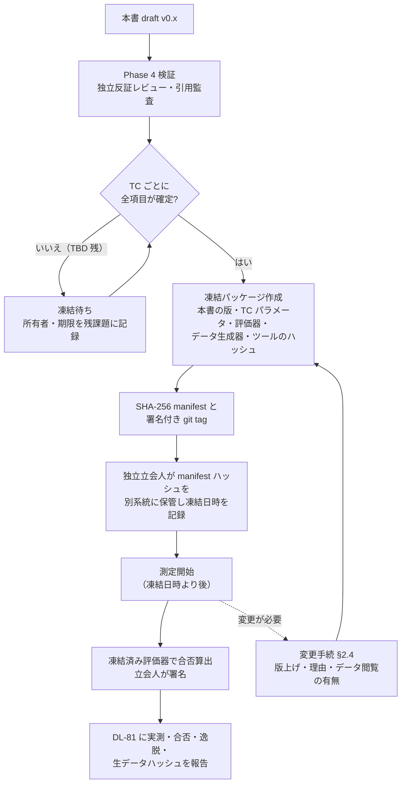
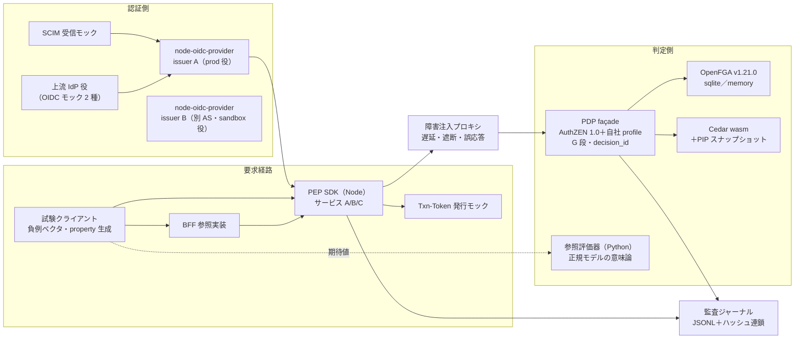
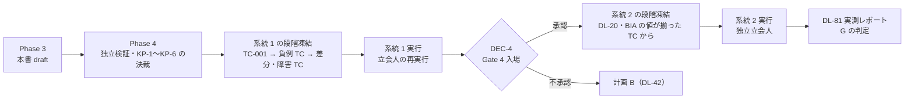

# 高保証 PoC 試験計画（事前登録）

> 文書ID: POC-01 / 版: 0.5 / 状態: draft / 最終更新: 2026-10-15
> 対応要求: R-032, R-034〜R-041, R-044, R-045, R-050〜R-054, R-071, R-078, R-080〜R-083, R-089, R-091, R-097, R-104, R-126, R-143〜R-146, R-148, R-150, R-152, R-156, R-168〜R-176, R-188.1, R-188.2, R-190.1, R-190.2, R-192.4, R-194.3, R-205, R-206, R-220, R-231, R-242, R-260, R-261, R-271, R-279, R-280, R-283（R-requirements.md で本書のパスを対応成果物に含む全 61 行）／G-009, G-056, G-059, G-066, G-081, G-086, G-088, G-092, G-103, G-108, G-117, G-123, G-136, G-141, G-146, G-147（G-goal-criteria.md で本書のパスまたは DL-22 を対応成果物に含む全 16 行）。関連: R-147, R-149, R-154, R-155（deliverables.md の DL-22 行のみに載る行）、G-142, G-144, G-149, G-150（G-goal-criteria.md §8 の DL-22 への申し送り）、R-058, R-059, R-061, R-062, R-269 と G-082（承認条件 4 とその構成要素。R-requirements.md・G-goal-criteria.md の対応成果物に本書は載っていないが、検証手段は TC-121 である。版 0.3 で追加）、R-042, G-003, G-061, G-062, G-078（ラウンド 5 で各正本に追加された検証の事前登録先。TC-029・TC-132・TC-133 と §6.6。版 0.5 で追加）。全件と閉じ方は末尾の対応表
> 依存文書: CONVENTIONS.md, traceability/deliverables.md（DL-22・DL-81・DL-82 行、§2.1）, traceability/R-requirements.md, traceability/G-goal-criteria.md, traceability/claims-ledger.md（CL-0022, CL-0157, CL-0200, CL-0274, CL-0287）, traceability/dissent-log.md（DS-14）, traceability/rejected-hypotheses.md（RH-009, RH-013）, 05_adr/README.md, 05_adr/ADR-001〜ADR-029（各 §7 検証）, 05_adr/reconciliation-notes.md, 04_architecture/capacity-model.md（ARC-13）, 04_architecture/fail-mode-matrix.md（ARC-08）, 04_architecture/revocation-continuous-evaluation.md（ARC-09）, 04_architecture/claims-catalog.md（ARC-15）, 03_threat-model/threat-catalog.md（THR-03）, 03_threat-model/incident-casebook.md（DL-53）, 01_governance/assumptions-register.md, 01_governance/business-impact-analysis.md, 01_governance/kri.md, 01_governance/risk-appetite-draft.md, 01_governance/stop-authority.md, 02_requirements/identity-lifecycle.md, 02_requirements/operation-risk-tiers-assurance.md, research/RS-04, RS-07, research/standards-status.md, 11_contracts/lifecycle-events.asyncapi.yaml（CON-12）, 11_contracts/mock-contract-test-kit.md（CON-11）, 03_threat-model/fraud-abuse-controls.md（THR-04）, 00_decision/05-residual-risk-register.md（DCS-05）, 05_adr/ADR-003-account-recovery-authenticators.md, research/RS-03（版 0.5 で追加）
> 作成方法: AI エージェント（Claude）が、全 ADR の §7（検証）、上記の設計文書、R/G の該当行を通読し、ADR が仮番で置いた試験案を TC-ID に統合・採番して起草した。本書は事前登録の**案**であり、凍結（§2）は Phase 4 の独立検証の後に行う。本書の判断は自己レビューであり、実在の CTO/CISO の決裁ではない（CONVENTIONS §8）[D]。版 0.2 は、模擬パネル（自己レビューであり、実在の CTO・CISO・監査の決裁ではない）のラウンド 3 の指摘に対応し、凍結後の実測と凍結前の実行を分ける判定条件（§2.2.1）、凍結後の再凍結の扱い（§2.4）、逸脱の開示（§2.4.1）、中止基準 C-9（§2.8）を加えた（レビュー記録）[D]。本書の版上げにより本書の SHA-256 は変わり、版 0.1 のハッシュを記した既存の manifest（12_poc/data/ 配下の `_freeze`）とは一致しなくなる。これらの manifest による実行は、いずれも §2.2.1 により §2.5 の扱いである [D]。版 0.3 は、模擬パネル（自己レビューであり、実在の CTO・CISO の決裁ではない）のラウンド 4 の指摘に対応し、承認条件 4（R-269）とその構成要素（R-058・R-059・R-061・R-062）の検証手段を TC-121 に割り当て、合否基準を事前登録した（§5.3 の TC-121、対応表、レビュー記録）[D]。版 0.4 は、模擬パネル（自己レビューであり、実在の CTO・CISO の決裁ではない）のラウンド 5 の audit 指摘に対応し、§2.4.1 に DEV-05〜DEV-12 を起票し、§2.5.1 に DEC-4 第 1 段の承認前の凍結実行（ゲート統制からの逸脱 GD-01）の暫定規則を置き、H-POC-6 に暫定措置と期限を加えた。2026-10-15T03:46Z（UTC）に 12_poc/data/ の run.json・eval.json・manifest とハーネス（12_poc/code/harness/run.js）を直接読んで事実を確認した（レビュー記録）[D]。版 0.5 は、模擬パネル（自己レビューであり、実在の CTO・CISO の決裁ではない）のラウンド 6 の redteam 指摘に対応し、ラウンド 5 で各正本に追加された検証（CON-12 の LC-CV-09〜LC-CV-16、REQ-02 の IL-TC25、ADR-003 の TC-03-13、THR-04 の試験案 23）を TC-029・TC-132・TC-133 として事前登録し、§6.6 に脅威・残余リスク→TC の対応を置き、TC-105 に RRG-032-1 の検知窓内の誤 allow の判定を加えた。統制台帳と POA&M への登録は申し送った（H-POC-12〜H-POC-16、レビュー記録）[D]。
> 表の注記: 表のセルでタグのないものは、本書の設計推論 [D] または各 ADR・設計文書の記述の転記であり、この注記で個別のタグに代える。

## 要旨（結論）

1. **PoC は 2 系統に分けて事前登録する** [D]。系統 1 は本リポジトリ内で動く小規模 PoC（Node 22・Python 3.14・OpenFGA v1.21.0 単体バイナリ・Cedar の wasm 配布物・node-oidc-provider、Docker 不使用）で、TC-001〜TC-029 の 29 件を置く [D]。系統 2 は Gate 4 の本番相当環境（1 cell 相当、PostgreSQL のレプリカ、KMS、実 IdP、独立立会人）が要るもので、TC-101〜TC-133 の 33 件を置く [D]。TC-029・TC-132・TC-133 は版 0.5 で追加した（ライフサイクル事象の受信側の負例と、管理者 1 名のテナントの回復への映像注入の演習。§6.6）[D]。
2. **系統 1 で合否を判定してよいのは「論理性質」だけで、性能値は合否に使わない** [D]。負例の拒否、状態遷移、判定の差分、証跡の再構成は、規模に依存しない性質なので系統 1 の実測（E4）を Gate 4 の証拠の一部にできる [D]。遅延・容量・可用性は、容量モデルが tail latency を実測範囲外へ外挿しないとしているため（ARC-13 §9.2）、系統 1 では記録だけを行い、合否は系統 2 の TC-101 等で判定する [D]。
3. **凍結（事前登録）は TC 単位で行い、凍結前の実測を合否に使わない** [D]。凍結パッケージ（本書の版、TC 別パラメータ、評価器、合成データ生成器、ツールのハッシュ）の SHA-256 を独立立会人が別系統に保管し、その時刻より前の実行は `_prefreeze` として隔離する（§2）[D]。凍結後の実測として合否に使えるのは、立会人の保管記録があり、凍結日時が立会記録で測定開始より前と示され、`git_dirty=false` の実行に限る（§2.2.1）。条件を満たさない実行はすべて §2.5 の扱いとし、2026-10-15 時点の 12_poc/data/ の実行記録は全件がこれに当たる [D][^27]。G-009 の合格条件（全 TC で凍結日時が測定開始より前、未開示の変更 0 件）をこの手順で満たす設計である [D]。
4. **合否基準のうち「0 件」は規範・不変条件に由来し、値の決裁を待たずに凍結できる** [D]。時間・遅延・率の閾値は BIA（GOV-04）・数値契約（DL-20）・A-ID に紐付け、決まっていないものは TBD とし所有者・期限・決め方を付けた [D]。閾値が TBD のまま残る TC は凍結できず、合否判定のための実行もできない [D]。
5. **有限回の試験で「漏えい 0」は証明できない** [D]。確率的な試験（property test など）では、0 件の観測から言える残余率の上限を試行回数 n で示す（0 件／n 回なら 95% 上側の上限はおよそ 3/n）[D]。n を決める残余率の上限 p_max は CISO の決裁事項（KP-4）とした [D]。
6. **ADR の仮番の試験案は ADR 索引の集計で 412 件ある**（05_adr/README.md）[D]。本書はこれを 62 の TC に統合し、ADR ごとの割当を §6.5 に示した [D]。第三者評価（DL-59）に回すもの（helpdesk へのソーシャルエンジニアリング等）は、TC ではなく DL-59 で事前登録する [D]。
7. **経営判断が要る点は 6 件ある**（§7 の KP-1〜KP-6）[D]。独立立会人の選定、系統 1 の結果の扱い、段階凍結、property test の残余率上限、系統 1 への SpiceDB の追加、PoC の中止権限である [D]。PoC の予算・要員・期間と負荷段階の上限は DEC-4 と容量モデルの K58-4 が扱い、本書は入力だけを渡す [D]。
8. **本書が閉じるのは事前登録計画（机上 A）までである** [D]。対応表の 85 行（R 65 行、G 20 行）は、いずれも実測（C）または第三者（D）を残しており、状態は「計画済み・未実測」である [D]。

---

## 1. 位置付け・読み方・前提

### 1.1 本書が決めること・決めないこと

| 本書が決めること | 本書が決めないこと（決める場所） |
|---|---|
| TC-ID の採番、各 TC の仮説・手順・注入・測定点・合否基準・中止基準・生データ保存方式・関連 R/T/ADR | 閾値の値（DL-20 数値契約、BIA、各 ADR の決裁案） |
| 凍結（事前登録）の手順、凍結前実測の扱い、凍結後の変更の開示方法 | PoC の予算・要員・期間・入場可否（DEC-4、DL-42） |
| 系統 1 と系統 2 の振り分け、系統 1 の結果で言えることの範囲 | 製品の最終選定（ADR-010 §2.10、Gate 3） |
| ADR 仮番 412 件の TC への割当 | 実測値と合否（DL-81 measurement-report.md） |
| 生データの置き場所と完全性の確かめ方 | コードの構成と再現手順（DL-82 code/README.md） |

- 本書は deliverables.md の DL-22 行の要点（TC ごとの仮説、攻撃・障害注入、測定点、合否基準、中止基準、生データ保存方式。対象は ID・所属、認可 graph、cross-tenant property test、token 誤用、障害注入、differential/shadow/rollback、特権・監査改ざん）に応える[^18] [D]。
- 結果は DL-81（12_poc/measurement-report.md）、コードは DL-82（12_poc/code/README.md）、生データは 12_poc/data/ に置く[^18] [D]。

### 1.2 読み手別の入口

| 読み手 | 先に読む節 |
|---|---|
| CTO・CISO | 要旨、§2.1（凍結の原則）、§3.3（系統 1 で言えること）、§7（決裁案）、対応表、残課題 |
| 独立立会人 | §2（凍結・判定・中止・生データ）、§3.4（TC 一覧） |
| PoC 実施チーム | §2.7〜§2.9、§3.1、§4、§5 |
| 連携開発者（依存サービス） | §4.4（TC-004〜TC-007 の token 負例）、§4.13（TC-013 の adapter 差替え）、§4.26（TC-026 の契約・CI）、§4.28（TC-028 の連携パターン）。依存サービスの SDK・PEP は、これらの負例ベクタに合格することが連携の前提になる（ADR-022）[D] |

### 1.3 前提（A-ID）と新規仮定

| ID | 内容 | 本書での使い方 |
|---|---|---|
| A-009 | 最大テナント 10 万人 | 系統 2 の最大テナント負荷（Check 5,266/秒）、tuple 7,550 万（ARC-13 §3.3）[A-009] |
| A-027 | access token 寿命 10 分（容量計算用の仮置き） | 系統 1 の寿命は試験用に短縮して設定し、本番値の根拠にしない [A-027] |
| A-036 | 認可 graph の最大深度 8・fanout 10 万 | TC-021・TC-101 の graph 形状 [A-036] |
| A-045 | 認可 Check 42,009/秒（基準） | TC-101 の負荷段階（cell 相当 7,742/秒）[A-045] |
| A-048 | 再ログイン集中 556/秒・攻撃時 5,115/秒 | TC-111 [A-048] |
| A-049 | tuple 7.55 億 | TC-117 の export 規模 [A-049] |
| A-054 | プラットフォームチーム 24 FTE | TC-130 の工数比較 [A-054] |
| A-090／A-091 | 判定系・認証系の可用性帯 | TC-105 の継続時間の照合先 [A-090, A-091] |
| A-093 | RTO 1 時間・RPO 5 分・監査 RPO 1 分 | TC-106・TC-109・TC-114 [A-093] |
| A-094 | 判定系・認証系は計画停止なし | TC-014・TC-129 の無停止切替 [A-094] |

本書が置く新規仮定は次のとおりである（前提台帳へ追加要）[D]。

| 仮 ID | 内容 | 確定の所有者・期限・決め方 |
|---|---|---|
| NA-POC-1 | 系統 1 のハードウェア（開発者 PC 1 台）は本番の性能を代表しない。系統 1 の遅延は相対比較（façade の有無、構成の差）にだけ使う | CTO、凍結前、本書 §3.3 の扱いを KP-2 で決裁 |
| NA-POC-2 | node-oidc-provider は、ADR-001 の AS 候補の代わりに、プロトコル層の負例（aud、iss、PKCE、DPoP 等）を PEP・SDK 側で試すための対照として使える。AS 製品の適否は判定しない | CTO、凍結前、ADR-001 TC-01-06 の対照の位置付けと一致させる |
| NA-POC-3 | 合成データのテナント規模分布（最大 1、大 10、中 100、小 多数のような段）は As-Is の分布を代表する | プロダクト責任者、G1、As-Is 実測（A-003 系）で置換 |
| NA-POC-4 | Cedar を系統 1 の 2 つ目の PDP として使っても、ADR-010 の主候補（OpenFGA と SpiceDB）の比較の代わりにはならない。系統 1 の差替え試験は「契約の差替え可能性」（G-066）だけを示す | CTO、凍結前、KP-5 と同時 |

- 本書の時点で、系統 1 の OpenFGA バイナリは `12_poc/tools/openfga/openfga.exe`、版表示 `v1.21.0`（build ab557c5、2026-09-20）、SHA-256 `6868a2314e89099c2874ca382b607c78f50aa8551ddfa2fc05edff787738ce8c` である [M]（本書作成時の環境確認。`openfga.exe version` と `sha256sum` の出力。凍結パッケージの manifest に転記する。合否の試験ではない）。v1.21.0 は 2026-09-20 公開の公式リリースである [V][^10]（RS-07#25、SS-K04）。
- 本書作成時のローカル環境は Node v22.23.2、Python 3.14.6 である [M]（同上の環境確認）。Cedar の wasm 配布物の名称・版と node-oidc-provider の版（standards-status は v9.12.2 を記録[^14]、SS-K20）は、凍結時に公式配布元で確認して固定する（本書時点で wasm 配布物は未確認）[D]。

### 1.4 R/G の抽出結果

- R-requirements.md の「対応成果物」欄に `12_poc/preregistered-test-plan.md` を含む行は 61 行あった（R-requirements.md §3 の表注記の行を除く）[D]。
- G-goal-criteria.md の「対応成果物」欄に本書のパスまたは DL-22 を含む行は 16 行あった（G-009, G-056, G-059, G-066, G-081, G-086, G-088, G-092, G-103, G-108, G-117, G-123, G-136, G-141, G-146, G-147）[D]。
- このほか、deliverables.md の DL-22 行にだけ載る R-147, R-149, R-154, R-155 と、G-goal-criteria.md §8 が「DL-22 の試験ケースに加える」とした G-142, G-144, G-149, G-150 を対応表に加えた[^18][^19] [D]。同じ §8 が挙げる G-136, G-141, G-146, G-147, G-059, G-123 は上記 16 行に含まれる [D]。
- 台帳からの持込み: CL-0022・CL-0287（RH-009）の「組合せで要件に適合」は R-205・R-206 の TC で、CL-0157 の原子的結合は TC-009 で、CL-0200（RH-013）の stale 対策の十分性は TC-008・TC-104 で、CL-0274 の「攻撃・障害試験を本番後の定期演習だけに置く」案の修正は本書の構成全体（Gate 4 で攻撃・障害を主目的にする）で扱う [D]。DS-14（FAL2 で IdP 起点 SAML を既定無効）は TC-112 で確かめる [D]。

---

## 2. 事前登録の規則

### 2.1 原則

1. **凍結前の実測は合否判定に使わない**（deliverables.md §2.1）[^18] [D]。凍結前の実行は、ハーネスの動作確認と測定の分解能の較正だけに使い、データは `12_poc/data/_prefreeze/` に隔離する（§2.5）[D]。
2. **凍結は TC 単位で行う** [D]。1 つの TC の全項目（仮説、手順、注入、測定点、合否基準、中止基準、試行回数、乱数 seed の規則、評価器）が確定したときに、その TC を凍結できる [D]。凍結した TC だけが合否判定の対象になる [D]。
3. **閾値を同じ TC の観測値から決めない** [D]。閾値は BIA・DL-20・A-ID・規範・不変条件から決める [D]。「記録のみ」とした値が DL-20 の決裁で閾値になった場合、合否判定は決裁後に凍結した版で新しく取ったデータで行う [D]。
4. **攻撃と障害を主目的にする**（R-169）[D]。各 TC は正例（happy path）を対照として含めるが、仮説は拒否・縮退・検知の側に置く [D]。正例は「試験系が壊れていないこと」の確認に使う（正例が失敗した実行は中止基準 C-3 に当たる）[D]。
5. **判定は独立立会人が行う** [D]。G-009・G-056 などの判定者は独立立会人を含む[^19] [D]。実施チームは評価器を実行するが、合否の記録への署名は立会人が行う（§2.6）[D]。

### 2.2 凍結手順



| 手順 | 内容 | 記録（証拠種別） |
|---|---|---|
| F-1 | 本書を Phase 4 の独立検証にかけ、指摘を反映する | 検証記録（E2） |
| F-2 | TC ごとに凍結可否を判定する（全項目が確定し、TBD が残っていない） | 本書 §3.4 の「凍結」列（E2） |
| F-3 | 凍結パッケージを作る。(a) 本書の版、(b) TC 別パラメータファイル（試行回数、seed の規則、水準、閾値）、(c) 評価器（合否を算出するスクリプト）、(d) 合成データ生成器、(e) 負例ベクタ一式、(f) 外部ツールのバイナリ・パッケージのハッシュ（OpenFGA、Cedar wasm、node-oidc-provider、ランタイム）、(g) 環境定義 | 凍結パッケージ（E10） |
| F-4 | パッケージ全ファイルの SHA-256 を manifest にまとめ、manifest のハッシュを算出する。リポジトリに署名付き tag（例 `poc-prereg-TC-xxx-v1`）を打つ | manifest、tag（E10） |
| F-5 | 独立立会人が manifest のハッシュを、実施チームが書き換えられない場所（立会人の組織の記録系）に保管し、凍結日時を記録する | 立会記録（E2） |
| F-6 | 測定を開始する。各実行の記録に、使った凍結パッケージの manifest ハッシュを書く。ハッシュが一致しない実行は無効とする | 実行記録（E5） |

- 外部の時刻証明（タイムスタンプ局など）を使うかは TBD とする（所有者: CISO、期限: 凍結前、決め方: 立会人の記録系が実施チームから独立していれば不要とし、独立性が弱い場合に追加する）[D]。
- 系統 2 の TC は、DEC-4（Gate 4 PoC 入場）の決裁後に凍結する [D]。系統 1 の TC は、Phase 4 の検証後に凍結できる（KP-2 で系統 1 の結果の扱いを決める）[D]。
- F-4〜F-6 は別々の手順であり、試験ハーネスが測定の開始時に自動で行う manifest の作成は F-4 の一部にしかならない [D]。F-5（実施チームが書き換えられない場所への保管と凍結日時の記録）は立会人が行うので、ハーネスが同じ実行の中で書いた `frozen_at` は凍結日時として扱わない [D]。

#### 2.2.1 凍結後の実測と凍結前の実行を分ける判定条件

各実行の `run.json` が次の W-1〜W-5 をすべて満たす場合に限り、その実行を「凍結後の実測」とし、合否判定（§2.6）と Gate 4 の証拠（E4・E5）に使える [D]。1 つでも満たさない実行は、`purpose` の記載にかかわらず §2.5 の扱い（合否に使わない）とする [D]。

| ID | 条件 | 確かめ方（`run.json` の項目と照合先） |
|---|---|---|
| W-1 | 立会人の保管記録（F-5）がある | `witness` に立会人の ID と、立会人の記録系での保管記録の参照がある。`witness` が null の実行は満たさない |
| W-2 | 凍結日時が測定開始より前であることが、立会記録で示される | 立会記録に記された凍結日時 < `started_at`。照合する凍結日時は立会人の記録系の時刻であり、実施チームの環境で書かれた `frozen_manifest.frozen_at` ではない。ハーネスが実行の開始時に自動で再凍結した場合（`frozen_at` と `started_at` が同じ実行の中で数秒以内に並ぶ）は満たさない |
| W-3 | 作業ツリーが凍結時の commit と一致する | `git_dirty=false`、かつ `git_commit` が F-4 の署名付き tag の commit と一致する |
| W-4 | 実行に使った manifest が立会記録のハッシュと一致する | `frozen_manifest.manifest_sha256`（または `manifest_hash`）＝立会人の保管したハッシュ（C-2 と同じ照合） |
| W-5 | 同じ TC の凍結版を、その TC の凍結後の結果を見た後に上げていない | 同じ TC の manifest の版の切替えごとに、旧版の最後の実行の `ended_at` と新版の凍結日時を比べる。旧版の結果を見た後の版上げは §2.4 の逸脱として扱い、新版の結果は参考にとどめる |

- 根拠: W-1・W-2 は F-5 と §2.6 手順 3 (b) を、W-3 は F-4（署名付き tag）を、W-4 は F-6 と C-2 を、W-5 は §2.4 の「データを見る前」の条件を、実行記録の項目で確かめられる形にしたものである [D]。G-009 の合格条件（全 TC で凍結日時が測定開始より前、未開示の変更 0 件）は立会人の記録で判定するので、実施チームの時計だけで示した凍結日時ではこの条件の証拠にならない[^19] [D]。
- 条件を満たさない実行の生データは、§2.9 の追記のみの規則に従い移動・削除しない [D]。区分（凍結後の実測か §2.5 か）と満たさなかった条件の ID は DL-81 の実行区分の表に記す（他文書への申し送り H-POC-2）[D]。
- この判定は機械検査で行う（申し送り H-POC-3）[D]。

#### 2.2.2 2026-10-15 時点の実行記録の区分

本書版 0.2 の作成時に 12_poc/data/ 配下の `run.json` と manifest を読み、§2.2.1 の条件で区分した（下表）[M][^27]。系統 1 の実行は、この時点で全件が §2.5 の扱いであり、Gate 4 の証拠に使わない [D]。

| 試験群（12_poc/data/ 配下） | 確認した実行記録 | W-1（立会人） | W-2（凍結日時） | W-3（作業ツリー） | 区分 |
|---|---|---|---|---|---|
| engine-swap-perf-audit（TC-013・TC-016・TC-023・TC-027・TC-028 の `measurement`） | 10 件（うち 1 件は確認時に実行中） | `witness: null`（全件） | `frozen_at` は `started_at` の 0.42〜0.72 秒前で、同じ実行の中で書かれている | `git_dirty: true`（全件） | §2.5 |
| revocation-consistency（TC-008） | 10 件（うち 2 件は `aborted:C-2`、1 件は実行中） | `witness: null`（全件） | v1〜v3 の各版の最初の実行は `frozen_at` が `started_at` の 0.12〜0.14 秒前 | `git_dirty: true`（全件） | §2.5 |
| tenant-isolation（TC-002・TC-003 の `measurement`） | 3 件（うち 1 件は実行中） | `witness: null`（全件） | 立会記録なし | `git_dirty: false` | §2.5（W-1・W-2 を満たさない） |

- 確認した値は、確認時点のファイルの内容である。試験群の実行は並行して続いており、件数は DL-81 の作成時に機械検査（H-POC-3）で再集計する [D]。

### 2.3 凍結パッケージの置き場所

| 対象 | 置き場所 | 備考 |
|---|---|---|
| 本書（凍結版） | 12_poc/preregistered-test-plan.md（版を 1.x に上げ、状態 frozen） | 凍結後に本書を直すときは §2.4 |
| TC パラメータ・評価器・データ生成器・負例ベクタ | 12_poc/code/prereg/ 配下（DL-82 の管理） | 個別ファイルは DL 対象外[^18] |
| manifest | 12_poc/data/_freeze/manifest-<TC-ID>-v<版>.json | 立会人の保管先に同じハッシュ |

### 2.4 凍結後の変更

| 変更の種類 | 扱い | 開示 |
|---|---|---|
| 誤記の訂正（意味を変えない） | 版の第 3 桁を上げる。合否に影響しないことを立会人が確認する | DL-81 の変更一覧 |
| 手順・注入・試行回数の変更（データを見る前） | 版を上げ、再凍結する。旧版で取ったデータは合否に使わない | 理由と差分を DL-81 に開示 |
| 手順・閾値の変更（当該 TC のデータを見た後） | 原則として行わない。行う場合は、旧版の基準での合否を正式な結果とし、新版の基準での結果を参考として併記する | 理由、見たデータの範囲、差分を DL-81 に開示 |
| 環境の欠陥による再実行 | 中止基準に該当した実行として記録を残し、同じ凍結版（同じ manifest ハッシュ）で再実行する。再実行のためにコード・評価器・パラメータを変える必要がある場合は、この行ではなく次の行の扱いになる | 中止の理由と回数を DL-81 に開示 |
| 当該 TC の結果を見た後の再凍結（版上げ） | 原因が評価器・試験コードの欠陥、試験対象の修正のいずれでも、逸脱として扱う。旧版の結果を正式な結果とし、新版の結果は参考として併記する。旧版の実行が §2.2.1 を満たさない場合は、旧版・新版の実行とも §2.5 の扱いになるが、逸脱の開示は省かない | §2.4.1 の様式で、理由、manifest のファイル差分、旧版の結果（合否と不合格の基準）、見たデータの範囲を DL-81 と POC-03 §10 に開示 |

- 未開示の変更は G-009 の不合格条件である[^19] [D]。変更の開示漏れを検出するため、DL-81 の作成時に、凍結時の manifest と実行時の manifest の差分を機械照合する [D]。
- 「データを見る前」かどうかは、同じ TC の旧版の実行が終わった時刻（`ended_at`）と新版の凍結日時の前後で機械的に判定する [D]。旧版の実行が 1 件でも終わった後の版上げは、理由欄の記載にかかわらず「データを見た後」とみなす [D]。

#### 2.4.1 逸脱の開示（2026-10-15 時点で確認したもの）

試験群 engine-swap-perf-audit の manifest（12_poc/data/_freeze/engine-swap-perf-audit/）と実行記録を照合し、旧版の結果を見た後の再凍結を次のとおり確認した [M][^27]。理由欄は各 v2・v3 manifest の `reason` の要約である [M][^27]。いずれも §2.4 の「データを見た後」の版上げであり、逸脱として開示する [D]。旧版の実行は §2.2.1 の W-1〜W-3 を満たさないので、旧版・新版のどちらの結果も合否に使わない（§2.5 の扱い）[D]。

| 逸脱 ID | TC | 旧版の実行（run-id）と結果 | 旧版の実行終了 → 新版の凍結 | manifest のファイル差分 | 理由（manifest の記載） | 関連する変更 |
|---|---|---|---|---|---|---|
| DEV-01 | TC-013 | v1 `20261015T022057Z-7da627`: 不合格（`request_id_echo_rate` が不合格） | 02:21:31.670Z → v2 02:22:06.748Z（約 35 秒後。v1 の開始から約 69 秒後） | `12_poc/code/tests/engine-swap-perf-audit/TC-013.js` | 評価器の欠陥の修正（注入区間の境界: 障害の設定前に `inject_start` を記録）。基準は不変と記載 | なし（試験コードのみ） |
| DEV-02 | TC-016 | v1 `20261015T022624Z-402d43`: 不合格（`injected_gap_and_forgery_detection_rate`＝0.75、`adapter_swap_consumer_diff_lines` が不合格） | 02:26:46.277Z → v2 02:27:50.063Z（約 64 秒後） | `12_poc/code/sts/server.js`、`12_poc/code/tests/engine-swap-perf-audit/TC-016.js` | (a) façade 単独の E1 注入に `auth_time` がなく schema で隔離された（試験の欠陥）ため評価器を修正、(b) 自社形式の `txn` を UUIDv4 に変更（v1 の形式は契約の発行形式に反した）。基準は不変と記載 | CH-ESPA-03（試験対象の STS のコード変更）[^28] |
| DEV-03 | TC-027 | v1 `20261015T023956Z-973a7e`: 不合格（`index_post_check_missing`。10,000 件のフォルダの一覧が edge の timeout で 503） | 02:43:38.092Z → v2 02:44:45.317Z（約 67 秒後。v1 の開始から約 4 分 49 秒後） | `12_poc/code/services/file-service.js`、`tests/engine-swap-perf-audit/TC-023.js`・`TC-027.js`・`lib/jobs.js`・`params/TC-023.json`・`params/TC-027.json` | 頁送りした `folder.list` を最後まで辿る手順に変更、フォルダ cursor の負例を追加。基準は不変、v2 の結果は §2.4 の参考と記載 | CH-ESPA-04（試験対象の file-service のコード変更）[^28] |
| DEV-04 | TC-028 | v1 `20261015T024829Z-375698`: 不合格（`negative_accepted`、`p14_deliveries_after_budget`）。v2 `20261015T024930Z-101665`: 不合格（`p14_deliveries_after_budget`） | v1 02:49:00.728Z → v2 02:49:30.376Z（約 30 秒後）、v2 02:50:02.920Z → v3 02:50:18.103Z（約 15 秒後） | v1→v2、v2→v3 とも `tests/engine-swap-perf-audit/TC-028.js` | v2: P-09 の剥奪後の確認に、グループ継承で読めるフォルダを使っていた（試験の欠陥）。v3: 評価器の欠陥（行の `kind` の上書きで P-14 の行が数えられなかった）。基準は不変と記載 | なし（試験コードのみ）。v3 の実行は確認時に実行中 |

- DEV-01〜DEV-03 は模擬パネルのラウンド 3 の指摘の対象、DEV-04 は本書の照合で追加に見つけたものである [D]。

**DEV-05 以降（版 0.4 で追加。模擬パネル ラウンド 5 の audit 指摘と DCS-01 申し送り 33・AU4-2 による）**

DCS-01 §10.1.1 の W-5 の規則（同じ TC の旧版の実行のうち最後に終わったものの `ended_at` が、新版の manifest の `frozen_at` より前なら、新版以降の実行を不充足とする。§2.4 末尾）を、revocation-consistency・resilience-keys・tenant-isolation・engine-swap-perf-audit の manifest と run.json に当てはめた [D][^37]。下表の版の切替えはすべてこの規則に当たり、§2.4 の「当該 TC の結果を見た後の再凍結」として逸脱に数える [D]。理由欄の「データを見ていない」との記載は、§2.4 末尾により判定を変えない [D]。判定は本書の作成者の一時スクリプトによるもので、H-POC-3 の正式な出力ではない [D]。正式な出力ができた時点で、本表と差があれば理由を付けて改める [D]。

| 逸脱 ID | TC | 旧版の実行（run-id）と結果 | 旧版の最後の実行終了 → 新版の凍結 | manifest のファイル差分（ハッシュが変わった、または加わったファイル） | 理由（manifest の `reason` の要約） | W-5 不充足の実行 |
|---|---|---|---|---|---|---|
| DEV-05 | TC-002 | v2 `20261015T022625Z-96a12e`: eval.json は**中止**（K2 未達。C3 で 275 件、C4 で 90 件の越境 allow）。v1 の manifest による凍結実行はない | 02:39:34.188Z → v3 02:40:33.917Z（約 60 秒後） | `pdp/facade.js`、`sts/server.js`、`tests/tenant-isolation/TC-002.js`・`TC-002.eval.js`・`TC-002.params.json`、11_contracts 配下 6 ファイル、追加 `model/diff.js`・TC-003 一式 | 記載なし（§2.4 では理由のない版上げも「データを見た後」とみなす。H-POC-3 (e) の検出対象） | v3 の 3 件（97f6c1・55e1a7・283e86。いずれも harness_error で中止） |
| DEV-06 | TC-008 | v1: `6ca1a1`・`ea9e3a` は completed で eval.json なし（未判定）、`bfd9e5` は aborted:C-2。v2: `aade41`・`8324cd`・`478281`・`d79cf7` は全基準 true、`93df36` は aborted:C-2 | v1 02:25:43.117Z → v2 02:29:29.242Z（約 3 分 46 秒後）、v2 02:44:52.701Z → v3 02:46:20.608Z（約 88 秒後） | v1→v2: `pdp/facade.js`、`sts/server.js`、追加 `model/diff.js`。v2→v3: `lib/http.js`、`services/file-service.js`、`tests/revocation-consistency/common.js`・`eval-TC-008.js` | v2: 他の試験群による基盤の変更（条件 C〜F の前）。v3: 他群による file-service の変更、評価器の実行選択の変更 | v2 の 5 件、v3 の 2 件（ca185d・0b2798） |
| DEV-07 | TC-009 | v1 `20261015T025529Z-6a1aca`: aborted:C-2（計画書の作業ツリーの変更による） | 02:55:29.502Z → v2 03:01:20.525Z（約 5 分 51 秒後） | `as/server.js`、`tests/revocation-consistency/common.js` | 計画の照合を凍結コミットから読むよう変更。測定データは見ていないと記載 | v2 の 2 件（2ff4d6・775e3e） |
| DEV-08 | TC-010 | v1: `5418a7`（OpenFGA）**不合格**、`384bb2`（Cedar）aborted:C-2。v2: `01d308`（Cedar）**不合格** | v1 02:52:32.198Z → v2 02:53:22.647Z（約 50 秒後）、v2 02:54:16.793Z → v3 03:02:47.601Z（約 8 分 31 秒後） | v1→v2: `tests/resilience-keys/common.js`。v2→v3: `as/server.js`、`inject/proxy.js`、`lib/http.js`、`pdp/adapters/cedar.js`、`tests/resilience-keys/TC-010.js`・`common.js`、追加 `params/TC-010.ref.json` | v2: C-2 の規則を計画書について記録のみに変更（RK-DEV-05）、Cedar のデータは見ていないと記載。v3: 正式な実行の後の基盤の修正（RK-08〜RK-10）、参考用 params、評価器の修正（RK-EV-01・RK-EV-02）による参考の再実行。正式な結果は v1・v2 と記載 | v2 の 1 件（01d308）、v3 の 2 件（8882ff・ee7b9d。いずれも不合格） |
| DEV-09 | TC-012 | v1 `20261015T030140Z-93099a`: 全基準 true | 03:11:19.290Z → v2 03:11:46.099Z（約 27 秒後） | `tests/revocation-consistency/TC-012.js` | v1 のデータを見た後の補足。再提示する拡大候補を変異体と異なるものに変更。v1 が正式な結果と記載 | v2 の 1 件（a74728） |
| DEV-10 | TC-022 | v1 `4b2401`: aborted:C-2。v2 `d275a0`: aborted:harness_error（試験コードの欠陥）。v3 `4a5038`: aborted:C-8 | v1 02:54:09.379Z → v2 02:54:58.428Z（約 49 秒後）、v2 02:55:07.590Z → v3 02:55:19.284Z（約 12 秒後）、v3 02:55:34.019Z → v4 02:55:52.725Z（約 19 秒後） | v1→v2: 計画書の参照を凍結コミット 151940a の版に変更、`tests/engine-swap-perf-audit/common.js`。v2→v3: `tests/engine-swap-perf-audit/lib/priv.js`。v3→v4: `inject/proxy.js`、`lib/http.js`、`pdp/adapters/cedar.js`、`tests/engine-swap-perf-audit/TC-022.js`・`params/TC-022.json` | v2: ハーネスの変更のみ。v3: 試験の欠陥の修正（E7 の actor.mode）。v4: v3 の実行を見た後に負例 N04b を追加し、データを見た後の変更として開示すると記載 | v2〜v4 の 3 件 |

| 逸脱 ID | 対象 | 事象 | 本書の扱い |
|---|---|---|---|
| DEV-11 | TC-010（評価器） | 正式な実行（v1 の OpenFGA、v2 の Cedar）の結果を見た後に評価器を変え、params/TC-010.json の注記を実装した（RK-EV-02）。Cedar の正式な実行の indeterminate_to_allow は 54 から 18、write_plus_allow は 18 から 6、rs_allow_in_outage は 36 から 12 に下がった。どちらの評価器でも不合格である [D][^38] | §2.4 の「手順・閾値の変更（当該 TC のデータを見た後）」に当たる。旧評価器の値（54・18・36）を正式な値として DL-81 に記し、変更後の値は参考として併記する [D] |
| DEV-12 | TC-010（評価出力） | 評価の再実行が eval.json を上書きし、2 つの正式な実行で最初の評価器の出力が失われた（RK-EV-03）。SHA256SUMS は最初の出力のハッシュを保持し、上書き前の値は変更記録に転記されている [D][^38] | §2.9 の「生データは追記のみ」に反する。以後は eval-rN.json として追記する（同記録）。DL-81 では、最初の出力が残っていないこと、転記値とハッシュの照合ができないことを開示する [D] |

- 上表の W-5 不充足は 19 件（DEV-05 3、DEV-06 7、DEV-07 2、DEV-08 3、DEV-09 1、DEV-10 3）である [D][^37]。DEV-01〜DEV-04 の 5 件（TC-013 v2、TC-016 v2、TC-027 v2、TC-028 v2・v3）と合わせて 24 件で、DCS-01 §10.1.1 の一時集計（03:28Z、W-5 不充足 24 件）と一致する [D][^37]。
- TC-015 は v1 の manifest（02:50:31.201Z 凍結）による凍結実行がなく、v2（02:55:55.130Z 凍結）の実行 1 件（39e207）だけがある [D][^37]。旧版の実行がないので W-5 には当たらない [D]。ただし v2 の理由は「TC-010 の実行の後の基盤とハーネスの変更」であり、他の TC のデータを見た後の共通基盤の変更である [D][^37]。§2.4 は当該 TC のデータで判定するので逸脱には数えないが、DL-81 の変更一覧に記す [D]。
- 旧版の実行が §2.2.1 を満たさないので、DEV-05〜DEV-12 のどの実行も合否に使わない（§2.5 の扱い）[D]。それでも §2.4 により、仮に将来使う場合の正式な結果は旧版の結果（TC-010 は v1・v2 の不合格、TC-002 は v2 の中止）である [D]。
- 機械検査（H-POC-3）の正式な出力ができるまで、DEV-05 以降の採番は本表を基準とする。差が出た場合は DEV-ID を振り直さず、追加は DEV-13 以降とし、取り下げは理由とともに本表に残す [D]。
- 「基準は不変」との記載があっても、評価器・手順・試験対象のコードを変えた版上げは §2.4 の「手順・閾値の変更（データを見た後）」に当たる [D]。評価器は合否を算出するもの（F-3 (c)）であり、その変更は合否基準の運用を変えるためである [D]。
- POC-03 §10 の「事前登録からの逸脱は 0 件」は、上表と食い違う[^29] [D]。訂正は申し送り H-POC-1 による [D]。

### 2.5 凍結前の実行（許可される範囲）

| 許可する目的 | 条件 | データの扱い |
|---|---|---|
| ハーネスの動作確認（smoke） | 合否を算出しない。評価器を実行しない | `_prefreeze/` に保存。DL-81 では件数と目的だけを報告 |
| 測定の分解能の較正（時計誤差 ε、probe 間隔 q、測定器の自己遅延） | TC-001 として行う。較正値は凍結パラメータに入る | 較正値の根拠として DL-81 に開示 |
| 試行回数を決めるための所要時間の見積り | 合否に関わる指標は集計しない | 所要時間だけを開示 |

- 許可しないもの: 合否に関わる指標の集計、閾値の調整、負例ベクタを「通る」ものに差し替えること [D]。
- 系統 1 の開発中に単体試験として負例を流すことは許すが、その結果は E4 の合否証拠にしない [D]。凍結後に、凍結版のベクタと評価器で改めて実行した結果だけを証拠にする [D]。

#### 2.5.1 DEC-4 第 1 段の承認前の凍結実行（GD-01。版 0.4 で追加）

- DEC-4 第 1 段（事前登録の合否・中止基準の承認）の決裁前に、`frozen=true`・`purpose=measurement` の実行と合否の算出が行われている。DCS-01 §10.1 はこれをゲート統制からの逸脱 GD-01 として開示した（X-7）[D][^39]。
- 開示の後も、この状態は続いている。2026-10-15T03:38:00.780Z に TC-017 の実行 `20261015T033800Z-d7b1ba` が始まった [D][^37]。run.json は `frozen=true`、`purpose=measurement`、`witness=null`、`git_dirty=true`、manifest v1 の `frozen_at` は 03:37:55.663Z（開始の約 5 秒前）である [D][^37]。凍結がまだ実行時の自動処理であり、H-POC-6 (1) は実装されていない [D]。
- ハーネス（12_poc/code/harness/run.js）は、`purpose` が指定されなければ `frozen=true` のときに `measurement` を入れる。`witness` は既定値 null のまま書かれる [D][^40]。したがって H-POC-6 (2)(3)（立会人なし・作業ツリー dirty のときに purpose を §2.5 の値に固定する）も実装されていない [D]。
- H-POC-6 が実装されるまでの暫定規則を次のとおりとする [D]。
  1. `witness` が null の実行は、`frozen` と `purpose` の値にかかわらず §2.5 の扱いとする。run.json の `purpose=measurement` という表示は、実測であることの証拠にならない。
  2. DEC-4 第 1 段と KP-1・KP-2 の決裁までは、`frozen=true` の実行を始めない。始めた場合は、その実行を GD-01 の継続として、run-id・開始時刻・purpose・満たさない W-ID を DL-81 と DCS-01 §10.1 に追記する。追記は DCS-01 §10.1.2 の手順による。
  3. 凍結実行を止めない判断をする場合は、ゲート統制の所有者（CISO）がその判断と理由を記録する。記録の先は POA&M の OI-C19（GD-01 の是正）と、表紙（DCS-00）§8 の 2 である。
- この暫定規則は本書の規則であり、ハーネスを変えるものではない [D]。ハーネスの変更は H-POC-6 による [D]。

### 2.6 合否判定の手続

1. 合否は凍結済みの評価器が生データから機械的に算出する [D]。人の判断が要る項目（例: 判定差分の原因分類）は、分類の規則を凍結し、2 名（うち 1 名は立会人側）が独立に分類して一致を確かめる [D]。
2. 評価器の入力は 12_poc/data/ の生データだけとし、評価器の出力（合否、各指標、算出に使ったファイルのハッシュ）を同じ実行ディレクトリに保存する [D]。
3. 立会人は、(a) manifest ハッシュの一致、(b) 凍結日時 < 測定開始日時、(c) 中止基準の該当有無、(d) 評価器の出力を確かめて署名する [D]。(b) の凍結日時は立会人の記録系の時刻であり、§2.2.1 の W-1〜W-5 を満たさない実行には署名しない [D]。
4. 系統 1 の負例 TC は、立会人が自分の端末で凍結版から再実行し、同じ合否になることを確かめる（再現性の確認）[D]。

### 2.7 統計の約束

| 論点 | 規則 | 根拠 |
|---|---|---|
| 列挙した負例（決定論的） | 凍結した負例ベクタを全件流し、1 件でも受理されれば不合格。拒否率 100% は「規則であり推定値ではない」 | ADR-005 H-01、ADR-015 TC-15-07 の扱い [D] |
| 生成型の試験（property test・fuzz） | 0 件の観測から言える残余率の 95% 上側限界は約 3/n（(1−p)^n = 0.05 を解く近似）。必要な試行回数は n = ⌈3 / p_max⌉。p_max は KP-4 で決める | 二項分布からの導出 [D]。K-03(b)・Z4 との対応 |
| 変異体による検出力 | PEP 呼出し・tenant scope を外した変異体を埋め込み、検出した割合を報告する（K-03(b)）。検出力の下限は TBD | kri.md K-03（所有者 CISO、期限 G4、決め方: 変異体試験の実測） |
| 分位点（p50/p99/p99.9） | 全標本を保存し、分位点は標本から直接算出する。分位点 q の推定に使う標本数は N(1−q) ≥ k を満たすようにし、k は凍結時に決める（所有者 SRE 責任者）。信頼区間は bootstrap で併記する | 規則 4（安全係数は tail を保証しない）[D]。ARC-13 §2.2 |
| 負荷の掛け方 | 開放ループ（到着時刻を事前に決める）で掛け、遅延は予定送信時刻から測る（応答待ちで送信が遅れる測定誤り（coordinated omission）を避ける） | [D] |
| 外挿 | tail latency は実測範囲外へ外挿しない。cell 間は線形に外挿してよいが、cell 内のノード数は実測した最大数を超えて外挿しない | ARC-13 §9.2[^20] [D] |
| 最大値 | 最大値は試行回数に依存するので、試行回数と負荷を凍結してから測る | ARC-09 §8.3[^22] [D] |
| 時間の分解能 | probe 間隔 q と時計誤差 ε の和より短い予算は検証できない。q・ε は TC-001 で決める | ARC-09 §8.3[^22] [D] |

### 2.8 共通の中止基準

各 TC の中止基準は、この共通基準に TC 固有の基準を加えたものとする [D]。中止した実行は削除せず、理由とともに保存・開示する [D]。

| ID | 中止基準 | 中止後の扱い |
|---|---|---|
| C-1 | 実データの混入を検出した（合成データ以外の個人情報・資格情報。DEC-4 の合成データ限定に反する） | 即時中止、データを隔離し CISO へ報告。再開は CISO の承認後 |
| C-2 | 凍結パッケージの manifest ハッシュと実行環境が一致しない | 実行を無効とし、正しい版で再実行 |
| C-3 | 正例（対照）の失敗率が、凍結時に定めた上限を超えた（試験系の故障を示す。上限は TC ごとに凍結） | 試験系を修理し、同じ凍結版で再実行 |
| C-4 | 時計誤差が TC-001 の較正値の上限を超えた | 時刻同期を直して再実行 |
| C-5 | 注入した障害が意図した範囲を超えた（例: 対象外の cell・プロセスに波及した） | 中止し、注入手段を直して再凍結 |
| C-6 | 生データの書込みに失敗した（ディスク満杯、ハッシュ不一致） | 当該実行を無効とし再実行 |
| C-7 | 系統 2 で、試験環境から本番・社外への到達を検出した | 即時中止、停止権限規程（01_governance/stop-authority.md）に従い報告 |
| C-8 | 立会人が不在になった（立会いが合否条件の TC） | 中断し、立会人の復帰後に最初からやり直す |
| C-9 | 実行記録が §2.2.1 の W-1〜W-5 のいずれかを満たさない（`witness` が null、`git_dirty=true`、凍結日時が立会記録で測定開始より前と示せない、manifest ハッシュが立会記録と一致しない、旧版の結果を見た後の版上げ） | 実行は中止しなくてよいが、合否判定に使わず §2.5 の扱いとする。満たさなかった条件の ID を DL-81 の実行区分の表に記す。凍結後の実測が要る場合は、条件を満たす状態で凍結（F-4・F-5）からやり直す |

### 2.9 生データ保存方式

```
12_poc/data/
  _freeze/                     凍結 manifest（TC・版ごと）
  _prefreeze/<TC-ID>/<日時>/   凍結前の smoke・較正（合否に使わない）
  <TC-ID>/<run-id>/
    run.json                   実行メタ（manifest ハッシュ、git commit、開始・終了時刻、実施者、立会人、seed、環境）
    env.json                   OS、ランタイム版、外部バイナリのハッシュ、時刻同期の状態
    inject.jsonl               注入の時刻と内容（例: 剥奪の revocation_id、障害の開始・終了）
    requests.jsonl             要求ごとの予定送信時刻・実送信時刻・応答時刻・結果
    decisions.jsonl            PDP・PEP の判定記録（decision_id、request_id、epoch、model_revision）
    audit.jsonl                監査ジャーナルの写し（ハッシュ連鎖付き）
    eval.json                  評価器の出力（合否、指標、入力ファイルのハッシュ）
    SHA256SUMS                 上記全ファイルのハッシュ
```

- 生データは追記のみとし、上書き・削除しない [D]。中止した実行も同じ形式で残す [D]。
- 全ファイルの SHA-256 を `SHA256SUMS` に記録し、そのハッシュを DL-81 に記す（CONVENTIONS §3 の [M] の条件「TC-ID と生データの所在」）[^18] [D]。
- 時刻は UTC の ISO 8601（ミリ秒以上）で記録し、各ホストの時刻同期の状態を `env.json` に残す [D]。
- 合成データだけを使う（DEC-4）[D]。合成 ID には実在しない形式の接頭辞を付け、C-1 の検出を機械化する [D]。
- 系統 2 の生データが大きく 12_poc/data/ に置けない場合、本体の保管先は TBD とする（所有者: PoC リード、期限: DEC-4 前、決め方: 容量見積りと、立会人が独立にハッシュを照合できること）。その場合も `SHA256SUMS` と `run.json` は 12_poc/data/ に置く [D]。

### 2.10 役割

| 役割 | 担当（案） | 責任 |
|---|---|---|
| PoC リード | プラットフォームチーム長 | 凍結パッケージの作成、実行、生データの保全 |
| 実施者 | PoC チーム（認証・認可・SRE） | 手順の実行、中止基準の監視 |
| 独立立会人 | KP-1 で決める（実施チームと報告系統が異なる者） | 凍結の記録、立会い、合否記録への署名、系統 1 の再実行 |
| 判定者 | 各 G の判定者欄（CTO、CISO、独立立会人） | G の合否の判定 |
| 中止権限 | KP-6 で決める | C-1・C-7 の即時中止、再開の承認 |
| 閾値の所有者 | 各 TC の「合否基準」欄に記した所有者 | 期限までに値を決め、凍結を可能にする |

---

## 3. 2 系統の構成

### 3.1 系統 1: 本リポジトリ内の小規模 PoC



| 構成要素 | 実装 | 根拠・制約 |
|---|---|---|
| AS（2 issuer） | node-oidc-provider（MIT、standards-status は v9.12.2 を記録）を 2 インスタンス | [V][^14]（SS-K20）。DPoP・PAR・device flow・RFC 9207 の `iss` 応答の対応は凍結前に公式文書で確認し、未対応の機能を使う負例は系統 2 へ移す（本書時点で未確認） |
| 認可エンジン 1 | OpenFGA v1.21.0 単体バイナリ。datastore は sqlite（一部 memory） | datastore は memory・postgres・mysql・sqlite から選べ、memory は再起動でデータが消える [V][^16]（RS-07#19）。PostgreSQL のレプリカ構成は系統 2 |
| 認可エンジン 2 | Cedar の wasm 配布物（言語版 4.5 系、SDK 4.10.0〜4.13.0 に揃える） | 言語版 4.5 は SDK 4.10.0〜4.13.0 に対応する [V][^15]（RS-07#46）。wasm 配布物の名称・版は凍結時に確認（未確認） |
| PDP façade | 自作（Node）。AuthZEN 1.0 evaluation／evaluations、自社 profile（consistency、model_revision、decision_id、reason）、G 段（テナント境界の前段 deny） | ADR-010・ADR-011 の決定。OpenFGA の AuthZEN エンドポイントは experimental で、要求 ID を応答に返さない [V][^9]（RS-07#23, #68）ため、façade が OpenFGA の Check API を呼び、要求 ID の echo は façade が行う |
| 参照評価器 | 自作（Python）。正規モデル（CAM）の意味論を素朴に実装した期待値生成器 | エンジンと独立の期待値を作り、差分試験の基準にする [D] |
| PEP SDK・サービス | Node の参照サービス 3 つ（A→B→C の 3 hop） | claims-catalog §2.4 の流れを再現[^23] [D] |
| 障害注入 | TCP/HTTP プロキシ（遅延、遮断、500、全 allow・全 deny の誤応答、古い model_revision） | fail-mode FM-01・FM-02・FM-13 に対応[^21] [D] |
| 監査ジャーナル | JSONL、producer ごとのハッシュ連鎖、別ディレクトリへの独立複写 | ADR-014 D14-29 の 4 層のうち producer 連鎖だけを模擬 [D] |
| 鍵 | ソフトウェア鍵（Node の暗号機能）。KMS・HSM は使わない | 鍵の保管・二者統制は系統 2（TC-109）[D] |

### 3.2 系統 2: Gate 4 の本番相当環境

| 項目 | 内容 | 根拠 |
|---|---|---|
| 規模の単位 | 日本の標準 cell 1 つ相当（Check 7,742/秒〜設計 21,678/秒、tuple 1.55 億、最大テナント 7,550 万） | ARC-13 §9.1[^20] [D][A-045, A-009] |
| 構成 | 1 cell＋比較用の 2 つ目の cell、3 AZ、PostgreSQL（同期・非同期レプリカ）、SpiceDB と OpenFGA、KMS（cell 専用アカウント）、監査の WORM、SIEM | ADR-010、ADR-013、ADR-014 [D] |
| 外部 | 実 IdP（Entra、Okta、Google の試験テナント）、SAML の顧客 IdP 役、OIDF 適合試験 | ADR-004、ADR-020 [D] |
| 立会い | 独立立会人が全 TC に立ち会う（KP-1） | G-056 等の判定者[^19] |
| 入場条件 | DEC-4（予算上限、要員、期間上限、事前登録仮説と合否・中止基準、合成データ限定、パイロット参加確約）[^18] | deliverables.md §6.1 |

### 3.3 系統 1 の結果で言えること・言えないこと

| 言えること（系統 1 の E4 を Gate 4 の証拠の一部にできる） | 言えないこと（系統 2 または第三者が要る） |
|---|---|
| 列挙した負例（aud、iss、typ、alg、kid、tid、DPoP、Txn-Token）の拒否 | 本番規模の Check p99/p99.9、可用性、容量（NA-POC-1） |
| cross-tenant の拒否（生成した試行回数 n の範囲で、残余率上限 3/n） | PostgreSQL レプリカ遅延・CockroachDB を含む stale allow |
| 判定の差分（新旧モデル、2 エンジン）と rollback 後に剥奪が復活しないこと | KMS・HSM の鍵保管、二者統制、DR |
| 監査から一貫リクエストを再構成できること（3 hop） | WORM・透明性ログを含む改ざん検知、SIEM の 24 時間停止 |
| PDP 不達・評価不能・誤応答での PEP の振る舞い（論理） | cell・リージョン単位の封じ込め、global 依存の不在 |
| 契約（AuthZEN＋自社 profile）の裏で PDP を差し替えても利用側コードが変わらないこと | ADR-010 の主候補（OpenFGA と SpiceDB）の比較（NA-POC-4） |
| ID ライフサイクルの状態遷移（OIDC の範囲） | SAML、実 IdP 製品の挙動、passkey の実機、AiTM |

- 系統 1 の遅延は「記録のみ」とし、合否に使わない（TC-017）[D]。容量モデルは tail latency の外挿を禁じている[^20] [D]。
- 系統 1 の負例の合格は、系統 2 で同じベクタを本番相当の構成に流す試験（TC-101〜TC-133 の該当部分）を省略する理由にしない [D]。系統 1 は「設計が論理として成り立つこと」、系統 2 は「本番相当の部品と規模で成り立つこと」を示す [D]。

### 3.4 TC 一覧

凍結の列: 「可」＝本書の値で凍結できる、「待」＝TBD の閾値または決裁が残る（括弧に待つもの）、「記録」＝合否を置かず記録だけを行う TC。

| TC | 名称 | 系統 | 主な R/G | 凍結 |
|---|---|---|---|---|
| TC-001 | 時計・probe・測定器の較正 | 1 | R-169 | 可 |
| TC-002 | cross-tenant property test | 1 | R-172, R-205, G-103 | 待（KP-4 の p_max） |
| TC-003 | BOLA・機能／プロパティ単位の認可負例 | 1 | R-071, R-242 | 可 |
| TC-004 | audience 取違えと token exchange の負例 | 1 | R-173, R-206, G-088 | 可 |
| TC-005 | issuer mix-up・redirect URI・PKCE の負例 | 1 | R-173, G-088 | 可（AS 機能の確認後） |
| TC-006 | JWT 負例ベクタ（typ・alg・kid・iss 結合・tid・crit） | 1 | R-173, G-081, G-088 | 可 |
| TC-007 | DPoP replay と盗まれた refresh token | 1 | R-173, G-088 | 可（AS 機能の確認後） |
| TC-008 | stale allow 継続時間と consistency mode | 1 | R-080, R-081, R-143, R-144, R-146 | 可 |
| TC-009 | コンテンツ更新と relation 更新の原子的結合 | 1 | R-145 | 可 |
| TC-010 | PDP 障害・評価不能・誤応答での縮退 | 1 | R-082, R-174, R-261 | 可（rs は暫定の扱いで） |
| TC-011 | 監査経路停止時の階層別挙動 | 1 | R-083, R-176 | 待（Q_r・Q_w は複数水準で可） |
| TC-012 | model migration differential・shadow・rollback | 1 | R-148, R-156, R-175, R-194.3 | 可（rollback 時間は記録） |
| TC-013 | AuthZEN adapter による 2 エンジン差替え | 1 | R-089, R-205, R-280, G-066, G-108, G-147 | 可 |
| TC-014 | 鍵の緊急 rotation・計画 rotation・JWKS 差替え | 1 | R-051, R-052, R-174 | 可（時間は記録） |
| TC-015 | 署名 alg の切替（古典 alg の範囲） | 1 | R-104 | 可 |
| TC-016 | txn・decision_id・trace_id による一貫リクエスト証跡の再構成 | 1 | R-176, R-205 | 可 |
| TC-017 | 小規模負荷の p50/p99/p99.9 | 1 | R-078, R-188.2, R-190.1 | 記録 |
| TC-018 | 登録・招待・所属変更・複数所属・退職 | 1 | R-034, R-035, R-044, R-170, R-279, R-283, G-086 | 可 |
| TC-019 | federation・linking・SCIM・IdP 停止（OIDC の範囲） | 1 | R-036, R-037, R-039, R-040, R-260, G-086 | 可 |
| TC-020 | 回復・認証器・step-up の鮮度 | 1 | R-032, R-041, R-045, G-086 | 可 |
| TC-021 | 認可 graph シナリオ | 1 | R-171, R-205 | 待（KP-4） |
| TC-022 | 特権操作・監査改ざん（論理） | 1 | R-054, R-176, R-231, G-092 | 可 |
| TC-023 | 非同期・委任ジョブの再認可 | 1 | R-044, R-143 | 可 |
| TC-024 | 署名付き URL・ヘッダ偽装・device code | 1 | G-136 | 待（L_url） |
| TC-025 | sandbox と本番の信頼分離 | 1 | G-141 | 可 |
| TC-026 | 契約試験・モック一致・CI ガード | 1 | G-142 | 可 |
| TC-027 | 一覧・検索の認可（打切り・cursor・側路） | 1 | R-205 | 可 |
| TC-028 | 連携パターン参照実装の負例 | 1 | R-205, R-206, G-103 | 可 |
| TC-029 | ライフサイクル事象の受信側の負例（LC-CV-09〜LC-CV-16、MK-08。版 0.5 で追加） | 1 | G-003, G-078（T-093, RRG-073） | 待（MK-08 の実装。所有者 CON-11 の所有者＋PoC リード、期限 TC-029 の凍結前（G4 入場前）） |
| TC-101 | 容量段階 P1〜P5（Check tail・最大テナント・cold cache） | 2 | R-078, R-089, R-190.1, R-190.2, R-220, G-056 | 待（DL-20） |
| TC-102 | エンジン比較（OpenFGA と SpiceDB、同一モデル・同一データ） | 2 | R-089, R-097, R-280, G-117 | 待（ADR-010 §2.10 の事前登録） |
| TC-103 | 整合性と stale allow（本番構成） | 2 | R-080, R-081, R-143〜R-146, R-271 | 待（B、B_rs） |
| TC-104 | 剥奪伝播の端から端（11 経路） | 2 | R-143, R-271 | 待（R(t, c)） |
| TC-105 | cell 内依存の障害注入（PDP・AS・IdP・store・CP） | 2 | R-082, R-174, R-220 | 待（D(t)、H、MTPD） |
| TC-106 | cell・リージョンの封じ込め | 2 | R-097, R-150, R-192.4, R-261, R-271 | 待（KD13-1） |
| TC-107 | noisy neighbor と quota | 2 | R-152 | 待（DL-20） |
| TC-108 | 配布の canary・wave・自動 rollback・freeze | 2 | R-148, R-154〜R-156, R-175, R-194.3, R-261 | 待（R-194.3、B13） |
| TC-109 | 鍵: KMS・HSM・ceremony・二者統制・DR | 2 | R-050〜R-054 | 待（R-189.5、BIA） |
| TC-110 | PQC への alg 切替とサイズ到達 | 2 | R-104 | 待（DL-20） |
| TC-111 | 全 session 失効後の一斉再認証と攻撃時負荷 | 2 | G-059 | 待（R-195.3、DL-58） |
| TC-112 | 実 IdP の federation・SAML・SCIM | 2 | R-036〜R-040, G-086 | 待（K04 系の許容値） |
| TC-113 | 認証器・回復・passkey・AiTM（実機） | 2 | R-032, R-041, G-086 | 待（BIA B12） |
| TC-114 | 監査基盤の端から端（WORM・SIEM・欠損検知） | 2 | R-083, R-126, R-176 | 待（R-193.x） |
| TC-115 | 特権・support・break-glass の全停止演習 | 2 | R-176, R-231, G-092 | 待（GOV-06 の発動窓） |
| TC-116 | テナントの統合・分割・移動・削除 | 2 | R-150 | 待（BIA） |
| TC-117 | export・import・出口・製品差替え | 2 | R-091 | 待（ADR-018 K18-3） |
| TC-118 | OIDF 適合試験（OIDC・FAPI 2.0） | 2 | （G-089 関連） | 可（全試験合格が基準） |
| TC-119 | 並行開発パイロットと独立開発者の切替 | 2 | G-123, G-144, G-146, G-147 | 待（G-146 の基準値） |
| TC-120 | workload identity・token exchange・Txn-Token の実規模 | 2 | R-206 | 待（DL-20） |
| TC-121 | PEP 網羅と storage guardrail | 2 | R-269（承認条件 4）, R-058, R-059, R-061, R-062, R-205, G-082 | 待（未観測比率の上限・誤検知率の上限・property test の検出力の下限。いずれも TBD。所有者 CISO＋プラットフォームチーム長、期限 TC-121 の凍結前（G4 入場前）、決め方は §5.3 の TC-121 (6)・(7)(c)） |
| TC-122 | 高リスク連携種別と sandbox の 6 項目 | 2 | G-136, G-141 | 待（L_url 等） |
| TC-123 | 脆弱性公表を模した修正期限演習 | 2 | （G-150） | 待（重大度別期限） |
| TC-124 | アクセシビリティ適合と代替経路 | 2 | （G-149） | 待（DL-34 の基準選定） |
| TC-125 | AI エージェント・MCP の委任 | 2 | R-173, R-206 | 待（DL-20） |
| TC-126 | 侵害対応の kill switch・隔離・証拠保全 | 2 | R-174 | 待（BIA） |
| TC-127 | 管理面・CI/CD の保護 | 2 | R-054, R-231 | 待（BIA） |
| TC-128 | 越境共有と一覧・検索の実規模 | 2 | R-205 | 待（DL-20） |
| TC-129 | 契約の進化（版・識別子・非推奨） | 2 | R-205 | 待（DL-20） |
| TC-130 | 運用・要員負荷の計測 | 2 | （A-054） | 記録 |
| TC-131 | 利用者負担の指標（login 成功率等） | 2 | R-188.1, G-147 | 記録 |
| TC-132 | ライフサイクル事象の注入・偽造（本番構成。LC-CV-09〜LC-CV-16、PO-10。版 0.5 で追加） | 2 | G-003, G-078（T-093, RRG-073） | 待（ADR-007 族 9 の決裁（DEC-3）、CON-15 の版の固定（LC-OI-3）、W_burst・N_burst（G3）、G_del、LC-OI-9） |
| TC-133 | 管理者 1 名のテナントの回復への映像注入・deepfake（IL-TC25、TC-03-13、THR-04 試験案 23。版 0.5 で追加） | 2 | R-042, G-061, G-062（IL-T34, FA-19） | 待（W_B1 の候補値（IL-D1。所有者 CISO＋事業責任者（B2B）、G1）、本人確認事業者の選定（ADR-001 の調達）） |

---

## 4. 系統 1 の試験ケース（TC-001〜TC-029）

- 各 TC の「生データ」欄は §2.9 の共通形式に加える内容だけを書く [D]。中止基準は §2.8 の C-1〜C-8 に加える固有の基準だけを書く [D]。
- 「吸収した仮番」は ADR・設計文書が置いた試験案のうち本 TC が受け持つ部分である（系統 2 と分担するものは §6.5 に両方を記す）[D]。
- 「0 件」の合否は、列挙した負例では全件、生成型の試験では凍結した試行回数 n の範囲での観測である（§2.7）[D]。

### 4.1 TC-001 時計・probe・測定器の較正

| 項目 | 内容 |
|---|---|
| 仮説 | 系統 1 の測定系（時計、probe、注入プロキシ、ログ書込み）の誤差 ε と probe 間隔 q の和が、時間を測る各 TC の判定に使う量より十分小さい |
| 吸収した仮番 | TC-ARC09-00 |
| 手順 | (1) 全プロセスの時刻を同一ホストの単調時計と壁時計の両方で記録する。(2) 注入プロキシで既知の遅延（複数水準）を入れ、測定値との差を取る。(3) probe を q の候補値で回し、ログ書込みの遅延を測る |
| 攻撃・障害注入 | 既知遅延の注入のみ |
| 測定点 | 注入した遅延と測定した遅延の差の分布、probe の実効間隔、ログ書込み遅延 |
| 合否基準 | ε＋q が、時間を測る TC（TC-008, TC-012, TC-014, TC-023, TC-028）で判定に使う最小の時間単位に対して無視できる比率以下。比率は TBD（所有者 SRE 責任者、期限 凍結前、決め方 ARC-09 TC-ARC09-00 と同じく予算値の決裁と同時） |
| 中止基準 | 同じ条件の再測で ε の分布が大きく変わる（測定系が不安定）。変化の判定規則は凍結時に定める |
| 生データ | 較正結果（`calib.json`）。較正値は他の TC の凍結パラメータに入る |
| 関連 | R-169／ARC-09 §8.3／本書 §2.7 |

### 4.2 TC-002 cross-tenant property test

| 項目 | 内容 |
|---|---|
| 仮説 | 2 テナント以上の合成データで、全 entry point（参照サービス A・B・C、façade の evaluation／evaluations、一覧）に他テナントの資源 ID・主体 ID・tid を混ぜた要求を生成しても、明示的な越境付与がない限り allow は 0 件である。G 段（テナント境界の前段 deny）は R 段（エンジン）のどの permit でも打ち消せない（ADR-011） |
| 吸収した仮番 | TC-011-01、TC-012-14、TC-24-01、TC-24-02、TC-010-10、TC-014-12（系統 1 部分）、TH-TC-020・TH-TC-021 の cross-tenant 部分 |
| 手順 | (1) 参照評価器（Python）で合成テナント・資源・関係を生成し、期待値を作る。(2) 操作列（付与、剥奪、folder 移動、外部共有、group 入れ子、tid の書換え、別テナントの token）を property test で生成し、OpenFGA と Cedar の両構成で流す。(3) 意図的に全域 permit を含む誤ったドメインモデルを投入した構成でも流す。(4) PEP 呼出しを外した変異体、tenant scope を外した変異体、DB の行条件を外した変異体を k 件ずつ埋め込み、検出力を測る |
| 攻撃・障害注入 | 他テナント ID の差替え、tid の書換え、別テナントの正規 token、全域 permit のモデル、PEP 変異体 |
| 測定点 | 越境 allow の件数（エンジン別・entry point 別）、変異体の検出数、試行回数 n、反例の最小化結果 |
| 合否基準 | 明示付与のない越境 allow 0 件（n 回の範囲。n = ⌈3/p_max⌉、p_max は KP-4）。全域 permit モデルでも越境 allow 0 件。変異体の検出力は記録し、下限は TBD（所有者 CISO、期限 G4、決め方 K-03(b)） |
| 中止基準 | 参照評価器と両エンジンが正例で一致しない率が凍結時の上限を超えた（期待値の誤りを示す）。生成器の分布が凍結した分布から外れた |
| 生データ | 生成 seed、操作列、反例（最小化前後）、変異体の一覧と検出結果 |
| 関連 | R-172, R-205／T-020, T-021, T-080／ADR-010, ADR-011, ADR-012, ADR-024／G-103／K-03, Z4 |

### 4.3 TC-003 BOLA・機能単位・プロパティ単位の認可負例

| 項目 | 内容 |
|---|---|
| 仮説 | 同一テナント内で、他利用者の object ID、権限のない機能、返却・更新が許されないプロパティへの要求が、PEP と façade で拒否される（OWASP API Security Top 10 の BOLA、認証不備、オブジェクト属性レベル・機能レベルの認可不備に当たる負例。R-242 の列挙） |
| 吸収した仮番 | TH-TC-020（自テナント内）、TH-TC-026 |
| 手順 | 参照サービスの全 operation を entry point 台帳から列挙し、各 operation に (a) 他利用者の ID、(b) 権限のない機能、(c) mass assignment（許されない属性の書込み）、(d) 過剰返却の検査（応答に許されない属性が含まれるか）、(e) 認証なし・期限切れ token を当てる |
| 攻撃・障害注入 | ID 差替え、HTTP メソッドの変更、隠し属性の送信 |
| 測定点 | 受理件数、応答に含まれた許されない属性の件数 |
| 合否基準 | 受理 0 件、許されない属性の返却 0 件 |
| 中止基準 | entry point 台帳と実装の operation 数が一致しない（台帳の欠落） |
| 生データ | operation ごとの要求・応答、台帳の版 |
| 関連 | R-071, R-242／T-020, T-026／ADR-012／R-071 の閉じ方 D は DL-59 の第三者試験で判定する |

### 4.4 TC-004 audience 取違えと token exchange の負例

| 項目 | 内容 |
|---|---|
| 仮説 | API A 用の access token を API B に提示すると拒否される。token exchange で、未登録の組、`resource` の欠落・複数、scope 拡大、act の深さ超過、actor の循環、期限切れの subject token は拒否される。Txn-Token を盗んだ workload は、束縛された access token なしでは下流に到達できない。tool サーバーは他 audience の token と上流 token の素通しを拒否する |
| 吸収した仮番 | ADR-005 H-01（aud 部分）、H09-01、H09-03、TC-017-01、TC-017-06、TC-021-05、CB-TC-02 |
| 手順 | AS（issuer A）でサービス別 aud の token を発行し、参照サービス A・B・C と tool サーバーのモックに、凍結した負例ベクタ（他 aud、aud 配列、aud なし、client_id と高権限利用者の sub の衝突）を流す。STS モックに exchange の負例を流す |
| 攻撃・障害注入 | aud 差替え、exchange 要求の改変、Txn-Token の単独提示 |
| 測定点 | 受理件数（ベクタ別・検証点別）、`txn` 記録による replay の検知件数 |
| 合否基準 | 受理 0 件（全ベクタ）。replay の検知率は記録する |
| 中止基準 | 正例（自分宛ての token）の失敗（C-3） |
| 生データ | ベクタ一式の版、検証点ごとの判定 |
| 関連 | R-173, R-206／T-015, T-037, T-073／ADR-005, ADR-009, ADR-017, ADR-021／G-088／RS は自分宛てでない token の要求を拒否しなければならない（RFC 9700、MUST）[N][^3]（RS-04#17） |

### 4.5 TC-005 issuer mix-up・redirect URI・PKCE の負例

| 項目 | 内容 |
|---|---|
| 仮説 | 2 つの AS（issuer A・B）と対話する client で、認可応答の `iss` が送信先 AS の issuer と一致しなければ client は処理を中止する。redirect URI の完全一致外、PKCE なし・plain・downgrade、認可コードの再使用は拒否される |
| 吸収した仮番 | TC-004-03（OIDC 部分）、TC-021-06（OIDC 部分）、TC-01-02（issuer 部分）、TC-017-12（mix-up 部分）、TC-20-03（PAR・PKCE・コード再使用の部分）、TH-TC-061 |
| 手順 | issuer B を攻撃者 AS とし、mix-up 攻撃の型（B の応答を A の応答として渡す、`iss` の欠落・差替え）を再現する。redirect URI の差異（末尾スラッシュ、大文字小文字、query 追加、別ホスト）を送る |
| 攻撃・障害注入 | 攻撃者 AS、応答の差替え、redirect URI の改変、PKCE の除去 |
| 測定点 | client・AS が受理した件数 |
| 合否基準 | 受理 0 件。client は `iss` を単純な文字列比較で照合し、不一致なら応答を拒否する（RFC 9207 の MUST）[N][^2]（RS-04#71）。mix-up 対策に `iss` を使うことは RFC 9700 の SHOULD で、受信した issuer の比較と不一致時の中止は MUST である[N][^3]（RS-04#5） |
| 中止基準 | node-oidc-provider が該当機能（`iss` 応答、PAR）を持たないと凍結前の確認で分かった場合、その負例を系統 2（TC-112・TC-118）へ移し、本 TC から外して再凍結する |
| 生データ | 各負例の認可要求・応答・client の判定 |
| 関連 | R-173／T-006, T-061／ADR-004, ADR-005, ADR-020, ADR-021／G-088 |

### 4.6 TC-006 JWT 負例ベクタ

| 項目 | 内容 |
|---|---|
| 仮説 | 全検証点（PEP SDK の版 N・N−1・N−2、edge 相当、外部 RP 相当の標準ライブラリ）が、凍結した JWT 負例ベクタを全件拒否する。種類の異なる JWT（ID Token、introspection 応答、SET、Txn-Token、DPoP proof）を access token として提示しても受理しない。未知の claim は無視し、未知の `crit` は拒否する |
| 吸収した仮番 | ADR-005 H-01（typ・alg 部分）、H-09、TC-07-01、TC-15-07、TC-016-01、TC-016-02、H09-02、ADR-022 H-2（未知 claim と crit）、TC-021-03（鍵スコープ部分）、TC-01-13、CB-TC-01、CB-TC-03、claims-catalog §9 の種別混同の行 |
| 手順 | 凍結したベクタ（alg none、alg 混同、allowlist 外 alg、typ なし・typ 違い、未知 kid、他 issuer・他 cell・他用途族の鍵、iss と鍵の不一致、aud 不一致、exp・nbf・iat の境界、tid の書換え、未署名の内部 token、発行記録にない jti、最低受理版より古い `profile_version`、未知の `crit`）を全検証点に流す |
| 攻撃・障害注入 | ベクタの提示、JWKS への他 issuer の鍵の混入 |
| 測定点 | ベクタ × 検証点ごとの受理・拒否、拒否理由コード、監査記録の有無 |
| 合否基準 | 受理 0 件。発行記録にない jti の privileged での検知・拒否 100%（ADR-005 H-09）。未知 claim での継続 100%、未知 `crit` の拒否 100%（ADR-022 H-2）。alg allowlist、iss と鍵の結合、aud の検証、種別ごとに互いに排他的な検証規則は RFC 8725 の MUST である[N][^1]（RS-04#62） |
| 中止基準 | 正例の失敗（C-3）。SDK の版が凍結時のハッシュと一致しない（C-2） |
| 生データ | ベクタ一式（ハッシュ付き）、検証点の版、判定 |
| 関連 | R-173, R-104（downgrade 部分）／T-040, T-041, T-042／ADR-005, ADR-007, ADR-009, ADR-015, ADR-016, ADR-021, ADR-022／G-081, G-088 |

### 4.7 TC-007 DPoP replay と盗まれた refresh token

| 項目 | 内容 |
|---|---|
| 仮説 | DPoP proof の再使用、別の鍵での proof、`htu`・`htm` の不一致、受理窓外の `iat` は拒否される。DPoP 束縛の token を Bearer として提示すると拒否される。盗まれた refresh token を別の鍵で使うと拒否され、rotation 併用時は再使用が検知される |
| 吸収した仮番 | ADR-005 H-01（DPoP・refresh 部分）、H-05（受理窓と時刻差の拒否率の記録）、H-07（正規 client の誤失効率の記録）、CB-TC-09、TH-TC-014 |
| 手順 | node-oidc-provider の DPoP 機能（凍結前に確認）で束縛 token を発行し、proof の再送・改変・鍵差替え、refresh token の別鍵使用を行う。時刻差を複数水準で注入する |
| 攻撃・障害注入 | replay、鍵差替え、時刻差の注入 |
| 測定点 | 受理件数、受理窓 W と時刻差ごとの拒否率、正規 client の誤失効件数 |
| 合否基準 | replay・鍵不一致・Bearer 提示の受理 0 件。拒否率と誤失効率は記録のみ（閾値 TBD: 所有者 プロダクト責任者＋CISO、期限 G4、決め方 ADR-005 H-05・H-07）。DPoP は窃取された token の不正使用を防ぐ多層防御で、HTTPS と組み合わせることが MUST である[N][^4]（RS-04#54）ため、系統 1 も TLS 上で行う |
| 中止基準 | AS が DPoP に対応しないと凍結前に分かった場合、本 TC を系統 2（TC-118）へ移す |
| 生データ | proof・token・判定、時刻差の注入記録 |
| 関連 | R-173／T-014, T-069／ADR-005／G-088 |

### 4.8 TC-008 stale allow 継続時間と consistency mode

| 項目 | 内容 |
|---|---|
| 仮説 | write・privileged 経路（façade が最新を強制する）では、剥奪の commit 後に allow が出ない。read-sensitive 経路の stale allow 継続時間は、構成した cache 最大齢＋q＋ε 以内に収まる。new enemy の例 A（folder から外した後の文書移動）と例 B（剥奪後の追記）が、最新強制の経路では漏洩にならない |
| 吸収した仮番 | TC-010-01・TC-010-02・TC-010-05（系統 1 部分: sqlite、レプリカなし）、TC-011-04（OpenFGA 部分）、TC-011-16、H6-03（系統 1 部分）、TC-ARC09-04（系統 1 部分）、TH-TC-032 |
| 手順 | (1) 合成主体が資源に q 間隔で要求し続ける probe を、PEP SDK cache・façade・OpenFGA の各層の条件（OpenFGA の MINIMIZE_LATENCY／HIGHER_CONSISTENCY、Check cache の有無と TTL の複数水準、façade のフェンスの有無、SDK cache の有無）で回す。(2) 剥奪を書き込み、commit 時刻 T0 と全 probe の最後の allow 時刻 T_last を記録する。(3) 例 A・例 B を操作列として再現する。(4) 書込応答の consistency_token を後続判定に渡し、read-after-write を確かめる |
| 攻撃・障害注入 | 剥奪の直後の要求、フェンスの巻戻し（古いフェンスの再送） |
| 測定点 | T_last − T0（階層別・条件別の p50・p99・最大）、例 A・B の漏洩件数、巻戻しの受理件数 |
| 合否基準 | write・privileged の stale allow 0 件。例 A・B の漏洩 0 件（最新強制の経路）。read-after-write 不整合 0 件。フェンス巻戻しの受理 0 件。read-sensitive の継続時間は「構成した cache 最大齢＋q＋ε」以内（構成値から導いた上限である。本番の B・B_rs は未決（ADR-010 決裁案 5、ADR-013 KD13-6）） |
| 中止基準 | 時計誤差が TC-001 の上限を超えた（C-4） |
| 生データ | probe の全要求、剥奪の revocation_id と T0、OpenFGA の設定、層ごとの cache 設定 |
| 関連 | R-080, R-081, R-143, R-144, R-146／T-032／ADR-006, ADR-010, ADR-011／OpenFGA の MINIMIZE_LATENCY は直前の tuple 変更を反映しないことがある[V][^7]（RS-07#13）。Check cache の TTL 既定は 10s[V][^8]（RS-07#15）。new enemy の定義[V][^13]（RS-07#4） |

### 4.9 TC-009 コンテンツ更新と relation 更新の原子的結合

| 項目 | 内容 |
|---|---|
| 仮説 | 業務データの更新と tuple の書込みを outbox で同一トランザクションに記録すれば、片方だけが反映された状態で誤 allow が出ない。consistency_token を業務データと一緒に保存すれば、後続の判定はその時点以降の状態で行われる |
| 吸収した仮番 | CL-0157 の要実測 |
| 手順 | 参照サービスの DB（sqlite）に outbox を置き、更新の途中でプロセスを停止する、outbox の配送を遅らせる、二重配送する |
| 攻撃・障害注入 | プロセス停止、配送遅延、重複配送 |
| 測定点 | 片側反映の状態で出た allow、重複適用の件数、配送遅延と allow の関係 |
| 合否基準 | 片側反映状態での誤 allow 0 件、重複適用 0 件 |
| 中止基準 | DB のトランザクション設定が凍結時と異なる（設定ハッシュの不一致） |
| 生データ | outbox の全記録、停止の時刻、判定 |
| 関連 | R-145／T-032／ADR-010, ADR-011／内容と zookie を原子的に保存し、後続の check に渡す方式[V][^13]（RS-07#5） |

### 4.10 TC-010 PDP 障害・評価不能・誤応答での縮退

| 項目 | 内容 |
|---|---|
| 仮説 | PDP timeout（FM-01）、全断（FM-02）、誤応答（FM-13）、評価不能（属性欠落、CEL error、Cedar の entity 欠落）で、PEP は操作階層ごとに失敗モード表どおりに動き、fail-open しない。不達は評価不能と別の理由コード（`deny_unavailable`）で返る。キャッシュ不達時に正本ストアへの迂回が起きない。一覧は不達時に空の一覧を返さない |
| 吸収した仮番 | TC-011-02、TC-011-03、TC-011-20、TC-012-05、TC-010-07、TC-010-19（系統 1 部分）、TC-13-04・05・06（系統 1 部分）、TC-025-11、TC-ARC08-13（系統 1 部分） |
| 手順 | 注入プロキシで façade とエンジンの間・PEP と façade の間に、D(t) 超過の遅延、遮断、500、全 allow・全 deny・古い model_revision の誤応答を入れる。Cedar 構成では forbid が参照する entity・属性を欠落させる。7 行（public〜break-glass/B）の代表操作を流す |
| 攻撃・障害注入 | 上記の障害、属性欠落 |
| 測定点 | 階層別の判定と理由コード、fail-open 件数、迂回の問合せ件数、誤応答の検知と freeze の発動 |
| 合否基準 | write 以上の allow 0 件。評価不能が許可に変わる件数 0。迂回 0 件。不達時の空一覧 0 件。read-sensitive は KD08-1 の決裁まで「拒否」と読む暫定の扱い（ARC-08 §4）で判定する（B_rs は未決（ADR-013 KD13-6））。全 allow の誤応答は全件 alarm。Cedar では評価が error になった policy は skip される[V][^11]（RS-07#39）ため、entity 欠落で forbid が skip されて allow になる経路が、PEP の完全性検査と G 段で塞がれることを確かめる（RS-07#40, #41）[V][^12] |
| 中止基準 | 注入が対象外のプロセスに及んだ（C-5） |
| 生データ | 注入記録、要求・判定・理由コード |
| 関連 | R-082, R-174, R-261, R-262／T-023, T-028, T-029／ADR-010, ADR-011, ADR-012, ADR-013, ADR-025／fail-mode-matrix §5・§8[^21] |

### 4.11 TC-011 監査経路停止時の階層別挙動

| 項目 | 内容 |
|---|---|
| 仮説 | 監査経路（ジャーナル書込み、独立複写）を止めると、privileged は拒否され、read-sensitive・write は spool 上限 Q_r・Q_w まで継続し、上限前の欠損は 0 件、復旧後の再送で欠落 0 件になる。Q_w < Q_r（ADR-013 D13-25） |
| 吸収した仮番 | TC-014-03（系統 1 部分）、TC-13-16（系統 1 部分）、TC-29-11（停止部分） |
| 手順 | 監査ジャーナルの書込み先を停止し、階層別の代表操作を流し続ける。Q_r・Q_w を複数水準で設定し、上限到達の前後で挙動を記録する。復旧して再送させる |
| 攻撃・障害注入 | 書込み先の停止、ディスク満杯の模擬 |
| 測定点 | 階層別の判定、spool 量、欠損件数、再送後の突合結果 |
| 合否基準 | 停止中の privileged の成功 0 件。上限前の欠損 0 件。再送後の欠落 0 件。Q_r・Q_w の値は TBD（所有者 CISO＋SRE 責任者、期限 G4、決め方 TC-13-16・TC-014-03 の実測）のため、水準ごとに「上限で挙動が切り替わるか」を判定する |
| 中止基準 | 停止注入が監査以外の経路を止めた（C-5） |
| 生データ | spool の推移、PEP 側の発行連番と受理記録 |
| 関連 | R-083, R-176／T-054／ADR-013, ADR-014, ADR-029／fail-mode FM-09 |

### 4.12 TC-012 model migration differential・shadow・rollback

| 項目 | 内容 |
|---|---|
| 仮説 | 新旧の認可モデル（OpenFGA の不変モデル版）で shadow 判定を行うと、allow を広げる未承認の差分を昇格前に 100% 検出できる。既知良好版に戻した後に、剥奪済みの関係が allow になる件数は 0 である。CAM→OpenFGA DSL と CAM→Cedar の 2 つの生成物が同じ判定を返す |
| 吸収した仮番 | TC-010-18、TC-016-07、TC-027-01〜06・11（系統 1 部分）、TC-011-10、TC-011-17、TC-011-21、TC-13-09（系統 1 部分）、H6-13（系統 1 部分）、TH-TC-027、TC-ARC09-16（系統 1 部分） |
| 手順 | (1) モデル v1 で運用中の store に、v2（意図した変更）と v2'（1 permission を広げた写し違い、deny 方向の写し違い）を作る。(2) 記録した要求列と property 生成の要求で v1・v2・v2' を shadow 評価し、差分を「意図」「allow 拡大」「deny 拡大」に分類する。(3) v2 へ切り替えた後に剥奪を書き込み、v1 へ rollback して判定する。(4) 権限拡大のモデル変更を CI に投入する。(5) Cedar の検証専用生成先で差分を解析し、(4) で検出できない差分の件数を記録する |
| 攻撃・障害注入 | 写し違いのモデル、rollback、署名済み旧版モデルの再提示 |
| 測定点 | 差分の件数と分類、検出時刻、rollback 所要時間、rollback 後の剥奪復活件数 |
| 合否基準 | 未承認の allow 拡大差分の検出 100%。rollback 後の剥奪復活 0 件。権限拡大の CI 検出 100%、追加承認なしの配布 0 件。CAM の 2 生成物の判定差 0（allow が広がる差分 0、狭まる差分は全件説明可能）。rollback 時間は記録のみ（R-194.3 は TBD、系統 2 の TC-108 で判定） |
| 中止基準 | 差分の分類で 2 名の分類が一致しない件数が凍結時の上限を超えた（規則の不備） |
| 生データ | モデル各版（ID とハッシュ）、shadow の全判定、差分と分類 |
| 関連 | R-147, R-148, R-156, R-175, R-194.3／T-027, T-028／ADR-010, ADR-011, ADR-013, ADR-016, ADR-027／K-04／G-147 ④（意図的に混入させた誤 allow の検出率）／OpenFGA のモデルは不変で書込みごとに新しい版になり、`authorization_model_id` の指定が強く推奨される[V][^17]（RS-07#18） |

### 4.13 TC-013 AuthZEN adapter による 2 エンジン差替え

| 項目 | 内容 |
|---|---|
| 仮説 | 依存サービスが AuthZEN 1.0 の evaluation／evaluations と自社 profile だけに依存していれば、façade の裏の PDP を OpenFGA から Cedar へ（逆も）差し替えても、参照サービスのコードの差分は 0 で、契約試験は全件合格する。façade は PEP が付けた要求 ID を全件 echo し、メタデータの PDP 識別子が一致しなければ PEP はそのメタデータを使わない |
| 吸収した仮番 | TC-011-05、TC-011-06（OpenFGA⇔Cedar の範囲）、TC-011-07（OpenFGA DSL→CAM→Cedar の範囲）、TC-011-08、TC-010-06、TC-010-09（系統 1 部分）、ADR-022 H-3（系統 1 部分） |
| 手順 | (1) 参照サービス 3 つを OpenFGA 構成で契約試験に通す。(2) façade の設定だけを Cedar 構成へ切り替え、同じ試験と同じ要求列を流す。(3) git の差分で参照サービスのコード差分を数える。(4) 要求 ID の欠落・不一致、`/.well-known/authzen-configuration` の識別子不一致を注入する。(5) 認可要件カタログ（G-108 の代表例）を CAM で記述し、2 エンジンで評価して表現可否を集計する |
| 攻撃・障害注入 | メタデータの差替え（PDP mix-up）、要求 ID の改変 |
| 測定点 | 参照サービスのコード差分、契約試験の合否、要求 ID の echo 率、判定差、表現可否 |
| 合否基準 | コード差分 0、契約試験全件合格、要求 ID の echo 100%、メタデータ不一致時の利用 0 件、2 エンジンの判定差 0（意図差分を除く）。表現率は記録し、目標値は TBD（所有者 CTO、期限 G4、決め方 DL-65 と G-147 ①）。AuthZEN 1.0 では、decision が false の要求は先へ進めてはならず（MUST NOT）[N][^5]（RS-07#63）、取得したメタデータの PDP 識別子が一致しなければそのデータを使ってはならない（MUST NOT）[N][^6]（RS-07#66） |
| 中止基準 | Cedar の wasm 配布物が凍結時の版と一致しない（C-2） |
| 生データ | 両構成の全判定、契約試験ログ、git の差分、カタログの評価結果 |
| 関連 | R-089, R-205, R-280／ADR-010, ADR-011, ADR-022／G-066, G-108, G-147／NA-POC-4（主候補の比較は TC-102） |

### 4.14 TC-014 鍵の緊急 rotation・計画 rotation・JWKS 差替え

| 項目 | 内容 |
|---|---|
| 仮説 | 署名鍵の緊急失効を宣言すると、失効 kid が失効状態の配布で全検証点に届き、適用後に旧 kid の token を受理しない。計画 rotation（事前公開→切替→保持→撤去）を早回しで連続実施しても検証失敗が増えない。retain 指定の鍵の削除は阻止され、誤撤去は検知される。偽の JWK Set を配布経路に注入しても検証点は受理しない。SDK の版 N・N−1・N−2 が未知 kid の取り直しで追随する |
| 吸収した仮番 | TC-07-02、TC-07-03（系統 1 部分）、TC-07-04、TC-07-13、TC-07-16、H6-12（系統 1 部分）、TC-19-04（系統 1 部分）、TC-13-22（系統 1 部分）、TC-016-08、CB-TC-16、CB-TC-20、TC-ARC09-15（系統 1 部分）、TH-TC-042 |
| 手順 | (1) 検証点を複数（SDK 3 版 × JWKS cache 設定の複数水準 × 失効状態 push の有無）並べ、q 間隔で旧 kid の token を提示し続ける。(2) 緊急失効を宣言し、宣言時刻と各検証点の最後の受理時刻を記録する。(3) 計画 rotation を凍結した回数だけ早回しで連続実施する（ADR-007 TC-07-02 は 12 回以上）。(4) retain 鍵の削除、使用中の鍵の撤去、偽 JWKS を注入する |
| 攻撃・障害注入 | 緊急失効、誤撤去、偽 JWKS、JWKS 取得の遮断 |
| 測定点 | 宣言から各検証点の最後の受理までの時間（p50・p99・最大）、計画 rotation 中の検証失敗件数、削除阻止の件数、偽 JWKS の受理件数 |
| 合否基準 | 失効 epoch 適用後の旧 kid 受理 0 件。計画 rotation 中の検証失敗 0 件（ADR-007 TC-07-02）。阻止されない retain 鍵の削除 0 件。偽 JWKS の受理 0 件。鍵年齢の硬上限で発行エラー 0 件。緊急失効の所要時間は記録のみ（R-189.5 は TBD、系統 2 の TC-109 で判定） |
| 中止基準 | 正例の検証失敗（C-3） |
| 生データ | 鍵の生成・失効・撤去の記録（鍵材料は含めない）、検証点ごとの判定 |
| 関連 | R-051, R-052, R-174／T-041〜T-044／ADR-006, ADR-007, ADR-013, ADR-016, ADR-019 |

### 4.15 TC-015 署名 alg の切替（古典 alg の範囲）

| 項目 | 内容 |
|---|---|
| 仮説 | 内部 token の alg を ES256 から別の alg へ、さらに巻戻し・再切替・退役の順で切り替えても、参照サービスと SDK 3 版のコード・設定の差分は 0 で、検証失敗が増えない |
| 吸収した仮番 | TC-15-01（系統 1 部分）、TC-07-06（古典 alg の部分）、H09-10（系統 1 部分） |
| 手順 | 切替手順（ADR-015 D15-71）を、系統 1 のランタイムで使える alg の範囲で実施する。PQ 方式（ML-DSA）が系統 1 のランタイムで使えるかは凍結前に確認し、使えなければ TC-110 に限る |
| 攻撃・障害注入 | 巻戻し中の旧 alg token の提示、許可外 alg への downgrade |
| 測定点 | コード・設定の差分、検証失敗件数、巻戻し時間 |
| 合否基準 | 差分 0 件、検証失敗の増分 0 件（系統 1 では SLI の許容値を待たずに 0 件で判定）、downgrade の受理 0 件。巻戻し時間は記録のみ |
| 中止基準 | 正例の失敗（C-3） |
| 生データ | 切替手順の各段の時刻と判定 |
| 関連 | R-104／T-085／ADR-007, ADR-015／G-068 |

### 4.16 TC-016 txn・decision_id・trace_id による一貫リクエスト証跡の再構成

| 項目 | 内容 |
|---|---|
| 仮説 | 3 hop の呼出し連鎖（A→B→C）で trace の sampling を DROP にし、外部の traceparent を偽造・衝突させても、監査記録だけから要求を再構成できる。write 以上は `txn` で、read-sensitive は (`jti_ref`, `decision_id`, `request_id`) で 100% 再構成でき、偽造 trace_id は判定記録の内容を変えない。PEP の適用記録と façade の判定記録を decision_id で双方向に突合すると、注入した欠落と偽装を全件検出できる。producer のハッシュ連鎖は、運用者権限での改変・削除・切捨てを検出する |
| 吸収した仮番 | ADR-005 H-20（再構成）、H-21、H-23、TC-011-11、TC-011-13、TC-012-04、TC-014-01、TC-014-11、TC-014-13、TC-021-10、TC-021-11、H09-07、H09-08、ADR-022 H-4、H-10、claims-catalog §9 の再構成・偽造 trace の行、TC-01-11（系統 1 部分） |
| 手順 | (1) claims-catalog §2.4 の流れ[^23]を参照サービスで再現し、write と read-sensitive の要求を流す。(2) sampler を 0% にし、外部から sampled flag、巨大な tracestate・baggage、衝突させた trace-id を注入する。(3) 監査ジャーナルから要求単位で連鎖を復元する再構成器（凍結）を実行する。(4) decision_id の欠落、façade を経ない偽の decision_id、façade 側だけの記録を注入する。(5) 運用者権限で 1 件の改変・1 件の削除・末尾の切捨てを行う。(6) Txn-Token adapter を自社形式の取引 ID に差し替える |
| 攻撃・障害注入 | trace の偽造、記録の欠落・偽装・改ざん、adapter の差替え |
| 測定点 | 再構成率（階層別）、偽造による記録内容の差分、突合での検出件数、改ざんの検出件数、相関 ID に入った識別情報の件数 |
| 合否基準 | 再構成率 100%（write 以上は txn、read-sensitive は 3 つ組）。偽造 trace による差分 0 件。注入した欠落・偽装の検出 100%。改変・削除・切捨ての検出 100%（producer 連鎖の範囲。WORM・透明性ログを含む検証は TC-114）。trace・baggage への識別情報 0 件。adapter 差替えで consumer の差分 0 |
| 中止基準 | 監査ジャーナルの独立複写が取れていない（C-6） |
| 生データ | 監査ジャーナルの原本と複写、再構成器の出力、注入の記録 |
| 関連 | R-176, R-205／T-017, T-025, T-030, T-055, T-084／ADR-005, ADR-009, ADR-011, ADR-012, ADR-014, ADR-021, ADR-022／claims-catalog §2.4・§9[^23]／Txn-Token の発行範囲は未決（ADR-005 U2、reconciliation-notes U-02） |

### 4.17 TC-017 小規模負荷の p50/p99/p99.9（記録のみ）

| 項目 | 内容 |
|---|---|
| 仮説 | 系統 1 の構成で、façade の有無・エンジン（OpenFGA、Cedar）・cache の有無・cold cache の条件ごとに、Check と login の遅延分布を取れる。測定系（開放ループ、全標本保存、分位点の直接算出）が系統 2 でそのまま使える |
| 吸収した仮番 | TC-011-12（相対値の部分）、TC-010-03（縮小版）、ADR-005 H-02 の予行 |
| 手順 | 開放ループで段階的に到着率を上げる。到着率の水準は、系統 1 のホストで飽和する点の手前までを予行で決めて凍結する（予行は §2.5 の「所要時間の見積り」として扱い、遅延は集計しない）。graph は A-036 の形状（深度・fanout）を縮小した合成データを使う |
| 攻撃・障害注入 | cold cache（プロセス再起動直後） |
| 測定点 | 全要求の遅延（予定送信時刻から）、失敗件数、façade の追加遅延、ホストの資源使用率 |
| 合否基準 | 合否を置かない（記録のみ）。ハーネスの妥当性だけを確かめる: 全標本が保存され、予定送信時刻から測られ、失敗が除外されずに数えられていること |
| 中止基準 | ホストの他プロセスの負荷が凍結時の条件を外れた |
| 生データ | 全標本（CSV）、ホスト情報、資源使用率 |
| 関連 | R-078, R-188.2, R-190.1／A-036, A-045／ARC-13 §9.2（外挿禁止）[^20]／NA-POC-1 |

### 4.18 TC-018 登録・招待・所属変更・複数所属・退職

| 項目 | 内容 |
|---|---|
| 仮説 | 2 テナント・同一メールの主体・複数所属の主体で、登録、招待（転送・再利用・期限切れ）、所属変更、退職・削除が ID ライフサイクルの状態機械どおりに遷移し、旧所属の権限が残らない。複数所属の主体は、tid の書換えやテナント A の IdP の session でテナント B の文脈に入れない |
| 吸収した仮番 | TC-004-14、ADR-005 H-10、identity-lifecycle の所属・招待・退職の試験候補、H26-03・H26-04 の退職部分（系統 1 部分） |
| 手順 | 合成主体で状態遷移のシナリオ（identity-lifecycle の P-01〜P-09 等）を流し、各遷移の後に全経路で権限を確かめる。招待リンクの転送・再利用・期限後利用、退職後の refresh・既存 session・委任ジョブを試す |
| 攻撃・障害注入 | 招待の転送・再利用、tid の書換え、退職直後の要求 |
| 測定点 | 遷移ごとの状態、旧権限での allow 件数、退職から全経路拒否までの時間 |
| 合否基準 | 状態機械からの逸脱 0 件。旧所属での allow 0 件。他テナント文脈への進入 0 件。招待の再利用・期限後利用の成功 0 件。退職の反映時間は記録（閾値は R-191 系、DL-20） |
| 中止基準 | 状態機械の版が凍結時と異なる（C-2） |
| 生データ | 遷移ログ、要求・判定 |
| 関連 | R-034, R-035, R-044, R-170, R-279, R-283／T-010, T-021, T-059／ADR-004, ADR-005, ADR-026／G-086 |

### 4.19 TC-019 federation・linking・SCIM・IdP 停止（OIDC の範囲）

| 項目 | 内容 |
|---|---|
| 仮説 | email・username の一致では既存アカウントに結合しない（nOAuth 型）。IdP の追加と linking 規則の変更は保護操作として止まる。IdP 再連携（既存アカウントへの IdP 付替え）は保護操作なしに成立しない。SCIM の同時 PATCH・If-Match なし・JIT と SCIM の同時到着・他テナント ID の指定で、重複 account とテナント越えの書込みが起きない。`active=false` で全手段が失効する。上流 IdP の停止時に一般利用者の代替ログインは開かない |
| 吸収した仮番 | TC-004-01、02、09（系統 1 部分）、12、13（系統 1 部分）、17、TC-021-13、CB-TC-11、CB-TC-12 |
| 手順 | 上流 IdP 役（OIDC モック 2 種）で攻撃者テナントに被害者の email を設定してログインする。テナント管理者権限で 2 つ目の IdP を追加し username を一致させる。SCIM モックに競合要求を流す。上流 IdP を停止する |
| 攻撃・障害注入 | 可変属性の一致、IdP の追加、SCIM の競合、IdP 停止 |
| 測定点 | 結合・なりすましの成立件数、保護操作の要求（再認証・通知・監査）の有無、重複・越境の件数、失効時間の p50・p99、代替ログインの件数 |
| 合否基準 | 可変属性による結合 0 件、なりすまし成立 0 件、保護操作の記録欠落 0 件、重複 account 0 件、テナント越えの書込み 0 件、失効漏れ 0 件、代替ログイン 0 件（IL-D4 (b) を選んだテナントを除く）。失効時間は記録（合否値は DL-20） |
| 中止基準 | 上流 IdP 役の設定が凍結時と異なる |
| 生データ | IdP 役の応答、SCIM 要求・応答、account の状態 |
| 関連 | R-036, R-037, R-039, R-040, R-260／T-058, T-060, T-062, T-063／ADR-004, ADR-021／G-086／SAML・実 IdP 製品の部分は TC-112 |

### 4.20 TC-020 回復・認証器・step-up の鮮度

| 項目 | 内容 |
|---|---|
| 仮説 | 回復の三択（異なる 2 つの回復要素、既存認証器の組合せ、再本人確認）を満たさない回復は成立しない。待機中の否認で回復が取り消され、全 session が失効する。helpdesk の操作者権限で認証器のリセット・移転ができない。PR 登録済みアカウントの +SEC 操作は弱い方式へ fallback しない。step-up の後に `acr`・`auth_time` が更新され、refresh では更新されない。`max_age` を超えた認証で保護操作は通らない |
| 吸収した仮番 | TC-03-01、02、03、04、06、10、TC-002-05（論理部分）、TC-002-06、TC-002-09、TC-002-10 |
| 手順 | 回復・認証器の状態を持つ参照実装（ADR-003 の規則）に、規則外の回復、否認、helpdesk 権限での操作、fallback の誘導、refresh による鮮度延長を流す。passkey は登録記録の状態だけを模擬する（実機は TC-113） |
| 攻撃・障害注入 | 規則外の回復、fallback 誘導、鮮度の偽装 |
| 測定点 | 成立件数、取消し後の旧回復での認証件数、`acr`・`auth_time` の値 |
| 合否基準 | 規則外の回復の成立 0 件、取消し後の旧回復での認証 0 件、helpdesk 権限での変更 0 件、fallback 0 件、鮮度規則からの逸脱 0 件。失効の完了時間は記録（閾値は DL-20） |
| 中止基準 | 参照実装の規則の版が ADR-003 の凍結参照と異なる |
| 生データ | 回復・認証器の状態遷移、token の claim |
| 関連 | R-032, R-041, R-045／T-002, T-003, T-005, T-008／ADR-002, ADR-003／G-086／helpdesk へのソーシャルエンジニアリングは DL-59 |

### 4.21 TC-021 認可 graph シナリオ

| 項目 | 内容 |
|---|---|
| 仮説 | folder の移動、外部共有、group の入れ子、custom role、剥奪直後、同時更新の操作列で、両エンジンの判定が参照評価器と一致する。custom role で、予約 permission・作成者が持たない permission・他テナント role の割当ては拒否される。外部主体は管理者ロール・privileged を得られない。ページング中の剥奪で剥奪済み資源が返らない |
| 吸収した仮番 | TC-011-09、TC-011-14、TC-24-03（時間の記録）、TC-24-04、TC-24-10、R-171 の列挙 |
| 手順 | 操作列を property test で生成し（同時更新は並行に投入）、各操作の後に参照評価器と両エンジンを比べる。custom role の昇格負例を列挙で流す |
| 攻撃・障害注入 | 同時更新、昇格の試み、ページング中の剥奪 |
| 測定点 | 判定差（allow 拡大・deny 拡大）、昇格の成立件数、ページングでの剥奪済み返却件数 |
| 合否基準 | allow 拡大の差分 0（n 回の範囲。p_max は KP-4）、昇格の成立 0 件、剥奪済み返却 0 件。deny 拡大の差分は全件説明可能であること |
| 中止基準 | 参照評価器の正例が両エンジンと一致しない率が上限を超えた |
| 生データ | 操作列、判定、差分 |
| 関連 | R-171, R-205／T-020, T-031, T-080／ADR-010, ADR-011, ADR-024 |

### 4.22 TC-022 特権操作・監査改ざん（論理）

| 項目 | 内容 |
|---|---|
| 仮説 | 昇格 grant なしでは事業者要員が顧客テナントに到達できない。自己承認・同一人物の連続承認・承認後の範囲変更は拒否される。時間上限・ケース終了で grant と session が失効する。認証秘密は昇格しても閲覧できない。監査経路の停止中は support アクセスが実行されず、監査の改ざんは検知される。AI エージェントは昇格の申請・承認と break-glass の発動ができない。帯域外の記録先に書けないとき break-glass は実行されない |
| 吸収した仮番 | TC-29-01〜06、11、13、14、15、16、19、TC-014-06（系統 1 部分）、TC-08-04（承認の論理部分） |
| 手順 | JIT 昇格・承認・support tool の参照実装に、各負例を流す。監査ジャーナルの停止と改ざんを注入する |
| 攻撃・障害注入 | grant なしの到達、自己承認、範囲変更、監査停止・改ざん、エージェントの token |
| 測定点 | 到達・成立件数、失効の時間、検知件数、警報の有無 |
| 合否基準 | 到達 0 件、成立 0 件（全負例）、失効後の成功 0 件、改ざんの検知 100%、警報の欠落 0 件。失効時間は記録（閾値は ADR-006 の privileged の反映時間と同じ決め方で TBD） |
| 中止基準 | 立会人不在（C-8。本 TC は立会いを合否条件にする） |
| 生データ | grant・承認・監査の記録 |
| 関連 | R-054, R-176, R-231／T-046, T-047, T-049, T-055／ADR-008, ADR-014, ADR-029／G-092 |

### 4.23 TC-023 非同期・委任ジョブの再認可

| 項目 | 内容 |
|---|---|
| 仮説 | enqueue 後・実行前の剥奪は実行時に拒否される。実行中の剥奪・テナント停止で、次の段が I_job 以内に拒否される。代理される利用者の停止で委任 grant が失効し、Txn-Token の発行が止まる。メッセージの改ざん（tid・sub・job_run_id・パラメータ）は拒否される。broker の保存領域とメッセージに token が含まれない。PDP・TTS の停止中に write のジョブは実行されない |
| 吸収した仮番 | H26-01〜07、09、11、12（系統 1 部分）、TC-012-07、H6-06（系統 1 部分）、TC-ARC09-08（系統 1 部分）、TH-TC-024、TH-TC-039 |
| 手順 | ファイルベースのキューと参照 consumer で、enqueue→剥奪→実行、実行中の剥奪・停止、改ざんメッセージの投入、PDP 停止を行う |
| 攻撃・障害注入 | 剥奪、停止、改ざん、PDP・TTS 停止 |
| 測定点 | 剥奪後に実行された段の件数、拒否までの時間、token の検出件数 |
| 合否基準 | 剥奪後の allow 0 件、剥奪後の段の実行 0 件、改ざんの受理 0 件、token の検出 0 件、fail-open 0 件。I_job と取消し時間は記録（閾値は DL-20） |
| 中止基準 | キューの配送保証が凍結時の設定と異なる |
| 生データ | キューの全メッセージ、consumer の判定 |
| 関連 | R-044, R-143／T-024, T-025, T-039／ADR-006, ADR-012, ADR-026 |

### 4.24 TC-024 署名付き URL・ヘッダ偽装・device code

| 項目 | 内容 |
|---|---|
| 仮説 | 署名付き URL は対象 object・テナント・操作に束縛され、期限切れ・他テナント・剥奪後の URL は寿命上限 L_url を超えて使えない。前段 proxy のヘッダ連携で、偽装ヘッダと proxy の迂回は拒否される。承認されていない device code は使えない |
| 吸収した仮番 | TC-012-13、H6-07（系統 1 部分）、TC-24-08、TC-ARC09-09（系統 1 部分）、G-136 (a)(b)(d) の負例 |
| 手順 | 参照サービスで URL を発行し、改変・期限後・剥奪後に取得する。proxy を経ずに直接、または偽装ヘッダ付きで要求する。device flow（AS の対応を凍結前に確認）で承認前のコードを使う |
| 攻撃・障害注入 | URL の改変・再使用、ヘッダ偽装、直接到達、未承認コード |
| 測定点 | 取得成功件数と時刻、受理件数 |
| 合否基準 | 期限切れ・他テナント・改変の取得成功 0 件。剥奪後の取得成功は発行時刻＋L_url 以内に限られる（L_url は TBD: 所有者 CTO、期限 G4、決め方 剥奪 SLO（R-191.1）以下で DL-20）。偽装ヘッダ・迂回の受理 0 件。未承認コードの利用 0 件 |
| 中止基準 | AS が device flow に対応しないと分かった場合、(d) を TC-122 へ移す |
| 生データ | URL の発行・取得記録 |
| 関連 | G-136／T-016, T-018, T-077／ADR-006, ADR-012 |

### 4.25 TC-025 sandbox と本番の信頼分離

| 項目 | 内容 |
|---|---|
| 仮説 | sandbox 役（issuer B）の鍵で発行した token・資格情報を、本番役（issuer A）の検証点に提示すると全件拒否される。非本番の主体・アプリは本番役の資源に到達できず、app-only 権限の付与の試行は検知される |
| 吸収した仮番 | TC-021-02、TC-08-05（系統 1 部分）、CB-TC-04（系統 1 部分） |
| 手順 | sandbox 役の token・client 資格情報を、本番役の全検証点（第三者 RP の模擬、SDK、edge 相当）に提示する |
| 攻撃・障害注入 | 信頼区画をまたぐ提示、権限付与の試行 |
| 測定点 | 受理件数、検知件数 |
| 合否基準 | 受理 0 件、付与試行の検知 100% |
| 中止基準 | 正例（同じ区画内）の失敗（C-3） |
| 生データ | 提示と判定 |
| 関連 | G-141 (a)／T-071／ADR-008, ADR-021, ADR-022 |

### 4.26 TC-026 契約試験・モック一致・CI ガード

| 項目 | 内容 |
|---|---|
| 仮説 | 同じ試験ベクタ（必須負例 13 種と正例）をモックと PoC 基盤に流すと結果が一致する。consumer の契約を破る変更（既定値の変更、閉じた enum への値の追加、claim の意味の変更、制約を強める claim の追加、field 削除）は merge 前に止まる。engine client を直接 import するサービス、列挙 API の直接呼出し、識別子規則の違反、名前空間の衝突は CI で拒否される |
| 吸収した仮番 | ADR-022 H-5、H-8、H-9、TC-016-03、TC-011-19、TC-025-12、TC-021-14、TC-021-16、claims-catalog §9 の予約名前空間・連携開発者義務の行 |
| 手順 | 契約試験キット（DL-80）のベクタをモックと PoC 基盤に流す。違反変更を凍結した件数だけ PR として CI に投入する |
| 攻撃・障害注入 | 契約違反の変更、規則違反のコード |
| 測定点 | 不一致件数、merge 前に止まった件数、見逃しの件数と種類 |
| 合否基準 | 結果の不一致 0 件。宣言で検出できる違反の停止 100%。意味の変更で見逃した件数と種類は記録（許容値は TBD: 所有者 CTO、期限 G4、決め方 初回実測。ADR-016 H16-3）。CI ガードの拒否 100% |
| 中止基準 | 契約試験キットの版が凍結時と異なる |
| 生データ | CI ログ、ベクタの結果 |
| 関連 | G-142／T-027／ADR-011, ADR-016, ADR-021, ADR-022, ADR-025 |

### 4.27 TC-027 一覧・検索の認可

| 項目 | 内容 |
|---|---|
| 仮説 | アクセス可能件数が 1,000 件を超える一覧で、ListObjects の打切りを 100% 検知し「不完全」と表示できる。他主体・他テナント・期限切れ・改ざんした cursor は拒否される。テナント間・テナント内で、件数・ファセット・補完・エラー応答から見えない資源を推測できない。剥奪直後の一覧で剥奪済み資源が上限を超えて返らない |
| 吸収した仮番 | TC-025-01（系統 1 部分: 1,000・10,000 件）、TC-025-07〜10、TC-010-20（系統 1 部分） |
| 手順 | 合成データで 1,000・10,000 件（100,000 件を含めるかは所要時間で凍結時に決める）の一覧を作り、ListObjects と索引＋post-check の両方で取得する。cursor の負例を流す。許可の有無だけを変えた 2 状態で応答を比べる |
| 攻撃・障害注入 | cursor の改ざん・使い回し、側路の推測 |
| 測定点 | 打切りの検知率、欠落件数、cursor の受理件数、2 状態の応答差分 |
| 合否基準 | 打切りの検知 100%、「不完全」表示 100%、索引＋post-check で欠落 0、cursor の受理 0 件、件数・ファセット・補完・エラーの差分 0 件（順位と時間の差は記録）、上限を超える返却 0 件（系統 1 では構成した cache 最大齢で判定。本番の上限 B は未決（ADR-010 決裁案 5）） |
| 中止基準 | 合成データの件数が凍結値と異なる |
| 生データ | 一覧の全応答、2 状態の比較結果 |
| 関連 | R-205／T-076／ADR-010, ADR-025／OpenFGA の ListObjects は既定で 3s・1,000 件までの結果を返す[V][^24]（RS-07#20） |

### 4.28 TC-028 連携パターン参照実装の負例

| 項目 | 内容 |
|---|---|
| 仮説 | 連携パターン P-01（BFF）、P-03（サービス間同期）、P-04（非同期 consumer）、P-05（長時間ジョブ）、P-07（第三者連携アプリ）、P-08（AI エージェント・tool）、P-09（一覧・検索）、P-14（ストリーム接続）の参照実装で、正例が成功し、cross-tenant・aud の誤り・失効後の利用の負例が拒否される |
| 吸収した仮番 | G-103 の対象パターン、TC-ARC09-07（P-14 の系統 1 部分）、TC-ARC09-14（P-08 の系統 1 部分） |
| 手順 | 各パターンの参照実装（DL-82）に、共通の 3 種の負例（他テナント、他 aud、失効後）を流す。P-14 は WebSocket 接続中に剥奪・session 失効を注入する |
| 攻撃・障害注入 | 3 種の負例、接続中の失効 |
| 測定点 | パターンごとの正例成功率、負例の受理件数、P-14 の切断までの時間 |
| 合否基準 | 正例の失敗 0 件、負例の受理 0 件（全パターン）、P-14 の予算経過後の配信 0 件（Δ_conn は TBD のため系統 1 では構成値で判定） |
| 中止基準 | 参照実装の版が凍結時と異なる |
| 生データ | パターン別の要求・判定 |
| 関連 | R-205, R-206／T-015, T-019, T-021／ADR-005, ADR-006, ADR-009, ADR-012, ADR-017, ADR-025, ADR-026／G-103（対象外の P-xx の割当は §6.3） |

### 4.29 TC-029 ライフサイクル事象の受信側の負例（LC-CV-09〜LC-CV-16。版 0.5 で追加）

ラウンド 6 の redteam 指摘により追加した。CON-12 は LC-CV-09〜LC-CV-16 を試験ベクタとし（LC-CV-15・LC-CV-16 はラウンド 5 で追加された案）、MK-08 がその注入と照会 API のモックを持つと定めている[^42][^48] [D]。THR-03 は T-093 の証拠を「LC-CV-09〜LC-CV-15 を MK-08 で実行した結果（E4）」とし、DCS-05 は RRG-073 の失効条件に「LC-CV-09〜LC-CV-15 のいずれかの不合格」を置いている[^43][^47] [D]。本 TC は LC-CV-16 を含めて事前登録する [D]。

| 項目 | 内容 |
|---|---|
| 仮説 | ライフサイクル事象（CON-12）の受信側の参照実装は、publisher 以外からの事象（RO-1）、他の鍵・署名なし・封筒の改変（RO-11）、正本と食い違う破壊的事象と保全継続中の解除事象（RO-12）、猶予中の撤回（RO-13）、窓 W_burst の間に N_burst を超える破壊的事象（RO-14 案）、照会 API の不達・古い読取り・不適合な応答（RO-12、CON-15 QC-2〜QC-4）のいずれでも、不可逆な処理（削除、削除の再開、テナント参照の付け替え）を実行しない。broker 経由でも mTLS の成功を真正性の根拠にしない |
| 吸収した仮番 | CON-12 LC-CV-09〜LC-CV-16、CON-15 `x-negative-examples` の LQN-01〜LQN-19（CON-11 §4.11 の「照会の負例」行）、THR-03 T-093 の検証欄の TC |
| 手順 | MK-08（CON-11 §4.11）を publisher と照会 API のモックとして起動し、受信側の参照実装（DL-82。CON-11 の CR-9 の consumer 1 種）に各ベクタを流す。LC-CV-09 はキット専用 CA が発行した publisher 以外の workload ID で送る。LC-CV-10 は非本番・別 cell・別用途族の 3 種の鍵で行う。LC-CV-15 は W_burst・N_burst の構成値で行い、構成値は本番値の根拠にしない。LC-CV-16 は (a)〜(e) の 5 種の応答を返す。各ベクタの前後に正例（真正で正本と一致する事象）を流す |
| 攻撃・障害注入 | 送信者の偽装、他の鍵・alg none・封筒の改変、正本不一致・撤回・保全継続、量の超過、照会 API の 503 と `Retry-After`（LQN-12）・timeout・200 do_not_proceed / LQ11（LQN-18）・verdict 欄のない 200 か未知の verdict（LQN-13）・verdict と reason_code の不適合（LQN-17） |
| 測定点 | ベクタ別の不可逆な処理の実行件数（SUT の副作用を `probe` で数える）、隔離・警報の件数、送られた deletion.report の outcome と理由、sequence の処理済みへの計上、LC-CV-16 (a) の再照会の時刻、正例の処理件数 |
| 合否基準 | 全ベクタで不可逆な処理の実行 0 件。LC-CV-09 は処理 0 件。LC-CV-10・LC-CV-11 は隔離と警報 100%、処理済みへの計上 0 件（LC-CV-10 は replay による真正な事象の取り直しを確認）。LC-CV-12・LC-CV-14 は正本不一致としての報告と警報 100%。LC-CV-13 は outcome=withdrawn 100%。LC-CV-15 は N_burst を超えた分の実行 0 件と SOC への警報 100%。LC-CV-16 は (a) で `Retry-After` より前の再照会 0 件、deadline までに proceed を得られなければ outcome=failed（照会不能）100%。LQN-01〜LQN-19 は各 `expect` のとおり。正例の処理の失敗 0 件（負例の拒否が全拒否によるものでないことの確認）。合否はいずれも CON-12・CON-11・CON-15 の期待結果の転記で、閾値の決裁を待たない（§2.7 の列挙した負例の規則）[D][^42][^48] |
| 中止基準 | MK-08 の版、CON-12・CON-15 の版が凍結時と異なる（LC-CV-15・LC-CV-16 と CON-15 は案・preview のため、版が変われば §2.4 で再凍結する） |
| 生データ | MK-08 の呼出し記録（配送・ack・再送、受けた deletion.report と replay 要求）、注入記録、SUT の副作用の `probe` 記録、照会 API モックの要求・応答 |
| 関連 | T-093／RRG-073、X-01／CON-12 PO-10・PO-13・RO-1・RO-11〜RO-14、CON-15、CON-11 MK-08／ADR-007（族 9 案）／S-01, S-19／G-003, G-078／本番構成の部分は TC-132 |

- 凍結の前提: 2026-10-15 時点で、PoC 基盤（DL-82）は CON-11 の `contract-kit/`（MK-01〜MK-08）を含まない[^48] [D]。MK-08 の実装が済むまで本 TC は凍結できない（所有者 CON-11 の所有者＋PoC リード、期限 本 TC の凍結前（G4 入場前））[D]。LC-CV-15・LC-CV-16 の CV 番号への採番は CON-11 の所有者が行う（CON-12 §10 H3-4・H5-2）[^42] [D]。

---

## 5. 系統 2 の試験ケース（TC-101〜TC-133、Gate 4 本番相当環境）

- 系統 2 の TC は DEC-4 の決裁後に凍結する（§2.2）[D]。本節は仮説・手順・測定点・合否基準・中止基準・関連を事前登録の案として固定し、凍結時に TC 別パラメータファイルへ展開する [D]。
- 生データは全 TC で §2.9 の形式に従う [D]。表の「固有の生データ」は追加分だけを書く [D]。
- 全 TC に共通の中止基準 C-1〜C-8（§2.8）を適用する。特に C-7（本番・社外への到達）は系統 2 に固有の危険であり、即時中止とする [D]。
- 合否基準の TBD は、各 ADR §7 が置いた所有者・期限・決め方をそのまま引き継ぐ。ここで新たな値は置かない [D]。

### 5.1 性能・容量・整合性

| TC | 仮説 | 手順・注入 | 測定点 | 合否基準 | 固有の中止基準・生データ | 吸収した仮番 | 関連 |
|---|---|---|---|---|---|---|---|
| TC-101 容量段階 | 1 cell 相当の構成で、ARC-13 §9.1 の P1（平常）〜P5（飽和点探索）の負荷を、cold cache を含めて p50/p99/p99.9 の予算内で処理できる。最大テナント区画は 14,745/秒（深度 8・10・25、fanout 10 万）を持続できる | 開放ループで P1→P2（s=1、1.5）→P3（fresh 比率 10・30・50%）→P4（K58-4 で採る場合）→P5。PDP・STS・状態ストアのノード数を 3 水準以上で変える。RLS の有無、post-check（f=1.2〜2）の有無を比べる | 全標本の遅延、エラー、primary の CPU・レプリカ遅延、ノード数ごとのスループット、knee の位置 | p50/p99/p99.9 の予算は TBD（所有者 CTO、期限 G4、決め方 DL-20（R-190）と BIA B14）。予算が決まるまで凍結しない。availability（R-190.2）は注入試験の間の成功率として記録し、年間値は G6 の本番計測で判定する | P5 は p99.9 が予算を超えた点で停止（ARC-13 §9.1）。ノード数・負荷段階・データ量の manifest | TC-010-03、04、13、16、TC-011-12、TC-012-08、TC-025-03、TC-01-18、ADR-005 H-02・H-05・H-16、TC-014-15、P1〜P5 | R-078, R-089, R-188.2, R-190.1, R-190.2, R-205, R-220／T-031／ADR-005, ADR-010, ADR-011, ADR-012, ADR-025／G-056／A-036, A-045, A-046 |
| TC-102 エンジン比較 | 同じ正規モデル・同じデータ・同じ負荷で、OpenFGA と SpiceDB（どちらも self-host・PostgreSQL）を、ADR-010 §2.10 の事前登録した足切り・重み・tie-break で比べられる。CAM の往復変換（OpenFGA DSL→CAM→SpiceDB schema）で判定差がない | TC-101 と同じ段階を両エンジンで実施。移行窓のトークン読替え（旧エンジンのトークンを新エンジンへ）、切替直後の fresh 増、置換 cell の契約試験 | 13 評価軸のうち実測できる軸（整合性、最大深度、tail latency、障害モード、バックアップ復旧、データ移出）、判定差 | 判定差 0（意図差分を除く）。移行窓の new enemy 再現 0 件。比較の結論は事前登録した手順でだけ出す（ADR-010 §2.10 の凍結が前提）。R-280 が挙げる OPA・AVP・独自実装は ADR-010 が主系の案として棄却しているため本 TC では比べない（DL-13 の机上比較） | 両エンジンの版とハッシュ | TC-010-08、TC-011-07（SpiceDB 部分）、TC-011-18、TC-027-10、TC-13-21 | R-089, R-097, R-280／ADR-010, ADR-011, ADR-027／G-117 |
| TC-103 整合性と stale allow | PostgreSQL の同期・非同期レプリカ、OpenFGA の Check cache、SpiceDB の consistency mode、フェンスを組み合わせた本番構成で、write 以上の stale allow が 0 件で、read-sensitive の継続時間が上限 B（または B_rs）以内に収まる。剥奪書込だけを同期レプリカで RPO 0 にできる | TC-008 と同じ probe を本番構成で。レプリカ遅延を段階的に増やす（FM-03）。リージョン停止を注入して剥奪の消失を数える | T_last − T0（p50・p99・最大）、例 A・B の漏洩、失われた剥奪 | write 以上の stale allow 0 件、例 A・B の漏洩 0 件、失われた剥奪 0 件（採否は BIA。決裁案 4）。read-sensitive の上限 B・B_rs は未決（ADR-010 決裁案 5、ADR-013 KD13-6）。所有者 CTO、期限 G4 | レプリカ構成と遅延の注入記録 | TC-010-01、02、05、12、TC-011-04、H6-03、TC-ARC08-03 | R-080, R-081, R-143〜R-146, R-271／T-032, T-035／ADR-006, ADR-010, ADR-011 |
| TC-104 剥奪伝播の端から端 | 14 種の剥奪事象 × 11 経路で、R(t, c) ＝ D_w ＋ max(Δ＋C＋Z) の各項を測り、全経路の最後の allow が予算内に収まる。SSF の受信・送信が profile どおりに相互運用し、検証できない SET を処理しない | canary 注入器と経路別 probe（ARC-09 §8.1 の構成）[^22]。EV-01〜EV-14、平常と範囲境界（EV-08）。受信義務を負う依存サービスの受信停止 | D_w、Δ_e、T_last,p、R_e2e（U と R を分けて）、cache invalidation 成功率 | 各予算は TBD（所有者 CTO＋CISO、期限 G4、決め方 BIA の R(t)・E(t) と DL-20）。M_rev 超過後の read-sensitive 以上の allow 0 件、失効後の新規派生 0 件、不正 SET の処理 0 件、受信停止時も E1・E2 で拒否 | probe 間隔 q と時計誤差 ε を TC-001 と同じ方法で較正 | TC-ARC09-01〜17（系統 1 分を除く）、H6-01、02、04、05、08、09、11、ADR-005 H-08、TC-01-07、TC-004-13、TC-13-24、TC-19-09、TC-19-11、TC-24-05、TC-028-05 | R-143, R-271／T-019, T-038, T-059／ADR-005, ADR-006, ADR-019, ADR-024, ADR-028 |
| TC-105 cell 内依存の障害注入 | PDP timeout・全断・replica 遅延・古い bundle・store 停止・AS 停止・IdP 停止・control plane 停止・JWKS 障害・リスク判定停止で、失敗モード表の全セルどおりに動き、逸脱 0 件である（G-058）。cold cache の一斉再起動で依存ストアが飽和しない | fail-mode-matrix §8 の注入[^21]（FM-01〜FM-08、FM-10、FM-13〜FM-16）。Tier 別代表サービス、H の到達、PDP・TTS の停止 | セルごとの挙動、迂回の問合せ、継続時間、依存ストアの飽和。FM-13 では検知窓 T_win の各項（P_ka × N_ka、t_ka、T_prop）と、検知窓内・窓外の write 以上の誤 allow 件数（窓内は E）を分けて数える（版 0.5 で追加。DCS-05 RRG-032-1、SLO-01 SLI-038） | 逸脱 0 件、迂回 0 件、期限切れ配布物での allow 0 件。FM-13 の検知窓外の write 以上の誤 allow 0 件、窓内の E ≦ E_max（版 0.5 で追加）[^47][^49][^50]。継続時間・D(t)・H は TBD（所有者は ARC-08 §4 の各記号の所有者、期限 G4、決め方 BIA の MTPD と本 TC の実測）。E_max・P_ka・N_ka は TBD（E_max の所有者 CISO、P_ka・N_ka は SRE 責任者＋CISO、期限 G4、決め方 K-04 と SLI-038 の決裁で組にして決める。ARC-08 §4）[^49]。系統 1 の TC-010 の合否は現行の基準（write 以上の allow 0 件）のまま変えない（ARC-08 §4 の E_max 行）[^49] | 注入範囲が対象 cell を超えたら中止（C-5） | TC-13-02〜07、TC-010-19、TC-012-05（本番構成）、TC-23-03、04、05、10、11、TC-01-09、TC-004-09、ADR-005 H-04・H-15、H09-04、H26-07（本番構成）、TC-ARC08-04、05、06、08、16 | R-039, R-082, R-174, R-220／T-009, T-023／ADR-005, ADR-009, ADR-010, ADR-013, ADR-023 |
| TC-106 cell・リージョンの封じ込め | 不良配布物・誤経路・鍵 metadata の誤削除の影響が 1 cell に収まる。1 リージョンの遮断が他の所在地群に波及しない。実行時の global 依存が 0 件。リージョン切替時間が A-093 の RTO 帯に収まる | canary cell への不良配布物、配置を誤った要求、1 cell の PDP への遅延（SDK の bulkhead）、リージョン遮断、構成と実行時トレースからの依存列挙 | 影響テナント数、他 cell の誤り率、切替時間、global 依存の件数 | 他 cell・他所在地群の誤り率変化が平常の変動幅内（変動幅の算出方法は凍結時に固定）。越境受理 0 件、global 依存 0 件（残る場合は例外登録と受容者）。切替時間は RTO 1 時間と照合 [A-093]。blast radius の予算は未決（ADR-013 KD13-1） | 遮断が試験環境外へ及んだら中止（C-7） | TC-13-01、12、13、14、15、22（本番構成）、TC-010-12、TC-07-14、TC-23-01、TC-01-15、TC-01-19、TC-021-03（cell 部分）、TC-ARC08-11、12 | R-097, R-150, R-192.4, R-261, R-271／T-009, T-043／ADR-007, ADR-010, ADR-013, ADR-023 |
| TC-107 noisy neighbor と quota | 1 テナントを過負荷にしても、quota により他テナントの p99 の悪化が予算内に収まる。過負荷時は同じ操作階層の中で Tier 3 から拒否される | 1 テナントに設計 Check の数倍を注入、quota の有無、PDP 容量の絞り込み | 他テナントの p99 の変化、shed の順序 | p99 の悪化の許容は TBD（所有者 CTO、期限 G4、決め方 DL-20 と ADR-010 D-24 の閾値）。shed 順序の逸脱 0 件 | — | TC-010-11、TC-23-07、TC-028-09（悪化の記録） | R-152／T-031／ADR-010, ADR-023, ADR-028 |
| TC-108 配布の安全装置 | 不良な policy・model・SDK 判定ルール・AS の更新は canary・wave で止まり、自動 rollback と freeze が働き、既知良好版に戻る。署名済み旧版・wave 範囲外・metadata 破損の配布物は data plane が拒否する。rollback 後に剥奪が復活しない | 欄数不一致・空欄・サイズ超過・全域 allow の bundle、写し違いのモデル（allow 拡大・deny 拡大）、旧版の再提示、対象外 cell への正規署名の配布、metadata の破損 | canary 外への到達、自動 rollback の作動と所要時間、freeze から全 cell の停止までの時間、剥奪の復活 | canary 外への到達 0 件、旧版・範囲外の受理 0 件、剥奪復活 0 件、未登録の allow 拡大で自動 rollback が作動（G-051）。rollback 時間（R-194.3）と誤 deny 率の閾値（B13）は TBD（所有者 CTO＋SRE 責任者、期限 G4、決め方 BIA と DL-20） | 配布 pipeline の侵害想定の注入は試験用署名鍵に限る | TC-13-08〜11、TC-027-01、02、06、12、TC-08-07、08、TC-23-08、TC-01-16、H6-13（本番構成）、CB-TC-19 | R-148, R-149, R-154, R-155, R-156, R-175, R-194.3, R-261／T-027, T-028／ADR-008, ADR-013, ADR-016, ADR-023, ADR-027 |

### 5.2 鍵・暗号・認証

| TC | 仮説 | 手順・注入 | 測定点 | 合否基準 | 固有の中止基準・生データ | 吸収した仮番 | 関連 |
|---|---|---|---|---|---|---|---|
| TC-109 鍵・KMS・HSM | 鍵は cell 専用アカウントの KMS で非エクスポートのまま生成・使用される。KMS の実効枠内で失効直後の署名負荷を throttle なしで処理する。KMS 停止・片リージョン断で DR 鍵へ切り替えて発行を続ける。L0 は k−1 人・同系統の 3 名では起動できない。KMS 管理者 1 名は署名権限を自己付与できない。台帳外の署名を検知する。緊急失効が予算内に全検証点へ届く | Service Quotas の実効値の確認、P8 の署名負荷（日本 cell 539/秒・809/秒、成長 1,241/秒）、KMS 停止、L0 ceremony の模擬（3-of-7）、自己付与の試行、台帳外署名の注入 | 署名の p99、throttle 件数、DR 切替時間、起動・付与の成立件数、検知時間、緊急失効時間 | throttle 0 件（ピーク÷実効枠 80% 以下は DL-20 で確定）。DR 切替は RTO 1 時間以内 [A-093]。起動・自己付与の成立 0 件（1 件でも成立すれば KD7-2 を HSM に確定）。注入した台帳外署名の検知 100%。緊急失効時間（R-189.5）・MTTD は TBD（所有者 CISO、期限 DEC-4、決め方 BIA と DL-20） | ceremony は E8 様式で記録・録画 | TC-07-03（本番構成）、07、09〜12、14、TC-13-23、TC-01-05、H6-12（本番構成）、TC-19-04（本番構成）、TC-ARC09-15（本番構成）、P8 | R-050, R-051, R-052, R-053, R-054／T-041, T-044, T-045／ADR-007, ADR-013, ADR-019 |
| TC-110 PQC への切替 | 内部 token の alg を ES256→ML-DSA-44→巻戻し→ML-DSA-44 と切り替えても、代表 10 サービス以上と SDK 3 版の改修 0 件で検証が続く。ML-DSA の JWT・DPoP proof・JWKS が実ブラウザ・CDN・LB・mesh を通る。KMS の ML-DSA 署名が 1 cell の成長負荷を満たす。7 年前相当の監査アーカイブを再封印後も検証できる | ADR-015 D15-71 の手順、経路ごとの到達試験、KMS の ML-DSA 署名負荷、TLS hybrid の handshake、CBOM の突合 | 改修件数、到達不可の経路、署名 QPS と遅延、増分 byte、取得失敗率 | 改修 0 件、内部経路の到達不可 0 件、検証失敗 0 件（アーカイブ）、CBOM 網羅 100%（PoC 範囲）。遅延・巻戻し時間は TBD（所有者 CTO、期限 G4、決め方 DL-20 と BIA） | KMS の ML-DSA 提供状況を凍結前に確認（未確認なら該当部分を外して再凍結） | TC-15-01〜06、08、09、TC-07-06、08、15、ADR-005 H-19、H09-10、TC-021-09 | R-104／T-085／ADR-005, ADR-007, ADR-015, ADR-021／G-068 |
| TC-111 一斉再認証と攻撃時負荷 | 全 session 失効後の再ログイン集中（全体 556/秒、cell 105/秒、顧客 IdP 1 つへ 70/秒）を、段階失効または「即時失効＋受付制御」で AS の容量内に収められる。全 session 失効時間は token の寿命に依存しない。攻撃時のログイン試行 5,115/秒は edge で拒否され、hash 計算に到達する要求率が上限内に収まる | P6・P7 の負荷。範囲（主体・テナント・cell）ごとの全 session 失効。IdP 遮断後の再ログイン集中。access token の寿命を変えた比較 | 失効時間、AS・依存ストアの飽和、再ログイン待ち時間の分布、edge の拒否率 | 依存ストアの飽和 0 件、Tier 1 の受付が Tier 2・3 より先。失効時間は R-195.3（TBD）以内、寿命を変えても差が測定誤差内。受付制御の基準は TBD（所有者 CTO、期限 G4、決め方 DL-58 と BIA） | 顧客 IdP 役への負荷が凍結した上限を超えたら中止（実 IdP を使う場合は試験テナントの契約上限） | TC-19-02、03、TC-23-06、TC-004-10、ARC-09 TC-ARC09-17、P6、P7 | G-059, R-112（関連）／T-004, T-009／ADR-004, ADR-006, ADR-019, ADR-023／A-048 |
| TC-112 実 IdP の federation | Entra・Okta・Google の試験テナントと SAML の顧客 IdP 役で、acr・amr の判定、mix-up・接続越えの拒否、IdP 起点 SAML の扱い（FAL2 では既定無効）、XSW・再送の拒否、証明書の 2 枚並行切替、metadata 改ざんの無効化、ドメイン失効、SCIM 実製品の遅延と競合、既存 SAML 接続の移行、SAML 署名鍵の切替が設計どおりに動く | ADR-004 §7 の各手順を実製品で実施。共有 issuer の他組織利用者でのログイン、unsolicited response の偽造・再送、未知の鍵・期限切れ証明書、metadata の差替え | 拒否件数、切替中のログイン失敗率、移行の完了率と所要期間、SCIM の遅延分布（U を R と分けて） | 受理 0 件（mix-up、接続越え、XSW、再送、未知の鍵、期限切れ、他組織、metadata 改ざん後の新鍵、旧 ACS での接続越え）。IdP 起点 SAML の既定無効（DS-14）。切替中の失敗率・移行完了率の許容は TBD（所有者 CTO・営業・顧客成功責任者、期限 G4、決め方 本 TC の事前登録と K04-5） | 実 IdP は試験テナントだけを使う（C-7） | TC-004-03〜08、10、11、15、16、TC-002-01、03、TC-021-06、07、TC-027-07、08、TC-19-05、TC-01-03、TC-01-12、TC-03-09 | R-036, R-037, R-038, R-039, R-040／T-061, T-064, T-065, T-067, T-068／ADR-002, ADR-004, ADR-019, ADR-021, ADR-027／G-086／DS-14 |
| TC-113 認証器・回復・AiTM | 同期 passkey による L3 の step-up が拒否される。PR 方式では中間者プロキシ型のフィッシングで session を取得できない。passkey の紛失届と signal の到達、IdP を乗り換えた後の passkey の継続利用、旧 RP ID の passkey の related origins での利用が設計どおり動く | 実機（主要 3 系統のブラウザ）、AiTM プロキシの再現、credential record の移送 | step-up の拒否件数、session 取得件数、再登録件数、signal の到達率 | 同期 passkey による L3 の受理 0 件、AiTM での session 取得 0 件、fallback 0 件、回復手続による再登録 0 件（合成利用者）。到達率・完了時間は記録（目標値 TBD: プロダクト責任者＋CISO、期限 G4、決め方 BIA 票B の B12 と DL-20） | — | TC-002-02、04、05（実機）、TC-01-10、TC-03-07、TC-021-04、TC-027-09、TH-TC-001、TH-TC-011 | R-032, R-041／T-001, T-002, T-011／ADR-001, ADR-002, ADR-003, ADR-021, ADR-027／G-086 |
| TC-118 OIDF 適合試験 | 採用候補の AS が OIDC（Basic、Config、Form Post）と FAPI 2.0 Security Profile（mTLS・DPoP 構成）・Message Signing の層 F で使う要素に合格し、層 F の負例を全件拒否する | OIDF の適合試験を採用版で自前実行。node-oidc-provider を対照に置く | 試験の合否、層 F の負例の受理件数 | 全試験合格（規則であり推定値ではない）、負例の受理 0 件。ログを E7 で保存 | 製品の版を凍結 | TC-01-06、TC-20-01〜09、TC-01-02（AS 部分）、TC-01-11（AS 部分）、TC-005・TC-007 から移した負例 | R-173（関連）／T-006, T-014, T-016／ADR-001, ADR-005, ADR-020 |

### 5.3 監査・特権・ライフサイクル・出口

| TC | 仮説 | 手順・注入 | 測定点 | 合否基準 | 固有の中止基準・生データ | 吸収した仮番 | 関連 |
|---|---|---|---|---|---|---|---|
| TC-114 監査基盤の端から端 | producer・ジャーナル・sealer・WORM・顧客配信の各段で注入した欠落・重複・順序逆転を目標時間内に検知する。SIEM と検索基盤を 24 時間止めても業務は止まらず、復旧後に欠落なく再取得できる。WORM のロックまでの遅延が監査の RPO に収まる。運用者権限での改ざん・削除・切捨て・equivocation を検知する。顧客 API は他テナントを返さず、顧客が欠落と改ざんを検証できる | ADR-014 §7 の各手順。H1〜H5 の個別注入。ATK-08 相当の権限での改変 | 検知時間、記録率、業務の拒否件数、WORM 遅延の p99、時刻のずれ、1 件の bytes | 注入した欠損の全件検知、業務の拒否 0 件（H1 起因）、再取得後の欠落 0 件、改ざん操作の検知 100%、他テナントのイベント 0 件。WORM 遅延の p99 は MTDL（仮置き 1 分）以内 [A-093]。検知時間（R-193.2）・検索の SLO（R-193.5）・時刻精度（R-193.6）は TBD（所有者 CISO＋法務責任者、期限 G4、決め方 DL-20 と K-21） | SIEM 停止は試験環境の SIEM に限る | TC-014-02〜10、12、14、15、TC-13-16（本番構成）、TC-016-06、P9 | R-083, R-126, R-176／T-054, T-055, T-056／ADR-013, ADR-014, ADR-016／K-21 |
| TC-115 特権・support・break-glass | 本基盤の AS・管理用 IdP・JIT 承認系・PDP・KMS・管理面を同時に止めても break-glass/P が使え、範囲外の操作は成立せず、全 sign-in が警報され、発動窓の満了で自動失効する。support session の窃取は無効化される。HAR・ログの token は無害化・自動失効される。許可されない法域からの昇格は拒否される。濫用の兆候を検知できる | Tier X の同時停止（TC-23-02）、同時二者での発動、HAR・ログへの token 混入、別端末・別 ASN での session 再利用、法域外からの申請、濫用の注入 | 範囲内操作の完了、範囲外の成立件数、警報の遅延、検出率・誤検知率、検知時間 | 範囲外の成立 0 件、警報の欠落 0 件、記録の欠落 0 件、法域外の昇格 0 件。警報の遅延・発動までの時間・検出率の目標は TBD（所有者 CISO、期限 G4、決め方 GOV-06 の発動窓と DL-52 §13） | 独立立会人の立会いを必須（C-8） | TC-29-07、08、09、10、12、17、18、TC-08-01、TC-13-17、TC-23-02、CB-TC-05（管理者以外）、CB-TC-06 | R-176, R-231／T-011, T-046, T-047, T-049, T-057／ADR-008, ADR-013, ADR-023, ADR-029／G-092 |
| TC-116 テナントのライフサイクル | 統合・分割・最大テナントの cell 間移動・停止・削除・復元が、意図した差分以外の判定を変えず、剥奪を戻さず、越境を残さない。KEK の破棄で全コピーが判読不能になる | 合成テナントで M0〜M9（統合）、差分追従の移動（7,550 万 tuple）、分割、KEK の破棄、削除済みテナントを含むバックアップの復元、破壊的操作の誤入力 | 判定差分、stale allow、凍結時間、復号できるコピーの件数、所要時間 | 意図した差分を除き判定差分 0 件、剥奪復活 0 件、残余の越境 0 件、待機期間後に復号できるコピー 0 件、阻止されない誤実行 0 件。所要時間・凍結時間の上限は TBD（所有者 CTO、期限 G4、決め方 BIA と DL-43）。「意図した差分」の一覧は実行前に顧客役と事業者役が承認して凍結する | — | TC-028-01〜04、06〜12、14、15、TC-13-19、TC-13-25、TC-014-07、TC-021-12、CB-TC-18 | R-150／T-036, T-048, T-082／ADR-013, ADR-014, ADR-021, ADR-028 |
| TC-117 出口・移行・製品差替え | 合成 100 万人を候補 A→B→A で往復でき、同じ RP ID で passkey を使い続けられる。tuple を全件（7.55 億）と最大テナント（7,550 万）で往復できる。監査の EIF を移送後に検証できる。署名 backend を RP の設定を変えずに切り替えられる。顧客テナントの出口を端から端まで行える。製品を乗り換えても issuer・sub・client_id・entityID は変わらない | ADR-018 §7 の各手順と、ADR-001 TC-01-01・04・17、ADR-010 TC-010-17 | 件数・digest の一致、判定差、hash 互換率、passkey の継続利用率、所要時間、移送速度 | 件数・digest 100% 一致、判定差 0、chain 検証の失敗 0 件、RP の設定変更 0 件、識別子の変化 0 件、export 経路の負例（単独承認、平文、法域外）の受理 0 件、顧客出口は Data Act の移行期間 30 日以内（顧客側作業を除く。ADR-018 の前提）。互換率・継続利用率・所要時間の目標は TBD（所有者 CTO、期限 G3、決め方 BIA の MTPD と K18-3） | 外部への出力経路を試験用に限定（C-7） | TC-018-01〜14、TC-010-17、TC-01-01、04、17、TC-07-05、TC-021-01、15、ADR-005 H-22、TC-028-13、TC-03-08、TC-13-21、P11 | R-091／T-077, T-079, T-086／ADR-001, ADR-007, ADR-010, ADR-018, ADR-021, ADR-028 |
| TC-121 PEP 網羅と storage guardrail（承認条件 4 の検証） | 静的宣言（S）・実行時観測（O）・DB 側の接続元（B）の 3 集合の差分で、未宣言の入口と台帳にない DB 直接接続を列挙できる（R-058）。計数による検査で、判断のない処理を sampling に関係なく数えられる。カスタム静的ルールが事前登録した違反集合を 100% 検出し、これらの検査が CI の必須ゲートとして継続実行される（R-059・R-062）。transaction pooling 越しでテナント文脈が混線しない。DB ロールと表設定の違反を自動で検出する。object storage の他区画の資格情報を取得できない（R-061）。以上がそろうことで、承認条件 4「全 entry point の PEP coverage を機械的に検証でき、DB/storage にも tenant guardrail がある」（R-269）を実測で示せる[^31][^32] | パイロット 2〜3 サービスで N 日分の計数と span を集め、未宣言 handler・台帳外の DB 直接接続・PEP 除去・テナント scope 除去の変異体を混入（混入集合は凍結時に manifest へ固定）。sampling 率 1% で計数と span の検出を比べる。RLS 無効表・FORCE 未設定表・BYPASSRLS ロール・owner 接続・security_invoker のない view を混入。PgBouncer の transaction pooling で `SET`／`SET LOCAL` を比べる。侵害 workload を想定し他区画の資格情報の取得を試す。同じ検査を CI のパイプラインで実行する[^31] | 混入の検出件数、混入以外の O∖S の件数、台帳にない DB 直接接続の件数、S∖O の件数と宣言済み entry point に対する比率（未観測比率）、判断なしで完了した要求の計数、他テナント行の件数、他区画の資格情報の取得件数、誤検知率、CI の実行記録、混入種別ごとの未宣言入口の検出率、DB 側の接続元ロール一覧と台帳・列挙結果の差分件数、変異の種類別・言語別の検出数（静的ルールと TC-002 の property test の別） | (1) 混入した違反（未宣言 handler、台帳外の DB 直接接続、PEP 除去、テナント scope 除去、DB ロール・表設定の違反）の検出 100%（G-072・K-06(c)）。(2) 判定時点の最終走査で、未宣言で観測された入口（O∖S）0 件、台帳にない DB 直接接続 0 件（K-01(a)。G-082 の「未網羅の entry point 0 件」）。(3) 計数による判断なし処理の検出が sampling 率に依らず混入をすべて捉える（K-01(b)）。(4) `SET LOCAL` 方式で他テナント行 0 件、他区画の資格情報の取得 0 件（試行は監査に残る）。(5) (1)〜(4) の検査が CI の必須ゲートで実行され、その記録が残る（E4）。(6) 未観測比率（S∖O）の上限は TBD（所有者 プラットフォームチーム長＋CISO、期限 TC-121 の凍結前（G4 入場前）、決め方: TC-012-01 の初回実測と A-055 の entry point 総数、NA-012-5 の「未観測は一部に限られる」との整合。上限を超えた場合は NA-012-5 を否定し ADR-012 §8 のトリガーへ回す）。誤検知率の上限は TBD（所有者 CISO、期限 TC-121 の凍結前（G4 入場前）、決め方: TC-012-03 の初回実測）。(7) 承認条件 4 の判定に使う 3 つの量を、次の定義と合格値で凍結対象とする（ラウンド 4 cto）。(a) 未宣言入口の検出率＝検出した混入の未宣言入口の数÷混入数。混入は G-082 の種別のうちパイロットサービスにあるものを種別ごとに 1 件以上とし、種別と件数は manifest に固定する。合格は全種別で 100%（K-01(a)、TC-012-01）。(b) DB 直接接続の列挙の完全性＝DB 側の接続元ロール一覧のうち、entry point 台帳にも列挙結果にもないロールの件数。合格は 0 件（混入した台帳外の接続ロールを含む。K-01(a) の DB 接続元の別計数、G-082 の「差分 0 件」）。(c) 変異体の検出力の下限＝カスタム静的ルールは事前登録した違反集合（PEP 除去・テナント scope 除去・結果の握りつぶし。言語ごとの件数 k は manifest に固定）に対して 100%（G-072・K-06(c)、D12-16、TC-012-03）。TC-002 の cross-tenant property test の PEP・RLS 変異体に対する検出力（K-03(b)）の下限は TBD（所有者 CISO、期限 TC-121 の凍結前（G4 入場前）、決め方: K-03(b) の限度の決定と TC-002 の記録値。TC-012-14）。(a)〜(c) のいずれかが TBD のまま、または不合格なら、承認条件 4 は「達成」にしない [D][^31][^36]。判定者は CISO と独立立会人（G-082）[^31][^32][^33] | パイロットサービスの本番データは使わない（C-1）。(6) の上限が決まるまで凍結しない（§3.4 の「待」） | TC-012-01、02、03、06、09、10、11、15 | R-269（承認条件 4）, R-058, R-059, R-061, R-062, R-205（関連）, G-082, G-072／T-018, T-022, T-077／ADR-012／pep-contract §6・§7／K-01, K-05, K-06／A-055, NA-012-5 |

### 5.4 連携・委任・並行開発・運用

| TC | 仮説 | 手順・注入 | 測定点 | 合否基準 | 固有の中止基準・生データ | 吸収した仮番 | 関連 |
|---|---|---|---|---|---|---|---|
| TC-119 並行開発パイロット | 基盤チームと報告系統が異なる者が、公開された連携ハンドブック・契約・モック・試験キットだけで模擬サービスを開発し、契約試験合格後に PoC 基盤へ切り替えてもコードを変えずに動く。パイロット 2〜3 サービスの待ち・手戻り・変更要求・問い合わせが事前登録基準内に収まる。非推奨の計測で未移行 consumer を全件特定できる。新サービスが SDK と試験キットだけで適合に達する | G-123 の手順（質問を全件記録）、G-146 の 4 指標、オンボーディング各段階のリードタイム（G-144）、モデル変更の申請から反映までの時間と自動審査だけで反映できた割合（G-147 ②）、顧客管理者が依頼なしに行える設定の割合（G-147 ③）、合成 consumer 50・300 での非推奨の模擬 | コード差分、質問の件数と分類、4 指標、リードタイム、特定率 | 切替時のコード差分 0、文書の不備による質問の是正 100%、未移行 consumer の特定漏れ 0 件。G-146 の 4 指標・G-144 のリードタイム・G-147 ②③ の目標値は TBD（所有者 CTO、期限 パイロット開始前、決め方 DL-20 と RS-16 の実績値）。少なくとも 1 チームは報告系統が異なる開発ベンダーとする | 独立開発者が作成者に質問した記録を全件保存 | ADR-022 H-1、H-6、H-11、TC-016-04、ADR-005 H-17 | G-123, G-144, G-146, G-147／ADR-005, ADR-016, ADR-022 |
| TC-120 workload identity と委任の実規模 | exchange 量の分散係数 r を測り、1,112×r/秒が STS・署名の容量内に収まる。Txn-Token を全要求に発行した場合の署名・検証の遅延と費用を測る。クラウド federation が SPIFFE 資格情報で成立する。法域越えの委任が identity chaining で成立し、未許可の越境が拒否される。委任ジョブの再認可の Check 増分が容量内に収まる。webhook の送受信が P-06 の規則どおりに認証される | 実トラフィックに近い負荷での exchange、16,804/秒（成長 56,444/秒）の Txn-Token 発行、SPIRE の SVID で主要クラウドへ接続、パーティション間の JWT authorization grant | r、署名・検証の遅延、接続の成立と失敗挙動、越境の成立件数、Check 増分 | 未許可の越境の成立 0 件。r・遅延・費用の閾値は TBD（所有者 CTO、期限 G4、決め方 DL-20 と ADR-005 H-20） | — | H09-05、06、12、13、ADR-005 H-20（実規模）、H26-08 | R-206／T-037, T-040／ADR-005, ADR-009, ADR-026／Txn-Token の発行範囲は未決（U-02） |
| TC-122 高リスク連携種別と sandbox | outbound 連携の他社 token・API キーを漏えい想定で一括失効でき、所要時間が事前登録基準内。レガシー製品の前段 proxy・SAML・ヘッダ連携で偽装と迂回が拒否される。共有 sandbox が 6 項目（信頼の分離、テスト用テナント・合成 ID・テスト用 IdP、セルフサービス登録、状態のリセット、本番データ持込みの禁止と検出、可用性目標と保守の告知）を備え、sandbox の資格情報が本番相当環境で拒否される | 漏えいを想定した一括失効、legacy proxy の迂回、sandbox の 6 項目の確認と負例 | 失効の所要時間、受理件数、6 項目の充足 | 受理 0 件、6 項目の充足。一括失効の所要時間の基準は TBD（所有者 CISO、期限 G4、決め方 BIA と DL-20） | 本番データの持込み検出は合成の「本番風」データで試す（C-1） | G-136 (b)(c)(d) の本番相当部分、G-141 (b)〜(f) | G-136, G-141／T-016, T-069, T-071／ADR-006, ADR-012, ADR-022 |
| TC-125 AI エージェント・MCP | エージェント内 UI の確認だけでは +FIN の tool を実行できない。承認 grant と異なる引数・再使用・他エージェントの鍵での提示は拒否される。自律用 client と委任用 client の `sub` が混ざらない。委任元の停止から拒否までの時間が剥奪 SLO 以内。所有者不在の検知から資格情報の停止までに漏れがない。監査の必須項目が欠けない | ADR-017 §7 の手順。間接 prompt injection は DL-59 の red team | 拒否率、発行件数、停止の反映時間、漏れの件数、監査の欠落 | 拒否率 100%、規則外の発行 0 件、漏れ 0 件、監査の必須項目の欠落 0 件。反映時間・承認の遅延と完了率は TBD（所有者 CTO＋CISO、期限 G4、決め方 DL-20 と NA-017-3） | — | TC-017-02〜05、07〜14、H26-10、H6-11、TC-ARC09-14（本番構成） | R-173, R-206／T-072〜T-075／ADR-006, ADR-017, ADR-026 |
| TC-126 侵害対応 | kill switch（K1〜K3）の発動から全 PEP の拒否までの時間は control plane と IdP を止めても変わらない。顧客 IdP の切離しで IdP 信頼の停止・session 失効・緊急管理者での管理継続・SSF 送信が一括で働く。PDP 隔離で疑わしい判定と known-good を使わない。影響範囲の照会と影響テナントだけへの一次通知ができる。証拠保全は破壊的操作より先に完了する。帯域外の連絡手段だけで招集・通知ができる。上流 IdP 侵害を想定した遮断が効く | 各段を canary cell で発動、侵害 IdP の模擬、改ざん bundle を持つ PDP の注入、合成データでの侵害模擬、平常の SSO・チャットを止めた演習 | 発動から拒否までの時間、残存 session、隔離後の allow、影響特定時間、誤配信、保全前の破壊的操作、ハッシュ不一致 | 停止条件での発動失敗 0 件、遮断後の受理 0 件、残存 session 0 件、隔離後の疑わしい判定による allow 0 件、誤配信 0 件、保全前の破壊的操作 0 件、ハッシュ不一致 0 件。時間の上限は TBD（所有者 CISO＋SRE 責任者、期限 DEC-4、決め方 BIA と DL-20） | 独立立会人の立会い。演習記録は E8 | TC-19-01、06、07、08、10、12、TC-01-14、TC-002-03（侵害部分）、H09-09、TC-23-09、CB-TC-07 | R-174／T-041, T-066／ADR-001, ADR-009, ADR-019, ADR-023 |
| TC-127 管理面・CI/CD の保護 | 依存台帳の閉路を機械検出できる。人は本番の管理面資産に直接書き込めない。自己承認と同一報告系統の承認は拒否される。非本番の主体は本番に到達できない。provenance・署名のない成果物は配備されない。緊急変更の同時二者が実時間で機能する。管理 session の窃取は無効化される。保護ブランチを迂回できない。宣言と実状態の乖離を検出できる。運用工具は複数 cell の同時操作と ID の型の取違えを拒否する | ADR-008 §7 の各手順、TC-13-18 | 成立件数、検知件数、二者が揃うまでの時間、乖離の検出時間 | 書込み・承認・到達・配備・迂回の成立 0 件、全試行の記録・警報、拒否 100%（運用工具）。二者が揃うまでの時間・乖離の検出時間は TBD（所有者 CISO＋SRE 責任者、期限 G4、決め方 BIA） | 試験用の署名鍵・保護ブランチに限る | TC-08-02〜06、09〜12、TC-13-18、CB-TC-05、CB-TC-15 | R-054, R-231／T-046, T-050〜T-053／ADR-008, ADR-013 |
| TC-128 越境共有と一覧の実規模 | 越境共有の取消し・期限切れ・信頼リスト除外後の残存アクセスが 0 件で、反映は R-191.1 の区分の時間内。home 側の停止が資源側へ伝わり、イベント欠損時も H_g 以内に拒否される。一覧の過剰取得係数 f、post-check の容量、所属 userset の列挙、索引の遅延と増幅、索引の再構築時間が予算内 | ADR-024・ADR-025 §7 の手順を最大テナント規模で | 反映時間、f の分布、L_idx・m、再構築時間 | 残存アクセス 0 件、欠損時も H_g 以内の拒否、テナント別 index で他テナント情報の推測 0 件。時間・f・L_idx の予算は TBD（所有者 CTO＋CISO、期限 G4、決め方 DL-20 と BIA） | — | TC-24-03（本番構成）、05、06、07、TC-025-01（100,000 件）〜06、13、TC-012-12、TC-010-20（本番構成） | R-205／T-076, T-080／ADR-010, ADR-012, ADR-024, ADR-025 |
| TC-129 契約の進化 | Prepare/Activate で claim の追加・削除を無停止で行い各段階を戻せる。5 対象（policy、model、schema、token、audit）で版上げ演習ができる。不透明 ID の符号化方式が主要な RP ライブラリ・DB で問題なく動く。pairwise sub は逆算・相関されない。寿命 profile 3 種で全 API の寿命が規則を満たす | ADR-016 §7、ADR-021 §7 の手順 | 停止時間、rollback の成否、相互運用の結果、推定の成否、違反件数 | 判定系の停止 0 [A-094]、各段階の rollback 成功、5 対象すべてで演習の合格、pairwise sub の推定不可、寿命規則の違反 0 件。符号化方式の閾値は TBD（所有者 CTO、期限 G4、決め方 DL-20） | — | TC-016-05、09、TC-021-08、15、ADR-005 H-24 | R-205（関連）／T-027, T-083／ADR-005, ADR-016, ADR-021 |
| TC-130 運用・要員負荷（記録） | PoC 期間の alert・インシデント・保守工数・習熟時間・契約の疑義対応が、A-054 の要員の内数と各 ADR の新規仮定の桁に収まるかを判断する材料を得る | 系統別の alert・インシデントの記録、façade・生成器・アダプタの保守工数、委託先要員の習熟時間、契約管理の工数、fleet 運用演習 | 件数、工数、時間 | 合否を置かない（記録のみ）。比較先は A-054、NA-006-3、NA09-3、NA-022-4、RS-15#70 の「1 シフト 2 件」（ADR-001 TC-01-08、ADR-013 TC-13-20） | — | TC-01-08、ADR-005 H-18、H6-10、H09-11、TC-010-14、15、ADR-022 H-7、TC-13-20 | A-054／ADR-001, ADR-005, ADR-006, ADR-009, ADR-010, ADR-013, ADR-022 |
| TC-131 利用者負担の指標（記録） | login 成功率、step-up の発生率・完了率、passkey 登録率、回復の発生率と完了時間、弱い方式の残存率、回復通知の到達時間と否認までの応答時間、テナント切替の負担をパイロットで測れる | パイロット利用者での実測 | 各指標の分布 | 合否を置かない（記録のみ）。目標値は TBD（所有者 プロダクト責任者＋CISO、期限 G4、決め方 BIA 票B の B12 と DL-20） | 実利用者を対象にする場合は DEC-4 の合成データ限定の例外として別途決裁（C-1） | TC-002-07、TC-03-11、TC-24-09、ADR-005 H-07（パイロット） | R-188.1, G-147（関連）／ADR-002, ADR-003, ADR-024 |

### 5.5 申し送りの TC（G-149・G-150）

| TC | 仮説 | 手順・注入 | 測定点 | 合否基準 | 固有の中止基準・生データ | 吸収した仮番 | 関連 |
|---|---|---|---|---|---|---|---|
| TC-123 脆弱性対応の演習 | 依存部品の脆弱性公表を模した事前登録シナリオで、SBOM による影響範囲の特定、重大度別の修正期限内の本番相当環境への反映、依存サービスへの通知ができる | 架空の CVE（重大度別）を注入した演習 | 特定時間、反映までの時間、通知の到達 | 重大度別の修正期限内の反映。期限の値は TBD（所有者 CISO、期限 G4、決め方 DL-32 継続保証計画） | 演習は E8 で記録 | （G-150 の申し送り） | G-150／T-051／ADR-008 |
| TC-124 アクセシビリティと代替経路 | 認証・登録・回復・同意の画面が採用した基準の適合目標を満たし、スマートフォン・生体認証・特定の認証器を使えない利用者の代替経路で全階層の認証を完了できる | 適合試験と利用者試験（支援技術の利用者を含む）、ローミング型キー・PIN での UV・複数認証器 | 未達件数、完了率 | 適合目標に対する未達 0 件、または全未達に是正計画と期限。代替経路で全階層の完了。基準は DL-34 で選定（未決） | 利用者試験の参加者の同意記録 | TC-002-08 | G-149／ADR-002 |

### 5.6 ラウンド 5 で各正本に追加された検証（TC-132・TC-133。版 0.5 で追加）

ラウンド 6 の redteam 指摘により追加した。TC-133 は REQ-02 の IL-TC25、ADR-003 の TC-03-13、THR-04 の試験案 23 を 1 つの TC にしたものであり、3 文書はいずれも同じ試験であると記している[^44][^45][^46] [D]。REQ-02 と ADR-003 は、DL-22 にこれらの採番と合否基準の事前登録を求めている[^44][^45] [D]。

| TC | 仮説 | 手順・注入 | 測定点 | 合否基準 | 固有の中止基準・生データ | 吸収した仮番 | 関連 |
|---|---|---|---|---|---|---|---|
| TC-132 ライフサイクル事象の注入・偽造（本番構成） | 本番相当環境の broker、KMS の署名鍵（ADR-007 族 9 案。環境別・cell 別）、照会 API（CON-15。publisher と別の workload ID・別配備）、パイロットの受信サービス（TC-119 の 2〜3 サービス）で、TC-029 のベクタ（LC-CV-09〜LC-CV-16）が TC-029 と同じ結果になる。broker の事象 channel には publisher 以外の workload ID が書き込めず（PO-10）、ACL と実構成の差分を日次走査が検出する。鍵マニフェストに非本番・別 cell・別用途族の鍵が混入しても受理されない | T-093 の攻撃経路 (a)〜(e) を順に注入する。(a) broker に書き込める別 workload の資格情報での書込み、(b) 鍵マニフェストの誤配布と (iss, typ, kid) 表の欠落、(c) 重複判定の記録の保持期間（W_replay 以上）を過ぎた再送、(d) publisher の侵害を模した、正しく署名された偽の破壊的事象（正本とは食い違う）、(e) deletion.report の偽造。注入は試験用パーティションと合成テナントに限る | 不可逆な処理の実行件数、broker による書込み拒否の件数、日次走査の差分の検出と検出までの時間、隔離・警報の件数、混入した鍵の受理件数、偽の report の受理件数 | (a)〜(d) で不可逆な処理の実行 0 件、publisher 以外の書込みの成立 0 件、混入した鍵による事象の受理 0 件、注入した ACL 差分の検出 100%（検出までの時間は記録）。publisher と照会 API の両方の侵害、または正本に誤った要求を書ける者の事象は RRG-073 の受容範囲（T-093 残余リスク (2)）であり、RO-14 による保留の可否を記録する。(e) の合否は LC-OI-9（報告の署名）の決定まで置かず、受理の有無を記録する[^43][^47] | 注入が試験用パーティション・合成テナントを超えたら中止（C-5）。生データは broker の ACL 設定と監査ログ、日次走査の記録、鍵マニフェスト、受信側の副作用と deletion.report | CON-12 LC-CV-09〜LC-CV-16（本番構成）、THR-03 T-093 の検証欄、DCS-05 RRG-073 の期限「LC-CV-09〜LC-CV-15 の実行は G4」 | T-093／RRG-073、X-01／CON-12 PO-10・PO-12・PO-13・RO-11〜RO-14、CON-15／ADR-007（族 9 案、DEC-3）／C-065／G-003, G-078 |
| TC-133 管理者 1 名のテナントの回復への映像注入・deepfake | 管理者が 1 名で break-glass を持たないテナントの回復（REQ-02 §11.5.1 の契約手続、ADR-003 RC5-2）は、事前に生成した映像や仮想カメラによる映像の注入で事業者要員の映像確認を欺かれても、攻撃者が作った管理者を発効させない。各試行は、SA-3 の帯域外の折返し確認で拒否されるか、SA-4 の発効遅延 W_B1 の間に SA-6 の通知を受けた契約記録の連絡先・既存の管理者に否認される。回復中は SA-5 によりテナント設定を変えられない | 合成テナント（管理者 1 名、break-glass なし、契約記録に試験用の署名者・請求先を登録）に、DL-59 の red team が攻撃者役として回復を依頼する。注入は (i) 事前に生成した映像、(ii) 仮想カメラによる映像の注入、(iii) 依頼者が示す連絡先への誘導、(iv) 回復中の IdP 追加・ドメイン追加・SCIM 資格情報の発行・越境付与・管理者の追加、(v) 発効遅延中の否認（連絡先役が否認する）。回復手続は、本番で手続を担う要員と同じ訓練・手順書を持つ要員が、試行の内容を知らされずに行う。(vi) 契約記録の連絡先も乗っ取られている想定は別系列で行う | 試行ごとの終了理由（SA-3 で拒否／W_B1 内に否認／発効）、攻撃者が作った管理者の発効件数、映像だけで手続が進んだ段、依頼者が示した連絡先での確認の成立、凍結中のテナント設定変更の成立、否認後の発効、通知の到達時間と否認までの応答時間、本人確認事業者による注入の検出の可否 | 攻撃者が作った管理者の発効 0 件（全試行が SA-3 で拒否されるか、W_B1 内に否認される）。遠隔映像だけで回復が成立する件数 0 件。依頼者が示した連絡先での確認の成立 0 件。凍結中のテナント設定変更の成立 0 件。否認後の発効 0 件。1 件でも成立すれば不合格（§2.7 の列挙した負例の規則）。注入の検出の可否、通知の到達時間の p99、否認までの応答時間は記録し、W_B1 の決め方（IL-D1）の入力にする。(vi) は記録のみとし、ADR-003 RR3-09 の受容の材料にする[^44][^45][^46]。W_B1 は TBD（IL-D1。所有者 CISO＋事業責任者（B2B）、期限 G1 で候補・G4 で確定、決め方 BIA と IL-TC15・本 TC の実測）。凍結は G1 の候補値で行い、確定値が候補値と異なれば §2.4 で再凍結する。試行数は凍結時に決める | 実在の利用者・顧客の連絡先を使わない。映像素材は出演者の同意記録を持つものに限る（C-1）。生データは回復の手続記録、通話・映像の記録（同意の範囲）、通知の送受信記録、テナント設定の変更要求と結果、事業者の検出結果 | ADR-003 TC-03-13、REQ-02 IL-TC25、THR-04 試験案 23（FA-19） | R-042／G-061, G-062／IL-T34、FA-19（THR-03 は未採番。関連 T-003）／ADR-003 RC5-2・RR3-09、ADR-029 D29-35／DL-59（映像注入・deepfake の演習）／遠隔の本人確認では、正規のセンサーからの入力であることを確かめる技術的統制と媒体の改ざん解析を実装しなければならない（SHALL）[N][^41]（RS-03#12） |

- TC-133 は、事業者側の手続（SA-3〜SA-6）の有効性を合否にし、本人確認事業者の注入検出の性能は合否にしない [D]。REQ-02 SA-2 が、映像を SA-3 に加える補助の材料にとどめ、検出の性能に依存しない設計にしているためである[^44] [D]。注入検出の有効性の評価は DL-59 と本人確認事業者の調達（REQ-02 §24 #17）で行う[^44] [D]。

---

## 6. 横断の割当

### 6.1 レビューの具体脅威 10 件（R-168）

| 脅威（R-168） | T-ID | 系統 1 | 系統 2 | 第三者 |
|---|---|---|---|---|
| フィッシング耐性 | T-001 | TC-020（fallback の論理） | TC-113（AiTM） | DL-59 |
| recovery bypass | T-002, T-003 | TC-020 | TC-113 | DL-59（helpdesk のソーシャルエンジニアリング） |
| session theft | T-011, T-046 | TC-022（support session の論理） | TC-113, TC-115, TC-127 | DL-59 |
| token replay | T-014 | TC-007 | TC-118 | — |
| IdP mix-up | T-061 | TC-005 | TC-112 | DL-59 |
| JWKS 差替え | T-042 | TC-014 | TC-109 | DL-59 |
| tenant confusion | T-021 | TC-002, TC-018 | TC-106, TC-116 | DL-59 |
| BOLA | T-020 | TC-003 | TC-121 | DL-59 |
| policy rollback | T-027 | TC-012 | TC-108 | — |
| stale allow | T-032 | TC-008 | TC-103, TC-104 | — |

- threat-catalog §6.1 が「事故由来の TC がない」とした BOLA（TH-TC-020）と policy rollback（TH-TC-027）は、TC-003 と TC-012 に持ち込んだ[^25] [D]。

### 6.2 実事故ケースブックの試験候補（G-081）

| CB-TC | 内容（要約） | TC | 備考 |
|---|---|---|---|
| CB-TC-01 | 別 issuer・別 cell・別種別の鍵で署名した token | TC-006 | — |
| CB-TC-02 | API A 用 token の API B への提示 | TC-004 | — |
| CB-TC-03 | tid の書換え、未署名の内部 token、テナント不一致の代理 token | TC-006 | 発行ログの確認を含む |
| CB-TC-04 | 非本番テナント・アプリから本番資源への到達 | TC-025、TC-127 | — |
| CB-TC-05 | 管理者 session の別 ASN・別端末での再利用 | TC-127、TC-115 | — |
| CB-TC-06 | HAR 等の添付への token・cookie の混入 | TC-115 | 検出率・誤検知率の目標は TBD |
| CB-TC-07 | 上流事業者の侵害通知での資格情報の全件回転 | TC-126 | 演習 |
| CB-TC-08 | password のみの人間アカウント・service user でのログイン | TC-020（論理）、TC-113 | — |
| CB-TC-09 | 盗まれた refresh token、別鍵での束縛 token、連携事業者単位の一括失効 | TC-007、TC-104（一括失効） | — |
| CB-TC-10 | Bulk API 相当の大量取得 | TC-128 | 検知・遮断時間の目標は TBD。不正検知の方式は DL-52 |
| CB-TC-11 | 未検証 email による既存アカウントへの連結 | TC-019 | — |
| CB-TC-12 | テナント管理者による IdP 追加と自動連結 | TC-019 | — |
| CB-TC-13 | helpdesk への従業員・管理者を装った依頼 | DL-59（red team） | PoC の TC ではない。G-081 の「PoC で拒否または検知」は本件だけ DL-59 の結果で判定する案（残課題） |
| CB-TC-14 | push の連続通知・SMS への切替え | TC-113 | — |
| CB-TC-15 | 本番アクセス token の生成 | TC-127 | — |
| CB-TC-16 | retain 鍵の削除、使用中の鍵の誤撤去 | TC-014、TC-106 | — |
| CB-TC-17 | ID 参照系の quota・容量の枯渇 | TC-105 | — |
| CB-TC-18 | 破壊的管理操作への種類の違う識別子 | TC-116 | — |
| CB-TC-19 | 不良な policy bundle・設定の canary 投入 | TC-108 | — |
| CB-TC-20 | 署名鍵の緊急失効 | TC-014、TC-109 | — |

### 6.3 連携パターン（G-103）

| P | パターン | TC |
|---|---|---|
| P-01 | ブラウザ→BFF→業務 API | TC-028 |
| P-02 | ネイティブアプリ・CLI | TC-005（PKCE・redirect）、TC-104（P6 経路）。参照実装は Gate 4（理由: OS のブラウザ連携の再現に実機が要る） |
| P-03 | サービス間の同期呼出し | TC-028、TC-004 |
| P-04 | 非同期メッセージの consumer | TC-028、TC-023 |
| P-05 | 長時間・定期ジョブ | TC-028、TC-023 |
| P-06 | Webhook の送受信 | TC-120。参照実装は Gate 4（理由: 外部の送信元の再現を本番相当の網で行う） |
| P-07 | 第三者連携アプリ | TC-028、TC-007 |
| P-08 | AI エージェント・tool 呼出し | TC-028、TC-004、TC-125 |
| P-09 | 一覧・検索 | TC-028、TC-027、TC-128 |
| P-10 | エクスポート・大量読取り | TC-024、TC-117、TC-128 |
| P-11 | 管理コンソール・support tool | TC-022、TC-115 |
| P-12 | B2B 顧客 IdP との federation | TC-019、TC-112 |
| P-13 | SCIM | TC-019、TC-112 |
| P-14 | ストリーム接続 | TC-028、TC-104 |
| P-15 | データ基盤への持出し | TC-121。参照実装は Gate 4（理由: DWH 製品の行・列統制を使う） |
| P-16 | テナント越境共有・ゲスト | TC-021、TC-128 |
| P-17 | break-glass・緊急経路 | TC-022、TC-115 |

### 6.4 失敗モード表の列（G-058）

| 列 | 系統 1 | 系統 2 |
|---|---|---|
| FM-01 PDP timeout | TC-010 | TC-105 |
| FM-02 PDP 全断 | TC-010 | TC-105 |
| FM-03 replica 遅延 | — | TC-103 |
| FM-04 store 障害 | TC-010（façade 側） | TC-105 |
| FM-05 IdP 停止 | TC-019 | TC-105、TC-112 |
| FM-06 AS 停止 | — | TC-105 |
| FM-07 KMS 停止 | — | TC-109 |
| FM-08 JWKS 取得失敗 | TC-014 | TC-105、TC-106 |
| FM-09 監査 sink 停止 | TC-011 | TC-114 |
| FM-10 SSF 停止 | — | TC-104 |
| FM-11 cell 間分断 | — | TC-106、TC-128 |
| FM-12 リージョン障害 | — | TC-106 |
| FM-13 誤った応答 | TC-010 | TC-105、TC-126 |
| FM-14 control plane 停止 | — | TC-105 |
| FM-15 失効配布停止 | — | TC-104 |
| FM-16 リスク判定停止 | — | TC-105 |
| 横断（同時停止） | — | TC-115 |

### 6.5 ADR 仮番の割当

- 05_adr/README.md は試験案の仮番を計 412 件と集計している[^26] [D]。下表は各 ADR §7 の仮番を TC に割り当てたものである [D]。1 つの仮番を系統 1 と系統 2 の両方に割り当てたものは、系統 1 が論理、系統 2 が本番相当の部品と規模を受け持つ [D]。
- 件数の機械照合（412 件すべてが下表に現れること）は Phase 4 の自動検査で行う（残課題 1）[D]。

| ADR | 割当（仮番 → TC） |
|---|---|
| ADR-001 | 01→117／02→005, 118／03→112／04→117／05→109／06→118／07→104／08→130／09→105／10→113／11→016, 118／12→112／13→006／14→126／15→106／16→108／17→117／18→101／19→106 |
| ADR-002 | 01→112／02→113／03→112, 126／04→113／05→020, 113／06→020／07→131／08→124／09→020／10→020 |
| ADR-003 | 01, 02, 03, 04, 06, 10→020／05→DL-59／07→113／08→117／09→112／11→131／13→133（版 0.5 で追加） |
| ADR-004 | 01, 02, 12, 17→019／03→005, 112／04, 05, 06, 07, 08, 11, 15, 16→112／09→019, 105／10→111／13→019, 104／14→018 |
| ADR-005 | H-01→004, 005, 006, 007／H-02→101／H-04→105／H-05→007, 101／H-07→007, 131／H-08→104／H-09→006／H-10→018／H-15→105／H-16→101／H-17→119／H-18→130／H-19→110／H-20→016, 120／H-21→016／H-22→117／H-23→016／H-24→129 |
| ADR-006 | H6-01, 02, 04, 05, 08, 09→104／03→008, 103／06→023, 104／07→024, 104／10→130／11→125, 104／12→014, 109／13→012, 108 |
| ADR-007 | 01→006／02, 04, 13, 16→014／03→014, 109／05→117／06→015, 110／07, 09, 10, 11, 12→109／08, 15→110／14→109, 106 |
| ADR-008 | 01→115／02〜06, 09〜12→127（04 は 022 にも）／05→025 にも／07, 08→108 |
| ADR-009 | H09-01, 03→004／02→006／04→105／05, 06, 12, 13→120／07, 08→016／09→126／10→015, 110／11→130 |
| ADR-010 | 01, 02, 05→008, 103／03→017, 101／04, 13, 16→101／06, 09→013／07→010／08→102／10→002／11→107／12→103, 106／14, 15→130／17→117／18→012／19→010, 105／20→027, 128 |
| ADR-011 | 01→002／02, 03, 20→010／04→008, 103／05, 06, 08→013／07→013, 102／09→021／10, 17, 21→012／11→016／12→017, 101／13→016／14→021／15→022／16→008／18→102／19→026 |
| ADR-012 | 01, 02, 03, 06, 09, 10, 11, 15→121／04→016／05→010, 105／07→023／08→101／12→128／13→024／14→002 |
| ADR-013 | 01, 12, 13, 14, 15→106／02, 03, 07→105／04, 05, 06→010, 105／08, 10, 11→108／09→012, 108／16→011, 114／17→115／18→127／19, 25→116／20→130／21→102, 117／22→014, 106／23→109／24→104 |
| ADR-014 | 01, 11, 13→016／02, 04, 05, 08, 09, 10, 14→114／03→011, 114／06→022, 114／07→116／12→002, 114／15→101, 114 |
| ADR-015 | 01→015, 110／02〜06, 08, 09→110／07→006 |
| ADR-016 | 01, 02→006／03→026／04→119／05, 09→129／06→114／07→012／08→014 |
| ADR-017 | 01, 06→004／02〜05, 07〜14→125 |
| ADR-018 | 01〜14→117 |
| ADR-019 | 01, 06, 07, 08, 10, 12→126／02, 03→111／04→014, 109／05→112／09, 11→104 |
| ADR-020 | 03→005, 118／01, 02, 04〜09→118 |
| ADR-021 | 01, 15→117／02→025／03→006, 106／04→113／05→004／06→005, 112／07→112／08→129／09→110／10, 11→016／12→116／13→019／14, 16→026 |
| ADR-022 | H-1, H-6, H-11→119／H-2→006／H-3→013／H-4, H-10→016／H-5, H-8, H-9→026／H-7→130 |
| ADR-023 | 01→106／02→115／03, 04, 05, 10, 11→105／06→111／07→107／08→108／09→126 |
| ADR-024 | 01, 02→002／03, 04, 10→021／05→104, 128／06, 07→128／08→024／09→131 |
| ADR-025 | 01→027, 128／02〜06, 13→128／07〜10→027／11→010／12→026 |
| ADR-026 | H26-01〜07, 09, 11, 12→023（03・04 の退職部分は 018 にも、07 は本番構成で 105 にも）／08→120／10→125 |
| ADR-027 | 01, 02, 06→012, 108／03, 04, 05, 11→012／07, 08→112／09→113／10→102／12→108 |
| ADR-028 | 05→104／13→117／01〜04, 06〜12, 14, 15→116 |
| ADR-029 | 01〜06, 11, 13〜16, 19→022／07〜10, 12, 17, 18→115／20→DL-59（ADR-003 と共同） |

設計文書の仮番の割当は次のとおりである [D]。

| 文書 | 割当 |
|---|---|
| ARC-08（fail-mode-matrix）TC-ARC08-xx | 03→103／04, 05, 06, 08, 16→105／10→104／11, 12→106／13→010, 105 |
| ARC-09（revocation）TC-ARC09-xx | 00→001／01〜03, 05, 06, 10〜13, 17→104／04→008, 104／07, 14→028, 104／08→023, 104／09→024, 104／15→014, 109／16→012, 108 |
| ARC-13（capacity）P1〜P11 | P1〜P5→101／P6, P7→111／P8→109／P9→114／P10→105／P11→117 |
| ARC-15（claims-catalog）§9 | 種別混同→006／Txn-Token 負例→006／再構成・偽造 trace→016／改ざん検知→016, 114／予約名前空間・連携開発者義務→026／ML-DSA 化後のサイズ→110 |
| THR-03（threat-catalog）TH-TC-xxx | §6.1 の表のとおり |
| CON-12（lifecycle-events）LC-CV-xx（版 0.5 で追加） | 09〜16→029, 132。01〜08 は未割当（残課題 15） |
| CON-15（照会 API）LQN-xx（版 0.5 で追加） | 01〜19→029 |
| REQ-02（identity-lifecycle）IL-TC25（版 0.5 で追加） | 25→133。IL-TC01〜IL-TC24 の採番は OI-C01 のとおり未了 |
| THR-04（fraud-abuse-controls）試験案（版 0.5 で追加） | 23→133。その他の試験案は未割当（OI-C01） |

### 6.6 ラウンド 5 で追加された脅威・残余リスクの割当（G-078・G-003。版 0.5 で追加）

ラウンド 5 の redteam 指摘で各正本に追加された攻撃経路について、脅威（または脅威の候補）→ 統制 → TC → 残余リスクの対応を次に置く [D]。§6.1 と同じく、系統 1 は論理、系統 2 は本番相当の部品と規模、第三者は DL-59 を受け持つ [D]。

| 脅威・残余リスク | 内容（要約） | 統制（正本） | 系統 1 | 系統 2 | 第三者 | 合否が RRG・受容票に返る先 |
|---|---|---|---|---|---|---|
| T-093（THR-03 版 0.3、P1） | ライフサイクル事象の注入・偽造・再送によるテナント参照の付け替えと大量削除[^43] | CON-12 PO-10・PO-13・RO-11〜RO-14、照会 API（CON-15）、C-065 の orchestrator と二者承認[^42] | TC-029（LC-CV-09〜16） | TC-132 | DL-59（broker への書込みによる注入と他の鍵での署名。THR-03 T-093 の検証欄） | RRG-073 の失効条件（LC-CV-09〜LC-CV-15 の不合格）。偽造した付け替えによるテナント間の到達は X-01[^47] |
| IL-T34（REQ-02。THR-03 では未採番、THR-04 FA-19） | deepfake・映像注入による遠隔本人確認の突破。管理者 1 名のテナントで二者承認のないまま管理者を作られる[^44][^46] | REQ-02 §11.5.1 SA-2〜SA-7（映像だけで成立させない、帯域外の折返し、発効遅延 W_B1、設定の凍結、独立経路の通知、別報告系統の二者確認）[^44] | — | TC-133 | DL-59（映像注入・deepfake の演習） | ADR-003 RR3-09（DCS-05 への写像は ADR-003 の申し送り #8 で未了）[^45] |
| RRG-032-1（DCS-05 版 0.6） | PDP の形式は正しい誤った allow（FM-13）の検知窓内に PEP を通る write 以上の誤 allow[^47] | 既知解の判定（ADR-013 D13-27）、検知後の拒否と配布の自動 freeze、SLI-038（限度型）[^49][^50] | TC-010（現行基準のまま。窓内の E の判定はしない） | TC-105（窓内 E ≦ E_max、窓外 0 件） | — | RRG-032-1 の失効条件（TC-010・TC-13-05 の窓内の E が E_max を超えた）[^47] |

- T-093 の統制のうち、PO-13・RO-11 は ADR-007 族 9 案（DEC-3）、RO-12 は CON-15 の GA、RO-14 は W_burst・N_burst の決定を待つ[^42][^43] [D]。これらが揃うまで TC-132 は凍結できない（§3.4）[D]。
- IL-T34 の T 番号の採番は THR-03 の所有者が行う（REQ-02 の申し送り、THR-04 の申し送り 1）[^44][^46] [D]。採番後に本表の T-ID を置き換える（残課題 14）[D]。
- 統制台帳（CTL-01）への T-093 の統制の登録（THR-03 T93-4）と、POA&M（TRC-11）への起票・実測の行は、本書の担当範囲外のため申し送る（H-POC-12・H-POC-13）[D]。2026-10-15 に確認した時点で、06_controls/ の 2 文書と traceability/open-items.md に T-093・RRG-073・RRG-032-1・TC-03-13・IL-TC25・LC-CV の記載は 0 件だった[^51] [D]。

---

## 7. 決裁案

本節は自己レビューによる案であり、決裁ではない（CONVENTIONS §8）[D]。

| ID | 論点 | 選択肢 | 推奨 | 帰結 | 決める人・期限 |
|---|---|---|---|---|---|
| KP-1 | 独立立会人を誰にするか | (a) 社内の内部監査部門／(b) 外部の評価者（DL-59 の SOW に含める）／(c) 系統 1 は内部監査、系統 2 は外部 | (c) | (a) は費用が小さいが、G-007 が求める報告系統外の独立性は満たしても、基盤の技術を評価できる要員の確保が要る。(b) は独立性が高いが、系統 1 の反復実行ごとに費用が掛かる。(c) は系統 1 の再実行を安く回し、Gate 4 の合否に効く系統 2 に外部の目を置ける | CISO＋CTO（DEC-4 の一部）。凍結前 |
| KP-2 | 系統 1 の結果をどう扱うか | (a) Gate 4 の合否に使わない（参考）／(b) 論理性質の TC（負例・状態遷移・差分・再構成）に限り E4 として Gate 4 の証拠の一部にする。性能値は使わない／(c) 性能値も含めて使う | (b) | (a) は系統 2 で全負例を再実行する費用と期間が増える。(b) は §3.3 の線引きで、系統 2 の負例試験を本番相当の部品に絞れる。(c) は容量モデルの外挿禁止（ARC-13 §9.2）に反し、誤った容量判断の危険がある | CTO＋CISO。Phase 4 の終わり |
| KP-3 | TBD の閾値が残る TC をどう凍結するか | (a) 全 TC の値が揃うまで凍結しない／(b) TC 単位の段階凍結（値が揃った TC から凍結・実行）／(c) 合否なしで先に実行し、値は後で決める | (b) | (a) は値の決裁（DL-20、BIA）を待つ間、論理性質の試験まで止まる。(b) は凍結の記録が TC ごとに増えるが、G-009 の条件（TC ごとに凍結日時が測定開始より前）と両立する。(c) は凍結前の実測で閾値を決める形になり、§2.1 の原則に反するので採らない | CTO＋CISO。凍結前 |
| KP-4 | 生成型の試験（TC-002、TC-021）の残余率上限 p_max | (a) 1/1,000（n ≈ 3,000）／(b) 1/10,000（n ≈ 30,000）／(c) 1/100,000（n ≈ 300,000）。いずれも n = ⌈3/p_max⌉ からの例示で、値の根拠ではない | (b) を初期案とし、TC-001 後に測る系統 1 の 1 試行あたりの所要時間で費用を確かめてから決める | p_max を小さくするほど試行回数と所要時間が比例して増える。有限回の試験で漏えい 0 は証明できない（threat-catalog T-020 の残余）ので、残る確率を残余リスクとして受容者が受け入れる形になる | CISO（受容者は risk-appetite-draft の Z4 の受容段）。凍結前 |
| KP-5 | 系統 1 に SpiceDB（単体バイナリ、memory datastore）を加えるか | (a) 加えない（OpenFGA と Cedar）／(b) 加え、TC-013 の差替えを 3 エンジンで行う | (b)。ただし Windows 向けの配布物の有無と版は未確認で、確認できなければ (a) | (a) は ADR-010 の主候補の片方（SpiceDB）が系統 2 まで試されず、CAM の往復（TC-011-07）も系統 2 まで待つ。(b) は実装工数が増えるが、主候補 2 つの意味論の差を Gate 4 の前に見つけられる | CTO。凍結前 |
| KP-6 | PoC の中止権限 | (a) PoC リード／(b) 独立立会人／(c) C-1・C-7 は誰でも即時中止でき、再開は CISO が承認する。その他の中止は PoC リードと立会人の合意 | (c) | (a) は実施側が中止を遅らせる動機を持つ。(b) は立会人が常時いない時間帯に中止が遅れる。(c) は停止権限規程（01_governance/stop-authority.md）の「誰でも止められ、再開は権限者」の考え方に揃う | CISO。凍結前 |

- PoC の予算・要員・期間・入場可否は DEC-4（CTO＋CISO＋CFO）の決裁事項であり、本書は入力（TC の数、系統 2 の構成、凍結の前提）を渡すだけである[^18] [D]。負荷段階の上限（P4・P5 を含めるか）は容量モデルの K58-4 で決める[^20] [D]。

---

## 8. 実施順序



| 順序 | 内容 | 前提 |
|---|---|---|
| 1 | TC-001（較正） | ハーネスの完成（DL-82） |
| 2 | 系統 1 の「可」の TC（負例: TC-003〜TC-007、TC-025、TC-026。状態遷移: TC-018〜TC-020。差分・再構成: TC-012、TC-013、TC-016） | TC-001 の較正値、KP-2・KP-3 |
| 3 | 系統 1 の時間を測る TC（TC-008、TC-014、TC-023、TC-028）、障害 TC（TC-010、TC-011） | TC-001 |
| 4 | 系統 1 の「待」の TC（TC-002、TC-021 は KP-4、TC-024 は L_url、TC-029 は MK-08 の実装） | 各決裁、MK-08 の実装 |
| 5 | 系統 2 | DEC-4、各 TC の閾値の決裁 |

---

## 対応表（R/G）

閉じ方は CONVENTIONS §6 の区分である。本書が閉じるのは事前登録計画（A）までで、C・D は未達である。状態はすべて「計画済み・未実測」（下表では「計画済」）である [D]。

### R（R-requirements.md で本書を対応成果物に含む 61 行）

| R-ID | 要求（要約） | 節・TC | 閉じ方 | 状態 |
|---|---|---|---|---|
| R-032 | AAL2 回復要件 | TC-020、TC-113 | C | 計画済 |
| R-034 | 招待 | TC-018 | C | 計画済 |
| R-035 | 所属変更 | TC-018 | C | 計画済 |
| R-036 | IdP 発見・複数 IdP | TC-019、TC-112 | C | 計画済 |
| R-037 | メール再利用と account linking | TC-019、TC-112 | C | 計画済 |
| R-038 | SAML 署名鍵更新 | TC-112（系統 1 は SAML なし） | C | 計画済 |
| R-039 | IdP 停止時の回復 | TC-019、TC-105 | C | 計画済 |
| R-040 | SCIM 競合・遅延 | TC-019、TC-112 | C | 計画済 |
| R-041 | 認証器の紛失・変更 | TC-020、TC-113 | C | 計画済 |
| R-044 | 退職・削除 | TC-018、TC-023 | C | 計画済 |
| R-045 | step-up の鮮度 | TC-020 | C | 計画済 |
| R-260 | IdP 再連携の統制 | TC-019 | C | 計画済 |
| R-050 | 鍵の生成・保管 | TC-109（系統 1 はソフトウェア鍵のため対象外） | C | 計画済 |
| R-051 | rotation | TC-014、TC-109 | C | 計画済 |
| R-052 | 失効 | TC-014、TC-109 | C | 計画済 |
| R-053 | 災害復旧 | TC-109（E8） | C | 計画済 |
| R-054 | 二者統制 | TC-022、TC-109、TC-127 | C（E1＋E8） | 計画済 |
| R-071 | API Top 10 負例試験 | TC-003（自己実行）＋DL-59 | D | 計画済（第三者は DL-59） |
| R-078 | 負荷・障害・分断試験で証明 | TC-101、TC-105、TC-106（TC-017 は記録） | C | 計画済 |
| R-080 | 分類ごとのキャッシュ最大齢 | TC-008、TC-103 | C | 計画済 |
| R-081 | 分類ごとの必要整合性 | TC-008、TC-103 | C | 計画済 |
| R-082 | 分類ごとの PDP 不達時挙動 | TC-010、TC-105 | C | 計画済 |
| R-083 | 分類ごとの監査不能時挙動 | TC-011、TC-114 | C | 計画済 |
| R-089 | engine 候補 PoC | TC-013、TC-102 | C | 計画済 |
| R-091 | データ移行可能性 | TC-117 | C | 計画済 |
| R-097 | ADR: engine/store・整合性・分割 | TC-102、TC-103、TC-106 | C（E2＋E5） | 計画済 |
| R-104 | crypto agility | TC-015、TC-110、TC-006（downgrade） | C | 計画済 |
| R-126 | SIEM 障害時挙動 | TC-114 | C | 計画済 |
| R-143 | 剥奪→拒否の最大時間 | TC-008、TC-023、TC-104 | C | 計画済 |
| R-144 | 変更直後読取の consistency mode | TC-008、TC-103 | C | 計画済 |
| R-145 | コンテンツ更新と relation 更新の原子的結合 | TC-009 | C | 計画済 |
| R-146 | cache/replica 由来 staleness の測定 | TC-008、TC-103 | C | 計画済 |
| R-148 | 新旧モデル shadow check | TC-012、TC-108 | C | 計画済 |
| R-150 | tenant/domain 単位の障害封じ込め | TC-106、TC-116 | C | 計画済 |
| R-152 | quota による noisy neighbor 対策 | TC-107 | C | 計画済 |
| R-156 | 既知良好版への即時復帰 | TC-012、TC-108 | C | 計画済 |
| R-261 | 共有 PDP の全体波及シナリオ | TC-010、TC-106、TC-108 | C | 計画済 |
| R-168 | 具体脅威 10 の検証 | §6.1 | C | 計画済 |
| R-169 | PoC は攻撃・障害主目的 | §2.1 原則 4、全 TC の仮説 | C | 計画済 |
| R-170 | ID・所属シナリオ群 | TC-018、TC-019、TC-020 | C | 計画済 |
| R-171 | 認可 graph | TC-021、TC-008（new enemy） | C | 計画済 |
| R-172 | cross-tenant property test | TC-002 | C | 計画済（KP-4 待ち） |
| R-173 | token 誤用 | TC-004〜TC-007、TC-125 | C | 計画済 |
| R-174 | 障害注入 | TC-010、TC-014、TC-105、TC-106、TC-109、TC-126 | C | 計画済 |
| R-175 | differential・shadow・rollback | TC-012、TC-108 | C | 計画済 |
| R-176 | 特権操作・監査改ざん・監査基盤停止 | TC-011、TC-016、TC-022、TC-114、TC-115 | C | 計画済 |
| R-188.1 | login 成功率 | TC-131（記録）。目標値は DL-20 | C | 計画済 |
| R-188.2 | login 遅延 p95/p99 | TC-017（記録）、TC-101 | C | 計画済 |
| R-190.1 | Check p95/p99/p99.9 | TC-017（記録）、TC-101 | C | 計画済 |
| R-190.2 | 認可 availability | TC-101、TC-105（注入下の成功率）。年間値は G6 の本番計測 | C | 計画済（一部は G6） |
| R-192.4 | リージョン切替時間 | TC-106 | C | 計画済 |
| R-194.3 | rollback 時間 | TC-012（記録）、TC-108 | C | 計画済 |
| R-205 | typed ReBAC＋限定 ABAC＋resource-local PEP の実証 | TC-002、TC-013、TC-021、TC-027、TC-028、TC-101、TC-102、TC-121 | C | 計画済 |
| R-206 | service 別 aud・token exchange・workload identity の実証 | TC-004、TC-028、TC-120、TC-125 | C | 計画済 |
| R-220 | 正しさ・可用性・遅延・整合性・変更安全性を数値で保証 | TC-101、TC-103、TC-105、TC-108 | C | 計画済 |
| R-231 | 最小権限と職務分離を証拠で示す | TC-022、TC-115、TC-127 | C | 計画済 |
| R-242 | OWASP API Top 10 の負例 | TC-003 | C | 計画済 |
| R-271 | 承認条件 6（engine/store の整合性・分割・障害の実測、剥奪 SLO） | TC-102、TC-103、TC-104、TC-106 | C | 計画済 |
| R-279 | ユーザー登録の手順と統制 | TC-018 | C | 計画済 |
| R-280 | 製品比較の対象と意味論の差 | TC-013（OpenFGA・Cedar）、TC-102（OpenFGA・SpiceDB）。OPA・AVP・独自実装は ADR-010 が主系の案として棄却しており PoC では比べない | C（E2＋E5） | 計画済（OPA・AVP の扱いは残課題 4） |
| R-283 | 複数所属の扱い | TC-018 | C | 計画済 |

### R（deliverables.md の DL-22 行だけに載る 4 行）

| R-ID | 要求（要約） | 節・TC | 閉じ方 | 状態 |
|---|---|---|---|---|
| R-147 | model ID pin | TC-012 | C | 計画済 |
| R-149 | 段階展開 | TC-108 | C | 計画済 |
| R-154 | 段階 rollout | TC-108 | C | 計画済 |
| R-155 | 緊急 freeze | TC-108、TC-010（誤応答での freeze の論理） | C | 計画済 |

### R（承認条件 4 とその構成要素 5 行。R-requirements.md の対応成果物には本書がない。版 0.3 で追加）

R-requirements.md はこれらの行の対応成果物を pep-contract・dfd-entry-points 等とし、traceability-matrix は「TC・RB・EX のいずれにも未割当」としている[^34][^35]。DCS-06 §3.6 は G4 の合格基準に R-269 を含め、§7 #4 を「実測待ち」としている[^33]。実測の手段を本書の TC-121 とし、台帳の更新は H-POC-7〜H-POC-9 で申し送る [D]。

| R-ID | 要求（要約） | 節・TC | 閉じ方 | 状態 |
|---|---|---|---|---|
| R-269 | 承認条件 4: 全 entry point の PEP coverage の機械検証と DB/storage の tenant guardrail | TC-121（合否基準 (1)〜(7)。承認条件 4 の判定量は (7) の (a) 未宣言入口の検出率、(b) DB 直接接続の列挙の完全性、(c) 変異体の検出力の下限）。補助に TC-002（cross-tenant property test） | C | 計画済（未観測比率の上限と property test の検出力の下限が TBD のため凍結待ち） |
| R-058 | 全 entry point の inventory（batch・queue・内部 API・データ直アクセス） | TC-121 の (2)（3 集合の差分）。inventory の作成自体は DL-10・as-is-inventory | C | 計画済 |
| R-059 | enforcement coverage の機械的検証 | TC-121 の (1)(3) | C | 計画済 |
| R-061 | DB/storage 側の tenant guardrail | TC-121 の (1)(4)。性能影響は TC-101（RLS の有無） | C | 計画済 |
| R-062 | 上記の CI での継続自動検証 | TC-121 の (5)。本番での継続は G6 以降の運用（K-01・K-05・K-06） | C | 計画済（継続性は G6 以降） |

### G（G-goal-criteria.md で本書または DL-22 を対応成果物に含む 16 行）

| G-ID | 受入基準（要約） | 節・TC | 閉じ方 | 状態 |
|---|---|---|---|---|
| G-009 | 全 TC の凍結（版・日付・ハッシュ）と変更の開示 | §2（凍結手順、§2.4 変更、§2.5 凍結前実行） | C | 計画済（凍結は Phase 4 後） |
| G-056 | 容量モデル由来の負荷での Check tail・一覧・深いネスト・最大テナントの実測、生データの保存 | TC-101、TC-102、TC-128、§2.9 | C | 計画済 |
| G-059 | 一斉再認証の過負荷制御の実測 | TC-111 | C | 計画済 |
| G-066 | 同じ API の裏で PDP を 2 種差し替え、利用側コード差分 0 | TC-013（系統 1）、TC-102（主候補） | C | 計画済 |
| G-081 | 実事故の同型攻撃を再現する負例 TC | §6.2 | C | 計画済（CB-TC-13 は DL-59） |
| G-086 | ID ライフサイクルの全イベントの PoC 検証 | TC-018、TC-019、TC-020、TC-112、TC-113 | C | 計画済 |
| G-088 | JWT の厳格検証と token 誤用の負例の拒否 | TC-004〜TC-007 | C | 計画済 |
| G-092 | 特権・support アクセスの試験（特権操作・監査改ざん・監査停止） | TC-011、TC-022、TC-115 | C | 計画済 |
| G-103 | 連携パターンのリファレンス実装と負例 | TC-028、§6.3 | C | 計画済 |
| G-108 | 認可要件カタログの表現可否の判定 | TC-013（2 エンジンでの評価）。カタログ本体は DL-65 | C | 計画済 |
| G-117 | 2〜3 engine の同一モデル・同一データでの PoC 比較 | TC-102、TC-013 | C | 計画済 |
| G-123 | 作成者以外がモックだけで開発し、コード変更なしで切替 | TC-119 | C | 計画済 |
| G-136 | 高リスク連携種別 4 つの統制と負例 | TC-024、TC-122 | C | 計画済 |
| G-141 | 共有 sandbox の 6 項目と信頼の分離 | TC-025、TC-122 | C | 計画済 |
| G-146 | パイロットの並行開発 4 指標 | TC-119 | C | 計画済 |
| G-147 | 柔軟性 4 指標の実測と目標値の決裁 | TC-013（①）、TC-119（②③）、TC-012（④） | C（B 併用） | 計画済 |

### G（G-goal-criteria.md §8 の DL-22 への申し送り 4 行）

| G-ID | 受入基準（要約） | 節・TC | 閉じ方 | 状態 |
|---|---|---|---|---|
| G-142 | consumer 契約の provider verification とモック・PoC 基盤の一致 | TC-026 | C | 計画済 |
| G-144 | オンボーディング各段階のリードタイム | TC-119 | C（B 併用） | 計画済 |
| G-149 | アクセシビリティ適合と代替経路 | TC-124 | C | 計画済 |
| G-150 | 脆弱性公表を模した演習 | TC-123 | C | 計画済 |

### 台帳からの持込み

| 台帳 ID | 内容 | 節・TC | 状態 |
|---|---|---|---|
| CL-0022、CL-0287（RH-009） | 組合せで要件に「適合する」は未実証 | R-205・R-206 の TC | 計画済 |
| CL-0157 | 業務データと tuple/outbox の同一トランザクション | TC-009 | 計画済 |
| CL-0200（RH-013） | stale 対策の十分性 | TC-008、TC-103、TC-104 | 計画済 |
| CL-0274 | 攻撃・障害試験を本番後の定期演習だけに置く案の修正 | 本書の構成（Gate 4 で攻撃・障害主目的） | 計画済 |
| DS-14 | FAL2 で IdP 起点 SAML を既定無効 | TC-112 | 計画済 |

---

## 残課題

1. **ADR 仮番 412 件の機械照合が済んでいない** [D]。§6.5 は範囲表記で割り当てたもので、全件が漏れなく現れるかは Phase 4 の自動検査で確かめる（所有者: PoC リード、期限: Phase 4）。
2. **凍結できない TC が多い** [D]。系統 2 の 33 件のうち 30 件と系統 1 の 5 件は、DL-20・BIA・各 ADR の決裁案の値、または MK-08 の実装を待つ（§3.4 の「待」。版 0.5 で TC-029・TC-132・TC-133 を加えた）。値が決まらない限り、G-009 の凍結は TC 単位でしか進まない（KP-3）。
3. **系統 1 の外部部品の確認が残る** [D]。node-oidc-provider の DPoP・PAR・device flow・RFC 9207 の `iss` 応答の対応、Cedar の wasm 配布物の名称と版、SpiceDB の Windows 向け配布物（KP-5）、系統 1 のランタイムでの ML-DSA の可否は未確認である。確認できない機能を使う負例は系統 2 へ移す（各 TC の中止基準）。
4. **R-280 の OPA・AVP・独自実装** [D]。ADR-010 は主系の案として棄却しており PoC で比べないが、R-280 の「意味論の違いを比較軸に加える」を DL-13（製品評価）の机上比較で閉じるかは DL-13 の担当と調整が要る。
5. **G-081 の CB-TC-13（helpdesk のソーシャルエンジニアリング）** [D]。PoC の TC ではなく DL-59 の red team で判定する案にした。G-081 の合格条件「PoC で拒否または検知を確認」をこの 1 件だけ DL-59 で満たすかは、判定者（CISO と独立立会人）の確認が要る。
6. **系統 2 の生データの保管先** [D]。12_poc/data/ に置けない規模の生データの保管先と、立会人による独立のハッシュ照合の方法は TBD（所有者: PoC リード、期限: DEC-4 前）。
7. **新規仮定 NA-POC-1〜NA-POC-4 の前提台帳への登録** [D]。前提台帳へ追加要である。
8. **第三者・経営判断が要る事項は未達** [D]。本書の対応表の全行は実測（C）または第三者（D）を残しており、合格を主張しない（CONVENTIONS §8）。KP-1〜KP-6 は決裁前である。
9. **R-190.2（availability）は PoC で閉じきれない** [D]。注入試験の間の成功率は測れるが、年間の可用性は G6 の本番計測でしか判定できない。DL-20 で R-190.2 の判定時点を明記する必要がある。
10. **系統 1 に凍結後の実測がまだ 1 件もない** [D]。2026-10-15 時点の実行記録は全件が §2.2.1 を満たさず §2.5 の扱いである（§2.2.2）。凍結後の実測には、立会人の選定（KP-1）、ハーネスの凍結手順の分離（H-POC-6）、`git_dirty=false` の作業ツリーでの実行が要る（所有者: PoC リード、期限: DEC-4 第 2 段の前）。
11. **DEV-05〜DEV-12 は一時スクリプトによる判定である** [D]。TC-002・TC-008・TC-009・TC-010・TC-012・TC-022 の版の切替えは、版 0.4 で W-5 の規則を当てはめて DEV-05〜DEV-10 として逸脱に数えた（§2.4.1）。機械検査（H-POC-3）の正式な出力による確定、POC-03 §10 と DL-81 への転記（H-POC-1・H-POC-10）は未実施である（所有者: PoC リード、期限: DL-81 の作成時。DEC-4 第 1 段の付議前に件数を確定する）。
12. **TC-121 の未観測比率の上限、誤検知率の上限、property test の検出力の下限（(7)(c)）が TBD** [D]。所有者は、未観測比率の上限がプラットフォームチーム長＋CISO、誤検知率の上限と検出力の下限が CISO である。期限はいずれも TC-121 の凍結前（G4 入場前）、決め方は §5.3 の TC-121 (6)・(7)(c) による。決まるまで TC-121 は凍結できず、承認条件 4（R-269）は G4 で判定できない。パイロット 2〜3 サービスの結果から約 300 サービス・1.2 万 entry point（A-055）への外挿は本 TC では主張せず、段階導入（DL-31）の K-01 で追う [D]。
13. **GD-01（DEC-4 第 1 段の承認前の凍結実行）は継続中である** [D]。2026-10-15T03:38Z に TC-017 が `purpose=measurement` で始まった（§2.5.1）。H-POC-6 の実装か凍結実行の停止がされるまで、§2.5.1 の暫定規則で扱う（所有者: CISO（ゲート統制）、PoC リード（記録）。期限: DEC-4 第 1 段の付議前。POA&M の OI-C19）。
14. **TC-029・TC-132・TC-133 の前提が揃っていない** [D]。TC-029 は MK-08 の実装（所有者 CON-11 の所有者＋PoC リード、期限 TC-029 の凍結前（G4 入場前））、TC-132 は ADR-007 族 9 の決裁（DEC-3）・CON-15 の版の固定（LC-OI-3。所有者 DL-49 の所有者＋プラットフォームチーム長、期限 DEC-8 第 1 段の付議前）・W_burst・N_burst（G3）・LC-OI-9、TC-133 は W_B1 の候補値（IL-D1。所有者 CISO＋事業責任者（B2B）、期限 G1）と本人確認事業者の選定を待つ。実測の期限は TC-029・TC-132 が G4（DCS-05 RRG-073 の期限）、TC-133 が G4〜G5（REQ-02 §24 #16、ADR-003 残課題 14）である[^44][^45][^47]。IL-T34 の THR-03 での T 番号は未採番であり、採番後に §6.6 を改める（所有者 THR-03 の所有者、期限 G2（THR-04 残課題 20））[^46]。POA&M への起票は H-POC-13 で申し送った。
15. **CON-12 の LC-CV-01〜LC-CV-08（配送・順序・削除報告などの受信側の義務）は TC に割り当てていない** [D]。ラウンド 6 の指摘の範囲は LC-CV-09〜LC-CV-16 であり、LC-CV-01〜08 を TC-029 に加えるか CON-11 の契約試験（TC-026 の範囲）で扱うかは、PoC リードと CON-11 の所有者が TC-029 の凍結前に決める。

---

## 他文書への申し送り

本書は指示により本書だけを編集した。次の修正は各文書の担当に申し送る [D]。

| ID | 対象文書 | 申し送る内容 | 根拠 |
|---|---|---|---|
| H-POC-1 | 12_poc/code/README.md（POC-03）要旨 4・§10 | 「事前登録からの逸脱は 0 件」と §10 冒頭の「手順は変更していない」を訂正し、§10 に逸脱の節を設けて DEV-01〜DEV-04 を、理由・manifest のファイル差分・旧版の結果つきで開示する。様式は本書 §2.4.1 に揃える | 本書 §2.4・§2.4.1[^29] |
| H-POC-2 | DL-81（12_poc/measurement-report.md、未作成）の予定節 | (1) 実行区分の表（各 run-id、凍結後の実測か §2.5 か、満たさなかった W-ID）。(2) 逸脱一覧（§2.4.1 の様式。DEV-01〜DEV-04 と、機械検査で確定する DEV-05 以降）。(3) 逸脱のある TC は旧版の結果を正式な結果として記し、新版は参考とする（§2.4）。(4) 2026-10-15 時点の実行を Gate 4 の証拠に使わないこと | 本書 §2.2.1・§2.2.2・§2.4.1、deliverables.md DL-81 行[^18] |
| H-POC-3 | traceability/consistency-checks.md と .workflows/checks/（検査仕様と実装） | 12_poc/data/ 配下の全 `run.json` と `_freeze` の manifest について、次を検出する機械検査を加える。(a) `witness` が null、(b) `git_dirty=true`、(c) `started_at − frozen_manifest.frozen_at` の差（同じ実行の中で書かれた凍結日時の検出。立会記録の凍結日時が無い場合は W-2 不成立）、(d) 同じ TC の manifest の版の切替え（`version`・`previous`）を列挙し、旧版の最後の実行の `ended_at` が新版の `frozen_at` より前なら W-5 不成立（逸脱）とする、(e) 版上げの manifest に `reason` がない、(f) 逸脱の件数と、POC-03・DL-81 の「逸脱 N 件」の記載の不一致 | 本書 §2.2.1、§2.4 末尾の機械照合 |
| H-POC-4 | 00_decision/03-decision-items.md §4.4 DEC-4 第 1 段 決議文案 3 | 文案 3 に次の一文を加える。「DEC-4 の決裁前に行った PoC の実行の記録（2026-10-15 時点の 12_poc/data/ 配下の実行を含む）は、Gate 4 の証拠に使わない。Gate 4 の証拠は、POC-01 §2.2.1 の条件（立会人の保管記録、立会記録による凍結日時の先行、作業ツリーの一致）を満たす凍結後の実行に限る。」あわせて「事前登録した合否・中止基準の承認」が POC-01 版 0.2 の §2.2.1・§2.4・C-9 を含むことを決議文案の版の欄で示す | 本書 §2.2.2、03-decision-items.md §4.4[^30] |
| H-POC-5 | 12_poc/code/CHANGES-engine-swap-perf-audit.md CH-ESPA-03・CH-ESPA-04 | 両変更が当該 TC の v1 の結果を見た後の試験対象の変更であり、本書 §2.4.1 の DEV-02・DEV-03 として開示した旨と、v1 の結果（不合格）が正式な結果であることを注記する | 本書 §2.4.1[^28] |
| H-POC-6 | 12_poc/code のハーネス（`run.json` を書く部分。DL-82） | (1) 実行の開始時に manifest を自動で再凍結する処理をやめ、凍結（F-4）を別の手順にする。(2) `witness` に立会人の ID と保管記録の参照を書く欄を設け、空なら `purpose` を §2.5 の値に固定する。(3) `git_dirty=true` のときは同様に §2.5 の値に固定する。(4) 旧版の実行の後に同じ TC の版を上げるときは、`reason` に見た run-id を必須とする。**版 0.4 で追加:** 2026-10-15T03:46Z の確認では (1)〜(3) は未実装で、TC-017 が `purpose=measurement` で始まっている（§2.5.1）。実装までは `frozen=true` の実行を始めないか、始める場合は §2.5.1 の暫定規則 3 の記録を先に置く。所有者: PoC リード（DL-22）、POC-03 の担当。期限: 直ちに（遅くとも DEC-4 第 1 段の付議前）。判断の記録: CISO | 本書 §2.2 の F-4〜F-6 の注記、§2.2.1、§2.5.1[^37][^40] |
| H-POC-7 | 00_decision/06-gate-plan-and-plan-b.md（DCS-06）§7 #4 の「閉じる成果物」、§3.6 G4 の合格基準 | §7 #4 の「閉じる成果物」に「POC-01 TC-121」を加える（例: 「pep-contract, DL-10, POC-01 TC-121」）。§3.6 の「PEP coverage の機械検証（R-269）」に「（POC-01 TC-121）」を付す。**ラウンド 4（cto）の対応で同じ担当が DCS-06 を修正済み**（§3.6、§7 #4、レビュー記録） | 本書 §5.3 の TC-121、DCS-06 §3.6・§7[^33] |
| H-POC-8 | traceability/traceability-matrix.md（TRC-04）の R-058・R-059・R-061・R-062・R-269 の行と、PEP 網羅の注記（「試験計画の対応表は R-205 だけを挙げている」） | 5 行の「TC・RB・EX のいずれにも未割当」を「TC-121（POC-01）」に、正方向表の「未割当」を TC-121 に更新する。注記は「POC-01 版 0.3 で対応表に追記済み」に改める。**ラウンド 4（cto）の対応で同じ担当が TRC-04 を修正済み**（§3 の未割当一覧・注記、§5 正引き表、§6 の TC-121 行、レビュー記録） | 本書の対応表（承認条件 4 の 5 行）[^34] |
| H-POC-9 | traceability/R-requirements.md の R-058・R-059・R-061・R-062・R-269 行、G-goal-criteria.md の G-082 行 | 対応成果物に 12_poc/preregistered-test-plan.md（DL-22）を加える。G-082 の「確認」に POC-01 TC-121 の実測（E4）を加える | 本書 §5.3 の TC-121[^35] |
| H-POC-10 | 12_poc/code/README.md（POC-03）§10、12_poc/code/CHANGES-resilience-keys.md RK-EV-02・RK-EV-03、tests/resilience-keys/README.md RK-DEV-06 | H-POC-1 の逸脱の節に DEV-05〜DEV-12 を加え、「逸脱 N 件」の記載を本書 §2.4.1 の件数に合わせる。RK-EV-02・RK-EV-03 に、本書 DEV-11・DEV-12 として開示した旨と、旧評価器の値が正式な値であることを注記する（DCS-01 申し送り 33 の POC-03 側） | 本書 §2.4・§2.4.1[^37][^38] |
| H-POC-11 | 00_decision/00-cover.md（DCS-00）§8 の 2 | OI-C18 の所有者を「PoC リードと内部監査」から「CISO（ゲート統制）と PoC リード（記録）。内部監査は確認者」に改め、GD-01 が 03:38Z の TC-017 の開始で継続していること（本書 §2.5.1）を記す。「OI-C18 の行はまだない」の記述は、TRC-11 版 0.6 の OI-C18（記録の扱い）と OI-C19（GD-01 の是正）で起票済みであることに改める | 本書 §2.5.1、TRC-11 OI-C18・OI-C19 |
| H-POC-12 | 06_controls/control-mapping-ledger.md（CTL-01）。参考: 06_controls/applicability.md（CTL-02） | (1) THR-03 T93-4 のとおり、C-065 または新しい C-ID の対象脅威に T-093 を加え、CON-12 の PO-10・PO-13・RO-11〜RO-14 を統制として登録する。試験の欄は POC-01 TC-029・TC-132、証拠は E4（TC-029・TC-132）と E10（PO-10 の日次走査、鍵マニフェストの検査）とする。(2) REQ-02 §11.5.1 の SA-2〜SA-7 を、IL-T34（THR-03 で採番後はその T-ID）を対象脅威とする統制として登録し、試験の欄を POC-01 TC-133 とする。(3) CTL-02 は法域・規制の適用性判定表であり統制の正本ではないため、CTL-02 には (1)(2) の C-ID を、該当する規制の行（データの削除・保全、本人確認）から参照させるかを CTL-02 の所有者が判断する。所有者: 統制台帳の所有者。期限: G3（THR-03 T93-4） | 本書 §6.6、THR-03 T93-4[^43]、REQ-02 §11.5.1[^44]。2026-10-15 時点で両文書の該当記載は 0 件[^51] |
| H-POC-13 | traceability/open-items.md（TRC-11）§4.4 実測（C） | 次の 4 行を起票する。(1) TC-029 の前提（MK-08 の実装）と凍結・実測。担当 CON-11 の所有者＋PoC リード、期限 G4（実測）、依存 OI-C01。(2) TC-132 の凍結・実測。担当 PoC リード＋DL-49 の所有者＋プラットフォームチーム長、期限 G4、依存 ADR-007 族 9 の決裁（DEC-3）・CON-15 の版の固定（LC-OI-3）・W_burst・N_burst（G3）・LC-OI-9。(3) TC-133 の凍結・演習。担当 PoC リード＋CISO（DL-59）＋事業責任者（B2B）、期限 G4〜G5、依存 IL-D1 の W_B1 の候補値（G1）と本人確認事業者の選定。(4) TC-105 の FM-13 の窓内 E の判定。担当 SRE 責任者＋CISO、期限 G4、依存 E_max・P_ka・N_ka の決裁。あわせて OI-C01 の採番対象に LC-CV-09〜LC-CV-16・TC-03-13・IL-TC25・THR-04 試験案 23 を加え、版 0.5 で TC-029・TC-133 に割り当てたことを記す。CON-12 §10 H3-1 の 4 項目（族 9 の決裁、CON-15、LC-OI-9、W_burst・N_burst）も同じ確認で未起票だったため、TRC-11 の所有者が併せて確認する | 本書 §6.6・残課題 14、CON-12 §10 H3-1[^42]。2026-10-15 時点で TRC-11 の該当記載は 0 件[^51] |
| H-POC-14 | 03_threat-model/threat-catalog.md（THR-03）T-093 の証拠・受容者案・検証欄 | 「LC-CV-09〜LC-CV-14、LC-CV-15 案」を「LC-CV-09〜LC-CV-16（POC-01 TC-029・TC-132）」に改める（LC-CV-16 は CON-12 版 0.4.0 で追加）。IL-T34（THR-04 FA-19）を T-xxx として採番した際は、検証欄に POC-01 TC-133 を記す | 本書 §4.29・§5.6、THR-03 T-093[^43]、CON-12 版 0.4.0[^42] |
| H-POC-15 | 00_decision/05-residual-risk-register.md（DCS-05）RRG-073・RRG-032-1 の行 | RRG-073 の期限と失効条件の「LC-CV-09〜LC-CV-15」を「LC-CV-09〜LC-CV-16（POC-01 TC-029・TC-132）」に改める。RRG-032-1 の失効条件の「TC-010・TC-13-05 の検知窓内の誤 allow 件数 E」に「POC-01 TC-105（系統 2）で E ≦ E_max を判定する」を加える | 本書 §5.1 の TC-105、§6.6[^47] |
| H-POC-16 | 02_requirements/identity-lifecycle.md（REQ-02）§20 IL-TC25・§24 #16、05_adr/ADR-003 §7 TC-03-13・残課題 14・申し送り #11、03_threat-model/fraud-abuse-controls.md（THR-04）§13.1 試験案 23・§17 申し送り 4、11_contracts/lifecycle-events.asyncapi.yaml（CON-12）§8、traceability/traceability-matrix.md（TRC-04） | 各文書の該当箇所に、DL-22 での採番（IL-TC25・TC-03-13・試験案 23 → POC-01 TC-133、LC-CV-09〜LC-CV-16 → POC-01 TC-029・TC-132）を記し、「DL-22 での事前登録」を済みに改める（実測は未達のまま）。TRC-04 の T-093 と IL-T34 の行の試験欄に同じ TC を記す | 本書 §4.29・§5.6・§6.5・§6.6[^42][^44][^45][^46] |

---

## レビュー記録

| ラウンド | 指摘（模擬パネル。自己レビューであり、実在の CTO・CISO・監査の決裁ではない） | 対応 |
|---|---|---|
| 3 | High（audit）: 実行記録 `run.json` の状態が事前登録の規則に合わない。(1) `frozen_manifest.frozen_at` が `started_at` の 1 秒未満前で、凍結が実行時の自動処理になっている。(2) `witness` が null、`git_dirty` が true。(3) TC-013・TC-016・TC-027 は v1 の不合格を見た 1〜5 分後に v2 として再凍結し、TC-016 は間に STS のコード変更（CH-ESPA-03）がある。§2.4 に照らして逸脱だが記録がなく、POC-03 は「逸脱 0 件」と書いている。この状態で DEC-4 第 1 段が合否・中止基準を承認すると、凍結の実効性が担保されない | 対応した。12_poc/data/ の `run.json` と manifest を読み、指摘の事実を確認した（frozen_at と started_at の差 0.42〜0.72 秒、`witness: null`、`git_dirty: true`、v1 終了から v2 凍結まで約 35〜67 秒）[^27]。(1)(2) は §2.2 に F-4〜F-6 の注記、§2.2.1 に判定条件 W-1〜W-5、§2.2.2 に現時点の区分（全件 §2.5）、§2.6 手順 3 に署名の条件、§2.8 に C-9 を加えた。(3) は §2.4 に「結果を見た後の再凍結」の行と判定規則を加え、§2.4.1 に DEV-01〜DEV-03 を理由・差分・v1 の結果つきで開示した。照合で見つけた TC-028 の v1→v3 を DEV-04 として加え、TC-008・TC-002 は未判定として残課題 11 に置いた。POC-03 §10・DL-81・consistency-checks・DEC-4 決議文案・CHANGES・ハーネスの修正は H-POC-1〜H-POC-6 で申し送った |
| 4 | High（ciso）: 承認条件 4（R-269。全入口の PEP coverage の機械検証と DB/storage の guardrail）を検証する TC がない。DCS-06 §3.6 は G4 の合格基準に R-269 を含め §7 #4 を「実測待ち」とするが、本書に R-269 は現れず、TC-121 の対応は R-205 だけで、traceability-matrix も R-269・R-058・R-059・R-061・R-062 を「未割当」としている。検証から合格値までの連鎖が欠けている（ラウンド 3 の重点確認の未解消） | 対応した。DCS-06 §3.6・§7 #4、R-requirements.md の 5 行、traceability-matrix の該当行、ADR-012 の TC-012-01〜03・09〜11 と承認条件 4 の記述、pep-contract §6.2 の差分の定義を読み、指摘の事実を確認した[^31][^32][^33][^34][^35]。(1) §5.3 の TC-121 を承認条件 4 の検証と位置付け、仮説・手順・測定点を 3 集合の差分（O∖S・台帳外 DB 直接接続・S∖O）と CI 実行に合わせて改め、合否基準 (1)〜(6) を事前登録した。未宣言の入口 0 件・台帳にない DB 直接接続 0 件・混入の検出 100%・他テナント行 0 件・他区画の資格情報の取得 0 件・CI 必須ゲートでの実行を置き、未観測比率と誤検知率の上限は TBD として所有者・期限・決め方を付けた。(2) §3.4 の TC-121 行と冒頭の対応要求に R-269・R-058・R-059・R-061・R-062・G-082 を加え、対応表に 5 行の節を設けた。(3) 残課題 12 に TBD と外挿の限界を置いた。(4) DCS-06 §7 #4・§3.6、traceability-matrix、R-requirements・G-goal-criteria の更新は H-POC-7〜H-POC-9 で申し送った。なお指摘は「§5.4 の合否基準」としたが、TC-121 は §5.3 にあるため §5.3 を修正した |
| 4 | High（cto）: 承認条件 4（R-269）を判定する TC が事前登録計画に対応付けられていない。TC-121 は R-205 だけに対応付けられ、R-269 は本書の対応要求にもない。TRC-04 は R-269 を「TC・RB・EX のいずれにも未割当」とし、DCS-06 §7 #4 の閉じる成果物に TC がない。G4 で何を測れば承認条件 4 が閉じるかが事前登録されておらず、事後に基準を作れる。ラウンド 3 で指摘した欠落が残っている | 対応した。対応付けと合否基準 (1)〜(6) は同じラウンドの ciso 指摘への対応（上の行）で入っていたため、cto が求めた 3 つの量を TC-121 の合否基準 (7) として定義と合格値つきで凍結対象に加えた。(a) 未宣言入口の検出率 100%（全種別）、(b) DB 側の接続元ロール一覧のうち台帳・列挙結果にないもの 0 件、(c) 事前登録した違反集合に対するカスタム静的ルールの検出率 100%。値は ADR-012 の TC-012-01・TC-012-03・D12-16 と kri.md の K-01(a)・K-06(c)、G-072・G-082 の合格条件から転記した[^31][^36]。TC-002 の property test の検出力（K-03(b)）の下限は TBD とし、所有者 CISO・期限 TC-121 の凍結前・決め方を付けた（残課題 12）。測定点に 3 つの量を加え、対応表の R-269 行に (7) を記した。H-POC-7・H-POC-8 は同じ担当が DCS-06（§3.6、§7 #4）と TRC-04（R-058・R-059・R-061・R-062・R-269 の行、注記、TC-121 行）を修正して対応した |
| 4 | High（devlead）: PEP coverage を検証する TC-121 が R-205 にしか対応付けられていない。承認条件 4（R-269）から TC-121 への対応が、POC-01 の末尾対応表、DCS-02 の R-269 行、DCS-06 §7 #4（閉じる成果物は pep-contract と DL-10 だけ）のいずれにもない。TC-121 の合格閾値「未観測比率の上限」に所有者と期限がない。ラウンド 3 で指摘された TC の欠落が、追跡上は解消していない | 対応した。本書の末尾対応表には、同じラウンドの ciso・cto 指摘への対応で「承認条件 4 とその構成要素 5 行」の節が入っており、R-269→TC-121 の行があることを確認した。DCS-06 §3.6 と §7 #4 も、cto 指摘への対応で TC-121（G4）を閉じる成果物に含めていることを確認した[^33]。残っていた点を次のとおり直した。(1) §3.4 の TC-121 行の「待」に、TBD 3 件の所有者（CISO＋プラットフォームチーム長）、期限（TC-121 の凍結前（G4 入場前））、決め方の参照先を記した。(2) §5.3 の TC-121 (6) で、未観測比率と誤検知率の上限の期限を「G4」から「TC-121 の凍結前（G4 入場前）」に改めた。合否基準は凍結の前に決まっていなければならず（§2.2）、G4 の時点で決めるのでは事前登録にならないためである [D]。(3) 残課題 12 の所有者・期限の表記を (6)・(7)(c) と揃えた。(4) DCS-02 の R-269・R-058・R-059・R-061・R-062 行の備考に TC-121 を記し、DCS-06 §7 #4 の現状欄に TBD の所有者・期限を加えた（同じ担当が修正） |
| 5 | High（audit）: DCS-01 §10.1 は X-7（DEC-4 第 1 段の承認前の凍結実行と合否の算出。ゲート統制からの逸脱 GD-01）を開示し、AU4-2 で OI-C18 に GD-01 と W-5 不充足を加えるよう申し送ったが反映されていない。X-7 の扱い (3)（purpose=measurement の凍結実行の停止、または H-POC-6 による purpose の固定）も実施されておらず、2026-10-15T03:38Z に TC-017（purpose=measurement、frozen=true、witness=null、git_dirty=true）が新たに始まった。本書 §2.4.1 への DEV-05 以降の追記（DCS-01 申し送り 33）も未実施である | 対応した。12_poc/data/ の run.json・eval.json・manifest と 12_poc/code/harness/run.js を 03:46Z に直接読み、指摘の事実を確認した（TC-017 `d7b1ba` の開始 03:38:00.780Z、manifest v1 の凍結 03:37:55.663Z、purpose の既定値が measurement、witness の既定値が null）[^37][^40]。(1) §2.4.1 に DEV-05〜DEV-10（TC-002・TC-008・TC-009・TC-010・TC-012・TC-022 の版の切替え。旧版の結果、終了から凍結までの時刻、manifest のファイル差分、理由、W-5 不充足の実行）と DEV-11・DEV-12（RK-EV-02 の結果を見た後の評価器の変更、RK-EV-03 の eval.json の上書き）を起票した。W-5 不充足は DEV-01〜DEV-10 で計 24 件となり、DCS-01 §10.1.1 の一時集計と一致した。TC-015 は旧版の凍結実行がないため W-5 に当たらないことを記した [D][^37][^38]。(2) §2.5.1 に GD-01 の暫定規則（witness が null の実行は purpose にかかわらず §2.5 の扱い、DEC-4 第 1 段までは凍結実行を始めない、止めない判断は CISO が記録する）を置いた。本書の作成者はハーネスを編集できないため、凍結実行は止まっておらず、GD-01 は継続中として残課題 13 に開示した。(3) H-POC-6 に実装状況・暫定措置・所有者・期限を加え、POC-03 側の DEV-05 以降の転記を H-POC-10、表紙 §8 の 2 の所有者と継続の開示を H-POC-11 として申し送った。残課題 11 を DEV-05〜DEV-12 の確定待ちに改めた |
| 6 | High（redteam）: ラウンド 5 の redteam 指摘で各正本に追加した検証が、事前登録の試験計画 POC-01 にも POA&M にも入っていない。対象は T-093 の LC-CV-15・LC-CV-16（照会 API の負例）、REQ-02 の IL-TC25 と ADR-003 の TC-03-13（管理者 1 名のテナントの回復）、THR-04 の試験案 23（FA-19 deepfake・映像注入）である。POC-01 と open-items で T-093・RRG-073・RRG-032-1 を grep すると 0 件で、06_controls/applicability.md にも T-093 の統制（PO-10・PO-13・RO-11〜RO-14）が登録されていない（THR-03 T93-4 は未適用）。検証・統制・期限・所有者の連鎖（G-078・G-003・G-130）が閉じておらず、G4 で何を実測し何をもって合格とするかが事前登録されていない | 対応した（1 件）。CON-12 版 0.4.0 の LC-CV-09〜LC-CV-16 と §10、CON-11 版 0.6 §4.11、THR-03 版 0.3 の T-093 と T93-4、REQ-02 版 0.2 の §11.5.1・IL-T34・IL-TC25、ADR-003 版 0.3 の TC-03-13・RR3-09、THR-04 版 0.2 の FA-19・試験案 23、DCS-05 版 0.7 の RRG-073・RRG-032-1、ARC-08 版 0.5 §4 の E_max 行を読み、本書・06_controls/ の 2 文書・TRC-11 に該当記載が 0 件であることを 2026-10-15 に grep で確かめた[^42]〜[^51]。(1) 系統 1 に TC-029（LC-CV-09〜LC-CV-16 と LQN-01〜LQN-19 を MK-08 で実行。不可逆な処理の実行 0 件などを合否として事前登録）を、系統 2 に TC-132（T-093 の攻撃経路 (a)〜(e) を本番相当の broker・KMS・照会 API で注入）と TC-133（IL-TC25・TC-03-13・試験案 23 を統合。合否は「攻撃者が作った管理者の発効 0 件。全試行が SA-3 で拒否されるか、W_B1 内に否認される」ほか）を加え、§3.4、要旨 1・6、§6.5、§8、残課題 2 を改めた。(2) §6.6 に T-093・IL-T34・RRG-032-1 → 統制 → TC → RRG の対応表を置いた。(3) RRG-032-1 は、ARC-08 §4 の E_max 行に従い TC-010 の基準を変えず、系統 2 の TC-105 に窓内 E ≦ E_max・窓外 0 件の判定を加えた。(4) TBD（MK-08 の実装、族 9、CON-15、W_burst・N_burst、W_B1、E_max）に所有者と期限を付け、残課題 14・15 に置いた。(5) 統制台帳への T-093・IL-T34 の統制の登録は H-POC-12、POA&M の 4 行の起票は H-POC-13、THR-03・DCS-05・各正本の追随は H-POC-14〜H-POC-16 で申し送った（本書だけを編集する指示のため）。実測は未達であり、本対応で閉じたのは事前登録（机上 A）までである |

---

## 参考文献

[^1]: IETF (Y. Sheffer, D. Hardt, M. Jones)『RFC 8725: JSON Web Token Best Current Practices』BCP 225, 2020-02. https://www.rfc-editor.org/rfc/rfc8725 （参照箇所: §3.1〜§3.12、確認日: 2026-10-03。RS-04#62。状態は final（BCP）、後継の 8725bis は RFC Editor Queue（research/standards-status.md SS-A08））
[^2]: IETF (K. Meyer zu Selhausen, D. Fett)『RFC 9207: OAuth 2.0 Authorization Server Issuer Identification』2022-03. https://www.rfc-editor.org/rfc/rfc9207 （参照箇所: §2, §2.3, §2.4、確認日: 2026-10-03。RS-04#71）
[^3]: IETF (T. Lodderstedt, J. Bradley, A. Labunets, D. Fett)『RFC 9700: Best Current Practice for OAuth 2.0 Security』BCP 240, 2025-01. https://www.rfc-editor.org/rfc/rfc9700 （参照箇所: §2.1, §2.3, §4.4.2.1、確認日: 2026-10-03。RS-04#5, #17）
[^4]: IETF (D. Fett, B. Campbell, J. Bradley, T. Lodderstedt, M. Jones, D. Waite)『RFC 9449: OAuth 2.0 Demonstrating Proof of Possession (DPoP)』2023-09. https://www.rfc-editor.org/rfc/rfc9449 （参照箇所: §2, §11.1〜§11.4、確認日: 2026-10-03。RS-04#54）
[^5]: O. Gazitt, D. Brossard, A. Tulshibagwale (Eds.), OpenID AuthZEN WG『Authorization API 1.0』Final, 2026-01-11. https://openid.net/specs/authorization-api-1_0.html （参照箇所: §2 Model, §5 Information Model（Decision）、確認日: 2026-10-03。RS-07#63。状態は OIDF Final（standards-status.md SS-C13））
[^6]: O. Gazitt, D. Brossard, A. Tulshibagwale (Eds.), OpenID AuthZEN WG『Authorization API 1.0』Final, 2026-01-11. https://openid.net/specs/authorization-api-1_0.html （参照箇所: §9 Policy Decision Point Metadata（9.2.3）, §10 Transport（10.1.3）、確認日: 2026-10-03。RS-07#66）
[^7]: OpenFGA『Query Consistency Modes』web 文書（版表記なし）. https://openfga.dev/docs/interacting/consistency （参照箇所: Background, When to use higher consistency, Cache expiration、確認日: 2026-10-03。RS-07#13, #15）
[^8]: OpenFGA『Configuration』（ページ表示 v1.20.0）. https://openfga.dev/docs/getting-started/setup-openfga/configuration （参照箇所: Check・ListObjects の cache TTL、cache controller、listObjectsDeadline、listObjectsMaxResults、確認日: 2026-10-03。RS-07#15）
[^9]: OpenFGA『AuthZEN API (Experimental)』web 文書（版表記なし）. https://openfga.dev/docs/interacting/authzen （参照箇所: Enabling AuthZEN, Implementation Notes、確認日: 2026-10-03。RS-07#23, #68。状態は experimental（standards-status.md SS-K06））
[^10]: OpenFGA『Release v1.21.0』GitHub, 2026-09-20. https://github.com/openfga/openfga/releases/tag/v1.21.0 （参照箇所: リリース日、ライセンス表示 Apache-2.0、確認日: 2026-10-03。RS-07#25、standards-status.md SS-K04）
[^11]: Cedar Policy『Authorization』Cedar Policy Language Reference Guide（版表記なし）. https://docs.cedarpolicy.com/auth/authorization.html （参照箇所: 判定規則（default deny / forbid overrides permit / skip on error）、確認日: 2026-10-03。RS-07#39）
[^12]: Cedar Policy『Policy validation』Cedar Policy Language Reference Guide（版表記なし）. https://docs.cedarpolicy.com/policies/validation.html （参照箇所: validation soundness、検出されない誤り（missing entities）、確認日: 2026-10-03。RS-07#40）
[^13]: R. Pang et al. (Google)『Zanzibar: Google's Consistent, Global Authorization System』Proceedings of the 2019 USENIX Annual Technical Conference, 2019-07. https://www.usenix.org/system/files/atc19-pang.pdf （参照箇所: §2.2 Consistency Model, §2.4 API、確認日: 2026-10-03。RS-07#4, #5）
[^14]: panva『node-oidc-provider』GitHub リポジトリ（standards-status 記録の版 v9.12.2、2026-09-05、MIT）. https://github.com/panva/node-oidc-provider （参照箇所: リリース、ライセンス表示、確認日: 2026-10-03。standards-status.md SS-K20、RS-15）
[^15]: Cedar Policy『Document history / Cedar language version history』Cedar Policy Language Reference Guide. https://docs.cedarpolicy.com/other/doc-history.html （参照箇所: 言語版 4.5 の行（SDK 4.10.0〜4.13.0, 2026-04-23）、確認日: 2026-10-03。RS-07#46、standards-status.md SS-K01）
[^16]: OpenFGA『Configuring OpenFGA』web 文書（版表記なし）. https://openfga.dev/docs/getting-started/setup-openfga/configure-openfga （参照箇所: Configuring data storage（memory・postgres・mysql・sqlite）, read replicas、確認日: 2026-10-03。RS-07#16, #19）
[^17]: OpenFGA『Immutable Authorization Models』web 文書（版表記なし）. https://openfga.dev/docs/getting-started/immutable-models （参照箇所: How to target a particular model, Benefits of passing in an authorization model ID、確認日: 2026-10-03。RS-07#18）
[^18]: 本リポジトリ『成果物計画』traceability/deliverables.md（参照箇所: §2.1 の「事前登録前の実測は合否判定に使わない」、DL-22・DL-81・DL-82 行、§6.1 の DEC-4、§6.3 の P-xx 初期割当、確認日: 2026-10-15）
[^19]: 本リポジトリ『/goal 受入基準』traceability/G-goal-criteria.md（参照箇所: G-009, G-056, G-059, G-066, G-081, G-086, G-088, G-092, G-103, G-108, G-117, G-123, G-136, G-141, G-146, G-147 の行、§8 の申し送り、確認日: 2026-10-15）
[^20]: 本リポジトリ『容量モデル』04_architecture/capacity-model.md（ARC-13 v0.2）（参照箇所: §2.2 規則 4、§9.1 負荷段階、§9.2 外挿の方法、§11 K58-4、確認日: 2026-10-15）
[^21]: 本リポジトリ『失敗モード表』04_architecture/fail-mode-matrix.md（ARC-08 v0.2）（参照箇所: §1.3, §1.4, §4, §5, §8、確認日: 2026-10-15）
[^22]: 本リポジトリ『失効・継続評価』04_architecture/revocation-continuous-evaluation.md（ARC-09 v0.2）（参照箇所: §4.1, §8.1〜§8.3、確認日: 2026-10-15）
[^23]: 本リポジトリ『claim 目録』04_architecture/claims-catalog.md（ARC-15 v0.2）（参照箇所: §2.4, §9、確認日: 2026-10-15）
[^24]: OpenFGA『Relationship Queries: Check, Read, Expand, ListObjects and ListUsers』web 文書（版表記なし）. https://openfga.dev/docs/interacting/relationship-queries （参照箇所: ListObjects — Caveats、確認日: 2026-10-03。RS-07#20）
[^25]: 本リポジトリ『脅威カタログ・残余リスク記録』03_threat-model/threat-catalog.md（THR-03 v0.1）（参照箇所: §6.1, §6.4、確認日: 2026-10-15）
[^26]: 本リポジトリ『ADR 索引と様式』05_adr/README.md（ADR-000 v0.1）（参照箇所: 要旨（試験案の仮番 412 件、全 ADR が proposed）、確認日: 2026-10-15）
[^27]: 本リポジトリ『PoC 生データ』12_poc/data/ 配下（参照箇所: engine-swap-perf-audit/TC-013・TC-016・TC-023・TC-027・TC-028、revocation-consistency/TC-008、tenant-isolation/TC-002・TC-003 の各 `run.json`（`started_at`・`ended_at`・`witness`・`git_dirty`・`frozen_manifest`・`status`）と `eval.json`（`verdict`・`criteria`）、_freeze/engine-swap-perf-audit/manifest-TC-013-v1〜v2・TC-016-v1〜v2・TC-027-v1〜v2・TC-028-v1〜v3.json、revocation-consistency/_freeze/manifest-TC-008-v1〜v3.json、tenant-isolation/_freeze/manifest-TC-002-v1〜v3.json（`version`・`frozen_at`・`reason`・`files`）、確認日: 2026-10-15。並行実行中のため確認時点の内容）
[^28]: 本リポジトリ『基盤の変更記録（engine-swap-perf-audit）』12_poc/code/CHANGES-engine-swap-perf-audit.md（参照箇所: CH-ESPA-03（`sts/server.js` の自社形式 `txn`、TC-016 の v1 実行で拒否されたため UUIDv4 に変更）、CH-ESPA-04（`services/file-service.js` の `folder.list` の頁送り、TC-027 の v1 実行の 503 による）、確認日: 2026-10-15）
[^29]: 本リポジトリ『PoC コード README』12_poc/code/README.md（POC-03 v0.1）（参照箇所: 要旨 4「事前登録からの逸脱は 0 件」、§10 冒頭、確認日: 2026-10-15）
[^30]: 本リポジトリ『決裁事項』00_decision/03-decision-items.md（参照箇所: §4.4 DEC-4 の決裁内容 (4) と第 1 段 決議文案 3、確認日: 2026-10-15）
[^31]: 本リポジトリ『ADR-012 PEP coverage とストレージ guardrail』05_adr/ADR-012-pep-coverage-storage-guardrails.md（参照箇所: 要旨の全 entry point の機械的棚卸し、§1 の承認条件 4（R-269、構成要素 R-058〜R-062）、NA-012-5、D12-16、§7 の TC-012-01〜TC-012-03・TC-012-09〜TC-012-11 の合否基準（未観測比率の上限 TBD の所有者・決め方を含む）、承認条件 4 を満たすのは案A だけとする記述、確認日: 2026-10-15）
[^32]: 本リポジトリ『PEP 契約・coverage・storage guardrail 検証仕様』04_architecture/pep-contract.md（参照箇所: 要旨 3、§6.1 entry point 台帳、§6.2 3 集合の突合（O∖S・台帳未登録の DB 直接接続を K-01(a)、S∖O を別掲）、対応表の R-059・R-269・G-082 の行、確認日: 2026-10-15）
[^33]: 本リポジトリ『ゲート計画と Plan B』00_decision/06-gate-plan-and-plan-b.md（DCS-06 v0.3）（参照箇所: §3.6 G4 の合格基準、§7 承認条件 10 項の #4 の行（閉じ方 C、G4、実測待ち、閉じる成果物 pep-contract・DL-10）、確認日: 2026-10-15）
[^34]: 本リポジトリ『R/G 追跡表』traceability/traceability-matrix.md（TRC-04 v0.2）（参照箇所: R-058・R-059・R-061・R-062・R-269 の「TC・RB・EX のいずれにも未割当」の行、PEP 網羅の注記、正方向表の該当行、確認日: 2026-10-15）
[^35]: 本リポジトリ『要求台帳』traceability/R-requirements.md（参照箇所: R-058・R-059・R-061・R-062・R-269 の行）、『/goal 受入基準』traceability/G-goal-criteria.md（参照箇所: G-082 の行（判定者 CISO と独立立会人、合格: 未網羅の entry point 0 件））、確認日: 2026-10-15
[^36]: 本リポジトリ『KRI 定義』01_governance/kri.md（参照箇所: §4.2 の K-01（(a) 静的宣言・実行時観測・DB 接続元の差分。DB 直接接続は接続元ロールで別に数える）・K-03（(b) 変異体のうち試験が検出した割合）・K-06（(c) 意図的に混入させた違反の検出率）の定義、限度表の K-03（(b) TBD、所有者 CISO、G4）・K-06（(c) 100%）の行、確認日: 2026-10-15）
[^37]: 本リポジトリ『PoC 系統 1 の実行記録（2026-10-15T03:46Z の確認）』12_poc/data/ 配下（`_prefreeze/` を除く）の全 run.json（`frozen`・`purpose`・`frozen_manifest.version`・`frozen_manifest.frozen_at`・`started_at`・`ended_at`・`status`・`git_dirty`・`witness`）と eval.json（`verdict`、revocation-consistency 群は `result`、resilience-keys 群は `summary.verdict`）、各群の `_freeze/manifest-TC-xxx-v*.json`（`version`・`frozen_at`・`previous`・`reason`・`files` のハッシュ）、確認日: 2026-10-15（03:46:30Z の run.json は 50 件、DCS-01 §10.1 の生成手順による集約ハッシュ `9e4417ee8a2fc7a4da161dd0cd9bc97cc601c505f9ae22363ed24e38737fdbd9`。TC-017 は実行中のため、この値は確認時点のもの。同じ手順で TC-001・TC-017・TC-025 を除く 47 件に絞ると DCS-01 §10.1 の 03:22Z の集約ハッシュ `0fe02e90…` を再現した）
[^38]: 本リポジトリ『基盤の変更記録（resilience-keys）』12_poc/code/CHANGES-resilience-keys.md（参照箇所: RK-EV-01〜RK-EV-03 の行）、『試験群 resilience-keys の説明』12_poc/code/tests/resilience-keys/README.md（参照箇所: RK-DEV-05・RK-DEV-06）、確認日: 2026-10-15
[^39]: 本リポジトリ『エグゼクティブ要約（決裁用 1 枚）』DCS-01. 00_decision/01-executive-summary.md （参照箇所: §10、§10.1 の X-7（GD-01）、§10.1.1 の W-1〜W-5 の規則と一時集計、申し送り 33・AU4-2、確認日: 2026-10-15）
[^40]: 本リポジトリ『PoC ハーネス』12_poc/code/harness/run.js（参照箇所: `Run` の constructor。`purpose: purpose || (frozen ? 'measurement' : 'prefreeze')`、`witness = null` の既定値、確認日: 2026-10-15T03:46Z）
[^41]: NIST『SP 800-63A-4 Digital Identity Guidelines: Identity Proofing and Enrollment』Final, 2025-07（CSRC 公表 2025-07-31）. https://pages.nist.gov/800-63-4/sp800-63a.html （参照箇所: §3.14 Digital Injection Prevention and Forged Media Detection、確認日: 2026-10-03。RS-03#12 で検証済み）
[^42]: 本リポジトリ『ライフサイクル事象の契約』CON-12 版 0.4.0. 11_contracts/lifecycle-events.asyncapi.yaml （参照箇所: §3 の PO-10・PO-12・PO-13、§4 の RO-1・RO-11〜RO-14、§4.1、§6 の GA の前提、§8、§10 の H2-7・H3-1・H3-4・H5-2、LC-OI-3・LC-OI-8・LC-OI-9、`x-conformance-vectors` の LC-CV-09〜LC-CV-16、確認日: 2026-10-15）
[^43]: 本リポジトリ『脅威カタログ・残余リスク記録』THR-03 版 0.3. 03_threat-model/threat-catalog.md （参照箇所: T-093 の攻撃経路・予防・証拠・残余リスク・受容者案・検証、申し送り T93-4、確認日: 2026-10-15）
[^44]: 本リポジトリ『ID ライフサイクル要件』REQ-02 版 0.2. 02_requirements/identity-lifecycle.md （参照箇所: §11.5.1 の SA-2〜SA-7、IL-T34、§20 の IL-TC25、§22 の DL-22・DL-59 への申し送り、§24 の #16・#17、確認日: 2026-10-15）
[^45]: 本リポジトリ『ADR-003 アカウント回復と認証器』版 0.3. 05_adr/ADR-003-account-recovery-authenticators.md （参照箇所: RR3-09、§7 の TC-03-13、残課題 14、他文書への申し送り #8・#11、確認日: 2026-10-15）
[^46]: 本リポジトリ『不正・濫用対策』THR-04 版 0.2. 03_threat-model/fraud-abuse-controls.md （参照箇所: §1.2 の FA-19、§4.4、§13.1 の試験案 23、§16 の残課題 20、§17 の申し送り 1・4、確認日: 2026-10-15）
[^47]: 本リポジトリ『残余リスク台帳』DCS-05 版 0.7. 00_decision/05-residual-risk-register.md （参照箇所: RRG-073 と RRG-032-1 の行（期限・失効条件）、X-01、確認日: 2026-10-15）
[^48]: 本リポジトリ『モック・契約試験キット』CON-11 版 0.6. 11_contracts/mock-contract-test-kit.md （参照箇所: 要旨 7（PoC 基盤は contract-kit を含まない）、§4.11 MK-08 の振る舞いと注入表（LC-CV-09〜LC-CV-16、照会の負例 LQN-01〜LQN-19）、確認日: 2026-10-15）
[^49]: 本リポジトリ『失敗モード表』ARC-08 版 0.5. 04_architecture/fail-mode-matrix.md （参照箇所: §4 の P_ka・E_max の行、FM-13 の行、§6.13 の T_win、確認日: 2026-10-15）
[^50]: 本リポジトリ『数値契約台帳』SLO-01 版 0.4. 07_slo/numeric-contracts.md （参照箇所: SLI-038 の行（検知窓内・窓外の区分）、限度型の定義、確認日: 2026-10-15）
[^51]: 本リポジトリ 06_controls/applicability.md（CTL-02 版 0.3）、06_controls/control-mapping-ledger.md（CTL-01 版 0.1）、traceability/open-items.md（TRC-11 版 0.7）（参照箇所: 「T-093」「RRG-073」「RRG-032-1」「TC-03-13」「IL-TC25」「LC-CV」の文字列検索の結果がいずれも 0 件、C-065 の行、§4.4、確認日: 2026-10-15。並行作業中のため確認時点の内容）
