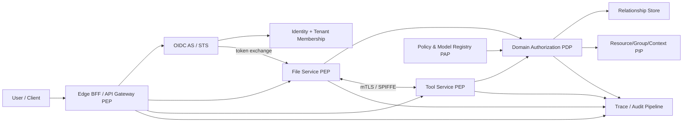

# マルチテナントSaaS認証・認可基盤の比較調査と設計指針

## エグゼクティブサマリー

本調査の結論は、**JWTを全権限の搬送コンテナにせず、認証・テナント境界・粗粒度の委任を短命トークンで運び、フォルダ、組織、拠点、個別オブジェクトなどの動的権限は各リソースサービスまたは共通PDP（Policy Decision Point）でリクエストごとに評価するハイブリッド方式**が、今回想定するSaaSに最も妥当である、というものである。AWSのマルチテナント指針も、ユーザーIDとテナントIDを結び付けたJWTを入口で検証しつつ、PAP・PDP・PEPを分離し、RBACとABACを組み合わせる構成を示している。[^1][^2][^3]

大手SaaSの公開仕様から確認できる共通点は次の通りである。

- **認証とオブジェクト認可は別レイヤー**である。Microsoft Entraの`tid`・`oid`・`scp`・`roles`、Salesforceの`tnk`・`scp`・`client_id`、Auth0 Organizationsの`org_id`のようなトークン情報は、主体・テナント・クライアント・API権限を表すが、個々のファイルやフォルダの最終権限そのものを網羅しない。[^4][^5][^6][^7]
- **APIスコープは上限、リソースACLは実効権限**という積集合モデルが主流である。Boxではトークンを持っていても、所有またはコラボレータであるコンテンツだけにアクセスできる。Google Drive、GitHub、Notion、Dropboxも同様に、トークンのスコープに加えて個別リソース、インストール先、ページ共有、名前空間などを評価する。[^8][^9][^10][^11][^12]
- **JWTは必須ではない**。外部APIでは、Slack、GitHub、Notion、Dropboxなど、利用者が内容を解釈しないベアラートークンを中心に設計されたサービスが多い。したがって「一時アクセストークンは基本的にJWT」という前提は設計要件として固定すべきではない。[^13][^9][^14][^15]
- **下流サービスに同じ万能トークンを転送し続ける方式は避けるべき**である。RFC 9068はリソースサーバーごとの`aud`検証を要求し、RFC 8693は下流向けにaudienceとscopeを絞ったトークン交換、および委任元を表す`act`を定義する。MicrosoftのOBOも中間API向けトークンを別の宛先へ送らないよう明示している。[^16][^17][^18][^19]
- **テナント分離と業務認可は独立した防御層**として実装すべきである。前者は誤ったテナントのデータに到達させない境界、後者は正しいテナント内で操作を許すかという判断であり、AWSも両者を区別している。[^2][^20]

推奨ターゲットは、4象限では「高セキュリティ・高柔軟性」に置く。ただし、その位置はJWT claimを増やすことで実現するのではなく、**標準化された短命トークン、サービス単位のaudience、ワークロードID、共通ポリシースキーマ、リソース関係グラフ、各サービスのPEP、強制的な監査・トレース**を組み合わせることで実現する。

## 調査範囲と確度

対象は、ユーザーまたはアプリが組織・ワークスペース・サイト内で多様なオブジェクトを動的に作成・共有・管理する、以下の10サービスである。

1. Microsoft 365 / SharePoint / Microsoft Graph
2. Google Workspace / Google Drive
3. Box
4. Dropbox Business
5. Salesforce
6. ServiceNow
7. GitHub
8. Slack
9. Atlassian Cloud（Jira / Confluence）
10. Notion

重要な制約として、各社の**内部マイクロサービス間プロトコル、内部JWT claim、PDP実装、キャッシュ失効方式は通常非公開**である。本レポートでは、公開されたOAuth/OIDC契約、API認可モデル、監査・リクエストID、公式アーキテクチャ資料から確認できる事実を「確認済み」、それらから自社設計に転用する部分を「設計上の帰結」として分離する。外部APIがJWTを返すことと、社内のすべてのマイクロサービスが同じJWTをそのまま解釈することは同義ではない。

## 10サービスの比較

| SaaS | テナント境界 | 外部トークン／認証 | 粗粒度権限 | 細粒度・動的権限 | 公開仕様から分かる最終判定位置 |
|---|---|---|---|---|---|
| Microsoft 365 / SharePoint | Entra tenant、SharePoint site | OAuth 2.0 access token。`tid`、`oid`、`scp`または`roles`を利用[^6][^7] | Graph delegated/application permissions | サイト、リスト、ファイル、SharePoint ACL。`Sites.Selected`では対象サイトへの明示割当も必要[^21][^22] | Graph/SharePoint側がトークン権限と対象リソース権限を評価 |
| Google Drive | Workspace domain、ユーザー、shared drive | OAuth 2.0 bearer token、サービスアカウントとドメイン全体委任[^23][^24] | Drive OAuth scope。`drive.file`から広域`drive`まで | `permissions`のtype/role、親からの継承、shared drive membership[^12] | Driveサービス側のACL評価 |
| Box | Enterprise、user/service account | OAuth 2.0。JWT bearer assertionはトークン取得手段であり、API access tokenとは区別される[^25][^26] | アプリscope、subject type、downscope | file/folder collaboration、role、waterfall inheritance[^11][^27] | Boxコンテンツサービスがscopeとcollaborationを評価 |
| Dropbox Business | team、member、namespace | OAuth 2.0短命token。team tokenとuser tokenを区別[^15] | files、sharing、team、member等のscope | namespace、team space、共有フォルダ。`Dropbox-API-Path-Root`でルートを明示[^10] | Dropbox APIがtoken主体、scope、namespace、共有権限を評価 |
| Salesforce | org | OAuth 2.0、opaqueまたはJWT access token。JWTには`tnk`、`scp`、`client_id`等[^4] | OAuth/custom scope、profile、permission set | org内のオブジェクト、レコード、フィールド、共有ルール | Salesforceプラットフォームがorg文脈とメタデータ権限を評価 |
| ServiceNow | instance | OAuth等で主体を確立。公開認可モデルはACL中心 | role、security attribute | table、field、record、operationごとのACL、data condition、script[^28][^29] | テーブル問い合わせ前後およびレコード文脈でACLを評価 |
| GitHub | enterprise、organization、repository owner | OAuth、GitHub App、PAT。API利用tokenは権限付きcredential | account/org/repository permissionまたはscope | repository selection、org policy、collaborator/team権限。tokenはユーザー権限を増やせない[^9][^30] | GitHub APIがtoken permissionとresource membershipの積を評価 |
| Slack | enterprise、workspace、installation | bot/user/app/workflow token。token typeが主体を規定[^14] | OAuth scope | channel membership、workspace installation、user visibility | Slack APIがtoken type、scope、workspace/channel関係を評価 |
| Atlassian Cloud | Atlassian Cloud site (`cloudId`) | OAuth 2.0 bearer token、API token | Jira/Confluence scope | project/space/issue/page permission、role、restriction | `api.atlassian.com/ex/.../{cloudId}`でサイトをルーティングし、製品側が権限を評価[^31][^32] |
| Notion | workspace | OAuth access token | integration capability | integrationを共有したpageとその子孫。未共有pageはAPIから不可視[^8][^13] | Notion APIがcapabilityとpage共有関係を評価 |

### Microsoft 365

Microsoft Entra access tokenの代表的claimは、発行者`iss`、宛先`aud`、テナント`tid`、主体`sub`/`oid`、クライアント`azp`/`appid`、委任scope `scp`またはapplication permission `roles`、時刻`iat`/`nbf`/`exp`などである。Microsoftは、API側で`aud`、`tid`、主体、actorを検証し、マルチテナントのデータキーには`tid`と`oid`の組を使うことを推奨している。[^6][^7][^33]

委任呼出しを下流APIへ継続する場合、OBOフローでAPI Aが自身の資格情報と受信token Aを提示し、API B専用のtoken Bを取得する。これにより、下流は自分向けの`aud`と委任scopeを検証でき、API A向けtokenを横流ししない。SharePoint固有の権限はGraph scopeだけでは決まらず、たとえば選択型権限は対象サイトへの明示的な割当を併用する。[^22][^19]

### Google Drive

Google DriveはOAuth scopeをアプリの最大機能上限として扱い、広域の`drive`より、ユーザーが選択・共有したファイルに限定する`drive.file`を推奨する。ファイル、フォルダ、共有ドライブにはuser/group/domain/anyoneとroleからなるpermission resourceがあり、親から子へ権限が伝播する。[^23][^12]

サーバー間ではサービスアカウントを用い、必要な場合のみ管理者がドメイン全体の委任とscopeを許可する。ユーザー代理ではJWT assertionの`sub`に偽装対象ユーザーを指定してaccess tokenを取得するが、最終的なファイル権限はDrive側が評価する。[^24]

### Box

BoxのJWTは「全サービスで利用する自己完結型認可token」というより、認可サーバーから短命access tokenを得るためのsigned assertionとして使われる。assertionには`iss`、`sub`、`box_sub_type`、`aud`、`jti`、短い`exp`を置き、ユーザーまたはenterprise/service accountをsubjectとして選ぶ。[^25][^26]

コンテンツ権限はcollaboration ACLで、item、user/group、roleを記録し、フォルダ階層にwaterfall継承する。API tokenが存在しても、認証主体が所有者またはcollaboratorでないコンテンツには到達できない。さらにtoken exchangeでresourceとscopeを限定したdownscoped tokenを発行できる。[^11][^27][^26]

### Dropbox Business

Dropboxはuser tokenとteam tokenを分け、files、sharing、team info、membership、event logなどのscopeでAPI機能を制限する。team authorizationのtokenは承認した管理者個人ではなくteamに結び付き、memberとして動く場合には選択ヘッダーを使う。[^15]

ファイル操作はtoken権限に加えてnamespaceに相対化される。`Dropbox-API-Path-Root`でteam spaceまたはmember rootを明示し、必要に応じて管理者・ユーザー選択を併用するため、テナント/名前空間文脈を曖昧なパス文字列に依存させない。[^10][^34]

### Salesforce

Salesforceはorgを基本テナント境界とし、OAuth access tokenにorg識別子`tnk`、scope `scp`、client identifier、issuer、audience、subject、時刻等を表現できる。一方、opaque tokenもサポートするため、resource serverはtoken introspectionまたはSalesforce側の認可面を利用できる。[^4]

実効権限はOAuth scopeだけでなく、ユーザーのprofile/permission set、object/field/record-level sharingの組合せで決まる。設計上重要なのは、org IDを境界として固定し、業務オブジェクトの認可メタデータをtoken寿命に閉じ込めない点である。

### ServiceNow

ServiceNowのACLは`<table>.<field>`とoperation（create/read/write/delete等）を基準に、role、security attribute、data condition、scriptを組み合わせる。評価時にはgenericからspecificへテーブル階層を探索し、複数条件をすべて満たす必要がある。[^28][^29]

これは「tokenに全permissionを列挙する」方式ではなく、認証済み主体の属性を入力に、対象record/table/fieldの文脈でサービス側が再認可する典型である。柔軟性は高いが、script ACLの複雑性、評価コスト、説明可能性を管理するため、共通ポリシー規約とテストが必要になる。

### GitHub

GitHubのfine-grained tokenは、一つのresource owner、選択repository、repository/organization/account permissionに絞れる。tokenは保持者が元来持つ権限を増やさず、token permissionとユーザーまたはApp installationのresource権限の積になる。[^9][^35]

各endpointは必要permissionを宣言し、レスポンスの`X-Accepted-GitHub-Permissions`で要求権限を示せる。JWTはGitHub Appがinstallation access tokenを得る際のアプリ認証に使われるが、通常APIは交換後の短命tokenを使う。この分離は自社でも「workloadの秘密鍵/identity」と「resource access token」を分ける根拠になる。[^36][^30]

### Slack

Slackではtoken type自体が主体モデルを表す。bot tokenはworkspaceにインストールされたapp bot、user tokenはworkspace member、app-level tokenは複数organizationにまたがるapp、workflow tokenは短命の限定主体である。[^14]

scopeだけでなく、botがchannelに参加しているか、userが会話を閲覧できるか、installationがどのworkspace/enterpriseに属するかをSlack側が評価する。token rotationを有効にするとaccess tokenは12時間で失効し、refresh tokenもローテーションされる。[^37]

### Atlassian Cloud

Atlassianは`cloudId`をCloud siteの一意なtenant identifierとしてAPI URLに含め、scopeでJira/Confluence機能を限定する。service accountのOAuth access tokenは60分で、`api.atlassian.com/ex/jira/{cloudId}`等へ送る。[^31][^32]

project、issue、space、pageなどの細粒度権限は各製品の認可モデルで評価されるため、tokenのscopeを持つだけでは対象objectへの権限を得ない。tenant contextをURLルーティングとtoken認可の両方で一致確認する方式は、テナント混同の防御として参考になる。

### Notion

Notion integrationはworkspaceへOAuthで追加され、capabilityでread/update/insert等の上限を定める。さらにintegrationがpageへ明示的に共有されなければ、そのpageと子孫をAPIで取得できない。[^8][^13]

このモデルは、scopeとresource share graphを分離した最小権限設計である。ユーザー本人の全権限をintegrationへ自動継承しないため、導入後のblast radiusは限定される一方、大量pageへの管理操作には明示的な共有運用が必要になる。

## 認証・認可サービスの役割分類

### 役割レイヤー

| レイヤー | 主責務 | 主なデータ | 実行位置 | 失敗時の原則 |
|---|---|---|---|---|
| Identity Provider / Authorization Server | 人・アプリ・workloadの認証、MFA/SSO、consent、token発行・交換・失効 | subject、tenant membership、client、auth strength、scope | 中央IdP/AS | 発行拒否 |
| Tenant Context Service | active tenant選択、membership確認、tenant routing | tenant ID、membership、home/active tenant | login/BFF/API gateway | tenant不一致を拒否 |
| Policy Administration Point (PAP) | role、relation、policy、schemaの登録・版管理 | policy、relationship tuple、role binding | 管理面 | 無効schema/policyを拒否 |
| Policy Information Point (PIP) | resource、group、device、location等の属性供給 | resource owner、parent、classification、device posture | directory/resource DB/cache | 欠落時は原則deny |
| Policy Decision Point (PDP) | `principal × action × resource × context`をallow/denyへ評価 | token claims、tuple、policy、attributes | centralized serviceまたはsidecar | timeout/errorはdeny |
| Policy Enforcement Point (PEP) | token検証、tenant binding、PDP呼出し、決定強制 | route、resource ID、method | gatewayと各microservice | bypass不能、deny by default |
| Token Exchange / Delegation | downstream audience/scopeへ絞り、actor chainを保持 | subject、actor、audience、scope | AS/STS | audience不一致を拒否 |
| Audit / Observability | 誰が、何を、どのtenantで、なぜ許可/拒否されたか記録 | trace ID、decision ID、policy revision、actor chain | 全サービス＋集約基盤 | 重要操作は監査不能なら拒否も検討 |

認可の機能分解にはNIST ABACのPAP/PDP/PEP/PIPが有効であり、AWSのマルチテナントSaaS指針もこの分離を採用する。OPAはpolicy bundleを各sidecarへ配布し、問い合わせinput、result、bundle revision、`decision_id`をdecision logへ記録できる。[^3][^38][^39][^2]

### フロー類型

| 類型 | 代表SaaS | tokenが運ぶもの | resource serviceの責務 | 強み | 弱み |
|---|---|---|---|---|---|
| Claim-centric tenant RBAC | Microsoft Entra、Salesforce | tenant、subject、client、scope/role、時刻 | claimとローカルrole/object ruleを照合 | 低レイテンシ、標準化しやすい | role肥大化、権限変更がtoken失効まで残る |
| Scope + Resource ACL/ReBAC | Drive、Box、Dropbox、Notion | identity、API capability | folder/page/namespace/relationを都度評価 | 動的共有と階層を自然に表現 | graph/ACL一貫性と高可用性が必要 |
| Installation/Delegation-centric | GitHub、Slack、Atlassian | app/user/bot主体、installation、scope | installation先とresource membershipを評価 | 外部integrationを最小権限化 | token種別・consent・owner文脈が複雑 |
| Central policy / ABAC hybrid | ServiceNow、OPA/Cedar型 | 安定した主体・tenant・auth context | PDPへprincipal/action/resource/contextを送る | 異種domainと条件付きpolicyに強い | policy governance、PIP品質、説明可能性が課題 |

実際の大規模SaaSは一つの類型だけではなく、入口ではclaim-centric、resource層ではACL/ReBAC、service-to-serviceではdelegationまたはworkload identity、管理ポリシーではABACを組み合わせる。

## JWT設計

### 最小claimセット

推奨するaccess tokenは「認証済みrequest contextの封筒」であり、業務ACLのスナップショットではない。

| Claim | 必須度 | 意味 | 設計ルール |
|---|---|---|---|
| `iss` | 必須 | 信頼する発行者 | tenant値から組み立てずallowlist/JWKSに結合 |
| `aud` | 必須 | 対象API/resource server | serviceまたはAPI product単位。全microservice共通audienceは禁止 |
| `sub` | 必須 | end-user/service principal | display nameやemailを使わず不変opaque ID |
| `tid` | 必須 | active tenant | resourceのtenantと毎回一致検証。ユーザー所属一覧は入れない |
| `azp` / `client_id` | 必須 | 呼出しclient | userとclientを別主体として監査 |
| `scp`または`roles` | 必須 | API capabilityの上限 | delegated scopeとapp roleを混同しない |
| `iat`,`nbf`,`exp` | 必須 | 有効時間 | 5〜15分を基準に短命化。clock skew上限を規定 |
| `jti` | 推奨 | token instance | 高リスク操作のreplay検知・失効補助 |
| `sid` | 条件付 | session | logout、CAE、session revoke連携 |
| `amr`,`acr` / `auth_time` | 条件付 | MFA/認証強度・鮮度 | privileged operationのstep-upに利用 |
| `act` | delegation時必須 | 代理実行actor | actor chainを監査。RFC 8693に従う[^17] |
| `cnf` | 高リスク時推奨 | proof-of-possession key binding | DPoPまたはmTLS sender-constrained tokenに利用[^40][^41] |
| `ver` | 推奨 | 独自claim schema version | consumerの段階移行と互換性管理 |

JWT access tokenの相互運用profileでは、resource serverは`typ=at+jwt`、許可algorithm、`iss`、`aud`、署名、`exp`を検証しなければならない。JWT BCPはalgorithm confusionを避けるため、許可algorithmを固定し、異なるJWT用途で検証ルールと鍵を分離するよう求める。[^42][^16]

### 入れてはいけない情報

- 全フォルダID、全拠点ID、全object permissionの列挙
- 変更頻度の高いgroup membershipの完全一覧
- email、氏名、機密分類など、API判定に不要なPII
- 暗号化されていない機密属性。署名JWTはpayloadを秘匿しない
- 任意の下流サービスが意味を独自解釈する非版管理claim
- trace IDやrequest IDを恒久的なtoken claimとして埋め込むこと

Microsoft Entraでもgroup数が多い場合はtokenに全groupを載せず、overage indicatorからGraphを照会する設計がある。これは、サイズ上限だけでなく、membership変更とtoken寿命の不整合を避ける根拠になる。[^43]

### 例示payload

```json
{
  "iss": "https://id.example.com/",
  "aud": "urn:example:file-api",
  "sub": "usr_01J...",
  "tid": "tnt_01H...",
  "azp": "web-bff",
  "scp": "file.read file.write",
  "amr": ["pwd", "mfa"],
  "auth_time": 1790928000,
  "iat": 1790928060,
  "nbf": 1790928060,
  "exp": 1790928660,
  "jti": "tok_01J...",
  "sid": "ses_01J...",
  "ver": 1
}
```

このtokenだけで`folder:F123`へのwriteを許可してはならない。File Serviceは`tid`とresource tenantの一致を確認した後、`Check(user:sub, action:file.write, object:file:F123, context)`をPDPへ問い合わせる。

## 推奨認可フロー

### ユーザー要求

1. ユーザーをOIDC Authorization Code + PKCEで認証し、組織横断ユーザーにはactive tenant選択を要求する。
2. ASはmembershipとtenant policyを確認し、BFF/API専用の短命access tokenを発行する。ブラウザへ長寿命bearer tokenを保存しない。
3. Gatewayは署名、`typ`、`iss`、`aud`、`exp`、`nbf`、`azp`を検証し、外部から来た`X-Tenant-ID`、actor header、内部authorization contextを除去して再生成する。
4. 各resource serviceはURL/bodyのresource IDから正規のtenant IDをDBまたはresource indexで解決し、tokenの`tid`と一致させる。クライアント申告tenantだけを信用しない。
5. PEPは`principal, action, resource, context`をPDPへ問い合わせる。PDPはtenant membership、resource relation、role、条件、deny policyを評価する。
6. 更新では、業務データとauthorization tuple/outboxを同一transactionで記録し、非同期反映時はconsistency tokenまたはrevisionを後続checkへ渡す。
7. 応答には外部request IDを返し、内部では`trace_id`、`span_id`、`authz_decision_id`、policy/model revisionを記録する。

Google Zanzibarはobject-user/object-object relation tupleを用い、ACL変更とcontent変更の因果順序を尊重し、クライアントが指定した変更より古くないsnapshotでcheckできる仕組みを持つ。削除直後に古い権限で読める「new enemy」問題を避けるには、単なるTTL cacheではなく、この一貫性要件を設計に含める必要がある。[^44][^45]

### サービス間要求

サービス自身の認証にはユーザーJWTの再利用ではなく、SPIFFE/SPIRE等の短命workload identityとmTLSを使う。SPIFFEはworkloadごとのIDをX.509-SVIDまたはJWT-SVIDとして発行し、JWT-SVIDでは`sub`にSPIFFE ID、`aud`と`exp`を必須とする。[^46][^47][^48]

ユーザー委任を下流へ渡す必要がある場合は、次のいずれかとする。

- **Token exchange/OBO**: 受信tokenをSTSへ提示し、下流service専用の`aud`、縮小scope、元user `sub`、呼出しservice `act`を持つ短命tokenへ交換する。[^18][^19]
- **Trusted authorization context**: mesh mTLSで認証した上流PEPが、署名/MAC付きの短命内部contextを下流へ渡す。下流は上流service identityとcontext audienceを検証する。
- **再認可**: 高リスクまたはresource-specificな操作では下流serviceがPDPへ再checkする。上流のallow結果を無条件継承しない。

単純なread chainでは、PDP決定を短時間cacheしてもよいが、keyは最低でも`tenant, principal, action, resource, policy_revision, relation_revision, relevant_context`を含める。deny cacheは短くし、権限剥奪・tenant停止・MFA要求変更ではpush invalidationまたはrevision mismatchで即時無効化する。

## 異種スコープの吸収

### 共通認可言語

各microserviceの「フォルダ」「組織」「拠点」「ツール」「プロジェクト」を一つの巨大role表へ押し込めず、型付きentity graphとして表現する。

```text
type tenant
  relations: member, admin

type site
  parent: tenant
  relations: operator, viewer

type folder
  parent: folder | site | tenant
  relations: owner, editor, viewer

type file
  parent: folder
  permissions:
    read  = viewer | editor | owner | parent.viewer
    write = editor | owner | parent.editor

type tool
  parent: site | tenant
  relations: operator, maintainer, viewer
```

ReBACは「user Uがobject Oにrelation Rを持つか」をcheckし、organization→project→documentのようなdomain hierarchy、group membership、外部共有をrelation tupleで表現できる。固定roleはschema/model、顧客が動的に作るcustom roleや共有関係はtupleへ置く、という分離が有効である。[^49][^50][^51]

ただし、すべてを一個の巨大authorization graphへ統合する必要はない。推奨境界は以下である。

- **共通control plane**: entity/action命名規約、tenant root、user/group identity、model registry、policy version、audit schema
- **domain別data plane**: File、Tool、Site等のtuple/attribute shardとPDP endpoint
- **共通SDK/sidecar**: token validation、tenant binding、check API、decision logging、fail-closed、metric
- **domain owner**: action/resource typeと継承規則の所有、schema review、migration

Cedarのようなschema付きpolicy engineはprincipal/resource/action/contextの型、entity属性、親子関係を定義し、policyを事前検証できる。ReBAC graphは関係と継承、Cedar/OPA型ABACはIP、時刻、device posture、機密区分、契約planなどのcontext条件に使うのが自然である。[^52][^53][^54]

### 判定式

実効許可は概念的に次の積である。

`Allow = token_valid AND tenant_bound AND client_allowed AND capability_scope AND resource_relation AND policy_conditions AND no_explicit_deny`

どれか一つでも不明・取得失敗・不一致ならdenyとする。super-adminやsupport accessは通常graphへ混ぜず、専用principal type、JIT elevation、MFA、理由入力、時間制限、全件監査を要求する。

## トレーサビリティ

### 相関ID

外部リクエストにはW3C `traceparent`を受け付けるが、trust boundaryで形式・長さを検証し、必要に応じて新しいtraceへlinkする。OpenTelemetryはサービス境界を越えたtrace context伝搬を標準化する一方、外部からの偽造context、外部への内部情報漏洩、baggageへのPII/credential格納を警告している。[^55][^56]

認可監査イベントは少なくとも次を持つ。

- `event_id`, `timestamp`, `trace_id`, `span_id`, `request_id`
- `authz_decision_id`, `decision` (allow/deny), `reason_code`
- `tenant_id`, `subject_id`, `actor_service_id`, `client_id`, `session_id`
- `action`, `resource_type`, `resource_id`（必要ならhash/tokenize）
- `token_jti`または不可逆hash、`token_issuer`, `token_audience`
- `policy_id`, `policy_revision`, `model_id`, `model_revision`
- 利用したrelation/attributeの参照IDまたは説明可能なderivation path
- `auth_strength`, `risk_signal`, `break_glass`, `delegation_chain`

OPA decision logは`decision_id`、query input/result、policy bundle revisionを持ち、監査とoffline debugへ利用できる。Microsoft Graphはクライアント生成`client-request-id`とサービス側`request-id`を記録することを推奨し、tenantの全HTTP requestをactivity logへ出せる。GitHubとBoxもそれぞれ`X-GitHub-Request-Id`、`box-request-id`を返す。[^38][^57][^58][^59][^60]

### 監査とトレースの分離

分散traceは性能・因果関係、監査logは否認防止・証跡のための別データである。trace samplingで監査イベントを落としてはならず、privileged operation、policy変更、共有変更、token exchange、deny spikeは100%監査する。監査logはappend-only/WORM、tenant別アクセス制御、保持期間、改ざん検知、SIEM転送を設け、payloadやJWT原文を保存しない。

## セキュリティ対策

| 脅威 | 主対策 | 設計上の検証項目 |
|---|---|---|
| tenant混同 / IDOR | resourceからtenantを逆引きし`tid`と照合、DB RLS/partition key、二重境界 | 他tenant IDをURL/body/headerへ混ぜたnegative test |
| token横流し | service別`aud`、token exchange、短命化、DPoP/mTLS binding | API A tokenがAPI Bで必ず拒否されること |
| token窃取 | BFF、HttpOnly/SameSite cookie、refresh rotation、`cnf`、秘密をlogしない | replay、XSS、漏洩refresh token試験 |
| stale authorization | 短命token、PDP revision、push invalidation、consistency token | 権限剥奪直後のread/write試験 |
| confused deputy | `sub`と`azp`/`act`を別検証、downscope、resource owner固定 | 高権限serviceによる代理範囲超過試験 |
| policy drift | schema、policy-as-code、static validation、unit/property/differential test | model migrationの互換性とdeny差分 |
| PDP障害 | local sidecar/cache、circuit breaker、fail closed、重要readの限定grace | partition、timeout、stale cache chaos test |
| ACL graph cycle/爆発 | typed DAG、depth/fanout limit、query budget、precompute | worst-case nested group負荷試験 |
| support/admin濫用 | JIT/PAM、MFA、dual approval、reason、全件recording | break-glass定期レビュー |
| trace/baggage注入 | trust boundaryでsanitize、PII禁止、outbound filter | forged `traceparent`/baggage試験 |

Sender-constrained tokenについて、DPoPはaccess/refresh tokenを公開鍵へ結び付け、盗まれたtoken単独の利用を難しくする。nonceにより事前生成proofのreplayも軽減できる。ただしDPoPはXSSや実行中client自体の侵害を解決しないため、短命化、BFF、CSP、鍵保護と併用する。[^40][^41]

## 4象限マッピング

### 軸の定義

- **柔軟性**: domain固有resource、階層、外部共有、custom role、context条件、将来追加serviceへ、中央基盤の再設計なしで対応できる度合い
- **セキュリティ**: least privilege、tenant isolation、迅速なrevocation、audience制約、policy検証、監査説明性、障害時fail-closedの総合度

ここで「柔軟性が高いほど必ずセキュリティが低い」は成立しない。自由記述scriptや無制限custom claimでは負の相関が生じるが、型付きschema、policy validation、中央guardrail、domain owner、決定監査を設ければ、高柔軟性と高セキュリティは両立できる。

| 象限 | アプローチ | 代表 | 位置付け |
|---|---|---|---|
| 低柔軟・低セキュリティ | 全API共通JWT、長寿命、巨大role claim、各serviceが独自parse | アンチパターン | 速いPoC以外では採用不可 |
| 低柔軟・高セキュリティ | 固定scope、単一tenant token、resource allowlist | Notionの明示共有、GitHub fine-grained tokenの一部 | integrationや限定domainには優秀だが、異種object拡張に弱い |
| 高柔軟・低セキュリティ | 任意claim、任意script ACL、serviceごとの自由policy | 統制なしABAC/ServiceNow script型の誤用 | 表現力は高いがreview・説明・負荷予測が難しい |
| 高柔軟・高セキュリティ | 短命audience token + typed ReBAC/ABAC + PEP/PDP + workload identity + audit | Zanzibar/OpenFGA、OPA/Cedar、OBOを組み合わせた構成 | 本SaaSの目標 |

### 参考ポジション

数値はベンダー公表値ではなく、公開モデルを比較するための定性的な相対評価である。

| 対象 | 柔軟性 | セキュリティ | 主な理由 |
|---|---:|---:|---|
| Microsoft 365 / SharePoint | 高 | 高 | tenant claim、OBO、Graph scope、SharePoint resource ACLを分離 |
| Google Drive | 高 | 高 | file/shared drive ACL、継承、domain delegationの管理統制 |
| Box | 高 | 高 | collaboration graph、waterfall、downscoped token |
| Dropbox | 中〜高 | 高 | scope、team/member token、namespace rootの明示 |
| Salesforce | 高 | 高 | org境界と多層object/record permission。ただし設定複雑性あり |
| ServiceNow | 非常に高 | 中〜高 | table/field/record/script ACL。柔軟だがgovernance負荷が高い |
| GitHub | 中〜高 | 高 | owner・repository・permissionの明示的な積 |
| Slack | 中 | 高 | token typeとinstallation/channel membershipによる強い境界 |
| Atlassian Cloud | 高 | 高 | cloudId routing、scope、製品内object permission |
| Notion | 中 | 高 | capabilityと明示page share。単純でblast radiusが小さい |
| 推奨自社基盤 | 非常に高 | 非常に高 | 型付きdomain拡張を中央guardrail、service別audience、継続監査で統制 |

## 推奨アーキテクチャ

### 論理構成



### 技術方針

- **Human identity**: OIDC/OAuth 2.0。enterprise federation、MFA、SCIMをIdP責務とする
- **Tenant context**: active tenantを明示選択し、token `tid`、route、resource tenantの三者一致を強制
- **Workload identity**: SPIFFE/SPIREまたはクラウドworkload identity + mTLS。共有client secretを廃止
- **Access token**: 非対称署名、5〜15分、API単位`aud`、最小claim。更新はrotation付きrefresh tokenまたはBFF session
- **Delegation**: RFC 8693 token exchange/OBO。`act`、縮小scope、downstream audience
- **Fine-grained authz**: ReBACを主軸、固定RBACとcontextual ABACを合成。folder/site/tool等を型付きresourceにする
- **PDP topology**: control planeは中央、decision planeはregion/domainに分散。sidecarまたはlocal agentで低遅延化
- **Policy**: schema-first、policy-as-code、model revision pinning、CIでpositive/negative/property test
- **Data**: relation tupleとresource更新にtransactional outbox。剥奪は優先配信しcacheをrevisionで無効化
- **Observability**: W3C Trace Context + OpenTelemetry、別系統のunsampled authorization audit

## 採用しない案

### 万能JWT

全tenant role、group、folder、site、tool permissionをJWTへ詰め、各serviceがローカル判定する案は採用しない。低遅延という利点はあるが、token肥大化、権限剥奪遅延、claim schema結合、serviceごとの解釈差、resource移動時の不整合、外部共有の表現困難、漏洩時blast radiusが大きい。

### 中央PDPのみ

すべてのrequestを単一regionの中央PDPへ同期問い合わせする案も採用しない。policy一元化には有利だが、全サービスの可用性・tail latency・障害半径を一か所へ集中させる。control planeの中央集約と、decision planeの分散配置を分ける。

### サービス完全自治

各microserviceが独自JWT claim、role名、tenant header、認可DB、監査形式を自由に定義する案は、局所的な柔軟性は高いが、tenant isolationの証明、横断監査、M&A/新service統合、CISO reviewが困難になる。domain固有modelは許容しても、共通contractとguardrailは必須とする。

## 意思決定事項

CTO/CISOの決裁対象は、製品名より先に次の原則とSLOである。

1. **認証と認可の分離**: IdP tokenは主体・tenant・capabilityを運び、object permissionはPDP/resource serviceで評価する。
2. **テナント境界**: `tid`だけでなくresource-derived tenant、storage partition/RLS、service authorizationの三層で強制する。
3. **token境界**: service別audience、短命化、token exchange、workload identityを必須とする。
4. **認可モデル**: typed ReBACを基本とし、RBACと限定ABACを合成する。任意scriptは例外承認制とする。
5. **可用性**: PDP p99 latency、cache staleness、revocation propagation、regional failover、fail-closed範囲をSLO化する。
6. **監査**: 全decisionを説明可能にし、policy/model revision、actor chain、resource、reasonを追跡できるようにする。
7. **変更統制**: schemaとpolicyはcode review、静的検証、unit/negative/property test、canary、rollbackを通す。
8. **privacy**: JWT、trace baggage、監査logへ不要なPIIやsecretを置かない。

## 導入ロードマップ

### Phase 0: 脅威モデルと契約

- tenant crossing、external sharing、support access、service delegation、async jobを含むDFDを作成
- resource type/action naming、token profile、error/reason code、audit event schemaを確定
- authorization SLOとRTO/RPO、最大staleness、権限剥奪反映時間を決裁

### Phase 1: 最小基盤

- OIDC AS、active tenant flow、BFF、service別audienceを実装
- 共通token validation/tenant binding SDKを配布
- File Serviceでtenant→folder→file、user/group→roleのReBAC modelを導入
- shadow authorizationで既存判定との差分を計測

### Phase 2: 分散認可

- PDPをregion/domainへ分散し、model/policy bundleを署名配布
- SPIFFE/workload identityとmTLS、token exchangeを導入
- transactional outbox、revision-aware cache、revocation channelを実装
- OpenTelemetry traceとunsampled decision auditを統合

### Phase 3: 高保証化

- policy schema validation、property test、mutation test、formal invariantをCIへ追加
- DPoPまたはmTLS-bound tokenを管理系・高リスクAPIへ適用
- JIT support access、dual approval、session recordingを導入
- cross-tenant fuzzing、chaos PDP outage、stale ACL、key rotationの演習を定期化

## CTO/CISO想定論点

| 指摘 | 回答の骨子 |
|---|---|
| なぜJWTだけで完結しないのか | 大手SaaSもscope/identityとresource ACLを分離している。動的共有・剥奪・階層はtoken snapshotよりPDP/ACLが適する |
| PDP障害で全停止しないか | control/decision plane分離、local sidecar、署名bundle、revision cache、regional replica。ただし権限不明時はfail closed |
| 柔軟なpolicyは危険では | 任意scriptでなくtyped schema、validation、domain ownership、CI test、revisioned rolloutで統制する |
| tenant claimを改ざんされたら | 署名検証に加え、resource-derived tenantとstorage境界を照合。client headerはgatewayで除去・再生成 |
| 権限剥奪がtoken期限まで残らないか | object権限はrequestごとにPDP評価し、revision invalidationを用いる。高リスクclaim変更にはsession/token revokeを併用 |
| 内部networkならmTLSは不要では | Zero Trustとしてservice identityを検証し、user delegationとworkload authorizationを分離する。共有secretよりrotationと監査に優れる |
| 全サービスで同じmodelを使えるか | tenant/user/group/action contractのみ共通化し、resource typeとrelationはdomain所有。巨大一枚岩modelを避ける |
| 誰がなぜ許可したか説明できるか | decision ID、policy/model revision、relation path、actor chain、trace IDを監査し、PDPにexplain機能を持たせる |

## 最終指針

本SaaSでは、認証基盤を「JWT発行機」、認可基盤を「role claim parser」と定義してはならない。認証基盤は人・client・workloadとactive tenantを確立し、短命・宛先限定・委任追跡可能なcredentialを発行する。認可基盤は、各domainが所有するresource graphとcontext policyを共通schema・共通API・共通監査で評価し、各microserviceのPEPが最終強制する。

大手SaaSの実例は、token scopeだけでなく、site、repository、page、folder、namespace、channel、recordといったresource側の権限を必ず重ねている。したがって、**短命JWT + service-specific audience + token exchange + workload identity + typed ReBAC/ABAC + resource-local PEP + revisioned audit**という組合せは、既存の成熟した設計原則を踏襲しつつ、今回の異種マイクロサービス要件に適合する方針である。[^12][^22][^9][^10][^11][^8]

---

## References

1. [Security practices in AWS multi-tenant SaaS environments](https://aws.amazon.com/blogs/security/security-practices-in-aws-multi-tenant-saas-environments/) - Securing software-as-a-service (SaaS) applications is a top priority for all application architects ...

2. [docs.aws.amazon.com › prescriptive-guidance › latestMulti-tenant SaaS authorization and API access control ...](https://docs.aws.amazon.com/prescriptive-guidance/latest/saas-multitenant-api-access-authorization/introduction.html) - Design options and best practices for implementing authorization and API access controls for multi-t...

3. [AWS Prescriptive Guidance - Multi-tenant SaaS authorization and API access control: Implementation options and best practices](https://docs.aws.amazon.com/pdfs/prescriptive-guidance/latest/saas-multitenant-api-access-authorization/saas-multitenant-api-access-authorization.pdf?did=pg_card-pdf&trk=pg_card-pdf)

4. [JWT-Based Access Tokens | Salesforce Help](https://help.salesforce.com/s/articleView?id=xcloud.jwt_access_tokens.htm&language=en_US&type=5) - Salesforce supports two types of access tokens: opaque tokens and JSON Web Tokens (JWT)-based access...

5. [Single Identity Provider: Authorization - Auth0 Docs](https://auth0.com/docs/get-started/architecture-scenarios/multiple-organization-architecture/single-identity-provider-organizations/authorization)

6. [Token claims reference for agent IDs - Microsoft Learn](https://learn.microsoft.com/en-us/entra/agent-id/agent-token-claims) - Learn about specialized token claims used by agent applications in Microsoft Entra to identify entit...

7. [entra-docs/docs/identity-platform/claims-validation.md at main · MicrosoftDocs/entra-docs](https://github.com/MicrosoftDocs/entra-docs/blob/main/docs/identity-platform/claims-validation.md) - This is the public repo for Microsoft Entra documentation - MicrosoftDocs/entra-docs

8. [Connection capabilities - Notion Docs](https://developers.notion.com/reference/capabilities)

9. [GitHub Docs](https://docs.github.com/en/authentication/keeping-your-account-and-data-secure/managing-your-personal-access-tokens.md)

10. [Team Files | Dropbox API Documentation](https://docs.dropboxapi.com/dropbox-api/docs/team-files) - November 10, 2023 Update: We’ve updated this Team Files Guide to incorporate information about new f...

11. [Collaborations - Box Dev Docs](https://developer.box.com/guides/collaborations)

12. [権限を更新](https://developers.google.com/workspace/drive/api/guides/manage-sharing?hl=ja) - Google Drive API でファイル、フォルダ、共有ドライブを共有する方法について説明します。

13. [Authentication - Notion Docs](https://developers.notion.com/reference/authentication)

14. [docs.slack.dev · authentication · tokensTokens | Slack Developer Docs](https://docs.slack.dev/authentication/tokens/) - Tokens are the keys to the Slack platform. They tie together all the scopes and permissions your app...

15. [Dropbox OAuth Guide](https://developers.dropbox.com/de-de/oauth-guide) - This guide covers how to implement an OAuth flow using the Dropbox API. Topics include access tokens...

16. [RFC 9068: JSON Web Token (JWT) Profile for OAuth 2.0 Access Tokens](https://www.ietf.org/rfc/rfc9068.pdf)

17. [RFC 8693 - OAuth 2.0 Token Exchange](https://datatracker.ietf.org/doc/html/rfc8693) - This specification defines a protocol for an HTTP- and JSON-based Security Token Service (STS) by de...

18. [[XML] rfc9068.notprepped.xml - » RFC Editor](https://www.rfc-editor.org/prerelease/rfc9068.notprepped.xml)

19. [Microsoft identity platform and OAuth2.0 On-Behalf-Of flow - Microsoft identity platform](https://learn.microsoft.com/en-us/entra/identity-platform/v2-oauth2-on-behalf-of-flow?WT.mc_id=AZ-MVP-5003833) - This article describes how to use HTTP messages to implement service to service authentication using...

20. [Amazon Verified Permissions multi-tenant design considerations](https://docs.aws.amazon.com/prescriptive-guidance/latest/saas-multitenant-api-access-authorization/avp-design-considerations.html) - Key design considerations for implementing authorization in multi-tenant SaaS applications by using ...

21. [Microsoft Graph permissions reference](https://learn.microsoft.com/en-us/graph/permissions-reference) - Microsoft Graph exposes granular permissions that control the access that apps have to resources, li...

22. [Implementing Delegated Graph API Access for an Azure ...](https://learn.microsoft.com/en-us/answers/questions/5955555/implementing-delegated-graph-api-access-for-an-azu) - Need some advice on a timer triggered Azure Function (.NET Isolated / C#) I'm working on. The purpos...

23. [Escolher escopos da API Google Drive | Google for Developers](https://developers.google.com/workspace/drive/api/guides/api-specific-auth?authuser=1&hl=pt-br) - Saiba mais sobre como usar escopos do OAuth 2.0 na API Google Drive.

24. [サーバー間アプリケーションに OAuth 2.0 を使用する | Authorization](https://developers.google.com/identity/protocols/oauth2/service-account?hl=ja)

25. [User access tokens - Box Dev Docs](https://developer.box.com/guides/authentication/jwt/user-access-tokens)

26. [アクセストークンをリクエスト - Box Dev Docs](https://developer.box.com/ja/reference/post-oauth2-token)

27. [Getting Started: Box User Basics - Box Docs](https://docs.box.com/en/box-fundamentals/for-users/getting-started/box-user-basics)

28. [Explore Access Control Lists](https://www.servicenow.com/docs/r/zurich/platform-security/access-control/exploring-access-control-list.html)

29. [ACL API](https://www.servicenow.com/docs/r/application-development/servicenow-sdk/acl-api-now-ts.html)

30. [docs.github.com › en › restPermissions required for fine-grained personal access tokens](https://docs.github.com/en/rest/authentication/permissions-required-for-fine-grained-personal-access-tokens) - For each permission granted to a fine-grained personal access token, these are the REST API endpoint...

31. [サービス アカウント用の OAuth 2.0 認証情報を作成する](https://support.atlassian.com/ja/user-management/docs/create-oauth-2-0-credential-for-service-accounts/) - サービス アカウントに代わって Atlassian アプリにアクセスするための OAuth 2.0 認証情報を作成します。

32. [Manage API tokens for service accounts - Atlassian Support](https://support.atlassian.com/user-management/docs/manage-api-tokens-for-service-accounts/) - Set up and manage API tokens for your service accounts in Atlassi

33. [ID token claims reference - Microsoft identity platform](https://learn.microsoft.com/en-us/entra/identity-platform/id-token-claims-reference) - Learn the details of the claims included in ID tokens issued by the Microsoft identity platform.

34. [API updates to better support team spaces](https://dropbox.tech/developers/api-updates-to-better-support-team-spaces) - Dropbox is updating the team space functionality to improve the scalability and privacy of the team ...

35. [個人用アクセス トークンを管理する - GitHubドキュメント](https://docs.github.com/ja/authentication/keeping-your-account-and-data-secure/managing-your-personal-access-tokens) - コマンドラインまたは API を使用して personal access token に認証を行う際、パスワードの代わりに GitHub を使用できます。

36. [Permissions required for fine-grained personal access tokens](https://docs.github.com/en/enterprise-server@3.21/rest/authentication/permissions-required-for-fine-grained-personal-access-tokens) - For each permission granted to a fine-grained personal access token, these are the REST API endpoint...

37. [Using token rotation | Slack Developer Docs](https://docs.slack.dev/authentication/using-token-rotation/) - This guide covers token rotation for Slack apps, which use granular permissions. You'll learn how to...

38. [www.openpolicyagent.org › management-decision-logsDecision Logs - Open Policy Agent](https://www.openpolicyagent.org/docs/management-decision-logs) - OPA can periodically report decision logs to remote HTTP servers, using custom

39. [Deploying OPA on Kubernetes | Open Policy Agent](https://www.openpolicyagent.org/docs/deploy/k8s) - Kubernetes is a powerful, extensible platform for deploying containerized

40. [AuthHero | Open-Source Multi-tenant Authentication](https://docs.authhero.net/features/multi-tenant-saas) - Self-host your authentication with Auth0 API compatibility. Enterprise-grade identity management tha...

41. [アクセストークンプロファイル - Auth0 Docs](https://auth0.com/docs/ja-jp/secure/tokens/access-tokens/access-token-profiles)

42. [Create an authorization server](https://developer.okta.com/docs/guides/customize-authz-server/main/) - Secure, scalable, and highly available authentication and user management for any app.

43. [Profiles](https://auth0.com/docs/api/myorganization)

44. [Zanzibar: Google’s Consistent, Global Authorization System](https://storage.googleapis.com/gweb-research2023-media/pubtools/5068.pdf)

45. [The Google Zanzibar Paper, annotated by AuthZed](https://authzed.com/zanzibar/2SMVg4W_Wx:N:k) - Zanzibar: Google’s Consistent, Global Authorization System. An annotated copy of the original paper ...

46. [JWT-SVID](https://spiffe.io/docs/latest/spiffe-specs/jwt-svid/)

47. [Secure Production Identity Framework for Everyone | SPIFFE](https://spiffe.io/docs/latest/spiffe-specs/spiffe/)

48. [SPIRE Use Cases](https://spiffe.io/docs/latest/spire-about/use-cases/)

49. [Get Started with Modeling](https://openfga.dev/docs/modeling/getting-started)

50. [Concepts](https://openfga.dev/docs/concepts)

51. [Authorization Model Design Principles](https://openfga.dev/docs/best-practices/modeling-design-principles)

52. [Cedar policy validation against schema](https://docs.cedarpolicy.com/policies/validation.html) - Cedar policy validation against schema

53. [Schema overview | Cedar Policy Language Reference Guide](https://docs.cedarpolicy.com/schema/schema.html) - Cedar schema

54. [Terms & concepts | Cedar Policy Language Reference Guide](https://docs.cedarpolicy.com/overview/terminology.html) - Cedar can use the schema to validate your authorization policies. Asking Cedar to validate your poli...

55. [Baggage](https://opentelemetry.io/docs/concepts/signals/baggage/) - Contextual information that is passed between signals.

56. [コンテキスト伝搬](https://opentelemetry.io/ja/docs/concepts/context-propagation/) - コンテキスト伝搬を使用すると、シグナル（トレース、メトリクス、およびログ）を生成された場所に関係なく相互に関連づけることができます。 トレースに限定されない ...

57. [Types and formats - Box Dev Docs](https://developer.box.com/guides/api-calls/types-and-formats) - Most API calls also return a box-request-id response header. The value of this header should not be ...

58. [How to Debug Microsoft Graph API Calls - Dev Proxy](https://learn.microsoft.com/en-us/microsoft-cloud/dev/dev-proxy/concepts/how-to-debug-microsoft-graph-calls) - This article shares some recommendations for debugging Microsoft Graph API calls.

59. [Making A Request](https://docs.github.com/en/enterprise-server@3.16/rest/using-the-rest-api/getting-started-with-the-rest-api) - Learn how to use the GitHub REST API.

60. [Access Microsoft Graph activity logs for tenant monitoring](https://learn.microsoft.com/en-us/graph/microsoft-graph-activity-logs-overview) - Microsoft Graph activity logs provide a detailed audit trail of all API requests in your tenant, hel...

